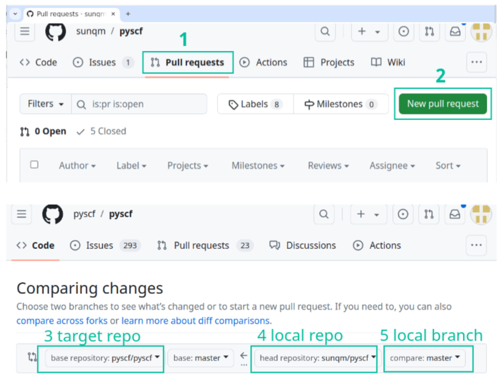
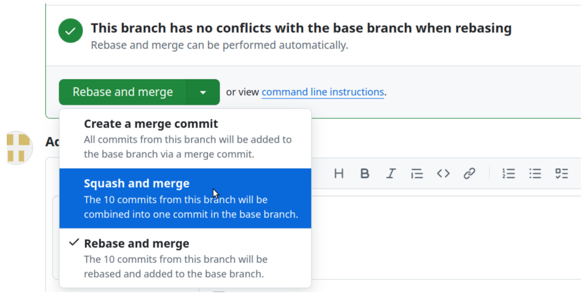
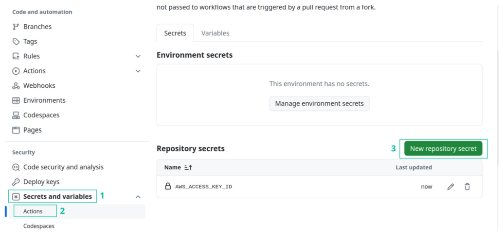
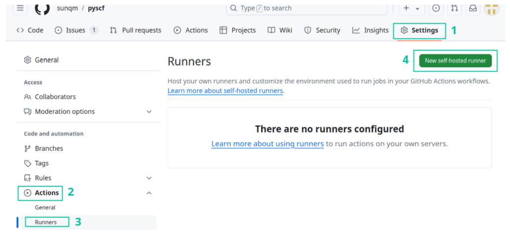
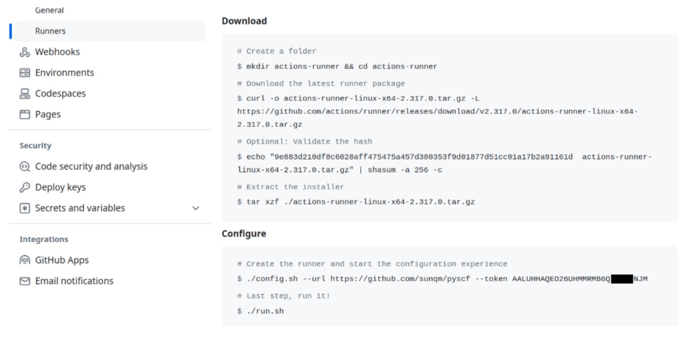
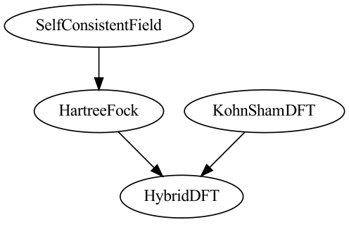
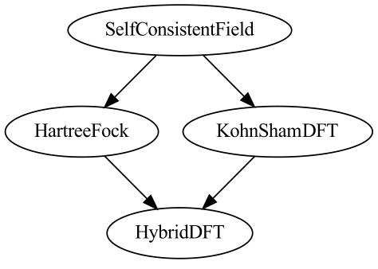
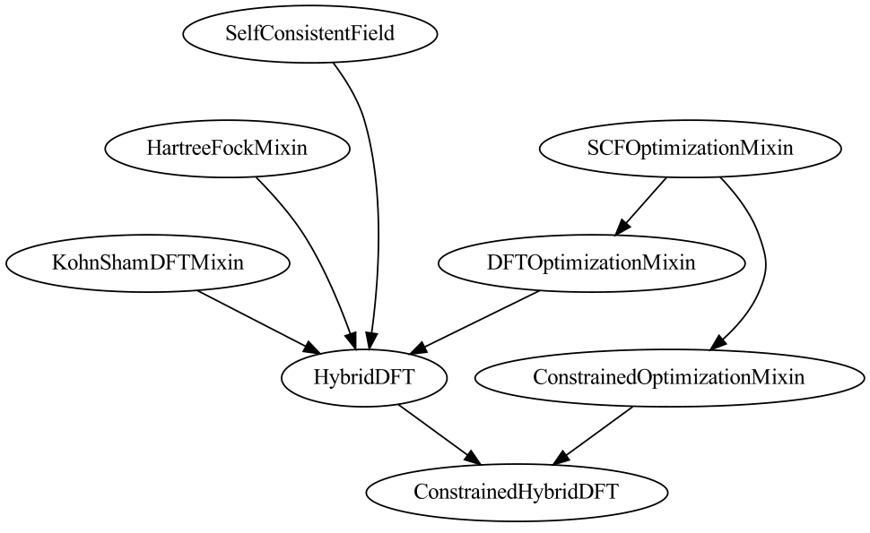
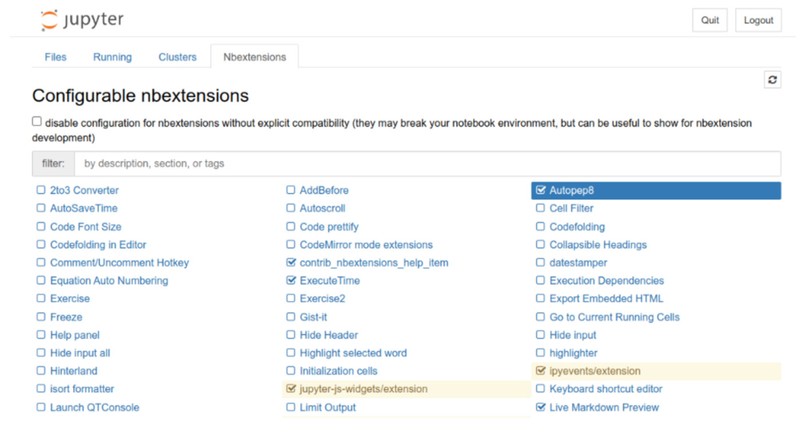
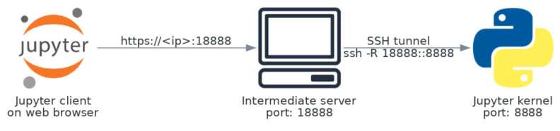

# Python 编程环境 {#ch01 .unnumbered}

Python 程序的语法清晰简洁，代码结构容易理解，初学者能快速入门编写程序。但在深入掌握 Python 的过程中，开发者往往会遇到不少与包体系和项目管理相关的实际挑战，例如：

- 系统中安装了一个 Python 库的多个版本，我如何知道自己正在使用哪个库？
- 多个模块相互引用，有时程序因导入错误而崩溃。这是怎么发生的？
- 我想将自己的工作作为一个 Python 包进行管理。应该如何组织项目？
- 我开发了一个 Python 包，怎样发布供他人使用？分发程序包的最佳方式是什么？
- 我想将 Python 程序作为命令行工具运行，该如何实现？
- 我需要在不同机器上运行 Python 程序，如何确保它们在相同的环境中运行？
- 我有一个继承自多个基类的类，如何知道基类中的某个方法是否被正确调用？
- 我想尝试一些很酷的 Python 包，但安装新包会破坏我的环境。如何保持运行环境稳定，不受影响？

这些问题因不直接涉及编码语法，常被常规 Python 教材省略，却又深刻影响着编程实战能力与开发效率。我们将从这些工程技术细节出发，开启 Python 编程的学习之旅。
本章重点探讨 Python 运行时机制与包管理系统，这两者直接关系到项目的规范管理与程序包的分发。要高效推进 Python 项目，不仅需要专用工具，还得借助通用的现代软件开发工具，因此我们也会讨论 Git 与 Docker 的用法。Docker 虽非 Python 专属工具，但在生态中极为关键，本书也会贯穿始终地使用它。

## 1.1 包系统

### 1.1.1 运行时

Python 的强大源于其极为丰富的包生态资源。要在程序中使用某个包，只需直接导入所需模块。要运行 Python 程序，只需输入以下命令：

```text
python my_script.py
```
但你是否思考过计算机究竟如何解析意图并执行程序？机器并不会凭空理解开发者的意图。具体来说，除了编写代码本身，关乎 Python 程序能否正常运转的还有三个关键问题：

- 调用的是哪个 Python 可执行文件？
- 是否存在影响程序执行的配置或环境变量？
- 实际导入了哪些依赖库？

#### 1.1.1.1 Python 可执行文件

命令行中的 python 命令不过是某个特定 Python 可执行文件的快捷别名。操作系统中往往并存着多个不同版本的 CPython 可执行文件，既有操作系统自带的默认版本（通常版本较旧），也有来自 Anaconda 等第三方分发渠道的文件。
通常而言，不同小版本的 Python 3 解释器对多数常规代码的行为保持一致。但在每次发布次版本时，官方仍会不断引入新语法并调整内置库函数。若随意混用不同版本的 Python 可执行文件，偶尔就会引发兼容报错与复现异常问题。
使用错误的 Python 可执行文件还会引发更棘手的问题：程序可能从错误路径加载依赖包。每个可执行文件各自关联着不同版本或不同集合的第三方库，这不仅会导致导入失败，还会破坏程序与包之间的兼容性。
若源码中用到了高版本 Python 特有的新语法，可以在程序中读取 sys.version_info 变量核验当前运行版本。例如，下面的代码便能确保脚本仅在 Python 3.10 环境下执行：

```text
assert (3, 9) < sys.version_info < (3, 11)
```
本书的讨论和示例均基于 Python 3.10 标准。

#### 1.1.1.2 Python 运行时路径

在 Python 中，运行时路径（runtime paths）指解释器检索模块与包的具体目录。Python 常见的模块搜索路径如下：

- 当前目录。
- 库目录，例如 /usr/lib/python3.10。
- 目录，例如 ~/.local/lib/python3.10/site-packages。

这些运行时路径统一保存在名为 sys.path 的列表中。导入库时，Python 会顺着 sys.path 中的目录顺序依次搜寻目标库，一旦命中首个匹配项即刻加载，后续路径中的同名模块则会被全部忽略。
若系统不同目录下安装了同一依赖包的多个副本，如何确认程序当下加载的具体是哪一份？最直接的办法是导入模块后打印其 __file__ 属性。例如：

```python
In [1]: import numpy
        numpy.__file__
Out[1]:
'/home/ubuntu/miniconda3/lib/python3.10/site-packages/numpy/__init__.py'
```
在终端中执行 python -h 命令，可列出以 PYTHON 为前缀的环境变量。其中部分变量能够改变解释器的默认行为，比如 PYTHONHOME 与 PYTHONPATH 会直接改写模块搜索路径。尽管临时调整这些变量便于测试新包，但也容易引发副作用，导致运行时意外加载有缺陷或不兼容的残留模块。

#### 1.1.1.3 检查依赖项

在 Linux 环境中，ldd 命令可打印共享库所依赖的确切底层路径。那么是否存在类似的便捷工具，能直观列出 Python 程序依赖的所有库？
借鉴 ldd 的思路，我们不妨编写一个小工具 pyldd 来分析依赖项。其基本思路是遍历目标包中的源码文件并提取其中的 import 语句。核心实现逻辑如下：

```python
import importlib
from pipreqs import pipreqs
imports = pipreqs.get_all_imports(path)
for name in imports:
    mod = importlib.import_module(name)
    print(mod)
```
针对指定路径，程序借助 pipreqs 工具扫描该路径下的包源码以提取 import 语句，随后调用 importlib 库动态执行这些导入动作，从而收集模块的位置。
部分 Python 模块是用 C 或 C++ 编写的底层共享库，它们同样存放在 site-packages 目录下，且命名通常遵循如下固定规范：

```text
{module_name}.cpython-{python_version}-{platform_info}.so
```
例如，可以在 site-packages/yaml/ 目录中找到名为 _yaml.cpython-310m-x86_64-linux-gnu.so 的模块。这类模块能直接导入 Python。

```python
from yaml import _yaml
```

#### 1.1.1.4 importlib 库

使用 importlib.import_module 函数可在运行时按需动态加载模块。执行语句

```text
b = importlib.import_module( 'a')
```
加载模块，与标准 import 语句的效果相同：

```python
import a as b
```
无论 import_module 函数在何处被调用多少次，模块本身及其注册的函数与全局变量仅在初次导入时初始化一次。Python 会将所有已加载的活动模块缓存至字典 sys.modules 中；若要判断某模块是否已被导入，直接检索该字典的键即可。
动态加载函数 importlib.import_module 带来了极高的灵活性，支持在运行时根据模块名称按需加载，从而有效减轻启动开销并规避模块导入失败的风险。以加载 GPU 运算内核为例：为了发挥不同硬件的极致性能，库中常提供多套硬件专用内核；若在模块初始化阶段盲目导入所有内核，容易引发环境兼容冲突或资源浪费。而通过动态导入，程序可以在运行时先行探测 GPU 设备型号，再有针对性地按需载入匹配的计算内核。
不过，滥用 importlib.import_module 往往会牺牲代码直观性，平添一层间接调用。动态导入还会给静态代码分析带来阻碍，使得 flake8、pylint 等工具难以追踪动态模块，进而漏查依赖或产生误报。因此，为了保持代码清晰并配合静态检查工具，只要模块名在编写期已知，就应优先采用标准 import 语句。

### 1.1.2 包、子包与模块

Python 的包和模块基于文件系统组织。其中的模块通常对应一个独立的 .py 文件；而包则是包含若干 .py 文件与特殊 __init__.py 文件的目录，后者在导入包时率先执行。包还支持嵌套包含，这些包称为子包。
管理这些包和模块常常会给实际编程带来如下挑战：

- 如何向系统添加包或模块？
- 如何解决不同模块之间的依赖和冲突？
- 创建和组织包的最佳实践是什么？

#### 1.1.2.1 添加包

pip install 和 conda install 命令是安装新 Python 包最常用的方法。pip 命令可以从以下位置安装 Python 包：

- 官方 [PyPI（Python Package Index）服务器](https://pypi.org)或任何 PyPI 镜像。
- 第三方 PyPI 服务器，或通过以下选项使用自托管的 PyPI 服务器：

```text
   --extra-index-url <host-url>
```

- 包 URL 中带有 git+ 前缀的 Git 仓库，例如

```bash
   pip install git+https://github.com/pypa/pip
```

- 本地文件系统上的包。

如果由于网络连接不佳，从 pypi.org 下载包的速度很慢，可以使用以下选项从镜像安装包：

```text
--index-url <mirror-host-url>
```
这个选项可以永久添加到 pip 命令中。例如，

```bash
$ pip config set global.index -url https://pypi.tuna.tsinghua.edu.cn/simple
```
在 Linux 系统上，此命令将配置写入文件 ~/.config/pip/pip.conf 或 ~/.pip/pip.conf。配置文件的内容 [1] 如下：

```text
[global]
index-url = https://pypi.tuna.tsinghua.edu.cn/simple
```
安装 TensorFlow 或 PyTorch 等大型包时，即使使用镜像也可能无法达到我们期望的下载速度。此时可考虑在自托管的 PyPI 服务器上缓存常用包。搭建自建 PyPI 服务器的过程并不复杂。它只需要一个基本的 Web 服务器来管理文件和文件系统的索引页面。有关详细指导，可以参考 Packaging Python 网站上提供的说明 [2]。这一部署既可以手动配置完成，也可以更简便地使用 Docker 容器快速搭建。
我们将在第 1.2 节介绍一个使用 Docker 托管私有 PyPI 服务器的示例。运行自托管 PyPI 服务器时，可能需要指定 --trusted-host 选项，以绕过 SSL（Secure Sockets Layer，安全套接层）验证错误。
开发 Python 项目时，经常需要使用未安装在 site-packages 目录中的包。在这种情况下，可编辑模式（editable mode）pip install -e 是从本地路径安装包的一种有用方法。在可编辑模式下，Python 能够实时检测到代码所做的任何修改。可编辑模式依赖 Python 的 .pth 文件（路径文件的缩写）。这些文件通常位于 site-packages 文件夹中。.pth 文件中的每一行指定一个目录，该目录将被追加到模块搜索路径 sys.path 中。例如，以下目录中可能存在一个 easy_install.pth 文件：

```text
                                 ~/.local/lib/python3.10/site-packages
```
假设 easy_install.pth 文件包含以下内容：

```text
/home/ubuntu/workspace/pytest/src
/home/ubuntu/workspace/geomeTRIC
```
这两个目录将被追加到 sys.path 列表的末尾，从而扩展包搜索路径。请注意，Python 按以下顺序搜索模块和包：

1. 输入脚本所在的目录；
2. PYTHONPATH 中列出的目录；
3. site-packages 目录；
4. .pth 文件中列出的目录。

#### 1.1.2.2 包依赖

使用复杂的 Python 包和模块系统时，我们可能遇到两类依赖问题：

- 版本冲突；
- 循环依赖。

在 Python 项目中，各依赖库通常声明在 pyproject.toml 配置、setup.py 脚本或 requirements.txt 文件内，明确记录该包的直接依赖。此外，间接依赖会由这些依赖库层层递归引入，进而极易诱发版本冲突。不同于 Linux 能在共享库中固化依赖版本与链接路径，Python 自身的导入机制原生并不支持指定版本号。若在同一环境中混合开发无关项目，引入虚拟环境可有效隔离冲突风险；但面对复杂间接依赖之间的版本互斥，Python 本身仍缺乏一劳永逸的标准解法。
除了版本冲突，模块间的循环依赖也是大型 Python 工程中的常见隐患。来看如下包目录结构：

```text
mypkg
├── __init__.py
├── module_a.py
└── module_b.py
```
module_a 和 module_b 的实现如下：

```bash
$ cat module_a.py
from . import module_b # (1)
def factory():
    return module_b.B()
$ cat module_b.py
from . import module_a # (2)
class B:
    def new():
return module_a.factory() # (3)
```
这两个模块在导入语句中互相引用，形成了循环依赖，但直接导入其中任一模块都不会报错。
当 Python 执行 import module_a 时，它首先找到 module_a.py 文件，为其创建模块对象并登记到 sys.modules 中，随后着手初始化 module_a。执行到 module_a.py 第 (1) 行的导入语句时，由于 module_b 尚未登记在 sys.modules 中，解释器便为其创建模块对象并转而初始化 module_b。当执行到 module_b.py 第 (2) 行时，代码需要 module_a，此时该模块已被创建并登记在 sys.modules 中（虽未完成初始化）；解释器检测到符号 module_a 已存在，便继续推进 module_b.py 的后续代码初始化。尽管 B.new 方法内部引入了对 module_a 的依赖（如第 (3) 行所示），但由于该依赖只有在方法调用时才会被执行，因此并不妨碍 module_b 的初始化。至此，Python 已成功完成 module_b 的创建和初始化，以及 module_a.py 中第 (1) 行的执行。然后它继续执行 module_a 中剩余的初始化步骤，其中包括将 factory 函数加载到 module_a 的命名空间中。虽然 module_a 的 factory 函数中使用了 module_b，但这并不妨碍 Python 解释器在初始化 module_a 时解析和加载该函数。
下面的代码示例展示了 module_a 和 module_b 之间另一种循环依赖情形，此时会直接触发 ImportError：

```bash
$ cat module_a.py
from . import module_b # (1)
class A:
    pass
def factory():
```

```bash
    return module_b.B()
$ cat module_b.py
from . import module_a
class B(module_a.A):
    pass
```
当

```python
                                        import module_a
```
代码执行时，Python 在 sys.modules 中为 module_a.py 创建模块对象。由于第 (1) 行的语句，这一操作转而创建并初始化 module_b.py 中的模块。在初始化 module_b 时，加载类 B 会触发对 module_a 中类 A 的访问。由于此时类 A 尚未在 module_a 命名空间完成初始化，将直接抛出 ImportError。
有一种不太直观的变通技巧可以绕过这个错误。使用这个包时，可以先导入 module_b。这将触发 module_a 的完整初始化，从而使类 A 可以在 module_a 的命名空间中访问。这种方法可防止加载 module_b 中的类 B 时出现导入错误。之后导入 module_a 也会成功，因为两个模块都已初始化并可在 sys.modules 中访问。
在本例中，导入顺序对于解决循环依赖至关重要。为确保按正确顺序处理导入，一种做法是在包初始化阶段显式安排这两个模块的导入。这可以通过在包的 __init__.py 文件中添加以下导入语句来实现：

```python
from . import module_b
from . import module_a
```
从这个包导入模块时，无论先导入哪一个模块，都会优先执行 __init__.py 文件，并在其中以正确的顺序导入这两个模块。
虽然调控导入顺序解决循环导入有时确实可行，但这种方法隐式处理问题，往往使解决方案变得脆弱，代码理解起来也颇为费劲；日后在重构程序或添加新功能时，这种方案还很容易诱发新问题。
为彻底解决这些隐患，另一种可靠方法是就近导入，即把 import 语句放在更靠近实际调用的位置，而非放在模块顶层。例如，在以下代码片段中，module_b 不在 module_a 的初始化阶段导入。相反，只有在调用 module_a 中的 factory 函数时才会导入它。这种延迟导入（lazy import）方法有助于在模块初始化阶段解除循环依赖的耦合。

```bash
$ cat module_a.py
class A:
    pass
def factory():
    from .module_b import B
    return B()
$ cat module_b.py
from . import module_a
class B(module_a.A):
    pass
```
根据 PEP（Python Enhancement Proposal，Python 增强提案）8 编码风格指南，通常并不推荐延迟导入。PEP 8 建议将导入语句统一放在文件开头。这种做法有助于尽早发现任何 ImportError，而不是在调用特定函数时才遇到错误。循环导入往往会导致导入链出现问题，在设计项目时应尽量避免。

#### 1.1.2.3 命名空间包

管理复杂的软件项目时，可以根据功能将模块划分到子包中。但同一个包的模块和子包并不一定非得放在同一个文件夹中，Python 允许将包拆分为更小的组件并分布在不同位置。
每个 Python 包都有一个 __path__ 属性。这个属性是一个目录列表，指明其子包和子模块所在的位置。与 sys.path 类似，Python 按顺序搜索 __path__ 中的目录，并选择匹配名称的第一个模块或子包。
例如，考虑一个包含核心仓库和扩展的项目，其文件结构如下：

```text
...
├── core_repo
│   └── mypkg
│       └── __init__.py
└── extensions
    └── mypkg_ext
        └── module_a.py
...
```
父包名为 mypkg，内含一个 __init__.py 文件。导入 mypkg 时，mypkg.__path__ 属性记录包的所有目录。此时 Python 无法导入 module_a.py，因为不知道该到哪里
寻找该模块。然而，一旦将包含 module_a.py 的目录添加到 mypkg.__path__，Python 就能成功定位并导入这个模块。如果修改后的 __path__ 写在 core_repo/mypkg/__init__.py 文件中，每次导入 mypkg 时，扩展模块便会自动注册到项目中。

```python
In [1]: import mypkg
        print(mypkg.__path__)
Out[1]:
['/ubuntu/home/core_repo/mypkg']
In [2]: import mypkg.module_a
...
ModuleNotFoundError: No module named 'mypkg.module_a'
In [3]: mypkg.__path__.append( '/ubuntu/home/extensions/mypkg_ext')
        import mypkg.module_a
        print(mypkg.module_a.__file__)
Out[3]:
'/ubuntu/home/extensions/mypkg_ext/module_a.py'
```
Python 中的这一特性被称为命名空间包（namespace package），允许多个相互独立的目录共享同一个包命名空间前缀。创建命名空间包有多种技术途径，Python 官方文档 [3] 详细列出了各种方案。此外，PEP 420 [4] 规范引入了隐式命名空间包机制；在这些成熟规范中，__path__ 属性通常交由系统自动化管理生成，但其底层寻址逻辑与上述过程完全相通。

### 1.1.3 将 Python 程序作为 CLI 工具

在处理数据管道或工作流自动化时，命令行界面（command-line interface，CLI）是调度 Python 程序的高效途径。Python 模块能非常便捷地封装成 CLI 工具。常见的 CLI 构建方式有：

- Python 命令 python -m。
- 标准库 argparse。
- click [5]、Typer [6] 和 Fire [7] 等第三方工具。

python -m 命令是启用 CLI 的最简单方法。它只要求在模块中定义代码块

```text
if __name__ == '__main__':
    ...
```
如果 sys.path 中可以访问这样的模块，执行命令 python -m package.module.name 将导入该模块并运行此代码块内的代码。例如，Python 标准库 json.tool 提供 CLI

```text
python-m json.tool
```
该命令用于格式化 JSON 数据（第 6 章还会进一步展开讨论 JSON 数据格式）。
若需要更完备的命令行功能，可借助 argparse 和 click 库。argparse 是 Python 内置标准库，开箱即用，适合无额外依赖的轻量场景。而在允许引入第三方依赖的项目中，click 库由于语法直观简洁，是构建优质 CLI 的极佳选择。
使用 argparse 通常要编写较多样本代码，必须显式定义每项参数细节；而 click 则利用 Python 装饰器优雅声明命令与选项。此外，click 还开箱支持 shell 命令行自动补全（shell-completion）[8] 等增强特性。下面的示例分别利用这两个库，为前文编写的依赖检查工具 pyldd.py 封装 CLI。该命令接收目标包路径 path，并通过可选参数 --depth 控制依赖分析深度。首先看 argparse 的实现：

```python
#!/usr/bin/env python
'''
Find and print all dependent libraries required by a package.
'''
import importlib
import argparse
import pathlib
def main():
    parser = argparse.ArgumentParser( 'pyldd', description=__doc__)
    parser.add_argument('path', type=pathlib.Path)
    parser.add_argument('--depth', type=int, default=0, help='The maximum depth of sub-packages to inspect'
    )
    args = parser.parse_args()
    imports = get_all_imports(args.path)
    imports = [imp for imp in imports if imp.count('.') <= args.depth]
    for name in set (imports):
        try:
            mod = importlib.import_module(name)
            print(mod)
        except Exception:
```

```python
            print(f'Module {name} not found' )
if __name__ == '__main__':
    main()
```
以下版本使用 click：

```python
#!/usr/bin/env python
'''
Find and print all dependent libraries required by a package.
'''
import importlib
import click
@click.command(name='pyldd', help=__doc__)
@click.option('--depth', type=int, default=0, help='The maximum depth of
    sub-packages to inspect' )
@click.argument('path', type=click.Path(exists=True, dir_okay=True))
def main(path, depth):
    imports = get_all_imports(path)
    imports = [imp for imp in imports if imp.count('.') <= depth]
    for name in set (imports):
        try:
            mod = importlib.import_module(name)
            print(mod)
        except Exception:
            print(f'Module {name} not found' )
if __name__ == '__main__':
    main()
```
如果希望以最少的编码快速构建 CLI，Fire 和 Typer 等库是很好的选择。这些库能分别将函数的位置参数和关键字参数映射到 CLI 参数和可选标志，从而自动生成 CLI。这里不再深入展开细节。
通常，要从命令行执行 Python 脚本，可以将脚本文件作为参数传给 Python 解释器，例如

```text
python script.py arg1 arg2
```
也可以使用命令

```text
python-m module.name
```
执行 CLI 脚本。不过，这些方法略显不便，因为需要反复输入 python 以及脚本路径或模块名称。在命令行执行 Python 脚本能否更加简化？
执行 Python 脚本的一种简单方法是为脚本赋予可执行权限：

```bash
$ chmod +x script.py
```
此外，还需在 CLI 脚本的顶部添加所谓的 shebang（sharp-bang #! 的简称）行。shebang 行至关重要，因为它明确指示 Unix shell 应如何执行脚本。shebang

```text
#!/usr/bin/env python
```
在绝大多数场景下已经足够。若系统内共存着多个 Python 解释器且必须指定某个版本，亦可直接在 shebang 行硬编码目标可执行文件的路径。例如：

```text
#!/usr/bin/python3.10
```
如果 CLI 工具预期是 Python 包的一项功能，可以采用更标准化的方法创建可执行命令，例如使用 setup.py 脚本或包配置文件 pyproject.toml。
在 setup.py 脚本中，如下例所示，setup() 的可选参数 entry_points 定义了 CLI 工具的可执行文件名称（pyldd）以及对应函数（pyldd.cli 模块中的 main）：

```python
from setuptools import setup, find_packages
setup( name='pyldd', packages=find_packages(), entry_points={
        "console_scripts":[
            'pyldd = pyldd.cli:main'
        ]
    }
)
```
另一种方法是在包配置文件 pyproject.toml 中，通过 [project.scripts] 节指示 Python 包系统为 CLI 创建命令。例如，

```text
[project.scripts]
pyldd = "pyldd.cli:main"
```
第 1.3.4 节将进一步探讨 pyproject.toml 配置的细节。
安装包之后，可以直接从命令行执行 pyldd 命令。

### 1.1.4 虚拟环境

在 C/C++ 或 Fortran 中，为了将程序与运行环境中安装的共享库隔离，通常构建静态链接的可执行文件。与这些编译型语言不同，Python 缺少类似静态编译的机制来隔离依赖。它必须依赖正确安装软件包以及正确配置运行环境。为解决这个问题，Python 引入了虚拟环境（virtual environments）的概念来隔离运行环境。在虚拟环境中运行 Python 程序有若干好处，例如：

- 将测试环境与生产环境分离。
- 确保在不同平台上的可复现性。
- 减少不同项目之间的依赖冲突。

开发 Python 软件项目时，强烈建议使用虚拟环境。管理 Python 虚拟环境通常有两个常见选择：Python 的 venv 模块和 conda env。
使用 venv 管理虚拟环境十分简单。要在一个目录中创建新环境，只需执行以下命令：

```bash
$ python -m venv new -env-dir
```
要激活虚拟环境，可以执行 shell 命令：

```bash
$ source new -env-dir/bin/activate
```
激活虚拟环境后，使用 pip 安装的任何包都被严格限制在虚拟环境目录中。具体而言，新安装的包放在 new-env-dir/lib/site-packages 目录，可执行文件则生成在 new-env/bin 目录中。此外，pip uninstall 只能删除当前 new-env-dir 目录中的包，可防止意外卸载系统级包。同时，对系统全局 site-packages 目录所做的更改（例如更新或卸载包）不会波及虚拟环境。每个 venv 都是自包含且彼此独立的。
清除虚拟环境也很简单。只需删除虚拟环境所在目录，即可删除所有包及其依赖，而不会影响其他项目或系统全局包。
虽然虚拟环境解决了运行环境隔离的问题，但它能否提供静态链接可执行文件所具有的可复现性？此外，如果需要使用特定环境在另一台机器上运行 Python 程序，应该怎么做？
venv 创建的环境不能像静态链接的可执行文件那样重命名或随意移动。将 venv 目录移动到不同位置会破坏其环境配置。这意味着 venv 仅供本地使用，不适合直接归档或分发项目。
要将 venv 环境转移到不同文件夹或另一台机器，核心挑战是确保新 venv 环境中安装的依赖库
保持一致，并且其版本与原环境中的版本精准匹配。我们可以执行以下命令，列出当前 venv 中安装的所有包，并将其保存到 requirements.txt 文件中：

```bash
$ pip freeze --local > requirements.txt
```
接下来，在另一台机器或另一个目录中创建新的 venv，并通过执行以下命令复制安装：

```bash
$ pip install -r requirements.txt
```

### 1.1.5 Conda

科学软件通常涉及使用 Python 之外的许多工具和库。对于涉及多种编程语言或各种系统库的项目，Python 包系统可能不足以进行管理。Conda 为管理使用多种编程语言开发的科学计算项目提供了解决方案。此外，Conda 通过 Anaconda 发行版和 Anaconda cloud [9] 提供了对大量科学计算库的访问。
不仅仅是一个 Python 包，尽管可以通过以下命令安装名为 conda 的 CLI 工具：

```bash
pip install conda
```
提供了一个包含 Python 可执行文件、包和系统库的综合系统。Conda 系统可以通过 Miniconda 或 Anaconda 发行版安装。Miniconda 是一个轻量级应用程序，仅包含 Python 可执行文件。Anaconda 发行版附带许多预安装的库。例如，本书使用的 Python 环境由 Miniconda 提供，使用以下命令安装：

```bash
$ curl https://repo.anaconda.com/miniconda/Miniconda3 -py310_23.3.1-0-Linux-
    x86_64.sh | bash
```
使用 conda 命令安装、更新和卸载包与使用 pip 的方式非常相似。然而，Conda 的包依赖解析不仅涉及 Python 包，还涉及相关系统库。这种综合系统往往使 Conda 操作比 pip 操作更慢。为了解决这个问题，开发了一个名为 Mamba [10] 的独立项目，以提高 Conda 包管理系统的速度。它可以直接替代 Conda 使用。
也提供虚拟环境 [11] 来隔离运行环境。其概念和用法与 venv 类似。可以使用以下命令创建一个空的 Conda 环境：

```bash
$ conda create -y --name env -name
```
可以使用以下命令激活这个环境：

```bash
$ source activate env -name
```
与 venv 类似，Conda 环境的目录不可移植。要在不同机器之间转移 Conda 环境，需要将已安装的 Conda 包导出到配置文件中：

```bash
$ conda env export --file environment.yaml
```
然后，可以使用导出的配置创建新环境：

```bash
$ conda env create -y --name new_env_name --file environment.yaml
```
这里你可能有一个问题：Conda 包和 PyPI 包能否混合使用、互相替代？
由 conda 命令安装的 Python 包在 Conda 包管理系统中有自己的记录。通常，pip 可以无错误地卸载或升级由 conda 安装的 Python 包。然而，Conda 无法检测到 pip 所做的更改。混合使用 pip 和 conda 安装可能破坏 Conda 包管理系统。
建议尽可能将其作为安装 Python 包的主要工具。它建议使用 Conda 安装所有在 Conda 中可用的包。如果某个包在 Conda 中不可用，建议先使用 Conda 安装尽可能多的依赖包，然后使用 pip 安装剩余的包。
实际上，按照建议筛选 Conda 中可用的包并不方便。为了简化这个过程，可以遵循一些简单规则来决定何时使用 conda 或 pip。例如，可以使用 Conda 设置基础 Python 环境，管理 NumPy、SciPy 和 scikit-learn 等几个对性能敏感的 Python 包，以及所有系统（非 Python）库。对于其他 Python 包，可以一直使用 pip。

## 1.2 Docker 中的 Python 程序

Docker 提供了一个称为容器（container）的轻量级、隔离且可复现的运行环境，用于承载运行应用程序。与传统虚拟机相比，Docker 容器消耗更少资源，性能开销也可以忽略不计 [12,13]。容器技术简化了 Python 应用程序的打包与分发，使得程序能够构建一次、随处运行。开发者可以将应用程序及其所有依赖打包到一个容器镜像中，进而在各种机器和操作系统上部署执行。由于容器固有的沙箱隔离特性，在 Docker 中使用 venv 或 conda env 等虚拟环境通常是不必要的。
本节展示一些在 Python 程序开发和工程应用中使用 Docker 的场景。有关 Docker 的技术背景和基本概念，读者可以参考 Docker 官方文档 [14]。Docker 及其底层虚拟化技术对云技术有着深远影响。在第 7 章，你将看到更多 Docker 及其在云计算应用中的实践示例。

#### 以非 root 用户运行 Docker

在大多数 Linux 发行版上，可以使用包管理系统安装 Docker，例如在 Ubuntu 上使用以下命令：

```bash
$ sudo apt install docker
```
然而，以这种方式安装的 Docker 需要 sudo 权限才能执行 docker 命令。在多个用户可以访问的集群上，这种方法可能带来安全风险。此外，向普通用户授予 sudo 权限并不总是可行的。
为了使 Docker 能够以非 root 用户运行，可以使用以下命令安装 Docker 的无 root 模式（rootless mode）[15]：

```bash
$ curl -fsSL https://get.docker.com/rootless | sh
```
在安装过程中，系统会提示你在 shell 启动配置文件（例如 ~/.bashrc）中设置 DOCKER_HOST 等环境变量。安装后，可以通过在不使用 sudo 的情况下执行以下服务，验证无 root 模式 Docker 的安装：

```bash
$ docker run hello -world
```
为确保无 root 模式 Docker 在系统启动时作为守护进程启动，应执行以下命令进行额外配置：

```bash
$ systemctl --user enable docker
$ sudo loginctl enable -linger $USER
```
如果你有兴趣尝试新工具，又不想扰乱现有环境，Docker 提供了一个方便的解决方案。例如，假设我们想评估 PyPy 解释器 [16] 的性能，它是一个以性能优于 CPython 解释器而闻名的即时编译器（JIT）。借助 Docker，我们可以使用以下命令轻松测试这个解释器：

```bash
$ docker run --rm -it -v /path/to/applications:/opt/app pypy:latest bash
```
此命令创建一个带有 bash 会话的 Docker 容器，并将主机上的 /path/to/applications 目录映射到容器中的 /opt/app。在容器内，我们可以像使用标准 Python 解释器一样使用 PyPy 解释器，例如通过以下命令运行应用程序：

```text
pypy application.py
```

#### 访问运行中的容器

Docker 容器是一种轻量级虚拟机。和传统虚拟机一样，容器可以关闭并重新启动。可以使用如下命令检查可用容器的状态，无论其处于运行还是已停止：

```bash
$ docker ps -a
```
此命令将显示每个容器的状态和 ID。要停止运行中的容器，可以使用命令

```bash
$ docker stop <container_id >
```
要启动已停止的容器，可以使用命令

```bash
$ docker start <container_id >
```
我们可能希望使用同一个容器执行各种任务。在这种情况下，需要从终端登录容器。与需要远程登录 shell（如 OpenSSH）的传统虚拟机不同，无须在 Docker 容器内安装或配置任何登录工具。可以执行以下命令登录容器。

```bash
$ docker exec -it <container_id > bash
```
这里的命令 bash 可以换成其他命令。

#### 检查镜像

从本质上看，Docker 镜像是 Docker 容器的静态快照，充当着创建新容器的模板。要排查镜像的构建过程或其中所包含的内容，可以使用 docker history 命令：

```bash
$ docker history --no -trunc <image_id>
```
其中 image_id 可以通过以下命令获取：

```bash
$ docker images
```
docker history 命令显示构成镜像的所有层。从其输出中，我们可以识别每一层执行的脚本或操作。

#### 创建 Docker 镜像

虽然可以使用 docker commit 命令保存运行中容器的快照来制作镜像，但在工程中更常用的方法是编写 Dockerfile。假设我们想为私有 PyPI 服务器 [17] 创建 Docker 镜像，可以按如下方式为该服务编写 Dockerfile：

```bash
FROM python:3.10
RUN pip install --no-cache pypiserver && \
    mkdir /data/packages
ENV PACKAGES_DIRECTORY=/data/packages
CMD pypi-server run -v -a . -P .
```
接下来，我们可以使用 docker build 命令基于此文件创建镜像：

```bash
$ docker build -t local -pypi:0.1 -f Dockerfile .
```
这里，-t 选项指定该镜像的标签，通常包括两部分：镜像名称（local-pypi）和版本 ID（0.1）。
定义 Dockerfile 是构建 Docker 镜像的关键步骤。Dockerfile 中需要使用若干关键字来指定如何构建 Docker 镜像 [18]。在这个例子中，Dockerfile 指定新镜像基于 python:3.10 基础镜像，如 FROM 行所示。以关键字 RUN 开头的行指定 docker build 过程中将在 shell 中执行的命令。ENV 行配置新的环境变量。CMD 关键字定义为该镜像启动 Docker 容器时执行的默认命令。

#### 部署私有 PyPI 服务器

如第 1.1.2.1 节所述，自托管的 PyPI 服务可用于分发私有包，或充当本地缓存加速大型 Python 包的下载。基于此前创建的镜像，可以使用以下 docker run 命令启动私有 PyPI 服务器：

```bash
$ docker run -d -p 8080:8080 -v /data/pypi -mirror:/data/packages local-pypi
    :0.1
```
-d 选项以守护进程模式运行容器。-p 选项暴露容器的 8080 端口，使我们能够通过以下 URL 访问服务：

```text
http://localhost:8080
```
-v 选项将主机上的 /data/pypi-mirror 目录挂载到容器内的 /data/packages。
可以使用 Python 包 twine 测试本地 PyPI 服务。twine 需要一个配置文件 ~/.pypirc 来定义 PyPI 服务器，包括 URL 和登录方法。

```text
[distutils]
index-servers =
    local
```

```text
[local]
repository: http://localhost:8080
username: placeholder
password: placeholder
```
然后可以将包上传到服务器，例如使用命令：

```bash
$ twine upload -r local dist/pyldd -0.1.0.tar.gz
```
文件 dist/pyldd-0.1.0.tar.gz 是 pyldd 包的源代码分发（source distribution，sdist）版本。第 1.3.4 节将进一步讨论发布 Python 包的细节。如果私有 PyPI 服务正常运行，上传的包应当能在主机的 /data/pypi-mirror 目录中找到。此 PyPI 服务也可以作为 PyPI 镜像服务器。要在此服务器上缓存更多包，可以从 pypi.org 下载 wheel 文件，然后使用 twine upload 命令将包上传到私有 PyPI 服务器。
上述 docker run 命令可以转换成一个更易读、更易管理的 YAML 格式配置文件，名为 docker-compose.yml。docker-compose 用于定义和运行多容器 Docker 应用程序。下面是一个 docker-compose.yml 文件示例，它实现了与前面的 docker run 命令相同的结果：

```text
version: '3.7'
services:
  pypi-local-mirror:
    image: local-pypi:0.1
    env:
      - PACKAGES_DIRECTORY=/data/packages
    ports:
      - 8080:8080
    volumes:
      - /data/pypi-mirror:/data/packages
    command: pypi-server run -v -a . -P .
    restart: always
```
可以使用 docker-compose 命令启动服务：

```bash
$ docker-compose up -d
```
要停止或重启服务，可以调用：

```bash
$ docker-compose stop pypi-local-mirror
$ docker-compose restart pypi-local-mirror
```
要终止并清理服务，可以执行：

```bash
$ docker-compose down
```

#### 执行旧版 Python 代码

在量子化学研究中，常会遇到需要运行旧代码的情况。在最新的操作系统或 Python 环境下，这些程序往往会因各种原因失败，例如：

- 程序不再维护，无法安装在新系统上。
- 程序依赖旧版本的库、编译器、Python 解释器或包，而这些在新系统上不可用。
- 程序只有在旧平台上才能产生正确结果。

此时 Docker 容器宛如一台时光机，能帮助我们重建历史计算环境并运行老旧代码。例如，假设需要运行一个为 Python 2.7 编写的陈旧脚本，只需启动一个运行 Python 2.7 的 Docker 容器即可：

```bash
$ docker run -it python:2.7
```
Docker 镜像 python:2.7 基于 Debian Linux 10 构建。在此容器中使用 pip 命令安装 Python 包时，它会自动安装这些包的旧版本。

## 1.3 管理 Python 项目

### 1.3.1 版本控制

Git 虽然并非 Python 专属工具，却是 Python 工程中最普及的版本控制利器。它可以系统化管理项目的方方面面，涵盖数据、配置文件以及源代码。下面结合 Python 开发中的常见实战场景展示常用 Git 命令与操作。本书无意穷尽所有 Git 底层机制（如暂存区索引、工作树原理）或各子命令的繁复选项；若想深入掌握高级 Git 技能，经典著作 Pro Git [19] 是极佳的参考资料。

#### 从 GitHub 下载项目

我们可以使用 git clone 命令和仓库 URL 创建远程仓库的本地副本。例如，可以通过以下命令下载本书的代码示例：

```bash
$ git clone https://github.com/sunqm/py -qc-book
```
如果仓库的提交历史很长或包含大文件，git clone 命令可能很慢。为了加快克隆过程，可以使用选项 --depth 1 只下载最新的提交，忽略提交历史。

#### 将远程仓库同步到本地仓库

将远程仓库的改动同步拉取到本地仓库，最直接的办法是执行 git pull 命令。例如，要将远端仓库 dev 分支的新改动合并到本地当前分支，可运行命令：

```bash
$ git pull https://github.com/sunqm/py -qc-book dev
```
如果我们已在本地仓库中做出更改，git pull 可能提示本地仓库与远程仓库之间存在冲突，需要我们解决冲突。在这种情况下，可以将 git pull 命令分解为不同步骤，并在每一步解决冲突。

```bash
# Set up a remote branch
git remote add upstream https://github.com/sunqm/py-qc-book
# git fetch can download all remote changes without modifying local branch
git fetch upstream dev
# Merge the changes made in the dev branch of the remote repository.
git merge upstream/dev
# Conflicts may be raised by "git merge".
# Edit the problematic files then create a commit to save the modification.
git commit -a
# Finally, clean up the commit history if needed
git rebase -i upstream/dev
```
这里，git rebase 命令通过将本地分支中记录的提交重新应用到另一个分支的 HEAD（本例中为 upstream/dev 分支）上来重建提交历史。选项 -i 允许在编辑器中（默认为 Vim）交互式地操作提交历史。在交互模式下，Git 显示一个提交列表，并允许我们选择如何修改或合并它们。执行 git rebase 后，本地分支将在目标分支之上具有线性的提交历史。
如果本地分支中有未提交的更改，git pull 或 git merge 将被中断。为解决这个问题，可以使用 git stash 命令暂存本地更改。之后执行 git stash pop 将恢复未提交的文件。

#### 向 GitHub 仓库贡献代码

要在远程仓库中添加功能或修复错误，可以先使用以下命令创建本地分支：

```bash
$ git checkout -b <branch_name>
```
Git 分支使我们能够同时处理项目的各种功能，而不会互相影响。可以使用命令

```bash
git checkout <branch_name>
```
在不同分支之间切换。修改源代码后，可以使用 git status、git add 和 git commit 等 Git 命令将更改保存在本地分支中。

```bash
# Create and switch to a new branch
git checkout -b new-feature
# Make changes and commit them
git add .
git commit -m "Add new feature"
```



**图 1.1** 创建 GitHub 拉取请求的步骤

上传本地更改之前，建议执行 git fetch origin 命令以获取远程仓库的所有更改。然后，如前所述，可以执行 git merge 并解决任何潜在的冲突
这些冲突发生在本地分支和远程分支所做的更改之间。最后，使用 git push 命令上传本地提交。如果远程仓库是 GitHub 或 GitLab 上的派生仓库，我们可以通过创建拉取请求（pull request，PR）贡献本地仓库的更新，如图 1.1 所示。提交 PR 时，应检查目标仓库、本地仓库及其各自的分支。GitHub PR 中自动生成的仓库和分支有时不正确。
当多个贡献者共同处理同一个项目时，使用标准合并操作合并 PR 可能使提交历史变得复杂。当不同 PR 中存在冲突的更改时，这个问题尤其严重。合并一个 PR 后，在另一个 PR 中，我们可能需要同步这些更新、解决冲突，然后将更改合并到主分支。这个过程可能导致提交历史纠缠不清，使跟踪提交之间的关系变得困难。保持线性的提交历史有助于防止这种混乱。这要求使用压缩合并（squash merge）或变基合并（rebase merge）[20] 来合并 PR。虽然强制保持线性提交历史可能导致中间提交丢失，但它有效降低了提交历史的复杂度，适合管理有多个贡献者的项目。
保持线性提交历史需要仓库管理者和贡献者合作。例如，假设我们正在为 py-qcbook 项目做贡献。需要添加或修改代码时，我们可以派生仓库并为新功能创建分支。在新分支上完成功能后，可以使用以下命令将远程仓库可能存在的更新合并到本地分支：

```bash
git pull https://github.com/sunqm/py-qc-book main
```
这个合并过程可能产生冲突。解决冲突后，我们可以将本地分支推送到派生的 GitHub 仓库，然后提交拉取请求。项目管理者在合并这个 PR 时，应使用压缩合并或变基合并（图 1.2）。新功能合并后，可以将父仓库中所做的更改同步到派生仓库 [21]。
为防止派生仓库与远程仓库之间出现同步问题，应避免直接修改主分支。如果所有贡献者和项目管理者都遵循这个流程维护项目，就能确保提交历史清晰并尽量减少代码冲突。

#### 检查另一个分支中所做的更改

在实际项目中，当在本地分支持续开发了一段时间后，该分支的代码往往已落后或偏离主干分支。为了明确合并两个分支时究竟会带来哪些具体改动，可以先抓取远端更新，再利用 git diff 命令比对代码差异：



**图 1.2** 合并 GitHub 拉取请求的选项

```bash
# Download new commits made in the remote repository
git fetch origin main
# Compare the local branch to the latest commit on the main branch.
git diff ...origin/HEAD
```
以并排模式查看差异通常更易读。为此，可以使用命令

```bash
git difftool -t vimdiff ...origin/HEAD
```
它会启动 vimdiff，显示两个分支之间的差异。

#### 撤销修改

Git 提供了几个命令来撤销修改并恢复到之前的状态。如果希望删除源代码中的更改并回退提交历史，使用

```bash
git reset--hard <commit-id> <file-or-dir>
```
如果只需要回退提交历史，同时保留源代码中的更改，使用

```bash
git reset--mixed <commit-id> <file-or-dir>
```
要撤销之前的提交，使用

```bash
git revert <commit-id>
```
这会创建一个新提交，撤销 <commit-id> 中所做的更改，同时保留提交历史。要丢弃所有本地更改或恢复到最近提交的状态，使用

```bash
git checkout --<file-or-dir>
```
如果意外执行了上述任何撤销操作并希望将其还原，可以使用 git reflog 查找正确的回退状态。例如：

```bash
# Undo an accidental git reset operation using git reflog
         git reflog
git reset HEAD@{2}
```

#### 确定引入错误的提交

git bisect 是追踪有问题提交的工具。假设我们有一个过去能够正确运行的测试脚本，可以使用 git bisect run 确定有问题的提交。

```bash
$ git bisect run python test.py
```
此命令将切换到特定提交，然后执行我们指定的命令，例如本例中的命令 python test.py。
另一种方法是手动运行 bisect 命令来搜索有问题的提交。例如：

```bash
git bisect start
# Mark the current commit as bad
git bisect bad
# Mark the commit v2.0.0 as good (no bug)
git bisect good v2.0.0
```
bisect 命令将在 v2.0.0 与最新提交之间的提交历史中执行二分搜索，生成一个供测试的状态。我们可以将生成的每个状态标记为

```bash
git bisect good
```
或

```bash
git bisect bad
```
git bisect 将继续搜索，直到确定导致问题的提交。找到后，它会显示一条消息，指出有问题的提交以及该提交更改的文件。

#### 分布在不同仓库中的子包

在某些项目中，一些模块在独立的仓库中开发。Git 子模块功能允许将其他仓库作为子目录包含在主仓库中。这些子模块的详细信息存储在 .gitmodules 文件中。
可以在 git clone 命令中使用 --recurse-submodules 标志来克隆包含子模块的仓库。此命令首先克隆主项目。如果项目包含 .gitmodules 文件，子模块将根据 .gitmodules 文件的内容下载。例如，

```bash
$ git clone --recurse -submodules https://github.com/numpy/numpy
```

### 1.3.2 测试 Python 程序

在 Python 编程中，由于语言的动态特性，测试尤为关键。与静态编译型语言不同，Python 没有检查语法和数据类型正确性的编译阶段，许多错误只能在运行时显现。开发量子化学程序时，开发者经常需要添加新功能或优化既有算法。严密的测试用例对于验证新实现的代码是否产生预期输出、是否破坏现有功能至关重要。测试有其自身的方法体系。如果你对此感兴趣，Lessons Learned in Software Testing [22] 是学习有效设计和管理测试的一本好书。

#### 1.3.2.1 测试工具

有多个测试框架可用于管理 Python 程序中的测试。pytest 是最受欢迎的测试框架之一。要使用 pytest [23]，只需将测试代码放在一个函数中，并在函数名前加上 test_ 前缀。在终端执行以下命令时，pytest 可以自动发现这些测试函数：

```bash
$ pytest <filename_or_dir >
```
如果参数是目录，pytest 可以自动查找并运行该目录中的所有测试。完成后，pytest 可以生成一份综合报告，包括发现的测试数量、通过的测试数量以及失败测试的详细信息。
开发者会创建单元测试和集成测试来验证代码的正确性和功能。单元测试旨在测试代码的单个函数或组件，确保它们产生预期结果。通常，单元测试侧重于确认此前开发的函数在修改后仍能正确运行。第 12 章第 12.1.3.6 节给出了开发量子化学解析积分的单元测试示例。另一方面，集成测试侧重于验证应用程序的各个组件能否协同工作。此外，测试中还有其他需要考虑的方面：

- 代码覆盖率（code coverage），它有助于找出可能需要更多测试的区域。衡量代码覆盖率有多种指标，例如衡量执行行数的语句覆盖率，以及评估所有可能分支中已执行分支的分支覆盖率。pytest 插件 pytest-cov 可用于报告这些覆盖率指标。
- 文档测试（doctests），它利用文档字符串中的代码片段测试 API 的功能。命令 pytest --doctest-modules 可以启动文档测试。
- 静态分析（static analysis），它检查源代码以发现编码风格、未使用变量、语法错误、类型相关错误和其他潜在问题。Python 有几个常用的静态分析工具，例如 Pylint [24]、Ruff 25]、Flake8 [26]、mypy [27]。

测试应在干净且可复现的环境中执行。这可以通过使用 Python 虚拟环境或 Docker 容器实现。例如，要在 Docker 容器中执行测试，可以创建一个名为以下名称的测试脚本：

```bash
test_all.sh
#!/bin/bash
pip install .
pytest .
```
并使用 docker 命令执行脚本：

```bash
$ docker run --rm --volume 'pwd ':/src --workdir /src python:3.10 bash
    test_all.sh
```

#### 1.3.2.2 测试自动化

pytest 等工具便于执行测试任务并汇总结果。测试自动化是在实践中需要考虑的另一个重要环节。如果项目托管在 GitHub 或 GitLab 上，测试任务通常配置为持续集成（Continuous Integration，CI）任务，借助 GitHub Actions 或 GitLab CI/CD 运行器执行。第 1.3.5 节将进一步详细讨论 CI。

#### 1.3.2.3 配置选择性执行的测试

运行一个包的完整测试套件可能很耗时，这往往会影响代码开发效率以及计算资源的有效利用。为缩短测试等待时间，可以将测试任务配置为在出现任何错误时提前终止。在 pytest 中可以使用 pytest -x 选项快速实现。此外，还可以根据测试特点将其组织成子集。通过选择性执行测试，可以跳过资源开销大或不太关键的测试。在 pytest 中，这需要在 pyproject.toml 文件中配置 [tool.pytest.ini_options] 节，定义用于标记测试的特殊标签，例如：

```text
[tool.pytest.ini_options]
markers = [
    "quick": marks tests as quick, "slow: marks tests as slow, "high_mem": marks tests with high memory usage, ]
```
可以用这些标记为各个测试添加标签，例如，

```python
import pytest
@pytest.mark.quick
def test_small_array():
    ...
import pytest
@pytest.mark.slow
def test_sparse_array():
    ...
```
执行以下命令时：

```bash
$ pytest -m quick
```
只会处理带有 @pytest.mark.quick 标记的测试。

### 1.3.3 编码风格和静态检查

PEP 8 [28] 是 Python 社区推荐的编码风格指南。它涵盖缩进、行长度、空白、命名约定等方面，以提高代码的可读性和一致性。Flake8 [26]、Ruff [25] 和 Pylint [24] 等工具可用于根据这些推荐指南检查 Python 程序。此外，这些工具可以作为静态代码分析器，检测 Python 代码中的潜在错误。
这些工具使用起来很简单。在命令行中，可以执行 flake8 path/to/your/code 或 pylint path/to/your/code 等命令，报告代码中的风格违规和任何潜在问题。它们也可以在 IDE（集成开发环境）或代码编辑器中配置，提供实时反馈和建议 [29]。
这些工具默认执行的风格规则相当严格。在实践中，可能需要忽略某些规则。可以通过配置文件自定义 lint 规则。此外，一种常见做法是在源代码中添加特定指令以绕过某些检查。例如，如果在语句末尾添加标记

```text
# noqa: rule-ID
```
就会绕过 Flake8 和 Ruff 30,31] 中的特定规则。Pylint 的自定义使用不同的标记：

```text
# pylint: disable=rule-name
```
其中 rule-name 在 Pylint 文档 [32] 中指定。

### 1.3.4 发布 Python 包

如果我们希望分发程序供他人使用，有几种方法可以分发 Python 库。在最简单的设置中，用户可以复制源代码并配置环境变量 PYTHONPATH，以访问新的 Python 功能。然而，这种方法无法扩展。建议通过标准化流程发布程序项目，将库作为 PyPI 包或 Conda 包分发。下面是将库作为 PyPI 包分发的步骤：

1. 按照 Python 的打包约定组织源代码。
2. 在项目根目录中创建配置文件以存储元数据，例如包名、版本和依赖。
3. 构建程序并生成分发文件。
4. 将分发文件上传到 PyPI。

对于 Conda 包，流程类似。区别在于需要使用 Conda 构建系统创建包文件，并将包文件上传到 Conda 仓库。

#### 1.3.4.1 Python 项目结构

按惯例，建议 Python 项目的源代码遵循结构化布局（例如 [PyPA 示例项目](https://github.com/pypa/sampleproject)）。Python Packaging User Guide [33] 官方文档提供了关于 Python 项目文件结构的很好的参考。下面展示了 Python 包的一种常见布局。

```text
.
├── doc
│   ├── conf.py
│   └── index.rst
├── LICENSE.txt
├── README.md
├── package_name
│   ├── __init__.py
│   ├── module1.py
│   ├── subpackage
│   │   ├── __init__.py
│   │   └── module2.py
│   └── ...
├── ...
├── pyproject.toml
├── requirements.txt
├── setup.py
└── tests
```

- doc 目录包含以 reStructuredText 或 Markdown 格式编写的文档文件。使用文档工具 Sphinx [34] 可以从这些文件生成网页或 PDF 文档。
- README.md 文件应包含软件包的简短介绍、简明的安装说明和简单的使用示例。
- pyproject.toml 文件指定软件包的元数据，包括项目信息、构建环境和安装选项。它也可用于存储测试、CI 作业及其他相关工具的配置。
- setup.py 文件存储项目元数据、依赖项及构建项目的配置。setup.py 脚本长期以来一直是标准的软件包配置文件。在许多 Python 软件包中，它仍然是管理项目的唯一配置文件。不过，现在更推荐将项目元数据与构建脚本分开，并使用 pyproject.toml 管理元数据。
- Python 项目包含 requirements.txt 文件，其中明确记录所有依赖项，包括直接和间接依赖项的名称及版本。requirements.txt 文件主要用于建立可复现的环境。
- 可以创建 MANIFEST.in 文件，指定应包含在软件包中或从中排除的文件和目录。
- 软件包、子包和模块的源代码经过组织后，存储在 src 文件夹或以项目名称命名的文件夹中。

#### 1.3.4.2 使用 pyproject.toml 和 setup.py 配置 Python 软件包

软件包的元数据和安装选项可以在 pyproject.toml 文件、setup.cfg 文件中指定，也可以直接在 setup.py 文件中 setup() 函数的参数里指定。目前推荐使用 pyproject.toml 文件进行配置。下面以 pyldd 工具为例，展示 pyproject.toml [35] 的配置。
pyldd 的 pyproject.toml 文件可以配置如下：

```text
[project]
name = "pyldd"
version = "0.1.0"
description = "Tool for inspecting Python package dependencies"
readme = "README.md"
keywords = ["pychem-book", "ldd"]
dependencies = [
"pipreqs>=0.4", "click"
]
```

```text
[project.scripts]
pyldd = "pyldd.cli:main"
```
将软件包发布到 PyPI 时，[project] 部分指定的字段会显示在项目的 PyPI 页面上，帮助用户了解软件包的基本信息。在 [project] 部分中，name 和 version 字段是必填的。description、readme 和 keywords 等其他字段是可选的。dependencies 字段指定项目正常运行所需的软件包。为避免不同软件包之间可能发生的冲突，通常不会严格指定依赖项的版本。
假设我们已激活虚拟环境 /home/ubuntu/chemenv。给定上述 pyproject.toml，运行 pip install 会将 pyldd 软件包安装到 /home/ubuntu/chem-env/lib/python3.10/site-packages 目录。此外，由于 [project.scripts] 部分定义了相应字段，还会创建名为 /home/ubuntu/chem-env/bin/pyldd 的可执行脚本。
当 Python 项目包含以 C 或 C++ 编写的模块时，需要在 setup.py 文件中配置编译设置。下面是 C/C++ 扩展的 setup.py 文件的一个最小示例。

```python
from setuptools import setup, Extension
setup(ext_modules=[
    Extension( 'example.simple_cpp', sources=['src/cpp/example_A.cpp', 'src/cpp/example_B.cpp'], language='c++', )], )
```
在 setup.py 文件中，我们可以使用 setuptools 库的 setup() 函数定义扩展模块。setup() 的 ext_modules 选项指定如何编译这些扩展。它接受一个 Extension 对象列表，这些对象定义构建每个扩展模块所需的源文件、编译器选项和其他设置。配置 setup.py 文件后，运行 python setup.py build_ext 就会将它们编译并链接为共享库，这些库可以像普通 Python 模块一样导入和使用。
请注意，setup() 函数和 Extension 等其他一些功能在 setuptools 软件包和 Python 标准库 distutils 中均可使用。setuptools 软件包提供基于 distutils 但更适合由 pip 命令处理的功能。虽然 setuptools 和 distutils 关系密切，但在同一个 setup.py 脚本中同时使用它们可能导致兼容性问题。建议只使用 setuptools 软件包中的函数。我们将在第 8 章更详细地探讨编译扩展模块的方法。
在某些项目中，编译扩展模块可能需要 Cython。这意味着必须先安装 Cython，然后才能运行 setup.py 文件进行编译。
构建依赖项可以在 pyproject.toml 文件中指定 [35]。例如，前置依赖 setuptools、wheel 和 cython 可以在 [build-system] 部分中如下定义：

```text
[build-system]
requires = ['setuptools', 'wheel', 'cython']
```
构建依赖项应与 [project] 部分的 dependencies 字段中列出的安装依赖项区分开来。[build-system] 部分中提到的软件包仅在构建阶段安装。这些软件包不会包含在软件包的最终发行版本中。

#### 1.3.4.3 构建 wheel

Python 软件包有两种发行格式：

- 源码发行包（sdist）。
- 二进制发行包（bdist）。

sdist 是一个 .tar.gz 文件，包含构建和安装软件包所需的全部源代码和必要文件。如果软件包由 setup.py 管理，我们可以运行以下命令，在项目的 dist/ 目录下创建一个 sdist 文件，例如 pyldd-0.1.0.tar.gz。

```bash
$ python setup.py sdist
```
对于由 pyproject.toml 管理的项目，我们需要使用第三方库 build 软件包生成 sdist 文件。

```bash
$ pip install build
$ python -m build -s .
```
bdist 也称为 wheel，它是一个文件名以 .whl 为后缀的 ZIP 压缩文件。这意味着可以使用 unzip 命令提取 wheel 文件的内容。wheel 文件包含针对特定平台预先构建的二进制文件。如果 Python 项目包含 C/C++ 扩展，安装其 sdist 包时需要编译这些扩展，这可能不太方便。wheel 发行包无需在安装过程中编译扩展，简化了安装。
要生成 wheel 文件，我们可以使用下面的 bdist_wheel 命令。它会在 dist/ 目录中生成 wheel 文件 pyldd-0.1.0-py3-none-any.whl。

```bash
$ pip install wheel
$ python setup.py bdist_wheel
```
对于由 pyproject.toml 管理的项目，可以使用以下命令编译 bdist_wheel：

```bash
$ pip install build
$ python -m build -w .
```
请注意，以上命令生成的 wheel 文件可能无法由其他用户在其本地 Python 环境中运行。wheel 文件中的 C 扩展可能依赖仅存在于构建该 wheel 包的系统上的特定系统库。尽管在不同的 Python 环境中安装 bdist 包文件时可能不会显示任何错误，但程序可能会因缺少依赖库而在运行时崩溃。
为确保跨平台兼容性，在公开发布 wheel 之前，我们需要使用名为 auditwheel 的工具检查并修复 wheel 文件中的二进制依赖项：

```bash
$ auditwheel -v repair dist/pyldd -0.1.0-py3-none-any.whl -w wheelhouse/
```
此命令将在 wheelhouse/ 目录中生成一个带有平台专属文件名的新 wheel 文件。生成的 wheel 的文件名不能随意更改。正如 PEP-0427 [36] 所述，wheel 的命名约定反映了该 wheel 支持的平台。pip install 命令依靠这一命名约定搜索兼容的 wheel。通过读取 wheel 的文件名，我们可以确定兼容的操作系统和 Python 版本。例如，文件名 pyldd-0.1.0-py3-none-any.whl 表明它是一个纯 Python 软件包，可以在任何平台上由任何 Python 3 解释器运行。相反，文件名 numpy-1.26.4-cp310-cp310-macosx_11_0_arm64.whl 表明该 wheel 专用于 Apple Silicon 平台，且仅与 Python 3.10 兼容。pypi.org 服务器上托管的所有软件包都遵循这一约定。
sdist 和 bdist 都可以使用 twine 等工具上传到 PyPI 服务器。

```bash
$ twine upload dist/pyldd -0.1.0.tar.gz
```
PyPI 服务器对软件包版本执行非常严格的规则。如果上传历史中已存在某个版本，即使原文件已从服务器删除，服务器也会拒绝使用相同版本号的任何新上传。版本检查基于 pyproject.toml 或 setup.py 中指定的元数据。仅更改文件名无法绕过版本检查。因此，上传到 PyPI 服务器之前，应确保软件包正确无误。

#### 1.3.4.4 PyPI 软件包中的文件

将项目打包为 sdist 或 wheel 格式时，只要存在 __init__.py 文件，setup.py 中的 setuptools.find_packages 函数或 pyproject.toml 中的 [options.packages.find] 部分就可以自动找到并包含软件包中的所有 Python 模块。因此，为确保包含所有 Python 源代码，我们可以在所有目录中创建 __init__.py 文件，即使它是空文件。
这些文件可以在 MANIFEST.in 中指定。除了单个文件，MANIFEST.in 配置还允许提供规则来匹配需要
指定要包含或排除的文件 [37]。本书不深入讨论 MANIFEST.in 的配置细节。得益于 AI 编码助手的进步，现在可以根据人类语言提供的描述，使用 AI 工具生成这些规则。

#### 1.3.4.5 构建 Conda 软件包

除了打包 wheel 版本供 PyPI 发布，Conda 是另一种常用的软件包分发方式。虽然 wheel 可以打包预编译的二进制库，但它无法有效管理 Python 扩展以外的二进制库的复杂依赖树。由于打包环境与运行环境不同，auditwheel 对二进制库施加了严格限制，以确保它们兼容各种系统。受这些限制影响，许多 bdist wheel 无法通过 auditwheel 检查。相比之下，Conda 不仅可以管理 Python 库，还可以管理系统库。Conda 包管理器能够为软件包的构建和运行提供一致的环境。Conda 软件包中的二进制库受到的限制要少得多。
要构建 Conda 软件包，需要使用 Conda 配方文件（recipe file）meta.yaml 指定软件包的元数据。与 pyproject.toml 中记录的元数据类似，我们可以在 Conda 配方文件中定义名称、版本、描述、依赖和其他信息。conda-build 工具需要这些信息来构建 Conda 软件包。
以 pyldd 项目为例，我们在 pyldd 仓库根目录下的 condarecipe 目录中创建了一个 meta.yaml 文件。meta.yaml 文件的最简配置如下。

```text
package:
  name: pyldd
  version: 0.1.0
source:
  path: ..
build:
  script: pip install --no-deps .
requirements:
  host:
    - python
  run: # List runtime dependencies here
    - python
    - click
```
接下来，可以安装 conda-build 软件包，并在 pyldd 根目录中执行以下命令来编译配方。

```bash
$ conda-build conda-recipe
```
这条命令会生成一个名为 pyldd-0.1.0-py310_0.tar.bz2 的 Conda 软件包。为了将该软件包分发给其他人使用，我们可以在 Conda 云平台上创建一个通道（channel），并将新软件包上传到该通道。有关如何上传软件包的更多细节，请参阅 Conda 文档 [38]。
你可能已经注意到，在 pyproject.toml 文件（第 1.3.4.2 节）中，pipreqs 软件包被列在依赖字段中，作为必要的依赖。然而，在 Conda 的 meta.yaml 中，并未将该软件包指定为依赖。我们绕过这个库，是因为 Conda 软件包的依赖必须也是 Conda 软件包。Conda 软件包不能引用外部软件包，例如在 PyPI 上分发的软件包。例如，pipreqs 在 Conda 中不可用，因此不能将它列在 requirements 条目中。
那么，如何在 Conda 软件包中管理外部依赖呢？
一种策略是添加其他通道，例如 conda-forge 通道。conda-forge 通道托管了大量软件包。我们可以配置 ~/.condarc 文件，除了默认通道之外加入新通道，如下所示：

```text
channels:
  - defaults
  - conda-forge
```
请注意，由于 conda-forge 托管的软件包数量庞大，启用该通道可能会显著降低 Conda 命令的运行速度。
另一种方法是为 pipreqs 库创建一个 Conda 软件包，并将其发布到 Conda 云平台上的特定通道。然后可以将该通道添加到 ~/.condarc 文件中。随后，便可在 meta.yaml 中将 pipreqs 软件包列为运行时依赖。

### 1.3.5 DevOps 工作流

持续集成和持续部署（Continuous Integration and Continuous Deployment，CI/CD）是软件项目中常用的工作流，用于简化日常工程操作。CI/CD 工作流可以包含各种类型的作业，常见组成部分包括：

- 测试，确保对代码库所做的任何更改在合并到主分支之前都经过验证。
- 质量分析，保持代码的可读性和一致性。
- 构建，编译代码并解析依赖。如果代码构建正确，这项作业会生成应用程序制品，供测试或发布使用。
- 发布，生成文档和发布说明，并将构建阶段生成的制品推送到指定仓库。
- 通知，将工作流生成的错误、警告或其他信息报告给特定用户。

将代码库托管在 GitHub 等平台上时，使用 GitHub Actions 执行 CI 工作流格外便捷。GitHub Actions 在仓库的 .github/workflows 目录下的 YAML 文件中定义。例如，假设多个开发者正在协作开发项目的不同功能，新功能通过 GitHub 拉取请求（pull request，PR）合并到主分支。为了确保新的拉取请求不会破坏既有代码库，我们可以创建一个 action，在发出拉取请求时自动运行。可以按如下方式配置 .github/workflows/pr_test.yml：

```text
name: Testing for PR
on: pull_request
jobs:
  test:
    runs-on: ubuntu-latest
    steps:
- uses: actions/checkout@v4 # (1)
    - name: Set up Python
uses: actions/setup-python@v4 # (2)
      with:
        python-version: '3.10'
    - name: Install dependencies
run: pip install -e . pytest # (3)
    - name: Static analysis
uses: py-actions/flake8@v2 # (4)
      with:
        max-line-length: 120
        path: src
- name: Test with pytest # (5)
      run: |
        pytest tests/
```
这个工作流定义了一个名为 test 的作业，在 Ubuntu 环境中运行。每个作业可以包含多个步骤。在每个步骤中，可以使用预定义的 GitHub Action 执行一系列操作，如第 (1)、(2)、(4) 行所示；也可以运行由第 (3) 和 (5) 行的键 run 指定的 shell 脚本。预定义的 GitHub Actions 可在 GitHub Marketplace 中找到。
使用 GitHub Actions 时，还有几点需要注意：

- 令牌和安全风险。在某些工作流中，我们可能需要使用密码或令牌访问私有资源。不应将密码和令牌硬编码在工作流或项目源代码的任何位置。推荐使用 GitHub 内置的 secrets 功能（图 1.3）来存储和管理令牌 [39]。
- 运行工作流的成本。GitHub 为工作流提供一定的免费使用额度。在设计要通过 GitHub Actions 运行的单元测试或其他类型的测试时，建议尽量减少其资源用量。



**图 1.3** 使用 GitHub secrets 管理密码和令牌

#### 1.3.5.1 自托管运行器

GitHub Actions 可以配置为在 Microsoft Azure 云平台上执行。然而，如果某个作业需要专用硬件（例如 GPU），或需要访问不方便通过互联网传输的数据，Microsoft Azure 云平台可能不是理想选择。在这些情况下，自托管运行器（self-hosted runner）可以作为一种有用的替代方案。
为了说明如何使用自托管运行器，在下面的示例中，我们将创建一个专用运行器，并将其配置为运行依赖 GPU 的作业：

1. 在 GitHub 网页上配置，如图 1.4 所示。
2. 按照

GitHub 页面提供的说明（图 1.5）安装运行器软件包。

3. 为本地运行器构建一个包含 Nvidia GPU 运行时

依赖的 Docker 镜像。

```bash
FROM nvidia/cuda:12.1.1-base-ubuntu22.04
RUN apt update && \
    apt install -y ca-certificates curl git python3 && \
    mkdir -p /home/runner
WORKDIR /home/runner
```
可以在本地创建名为 local-gpu-runner:latest 的 Docker 镜像：



**图 1.4** 配置 GitHub 自托管运行器



**图 1.5** GitHub 自托管运行器的安装说明

```bash
$ docker build -t local -gpu-runner:0.1 .
```

4. 创建一个 docker-compose.yml 文件来管理自托管运行器。

```text
version: "3.7"
services:
  runner:
    image: local-gpu-runner:latest
    volumes:
```

```text
         - /data/github-runner:/home/runner
         - /data/modelA:/data
       command: /home/runner/run.sh
       runtime: nvidia
```
/data/github-runner 目录是解压 actions-
runner 软件包的文件夹。该目录包含一个脚本文件 run.sh，可以启动本地
action 运行器。请注意，docker-compose 文件中的 runtime 键设置为
nvidia，它是 Nvidia GPU 的自定义 Docker 运行时。该 Docker 运行时
要求在操作系统上单独安装 nvidia-container-runtime 软件包
[40]。随后可以执行以下命令启动运行器：

```bash
   $ docker-compose up -d
```

#### 1.3.5.2 PyPI 发布工作流

并通过 GitHub Action 将其发布到 PyPI 是一项非常常见的任务。因此，GitHub Marketplace 中有一些预定义的 action 可以自动完成这项工作。在下面的配置中，我们使用预定义的 action 自动发布 PyPI 软件包：

```yaml
name: Wheels
on:
  release:
    types:
    # trigger the workflow when a new release is tagged
    - released
jobs:
  build_wheels:
    name: Wheels for Mac OS
    runs-on: macos-13
    steps:
    - uses: actions/checkout@v4
    - name: Build wheels
      uses: pypa/cibuildwheel@v2.14.1
    - name: Upload package to PyPI
      uses: pypa/gh-action-pypi-publish@release/v1
      with:
        password: ${{ secrets.PYPI_API_TOKEN }}
```

## 1.4 模块化设计与面向对象编程

随着程序项目不断发展并增加更多功能，可以根据这些功能的共同特征对其进行组织。这就形成了模块化设
计，有时也会形成面向对象的代码结构。面向对象编程（object-oriented programming，OOP）是一种被广泛采用的成熟编程范式。在各种场景中，它提供了一条自然的途径，把业务抽象映射到代码逻辑中。鉴于它的普及程度，不难找到有关 Python 面向对象编程的书籍和课程，例如 Luciano Ramalho 的《Fluent Python》[41] 或 Allen B. Downey 的《Think Python》[42]。
在量子化学领域，各种对象和概念都可以纳入面向对象编程框架。例如，原子、分子、波函数和哈密顿量等实体可以使用面向对象编程的类有效建模。此外，量子化学方法之间往往存在紧密联系。这些方法之间通常可以观察到清晰的层次结构。因此，通过继承使用面向对象的类来组织这些方法是合理的。如何将面向对象设计应用于量子化学程序？第 13 章将详细讨论这个主题，并以平均场程序的设计为例。
尽管面向对象编程十分实用，但实际应用时也伴随着挑战。其中一个常见难题是多重继承（multiple inheritance）。由于量子化学方法间关系复杂，开发者常希望通过多重继承为其建模。然而，多重继承容易增加耦合与复杂度，使代码晦涩难懂。
面向对象编程的另一个挑战出现在并行编程中。并行计算是量子化学程序的一个重要方面。在处理波函数等可变对象时，必须仔细同步各线程或进程间的状态以确保一致；而状态同步的开销往往会显著影响并行执行效率。第 10 章将进一步讨论这个问题。

### 1.4.1 多重继承中的方法解析顺序

类继承允许子类访问父类中定义的方法。在单继承情况下，要确定子类具体使用哪个方法，只需顺着父类递归向上回溯直到找到目标方法即可。但在多重继承场景下，确定该调用哪个方法就会复杂得多；一旦父类中出现方法名称冲突，实际执行哪一个方法便容易产生歧义。
例如，假设我们定义了一个自洽场（Self-Consistent Field，SCF）基类，其中包含检查 SCF 收敛性的方法。我们可以为 Hartree-Fock 方法定义一个继承 SCF 基类的子类。此外，还可能有一个用于 Kohn-Sham 密度泛函理论（Density Functional Theory，DFT）方法的类，它采用不同的收敛性检查器。为了实现结合 Hartree-Fock 和 DFT 的混合 DFT 方法，我们可以创建一个同时继承 Hartree-Fock 和 Kohn-Sham DFT 类的子类（图 1.6），这就用到了多重继承。



**图 1.6** Hartree-Fock、Kohn-Sham 和混合 DFT 类的简单类继承

```python
class SelfConsistentField:
    def check_convergence(self):
        print('Default convergence checker' )
class HartreeFock(SelfConsistentField):
    pass
class KohnShamDFT:
    def check_convergence(self):
        print('Convergence checker for DFT' )
class HybridDFT(HartreeFock, KohnShamDFT):
    pass
```
在 HybridDFT 类的实例中调用 check_convergence 方法时，它继承的是哪个父类的方法？
作为一个 DFT 类，我们可能希望 HybridDFT 类复用父类 KohnShamDFT 中定义的方法。然而，在这个多重继承的类中，这一期望并未实现。执行下面的代码可以看到，check_convergence 方法实际上解析为基类 SelfConsistentField 中实现的方法。

```text
In [1]: HybridDFT().check_convergence()
Out[1]:
Default convergence checker
```
如果对 KohnShamDFT 类的实现做一个小改动（图 1.7）：

```python
class KohnShamDFT(SelfConsistentField):
    def check_convergence(self):
        print('Convergence checker for DFT' )
```



**图 1.7** Hartree-Fock、Kohn-Sham 和混合 DFT 类的修改版类继承

那么 check_convergence 方法将转而使用 KohnShamDFT 类中的实现

```text
In [2]: HybridDFT().check_convergence()
Out[2]:
Convergence checker for DFT
```
为什么如此微小的差异会导致这种情况？
这是 Python 继承机制中发生的情况。调用 HybridDFT.check_convergence 方法时，Python 按照一个称为方法解析顺序（Method Resolution Order，MRO）的特定顺序搜索方法。如果在多个类中找到该方法名，Python 会选择在 MRO 中最先出现的那个。
可以通过类的 __mro__ 属性访问 MRO。在这个例子中，使用第一个版本的 KohnShamDFT 类时，HybridDFT 类的 MRO 为

```python
In [3]: HybridDFT.__mro__
Out[3]:
(<class 'HybridDFT'>,< class 'HartreeFock'>,< class 'SelfConsistentField'>, <class 'KohnShamDFT'>,< class 'object'>)
```
按照 MRO，Python 首先在 SelfConsistentField 基类中找到 check_convergence 方法。当使用第二个版本的 KohnShamDFT 类时，HybridDFT 类的 MRO 变为

```python
(<class 'HybridDFT'>,< class 'HartreeFock'>,< class 'KohnShamDFT'>,< class
    'SelfConsistentField'>,< class 'object'>)
```
在这种情况下，Python 找到的第一个可用的 check_convergence 方法位于 KohnShamDFT 类中。
Python 使用一种称为 C3 线性化（C3 linearization）的特定算法 [43] 来构建 MRO，从而唯一确定 MRO。该算法旨在为多重继承的类建立一致且可重
现的 MRO。虽然它保证 MRO 是确定性的，但这并不意味着多重继承类中的歧义减少了。例如，上面展示的 HybridDFT 类的两个 MRO 之间的差异，是由第二个父类 KohnShamDFT 中一个微小的层次结构差异造成的，在处理子类 HybridDFT 时可能很容易忽略这一点。
为了减少面向对象程序中的歧义和混淆，建议尽可能限制多重继承的使用。如果无法避免多重继承，建议在子类中显式定义任何存在歧义的方法，以确保清晰。这可以通过直接调用所需父类中的实现来完成。例如，可以在 HybridDFT.check_convergence 方法中显式调用 KohnShamDFT.check_convergence 方法：

```python
class HybridDFT(HartreeFock, KohnShamDFT):
    def check_convergence(self):
        return KohnShamDFT.check_convergence(self)
```
另一种方法是将父类的方法显式赋给子类的一个属性。

```python
class HybridDFT(HartreeFock, KohnShamDFT):
    check_convergence = KohnShamDFT.check_convergence
```
这里需要指出，在这个例子中，我们显式写出了父类的名称，而不是使用 Python 内置函数 super() 来确定父类。为什么这里不使用 super() 函数？这是因为 super() 依靠 MRO 在超类中查找方法。在当前例子中，我们希望不依赖 MRO 而直接调用特定父类的方法。使用 super() 反而会重新引入 MRO 并造成歧义。\n这引出了一个相关问题：在什么情况下使用 super() 有利？考虑一种情况，我们需要访问父类中的每个重载方法。在这种情况下，使用 super() 可以沿着 MRO 链自动查找并逐级执行可用的方法，如下面的示例所示：

```python
class SelfConsistentField:
    def check_convergence(self):
        print('Default convergence checker' )
        # Some code to test convergence
        converged = ...
        return converged
class HartreeFock(SelfConsistentField):
    pass
class KohnShamDFT(SelfConsistentField):
    def check_convergence(self):
```

```python
        print('Convergence checker for DFT' )
        converged = ...
        return super ().check_convergence() and converged
class HybridDFT(HartreeFock, KohnShamDFT):
    def check_convergence(self):
        print('Convergence checker for HybridDFT' )
        converged = ...
        return super ().check_convergence() and converged
```
无须在子类中指定要引用哪个父类。当从子类调用 check_convergence 方法时，它会触发父类中每个 check_convergence 方法的执行。

```text
In [1]: HybridDFT().check_convergence()
Out[1]:
Convergence checker for HybridDFT
Convergence checker for DFT
Default convergence checker
```

### 1.4.2 混入（mixin）

混入（Mixin）是面向对象程序中的一种设计策略，用于促进代码复用并尽量减少继承层次结构中的方法冲突。本质上，混入是一组用于增强其他类功能的方法。从技术上讲，为了提供复杂功能，可以通过类的多重继承组合多个混入。理想情况下，类中的每个混入都应提供一种独立的功能。不同的混入应当提供正交的功能，以降低方法名称冲突的风险。
例如，采用混入设计后，HybridDFT 类及其父类可以组织为

```python
class SelfConsistentField:
    pass
class HartreeFockMixin:
    pass
class KohnShamDFTMixin:
    pass
class SCFOptimizationMixin:
    def check_convergence(self):
        print('Default convergence checker' )
```

```python
class DFTOptimizationMixin(SCFOptimizationMixin):
    def check_convergence(self):
        super().check_convergence()
        print('Convergence checker for DFT' )
class HartreeFock(SelfConsistentField, HartreeFockMixin, SCFOptimizationMixin):
    pass
class KohnShamDFT(SelfConsistentField, KohnShamDFTMixin, DFTOptimizationMixin):
    pass
class HybridDFT(SelfConsistentField, HartreeFockMixin, KohnShamDFTMixin, DFTOptimizationMixin):
    pass
```
check_convergence 方法被放在专门用于波函数优化的类中。类似地，每个理论模型的其他功能被分组并在各自的混入（Mixin）中实现。在开发新模型（例如 HybridDFT 类）时，通过组合相关理论模型的混入来派生新类。这个类层次结构消除了 HybridDFT 类中 check_convergence 方法的歧义，因为唯一可用的候选方法由 DFTOptimizationMixin 类提供。应当注意，混入不会自动解决多重继承中的歧义。需要仔细设计和实现，才能确保每个父类，包括基类和混入，都提供一组不同的方法。混入方法本质上是多重继承的一种更复杂的形式。使用混入可能使多重继承的情况进一步复杂化，并在子类中导致各种意外的名称冲突。
例如，假设我们基于 HybridDFT 开发了一个新模型 ConstrainedHybridDFT，其中采用一种新的优化算法，支持对电子密度的局域性施加约束。如果新类按如下方式实现，check_convergence 方法就会出现歧义。这是由于 OptimizationMixin 系列中的菱形继承结构（图 1.8）造成的。

```python
class ConstrainedOptimizationMixin(SCFOptimizationMixin):
    def check_convergence(self):
        super().check_convergence()
        print('constrained optimization convergence checker' )
class ConstrainedHybridDFT(HybridDFT, ConstrainedOptimizationMixin):
    pass
```



**图 1.8** ConstrainedHybridDFT 类中的菱形继承

## 1.5 使用 IPython 和 Jupyter

IPython 和 Jupyter 广泛应用于数据科学和科学计算领域。IPython 是一个增强的 Python shell，提供智能 Tab 补全和可编辑历史记录等实用功能。Jupyter 则是基于 Web 的交互式计算平台，支持 Python、R 和 Julia 等多种编程语言。Jupyter 提供了笔记本环境，支持在网页浏览器中交互式执行代码。
IPython 和 Jupyter 的使用非常直观。输入一个问号

```text
<keyword>?
```
可以查看函数的文档字符串，而输入两个问号

```text
<keyword>??
```
还会显示源代码。在网上很容易找到生动的 IPython 和 Jupyter 演示。如果你以前从未使用过 IPython 或 Jupyter，建议先跟随这些优秀工具的在线教程学习 [44]。

### 1.5.1 启动配置

IPython 和 Jupyter Notebook 共享相同的启动配置，它们是位于 ~/.ipython/profile_default/startup/ 文件夹中的 Python 脚本。我们可以在该目录中创建脚本，导入常用的库，例如

```python
# Import regularly used libraries
import numpy as np
import pandas as pd
```
startup 文件夹中的 Python 脚本会按照文件名顺序依次执行。如果不同脚本中的启动操作配置不同，所有配置都会执行。然而，对于全局命名空间中定义的变量，后执行的脚本中的定义会覆盖先前脚本中的定义。

### 1.5.2 扩展

Jupyter 提供了多种扩展来增强 Jupyter Notebook 的功能。要在 Jupyter 中激活这些扩展，需要安装额外的库：

```bash
$ pip install jupyter jupyter_contrib_nbextensions "notebook~=6.0"
```
请注意，可能需要较旧版本的 notebook 软件包，因为最新版本与 Jupyter Notebook 扩展并不完全兼容。有许多常用扩展可供选择，包括用于调试、自动补全、自动缩进、可视化、Git 等的扩展。要在 Jupyter 中启用这些扩展，可以使用以下命令：

```bash
$ jupyter nbextension install extension -name --user
$ jupyter nbextension enable extension -name --user
$ jupyter nbextension list
```
此外，我们可以在 Jupyter Notebook 中选择要加载的扩展，如图 1.9 所示。
在某些系统上，你实际安装的可能是 JupyterLab [45]，而不是 Jupyter Notebook。虽然这两个项目关系密切，但它们的扩展不能互换。前面的 jupyter nbextension 命令不适用于 JupyterLab。要管理 JupyterLab 中的扩展，应使用 jupyter labextension 命令。

### 1.5.3 魔术命令

IPython（和 Jupyter）中的一个显著功能称为魔法命令（magics）。IPython 魔法命令是特殊命令，它们以 IPython 单元格的内容作为输入并执行特定任务。例如，我们可以使用 %time 魔法命令测量代码块的执行时间。

```text
In [1]: %%time
        a= set()
        for i in range (100000):
            a.add(i)
```



**图 1.9** 在 Jupyter Notebook 中配置扩展

```text
CPU times: user 24 ms, sys: 4.05 ms, total: 28.1 ms
Wall time: 27.6 ms
```
IPython 提供哪些魔法命令？我们可以使用 %lsmagic 命令列出所有可用的魔法命令。除了 IPython 内置的魔法命令，还可以使用 %load_ext 命令加载魔法命令扩展。例如，可以将 Cython 编译器的魔法命令加载到 IPython 中（更多细节见第 9 章）。以标准方式使用 Cython 通常需要复杂的配置。%cython 魔法命令使我们能够以简单的方式在 IPython shell 中编译函数。

```python
In [2]: %load_ext cython
In [3]: %%cython
        def incremental_set():
            a= set()
            for i in range (100000):
                a.add(i)
In [4]: %time incremental_set()
CPU times: user 1.74 ms, sys: 8.2 ms, total: 9.94 ms
Wall time: 10 ms
```
此外，我们可以通过 IPython 提供的接口自定义魔法命令 [46]。例如，可以创建一个魔法命令，将 AI 工具整合到编程工作流中。这里以 OpenAI 的 ChatGPT 为例，自定义一个用作 AI 编程助手的魔法命令：

```python
try:
    import openai
except ImportError:
    pass
else:
    from IPython.core.magic import register_cell_magic
    @register_cell_magic
    def hello_gpt(line, cell):
        client = openai.OpenAI(api_key= 'YOUR OPENAI TOKEN STRING' )
        prompts = [{ 'role': 'system', 'content': '''
- You are an AI programming assistant.
- The output should be in a single code block.
- Skip any installation instructions or basic usages.
- When explaining the techniques, write them as comments within the
    generated code.
- Avoid wrapping the response in triple backticks.
'''},{ 'role': 'user', 'content':f 'Create a Python function\n{cell}.' }]
        ret = client.chat.completions.create( model='gpt-4-turbo', messages=prompts, max_tokens=1000, timeout=20, temperature=0.7, )
        print(ret.choices[0].message.content)
```
这段代码应放在 IPython 启动目录中的脚本文件里。启动 IPython 或 Jupyter Notebook 时，新的单元格魔法命令 %%hello_gpt 会自动注册。在 Jupyter Notebook 中，我们可以使用这个单元格魔法命令，根据单元格块中指定的要求生成代码。

```python
In [2]: %%hello_gpt
        # This function uses chatgpt API to generate code as requested
        def query_gpt(request):
Out[2]:
def query_gpt(request):
    import openai
    ...
    try:
        response = openai.Completion.create( engine=model, prompt=request, max_tokens=150
```

```text
        )
    ...
```

### 1.5.4 远程执行

Jupyter Notebook 的使用不限于本地机器。我们可以在远程机器上启动 Jupyter 内核，并通过本地网页浏览器与之交互。以下命令可以启动 Jupyter Notebook 内核并显示登录方式，其中包括服务器 URL 和用于登录的密码令牌。使用这个 URL 和密码令牌，我们可以访问远程 Jupyter Notebook 服务器。

```bash
$ jupyter notebook --no -browser --ip " *"
```



**图 1.10** 通过中间服务器远程执行 Jupyter Notebook

如果 Jupyter 内核启动在公共网络访问受限的集群上，我们可以通过 SSH 隧道访问 Jupyter Notebook 内核，如图 1.10 所示。假设存在一个中间服务器，Jupyter 内核和客户端都能连接到它，我们可以建立 SSH 隧道，将来自中间服务器的请求转发到远程计算服务器。要配置该隧道，可以在远程服务器上执行以下命令：

```bash
$ ssh -fN -R 18888:localhost:8888 intermediate_server_ip
```
然后，通过访问[中间服务器 IP 的 18888 端口](https://<intermediate_server_ip>:18888)，就可以访问远程 Jupyter Notebook。

## 小结

本章探讨了 Python 编程环境和 Python 软件包生态系统的多个方面，包括：

- Python 运行时的机制。
- Python 包管理系统。
- 如何创建和管理隔离的 Python 运行时环境。
- 如何管理 Python 项目。
- 发布 Python 软件包。
- 面向对象的 Python 项目的设计原则。
- IPython 和 Jupyter Notebook 的配置。

这些主题在学习 Python 编程的过程中经常被忽视。然而在工程实践中，它们是开发者经常面对的常见问题。花时间理解这些技术细节大有裨益。Git、Docker 以及持续集成与持续交付（CI/CD）工作流等技术虽然并非 Python 所独有，但在 Python 应用程序开发中极其常用。熟练掌握这些技术，可以大大提高程序开发和科研工作的整体效率。

## 参考文献

::: {.ref-list}

[1] The pip developers, Configuration of pip, [pypa.io](https://pip.pypa.io/en/stable/topics/configuration/), 2024.

[2] Python Packaging Authority, Hosting your own simple repository, [python.org](https://packaging.python.org/en/latest/guides/hosting-your-own-index/), 2024.

[3] Python Packaging Authority, Packaging namespace packages, [python.org](https://packaging.python.org/en/latest/guides/packaging-namespace-packages/), 2024.

[4] E.V. Smith, Pep 420 – implicit namespace packages, [python.org](https://peps.python.org/pep-0420/), Apr. 2012.

[5] A. Ronacher, Click documentation, [palletsprojects.com](https://click.palletsprojects.com/en/8.1.x/), 2024.

[6] S. Ramírez, Typer, [tiangolo.com](https://typer.tiangolo.com/), 2024.

[7] Google, Python fire, [github.io](https://google.github.io/python-fire/), 2024.

[8] A. Ronacher, Click documentation shell completion, [palletsprojects.com](https://click.palletsprojects.com/en/8.1.x/shell-completion/), 2024.

[9] Conda Development Team, Anaconda documentation, [anaconda.com](https://docs.anaconda.com/anaconda/index.html), 2024.

[10] QuantStack & mamba contributors, Mamba documentation, [readthedocs.io](https://mamba.readthedocs.io/en/latest/), 2024.

[11] Conda Development Team, Manage environments - conda documentation, [conda.io](https://conda.io/projects/conda/en/latest/user-guide/tasks/manage-environments.html), 2023.

[12] W. Felter, A. Ferreira, R. Rajamony, J. Rubio, An updated performance comparison of virtual machines and Linux containers, in: 2015 IEEE International Symposium on Performance Analysis of Systems and Software (ISPASS), 2015, pp. 171–172, [DOI](https://doi.org/10.1109/ISPASS.2015.7095802).

[13] P. Saha, A. Beltre, P. Uminski, M. Govindaraju, Evaluation of docker containers for scientific workloads in the cloud, in: Proceedings of the Practice and Experience on Advanced Research Computing: Seamless Creativity, PEARC ’18, Association for Computing Machinery, New York, NY, USA, 2018, pp. 1–8, [DOI](https://doi.org/10.1145/3219104.3229280).

[14] Docker, Inc., Docker documentation, [docker.com](https://docs.docker.com/manuals/), 2024.

[15] Docker, Inc., Run the docker daemon as a non-root user (rootless mode), [docker.com](https://docs.docker.com/engine/security/rootless/), 2024.

[16] The PyPy Team, PyPy documentation, [pypy.org](https://pypy.org/features.html), 2024.

[17] M. Herman, Setting up a private PyPI server, [testdriven.io](https://testdriven.io/blog/private-pypi/), Jul. 2022.

[18] Docker, Inc., Dockerfile reference, [docker.com](https://docs.docker.com/reference/dockerfile/), 2024.

[19] S. Chacon, B. Straub, Pro Git: Everything You Need to Know About Git, 2nd edition, Apress, 2014, [git-scm.com](https://git-scm.com/book/en/v2).

[20] GitHub, Inc., Incorporating changes from a pull request, [github.com](https://docs.github.com/en/pullrequests/collaborating-with-pull-requests/incorporating-changes-from-a-pull-request), 2024.

[21] GitHub, Inc., Syncing a fork, [github.com](https://docs.github.com/en/pull-requests/collaboratingwith-pull-requests/working-with-forks/syncing-a-fork), 2024.

[22] C. Kaner, J. Bach, B. Pettichord, Lessons Learned in Software Testing, John Wiley & Sons, Inc., USA, 2001.

[23] D. Hillard, Effective Python testing with pytest, [realpython.com](https://realpython.com/pytest-pythontesting/), 2020.

[24] Logilab and Pylint contributors, Pylint documentation, [readthedocs.io](https://pylint.readthedocs.io/en/stable/), 2024.

[25] Astral, Ruff documentation, [astral.sh](https://docs.astral.sh/ruff/), 2024.

[26] I. Cordasco, Flake8 documentation, [pycqa.org](https://flake8.pycqa.org/en/latest/), 2024.

[27] J. Lehtosalo, Mypy documentation, [readthedocs.io](https://mypy.readthedocs.io/en/stable/), 2024.

[28] G. van Rossum, B. Warsaw, N. Coghlan, Pep 8 – style guide for Python code, [python.org](https://peps.python.org/pep-0008/), 2001.

[29] Microsoft, Pylint extension for visual studio code, [visualstudio.com](https://marketplace.visualstudio.com/items?itemName=ms-python.pylint), 2024.

[30] G. McConnaughey, The big ol’ list of rules, [flake8rules.com](https://www.flake8rules.com/), 2024.

[31] Astral, The Ruff Linter - error suppression, [astral.sh](https://docs.astral.sh/ruff/linter/#errorsuppression), 2024.

[32] Logilab and Pylint contributors, Pylint checkers’ options and switches, [readthedocs.io](https://pylint.readthedocs.io/en/latest/user_guide/checkers/features.html), 2024.

[33] Python Packaging Authority, Packaging Python projects, [python.org](https://packaging.python.org/en/latest/tutorials/packaging-projects/), 2024.

[34] Read the Docs, Inc & contributors, Getting started with sphinx, [readthedocs.io](https://docs.readthedocs.io/en/stable/intro/getting-started-with-sphinx.html), 2024.

[35] Python Packaging Authority, pyproject.toml specification, [python.org](https://packaging.python.org/en/latest/specifications/pyproject-toml/#pyproject-toml-spec), 2024.

[36] D. Holth, Pep 427 – the wheel binary package format 1.0, [python.org](https://peps.python.org/pep-) 0427/#file-name-convention, Sep. 2012.

[37] Python Packaging Authority, Controlling files in the distribution, [pypa.io](https://setuptools.pypa.io/en/latest/userguide/miscellaneous.html), 2024.

[38] Anaconda, Inc., Channels and packages, [anaconda.com](https://enterprise-docs.anaconda.com/en/latest/data-science-workflows/packages/channels.html#uploading-a-package-to-a-channel), 2024.

[39] GitHub, Inc., Using secrets in GitHub actions, [github.com](https://docs.github.com/en/actions/security-guides/using-secrets-in-github-actions), 2024.

[40] NVIDIA Corporation, Installing the NVIDIA container toolkit, [nvidia.com](https://docs.nvidia.com/datacenter/cloud-native/container-toolkit/latest/install-guide.html), 2024.

[41] L. Ramalho, Fluent Python: Clear, Concise, and Effective Programming, O’Reilly Media, 2015, [google.co.in](https://books.google.co.in/books?id=bIZHCgAAQBAJ).

[42] A. Downey, Think Python. How to Think Like a Computer Scientist, 2nd edition, Green Tea Press, Needham, Massachusetts, 2014.

[43] M. Simionato, The Python 2.3 method resolution order, [python.org](https://www.python.org/download/releases/2.3/mro/), 2003.

[44] Jupyter Team, The Jupyter Notebook, [readthedocs.io](https://jupyter-notebook.readthedocs.io/en/latest/notebook.html), 2024.

[45] Jupyter Project, Jupyterlab documentation, [readthedocs.io](https://jupyterlab.readthedocs.io/en/latest/), 2024.

[46] The IPython Development Team, IPython documentation - d e fining custom magics, [readthedocs.io](https://ipython.readthedocs.io/en/stable/config/custommagics.html#defining-custommagics), 2024.

:::

