# 可视化 {#ch03 .unnumbered}

可视化在数据处理和分析中起着至关重要的作用。与公式和理论分析相比，它可以帮助我们更直观地理解问题或思想。
Python 提供了各种用于创建图形的开源工具。在科学数据领域，Matplotlib 是处理 NumPy 数组和 Pandas 数据对象中数据的主要工具。
虽然 Matplotlib 非常适合绘制二维图像，但其三维绘图能力相对有限且性能欠佳。那么，三维可视化有哪些备选方案？Mayavi 库就是其中一种不错的选择，它专为科学数据可视化量身设计。
量子化学数据可视化面临独特的挑战。除了使用 Matplotlib 和 Mayavi 等工具分析数据外，我们经常需要借助外部可视化软件呈现分子、晶体与波函数等对象的三维渲染结果。外部可视化软件包无法在 Python 中直接操作，必须依赖特定的数据格式与其交互，例如 Molden 和 Cube 文件。如何以编程方式高效生成这些文件？Python 中的 Jinja 模板技术便提供了一条非常实用的解决思路。
本章将讨论如何使用这些 Python 工具完成数据可视化任务。

## 3.1 Matplotlib

本节对 Matplotlib 采用以下导入约定。

```python
import matplotlib.pyplot as plt
```
绘图的典型工作流程可概括如下：

1. 一个 plt.Figure 对象和若干 plt.Axes 对象。
2. Axes 对象提供的绘图函数。
3. 根据需要调整坐标轴属性。
4. 图形。

第一步，我们可以使用 plt.figure() 函数创建一个 Figure 实例。在这个 Figure 中，有多种方法可以创建单个或多个图。

- `Figure.subplots()`：此函数创建一组图。这些图是 Axes 对象。
- `Figure.add_subplot()`：在一个图形中添加单个图（即 Axes 对象）。
- `Figure.subfigures()`：在一个图形中创建一组逻辑图形。在每个子图形中，执行实际绘图功能之前仍需创建图（Axes）。
- `Figure.add_subfigure()`：在一个图形中添加单个逻辑图形。
- `plt.subplot()`：创建图的快捷方式。此命令基本等同于 plt.figure().add_subplot()。
- `plt.GridSpec()`：此类引入网格，可将图形划分为任意形状的子图。
- `Figure.add_axes()`：此函数在图形中插入单个图。

这里简要演示如何使用 Figure.add_subplot 方法。如果你有兴趣了解其他方法，建议查阅 Matplotlib 官方文档或专门的书籍，例如 Jake Vanderplas 的 Python Data Science Handbook: Essential Tools for Working with Data [1]。函数调用

```text
add_subplot(rows, cols, index)
```
将图形划分为 rows × cols 个单元格。根据参数 index，按从左上到右下的顺序选定对应单元格，并在该处创建一个 Axes 对象。图 3.1 展示了 add_subplot 命令的效果。

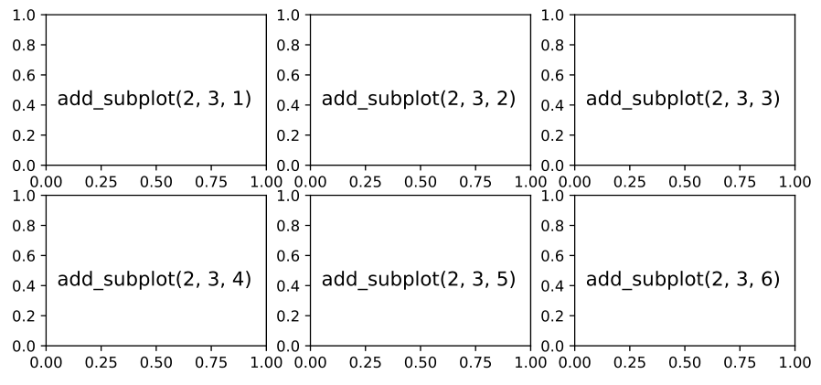

**图 3.1** add_subplot 的输出

接下来，我们可以为得到的 Axes 对象创建基本图形。下面展示几个常见的可视化任务。这些任务的结果如图 3.2 所示。

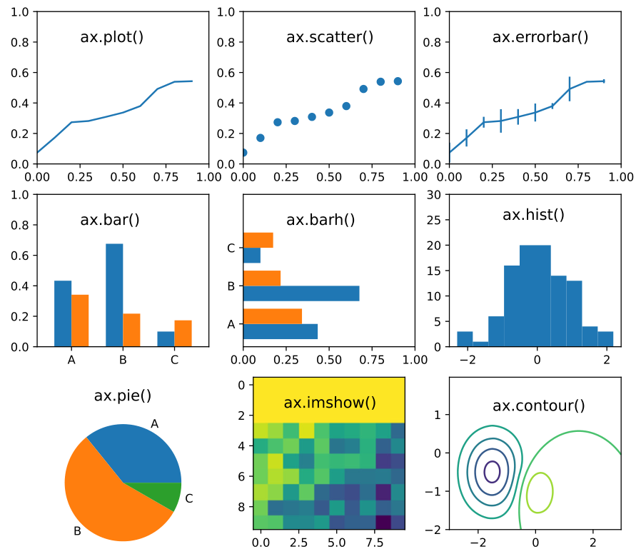

**图 3.2** 各种绘图函数的输出

```python
fig, ax = plt.subplots()
# Line plots
x = np.arange(10)
y = np.random.rand(10).cumsum()
ax.plot(x,y )
# Scatter plots
ax.scatter(x,y )
# Error bars
yerr = .1 * np.random.rand(len(x))
ax.errorbar(x,y , yerr=yerr)
# Vertical bars
np.random.seed(1)
c a t=( 'A', 'B', 'C')
```

```python
weights = np.random.rand(2,3 )
ax.bar(np.arange(.15, .85, .3) , weights[0] , width=.1)
ax.bar(np.arange(.15, .85, .3)+.1, weights[1], width=.1)
ax.set_xticks([.2,. 5, .8], labels=cat)
# Horizontal bars
ax.barh(np.arange(.1,. 7, .25) , weights[0] , height=.1)
ax.barh(np.arange(.1,. 7, .25)+.1, weights[1], height=.1)
ax.set_yticks([.15,. 4, .65], labels=cat)
# Histogram
ax.hist(np.random.standard_normal(100), bins=10)
# Pie plots
ax.pie(weights, labels=cat)
# The value of a matrix
xy = np.random.rand(10,10)
ax.imshow(xy)
# Contour
X, Y = np.meshgrid(np.arange(-3.0, 3.0, .05), np.arange(-2.0, 2.0, .05))
r 0=X **2 + (Y+1.) **2
r1 = (X+1.5) **2 + (Y+.5) **2
Z = .32 *np.exp(-2*r0) - .65 *np.exp(-r1)
ax.contour(X,Y ,Z )
```
得到基本图形后，我们可以通过调整 Axes 对象的各种属性来改善视觉外观，包括颜色、线型和坐标轴样式等。下面概述绘图时经常调整的若干关键属性：

- 标记。在 ax.scatter 和 ax.plot 图中，我们可以自定义数据点标记的可视化效果，包括形状、大小、颜色和透明度。常见的形状标记包括： -’表示圆形标记， -’表示方形标记， -’表示朝下的三角形标记， -’表示朝上的三角形标记， -’表示加号形标记， -’表示 X 形标记。

标记大小可以用 markersize 关键字修改。要指定颜色，可以将’r’、’g’、’b’、’k’（黑色）、’c’（青色）等单个字母赋给 color 关键字。透明度可以用 alpha 关键字控制，它接受 0 到 1 之间的数字。

- ax.plot 方法的样式。关键字 linestyle（简称 ls）的选项包括：

```text
- linels='-.'.
```
我们既能使用 marker 参数突出数据点、使用 color 参数设置颜色，也能使用 linewidth 调整线宽以改善线条外观。除这些关键字外，Matplotlib 还支持简写字符串表示法，可同时指定数据标记、线型与线条色彩。例如，简写表示法’s --r’便表示带有方形标记的红色虚线。

- 表示法。除了前面提到的单字母表示法，颜色也可以通过预定义名称指定，例如

```text
color='darkgreen' and color='tab:purple'.Furthermore,Matplotlibsupports
```
通过 RGB 分量定义颜色，可以使用十六进制代码’#RRGGBB’，也可以使用三个浮点数的元组 (r, g, b)。Matplotlib 配色方案的详细说明可参见 Matplotlib 文档 [2–4]。

- 坐标轴。可以使用 set_xlim、set_ylim、set_xticks 与 set_yticks 函数调整坐标轴。顾名思义，它们分别用于调节坐标轴的取值范围和刻度显示。可以使用 ax.set_xlabel 与 ax.set_ylabel 方法添加坐标轴标签。若要启用对数坐标，

```text
ax.set_xscale('log')
ax.set_yscale('log')
```
可以调用这些方法。

如果在任何绘图函数中使用了 label 关键字，ax.legend 方法可以为这些标签生成图例。ax.legend 方法中的 loc 关键字可以设置图例的位置。例如，

```text
ax.legend(loc='upper left')
```
将图例放在图的左上角。其他常见位置

```text
include'upper center','upper right','center left','center right',etc.
```

- 文本和注释。ax.text 方法可以在图中插入说明文字。命令

```text
ax.text(x, y, 'message')
```
该命令将’message’置于图内坐标 (x, y) 处。此外，ax.annotate 方法支持在文本旁附带更丰富的指示元素，例如箭头与其他注释符号。该方法须指定文字与箭头的具体坐标。例如，下面的语句将文本’message’置于坐标 (2, 2) 处，并绘制从 (2, 2) 指向 (1, 3) 的箭头。

```text
   ax.annotate('message', xy=(1, 3), xytext=(2, 2), arrowprops=dict(arrowstyle='->'))
```

- 格式。在与文本相关的方法中，例如 ax.text、ax.annotate 以及前面提到的 ax.set_xlabel、ax.set_xticks 等，可以使用 fontfamily、fontsize 和 rotation 等参数调整文本外观。

此外，Matplotlib 支持在文本信息中使用 LaTeX 数学符号。
例如，输入 Tex 风格的符号 r’$\mu_0$’可以显示 μ 0。请
注意定义 Python 原始字符串的前缀 r。这确保原始字符串
传递给 Matplotlib 函数时不会转换反斜杠字符。
绘图工作流程的最后一步是展示或保存图像。通常调用 plt.show() 方法显示图形。如果在 Jupyter Notebook 中启用了%matplotlib 魔法命令，就不必显式调用 plt.show()，图像会自动显示出来。
保存图像主要有两种途径。在交互式图形窗口中，单击 Save 按钮并选择对应格式即可保存图表。若在非交互式脚本环境下保存图像，可调用 Figure.savefig 函数，例如

```text
fig.savefig('result.png')
fig.savefig('result.jpg')
fig.savefig('result.svg')
fig.savefig('result.pdf')
```
可以根据文件名的后缀自动选择合适的后端，以所需的图像格式渲染图形。
为帮助你快速找到 Matplotlib 图形的基本配置，我们在图 3.3 中总结了 Matplotlib 的常用功能。
到目前为止，我们梳理了 Matplotlib 的基本用法。如果你正在寻找全面学习 Matplotlib 的系统指南，Jake Vanderplas 的 Python Data Science Handbook: Essential Tools for Working with Data, 2nd Edition 是一本出色的参考书。该书提供了详尽的使用说明与实例。此外，浏览官方网站上的示例图库也是掌握 Matplotlib 的另一条有效途径。

## 3.2 可视化

中的几个绘图函数同样支持 Pandas 数据对象的可视化。例如，ax.plot 函数能自动识别 Series 和 DataFrame，选取索引与数据进行绘图。不过，呈现 Pandas 数据更常用的方法是调用 Series 和 DataFrame 对象的.plot() 方法。Pandas 内置的绘图功能扩展了

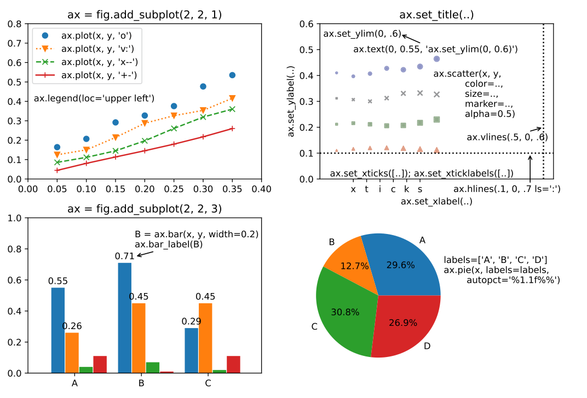

**图 3.3** Matplotlib 绘图功能速查表

API 的功能。具体而言，对于 DataFrame 对象，它可以自动选择数据列，并配置图例、刻度标签和其他可视化元素。
Pandas.plot 方法支持 Matplotlib 提供的大多数绘图类型，例如 area、barh、density、hist、line、scatter、bar、box、hexbin、kde 和 pie。这些绘图函数的用法十分直观，只需调用 DataFrame 对象的特定绘图方法.plot.{function_name}。例如，通过此 API 执行以下代码，即可生成图 3.4 所示的图形。

```python
fig, axs = plt.subplots(3,3 , figsize=(9, 8))
df = pd.DataFrame(np.random.rand(5,3), columns=[ 'x', 'y', 'z'])
for i, key in enumerate (['line', 'density', 'box', 'area', 'bar', 'barh']):
    getattr(df.plot, key)(ax=axs[i//3,i%3], title=key)
data = np.random.rand(200,3).cumsum(axis=1)
df = pd.DataFrame(data, columns=[ 'x', 'y', 'z'])
df.plot.hist(ax=axs[2,0], title= 'hist')
df.plot.scatter('x', 'y', ax=axs[2,1], title= 'scatter')
df.plot.hexbin('x', 'y', 'z', ax=axs[2,2], title= 'scatter')
```

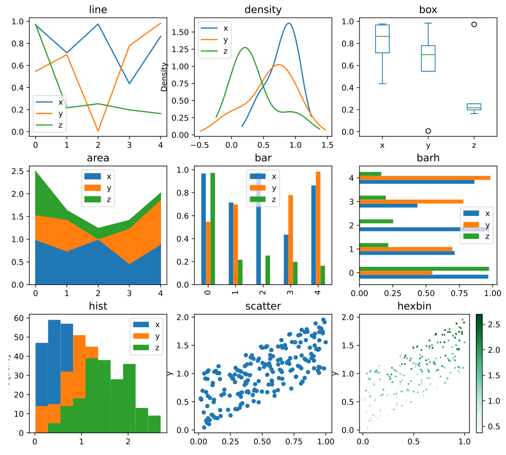

**图 3.4** Pandas 绘图方法

要自定义 Pandas 图形，可以为 Pandas.plot 方法指定一系列常用参数，包括 label、style、xticks、yticks、xlim、ylim、title、alpha、kind、figsize 等。此外，可以使用 ax 关键字参数将输出导向特定的 Axes 对象，该选项有助于进一步增强与定制所生成的图形。例如，

```python
In [3]: ax = plt.subplot(111)
        df.plot.bar(ax=ax)
        ax.legend(loc='upper left' )
```
除 Pandas 内置绘图功能外，社区还涌现了多个用于呈现 Pandas 数据的开源工具包。例如，基于 Matplotlib 开发的 Seaborn [5] 专为数据可视化而生，十分适于对 Pandas 数据作后续处理，并能轻松绘制内容详实的统计图表。

## 3.3 三维绘图

提供了三维绘图能力，但相关功能仍有局限。当绘制蛋白质分子等大型三维模型时，Matplotlib 往往会出现明显的性能卡顿。为了高效呈现复杂的三维结构，我们应当转向专为三维绘图量身定制的工具。
在 Python 中用于三维可视化的常见工具包包括 Mayavi [6]、PyVista [7]、VisPy [8] 和 Scikit-image [9]。在这些工具包中，Mayavi 特别适合呈现科学数据。它提供了与 Matplotlib 的 pylab 模块高度相近的操作体验。只要你熟悉了 Matplotlib，迁移到 Mayavi 进行三维绘图便十分自然。
Mayavi 的安装过程比一般 Python 软件包更复杂。Mayavi 依赖 Python QT 库。根据官方安装说明，可以执行以下命令安装 Mayavi 和 PyQT5：

```bash
$ pip install mayavi PyQT5
```
不过，此命令仅安装了 QT 库的 Python 封装。要启用完整的可视化功能，还必须单独安装底层依赖库，包括 Visualization Toolkit（VTK）以及 GUI（图形用户界面）库 QtCore、QtGui、QtSvg 和 QtWidgets。这些库可以通过操作系统的包管理器轻松安装。例如，在 Ubuntu 发行版上可以使用以下命令：

```bash
$ sudo apt install -y libqt5core5a libqt5gui5 libqt5svg5 libqt5widgets5 \
        vtk9
```
如果运行的是 Conda 环境，应当通过 Conda 软件包安装 Mayavi、PyQT5 和依赖的 QT 库。
要在 IPython 或 Jupyter Notebook 中使用 Mayavi，可能需要额外的配置步骤 [10]。在 IPython shell 中，可以使用魔术命令 %gui qt 将 GUI 后端更改为 QT。若在 Jupyter Notebook 中使用 Mayavi，可能需要安装最新版本的 node.js 以及用于 Notebook 的 IPython 扩展。

```bash
$ jupyter-labextension enable widgetsnbextension
$ jupyter-labextension enable ipyenvents
```
为验证 Mayavi 的安装，我们可以运行该库提供的内置测试：

```python
In [1]: %gui qt
In [2]: from mayavi import mlab
        mlab.test_mesh()
```

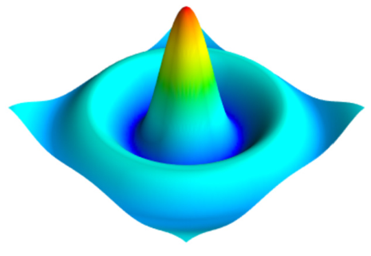

**图 3.5** 使用 mlab.surf 绘制曲面的示例

mayavi.mlab 能够渲染各种三维图形，包括曲面、等值线、散点、线条、条形图与矢量场。我们先考察用 mlab.surf 函数完成的简单曲面可视化。mlab.surf 函数旨在用地毯图展示二维数组的数值分布，其中 z 轴上的每个值对应二维平面上的一个数据点。下面的脚本展示了数据准备和三维绘图的步骤，输出结果如图 3.5 所示。

```python
from mayavi import mlab
x, y = np.mgrid[-10:10:100j, -10:10:100j] # (1)
r = np.sqrt(x **2+y **2)
z = np.sin(r)/r
mlab.clf() # clear the current figure
mlab.surf(x,y ,z , warp_scale= 'auto')
mlab.show()
```
np.mgrid 函数经常用于 Mayavi 三维绘图，它能够方便地创建密集的多维空间网格。例如，第 (1) 行语句生成了一个由二维数据点组成的 100 × 100 均匀网格，这些点可直接传给 Mayavi 函数。np.mgrid 利用索引切片语法（[]）来指定网格范围，由切片 start:stop:step 规定起点与终点。step 参数若为实数，代表采样点间距；若为虚数，则代表起点与终点之间的区间划分数。对于实数 step，切片行为与 np.arange(start, stop, step) 相同；而对于虚数 step，它则完全等同于

```text
tonp.linspace(start, stop, step.imag).
```

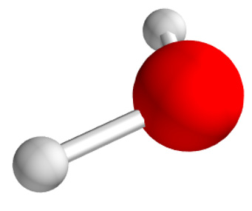

**图 3.6** 由 Mayavi 可视化的分子

借助 Mayavi 同样能够出色展现复杂的分子性质，例如电子密度分布与静电势等值面。我们不妨以包含分子信息的 Pandas DataFrame 为例，其中’Q’字段记录各原子的有效电荷：

```python
mole = pd.DataFrame({
    'symbol':[ 'O', 'H', 'H'], 'x': [0.5009, 1.4049, -0.0934], 'y': [2.7238, 2.4390, 1.9786], 'z': [0.8464, 0.6938, 0.7321], 'Q':[-0.64, 0.32, 0.32], })
```
我们可以先用 mlab.points3d 和 mlab.plot3d 函数绘制分子中的原子和键。下面的脚本生成如图 3.6 所示的分子视图：

```python
R=( 1 ,0 ,0 )
G=( 0 ,1 ,0 )
B=( 0 ,0 ,1 )
W=( 1 ,1 ,1 )
K=( 0 ,0 ,0 )
color_map = pd.Series({
    'H': (.8,. 8, .8), 'C': (.6,. 6, .6), 'N':B , 'O':R , })
covalent_radius = pd.Series({
    'H': 0.31, 'C': 0.73, 'N': 0.71, 'O': 0.66,
```

```python
})
def plot_mole(mole):
 geom = mole.loc[:,'x':'z']
 for symbol, xyz in geom.groupby(mole.symbol):
     x,y , z = xyz.to_numpy().T
     mlab.points3d(x,y ,z , scale_factor=covalent_radius[symbol], resolution=30, color=color_map[symbol])
 # Bonds between atoms
 geom = mole.loc[:,'x':'z'].to_numpy()
 radii = covalent_radius[mole.symbol].to_numpy()
 dist = np.linalg.norm(geom[:,None] - geom, axis=2)
 conn = dist < radii[:,None] + radii
 for i,j in np.argwhere(conn):
     if i<j :
         xyz = geom[[i,j]]
         mlab.plot3d(xyz[:,0], xyz[:,1], xyz[:,2], tube_radius=0.06)
plot_mole(mole)
```
在这个绘图脚本中，我们使用了以下技术：

- mlab.points3d 函数用于将球体绘制为原子。该函数可以处理多个点的坐标，并将它们作为单个对象进行渲染。
- 使用不同颜色与半径来区分不同种类的原子。与内置丰富预设配色方案的 Matplotlib 不同，Mayavi 并不支持色彩名称别名。其颜色必须传入一个三元元组，由各数值分别表示对应 RGB 颜色通道的比例。
- 使用 mlab.plot3d 绘制原子之间的键。为了确定共价键，我们考虑原子之间的距离，并将其与相应共价半径之和进行比较。

接下来展示分子静电势等值线的绘制。精确计算静电势需要第 16 章编写的程序；为简明起见，我们在此采用简化物理模型来表示三维静电势。该模型将原子的有效电荷近似为高斯分布，且该分布随距原子中心的距离 s 发生衰减：

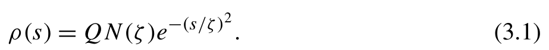{width=45%}

[]{#eq-03-001}

ρ (s) = QN (ζ)e.) Q 是有效电荷，N(ζ) 是高斯分布 e 的归一化因子。参数 ζ 控制高斯分布的展宽，我们用共价半径来表征它。我们可以推导出静电势
通过计算积分得到高斯分布电荷的 $V (r)$：

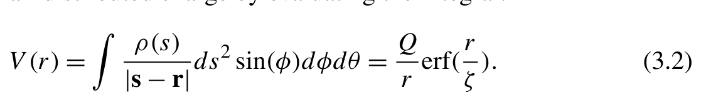{width=54%}

[]{#eq-03-002}

$ρ (s)$
$V (r) = ds (φ)dφ dθ = Q erf(r).)$
$|s − r | r ζ$
将分子中所有原子的贡献相加，我们可以得到一个 Python 函数，用于计算指定网格上的电势。

```python
def eval_potential(mole, grids):
    assert grids.shape[0] == 3 # the x,y , z components
    xyz = mole.loc[:,'x':'z'].to_numpy()
    r = np.linalg.norm(grids.reshape(3,-1) - xyz[:,:,None], axis=1)
    radii = covalent_radius[mole.symbol].to_numpy()
    v = np.einsum( 'q,qv->v', mole.Q, erf(r/radii[:,None]) / r)
    return v.reshape(grids.shape[1:])
```
随后，我们使用 mlab.contour3d 函数绘制静电势等值面。该函数需要在三维空间网格上对电势充分采样。我们将分子放置在一个 4 × 4 × 4 盒子的中心，并调用 np.mgrid 函数在盒子内部生成规整的均匀网格。这种均匀采样方案对 mlab.contour3d 生成平滑的等值面起着关键作用。网格传入 eval_potential 函数以求解各点电势值，注意务必保证输出数组形状与网格完全一致。此外，采样网格的坐标与电势场数值都应组织为三维数组。默认情况下，mlab.contour3d 函数会自动生成五个等值面；若想控制绘制哪些特定曲面，只需向 contour 参数传入包含特定数值的列表。静电势等值面效果如图 3.7 所示。

```python
def view_contour(mole,f n, contours=5, resolution=(80,80,80)):
    mlab.figure(1, bgcolor=W, fgcolor=K, size=(500, 500))
    mlab.clf()
    plot_mole(mole)
    xyz = mole.loc[:,'x':'z'].to_numpy()
    xyz_center = xyz.mean(axis=0)
    # Create mesh in cubic
    box_size = abs(xyz - xyz_center). max() * 2+4 .
    nx,n y, nz = resolution
    xmin, ymin, zmin = xyz_center - box_size/2
    xmax, ymax, zmax = xyz_center + box_size/2
    grids = np.array(np.mgrid[xmin:xmax: complex(0, nx), ymin:ymax:complex(0, ny), zmin:zmax:complex(0, nz)])
```

```text
    v = fn(mole, grids)
    mlab.contour3d(grids[0], grids[1], grids[2],v , contours=contours, transparent=True)
    mlab.view(75,0 ,7 )
    mlab.show()
view_contour(mole, eval_potential)
view_contour(mole, eval_potential,[-.1, .1])
```

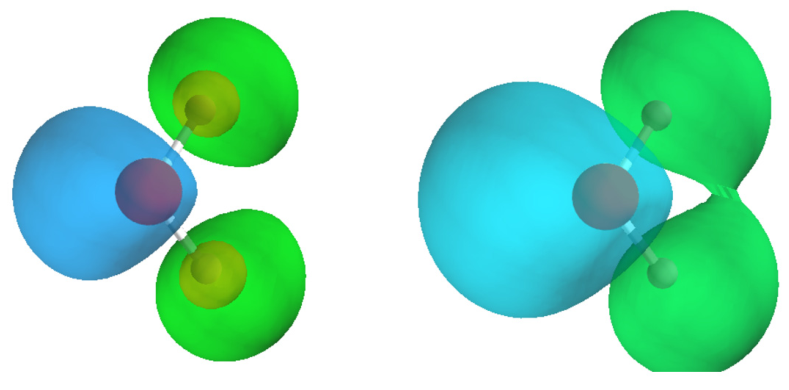

**图 3.7** 以等高线可视化静电势

Mayavi 还支持在三维曲面上对电势分布进行着色渲染，这一任务可通过 mlab.mesh 轻松实现。与局限于平面二维网格的 mlab.surf 相比，mlab.mesh 允许利用三维空间中的二维网格构建曲面拓扑，其上每个节点由笛卡尔坐标 (x, y, z) 显式给出。下例中，我们构建了一个以分子几何中心为原点的球面，并将球体半径设定为略大于中心到最外层原子的极限距离。
我们使用 np.mgrid 为球体的极角和方位角生成均匀网格。随后将这些网格转换为笛卡尔坐标。这些网格上的电势值及其坐标被输入 mlab.mesh 函数。

```python
def view_sph_surface(mole,f n, contours=5):
    mlab.figure(1, bgcolor=W, fgcolor=K, size=(500, 500))
    mlab.clf() # Clear figure
    plot_mole(mole)
    xyz = mole.loc[:,'x':'z'].to_numpy()
    xyz_center = xyz.mean(axis=0)
```

```python
    # Create a sphere surface
    radii = covalent_radius[mole.symbol].to_numpy()
    r = (np.linalg.norm(xyz - xyz_center, axis=1) + radii). max()
    phi, theta = np.mgrid[0:np.pi:80j, 0:2 *np.pi:80j]
    x=r * np.sin(phi) * np.cos(theta)
    y=r * np.sin(phi) * np.sin(theta)
    z=r * np.cos(phi)
    # The grids of the surface in Cartesian coordinates representation.
    grids = np.array([x,y,z]) + xyz_center[:,None,None]
    v = fn(mole, grids)
    surface = mlab.mesh(grids[0], grids[1], grids[2], scalars=v, transparent=True)
    mlab.scalarbar(surface, orientation= 'vertical', label_fmt= '%.2f', nb_labels=5)
    mlab.view(75,0 ,7 )
    mlab.show()
view_sph_surface(mole, eval_potential)
```

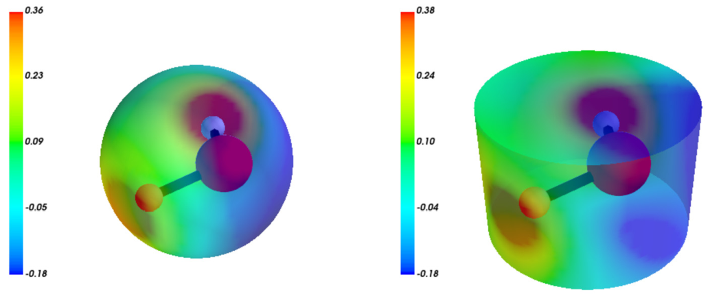

**图 3.8** 球面和柱面上的静电势强度

再看一个例子：我们为圆柱体表面构造二维网格。该二维网格由底面、侧壁与顶面三部分组成：对于两个端面，根据径向距离和方位角生成网格；对于侧壁，则根据方位角和高度创建网格。下面的代码展示了网格坐标的生成过程。

```python
nx, ny = resolution
r,z=1 . 1 , 0.7
h, theta = np.mgrid[-z:z:complex(0, nx), 0:2 *np.pi:complex(0, ny)]
u, theta = np.mgrid[0:r: complex(0, nx), 0:2 *np.pi:complex(0, ny)]
grids = np.concatenate([
    # top plate
    [u * np.cos(theta), u * np.sin(theta), np.full((nx, ny), -z)],
    # side wall
    [r * np.cos(theta), r * np.sin(theta), h],
    # bottom plate
    [u * np.cos(theta), u * np.sin(theta), np.full((nx,n y ) ,z ) ], ], axis=1) + xyz_center[:,None,None]
```
球面和圆柱面及其上的电势值如图 3.8 所示。这些可视化结果可以提供一些信息，例如另一个分子可能从哪些方向接近当前分子。
面对三维空间中的任意复杂曲面，直接构建规整的二维网格往往十分困难。此时通常需借助三角面片定义几何表面，再调用 mlab.triangular_mesh 予以渲染。鉴于为三维实体剖分三角网格涉及较为深入的计算几何知识，已超出本书主旨，在此不再展开。
从这些例子中可以看出，Mayavi 与 Matplotlib 具有不同的编码风格。Matplotlib 将绘图过程映射为面向对象的任务，使用各种实例管理图中的不同元素，我们通过创建和组合这些实例完成绘图；若要修改图形外观，只需访问实例并调整其属性即可。相比之下，mlab 模块并非完全面向对象：它在默认画布上工作，可视化元素被直接添加到画布上，配置项在全局命名空间中指定，最后由 mlab 调用底层引擎执行渲染。它的用法更偏向命令式，类似于 Matplotlib 旧版的 pylab 接口。
在 Mayavi 文档提供的示例图库中，你可能会找到一些使用 mlab.pipeline 函数创建可视化元素的例子。Mayavi 中的流水线（pipeline）是指一系列协作产生三维可视化结果的数据处理和可视化组件 [11]。流水线通常由以下组件组成：

- 源，加载原始数据，并存储和验证原始数据。
- 过滤器，对原始数据执行平滑、塑形和筛选等操作。
提供具体的可视化模型，例如曲面图、体渲染、等值线等。
进行可视化渲染的阶段。

在图 3.9 所示的交互式窗口中，流水线组件以分层树结构显示。要修改可视化效果，我们可以在交互式窗口中检查每个组件的属性并调整其配置。

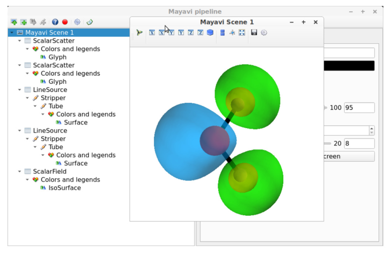

**图 3.9** Mayavi 场景的布局和流水线

mlab 三维绘图函数，例如 mlab.plot3d、mlab.surf、mlab.mesh 和 mlab.contour3d，是包含特定可视化任务所需全部中间组件的流水线类。当需要更细致地自定义可视化效果时，mlab.pipeline 函数能够定制或调整流水线组件。

## 3.4 化学可视化

针对化学体系，业内已存在多种成熟的分子结构可视化软件。只要具备 XYZ、PDB（Protein Data Bank）、MOL 或 SDF 等标准分子格式文件，便能借助 PyMOL、Avogadro、py3Dmol 等工具便捷地展现三维构型。然而在量子化学领域，绘图核心转向了分子内部的电子行为，包含分子轨道、电子密度与静电势等波函数衍生属性。遗憾的是目前尚无专门封装此类结果的三维 Python 原生库。虽然 Mayavi 能够胜任部分任务，但其底层接口较为基础，通常需编写冗长的前后处理代码方能获得满意的视觉效果。
可视化量子化学结果的一种更实用的方法是将其保存为专用文件格式，例如 Molden 和 Cube。量子化学可
视化软件，如 VMD 或 Jmol，随后即可读取这些文件并生成三维显示。因此，这种方法的关键在于生成 Molden 或 Cube 文件。在此背景下，Jinja 模板技术对于高效生成 Molden 和 Cube 文件非常实用。

### 3.4.1 模板

Jinja 模板处理过程可以分为两个主要步骤：

1. 使用 jinja2.Template 函数模板。Jinja 提供各种模板

加载器，用于从文件导入模板。作为简单的替代方案，我们可以
将 Python 的 open 函数与 jinja2.Template 函数一起使用，加载模板文件。

2. 使用关键字参数调用.render() 方法来渲染模板。

```python
In [1] import jinja2
       tpl = jinja2.Template( 'template_string {{ key }}' )
       tpl.render(key=value)
Out[1]:
'template_string value'
```
接下来考察 Jinja 模板的语法 [12]。模板字符串中可以使用多种语法。然而，在我们使用 Molden 和 Cube 格式的场景中，只需要基本语法。

#### 表达式

表达式书写在双大括号 {{}} 内。在模板渲染过程中，其中的变量会被传入的 Python 对象实际替换。这些表达式既可以是数字、字符串、列表和字典等基础 Python 变量，也可以是需要在运行时求值的复杂表达式。常见的复杂表达式包括数学运算、访问对象属性、调用函数以及单行 if-else 判定语句。

#### 控制语句

控制语句由符号  表示。Jinja 支持几种常见的控制语句，例如 if-else、for 循环、赋值等。if-else 语句可用于处理缺失值。例如，

```yaml
In [2]: jinja2.Template( '''\
        {{ key }}
        {{ absent }}''').render(key='a')
Out[2]:
'a\n'
```
由 set 表示的赋值语句允许我们定义临时变量。这些变量可以在 Jinja 表达式中作为普通变量使用。例如，

```yaml
In [3]: jinja2.Template( '''\
        
        { {z} }{ {y} }{ {x} } ' '').render(items=' abc ' )
Out[3]:
'\nc b a'
```

#### 空白字符控制

空白字符控制与表达式或控制语句结合使用，例如 、{{- 和 -}}。这些模板标签中的减号用于消除前导和尾随空白字符，以及控制语句引入的空行。例如，

```yaml
In [4]: jinja2.Template( '''\
        
        {{- z }} {{ y }} {{ x }}''').render(items=' abc ' )
Out[4]:
' cba '
```

### 3.4.2 格式

Molden 是存储量子化学数据通用的标准文件规范，能完整记录分子构型、原子基组和轨道系数等信息。该格式极常用于呈现分子轨道，且在灵活配置后，还可直接用来可视化任意形式的自定义轨道。
Molden 格式的结构有完善的文档记录，可以参考在线文档 https://www.theochem.ru.nl/molden/molden_format.html。下面，我们将使用 Jinja 模板展示 Molden 格式的结构。
Molden 格式由一系列用方括号表示的区段组成，例如 [Molden Format]、[Atoms]、[GTO] 等。这些区段将 Molden 文件组织为不同的部分。

```text
molden_tpl = jinja2.Template( '''\
[Molden Format]
Comment lines
[Atoms] ({{ unit or 'Ang' }})

{{ element }} {{ loop.index }} {{ atom_number }} {{ x }} {{ y }} {{ z }}

```

```text
[GTO]

{{ loop.index }} 0
{{ gto_shells }}

[5d]
[7f]
[MO]

{{ mo }}

''')
```
分子几何结构详述于 Molden 格式的 [Atoms] 区段。在这个区段中，每一行对应分子中的一个原子。
要表示电子轨道，应同时提供基组信息与轨道系数。基组的详细信息包含在 [GTO] 区段中。在这里，Molden 格式要求分别指定每个原子的基组信息。请注意上述模板中的  符号。按照 Molden 格式规范，不同原子的基组间必须插入空行。因此，Jinja 代码里的尾随空白字符被特意保留，以完全符合这一排版要求。
基组的配置由一系列壳层指定。每个壳层的结构在下面的 gto_shell_tpl 模板中列出。对于常规的高斯型轨道（Gaussian-type orbital，GTO）基组，其信息可以从 Basis Set Exchange（BSE）在线数据库获取，该数据库可通过 Python 软件包 basis-set-exchange 访问 [13,14]。

```python
from basis_set_exchange import get_basis
from basis_set_exchange.manip import uncontract_general
gto_shell_tpl = jinja2.Template( '''\
{{ spdf_shell }} {{ len(exponents) }} 1.00

{{ ' '.join(e_cs) }}
''')
def bse_to_gto_shell(shell):
    spdfg = 'spdfg'
    exponents = shell[ 'exponents']
    coefficients = shell[ 'coefficients']
    spdf_shell = ''.join(spdfg[l] for l in shell['angular_momentum'])
    return gto_shell_tpl.render( spdf_shell=spdf_shell, exponents=exponents, coefficients=coefficients, len=len, zip=zip)
```

```python
def gto_session(basis_name, element):
    bse_data = get_basis(basis_name, element)
    bse_data = uncontract_general(bse_data)
    _, basis = bse_data[ 'elements'].popitem()
    return '\n'.join([bse_to_gto_shell(shell)
                      for shell in basis['electron_shells']])
```
[GTO] 区段之后的 [5d] 和 [7f] 区段是可选的。这些区段指定原子基函数使用球面 D 和 F 函数。
接下来，可以在 [MO] 区段中包含电子轨道。如下面的 mo_tpl 模板所示，对于每个轨道，MO 区段允许指定各种属性，包括对称性、轨道能量和占据数等，随后是一列轨道系数。处理轨道系数时，请注意 D、F 和 G 函数的顺序。例如，球面 D 函数

```text
arrangedasD0, D+1, D-1, D+2, D-2.Forsimplicity,we haveomittedthereordering
```
过程。

```python
mo_tpl = jinja2.Template( '''\
Sym= {{ symmetry or 'A' }}
Ene= {{ energy or 0.0 }}
Spin= {{ spin or 'Alpha' }}
Occup= {{ occupancy or 0.0 }}

{{ loop.index }} {{ c }}
''')
def mo_session(orbitals):
    return [mo_tpl.render(coefficients=c) for c in orbitals]
```
将所有组件组合起来，我们可以创建 render_molden 函数：

```python
from basis_set_exchange.lut import element_Z_from_sym
def render_molden(elements, coordinates, basis_name, orbitals):
    x,y , z = coordinates.T
    atom_numbers = [element_Z_from_sym(ele) for ele in elements]
    atoms = list(zip(elements, atom_numbers,x ,y , z))
    return molden_tpl.render( Z=element_Z_from_sym, atoms=atoms, gtos=[gto_session(basis_name, atom[0]) for atom in atoms], mos=mo_session(orbitals))
```
例如，我们可以使用以下代码将一个分子的所有原子轨道输出到 Molden 文件中。

```python
import pandas as pd
import pyscf
mole = pd.DataFrame({
    'symbol':[ 'O', 'H', 'H'], 'x': [0.5009, 1.4049, -0.0934], 'y': [2.7238, 2.4390, 1.9786], 'z': [0.8464, 0.6938, 0.7321], })
basis = 'sto-3g'
AOs = np.identity(5)
elements = mole.symbol
coordinates = mole.loc[:,'x':'z'].to_numpy()
with open ('demo.molden', 'w') as f:
    f.write(render_molden(elements, coordinates, basis, AOs))
```

### 3.4.3 格式

Cube 格式源自 Gaussian 计算化学软件。它已成为存储体积量子化学数据的事实标准。它非常适合在三维网格中详细表示分子轨道、电子密度和电势面。
Gaussian 官方手册简述了 Cube 格式规范，更多细节亦见于各类技术文档 [15,16]。尽管 Cube 文件本质上是纯文本，但其排版格式极其严格。文件头必须依序包含体区域原点、体素步长、体系原子坐标以及网格场数值。写入原子与体素元数据时，整型数据须固定为 5d 格式，浮点数采用 12.6f 格式；而在存储三维场数据时，数值必须遵循 13.5E 格式，且规定每行输出六个数值。
以下 Jinja 模板展示了 Cube 格式的结构。

```text
cube_tpl = jinja2.Template( '''\
Comment line 1
Comment line 2
{{ '%5d' % len(atoms) }} {{ '%12.6f' % origin[0] }} {{ '%12.6f' % origin[1]
     }} {{ '%12.6f' % origin[2] }}



{{ '%5d' % n_voxels[0] }} {{ '%12.6f' % vx[0] }} {{ '%12.6f' % vx[1] }} {{
    '%12.6f' % vx[2] }}
{{ '%5d' % n_voxels[1] }} {{ '%12.6f' % vy[0] }} {{ '%12.6f' % vy[1] }} {{
    '%12.6f' % vy[2] }}
```

```python
{{ '%5d' % n_voxels[2] }} {{ '%12.6f' % vz[0] }} {{ '%12.6f' % vz[1] }} {{
    '%12.6f' % vz[2] }}


{{ '%5d' % atom_number }} {{ '%12.6f' % charge }} {{ '%12.6f '%x} }{ {
    '%12.6f' % y }} {{ '%12.6f' % z }}


{{ data }}

''')
def render_cube(elements, coordinates, voxel, origin, data):
    atom_numbers = [element_Z_from_sym(ele) for ele in elements]
    x,y , z = coordinates.T
    atoms = list(zip(atom_numbers,x ,y ,z ) )
    n_voxels = data.shape
    formatted_data = []
    for ix in range (n_voxels[0]):
        for iy in range (n_voxels[1]):
            for iz in range (0, n_voxels[2], 6):
                # In each line, writes up to 6 floats in the 13.5E format
                formatted_data.append( ''.join(f'{v:13.5E}' for v in data[ix,iy,iz:iz+6]))
    return cube_tpl.render( atoms=atoms, len=len, n_voxels=n_voxels, voxel=voxel, origin=origin, volumetric_data=formatted_data)
```
要可视化电子性质，可以创建网格，计算其在网格上的值，并使用此模板渲染 Cube 文件。
例如，我们可按下列流程构造 Cube 文件以观察 p 型原子轨道。设定 0.3 × 0.3 × 0.3 的体素微元，沿 x、y、z 轴各采样 60 个网格点。为便于演示，我们调用量子化学程序 PySCF [17,18] 快速求取 p 轨道在各个空间网格点上的波函数值。请特别留意分子坐标的单位转换：Cube 规范明确要求所有几何长度参数均以玻尔（Bohr）为单位。

```text
# NOTE: all units are in Bohr
boundary = [[-9., 9.], [-9., 9.],
```

```python
            [-9., 9.]]
mesh = [60,6 0, 60]
mgrids = np.mgrid[[ slice(r[0], r[1],m *1j)
                   for r,m in zip (boundary, mesh)]]
grids = mgrids.reshape(3, -1).T
origin = mgrids[:,0,0,0]
voxel = np.array([mgrids[:,1,0,0] - origin, mgrids[:,0,1,0] - origin, mgrids[:,0,0,1] - origin])
# AO values on given grids
basis = 'sto-3g'
mol = pyscf.M(atom= list(mole.to_numpy()), basis=basis, verbose=0)
ao = mol.eval_gto( 'GTOval', grids)
ao_2pz = ao[:,4].reshape(mesh)
elements = mole.symbol
coordinates = mole.loc[:,'x':'z'].to_numpy() / 0.529177249
with open ('demo.cub', 'w') as f:
    f.write(render_cube(elements, coordinates, voxel, origin, ao_2pz))
```

## 小结

本章探讨了科学数据可视化的二维与三维技术，包括使用 Matplotlib 开展二维可视化和使用 Mayavi 进行三维可视化。对于量子化学数据的可视化，我们借助外部软件，并使用 Molden 和 Cube 文件交换数据。我们还讨论了使用 Jinja 模板技术生成 Molden 和 Cube 文件的方法。
我们的讨论侧重于数据可视化的技术层面。除了实现技术，更重大的挑战在于创建信息丰富的可视化结果，以有效传达数据背后的故事。关于这一主题，Claus O. Wilke 的 Fundamentals of Data Visualization [19] 是一本出色的参考书。

## 参考文献

::: {.ref-list}

[1] J. VanderPlas, Python Data Science Handbook: Essential Tools for Working with Data, O’Reilly Media, Inc, Sebastopol, CA, 2016.

[2] J. Hunter, D. Dale, E. Firing, M. Droettboom, the Matplotlib development team, Matplotlib examples - list of named colors, [matplotlib.org](https://matplotlib.org/stable/gallery/color/named_colors.html), 2024.

[3] J. Hunter, D. Dale, E. Firing, M. Droettboom, the Matplotlib development team, Matplotlib users guide - specifying colors, [matplotlib.org](https://matplotlib.org/stable/users/explain/colors/colors.html), 2024.

[4] J. Hunter, D. Dale, E. Firing, M. Droettboom, the Matplotlib development team, Matplotlib examples - color demo, [matplotlib.org](https://matplotlib.org/stable/gallery/color/color_demo.html), 2024.

[5] M.L. Waskom, seaborn: statistical data visualization, The Journal of Open Source Software 6 (60) (2021) 3021, [DOI](https://doi.org/10.21105/joss.03021).

[6] P. Ramachandran, G. Varoquaux, Mayavi: 3d visualization of scientific data, Computing in Science & Engineering 13 (2) (2011) 40–51, [DOI](https://doi.org/10.1109/MCSE.2011.35).

[7] C.B. Sullivan, A. Kaszynski, PyVista: 3d plotting and mesh analysis through a streamlined interface for the visualization toolkit (VTK), The Journal of Open Source Software 4 (37) (2019) 1450, [DOI](https://doi.org/10.21105/joss.01450).

[8] Vispy developers, Vispy: interactive scientific visualization in Python, [vispy.org](https://vispy.org/), 2024.

[9] S. van der Walt, J.L. Schönberger, J. Nunez-Iglesias, F. Boulogne, J.D. Warner, N. Yager, E. Gouillart, T. Yu, the scikit-image contributors, scikit-image: image processing in Python, PeerJ 2 (2014) e453, [DOI](https://doi.org/10.7717/peerj.453).

[10] Enthought, Mayavi on Jupyter, [github.com](https://github.com/enthought/mayavi/blob/master/examples/mayavi/mayavi_jupyter.ipynb), 2024.

[11] Enthought, Mayavi documentation - objects populating the mayavi pipeline, [enthought.com](https://docs.enthought.com/mayavi/mayavi/mayavi_objects.html), 2024.

[12] Pallets, Jinja2 documentation - template designer documentation, [palletsprojects.com](https://jinja.palletsprojects.com/en/latest/templates/), 2024.

[13] K.L. Schuchardt, B.T. Didier, T. Elsethagen, L. Sun, V. Gurumoorthi, J. Chase, J. Li, T.L. Windus, Basis set exchange: a community database for computational sciences, Journal of Chemical Information and Modeling 47 (3) (2007) 1045–1052, [DOI](https://doi.org/10.1021/ci600510j), pMID: 17428029.

[14] B.P. Pritchard, D. Altarawy, B. Didier, T.D. Gibson, T.L. Windus, New basis set exchange: an open, up-to-date resource for the molecular sciences community, Journal of Chemical Information and Modeling 59 (11) (2019) 4814–4820, [DOI](https://doi.org/10.1021/acs.jcim.9b00725), pMID: 31600445.

[15] P. Bourke, Gaussian cube files, [paulbourke.net](https://paulbourke.net/dataformats/cube/), 2024.

[16] B. Skinn, Gaussian cube file format, [readthedocs.io](https://h5cube-spec.readthedocs.io/en/latest/cubeformat.html), 2024.

[17] The PySCF Developers, Quantum chemistry with Python, [pyscf.org](https://pyscf.org/), 2024.

[18] Q. Sun, X. Zhang, S. Banerjee, P. Bao, M. Barbry, N.S. Blunt, N.A. Bogdanov, G.H. Booth, J. Chen, Z.-H. Cui, J.J. Eriksen, Y. Gao, S. Guo, J. Hermann, M.R. Hermes, K. Koh, P. Koval, S. Lehtola, Z. Li, J. Liu, N. Mardirossian, J.D. McClain, M. Motta, B. Mussard, H.Q. Pham, A. Pulkin, W. Purwanto, P.J. Robinson, E. Ronca, E.R. Sayfutyarova, M. Scheurer, H.F. Schurkus, J.E.T. Smith, C. Sun, S.-N. Sun, S. Upadhyay, L.K. Wagner, X. Wang, A. White, J.D. Whitfield, M.J. Williamson, S. Wouters, J. Yang, J.M. Yu, T. Zhu, T.C. Berkelbach, S. Sharma, A.Y. Sokolov, G.K.-L. Chan, Recent developments in the PySCF program package, Journal of Chemical Physics 153 (2) (2020) 024109, [DOI](https://doi.org/10.1063/5.0006074), [aip.org](https://pubs.aip.org/aip/jcp/article-pdf/doi/10.1063/5.0006074/16722275/024109_1_online.pdf).

[19] C. Wilke, Fundamentals of data visualization, [clauswilke.com](https://clauswilke.com/dataviz/), 2024.

:::

