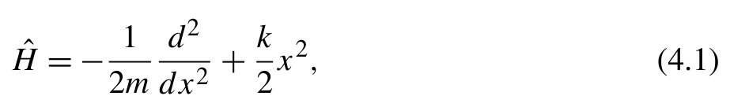
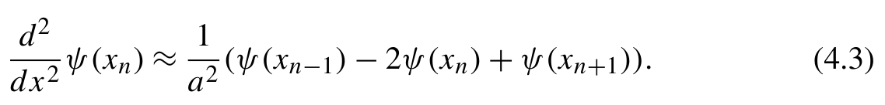
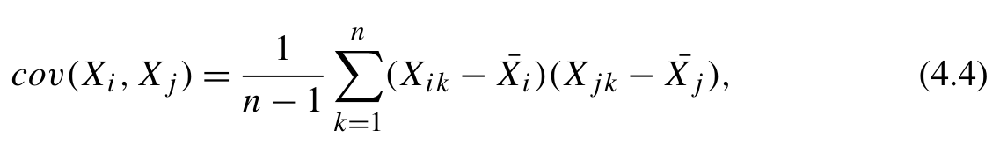
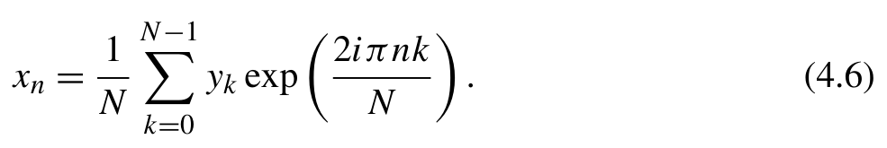
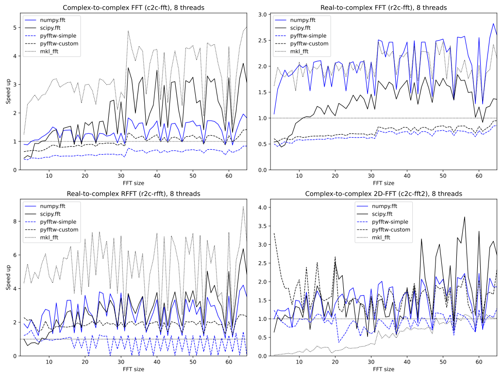

# 科学计算工具 {#ch04 .unnumbered}

科学计算是一个广阔的领域，不同领域使用着各具特色的工具。即使面对相同的工具，各领域的应用场景与关注侧重也往往大相径庭。我们在此不展开讨论 SciPy 等通用科学计算工具的基础知识，相关文献已有详尽介绍，例如 Robert Johansson 所著《Numerical Python - Scientific Computing and Data Science Applications with NumPy, SciPy and Matplotlib》。
本章重点探讨专用于量子化学程序与应用的科学计算工具，主要涵盖以下主题：

- 代数工具。
- 用于稀疏矩阵的工具，因为量子化学中的哈密顿量本质上是大型稀疏矩阵。
- 缩并。这是多体方法中最常用的工具。

它对量子化学应用的性能有很大影响。

- 变换。处理涉及周期性边界条件的问题时，傅里叶变换是一种必要的计算工具。

计算性能始终是科学计算中的关键问题。评估这些工具时，我们将从多个角度考虑性能，包括：

- 哪些因素会影响它们的效率？
- 如何正确使用它们以最大限度地提高性能？
- 有多个选项时应选择哪一个？

## 4.1 代数

科学计算应用需要线性代数运算时，可以选用 numpy.linalg 和 scipy.linalg 两个模块。这两个模块有何区别？各自适合在什么场景下选用？本节将详细探讨这些问题。
numpy.linalg 模块提供基础的线性代数运算，包括线性方程求解器（solve、lstsq）、矩阵分解（qr、cholesky、eig、eigh、svd）、矩阵求逆（inv、pinv）、矩阵行列式函数（det）、矩阵或
向量范数（norm）、矩阵条件数（cond）、方阵整数次幂（matrix_power）等。SciPy 的线性代数模块 scipy.linalg 涵盖 numpy.linalg 的绝大部分功能，还提供了额外的高级特性与更进一步的性能优化。
编写科学计算程序时，可先从 numpy.linalg 入手实现基本功能；若需要更高计算性能与扩展特性，再将 numpy.linalg 函数替换为对应的 SciPy 函数。
scipy.linalg 的功能增强主要体现在以下几类：

- 线性方程求解器。与 NumPy 只为各种矩阵提供通用求解器 np.linalg.solve 不同，scipy.linalg 允许我们根据矩阵的特征选择不同的求解器，以提高性能或数值稳定性。例如，scipy.linalg 提供使用 Cholesky 分解求解线性方程的 cho_solve()、使用 LU 分解的 lu_solve 求解器、专用于三角矩阵的 solve_triangular()、用于方程 AX +XB = Q 的 solve_sylvester()、用于非方阵的 solve_banded()。这些专用求解器以 solve_ 为前缀，因此容易识别。
- 矩阵因式分解和分解函数。例如用于 LU 分解的 lu()、用于 A = R Q 的 rq()

用于 Hessenberg 分解的 hessenberg() 和用于 Schur 分解的 schur()。某些分解函数可以利用矩阵的特殊性质，例如用于带状矩阵 Cholesky 分解的 cholesky_banded()、用于带状矩阵特征值分解的 eig_banded()，以及用于实对称三对角矩阵特征值问题的 eigh_tridiagonal()。

- 矩阵函数，例如 expm()、logm()、sqrtm()、cosm()、
- 矩阵和更多数组构造器，例如用于创建分块对角矩阵的 block_diag()、用于创建伴随矩阵的 companion()、用于创建离散傅里叶变换（discrete Fourier transform，DFT）矩阵的 dft()，其定义为 Amn =

{width=30%}

[]{#eq-04-001}

- BLAS 和 LAPACK 库的接口。dsyrk() 和 dsyev() 等 BLAS 和 LAPACK 函数可以与 NumPy 数组一起访问和使用。这些接口可通过 scipy.linalg.blas 和

每一类中，我们只列出了一些代表性函数。有关各类函数的完整列表，请参阅 SciPy 文档 [1]。
对于 numpy.linalg 中已有的函数，SciPy 继承了它们的 API，并引入额外参数以提供更多功能。这些额外参数主要与内存管理策略有关。例如，大多数函数都有的 overwrite_a 选项允许覆盖输入的
矩阵以减少内存占用。此外，还有一些旨在提高性能的参数。例如，check_finite 选项允许跳过对输入矩阵的数值有效性检查。除了这些常见参数，下面简要总结 SciPy 对 numpy.linalg 函数所做的其他专门改进：

- 对于线性方程 Ax = b，scipy.linalg.solve 函数引入了 assume_a 选项，用于指定矩阵是对称、厄米还是正定的。根据矩阵类型，将调用不同的 LAPACK 例程。
- SciPy 中的 qr 函数提供 pivoting=True 选项，以启用具有秩揭示功能的主元 QR 分解 [2]。该选项允许库使用数值上更稳定的例程处理病态矩阵。请注意，SciPy 和 NumPy 中 qr 的默认模式不同。在 SciPy 中，Q 矩阵是维度扩展后的方阵，而在 NumPy 中，Q 是列数缩减的矩阵。
- SciPy 的 cholesky 函数默认执行上三角 Cholesky 分解。为了与 NumPy 中的行为一致，应指定关键字参数 lower=False。
- SciPy 中的 eigh 函数可以求解广义特征值问题，包括

{width=30%}

[]{#eq-04-002}

此外，它提供 subset_by_value 和 subset_by_index 选项，以便只计算
选定的特征值子集。

- 对于一般矩阵的特征值问题，SciPy 中的 eig 函数既能计算左特征向量，也能计算右特征向量，而 NumPy 版本只能计算右特征向量。此外，SciPy 版本支持广义特征值问题 Av = λB v。

## 4.2 矩阵

稀疏矩阵（sparse matrices）即以零元素为主的矩阵，在量子化学程序和许多科学计算应用中很常见。为降低稀疏矩阵的内存占用，可只存储非零元素及其必要的位置索引。但稀疏矩阵的非连续存储结构，使其处理难度明显高于稠密矩阵。
稀疏矩阵的核心难点在于存储格式以及操作运算。为应对这些挑战，scipy.sparse 模块提供了一套完善的稀疏矩阵操作功能。在线性代数算法方面，numpy.linalg 和
scipy.linalg 专为稠密矩阵设计，不适用于稀疏矩阵；若需对稀疏矩阵执行线性代数运算，应使用 scipy.sparse.linalg 模块中的函数。

### 4.2.1 格式

SciPy 支持多种稀疏矩阵存储格式，各格式对应适用的场景。CSR、CSC 和 BSR 格式针对高效访问矩阵元素与执行矩阵向量运算做了优化，其余格式则更适合用来构建矩阵。

- 压缩稀疏行（Compressed Sparse Row，CSR）格式存储每行非零元素的索引。这种格式使用一个 NumPy 数组（通过 .data 属性访问）存储非零元素，另一个数组（与 .indices 属性关联）存储索引，第三个数组（通过 .indptr 属性访问）存储索引的行指针。具体来说，第 i 行的列索引存储在 indices[indptr[i]:indptr[i+1]] 中，相应的值存储在 data[indptr[i]:indptr[i+1]] 中。这种格式便于按行访问元素，矩阵向量乘法也很高效。然而，向矩阵插入新元素的效率很低。每次添加新元素时，都会重建索引和数据数组，通常通过 COO 格式作为中间格式。
- 压缩稀疏列（Compressed Sparse Column，CSC）格式与 CSR 类似，但按列存储。
- 块稀疏行（Block Sparse Row，BSR）格式与 CSR 类似，但存储的是数组块而不是标量变量。这种格式对数组块施加了若干限制：BSR 存储中的所有数组块具有相同的块大小。数组每个维度的大小都应是块大小的整数倍。这些限制约束了 BSR 的适用范围。然而，当稀疏矩阵与这种格式兼容时，BSR 在算术运算和矩阵向量乘法方面被认为比其他格式更高效。
- 坐标（Coordinate，COO）格式将每个非零元素的行索引、列索引和值分别存储在列表中。这种格式不支持使用数组索引语法（如 a[i,j]）直接访问矩阵元素。在 scipy.sparse 中，这种格式通常用作稀疏存储格式之间转换的中间格式。
- 键字典（Dictionary of Keys，DOK）格式将非零元素存储在字典中，使用（行、列）元组作为键。这种格式与 COO 格式类似，但支持访问单个矩阵元素。如果需要逐步构造稀疏矩阵，这种格式是合适的选择。
- 列表的列表（List of Lists，LIL）格式为每行分别在列表中存储数据和列索引。这种格式与 CSR 格式密切相关。LIL 和 CSR 格式之间的转换很高效。LIL 格式支持访问单个元素。向稀疏矩阵插入新元素时，只需要更新相关行的数据和索引列表。
- （对角线，Diagonal）格式存储对角线元素及其相对于主对角线的偏移量。它不支持访问或修改单个元素。该格式不适合表示一般稀疏矩阵，主要用于特殊场景，例如存储带状矩阵。

scipy.sparse 为每种存储格式都提供了专用类，它们均继承自 scipy.sparse.spmatrix 类。各格式都可以通过对应的类来实例化，调用 scipy.sparse.{format}_array 或 scipy.sparse.{format}_matrix，其中占位符 {format} 替换为前述格式即可。例如，若需实例化 CSR 矩阵，可以直接由稠密矩阵构建，

```text
scipy.sparse.csr_array(np.eye(4))
```
或从另一个稀疏矩阵构造，

```text
scipy.sparse.csr_array(scipy.sparse.eye(4, format='coo'))
```
给定数据列表及其行索引和列索引，我们可以如下创建稀疏矩阵：

```python
row_indices = np.arange(4)
col_indices = np.arange(4)
scipy.sparse.csr_array(np.ones(4), (row_indices, col_indices))
```
另一种方法是直接指定CSR的indices和indptr以及data数组，从而直接创建CSR稀疏数组：

```python
data = np.ones(4)
indices = np.array([0,1,2,3])
indptr = np.array([0,1,2,3,4])
scipy.sparse.csr_array((data, indices, indptr), shape=(4, 4))
```
不同存储格式之间的转换可以通过两种方法完成。一种是使用每个稀疏矩阵类的.to{format}()方法。另一种是使用前面讨论过的类实例化函数{format}_array或{format}_matrix。例如，下面的代码片段展示了从COO格式到其他格式的转换。

```text
a_coo = scipy.sparse.coo_array(np.eye(4))
# convert to dense numpy array
a_coo.toarray()
# convert to CSC format
a_coo.tocsc()
# convert to BSR format
a_coo.tobsr(blocksize=(2,2))
```


**表 4.1** 两种稀疏矩阵之间转换所需的中间格式。

其他格式在执行实际点积运算前都会先转换为 CSR 格式。这种格式转换有时会拖慢运行速度。若需要多次调用 .dot() 方法，为避免反复转换格式，建议提前手动转为 CSR 格式。
稀疏数组依靠若干专用属性来高效管理内部的非零元素。这些属性的名称与含义可在各 {format}_array 类的文档字符串中查到。借助这些属性，我们可以快速遍历稀疏数组中的非零元素。例如，通过 COO 数组的 .data、.row 和 .col 属性即可直接访问其非零元素：

```python
a = scipy.sparse.coo_array(np.eye(3))
for row, col, value in zip (a.row, a.col, a.data):
    print(f'({row}, {col}): {value}' )
```
CSR的非零元素可以通过.indptr、.indices和.data属性访问：

```python
for row in range (csr_matrix.shape[0]):
    for ptr in range (csr_matrix.indptr[row], csr_matrix.indptr[row+1]):
        col = csr_matrix.indices[ptr]
        value = csr_matrix.data[ptr]
        print(f'({row}, {col}): {value}' )
```
对于CSC，可以使用类似的代码：

```python
for col in range (csc_matrix.shape[1]):
    for ptr in range (csc_matrix.indptr[col], csc_matrix.indptr[col + 1]):
        row = csc_matrix.indices[ptr]
        value = csc_matrix.data[ptr]
        print(f'({row}, {col}): {value}' )
```
LIL的非零元素由.rows和.data属性管理，可以这样访问：

```python
for row in range (lil_matrix.shape[0]):
    for col, value in zip (lil_matrix.rows[row], lil_matrix.data[row]):
        print(f'({row}, {col}): {value}' )
```
对于DOK，遍历非零元素类似于遍历字典：

```python
for (row, col), value in dok_matrix.items():
    print(f'({row}, {col}): {value}' )
```

### 4.2.2 稀疏矩阵的代数

稀疏矩阵的一个主要用途，是对大型矩阵执行线性代数运算，使用稠密矩阵表示这些矩阵既不切实际也缺乏效率。线性代数模块 scipy.linalg 专为稠密矩阵设计，因而并不适用于稀疏矩阵。此时可以使用 scipy.sparse.linalg 模块中的线性代数函数。不过，scipy.sparse.linalg 提供的接口不如 scipy.linalg 丰富，在其中我们可以找到基础的线性代数函数，包括：

- 方程求解器，例如spsolve和gmres（广义最小残差，Generalized Minimal RESidual）函数。
- 函数，例如用于一般特征值问题的eigs和eigsh，以及用于奇异值分解（SVD）的svds。
- 分解函数splu，用于计算稀疏方阵的LU分解。
- 一些基本矩阵运算，包括用于矩阵指数运算的expm、用于矩阵求逆的inv和用于计算矩阵范数的norm。

scipy.sparse.linalg 函数的基本用法非常直观。此处不再展开罗列具体参数，SciPy 官方文档已提供了详尽的参考说明 [3,4]。
使用 scipy.sparse.linalg 函数时，不能像对待稠密矩阵那样简单地将其视作黑盒。充分理解各函数背后的算法原理与局限性，对于解决涉及稀疏矩阵的线性代数问题大有裨益。
特征值计算函数 eigsh 采用迭代算法（Arnoldi 迭代）求解特征值。由于稀疏矩阵往往对应高维大型矩阵，像稠密矩阵那样计算全部特征值谱通常既不现实也无必要，迭代算法恰好可以只计算所关心的部分特征值与特征向量。若要计算量子体系的基态，可设置参数 which='SA' 以提取最低本征值。另一个备选项是 lobpcg 函数（局部最优块预条件共轭梯度，Locally Optimal Block Preconditioned Conjugate Gradient），它支持传入预条件子以加速基态特征值问题的收敛。确定量子体系基态的另一种选择是 Davidson 对角化算法，我们将在第 14 章详细探讨。
针对线性方程，scipy.sparse.linalg 提供了多种求解器，大体可分为直接求解器与迭代求解器。例如 spsolve 属于直接求解器，而 gmres 属于迭代求解器。除 gmres 外，该模块还包含若干迭代求解器，包括仅适用于对称正定矩阵的 cg（共轭梯度，Conjugate Gradient）、bicg（双共轭梯度，BIConjugate Gradient）、minres（最小残差，MINimum RESidual）以及 qmr（拟最小残差，Quasi-Minimal Residual）。对于非方阵系统，则可借助 lsqr 求解器在最小二乘意义下迭代求解线性方程。
直接求解器（如 spsolve）在求解方程 Ax = b 时必须先分解稀疏矩阵 A，分解步骤的计算开销相当大；但直接法能求出精确解并保证精度。当右端项 b 包含多个列向量时，直接求解器只需很少的额外计算开销，就能高效求解多个向量。
相较之下，gmres 等迭代求解器通过矩阵向量乘积 Ax 构造 Krylov 子空间，将线性方程变换并表示在这个子空间中随后求解。当只需求解单个或少数几个 b 向量时，迭代法效率极高；但作为数值迭代方法，它可能面临收敛缓慢或精度不足的问题。
稀疏矩阵线性代数函数的一个关键考量是内存消耗。虽然输入矩阵是稀疏的，代数运算的输出却未必保持稀疏性。例如，稀疏矩阵的逆通常是稠密矩阵（即使 inv 函数的输出仍以稀疏格式存储），因此 inv 会破坏稀疏性，应尽可能避免使用。同理，splu 分解也会破坏稀疏性，因为 LU 分解的输出通常是稠密数组。请注意，直接线性方程求解器 spsolve 需要对矩阵进行 LU 分解，LU 中间结果可能消耗大量内存，因而不适合处理更大的稀疏矩阵，以免耗尽可用内存。

### 4.2.3 算符

在某些情况下，以稀疏格式存储整个矩阵可能不切实际，甚至不可能。这类矩阵通常通过它们与另一个向量的乘积来定义。第 14 章讨论的量子化学中的全组态相互作用（FCI）问题就是一个典型例子。
我们可以使用 scipy.sparse.linalg.LinearOperator 类表示通过矩阵向量积定义的稀疏矩阵。实际上，scipy.sparse.linalg 模块中的所有迭代算法都依赖 LinearOperator 类提供的 matvec 接口，无论底层矩阵是稠密矩阵、稀疏矩阵还是纯函数算符。
为展示 LinearOperator 类的用法，我们考虑一个简单例子：一维谐振子的哈密顿量：

{width=45%}

[]{#eq-04-003}

H =− 1 k x,)
2m dx 2
其中m表示粒子质量，k是力常数。为了求解含时无关薛定谔方程

{width=40%}

[]{#eq-04-004}

我们将哈密顿量和波函数都离散化到间距为a的一维网格上。动能项可以使用有限差分公式计算
（采用开放边界条件）：

{width=56%}

[]{#eq-04-005}

≈ 1 − 1) − 2 ψ(xn) + ψ(xn +1)).)
dx a
依据该公式，可以直接写出计算作用结果 H ψ 的 matvec 函数。借助 LinearOperator 类将 matvec 函数封装包装后，即可得到能与 scipy.sparse.linalg 无缝对接的算符对象，随后调用迭代特征值求解器便能求出量子体系的基态能量及本征态。

```python
def harmonic_oscillator(m,k , ngrids, box_size):
    '''H = 1/2m p^2 + 1/2 k x^2'''
    x = np.linspace(-box_size, box_size, ngrids)
    dx = x[1] - x[0]
    def matvec(psi):
        d2 = psi * -2
        d2[:-1] += psi[1:]
        d2[1:] += psi[:-1]
        return -1/(2*m*dx**2) * d2 + k/2 * x**2 * psi
    return scipy.sparse.linalg.LinearOperator((ngrids, ngrids), matvec=
    matvec)
if __name__ == '__main__':
    m = 0.5
    k = 0.5
    ngrids = 1000
    box_size = 10.
    A = harmonic_oscillator(m,k , ngrids, box_size)
    e, psi = scipy.sparse.linalg.eigsh(A, which= 'SM')
    print(e)
```

## 4.3 缩并

许多科学计算任务涉及对多个张量乘积的特定指标求和，这类运算通常可以直接表述为张量缩并。例如，在计算一组向量的协方差矩阵时：

{width=55%}

[]{#eq-04-006}

∑
cov (Xi,Xj) = 1 (Xik − ¯Xi)(Xjk − ¯Xj),)
n − 1
我们可以使用for循环实现程序：

```python
def cov(x):
    m, n = x.shape
    c = np.zeros((m, m))
    for i,x i in enumerate (x):
        for j,x j in enumerate (x):
            c[i,j] = np.dot(xi - xi.mean(), xj - xj.mean()) / (n - 1)
    return c
```
或者，可以使用张量缩并代码实现相同功能：

```python
def cov(x):
    m, n = x.shape
    dx = x - x.mean(axis=1)[:,None]
    return np.einsum('ik,jk->ij',d x,d x )/( n-1 )
```
在这个例子中，我们使用NumPy的np.einsum函数执行张量缩并。在np.einsum中，输入操作数和输出张量的索引用字母标记。缩并模式由这些字母组成的字符串描述。在这个描述字符串中，输入和输出由符号’->’分隔。出现在输入中但不出现在输出中的重复字母表示按照爱因斯坦求和约定对这些索引求和。当有多个输入操作数时，它们的索引用逗号分隔。
为什么我们更喜欢在科学计算问题中使用张量缩并？除了代码可读性方面的优势，张量缩并还提供更好的性能，因为它可以利用专门针对张量缩并运算优化的库。协方差矩阵计算就是一个例子。einsum版本比使用for循环的版本快一个数量级。
请注意，np.einsum的默认实现并非性能最优。例如，执行矩阵乘法

```python
c = np.einsum('ij,jk->ik', a, b)
```
时，np.einsum明显慢于np.dot函数。后者利用底层BLAS库提供的矩阵乘法例程实现更快的性能。
可以通过指定关键字参数optimize=True来改善np.einsum的性能。使用这个选项时，einsum利用tensordot函数将einsum模式转换为矩阵乘法。此外，当缩并涉及多个张量时，这个选项会启用对最高效缩并路径的搜索。例如，考虑下面的张量缩并，其中数组a和数组b的形状均为(n,n)，数组c的形状为(n, n)。

```python
d = np.einsum( 'ij,jk,kl->il',a ,b ,c )
```
np.einsum默认在单次运算中执行三个张量的缩并，其复杂度为O(n)。这无疑是不利的。如果我们将缩并过程分解为

```python
d = np.einsum( 'ik,kl->il', np.einsum('ij,jk->ik',a , b), c)
```
这两步张量缩并需要2n n次浮点运算。如果将缩并顺序改为

```python
d = np.einsum( 'ij,jl->il',a , np.einsum('jk,kl->jl',b , c))
```
浮点运算总次数变为n n。显然，交换后的缩并顺序更高效。启用optimize=True选项时，缩并顺序由np.einsum_path函数优化。np.einsum_path可以分析张量缩并中的浮点运算，并建议使浮点运算次数最少的最优缩并路径。
使用np.einsum时，是否建议始终启用optimize选项？
启用optimize选项通常可以使einsum更快。然而，在某些情况下，使用optimize可能没有好处，甚至可能降低性能。对于这个问题，我们可以考虑三个因素：

- einsum模式能否转换为矩阵乘法形式。

当einsum模式可以映射为
矩阵乘法时，optimize选项是有益的。只有当任何重复索引都恰好出现
两次时，转换才有可能。如果无法转换为矩阵乘法，为np.einsum设置
optimize=True只会调用标准的np.einsum实
现，因此性能不会提高。值得注意的是，在这些情况
下，简单的NumPy广播有时可以比np.einsum表现得更好。
例如：

```python
   I n[ 1 ] :a=n p .random.rand(100, 100, 100)
           b = np.random.rand(100, 100, 100)
   In [2]: %time c = np.einsum( 'kij,ijp->ijkp',a ,b )
   CPU times: user 175 ms, sys: 128 ms, total: 303 ms
   Wall time: 302 ms
   In [3]: %time c = np.einsum( 'kij,ijp->ijkp',a ,b , optimize=True)
   CPU times: user 175 ms, sys: 113 ms, total: 288 ms
   Wall time: 287 ms
   In [4]: %time c = a.transpose(1,2,0)[:,:,:,None] * b[:,None,:,:]
   CPU times: user 101 ms, sys: 133 ms, total: 234 ms
   Wall time: 233 ms
```

- 问题规模。np.einsum_path 路径分析本身通常需要消耗约 100 毫秒的额外耗时。当问题尺寸较小时，这一固定开销便不可忽略。而面对大规模张量缩并时，判断运算属于 CPU 受限还是内存受限则极为关键（相关概念详见第 9 章）。一旦缩并属于内存受限型，即便能转换为矩阵乘法，直接运行未开启 optimize=True 的原生 np.einsum 往往速度更快。例如：

```python
I n[ 5 ] :a=n p .random.rand(100, 100)
        b = np.random.rand(100, 100)
In [6]: %time c=np.einsum( 'ij,kl->ijkl',a ,b )
CPU times: user 104 ms, sys: 125 ms, total: 229 ms
Wall time: 228 ms
In [7]: %time c=np.einsum( 'ij,kl->ijkl',a ,b , optimize=True)
CPU times: user 132 ms, sys: 100 ms, total: 232 ms
Wall time: 231 ms
```

- 中间结果的生成开销。为了将 einsum 模式转换为矩阵乘法，tensordot 需要执行一系列张量转置与形状重排运算。如第 2 章所述，这些转置和形状重排可能导致创建 NumPy 数组的内存副本。当涉及大型张量时，创建副本会引入显著开销，有时甚至占据整个计算成本的主要部分。例如：

```python
I n[ 8 ] :a=n p .random.rand(500, 500, 500)
        b = np.random.rand(500,3 , 500)
In [9]: %time c=np.einsum( 'jki,ipj->kp',a ,b )
CPU times: user 529 ms, sys: 0 ns, total: 529 ms
Wall time: 528 ms
In [10]: %time c=np.einsum( 'jki,ipj->kp',a ,b , optimize=True)
CPU times: user 969 ms, sys: 115 ms, total: 1.08 s
Wall time: 1.08 s
```

## 4.4 傅里叶变换

傅里叶变换广泛应用于科学计算的诸多领域。在量子化学应用中，它可用于计算库仑相互作用、积分计算、求解微分方程及其他数值处理。在
实际计算程序中，离散傅里叶变换（DFT）常用于对空间中均匀分布的采样数据 xn 进行傅里叶变换（FT），该过程会输出一系列在均匀分布频率 k 上表示的数据点 yk。

{width=48%}

[]{#eq-04-007}

∑ − 2iπ nk
yk = xn exp.)
N
逆DFT由下式给出

{width=48%}

[]{#eq-04-008}

∑ 2iπ nk
xn = 1 yk exp.)
N N
利用快速傅里叶变换（Fast Fourier Transform，FFT）算法可以极高效地完成 DFT 计算。尽管朴素 DFT 复杂度看似为 O(n)，但经典的 Cooley-Tukey 算法 [5] 能将复杂度大幅降低至 O(n log (n))。当变换长度可分解为小素数因子乘积（如 2、3、5）时，Cooley-Tukey 算法极为高效。面对大素数长度，其他算法 [6,7] 虽也能保证任意长度下的 O(n log n) 复杂度，但在计算性能上通常远逊于可因式分解的场景。

### 4.4.1 FFT

scipy.fft模块提供多种FFT函数，用于计算DFT及其逆变换，包括：

- 一般一维FFT及其逆变换函数fft和ifft。
- 二维和多维FFT函数fft2、fftn及其逆变换ifft2、ifftn。
- rfft函数。该函数专用于实数输入数据，计算成本大约可以降低一半。irfft函数计算rfft的逆变换并返回实数数组。
- fftfreq和rfftfreq函数。这些函数可用于生成DFT采样频率。

例如，给定一个采样数据向量，我们可以执行以下DFT和逆DFT运算，

```python
In [1]: x = np.random.rand(10)
        y = scipy.fft.fft(x)
        x = scipy.fft.ifft(y)
        print(y.shape)
Out[1]:
(10,)
```

```python
In [2]: x = np.random.rand(10)
        y = scipy.fft.rfft(x)
        x = scipy.fft.irfft(y)
        print(y.shape)
Out[2]:
(6,)
In [3]: print(scipy.fft.rfftfreq(10))
Out[3]:
[0. 0.1 0.2 0.3 0.4 0.5]
```
请注意，fft函数输出复数数组，其形状与输入数组相同。相比之下，rfft函数可以利用正负频率之间的对称性，只计算正频率的DFT。因此，rfft函数的输出大小实际上是标准FFT的一半。
scipy.fft模块的一个重要特性是能够使用多线程并行地对多个向量执行FFT。通过设置参数workers，我们可以分配多个线程执行SciPy FFT函数。

```python
x = np.random.rand(2000, 10)
y = scipy.fft.fft(x, workers=4) # using 4 threads
y = scipy.fft.fft(x, workers=-1) # using all available CPU cores
```
由于并行化是在向量之间而不是在FFT维度内执行的，如果没有足够多的向量需要变换，使用多个worker就不会带来好处。
你可能已经注意到，NumPy库也在numpy.fft模块中提供了FFT实现。scipy.fft和numpy.fft的功能几乎相同。然而，总体而言，scipy.fft模块比numpy.fft更有优势，原因如下：

- 使用FFT PACK库[8]，该库比NumPy内置的FFT库具有更全面的优化和更高的效率。
- 允许我们覆盖输入数据（使用关键字参数overwrite_x），这可以减少内存使用量和数据传输开销。

相比之下，numpy.fft总是为其输出创建新数组。

- 可以利用多核CPU的并行能力，而numpy.fft不提供多线程执行。
- 不仅rfft，scipy.fft.fft函数也可以识别实数输入数据，并利用变换中的对称性提高性能。

除了NumPy和SciPy提供的FFT模块，FFTW和Intel FFT等其他流行的FFT库也提供Python接口。

### 4.4.2 FFT

Intel FFT 是适用于 X86 硬件的高性能库。它利用矢量化与多核并行来提高 FFT 性能。
Intel FFT 是 Intel Math Kernel Library（MKL）的一个组件。在 Python 程序中，可以通过 mkl_fft 包直接调用 Intel FFT 函数。请注意，mkl_fft 包只是 MKL 库的接口，不包含 MKL 库本身，后者必须单独安装。在大多数 X86 平台上，可以使用 pip 命令在 Python 环境中安装 Intel MKL 核心库和 FFT 包装器：

```bash
$ pip install mkl_fft mkl mkl -service
```
Intel FFT库使用起来很直接。它不像FFTW那样需要复杂配置，例如创建或缓存计划（参见第 4.4.3 节）。此外，内存对齐并非强制要求，尽管对齐内存可以提高性能。mkl_fft.interfaces.scipy_fft模块遵循scipy.fft和numpy.fft的API。下面的代码示例说明如何使用兼容接口从SciPy和NumPy无缝过渡到mkl_fft。

```text
y = scipy.fft.rfft(x, workers=4)
y = mkl_fft.interfaces.scipy_fft.rfft(x, workers=4)
y = numpy.fft.rfft(x)
y = mkl_fft.interfaces.numpy_fft.rfft(x)
```
我们可以使用mkl_fft库直接替代scipy.fft。例如，可以将mkl_fft配置为scipy.fft的后端。

```text
In [4]: with scipy.fft.set_backend(mkl_fft.interfaces.scipy_fft):
            y = scipy.fft.fft(x, workers=8)
```
在这个上下文中，调用scipy.fft模块中的函数时，实际上执行的是mkl_fft库中的FFT函数。

### 4.4.3 PyFFTW

PyFFTW [9] 为 FFTW [10] 项目提供了 Python 绑定接口。FFTW 凭借对傅里叶变换全面深入的优化著称，是目前业界最高效的 FFT 实现之一。
为最大化计算性能，FFTW 融入了大量的优化策略。它采用不大于 13 的小素数基数对变换长度进行因子分解，并针对更大素数实现了一系列 O(n log (n)) 专用算法；库内同时兼顾了硬件架构与特定数据类型的底层适配，并针对实数到实数、实数到复数及复数到实数等各类变换分别提供定制实现。鉴于众多可选算法让人工挑选最优方案变得十分困难，FFTW 特别设计了自适应规划器（planner），在执行实际变换前于目标硬件上实测并筛选最快的执行方案。
PyFFTW 包提供了两套主接口以方便 Python 调用：一套是与 scipy.fft 及 numpy.fft 接口完全兼容的标准接口；另一套则是支持深度调优的高级接口。
标准接口与 mkl_fft 类似，可直接作为 scipy.fft 的加速后端透明接入。

```text
In [5]: with scipy.fft.set_backend(pyfftw.interfaces.scipy_fft):
         y = scipy.fft.fft(x, workers=8)
```
然而，正如我们将在下一节的性能基准测试中看到的那样，通过标准接口不太可能获得性能优势。如果打算在应用中使用PyFFTW，建议使用PyFFTW的高级接口，以充分发挥FFTW的性能潜力。
高级接口为FFTW运算提供更详细的定制，包括：

- 对齐。PyFFTW 在调用底层 FFTW 函数之前必须确保内存对齐。若输入数组不满足内存对齐要求（该设置与具体系统架构相关），PyFFTW 会分配适当对齐的新内存，并将输入数组完整复制到这块新内存中，从而引入额外开销。为解决这个问题，建议在可行时为 FFT 数据存储预先分配内存对齐的 NumPy 数组。PyFFTW 提供了 empty_aligned 函数，用于创建具有所需对齐格式的空 NumPy 数组。

```python
# Preallocate array with aligned memory
x = pyfftw.empty_aligned(shape, dtype=np.complex128)
x[:] = np.random.random(shape)
```
或者，可以使用

```text
x = pyfftw.byte_align(x)
```
来确保数组的内存对齐。只有输入数组中的数据没有正确对齐时，这条语句才会创建新数组。

- 配置 FFT 规划器。PyFFTW 中的默认规划器为 FFTW_ESTIMATE，它所创建的计算计划可能并非最优。最优 FFTW 运行时计划取决于多种因素，例如问题规模、FFT 长度、数据类型、变换类型、内存对齐以及内存访问模式。其他规划器（如 FFTW_MEASURE 和 FFTW_PATIENT [10,11]）可引导 FFTW 投入更多算力搜寻尽可能快的方法。要配置规划器，可将全局配置更改为：

```text
   pyfftw.config.PLANNER_EFFORT = 'FFTW_MEASURE'
```
或设置FFT函数的关键字参数planner_effort：

```text
   pyfftw.interfaces.scipy_fft.fft(x, planner_effort= 'FFTW_MEASURE')
```

- 计划缓存。FFTW_MEASURE 与 FFTW_PATIENT 在构建计划阶段会产生显著的时间开销，在大尺寸变换下其耗时甚至远超计算本身。因此这类模式更适用于反复调用同规格变换的长运行程序。为避免重复探测，应开启规划结果的缓存机制。在 PyFFTW 中可调用如下命令启用计划缓存：

```text
   pyfftw.interfaces.cache.enable()
```
通过高级接口配置FFTW时，建议使用辅助函数pyfftw.builders.fft创建pyfftw.FFTW类的实例。这个实例包含计算所需的全部FFTW参数。我们可以调用这个实例来执行实际变换。

```text
In [6]: fft_obj = pyfftw.builders.fft(x, threads=nproc)
        out = fft_obj()
```

### 4.4.4 性能基准测试

到目前为止，我们介绍了四个 FFT 库：numpy.fft、scipy.fft、PyFFTW 和 mkl_fft。在实际应用中应该选用哪个 FFT 库？本节将通过性能基准测试深入探讨这一问题。
对于 PyFFTW，基准测试包括其标准接口和高级定制用法。调用标准接口时，FFTW 规划器采用默认的 FFTW_ESTIMATE 设置。高级定制旨在进一步提升 FFTW 性能，包括显式内存对齐和启用 FFTW_MEASURE 规划器。此外，在对计算计时之前，每个测试用例都会预先执行一次，以充分预热规划器缓存。这些配置代表了 PyFFTW 包在实际应用中的理想性能状态。
基准测试的一个重点是各类 FFT 变换的执行效率，包括使用标准 fft 函数的复数到复数 FFT（c2c-fft）、使用实数输入数据和 fft 函数的实数到复数 FFT（r2c-fft）、使用 rfft 的实数到复数 FFT（r2c-rfft），以及使用 fft2 的复数到复数二维 FFT（c2c-fft2）。
FFT 问题规模是影响计算性能的关键因素。这里我们考察两种对比场景：一种涉及较大的 FFT 长度，反映各 FFT 库渐近复杂度 O(n log (n)) 的执行效率；此外，鉴于晶体体系的量子化学计算通常在三维空间网格
的中等大小盒子内展开，每个轴上的 FFT 长度往往不大，因此第二组测试用例侧重于 FFT 长度小于 100 的场景，主要反映各 FFT 库的访存开销与内存效率。
科学计算通常借助多核 CPU 并行加速，多线程并行的扩展效率是另一个关键考量因素。因此，每个 FFT 库的性能都在单线程与 8 线程并行场景下进行了基准测试。多线程基准测试针对较短 FFT 长度的算例进行。为尽量减少初始化开销的影响，FFT 计算应用于包含足够多向量（范围从 105 到 107）的大型数组。
基准测试在 AWS c5a.4xlarge EC2 实例上执行。该实例为云端运行的 16 核虚拟机，配备运行频率为 3.3 GHz 的 AMD EPYC CPU 和 32 GB 内存。在该机器上，我们安装了 NumPy v1.24、SciPy v1.13、PyFFTW v0.13 以及集成 MKL 2024.1 的 mkl_fft v1.3，所有库均通过 PyPI 提供的预编译 wheel 安装。值得说明的是，PyFFTW v0.13 的官方 wheel 并未开启 SIMD 矢量化支持。若要启用 FFTW 的 SIMD 优化，需手动编译 FFTW 与 PyFFTW 源码。然而受限于问题规模和 Python 封装层开销，在这些测试中手动编译的 SIMD-FFTW 相比 wheel 打包版本并未表现出明显优势，因此基准测试排除了手动编译版本的结果。
在较大 FFT 长度一端，我们分别测试了可分解为小素数基数以及无法如此分解的 FFT 长度。各库性能总结于表 4.2。SciPy 在多个场景中运算最快；Intel FFT 略逊于 scipy.fft，但两者速度总体相当。在涉及大素数的场景中，PyFFTW 展现出显著的性能优势，这归功于它为一般 FFT 长度提供了大量 O(n log (n)) 优化算法。在其他情况下，令人意外的是，当 FFT 长度可分解为小素数因子时，PyFFTW 的运行速度反而较慢；即使使用 FFTW_MEASURE 优化并充分预热，其实测速度仍比 scipy.fft 慢约一倍。
在短 FFT 长度测试中，我们编写了辅助代码以配合基准测试。
由于 numpy.fft 缺少多线程并行能力，我们利用 Python threading 模块在独立向量维度上并行执行 numpy.fft。下方代码展示了如何并行化 numpy.fft.fft 函数，其余类型的 FFT 变换也按类似方式实现并行。

```python
import threading
def np_fft(fn,x , nproc=8):
    y = np.empty(x.shape, dtype=np.complex128)
    block = (x.shape[0]+nproc-1) // nproc
    def _fft_priv(i):
```


**表 4.2** 大 FFT 长度下标准一维 fft 的性能基准。

```python
i0,i 1=i * block , (i+1) * block
y[i0:i1] = np.fft.fft(x[i0:i1])
threads = []
for i in range (nproc):
t = threading.Thread(target=_fft_priv, args=(i,))
t.start()
threads.append(t)
[t.join() for t in threads]
return y
import pyfftw
pyfftw.config.PLANNER_EFFORT = 'FFTW_MEASURE'
pyfftw.interfaces.cache.enable()
def fftw_warmup(x, nproc=8):
x = pyfftw.byte_align(x)
fftw_obj = pyfftw.builders.fft(x, threads=nproc)
fftw_obj()
return fftw_obj
```
由NumPy的OpenBLAS后端提供[12]。下面展示fft、rfft和fft2的朴素DFT实现。

```python
def naive_fft(x):
    n = x.shape[-1]
    m = np.exp(-2j*np.pi*np.arange(n)[:,None] * np.fft.fftfreq(n))
    return x.dot(m)
def naive_rfft(x):
    assert x.dtype.kind != 'c'
    n = x.shape[-1]
    m = np.exp(-2j*np.pi/n*np.arange(n)[:,None] * np.fft.rfftfreq(n))
    return x.dot(m.T)
def naive_fft2(x):
    n1, n2 = x.shape[-2:]
    m1 = np.exp(-2j*np.pi/n*np.arange(n1)[:,None] * np.fft.fftfreq(n1))
    m2 = np.exp(-2j*np.pi/n*np.arange(n2)[:,None] * np.fft.fftfreq(n2))
    x1 = m1.T.dot(x.reshape(-1,n2).T)
    y = m2.T.dot(x1.reshape(-1,n1).T)
    return y.reshape(n1,n 2, -1).transpose(2,0,1)
```
在基准测试中，朴素DFT的计算时间随FFT长度N严格按N变化。这作为衡量其他FFT库性能的基准。性能基准测试结果总结于图 4.1和图 4.2。多线程并行效率显示于图 4.3。
我们可以观察到，相对于朴素DFT的加速比在这些FFT库之间有很大差异。某些FFT长度的性能明显差于相邻数据点。这些FFT长度主要对应素数。FFT库通常没有针对这些中等大小素数的特殊优化。在这些数据点上，FFT库甚至比朴素DFT更慢。
对于不是素数的FFT长度，numpy.fft和scipy.fft相对于朴素DFT都表现出显著的性能提升。值得注意的是，numpy.fft在多项测试中优于scipy.fft，尤其是在r2c-FFT情况下。启用多线程时，由于具有更好的内置并行实现，scipy.fft在c2c-fft、r2c-rfft和c2c-fft2任务中比numpy.fft更快。
numpy.fft的性能优势主要归因于数据类型转换和数据移动相关开销的减少。NumPy FFT代码在执行类型转换和数据复制时比SciPy FFT函数略高效，因此在某些测试中性能优于SciPy。默认情况下，NumPy和SciPy提供的FFT函数不会修改输入数据。这些FFT库中额外的数据复制步骤因此导致显著开销。如果启用overwrite_x关键字


**图 4.1** 单线程下各种 FFT 库对不同变换类型的性能比较

对于 scipy.fft 函数，开启该选项可显著提高运行性能，超过 numpy.fft。
有趣的是，NumPy 的 r2c-fft 性能十分亮眼，在多项测试中比 scipy.fft 快 30% 或更多。如前所述，scipy.fft 专门包含处理 r2c-fft 的代码，利用了实值 FFT 的对称性。那么，为何这种优化反而导致了性能下降？
对于规模较小的 FFT 问题，这种对称性对计算成本的影响很小。为了利用对称性，scipy.fft 引入了复杂的数据移动操作，这些操作的开销接近或超过 FFT 本身的计算耗时。更糟糕的是，SciPy r2c-fft 中的数据移动未作并行化处理，进一步放大了多线程计算中的开销。在图 4.3 中可以清楚看到 SciPy r2c-fft 的多线程加速比异常低下。
随着 FFT 长度增加，SciPy 在 r2c-fft 中的专项优化才逐渐展现优势。在处理较大的 FFT 时，SciPy 在单线程执行下能够超越 NumPy，尽管此处测试未直接展示这一点。然而当



**图 4.2** 八线程下各种 FFT 库对不同变换类型的性能比较

启用多线程时，即使 FFT 长度接近 500，SciPy r2c-fft 仍可能比 NumPy 中的实现慢。
总体而言，Intel mkl_fft 库在这些 FFT 库中综合性能最佳。它在 c2c-fft 和 r2c-rfft 测试中尤其突出。在这些 FFT 类型中，无论以单线程还是多线程模式运行，mkl_fft 都比其他 FFT 库快约 50%。不过，mkl_fft 在 c2c-fft2 中表现较弱：在单线程模式下表现与其他 FFT 库相当；启用多线程时明显落后，甚至比朴素 DFT 更慢。
PyFFTW 在这些测试中表现最差。使用默认的 FFTW_ESTIMATE 规划器时，其性能落后于朴素 DFT，并且明显慢于 numpy.fft 和 scipy.fft。唯有在使用 FFTW_MEASURE 规划器、显式对齐数据并预热规划器之后，PyFFTW 的性能才接近 scipy.fft。使用这些设置时，PyFFTW 在单线程 c2c-fft2 测试中表现尚可；然而在多线程 c2c-fft2 测试中再度落后。性能瓶颈的一个关键原因可归结为数据移动开销：在调用


**图 4.3** FFT 库的多线程效率

例程前，PyFFTW 频繁进行内存检测与隐式对齐拷贝。在小规模向量场景下，这种搬运开销足以抵消掉任何算法层面的加速效果。
就多线程扩展能力而言，scipy.fft 与 mkl_fft 展现出稳健的并行加速比。配置 8 线程时，两者的核心扩展效率均保持在 50% 以上，多数场景下实测加速达到 4 倍以上。值得一提的是，利用 Python 原生 threading 模块封装的 numpy.fft 在短变换并行测试中表现亮眼，在 r2c-fft 任务上的多核效率甚至领跑全场。这一优势源于类型转换的解耦：实数变换必须先将数组强转为复数，numpy.fft 的转换代码能随工作线程天然并发展开，而其余库的类型转换往往以单线程串行执行，从而沦为限制多核发挥的瓶颈。
相反，PyFFTW 的多核表现乏善可陈。即便开启高级接口定制，多线程模式相较单线程带来的提升依然微乎其微，大部分测试下的 8 线程实测加速比甚至未突破 2 倍。可以预见随着 CPU


**表 4.3** 各 FFT 库的优势及不利场景。

### 4.4.5 选择FFT库？

在实际程序中应用 DFT 时，应当如何选用 FFT 库？若 DFT 并非关键瓶颈，scipy.fft 和 numpy.fft 均足够好用。但若要在高频调用的密集计算中最大化 FFT 性能，就必须全面评估各项因素，以便挑选最适合的方案：

- FFT。mkl_fft是一维FFT的首选。对于多维FFT，可以考虑scipy.fft或PyFFTW。
- 长度。mkl_fft适合短FFT长度。当FFT长度足够大时，选择取决于FFT长度的特征。如果FFT长度是随机数，很可能涉及大素数，PyFFTW可能更高效。否则，在大多数场景中mkl_fft和scipy.fft更合适。处理相对较小的素数（例如小于50的素数）时，可以使用朴素DFT。对于中等大小的素数，一维FFT可以选择mkl_fft，多维FFT可以选择scipy.fft。

如果应用场景允许自由选择采样数据规模，为了最大化
FFT 计算效率，通常建议选择可以因式分解为
2 的幂或小素数乘积的大小。但在某些量子化学应用中，素数 FFT 长度往往不可避免。例如为了追求更高的数值对称精度，我们可能需要使用相对于原点对称的采样网格，从而在每个空间轴上产生 2n + 1 个点，而这些点数通常恰好是素数。

- 核心并发能力。如果计算环境中可使用多个 CPU 核心，scipy.fft 和 mkl_fft 均能提供高效且成熟的并行能力。多线程 PyFFTW 表现欠佳，因此不建议在多核并行环境中使用。若采用 numpy.fft，则可通过 Python 标准库 threading 进行向量级并发封装。
- 输入数组类型。如果输入数据能保证为特定类型（实数或复数），则可针对实数输入直接使用 rfft、对复数输入使用 fft，此时 mkl_fft 往往是最具效率的库。若输入数据必须经历实数到复数的类型转换，mkl_fft 与 numpy.fft 在类型转换和数据搬运上的额外开销较小，是更佳的选择。处理大尺寸 FFT 时则例外，scipy.fft 能够根据数据类型智能调度最优变换函数，在特定场景下可抹平转换开销。
- 内存覆写支持。若允许直接覆盖输入数组，设置 overwrite_x=True 能显著加快 fft 函数的运算速度。不过该选项对 rfft 并不适用，其内部数据搬运开销往往抵消了算法节省。在多线程并行计算中，允许覆写输入数据能够显著提升 FFT 的并发加速比，scipy.fft 与 mkl_fft 都能从中显著受益。
- 操作系统等环境因素。

这些因素并非彼此孤立。它们相互作用并影响最终的 FFT 性能。在实际应用中，建议根据具体的问题设置进行性能基准测试，以确定最合适的 FFT 库。

## 小结

本章介绍了用于科学计算任务的数值计算工具。执行线性代数运算时，推荐使用 scipy.linalg 模块，它在诸多方面比 numpy.linalg 更具优势。对于稀疏矩阵，scipy.sparse 提供多种存储格式和一套全面的线性代数工具。如果数学方程可以表述为张量缩并，numpy.einsum 函数就是提高可读性和计算效率的强大工具。对于离散傅里叶变换，scipy.fft 模块通常已经足够；可通过 mkl_fft 包访问的 Intel FFT 是可行的替代方案，可能提供更高的计算性能。
除了数值计算，科学应用还经常涉及非数值计算任务。在下一章，我们将探讨应对非数值计算挑战的技术。

## 参考文献

[1] The SciPy community, Scipy api - linear algebra, https://docs.scipy.org/doc/scipy/reference/linalg.html, 2024.
[2] T.F. Chan, Rank revealing qr factorizations, Linear Algebra and Its Applications 88–89 (1987) 67–82, https://doi.org/10.1016/0024-3795(87)90103-0, https://www. sciencedirect.com/science/article/pii/0024379587901030.
[3] The SciPy community, Scipy api sparse linear algebra (scipy.sparse.linalg), https://docs. scipy.org/doc/scipy/reference/sparse.linalg.html, 2024.
[4] The SciPy community, Scipy user guide sparse eigenvalue problems with arpack, https://docs.scipy.org/doc/scipy/tutorial/arpack.html, 2024.
[5] J.W. Cooley, J.W. Tukey, An algorithm for the machine calculation of complex Fourier series, Mathematics of Computation 19 (90) (1965) 297–301, http://www.jstor.org/stable/ 2003354.
[6] C.M. Rader, Discrete Fourier transforms when the number of data samples is prime, Proceedings of the IEEE 56 (6) (1968) 1107–1108, https://doi.org/10.1109/PROC.1968. 6477.
[7] L. Bluestein, A linear filtering approach to the computation of discrete Fourier transform, IEEE Transactions on Audio and Electroacoustics 18 (4) (1970) 451–455, https://doi.org/ 10.1109/TAU.1970.1162132.
[8] SciPy Development Team, Scipy api legacy discrete Fourier transforms (scipy.fftpack), https://docs.scipy.org/doc/scipy/reference/fftpack.html, 2024.
[9] H. Gomersall, pyfftw: Python wrapper around fftw, Astrophysics Source Code Library, record ascl:2109.009 (Sep. 2021).
[10] M. Frigo, A fast Fourier transform compiler, SIGPLAN Notices 34 (5) (1999) 169–180, https://doi.org/10.1145/301631.301661.
[11] FFTW Development Team, Fftw documentation - planner flags, https://www.fftw.org/fftw3_doc/Planner-Flags.html, 2024.
[12] NumPy Team, Numpy packages & accelerated linear algebra libraries, https://numpy. org/install/#numpy-packages--accelerated-linear-algebra-libraries, 2024.
