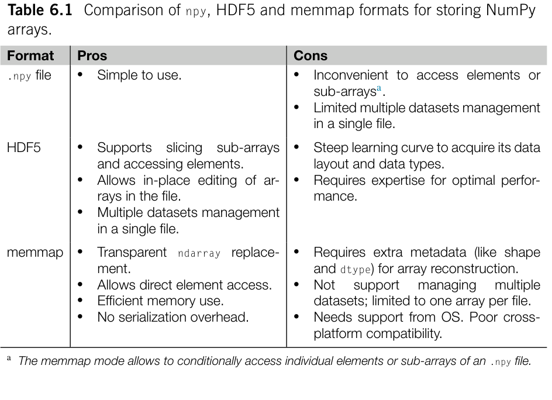
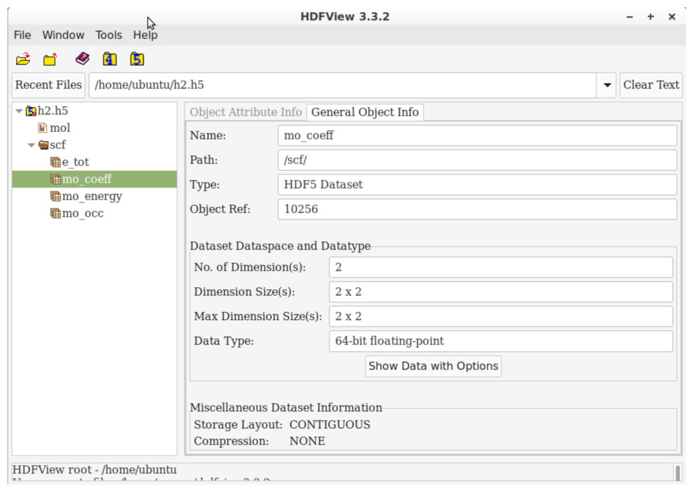

# 输入与输出 {#ch06 .unnumbered}

术语 I/O（输入与输出，Input and Output）通常指计算机核心部件（CPU 和内存）与存储磁盘、网络等辅助设备之间的通信。
I/O 往往伴随计算程序中的诸多技术挑战。为了解决 I/O 性能和数据可用性难题，软件工程界投入了大量研发工作。尽管 I/O 技术表面看并非量子化学应用的核心，我们在实践中却经常遇到与 I/O 相关的挑战，例如文件读写、数据交换、格式转换等。例如，你可能遇到过以下实际情况和问题：

- 有一个需要保存到文件的大型 NumPy 数组。有哪些存储格式可用？应该如何选择？
- 使用 pickle 保存 Python 对象时，偶尔会出现 PicklingError。这个问题通常由什么引起？
- 想用 JSON 格式存储 NumPy 数组，但 JSON 不支持这一操作。该怎么办？
- 将程序的输出重定向到文件后，程序运行期间在文件中却看不到任何输出内容。为什么会这样？
- 程序崩溃后，尝试使用它生成的中间文件继续后续计算，但文件有时会损坏。可能是什么原因？

阅读本章后，你应该能透彻理解这些问题。除了与文件及数据格式相关的技术细节，本章还将探讨网络 I/O 相关技术。在量子化学程序中，开发并行运行的应用时往往会涉及网络 I/O。网络 I/O 也是云计算技术的重要基础，我们将在第 7 章深入讨论云计算。如果你觉得网络 I/O 较为复杂，可以先着眼于其核心概念。至于涉及的各类工具，只要在工作中切实需要，AI 编程助手就能为我们提供强力支持。实际上，本章将广泛借助 AI，展示 AI 工具如何协助设计并开发网络 I/O 程序。

## 6.1 序列化

数据序列化（serialization）与 I/O 密切相关。序列化是将内存中的复杂数据对象转换为流表示形式的过程。在数据保存到文件或通过网络发送之前，通常需要执行这一转换。反序列化（deserialization）则是相反的过程，即从格式化数据流中重建对象。从文件读取或从网络接收数据时，便需要执行这一过程。
在处理 I/O 场景时，数据序列化需要综合权衡几个关键技术维度，包括：

- 二进制格式与人类可读格式之间的选择。人类可读的数据更容易理解，但往往占用更多存储空间，处理开销也更高。
- 跨平台兼容性。在不同架构的平台或不同版本的软件上反序列化数据时，容易出现兼容性错误。
- 目标数据是否支持序列化。尝试序列化 Python 中的任意对象可能导致操作失败。JSON 序列化就是典型例子，它存在诸多类型限制。
- 序列化能否忠实表达原始数据。某些序列化方案为了减小数据体积或简化流程，可能会改变数据的底层格式或数值精度。
- 序列化与反序列化的开销。某些方案（如 Pickle）需要额外的 CPU 算力和内存空间来进行转换，这在高性能应用中会带来不可忽视的负担。

Python 提供了多种数据序列化方案。其中，Pickle 毫无疑问是处理通用 Python 对象的首选。它与 Python 语言高度兼容，天然支持大多数 Python 对象。然而，在处理数组或网络 I/O 时，Pickle 往往不是最佳选择。在这些场景下，其他序列化方案可以提供更好的性能。我们将在第 6.2 至 6.5 节探讨这些方案。
除二进制序列化方案外，某些场景下的数据更适合采用人类可读的格式。在可用选项中，JSON（JavaScript Object Notation）最受欢迎。尽管 JSON 起源于 JavaScript，但它与语言无关，广泛用于不同编程语言间的数据交换。YAML 是另一种流行格式，尤其适合存储配置数据。其他选项还包括适合序列化表格或矩阵的 CSV，以及更复杂但定制能力更强的 XML。
当数据以人类可读的格式序列化时，处理开销通常远高于二进制序列化。虽然存在高性能第三方 JSON 库，但与 Python 内置的 json 模块相比，它们的功能通常相对有限。

### 6.1.1 Pickle

在 Python 中，Pickle 序列化由内置的 pickle 模块提供。该模块包含几个常用函数：用于序列化的 pickle.dump 与 pickle.dumps，以及用于反序列化的 pickle.load 与 pickle.loads。pickle.dumps 函数可以将 Python 对象序列化为 bytes 对象，之后由 pickle.loads 完成反序列化。另一方面，pickle.dump 和 pickle.load 直接读写文件对象，不需要额外的内存来暂存序列化生成的 bytes 对象。

```python
In [1]: import pickle
        with open ('file.pkl', 'wb') as f:
            pickle.dump(obj,f )
        with open ('file.pkl', 'rb') as f:
            obj = pickle.load(f)
In [2]: bytes_stream = pickle.dumps(obj)
        obj = pickle.loads(bytes_stream)
```
如上述示例所示，Pickle 的基础用法非常简明。接下来，我们来考察 pickle 序列化中可能出现的各类问题。

#### 哪些对象可以用 pickle 序列化？

查阅官方文档 [1]，可以用 pickle 序列化的对象包括：

- 内置常量，如 None、True、False；
- 字符串、bytes、bytearray 对象；
- 列表、集合和字典（它们必须只包含可用 pickle 序列化的对象）；
- 函数；
- 在模块顶层定义的类。

此外，NumPy 以及 Pandas、PyTorch、Jax 和 Cupy 等类似库提供的数组和类数组对象，同样可以用 pickle 序列化。如果类实例的所有属性都支持 pickle 序列化，那么该实例本身也能被 pickle 序列化。在多数常见场景下，无需编写额外代码即可让这类对象直接支持序列化。序列化对象时，pickle 会自动递归处理各个属性的序列化。
在 I/O 过程中确保对象支持序列化至关重要；尤其在并行计算中，所有输入参数和输出通常都必须通过 pickle 序列化来传递。然而在实际工程中，并行程序经常会遇到许多无法直接被 pickle 序列化的对象，例如：

- 闭包（closure）与 lambda 函数。
- 文件对象（file object），例如 open 函数返回的对象。
- 生成器对象（generator object），由生成器表达式 [2] 或 yield 语句产生。
- future 对象，由 concurrent.futures 模块创建。
- 迭代器对象（iterator object）。
- 等等。

如果 I/O 过程必须传递这些无法用 pickle 序列化的对象，应该如何处理？
一种可行策略是用可序列化的对象替代它们。例如，若想把闭包分发到远程执行，可以使用 functools.partial 构造替代方案。functools.partial 可以创建绑定了参数的普通函数，使其成为支持 pickle 序列化的常规对象。

```python
In [3]: def pow_n(n):
            def partial_pow(m):
                return pow (m,n )
            return partial_pow
        pickle.dumps(pow_n(3))
AttributeError: Can t pickle local object 'pow_n.<locals>.partial_pow'
In [4]: def pow_n(n):
            return functools.partial(pow, exp=n)
        pickle.dumps(pow_n(3))
Out[4]:
b'\x80\x04\x95C\x00\x00\x00\x00\x00\x00\x00\x8...'
```
由于闭包与 lambda 函数在分布式计算中应用广泛，人们开发了几种支持它们的第三方序列化方案，例如 cloudpickle [3] 和 dill [4]。与通过引用序列化对象的 Python 内置 pickle 模块不同，这些库可以按值序列化函数或类。通过引用序列化意味着函数和类被视为模块的属性，加载时必须能够访问或导入这些模块。相比之下，按值序列化在序列化过程中也会对闭包的主体进行编码，因而在一定程度上牺牲了序列化效率。
处理无法用 pickle 序列化的实例的另一种策略是为类定制序列化方法 [5]。如果实例因为某些无法序列化的属性而无法用 pickle 序列化，我们可以实现 __setstate__ 和 __getstate__ 方法，定制序列化和反序列化过程，将这些属性排除在 I/O 过程之外。

#### 跨平台兼容性

pickle 序列化在不同平台、不同 Python 版本之间是否能够良好兼容？
它具备跨平台兼容性。然而，使用不同协议版本创建的 pickle 文件彼此不兼容。Python 早期引入了多个版本的 Pickle 协议；在不同版本间传输 pickle 文件，容易在旧平台上引发兼容问题。幸运的是，自 Python 3.8 起，默认协议版本（可通过 pickle.DEFAULT_PROTOCOL 查看）已统一为版本 4。鉴于 Python 3.7 已停止维护，不同版本之间的兼容性如今通常不再是问题。

#### 软件版本依赖

尽管 Pickle 协议在近期 Python 版本中已趋于稳定，但这并不能解决第三方库中的序列化兼容问题。外部库的对象可能定义独有的 pickle 序列化规则，这些规则往往随版本变化，从而引发兼容性故障。例如，Pandas DataFrame 的序列化机制在 1.1、1.3 和 2.1 版本中均有调整；由新版 Pandas 导出的 pickle 对象，可能无法在旧版本中反序列化。为解决第三方库的这一兼容隐患，我们可以固定依赖库的具体版本，或者避免在 I/O 环节直接使用 pickle。相比之下，改用 JSON 或 HDF5 等更稳定的格式来自定义序列化方法，通常更为稳妥。

#### 安全问题

Python pickle 存在已知的安全隐患，因此建议只对来自受信任来源的数据进行反序列化。

### 6.1.2 JSON

JSON 文档在结构上很类似于包含嵌套字典和列表的 Python 对象。此处不再详述 JSON 格式规范，因为这些规范极易在其他地方查阅到。
Python 拥有一个处理 JSON 文档的内置模块，提供 json.dump 和 json.dumps 等序列化函数，以及 json.load 和 json.loads 等反序列化函数。它们的调用方式与 pickle 模块中对应函数十分相似：

```python
In [5]: import json
        with open ('file.json', 'w') as f:
            json.dump(obj,f )
        with open ('file.json', 'r') as f:
            obj = json.load(f)
In [6]: json.dumps({ 'a':[ 2, 3]})
Out[6]:
'{"a": [2, 3]}'
In [7]: json.loads( '{"a": [2, 3]}' )
Out[7]:
{'a':[ 2, 3]}
```
JSON 并非 Python 的原生数据格式。因此，将 Python 对象序列化为 JSON 格式时存在若干限制。
JSON 格式仅支持 Python 内置类型的子集，仅限于 None、True、False、数值（整数和实数）、字符串、元组、列表和字典。无法直接使用 JSON 格式序列化 Python 函数或类。
为了能够在 JSON 中序列化更多类型的 Python 对象，json 模块提供了自定义 JSON 编码器与解码器的扩展接口。
例如，JSON 原生并不支持序列化 NumPy 数组。针对这一问题，我们可以将 NumPy 数组转换为嵌套列表，并附加唯一标识标签来标记转换后的数组。通过继承 JSONEncoder 类并重写 default 方法，即可实现这一扩展。在解码包含自定义节点的 JSON 文档时，通过识别该标签，便能借助 NumPy 函数重建原始数组。

```python
class NpArrayEncoder(json.JSONEncoder):
    def default(self, obj):
        if isinstance (obj, np.ndarray):
            return {'python/ndarray': obj.tolist()}
        return super ().default(obj)
def np_decoder(obj):
    if 'python/ndarray' in obj:
        return np.array(obj['python/ndarray'])
    return obj
```
可以按如下方式运行自定义编码器和解码器：

```python
In [6]: arr = np.arange(4.).reshape(2,2 )
        dat_encoded = json.dumps({ 'a': arr, 'b':[ 3, 4]}, cls=NpArrayEncoder)
        dat_decoded = json.loads(dat_encoded, object_hook=np_decoder)
        print(dat_encoded)
        print(dat_decoded)
Out[6]:
{"a":{ "python/ndarray": [[0.0, 1.0], [2.0, 3.0]]}, "b":[ 3, 4]}
{'a': array([[0., 1.], [2., 3.]]), 'b':[ 3, 4]}
```
在某些场景中，我们只能将 Python 对象转换为二进制数据（bytes 或 bytearray 类型）。然而 JSON 格式要求使用 UTF-8 编码，Python 中的 json 模块无法直接处理 JSON 文档中的二进制数据。在这种情况下，我们可以在将二进制数据存入 JSON 之前使用 base64 编码进行转换。Base64 编码是一种将数据转换为 ASCII 字符的通用方法。
为说明如何在 JSON 文档中处理二进制数据，我们仍以 NumPy 数组为例。在 JSON 编码器中，我们可以使用 .tobytes() 方法提取 NumPy 数组的原始内容，然后使用 Python base64 库中的 b64encode 函数将二进制数据编码为 base64 字符串。在 JSON 解码阶段，我们首先将 base64 字符串解码回二进制数据，然后使用 NumPy 函数重建数组。编码器和解码器的程序如下所示。

```python
from base64 import b64encode, b64decode
class NpArrayEncoder(json.JSONEncoder):
    def default(self, obj):
        if isinstance (obj, np.ndarray):
            return {'python/ndarray': b64encode(obj.tobytes()).decode(), 'shape': obj.shape}
        return super ().default(obj)
def np_decoder(obj):
    if 'python/ndarray' in obj:
        return np.frombuffer( b64decode(obj['python/ndarray'])).reshape(obj['shape'])
    return obj
```

### 6.1.3 YAML

YAML 是一种清晰、直观且表达力丰富的数据格式。YAML 格式是 JSON 格式的超集，任何 JSON 文档都可以直接视作 YAML 文档。YAML 通过引入缩进来表示数据层次，并允许在文档中添加注释，从而扩展了 JSON 格式。关于 YAML 格式规范可以在线查阅 [6]。
如果序列化 Python 对象时优先考虑人类可读性，YAML 通常是比 JSON 更合适的格式。这种格式尤其适合配置文件，我们在第 1 章提到的 docker-compose 文件就是一个典型例子。在第 7 章中，你还会看到更多用于管理云配置的 YAML 文档示例。
Python 标准库并不支持读写 YAML 格式文档，必须安装外部库来处理 YAML 数据。常见的选择包括 pyyaml 和 ruamel.yaml 库，两者的用法十分类似。以 ruamel.yaml 库为例，我们可以使用它的 dump() 函数序列化 Python 对象，使用 load() 函数进行反序列化。与 json 和 pickle 模块不同，YAML 库不提供 dumps() 和 loads() 函数；相反，dump() 和 load() 同时用于序列化为字符串以及从字符串反序列化，这与 json 和 pickle 采用的 API 惯例有所不同。

```python
In [8]: from ruamel import yaml
        with open ('file.yaml', 'w') as f:
            yaml.dump(obj,f )
        with open ('file.yaml', 'r') as f:
            obj = yaml.load(f)
```

```yaml
In [9]: yaml.dump({ 'a':[ 2, 3]})
Out[9]:
'a: [2, 3]\n'
In [10]: yaml.load( 'a: [2, 3]\n' )
Out[10
{'a':[ 2, 3]}
```
运行这个代码示例时，由于使用了 yaml.load() 函数，你会收到一条 UnsafeLoaderWarning。发出这一警告的原因，在于 YAML 库中的解码器可以对某些节点执行 Python 函数。这一特性使 YAML 对 Python 对象的支持比 JSON 更广泛，允许编码集合、时间戳、复数乃至 NumPy 数组等多种数据类型。然而，允许解码器执行 Python 函数会引入安全风险，类似于 pickle 反序列化相关的漏洞。我们可以使用 yaml.safe_load() 函数防止解码器执行对象构造函数，尽管这会限制所支持的数据类型。在大多数情况下，yaml.safe_load() 函数已足以反序列化常规 YAML 文档。
YAML 如何处理二进制数据？作为基于文本的格式，YAML 无法原生表示二进制数据。ruamel.yaml 库中的编码器可以自动检测对象中的二进制数据，并使用 base64 编码进行转换。解码 YAML 文档时，这些经过 base64 编码的字符串会被自动识别并还原为二进制对象。这一能力使 YAML 成为比 JSON 更方便的选择。

## 6.2 文件输入输出

在 Python 中，基本文件 I/O 操作通常由 open() 函数及其返回的文件对象处理。我们将跳过 open() 的基础用法，因为编程教材已对此进行了广泛介绍。
在量子化学应用中，I/O 通常指在文件中读写大型数组。由此引出了一个新问题：如何有效地在磁盘上存储和管理高维数组，同时确保访问简便高效？数组存储方案的选择取决于多方面考量：

- 是否需要访问单个元素？
- 是否允许修改文件中数组的内容？
- 数据存储用于临时使用还是长期保存？
- 是否需要在一个文件中保存多个数组？
- 文件是否需要被不同编程语言访问？

有几种用于存储数组的高性能数据格式，例如 NumPy 的 npy 格式、内存映射和 HDF5 格式。这些格式各有其独特特性和特定使用场景，表 6.1 简要比较了这些格式。本节探讨这几类数据格式的功能，性能方面的考量留待第 9 章讨论。



**表 6.1** 用于存储 NumPy 数组的 npy、HDF5 和 memmap 格式比较。

### 6.2.1 npy 格式

NumPy 提供 np.save 函数，可将数组序列化到 .npy 格式的文件中。使用 np.load 函数则可将其加载到内存中。

```python
In [11]: np.save(np.random.rand(2,2 , 3), 'rand.npy')
         a = np.load( 'rand.npy')
```
如果想在一个文件中保存多个数组，NumPy 提供了 np.savez 函数。该函数将多个数组归档到一个 .npz 文件中。访问 .npz 归档的内容时，仍可使用 np.load 函数。np.load 返回一个行为类似于字典的 NpzFile 对象，通过访问相应键即可直接获取保存在 npz 文件中的特定数组。

```python
In [12]: np.savez( 'multi.npz', arr1=np.random.rand(2,2 , 3), arr2=np.eye(4), index=np.arange(5))
         with np.load('rand.npz') as npz_ar:
             print(npz_ar['arr1'].shape)
             print(npz_ar['arr2'].shape)
             print(npz_ar['index'].shape)
Out[12]:
(2,2 ,3 )
         (4,4 )
         (5,)
```
请注意，NumPy 处理 .npz 文件时采用延迟加载策略。只有在引用 .npz 文件中的单个数组时，才会将其加载到内存中。换言之，如果我们只从 .npz 文件读取特定数组，就不必担心读取文件中其他数组带来的 CPU 或内存开销。
.npz 格式本质上是多个 .npy 文件的压缩归档。解压这个 .npz 文件，就能清楚看到 npz 格式的结构，NpzFile 对象的键对应文件名。

```bash
$ unzip multi.npz
Archive: multi.npz
 extracting: arr1.npy
 extracting: arr2.npy
 extracting: index.npy
```
实际上，如果我们手头有多个 .npy 文件，可以手动将它们打包成一个文件来模拟 .npz 归档。np.load 函数能够直接识别并加载这种自定义的 .npz 文件。
默认情况下，np.load 函数会将 .npy 文件中的整个数组全量加载到内存中。如果我们只需要访问其中部分元素，加载整个文件便显得很低效。为解决这一问题，np.load 函数提供了 memmap 模式，允许直接将 .npy 文件映射到内存（见第 6.2.3 节），之后便能像访问常规 NumPy ndarray 一样操作该数组。

```python
In [13]: np.save(np.random.rand(2,2 , 3), 'rand.npy')
         a = np.load( 'rand.npy', mmap_mode= 'r')
         print(a[1,0,:2])
Out[13]:
[0.79594989, 0.4396052 ]
```
np.load 的 memmap 模式有一定限制：它不允许直接修改文件的内容；此外，访问 .npz 文件中的数组时，memmap 模式并不适用。
.npy 格式是 NumPy 数组专用的序列化格式，并非为跨语言互操作而设计。然而，NumPy 保证了 .npy 格式的跨平台兼容性 [7]。.npy 格式存储了准确重建数组所需的全部信息（例如形状和 dtype），使文件可以在任何操作系统和硬件架构上可靠加载。
在纯 Python 程序中，.npy 格式是存储数组的实用选择。它使用方便，几乎不需要关注底层存储细节。不过，.npy 格式不支持直接在文件中编辑或重新排列数组。至于多个数组的管理，.npz 格式本质上只是简单的文件打包归档，并不提供更深入的组织与管理功能。

### 6.2.2 存储

HDF5（Hierarchical Data Formats，层次数据格式）是存储 NumPy 数组的绝佳选择，因为它提供高效的数据存储，可供不同平台和编程语言访问。.npy 存储缺少的功能，例如访问单个元素、切片数组、压缩数组以及直接在文件中就地编辑数组，都可以通过 HDF5 存储轻松实现。



**图 6.1** 在 HDFview 中可视化的 HDF5 文件结构

顾名思义，HDF5 使用层次结构组织文件中的数据，类似于基于目录的文件系统（图 6.1）。在 HDF5 文件中，数组的实际数据保存在 Dataset 中；Group 则包含数据集或其他组，其作用类似目录。
借助 h5py 库，在 Python 中访问 HDF5 文件十分简单。该库将 HDF5 文件映射为字典式对象，数据集或数据组
可以通过键名访问。数据集中的元素可以像 NumPy 数组一样切片或索引。下面的代码示例展示了 h5py 的基本功能：

```python
# Store array. File is opened in writable mode
with h5py.File('example.h5', 'w') as f:
    dataset = f.create_dataset( 'data', shape=(8,), maxshape=(None,))
    dataset[:] = np.arange(8.)
    # let h5py automatically set the dataset name, data types, and shape
    f['data1'] = np.arange(8.)
# Load array
with h5py.File('example.h5', 'r') as f:
    print(f['data'])
# Access individual elements
with h5py.File('example.h5', 'r') as f:
    print(f['data'][4:8])
# Edit contents of a dataset
with h5py.File('example.h5', 'a') as f:
    f['data'][::2] = 0.
# Resize a dataset
with h5py.File('example.h5', 'a') as f:
    f['data'].resize(12)
# Drop a dataset
with h5py.File('example.h5', 'a') as f:
    del f['data']
# Rename a dataset
with h5py.File('example.h5', 'a') as f:
    f.move('data', 'new')
```
由于其数据结构与管理机制的设计，HDF5 文件占用的磁盘空间往往会超过所存数组的总大小。若频繁删除或插入数据集，这种现象尤其明显。
HDF5 的性能在很大程度上取决于 Dataset 的存储配置。优化 HDF5 性能需要专业经验，有时还需重新设计存储结构。我们将在第 9 章更详细探讨 HDF5 存储的优化。

### 6.2.3 映射

内存映射（memmap）是一种允许像读写内存一样直接访问文件的技术。这项技术在处理超出可用物理内存的大型数据集时尤为实用。NumPy 支持将 memmap 作为数组的底层数据缓冲区，操作 memmap 数组与常规数组几无二致。它允许开发者仅读取所需切片，而无需把整个数组全量载入内存。NumPy memmap 的使用十分便捷，创建用于存储数组的 memmap 只需运行如下代码：

```python
arr = np.memmap( 'filename.mmap', shape=(5,5), dtype= 'f8', mode= 'w')
```
写入 memmap 数组的任何内容都会同步到磁盘文件，无需额外的数据序列化过程。要加载磁盘上已有的 memmap 数组，可使用以下命令：

```python
arr = np.memmap( 'filename.mmap', shape=(5,5), dtype= 'f8', mode= 'r+')
```

## 6.3 缓冲

I/O 性能受读写请求频率的影响很大。I/O 设备通常具有较高延迟，频繁发起小型 I/O 请求会显著增加开销。为尽量减少这一开销，操作系统通常在执行实际 I/O 操作前先将数据写入内存缓冲区。只有当缓冲区积累了足够的数据时，才会集中刷写到 I/O 设备中。得益于缓冲 I/O 机制，数据得以按块集中管理，而不是逐个处理。
虽然 I/O 缓冲可以有效提高性能，但处理不当可能导致数据丢失。例如，修改文件后若忘记关闭，可能导致内容写入不完整，因为部分数据仍滞留在缓冲区中。关闭文件时，无论缓冲区是否已满，其中所有数据都会同步写入硬件设备。因此，应对所有打开的文件对象调用 .close() 方法。
Python 建议使用 with 上下文管理文件对象，以确保文件正常关闭。为什么不建议手动调用 .close() 方法？原因在于，若程序因错误或异常而崩溃，.close() 语句很可能不会被执行。对文件对象使用 with 上下文，即便遇到 Python 异常，也能确保在退出程序前关闭文件。
有时，程序可能被用户或系统信号突然终止。即便使用 with 上下文，退出处理程序也可能无法执行，从而造成数据丢失。如果对此有所担忧，可以定期调用文件对象的 .flush()
方法。flush() 方法能确保数据立即同步写入存储设备。例如，对 HDF5 文件完成任何修改后主动刷新缓冲区，就能充分保证文件内部数据的完整性。

```python
with h5py.File('example.h5', 'r') as f:
    f['data'] = np.arange(8.)
    f.flush()
```
在某些场景中，我们可能希望禁用缓冲 I/O。你可能经历过这样的情况：Python 程序的输出被重定向到日志文件时，消息不会立即出现在文件中。这种延迟是因为写入文件的消息被系统缓冲了。为解决这一问题，可以使用 -u 选项强制 Python 对 stdout 禁用缓冲，确保输出立即在日志文件中可见。

```bash
$ python -u example.py > log
```

## 6.4 I/O

内存 I/O 是指像操作普通文件一样，在内存中直接执行数据的读写。尽管该机制初看不起眼，但在实际工程中用途广泛。内存 I/O 主要能够：

- 模拟文件对象的功能。例如，我们可以将 CSV 格式的字符串转换为类文件对象，供 pandas.read_csv() 函数解析，因为该函数只支持文件对象。
- 用作 I/O 缓冲区。内存 I/O 常被用作并行计算期间接收数据的缓冲区。
- 提供拼接字符串（或字节）的高效方法。需要拼接大量字符串时，使用流式内存 I/O 处理可以提高性能，因为它避免了标准字符串拼接中的重复内存分配。
- 用作临时文件，以减轻存储设备的压力。例如，在云中使用虚拟机时，I/O 受到带宽和操作次数等限制。用内存 I/O 替代部分磁盘文件 I/O 可以提高性能。

内存 I/O 可通过 Python 标准库 io 模块实现。利用 io 模块中的 BytesIO 与 StringIO 类，即可创建功能类似文件操作的内存对象。

```python
In [15]: from io import BytesIO, StringIO
In [16]: buf = io.StringIO()
         buf.write('hello')
         buf.write(' world' )
         buf.seek(0)
         print(buf.read())
Out[16]:
'hello world'
In [17]: buf = io.BytesIO()
         buf.write(np.random.rand(10).tobytes())
```

## 6.5 I/O

网络 I/O 指进程或计算节点通过网络交换数据。网络 I/O 的主要应用在于 Web 服务，此时关注的核心是网络的可访问性与可用性，即如何通过网络正确访问远程服务。
乍看之下，Web 服务的网络 I/O 似乎与量子化学无关。从历史上看，量子化学程序多面向高性能计算（HPC）环境设计，其网络 I/O 主要由 MPI（消息传递接口）库承担。MPI 专为 HPC 互连网络设计，以低延迟、高带宽和低故障率著称。使用 MPI 时，我们在 Python 层能做的并不多，程序主要依靠底层 MPI 库处理各类网络通信（更多讨论见第 10 章）。然而，随着云计算资源的快速发展，部分量子化学计算不再强依赖独占式 HPC 环境，可以直接在云上运行。而在云端环境中，不可避免地要采用面向 Web 服务开发的一系列网络 I/O 技术。
与 HPC 提供的低延迟网络设施相比，云计算的网络环境更为复杂，基于 Web 服务的网络通信也需要不同的技术栈。Python 提供了诸如 socket、urllib 和 http 等标准库模块以支持底层网络交互，但实际上大多无需直接调用这些底层工具，因为成熟的第三方软件包提供了更简明的网络编程模型。
网络 I/O 背后的技术涉及大量细节与工程挑战。在后续讨论中，我们将省略繁琐细节，把重心放在核心概念与应用场景上。本节示例大多使用 AI 辅助编码工具生成（辅以少量人工修改）；得益于该领域极其丰富的开源代码储备，AI 经过训练后能出色完成这些编码任务。

### 6.5.1 通过 HTTP 的请求

HTTP 是 Web 服务最基础的协议，也是网络上交换信息最通用的技术。一次 HTTP 请求通常包含以下信息：

- 请求方法：GET、PUT、POST、DELETE 等；
- URI（统一资源标识符）[8]；
- 头部，记录编码、Cookie、用户代理、认证和各类元数据；
- 消息体（通常称为载荷）；远端服务器的 HTTP 响应包括：
- 响应状态码（200、300、400、500 等）；
- 头部中的元数据；
- 响应消息。

requests 库是处理 HTTP 请求和响应最流行的工具。它可以自动组装 HTTP 请求并调用底层库发送出去；收到远程服务器响应后，也能方便地解析并后处理返回内容。
使用 requests 库时，重点在于配置远程服务所需的必要信息，包括：

- 目标 URL；
- 请求方法（例如 GET、POST）；
- URL 参数（出现在末尾 ? 之后），传入 params 参数中；
- 授权或身份验证凭据。

此外，考虑到可能出现网络波动与远程服务异常，为 HTTP 请求配置超时并检查状态码至关重要。若响应是 JSON 文档，response.json() 方法能将数据直接转为 Python 对象。我们可以整理好全部必要信息，提供给 AI 编码助手来生成完整程序。
例如，Basis Set Exchange 数据库支持通过 HTTP 请求下载基组。阅读手册 [9] 可知，该服务允许一次性批量获取多个基组并返回 JSON 格式。随后我们借助 GPT-4 生成请求函数，提示词如下：

```python
Create a Python function to query basis sets from bse:
- URL is "https://www.basissetexchange.org/api/basis/"
- Query multiple elements with the parameters: ?elements=1&elements=6&
    elements=n
- Let the server return basis set in json format.
- Timeout 10s.
```

```python
- Handle error in response.
- Use the following signature
'''
def query_basis_sets(basis_name, elements: List[ str]):
    ...
    return {element1: basis_dat1, element2: basis_dat2}
'''
```
生成的代码如下，其中 requests 库已针对该任务正确配置。

```python
import requests
from typing import List
def query_basis_sets(basis_name, elements: List[ str]):
    # Construct the URL for the API request
    u r l=f "https://www.basissetexchange.org/api/basis/{basis_name}/format/
    json/"
    # Prepare the parameters for the request, including multiple elements
    params = { 'elements': elements}
    try:
        # Make the request to the BSE API with a timeout of 10 seconds
        response = requests.get(url, params=params, timeout=10)
        # Check if the response was successful (status code 200)
        if response.status_code == 200:
            # Parse the JSON response
            data = response.json()
            # Extract and return the basis set data for the requested
    elements
            result = {element: data[ 'elements'][element]['electron_shells']
     for element in elements if str (element) in data['elements']}
            return result
        else:
            # Handle responses with error status codes
            print(f"Error fetching data: {response.status_code}" )
            return {}
    except requests.exceptions.RequestException as e:
        # Handle exceptions raised by the requests library
        print(f"An error occurred: {e}" )
        return {}
# Example usage
elements = [ '1', '6'] # Hydrogen and Carbon
basis_name = 'cc-pVDZ' # Example basis set name
data = query_basis_sets(basis_name, elements)
print(data)
```

### 6.5.2 API

调用远程服务时，另一个关键方面是服务的 API 和数据格式。在各种设计中，REST（表述性状态转移）API 常被 Web 服务接口广泛采用。
你可能会问：REST API 与量子化学应用开发有什么关联？许多数据集都通过 REST API 对外开放。为了处理这些数据，势必要与 REST 服务交互。前面演示过的 Basis Set Exchange（BSE）服务就是一个采用 RESTful 设计并返回相应数据的例子；Materials Project [10] 是另一个例子，它通过 REST API 提供了大量分子和材料的计算结果。此外，访问云上托管的计算资源时，我们也经常需要使用 REST API，第 7 章将专门探讨这一主题。
REST 不是协议或标准，而是一种设计方法。当服务接口被称为 RESTful 时，通常遵循以下通用惯例：

- REST 将服务中的数据与功能抽象为资源，可通过统一资源标识符（URI）访问。URI 是反映数据层次结构的清晰路径。例如在 BSE 服务中，基组数据可通过 /api/basis/<basis_name> 访问，对应参考文献则通过 /api/references/<basis_name> 访问。
- 资源操作与 HTTP 方法关联：GET 用于获取数据，POST 用于创建数据，PUT 用于更新数据等。例如从 BSE 下载基组时使用 GET 方法。
- HTTP 状态码用于表示 REST API 请求的结果，例如状态码 200 表示成功，400 表示请求无效或处理失败。
- REST API 以结构化文本格式传输数据，通常对请求和响应都使用 JSON。
- 除远程资源内容外，REST API 响应通常还包含状态与辅助信息，帮助用户分析和管理数据。辅助信息通常包括 API 版本、数据版本、错误消息、请求时间戳和后续操作的 URL 等。

尽管设计良好结构的 REST API 还有更多建议和指南，但这些主题超出了本书范围。如果你有兴趣进一步了解，可在线查阅更多资料 [11]。

### 6.5.3 通过 HTTP

在 HPC 环境中，通常不需要考虑通过 HTTP 进行远程过程调用（RPC）。这项技术更常用于云环境，任务分布在各个远程计算节点上，RPC 则用于启动并控制具体计算任务。
在 Python 生态中，有几个框架可用于搭建 RPC 服务，例如 Flask [12]、FastAPI [13] 和 json-rpc [14] 等。这里我们以 Flask 框架为例，说明如何开发 RPC 程序。虽然其他框架提供不同的设计和 API，但基本概念完全相通。
假设我们希望开发一个提供 DFT 计算能力的 RPC 服务。该服务的初始版本可以提供以下几项功能：

- 提供接入点，接收带有 DFT 参数的作业，并启动异步计算任务。
- 提供接入点，查询已提交任务的运行状态或计算结果。
- 提供监控接口，查看排队中、运行中或已完成的任务列表。

我们可以把这些需求提供给 AI 编码助手，生成一个 RPC 服务骨架，作为自定义或优化服务的起点。为了引导 AI 工具，我们可以在提示词中使用伪代码概述需求。伪代码能够清晰说明每个 RPC 函数的输入输出格式及对应 URI 等。下面是我们给 GPT-4 的提示词。

```python
Create a HTTP service that serves for DFT calculations online
- Use flask framework.
- Provide REST API
- Implement functionalities below
'''
# REST API: POST at URI '/dft-energy/'
def create_dft_job(geometry: str, basis_set: str, xc_func: str):
    - launch a dft calculation, return an ID for the job
    return {'id': ..., 'status': ...}
# REST API: GET at URI '/dft-energy/<id>'
def query_dft_result(id):
    - get the result or the state of a specific job
    return {'results': ..., 'status': ...}
# REST API: GET at URI '/jobs/<status>'
def list_jobs():
    - list jobs for the specified status, such as pending, running, finished.
    return {'jobs':[ id, id, id], 'status': ...}
'''
```
下面展示了 GPT-4 生成的代码。为求简洁，我们省略了
AI 生成的一些注释和解释。

```python
from flask import Flask, jsonify, request, abort
from uuid import uuid4
from threading import Thread
import time
app = Flask(__name__)
# Simulated database for demonstration purposes
jobs_db = {}
# Job statuses
PENDING = 'pending'
RUNNING = 'running'
FINISHED = 'finished'
def simulate_dft_calculation(job_id, geometry, basis_set, xc_func):
time.sleep(5) # Simulate computation time
 jobs_db[job_id]['status'] = FINISHED
 jobs_db[job_id]['results'] = ...
@app.route('/dft-energy/', methods=[ 'POST'])
def create_dft_job():
 data = request.json
 geometry = data.get( 'geometry')
 basis_set = data.get( 'basis_set')
 xc_func = data.get( 'xc_func')
 if not geometry or not basis_set or not xc_func:
abort(400) # Bad request if any field is missing
 job_id = str(uuid4())
 jobs_db[job_id] = { 'status': PENDING, 'results': None}
 thread = Thread(target=simulate_dft_calculation, args=(job_id, geometry, basis_set, xc_func))
 thread.start()
 return jsonify({'id': job_id, 'status': PENDING}), 202
@app.route('/dft-energy/<id>', methods=[ 'GET'])
def query_dft_result(id):
    job = jobs_db.get( id)
    if job is None:
abort(404) # Not found if the job ID does not exist
    return jsonify({'results': job[ 'results'], 'status': job[ 'status']})
@app.route('/jobs/<status>', methods=[ 'GET'])
def list_jobs(status):
    filtered_jobs = [job_id for job_id, details in jobs_db.items() if
    details['status'] == status]
    return jsonify({'jobs': filtered_jobs, 'status': status})
if __name__ == '__main__':
    app.run()
```
在生成的代码中，如注释所示，DFT 计算部分是模拟的。为了将这个服务器转换为可运行的应用，我们在此集成量子化学程序 PySCF [15] 来执行 DFT 计算。

```python
def simulate_dft_calculation(job_id, geometry, basis_set, xc_func):
    import pyscf
    mf = pyscf.M(atom=geometry, basis=basis_set).RKS(xc=xc_func).run()
    jobs_db[job_id]['status'] = FINISHED
    jobs_db[job_id]['results'] = mf.e_tot
```
为了避免阻塞 RPC 服务，DFT 计算任务以异步方式执行。异步执行是 RPC 服务中的标准做法。如这个代码示例所示，收到请求后，RPC 服务器将计算任务分配给独立线程，并立即返回该任务的作业 ID。今后可以使用这个作业 ID 管理作业。使用线程执行异步作业并不是一种可扩展的解决方案；为了支持大规模计算，可以将任务分发到云中的专用服务或资源。关于云计算的进一步讨论见第 7 章，关于异步计算的更多细节见第 10 章。
请注意，这个代码示例创建了一个内存字典来存储计算状态和结果。为避免意外丢失数据的风险，我们可以考虑使用 Redis 和 MongoDB 等真正的数据库进行持久化存储。在 Python 中，可以使用 redis-py 库 [16] 管理 Redis 数据库。使用 Redis 作为存储服务是一种标准化的数据管理方法，接口代码可以轻松使用 AI 工具生成。
根据这个 RPC 示例，我们可以确定 RPC 服务的基本组件和结构：

- HTTP 服务对象（如 Flask app）及监听 GET 和 POST 请求的各种 URI。
- 用于输入和输出的 JSON 格式。
- 计算密集型任务的异步执行机制。
- 用于跟踪异步任务状态的数据库。

通过对 RPC 服务器程序运行以下命令，我们可以启动一个开发服务器 [17]，该服务器可通过 [127.0.0.1:5000](http://127.0.0.1:5000/)访问。

```bash
$ python dft_rpc.py
```
然而，这个服务器主要用于调试和测试。为了使服务能够可靠地供远程访问，还需要解决部署和网络路由等其他技术问题 [18]。这里我们跳过这些技术细节。
现在让我们把注意力转向这个 RPC 服务的缺点。使用 Python 开发 REST-RPC 服务有哪些局限？

- 数据结构限制。Python 对象不能直接映射到 JSON 数据。若输入参数或输出包含无法序列化为 JSON 的对象，我们需要设计额外机制将其转换为兼容 JSON 表示的格式。
- 错误处理繁琐。若计算遇到任何 Python 错误，这些错误无法通过 HTTP 响应抛出。必须专门设计错误处理约定来传达 Python 异常事件。
- 协议开销明显。一个开销来源是解析 HTTP 协议和路由 HTTP 请求，这些操作有 1–10 毫秒的固定成本；另一开销是 JSON 文档的序列化和反序列化成本。无论实际数据类型为何，都必须在内存与文本间来回转换。REST 服务的开销会影响性能，尤其是对要求高效率和低延迟的应用而言。
- 消息体积与更高的带宽消耗。文本格式不如二进制数据紧凑。此外，REST API 还通过包含字段名、括号和其他辅助文本进一步增加了消息大小。
- 处理二进制编码的挑战。二进制格式数据在量子化学计算中不可避免。例如，我们可能需要访问波函数、密度矩阵和积分，它们通常都是非常大的数组。

JSON 规范本身不支持二进制数据。若要在 JSON 中传输
二进制字节流，必须经过若干层中间数据编码转换。

### 6.5.4 gPRC

gRPC 框架以其高性能和低延迟著称，常用于优化 RPC 系统中的数据传输效率。
gRPC 使用 Protobuf（Protocol Buffers）[19] 序列化和交换数据。Protobuf 是一种跨平台、跨编程语言的数据格式。使用 gRPC 和 Protobuf 开发 RPC 服务有一套标准化流程
[20]。以 DFT RPC 服务为例，该流程通常涉及以下步骤：

1. 在 .proto 文件中定义服务，我们可以在其中指定服务接口与消息结构。

```bash
$ cat dft_rpc.proto
syntax = "proto3";
service DFTCalculation {
  rpc run_dft(DFTJobRequest) returns (DFTJobResponse) {}
}
message DFTJobRequest {
  string geometry = 1;
  string basis_set = 2;
  string xc_func = 3;
}
message DFTJobResponse {
  string job_id = 1;
}
```

2. 使用 grpcio-tools 软件包生成一个名为 dft_rpc_pb2.py 的 protobuf 模块和一个名为 dft_rpc_pb2_grpc.py 的 gRPC 包装模块。

```bash
$ pip install grpcio -tools
$ python -m grpc_tools.protoc -I. --python_out=. --grpc_python_out=.
    dft_rpc.proto
```

3. 使用生成的 Protobuf 模块编写服务器端代码。在服务端代码中，生成的 Protobuf 模块用于数据传输。此外，grpc 模块（由 grpcio 软件包提供）用于创建并启动服务。

```python
from concurrent import futures
import grpc
import dft_rpc_pb2
import dft_rpc_pb2_grpc
class DFTCalculationServicer(object):
    def run_dft(self, request, context):
        import pyscf
        mol = pyscf.M(atom=request.geometry, basis=request.basis_set)
        mf = mol.RKS(xc=request.xc_func).run()
        return dft_rpc_pb2.DFTJobResponse(energy=mf.e_tot)
def serve():
    server = grpc.server(futures.ThreadPoolExecutor(max_workers=10))
    dft_rpc_pb2_grpc.add_DFTCalculationServicer_to_server( DFTCalculationServicer(), server)
    server.add_insecure_port("[::]:50051")
    server.start()
if __name__ == '__main__':
    serve()
```

4. 编写客户端。生成的 Protobuf 模块也用于客户端。为简化调用，建议在客户端内实现一个与 RPC 服务器上对应函数同名的函数。

```python
import grpc
import dft_rpc_pb2
import dft_rpc_pb2_grpc
def run_dft(geometry, basis_set, xc_func):
    with grpc.insecure_channel('localhost:50051') as channel:
        stub = dft_rpc_pb2_grpc.DFTCalculationStub(channel)
        response = stub.run_dft(dft_rpc_pb2.DFTJobRequest( geometry=geometry, basis_set=basis_set, xc_func=xc_func
        ))
        return response.energy
if __name__ == '__main__':
    e = run_dft( ' O000 ;H 0.757 0.587 0; H -0.757 0.587 0' , 'sto-3g', 'b3lyp')
    print("DFT job results:" ,e )
```

### 6.5.5 arrow

为 Python 应用程序实现 gRPC 需要根据 Protobuf 的特性设计数据格式及接口。若 RPC 的输入和输出涉及复杂数据对象（例如各种 NumPy 数组或 Pandas DataFrame 对象），就必须在 .proto 文件中指定每个对象的表示形式，这可能相当不便。对于 Python 应用，Apache Arrow 库 pyarrow [21] 可用作 gRPC 框架的替代方案。
Apache Arrow 推出了 Flight [22]，这是一个构建在 gRPC 之上的 RPC 框架。Flight 框架不仅提供 Python 式的使用体验，还受益于 gRPC 的数据通信效率。
要使用 Flight 创建 RPC 服务，我们需要继承其 FlightServerBase 类。该类提供了一个钩子 do_action，用于传输数据并在 RPC 服务器上执行预定义操作。例如，通过重写这个钩子方法，我们可以实现一个 DFT RPC 服务，直接输出总能量和一个轨道能量数组。

```python
import pickle
import json
import numpy as np
import pyarrow.flight as flight
def run_dft(geometry, basis_set, xc_func):
    import pyscf
    mf = pyscf.M(atom=geometry, basis=basis_set).RKS(xc=xc_func).run()
    return mf.e_tot, mf.mo_energy
class DFTFlightServer(flight.FlightServerBase):
    def do_action(self, context, action):
if action.type == 'run_dft': # (1)
            # Decode inputs from the action body
            params = json.loads(action.body.to_pybytes())
            energy, orbital_energies = run_dft( params['geometry'], params['basis_set'], params['xc_func'])
yield flight.Result(pickle.dumps(energy)) # (2)
            yield flight.Result(pickle.dumps( (orbital_energies.shape, orbital_energies.dtype)))
            yield flight.Result(orbital_energies.data)
        else:
            raise NotImplementedError
if __name__ == '__main__':
    server = DFTFlightServer( 'grpc://localhost:50011')
    server.serve()
```
do_action 方法可以处理所有请求（在此上下文中称为 action），并根据第 (1) 行中 action.type 的值分派它们。请注意，
do_action 方法并非设计为返回一个值。相反，它应当作为生成器（generator）或迭代器（iterator）工作，产出 PyArrow Result 对象，如第 (2) 行所示。
在 Flight 框架中，输入输出（I/O）操作通过 PyArrow 缓冲区（buffer）处理。PyArrow 缓冲区的工作方式类似于 Python 内置的缓冲区协议（buffer protocol）（bytes 和 bytearray）以及 memoryview 对象[]。它不适用于直接广播一般的 Python 对象。我们必须在通信前使用 pickle.dumps 或 json.dumps 之类的方法将其转换为字节。然而，对于 NumPy 数组，可以直接访问其 memoryview（通过 .data 属性），从而绕过序列化（serialization）的开销。此外，对于 Pandas 对象，PyArrow 专门提供了 pyarrow.serialize_pandas 和 pyarrow.deserialize_pandas 函数，以实现快速的序列化和反序列化（deserialization）操作。
处理大规模数据时，将序列化后的数据全部存储在内存中可能导致显著的开销。为解决这一问题，Flight 框架提供了用于分发数据的流式方法（streaming methods）[24]，包括用于下载的 do_get 和用于上传的 do_put。
在客户端，我们使用 FlightClient 类与服务器建立连接。通过调用 do_action() 方法，请求被转发到服务器，触发服务器端的 do_action()。do_action() 的响应是一个生成器。我们可以使用 Python 的 next() 函数迭代访问返回值。与服务器端的过程类似，输入和输出都以缓冲区协议表示，需要手动进行序列化和反序列化。

```python
import pickle
import json
import numpy as np
from pyarrow import flight
def run_dft(geometry, basis_set, xc_func):
    request = json.dumps({
        "geometry": geometry, "basis_set": basis_set, "xc_func": xc_func
    })
    action = flight.Action( 'run_dft', request.encode())
    with flight.FlightClient('grpc://localhost:50011') as client:
        result = client.do_action(action)
        energy = pickle.loads( next(result).body)
        shape, dtype = pickle.loads( next(result).body)
        orbital_energies = np.frombuffer( next(result).body, dtype).reshape(shape)
        return energy, orbital_energies
if __name__ == '__main__':
    e, mo_energy = run_dft( ' O000 ;H 0.757 0.587 0; H -0.757 0.587 0' , '
    sto-3g', 'b3lyp')
    print("DFT energy:" ,e )
    print("orbital energies:" , mo_energy)
```
这是 PyArrow Flight 框架的一个最小示例。要在实际产品中开发远程过程调用（RPC）服务，通常需要实现包含身份验证、TLS 加密传输及其他功能的中间件（middleware）。这些组件的详细信息可见 Flight 文档 [24]。
除 PyArrow 之外，Dask [25] 和 Ray [26] 等其他库也提供了 RPC 服务的解决方案。这些库各自侧重于 RPC 通信的不同方面。我们鼓励读者查阅它们的文档，了解如何有效利用这些工具。

## 小结

本章涵盖了一系列技术主题，包括数据序列化格式、用于数组存储的文件 I/O 以及网络 I/O 处理。对于数据序列化，Python 内置的 pickle 模块通常是合适选择。然而，对于配置文件和网络请求等特定场景，JSON 和 YAML 等人类可读格式更受青睐。对于文件 I/O，可选方案包括 HDF5 格式、NumPy 原生的 npy 格式与 NumPy memmap。这些技术各有优势，不存在适用于所有场景的单一优胜者。对于网络 I/O，性能要求在很大程度上决定了技术选型：为了实现简单，基于 JSON 的 REST API 是可行选择；而对于要求高性能的场景，则可以考虑 gRPC 及其衍生技术（如 PyArrow）。

## 参考文献

::: {.ref-list}

[1] Python Software Foundation, Python documentation what can be pickled and unpickled, [python.org](https://docs.python.org/3/library/pickle.html#what-can-be-pickled-and-unpickled), 2024.

[2] Python Software Foundation, Python documentation - generator expressions, [python.org](https://docs.python.org/3/reference/expressions.html#generator-expressions), 2024.

[3] Cloudpipe Development Team, Cloudpickle, [github.com](https://github.com/cloudpipe/cloudpickle), 2024.

[4] The Uncertainty Quantification Foundation, dill: serialize all of Python, [readthedocs.io](https://dill.readthedocs.io/en/latest/), 2024.

[5] Python Software Foundation, Python documentation - pickling class instances, [python.org](https://docs.python.org/3/library/pickle.html#pickling-class-instances), 2024.

[6] YAML Language Development Team, Yaml ain’t markup language (yaml) version 1.2, [yaml.org](https://yaml.org/spec/1.2.2/), 2024.

[7] NumPy Developers, NumPy documentation - numpy.lib.format, [numpy.org](https://numpy.org/doc/stable/reference/generated/numpy.lib.format.html), 2024.

[8] T. Berners-Lee, R. Fielding, L. Masinter, Uniform resource identifier (uri): generic syntax, [ietf.org](https://datatracker.ietf.org/doc/html/rfc3986), 2005.

[9] B. Pritchard, Basis set exchange api documentation rest api reference, [github.io](https://molssibse.github.io/basis_set_exchange-apidoc/reference.html#), 2024.

[10] A. Jain, S.P. Ong, G. Hautier, W. Chen, W.D. Richards, S. Dacek, S. Cholia, D. Gunter, D. Skinner, G. Ceder, K.A. Persson, Commentary: The Materials Project: a materials genome approach to accelerating materials innovation, APL Materials 1 (1) (2013) 011002, [DOI](https://doi.org/10.1063/1.4812323), [aip.org](https://pubs.aip.org/aip/apm/article-pdf/doi/10.1063/1.4812323/13163869/011002_1_online.pdf).

[11] L. Gupta, Rest api tutorial, [restfulapi.net](https://restfulapi.net/), Dec. 2023.

[12] Pallets, Flask documentation, [palletsprojects.com](https://flask.palletsprojects.com/en/latest/), 2024.

[13] S. Ramírez, FastAPI, [github.com](https://github.com/tiangolo/fastapi).

[14] JSON-RPC Working Group, Json-rpc specification, [jsonrpc.org](https://www.jsonrpc.org/specification), 2024.

[15] The PySCF Developers, Quantum chemistry with Python, [pyscf.org](https://pyscf.org/), 2024.

[16] Redis Inc, redis-py - Python client for redis, [readthedocs.io](https://redis-py.readthedocs.io/en/stable/), 2024.

[17] Pallets, Flask documentation - development server, [palletsprojects.com](https://flask.palletsprojects.com/en/latest/server/), 2024.

[18] Pallets, Flask document - deploying to production, [palletsprojects.com](https://flask.palletsprojects.com/en/latest/deploying/), 2024.

[19] Google LLC, Protocol buffers documentation, [protobuf.dev](https://protobuf.dev/), 2024.

[20] gRPC Authors, Basics tutorial - a basic tutorial introduction to grpc in Python, [grpc.io](https://grpc.io/docs/languages/python/basics/), 2024.

[21] N. Richardson, I. Cook, N. Crane, D. Dunnington, R. François, J. Keane, D. Moldovan-Grünfeld, J. Ooms, J. Wujciak-Jens, Apache Arrow, arrow: Integration to ‘Apache’ ‘Arrow’, [apache.org](https://arrow.apache.org/docs/r/), 2024.

[22] W. McKinney, Introducing apache arrow flight: a framework for fast data transport, [apache.org](https://arrow.apache.org/blog/2019/10/13/introducing-arrow-flight/), 2019.

[23] Apache Software Foundation, Apache arrow document memory and io interfaces, [apache.org](https://arrow.apache.org/docs/python/memory.html), 2024.

[24] Apache Software Foundation, Apache arrow cookbook - arrow flight, [arrow](https://arrow). apache.org/cookbook/py/flight.html, 2022.

[25] Dask Development Team, Dask: library for dynamic task scheduling, [pydata.org](http://dask.pydata.org), 2016.

[26] P. Moritz, R. Nishihara, S. Wang, A. Tumanov, R. Liaw, E. Liang, M. Elibol, Z. Yang, W. Paul, M.I. Jordan, I. Stoica, Ray: a distributed framework for emerging AI applications, in: 13th USENIX Symposium on Operating Systems Design and Implementation (OSDI 18), USENIX Association, Carlsbad, CA, 2018, pp. 561–577, [usenix.org](https://www.usenix.org/conference/osdi18/presentation/moritz).

:::

