# 使用云计算 {#ch07 .unnumbered}

如果我们需要开展大量量子化学模拟，这些计算应该放在哪里运行？许多人首先想到的可能是超级计算机或高性能工作站。除了这些传统选择，云计算也是一种极具吸引力的可行替代方案。
虽然量子化学模拟以往多在超级计算机上运行，但把云资源作为大规模化学模拟的替代手段十分值得考虑。与往往受制于机时配额或排队等待的超级计算机不同，云计算通常能够提供近乎弹性的充沛资源。这种充沛的算力让云计算在高通量量子化学模拟中尤为引人瞩目。此外，云端还提供了许多超级计算机上可能未配备的现代化工具与异构硬件。有人或许看重超级计算机的独特优势，认为云计算不太可能完全取而代之。这种看法固然客观，但云计算的普及及其深远影响已不容忽视。我们完全可以把云作为补充算力纳入日常研究。
为了有效利用云计算，我们需要建立不同于传统超级计算机的新认知。具体来说，云计算需要综合权衡以下几个技术方面：

- 计算、存储和网络资源位于哪里？我们如何访问这些资源？
- 如何配置服务并管理其配置？
- 如何设计工作流并编排工作流中的计算资源？
- 如何在云上调度并扩展并行作业？

使用云计算通常需要编写专门的程序。在这类程序中，大量工作集中在配置云服务并确保其持续可用。这些技能与 DevOps 运维更为贴近。虽然 DevOps 技能不直接参与算法设计或科学程序的底层实现，却能显著提升生产力。本章将探讨云计算相关的编程技术。我们不会逐一提供云服务分步手册，而是介绍总体设计思路，其余具体配置借助 AI 助手完成。

## 7.1 云计算

云计算提供多样技术与能力以调度计算资源。探讨云技术的全部细节超出了本书范围。本节讨论云计算的基本原理。我们主要使用 Python 语言，通过调用云 API 部署计算任务。
请注意，云计算根据实际消耗的资源收费。这不仅包括 CPU 核心时长，存储、数据传输、数据库和公网 IPv4 地址也都是计费资源。特别是数据传输，若规划不当很容易产生意外费用。在任务结束后务必妥善释放资源。尽管云计算技术已发展多年，目前主流云厂商仍未提供足够「智能」的方案来自动平衡成本与性能。云计算的一项关键技能是合理编排云资源，以最大限度减少开销。面对特定计算需求，往往有多种策略能产生相同结果。如果预计会大量使用云资源，仔细研读云厂商文档是很有必要的。

### 7.1.1 云与超级计算机之间的区别

在云端运行模拟任务，与在配备 PBS 或 SLURM 作业调度系统的传统超级计算机上运行大有不同。超级计算机通常提供贴近单台 Linux 电脑的操作体验。从这个角度来说，云计算显得不够直观。两种截然不同的使用体验，很大程度上源于云平台与传统超级计算机在系统架构上的本质差异：

- 可访问性。传统超级计算机通常提供所有计算节点均可访问的大规模高性能全局文件系统。在不同节点之间共享数据很简单。操作全局文件系统中的文件类似于访问本地磁盘上的数据。相比之下，云通常不采用全局文件系统架构，而是将文件存储在云对象存储中，例如 AWS S3 或 Azure Blob。访问存储在这些位置的文件需要使用特定工具或 API。
- 软件栈。传统超级计算机通常在运行相同操作系统的同构环境中提供预装软件。在云中，软件安装在虚拟机（VM）或 Docker 镜像中。每个软件的运行环境可以更加灵活、隔离和不同。对于特定任务，用户只使用包含必要软件的虚拟机或镜像。
- 调度。超级计算机使用 PBS 或 SLURM 等作业调度系统来管理作业并确定其优先级。这些系统在可重复使用的计算节点上启动作业，这些节点的环境与交互会话中使用的环境几乎相同。云计算平台有自己的作业调度

机制。各个作业分别配置，并在云中隔离的虚拟机内执行。

- 并行执行。超级计算机可以提供低延迟、高性能的网络，从而实现处理器之间的高效通信。通过 MPI（消息传递接口）在不同进程之间交换数据相对简单。在云中，实现这种程度的连接并不那么直接。

### 7.1.2 工作流

通常，我们需要设计一个工作流来利用云计算资源并管理计算任务。工作流本质上是按特定顺序执行的一系列预定义计算任务。我们可能需要开发一系列 Python 程序来连接工作流的各个组件。
设计工作流时应考虑云架构的特点，特别是涉及以下问题：

- 如何访问输入数据？例如，大量输入数据可以存储在云对象存储中，并通过云存储 API 访问。输入参数可以存储在 GitHub 或 GitLab 中，并通过 HTTP 请求或 Git 操作访问。或者，必要的输入数据可以缓存在 Docker 镜像中。此外，数据库也可以作为提供输入数据的一种选择。
- 如何保存输出？云对象存储和数据库是保存结果的两种常见选择。也可以通过远程过程调用（RPC）服务将结果发送给接收方。
- 如何连接工作流的不同组件，以及如何在它们之间交换消息？可以使用云对象存储和数据库交换数据。RPC 经常用于连接不同的服务。
- 计算需要什么资源？根据不同设备的性能和成本，我们可能需要确定合适的资源组合，包括 CPU 核心数、GPU 卡数、内存大小、临时磁盘空间和网络可访问性。
- 使用哪些 Docker 镜像或虚拟机镜像？镜像中应安装哪些软件或工具，以及应如何配置它们？

例如，假设我们需要设计一个工作流，使用密度泛函理论（DFT）生成分子的势能面（PES）。这个工作流涉及两种执行器：分子几何结构生成器和执行 DFT 计算的执行器。如图 7.1 所示，这两个执行器按以下方式协作：

1. 几何结构生成器读取分子的初始几何结构，并为 PES 生成一个粗粒度网格。
2. 假设云供应商是 AWS，几何结构生成器将所有几何结构文件上传到对象存储，例如 AWS S3。

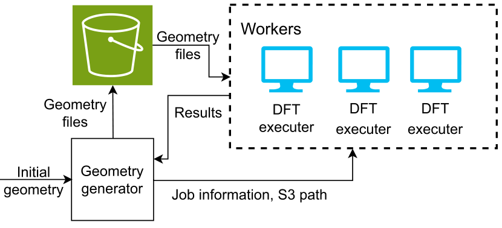

**图 7.1** 使用 DFT 的 PES 工作流

3. 几何结构生成器随后调用云 API 启动若干工作进程，执行 DFT 计算。在每个作业中，元数据，例如几何结构文件的 S3 路径，作为输入提供给 DFT 执行器。
4. DFT 执行器下载一个几何结构文件，然后执行预定义的

DFT 计算。

5. DFT 执行器将结果上传到 S3 存储，然后通过 RPC 向几何结构生成器发送状态

信号。

6. 几何结构生成器根据现有结果在 PES 上创建更多网格，并返回步骤 2 以继续工作流。或者，如果已生成足够的数据点，它可以选择终止工作流。

该工作流在资源利用方面具有以下特点：

- 工作流主要由 CPU 密集型任务组成。
- 对存储空间和 I/O 操作的需求很小。
- 如果所选的 DFT 程序支持使用 GPU 设备，则可以分配 GPU 工作进程。

关于软件栈，为了支持该工作流中定义的任务，我们可以创建一个包含所有必要组件的 Docker 镜像：几何结构生成器、DFT 程序、云管理工具包（如 awscli）以及用于 RPC 服务的某些 Python 库。
为了设计完整而稳健的工作流，还需要考虑其他事项，例如 DFT 计算的容错、认证方案、工作流重启方案等。开发云计算工作流类似于开发程序的过程。在将其部署到云上之前，可能需要持续测试和调试。一旦工作流完全运行，就可以方便地在云中反复执行类似作业。

### 7.1.3 资源

虚拟机（VM），例如 AWS EC2 和 Azure VM，是云平台提供的基础计算资源。执行计算任务最简单的方法是在云虚拟机中交互式执行计算。为了使每台虚拟机的运行环境可重现，我们可以通过预安装常用软件栈来自定义虚拟机镜像 [1]。此外，我们可以利用块存储持久保存配置文件和数据 [2]。结合自定义虚拟机镜像和持久存储，我们可以轻松启动具有相同环境的虚拟机进行计算。
为了高效执行一批计算任务，我们需要一种非交互式方案来管理计算资源和环境。有几种选择可供考虑。一种选择是使用云平台提供的 Batch 服务，例如 AWS Batch、Azure Batch 或 Google Batch。另一种选择是使用容器化解决方案，例如 AWS ECS、Azure ACS 或 Google GKE。虽然这些云平台的用户界面（UI）不同，但容器化方法的设计和概念相似。下面我们将以 AWS ECS（弹性容器服务）[3] 为例，展示如何部署容器化计算任务。
如果你刚刚注册了一个新的 AWS 账户，可能需要几个准备步骤来配置基本的云计算环境，包括：

- VPC（虚拟私有云）[4]，这是可以分配虚拟网络、虚拟机和私有存储的基础设施。
- 子网（Subnet）[5]，它提供 VPC 内的一组 IP 地址。
- S3（简单存储服务）[6]，一种提供持久数据存储的对象存储服务。
- ECR（弹性容器注册表）[7]，它提供用于托管私有 Docker 镜像的仓库。
- 安全组（Security Groups）[8]，充当防火墙，控制虚拟机的入站和出站网络流量。
- AWS 凭证 [9]，提供登录虚拟机所需的密钥和认证。
- IAM（身份与访问管理）角色 [10]，管理访问云中各种服务的权限。

在下面的 DFT PES 计算代码示例中，我们将使用 ECS、S3 存储、ECR 和其他相关服务。如图 7.2 的截图所示，使用 AWS Web 控制台配置 S3 服务很简单。我们创建了一个名为 python-qc-3vtl 的 S3 存储桶供以后使用。请注意，AWS S3 存储桶名称在全球所有 AWS 账户中都是唯一的。例如，存储桶名称 python-qc 已被其他用户使用。因此，我们无法使用 python-qc 作为项目的存储桶名称。为确保唯一性，我们添加了后缀 -3vtl。在你自己的实现中需要选择不同的名称。AWS IAM 权限系统很复杂。为简单起见，我们创建了一个能够访问广泛 AWS 服务的 IAM 策略，如下所示：

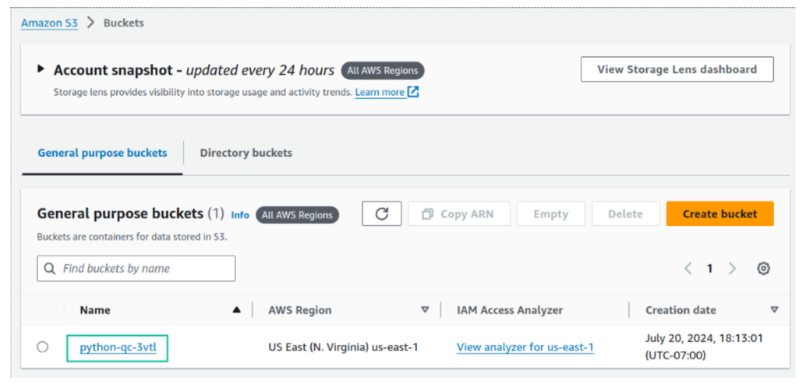

**图 7.2** 使用 AWS Web 控制台创建 AWS S3 存储桶

```yaml
{
        "Version": "2012-10-17", "Statement":[
                {
                        "Effect": "Allow", "Action":[
                                "ec2:*", "ecs:*", "ecr:*", "s3:*", "lambda:*", "sqs:*"
                        ], "Resource": "*"
                }
        ]
}
```
请注意，此 AWS IAM 配置是不安全的。在实际应用中，建议仔细配置 IAM 规则，并将访问权限限制为仅访问必要的服务和资源。更多细节请参阅 AWS 在线文档。
容器化方法需要专门为计算任务设计的 Docker 镜像。假设目标是建立第 7.1.2 节中提到的 DFT PES 工作流，可以创建以下 Dockerfile：

```text
FROM nvidia/cuda:12.0.1-runtime-ubuntu22.04
# Install necessary dependencies
RUN apt-get update && apt-get install -y python3 python3-pip \
    && rm -rf /var/lib/apt/lists/ *
RUN pip install --no-cache-dir pyscf gpu4pyscf-cuda12x awscli boto3
COPY start.sh /app/start.sh
WORKDIR /app
```
为了适应需要 GPU 加速的场景，基础镜像设置为 nvida/cuda:12.0.1-runtime 镜像，它提供 CUDA 12 运行环境。对于 DFT 计算引擎，我们使用量子化学程序 PySCF [11] 及其 GPU 加速变体 gpu4pyscf-cuda12x [12,13]。安装 awscli 工具包和 boto3 库是为了管理 AWS 服务并与之交互。start.sh 脚本负责管理计算和数据传输任务。该脚本实现如下：

```yaml
#!/bin/bash
# Set the default time limit to 1 hour
TIMEOUT=${2:-3600}
S3PATH=$1
aws s3 copy $S3PATH/job.py ./
timeout $TIMEOUT python job.py > job.log
aws s3 copy job.log $S3PATH/
```
计算任务定义在 Python 程序 job.py 中，该程序应由几何结构生成器服务创建。为了防止计算无限期运行，我们使用 GNU timeout 工具对计算强制执行时间限制。计算结果上传到 S3 存储。然后，我们构建此镜像并将其上传到 AWS ECR 服务：

```bash
$ aws ecr create -repository --repository-name python-qc/dft-gpu
$ docker build -t 987654321000.dkr.ecr.us -east-1.amazonaws.com/python-qc/
    dft-gpu:1.0 .
$ docker push 987654321000.dkr.ecr.us -east-1.amazonaws.com/python-qc/dft-
    gpu:1.0
```
12 位数字 987654321000 只是账户 ID 的占位符。你应该将其替换为自己的实际账户 ID。
要在 AWS ECS 上部署计算工作流，首先需要定义一个 ECS 集群。ECS 集群包含虚拟机硬件资源、操作系统、网络配置以及各种访问权限的规格。使用 awscli 工具包提供的命令，我们可以建立一个以默认设置在虚拟机上运行的基本集群，称为 FARGATE 模式 [14]。

```bash
$ aws ecs create -cluster --cluster-name ecs-basic-cluster
```
FARGATE 模式集群足以探索 AWS ECS 的基本功能。然而，该集群不支持 GPU 加速。为了使用 GPU，我们需要在创建 ECS 集群时为 EC2 GPU 实例启用 ASG（自动扩缩组）[15]。建议使用 AWS Web 控制台配置这种 ECS 集群（图 7.3）。有关 ECS 集群配置的详细说明，请参阅 AWS ECS 文档 [3,16]。

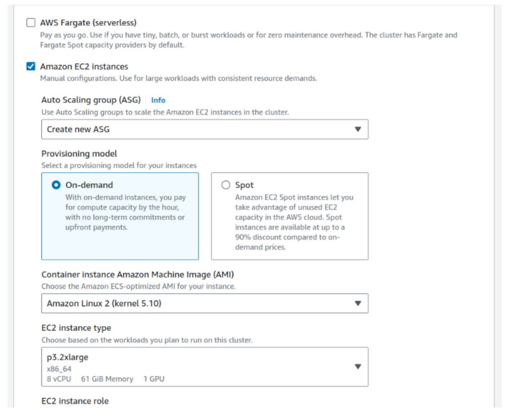

**图 7.3** 为 EC2 GPU 实例创建带有 ASG 的 ECS 集群

假设名为 python-qc 且支持 GPU 的 ECS 集群已配置完毕。下一步是在该 ECS 集群上创建任务定义。任务定义相当于计算任务的配置模板，用来指定 CPU、内存和 Docker 镜像等资源规格。任务定义可以在 AWS 网页控制台上直接配置。
为了方便后续维护，我们将改为通过编程方式生成并管理任务定义。核心思路是结合代码生成与 AWS Python SDK boto3 来自动化管理配置。为了
提高配置的可读性，我们将其存为 YAML 格式。boto3 涉及大量底层云 API 细节，手动编写较为繁琐。得益于 AI 编程工具的进步，我们不必再逐项深究复杂的 boto3 接口文档。配置云资源正是 AI 助手大显身手的场景。开源社区沉淀了海量云 API 代码范例，AI 模型对此训练充分，生成的代码相当准确。
这里，我们借助 GPT-4 生成配置样板，再按需微调以满足具体计算需求。不同的 AI 助手生成的代码细节可能略有差异，但对当前任务而言影响不大。我们给 GPT 的提示词如下：

```text
Create a Python script to register an AWS ECS task definition:
- Use GPU instances on ECS
- Use boto3 library
- Follow the template below
'''
config = '''
- ECS configuration in YAML.
- Include docker image, the CPU, memory and other necessary requirements in
     configuration.
'''
py_config = convert YAML config to Python code
ecs_client = boto3.client('ecs')
response = ecs_client.appropriate_ecs_function( **py_config)
'''
```
GPT-4 的输出如下：

```python
import boto3
import yaml
# Your YAML configuration for the ECS task
config = '''
taskDefinition:
  family: gpu-task-family
  networkMode: "awsvpc"
  containerDefinitions:
    - name: gpu-container
      image: your-docker-image
      cpu: 1024
      memory: 2048
      resourceRequirements:
        - type: GPU
          value: "1"
  requiresCompatibilities:
    - EC2
  memory: "4GB"
  cpu: "1024"
'''
# Convert YAML config to Python dictionary
py_config = yaml.safe_load(config)
# Initialize a boto3 client for ECS
ecs_client = boto3.client( 'ecs')
# Register the ECS task definition
response = ecs_client.register_task_definition( **py_config['task_definition'])
```
虽然可以改进提示词以生成更好的代码样例，但在当前情境下我们不再进行这种改进。上面的代码样例足够清楚地说明了 boto3 ECS 客户端的 register_task_definition 函数的参数。生成的 YAML 配置样例也很容易理解。基于这个代码样例，我们可以调整某些设置，得到如下注册任务定义的脚本：

```python
config_tpl = '''
task_definition:
  family: dft-demo
  networkMode: "awsvpc"
  containerDefinitions:
    - name: dft-demo-1
      image: 987654321000.dkr.ecr.us-east-1.amazonaws.com/python-qc/dft-gpu
    :1.0
      cpu: 4
      memory: 2048
      resourceRequirements:
        - type: GPU
          value: "1"
  requiresCompatibilities:
    - EC2
  memory: "4GB"
  cpu: "4"
'''
py_config = yaml.safe_load(config)
ecs_client = boto3.client( 'ecs')
response = ecs_client.register_task_definition( **py_config['task_definition'])
```

```python
print(yaml.dump(response))
```
如果之前已经创建了采用 FARGATE 模式的基本 ECS 集群，可以从任务配置中删除设置 "resourceRequirements"。
使用类似的方法，我们可以基于上述任务定义来定义可运行的任务，并将其提交给 ECS。可运行任务需要使用 run_task 函数。这里省略 GPT-4 生成的中间代码示例，只展示修改后的脚本。

```python
import boto3
import jinja2
import yaml
task_config_tpl = jinja2.Template( '''
cluster: python-qc
taskDefinition: dft-demo
count: 1
overrides:
  containerOverrides:
  - name: dft-demo-1

    image: {{ image }}

    command:
    - /app/start.sh
    - s3://python-qc-3vtl/{{ task }}/{{ job_id }}
    - "{{ timeout or 7200 }}"
    environment:
    - name: JOB_ID
      value: "{{ job_id }}"
    - name: OMP_NUM_THREADS
      value: "{{ threads or 1 }}"

  memory: {{ threads * 2} } G B

  memory: 2GB

networkConfiguration:
  awsvpcConfiguration:
    subnets:

    -{ {v} }

''')
ec2_client = boto3.client( 'ec2')
```

```python
resp = ec2_client.describe_subnets()
subnets = [v[ 'SubnetId'] for v in resp['Subnets']]
config = task_config_tpl.render( task='dft-demo', job_id= '219a3d6c', threads=2, subnets=subnets)
config = yaml.safe_load(config)
ecs_client = boto3.client( 'ecs')
resp = ecs_client.run_task( **config)
print(yaml.dump(resp))
```
如果任务提交成功，ECS 将启动一台配备 GPU 设备的 EC2 虚拟机。然后，它根据任务和任务定义中指定的参数，在虚拟机内执行 docker run 命令。例如，本例中的任务实际上等同于以下 docker run 命令：

```bash
$ docker run --runtime=nvidia -container-runtime \
    -e OMP_NUM_THREADS=2 --cpus 2 --memory 8G \
    987654321000.dkr.ecr.us-east-1.amazonaws.com/python-qc/dft-gpu:1.0 \
    /app/start.sh s3://python-qc-3vtl/dft-demo/219a3d6c 7200
```
ECS 任务并不限于单个运行至完成的作业。我们可以使用 ECS 工作节点运行 Dask、Ray 或其他作业调度器。这些调度器可以执行各种类型的任务，简化配置各个 ECS 任务的复杂过程。我们将在第 7.2 节探讨这种方法。

### 7.1.4 云服务之间的通信

在这个势能面（PES）工作流中，我们可能希望根据势能面计算的进展动态调整几何构型网格。为此，需要在几何构型生成程序与 DFT 计算任务之间建立交互。几何构型生成程序可以先在势能面上生成粗粒度网格，然后根据已完成的结果细化网格，而不是一次生成势能面上的所有网格。下面的函数 geometry_on_pes 给出了这一功能的原型。

```python
def geometry_on_pes(molecule, pes_params, existing_results=None):
    '''Generates molecule geometry for the important grids on PES
    Arguments:
    - molecule: Molecular formula
    - pes_params: Targets to scan, such as bonds, bond angles.
    '''
    # This function should produce molecule configurations
    # based on the results of accomplished calculations.
    # Here is a fake implementation to demonstrate the functionality.
    if len (existing_results) > 1:
        return []
    h2o_xyz = ' O000 ;H 0.757 0.587 0; H -0.757 0.587 0'
    return [h2o_xyz] * 3
```
由于 DFT 任务在远程容器或虚拟机中执行，几何构型生成程序和 DFT 任务无法在同一内存空间中直接交互。因此，我们利用远程过程调用（RPC）框架使这两个程序能够通信。几何构型生成程序可以作为一项服务，生成任务并在云中启动这些任务。此外，这项几何构型服务提供一个 RPC 端点，以接受来自 DFT 执行器的请求。每个 DFT 任务都可以通过此 RPC 将其状态或结果发送给几何构型服务。如图 7.4 所示，势能面工作流需要以下组件协同工作：

- 几何构型服务，用于生成势能面上的网格。
- 作业启动器，用于启动在 ECS 上运行的 DFT 任务。
- RPC 系统，用于几何构型服务与 DFT 任务之间的通信。

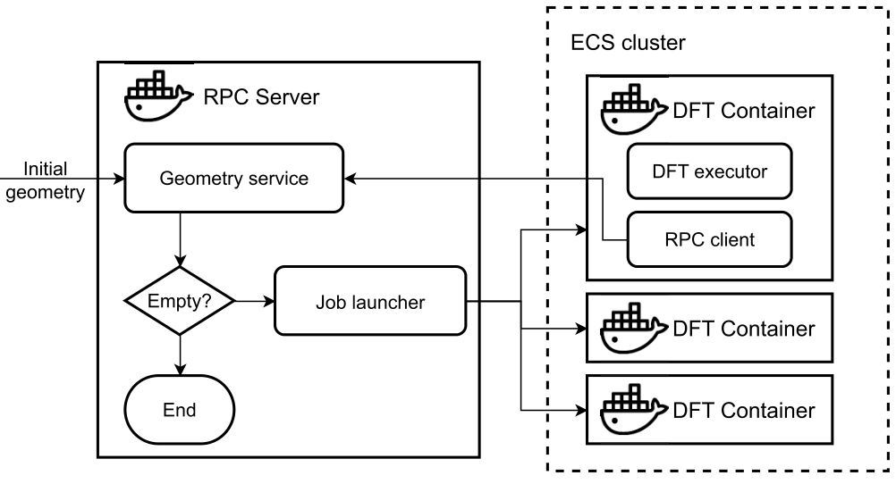

**图 7.4** 基于 RPC 服务的 PES 工作流设计

#### DFT 任务执行器的配置

为便于与 RPC 服务器通信，可以将服务器地址作为参数或环境变量提供给 DFT 任务的 Docker 容器。基于第 7.1.3 节开发的 ECS 任务，我们稍作调整来设置 DFT 任务：

```yaml
rpc_config_tpl = jinja2.Template( '''
cluster: {{ cluster }}
taskDefinition: {{ task }}
count: 1
overrides:
containerOverrides:
- name: {{ task }}-1
 command:
 - /app/start.sh
 - {{ job_path }}
 - {{ timeout or 7200 }}
 environment:
 - name: JOB_ID
   value: "{{ job_id }}"
 - name: RPC_SERVER
   value: "{{ rpc_server }}"
 - name: OMP_NUM_THREADS
   value: "{{ threads }}"
 resourceRequirements:
 - type: GPU
   value: "1"
cpu: {{ threads }} vcpu
memory: {{ threads * 2} } G B
launchType:
EC2
networkConfiguration:
awsvpcConfiguration:
 subnets:

 -{ {v} }

''')
```
DFT 执行器的 start.sh 脚本执行以下操作：1. 从 S3 存储中获取之前创建的 job.py 程序。

2. 调用 job.py 执行 DFT 计算。
3. 使用 rpc.py 程序将结果发送给 RPC 服务器。

下面给出 start.sh 的一种可能实现：

```yaml
#!/bin/bash
# Set the default time limit to 1 hour
TIMEOUT=${1:-3600}
S3PATH=$1
```

```text
aws s3 copy $S3PATH/job.py ./
if (timeout $TIMEOUT python job.py > job.log); then
  aws s3 copy job.log $S3PATH/
  python /app/rpc.py finished job.log
else
  python /app/rpc.py failed job.log
fi
```
rpc.py 程序充当 RPC 客户端。它调用几何构型服务的 RPC 端点 set_result，将 DFT 能量或计算状态等消息传回几何构型服务。下面的代码片段展示了 rpc.py 的基本功能：

```python
from xmlrpc.client import ServerProxy
rpc_server = os.getenv( 'RPC_SERVER')
job_id = os.getenv( 'JOB_ID')
status = sys.argv[1]
logfile = sys.argv[2]
def parse_log(logfile):
    '''Reads the log file and finds the energy'''
    log = open(logfile, 'r').read()
    ...
    return energy
with ServerProxy(rpc_server) as proxy:
    if status == 'finished':
        proxy.set_result(job_id, parse_log(logfile))
    else:
        proxy.set_result(job_id, status)
```
如第 6 章所示，RPC 通信可以通过 REST API 实现。然而，为了简单起见，这里使用 Python 标准库 xmlrpc 创建 RPC 客户端。客户端需要 RPC 服务器的地址，该地址保存在环境变量 RPC_SERVER 中。这个环境变量此前已在 ECS 任务中配置。

#### RPC 服务器的配置

在 RPC 服务器与 DFT 执行器容器之间建立网络通信并非易事。一种方法是为 RPC 服务器绑定一个其他 Docker 容器可以访问的端点。这个端点可以是 IP 地址、可通过 DNS 解析的地址，或将消息转发到运行 RPC 服务器的机器的代理。在本例中，几何构型服务和 DFT 执行器配置为在 AWSVPC 网络模式 [17] 下运行。在这种网络模式下，所有容器都可以通过 IP 地址直接相互访问。每个容器实例的 IP 地址
可以通过 AWS 提供的元数据 URI 获取 [18]。

```python
import os, requests
def self_Ip():
    '''IP address of the current container or EC2 instance'''
    metadata_uri = os.getenv( 'ECS_CONTAINER_METADATA_URI')
    resp = requests.get(f '{metadata_uri}/task').json()
    return resp['Networks'][0]['IPv4Addresses']
```
为了在 RPC 服务器上准备 DFT 任务，我们使用以下模板创建 Python 脚本 job.py：

```python
rpc_job_tpl = jinja2.Template( '''
import pyscf
from gpu4pyscf.dft import RKS
mol = pyscf.M(atom="""{{ geom }}""", basis='def2-tzvp', verbose=4)
mf = RKS(mol, xc='wb97x').density_fit().run()
''')
```
job.py 脚本生成后，将上传到 S3 存储中由 job_path 指定的位置，以便远程访问。
这些任务准备步骤可以整合到 launch_tasks 函数中，如下所示：

```python
import boto3, hashlib, jinja2, json, yaml
from typing import List, Dict
from concurrent.futures import Future
CLUSTER = 'python-qc'
TASK = 'dft-demo'
RPC_PORT = 5005
s3_client = boto3.client( 's3')
ecs_client = boto3.client( 'ecs')
job_pool: Dict[ str, Future] = {}
def launch_tasks(geom_grids, results_path, timeout=7200):
    assert results_path.startswith('s3://')
    ip = self_Ip()
    jobs = {}
    for geom in geom_grids:
        job_conf = rpc_job_tpl.render(geom=geom).encode()
        job_id = hashlib.md5(job_conf).hexdigest()
        bucket, key = results_path.replace( 's3://', '').split('/',1 )
        job_path = f 's3://{bucket}/{key}/{job_id}'
        s3_client.put_object(Bucket=bucket, Key=f'{key}/{job_id}/job.py', Body=job_conf)
        task_config = rpc_config_tpl.render( cluster=CLUSTER, task=TASK, job_id=job_id, job_path=job_path, rpc_server=f'{ip}:{RPC_PORT}', timeout=timeout, threads=2)
        try:
            ecs_client.run_task(**yaml.safe_load(task_config))
        except Exception:
            pass
        else:
fut = Future() # (1)
            fut._timeout = timeout
            job_pool[job_id] = fut
            jobs[job_id] = fut
    return jobs
def set_result(job_id, result):
    fut = job_pool[job_id]
fut.set_result(result) # (2)
```
给定一组分子几何构型，launch_tasks 函数启动 ECS 任务并返回与 DFT 任务对应的一组 Future 对象。这些 DFT 任务与几何构型生成服务异步运行。为了跟踪 DFT 任务的结果，我们在第 (1) 行引入 Future 对象，它代表尚未完成的 DFT 任务的结果。当调用 Future.result() 方法时，异步程序将被阻塞，直到 Future.result() 方法返回结果。第 (2) 行的 Future.set_result 方法可用于设置结果，通知 Future 对象解除阻塞状态。set_result 方法向 RPC 服务开放，使 DFT 工作节点上的 RPC 客户端可以远程执行它。Future 对象与 set_result 方法的组合是异步编程中的常用技术，我们将在第 10 章更详细地探讨。

#### 部署 RPC 服务器

为防止 launch_tasks 函数被 RPC 服务阻塞，我们在后台运行 RPC 服务器。

```python
from contextlib import contextmanager
from threading import Thread
from xmlrpc.server import SimpleXMLRPCServer
```

```python
@contextmanager
def rpc_service(funcs):
    '''Creates an RPC service in background'''
    try:
        rpc_server = SimpleXMLRPCServer(( "", RPC_PORT))
        for fn in funcs:
            rpc_server.register_function(fn, fn.__name__)
        rpc_service = Thread(target=rpc_server.serve_forever)
        rpc_service.start()
        yield
    finally:
        # Terminate the RPC service
        SimpleXMLRPCServer.shutdown(rpc_server)
        rpc_service.join()
```
接下来，我们开发驱动函数 pes_app 来管理 RPC 服务器和工作流。该函数定义在 pes_scan.py 文件中。根据已完成的 DFT 任务的结果，驱动程序可以继续生成下一批计算任务，也可以在必要时终止势能面工作流。

```python
def parse_config(config_file):
    assert config_file.startswith('s3://')
    bucket, key = config_file.replace( 's3://', '').split('/',1 )
    config = json.loads(s3_client.get_object(Bucket=bucket, Key=key))
    return config
def pes_app(config_file):
    config = parse_config(config_file)
    molecule = config[ 'molecule']
    pes_params = config[ 'params']
    results_path = config_file.rsplit( '/', 1)[0]
    with rpc_service([set_result]):
        # Scan geometry until enough data are generated
        results = {}
        geom_grids = geometry_on_pes(molecule, pes_params, results)
        while geom_grids:
            jobs = launch_tasks(geom_grids, results_path)
            for key, fut in jobs.items():
                try:
                    result = fut.result(fut._timeout)
                except TimeoutError:
                    result = 'timeout'
                results[key] = result
            geom_grids = geometry_on_pes(molecule, pes_params, results)
    return results
if __name__ == '__main__':
    pes_app(sys.argv[1])
```
RPC 服务器程序可以作为任务部署在 ECS 上。

```python
rpc_server_config = '''
family: pes-rpc-server
containerDefinitions:
- name: rpc-server
  image: 987654321000.dkr.ecr.us-east-1.amazonaws.com/python-qc/dft-gpu:1.0
  networkBindings:
  - containerPort: 5005
    hostPort: 5005
  command:
  - python
  - pes_scan.py
  - config_file
'''
config = yaml.safe_load(rpc_server_config)
ecs_client.register_task_definition(**config)
```
在此配置中，必须配置 networkBindings，开放端口 5005（之前由 RPC_PORT 指定）以进行 RPC 通信。

### 7.1.5 函数即服务

从头开发云上工作流需要一些编码工作和云平台专业知识。成功配置工作流后，我们可能希望提高其可访问性，使其更便于今后使用或供其他用户使用。在这种情况下，开发函数即服务（Function-as-a-Service，FaaS）是一种可行的选择，可以简化云平台相关的复杂部署流程。此服务可通过 HTTP 协议上的 RESTful API 访问。只需发送指定分子结构和 DFT 参数的 HTTP 请求，就可以启动势能面扫描任务。
势能面扫描服务需要多个组件相互协调：

- 接收 HTTP 请求的端点。
- 将 HTTP 请求转发至后端服务器。
- 后端服务器，用于处理请求并在 AWS ECS 上启动势能面扫描作业。然后，它在 HTTP 响应中返回执行结果。

在 AWS 云平台上，我们可以利用各种 AWS 组件来实现此服务（图 7.5）。AWS API Gateway 可以提供 HTTP 端点，并作为代理转发 HTTP 请求 [19]。AWS Lambda 可以充当后端，

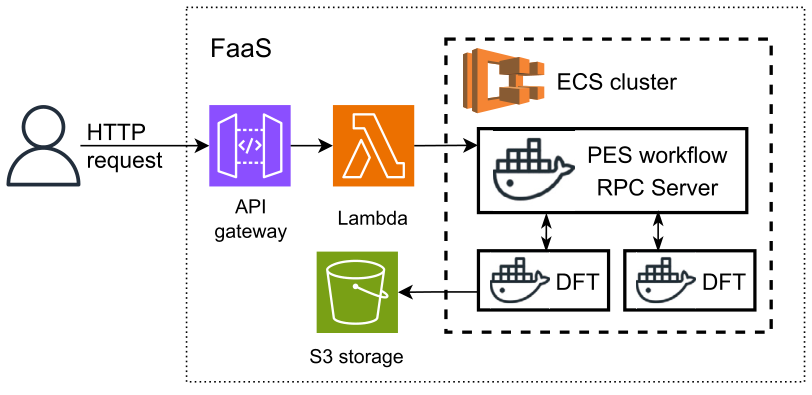

**图 7.5** PES 扫描服务的 FaaS 架构

解析请求并启动我们在第 7.1.4 节开发的势能面扫描工作流。势能面扫描作业的结果可以存储在 S3 存储中。S3 存储路径在 HTTP 响应中返回。Lambda 处理函数和 API Gateway 触发器的配置如图 7.6–7.9 所示。
让我们从 AWS Lambda 开始这个项目。AWS Lambda 是一项无服务器计算服务，使我们无需预配或管理服务器即可执行代码。它根据传入的请求自动分配计算资源并执行预定义的函数。这里，我们使用图 7.6 所示的配置创建一个 Lambda 函数。我们将该 Lambda 函数命名为 pes-scan。此名称将自动应用于其他服务的配置。你也可以为此函数选择其他名称。如果选择不同的名称，务必相应更新后续设置中所有的 pes-scan。
在 AWS Lambda 控制台（图 7.7）中，我们可以在图 7.7 的方框 1 中部署以下 Python 函数处理程序 [20]。

```python
import json, hashlib, boto3
s3_client = boto3.client( 's3')
ec2_client = boto3.client( 'ec2')
ecs_client = boto3.client( 'ecs')
def lambda_handler(event, context):
    # The data structure of event can be found in
    # https://docs.aws.amazon.com/lambda/latest/dg/services-apigateway.html
    method = event[ 'httpMethod']
    if method != 'POST':
        return {'statusCode': 400}
    body = json.loads(event[ 'body'])
    job = body[ 'job']
    if job.upper() != 'PES':
        msg = f 'Unknown job {job}'
        results = 'N/A'
    config = json.dumps({
        'molecule': body[ 'molecule'], 'params': body[ 'params']
    }).encode()
    job_id = hashlib.md5(config).hexdigest()
    resp = ec2_client.describe_subnets()
    subnets = [v[ 'SubnetId'] for v in resp['Subnets']]
    bucket, path = 'python-qc',f 'pes-faas/{job_id}'
    s3_client.put_object(Bucket=bucket, Key=f '{path}/config.json', Body=
    config)
    s3path = f 's3://{bucket}/{path}/config.json'
    resp = ecs_client.run_task( cluster='python-qc', taskDefinition='pes-rpc-server', count=1, launchType='FARGATE', networkConfiguration={'awsvpcConfiguration':{ 'subnets': subnets}}, overrides={
            'containerOverrides':[ {
                'name': 'rpc-server', 'command':[ 'python', 'pes_scan.py', s3path]
            }]
        }
    )
    msg = json.dumps(resp)
    results = f 's3://{bucket}/pes-faas/{job_id}/results.log'
    return {
        'statusCode': 200, 'body':{
            'results': results, 'detail': msg, }
    }
```
此处理程序解码 HTTP 请求，并在 ECS 上启动势能面扫描任务。此外，可以在 AWS Lambda 控制台中图 7.7 的方框 3 处配置 Lambda 函数的触发器。如图 7.8 的方框 1 所示，将 API Gateway 指定给触发器。为简单起见，我们将 API Gateway 的安全机制设置为 Open，允许网关接受所有请求并将其转发

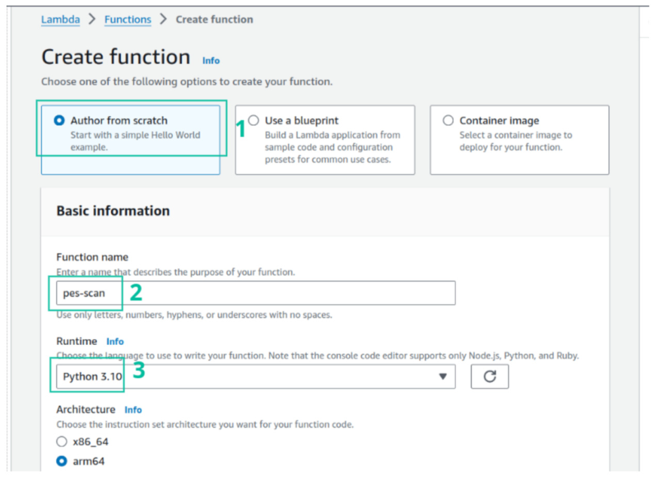

**图 7.6** 创建 AWS Lambda 函数以触发 PES 扫描服务

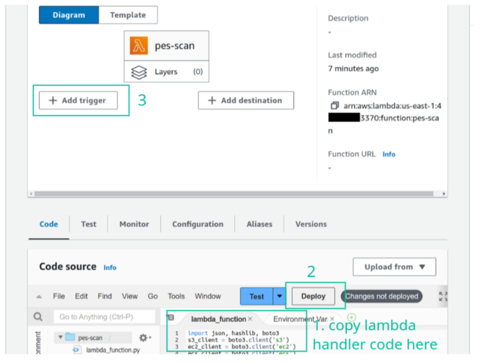

**图 7.7** 配置 AWS Lambda，章节

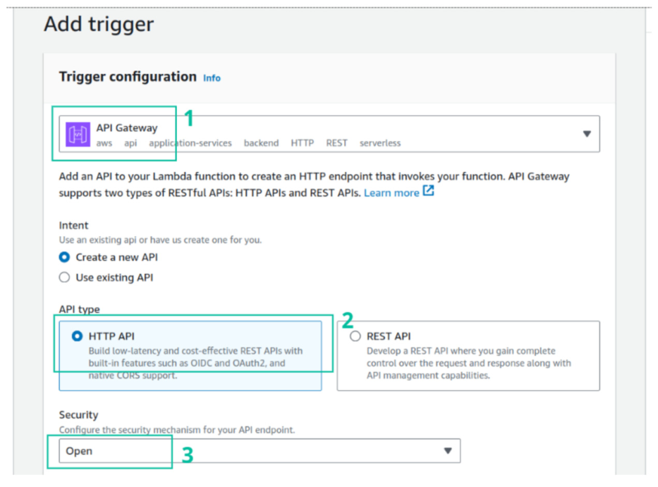

**图 7.8** 添加 AWS API Gateway 触发器

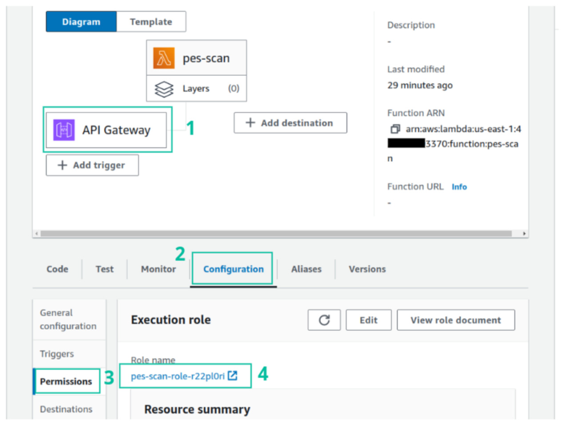

**图 7.9** 检查 API Gateway 端点并配置权限，245

给 Lambda 函数。请注意，此设置并不安全。建议配置身份验证方法以增强服务安全性 [21]。部署 API Gateway 触发器后，会生成一个 HTTP 端点。点击图 7.9 中的方框 1 即可访问该端点，其对应的 URL 如下：

```text
https://d8iah6mwib.execute-api.us-east-1.amazonaws.com/default/pes-scan
```
Lambda 函数处理程序需要访问多项 AWS 服务，包括对 S3、EC2 和 ECS 的读写权限。我们可以在 AWS Lambda 控制台中配置 Lambda 函数的权限，如图 7.9 所示。有关 IAM 策略的配置方法，请参阅第 7.1.3 节。为 Lambda 函数分配必要权限后，我们就可以通过 API Gateway 端点提供势能面扫描服务。下面是使用 JSON 文档调用 HTTP API 的示例，该文档指定了分子的几何构型和势能面参数：

```python
import requests
molecule = ' O000 ;H 0.757 0.587 0; H -0.757 0.587 0'
resp = requests.post( 'https://d8iah6mwib.execute-api.us-east-1.amazonaws.com/default/pes-
    scan', json={'job': 'pes', 'molecule': molecule, 'params': 'O,H'}
)
print(resp.json()['detail'])
```
响应中将包含一个 S3 路径，指明结果的存储位置。
上述示例是 FaaS 最基本的框架，其中省略了许多技术细节。在完整的 FaaS 中，需要考虑更多工程和易用性问题，例如授权、身份验证、网络安全、容错、监控和数据持久性等。尽管如此，这个基本框架可以作为起点，在此基础上逐步引入更多功能，提高 FaaS 的易用性。

## 7.2 分布式作业执行器

在高性能计算（HPC）环境中，PBS 和 SLURM 等作业调度器用于为作业执行分配计算资源。虽然它们也适用于云环境，但在云环境中并不那么常用。在云环境中，计算节点和存储等资源按需分配。每次分配新的计算资源时重新配置传统的 HPC 管理系统都很不方便。因此，简单轻量的作业调度工具在云环境中变得更加流行。
为了并行执行 Python 程序，Celery、Dask 和 Ray 是三种适合云计算的流行分布式执行器。这些工具各有其特点、优势和适用场景：

- [22] 是一种分布式计算工具，依靠消息队列将任务分发到多个计算节点。可以轻松扩展工作节点，以处理大量类似任务。Celery 通常用于处理 Web 应用中的后台任务。它也能够有效支持量子化学数据生成工作负载。
- [23] 是一个专注于大规模数据处理的库。它经常用于分布在多个计算节点上的数据分析和数值计算作业。其分布式系统是纯 Python 应用，不需要任何外部组件（例如消息队列或数据库）。Dask 是一个灵活的工作负载分发框架。它不限于预定义函数。Python 函数可以在运行时创建并发送给工作节点执行。
- [24] 是一个高性能分布式计算框架。在分布式任务执行方面，它与 Dask 有某些相似之处。Ray 项目的亮点是与云计算环境的原生集成。它提供便捷的云资源管理和任务调度能力。除了分发工作负载外，Ray 还为分布式系统中的内存共享和并行计算提供了全面的解决方案。如果目标是开发一个不仅仅卸载工作负载的分布式应用，Ray 框架是一个很好的选择。

分布式作业执行器通常由服务器、客户端、工作节点及其他组件组成。每个组件都需要不同的部署策略。服务器和工作节点通常部署在云端。客户端可以安装在本地 Python 环境中。
分布式计算往往与并行计算技术密切相关。本节只关注云计算背景下分布式作业执行器的能力与部署。并行程序的设计将在第 10 章探讨。

### 7.2.1 Celery

的分布式执行基于生产者—消费者并行计算模型。在这种设置中，Celery 客户端充当生产者，将新任务推入队列。然后，Celery 工作节点从该队列获取并执行任务。要部署 Celery，我们需要设置消息代理来管理任务队列。
支持多种消息代理，例如 RabbitMQ、Redis 和 Amazon SQS（Simple Queue Service）。每种消息代理在安全性、性能、优先级处理、容错和崩溃恢复等功能方面各有所长。这些因素对于高并发 Web 应用至关重要。然而，对于 DFT 数据生成或其他化学模拟计算等任务，这些代理之间的差异很小，通常都足以满足我们的使用场景。
我们选择 Redis 作为代理。可以使用以下命令在本地部署它：

```bash
$ docker run -d -p 6379:6379 redis:7.2
```
相应地，我们可以安装带 Redis 扩展的 Celery 库：

```bash
$ pip install celery[redis]
```
应用 Celery 的第一步是开发一个 Celery 应用。Celery 应用本质上是一个 Python 模块，可以在本地以及由 Celery 工作节点导入。

```bash
$ cat dft_app.py
import hashlib
import pyscf
from gpu4pyscf.dft import RKS
from celery import Celery
app = Celery('dft-pes', broker='redis://localhost:6379/0', # (1)
backend='redis://localhost:6379/1') # (2)
@app.task
def dft_energy(molecule):
    job_id = hashlib.md5('f{molecule=}).hexdigest()
    mol = pyscf.M(atom=molecule, basis='def2-tzvp', verbose=4)
    mf = RKS(mol, xc='wb97x').density_fit().run()
    return job_id, mf.e_tot
```
创建 Celery 应用时，通过关键字 borker 指定消息代理，如第 (1) 行所示。它只充当调度作业的任务队列。要接收远程 Celery 工作节点的输出，必须配置数据库后端，为 Celery 应用存储结果。Celery 提供多种结果后端选项 [25]。为简单起见，我们继续使用 Redis 作为结果后端。Redis 使用 URL 中的数字标识数据库。不同数字对应不同数据库。如第 (2) 行所示，结果配置为存储在单独的数据库中。
按照 Celery 库的要求，我们应在 Celery 应用代码中使用装饰器 @app.task 注册所有远程函数。在本地环境中，我们可以导入此应用并调用远程函数的 .delay() 方法来提交任务。

```python
In [1]: from dft_app import dft_energy
        results = [
            dft_energy.delay(' O000 ;H 0.757 0.5 0; H -0.757 0.5 0' ), dft_energy.delay(' O000 ;H 0.757 0.6 0; H -0.757 0.6 0' )]
        print(results)
        print(results[0].status, results[1].status)
```

```text
Out[1]:
[<AsyncResult: 41100ef3-2fed-4809-b8e7-a599b161b5a8>, <AsyncResult: 17271
    cc9-6aba-4bef-a8ce-544a512f8e9a>]
PENDING PENDING
```
返回一个 AsyncResult 对象来表示远程函数的结果。最初，提交的任务状态为 PENDING。这是因为我们尚未为该应用部署任何工作节点。
在另一个终端中，可以通过执行以下命令启动 Celery 工作节点：

```bash
$ celery --app=dft_app worker
```
由 --app 参数指定的应用必须是 Celery 工作节点能够导入的模块。在此本地设置中，由于命令在应用程序文件所在的同一目录中执行，工作节点成功加载了 Celery 应用。远程部署工作节点时，应正确安装该应用，以确保它可以被导入。为此可以使用我们在第 1 章讨论的软件包分发技术。
工作节点从消息代理获取任务，并将结果发送到后端数据库。我们可以通过 AsyncResult 对象访问运行状态、错误消息和结果。

```python
In [2]: print(results[0].get())
        print(results[1].status)
Out[2]:
['2bb88ae9b074ca2c190ac9969b4e7397', -76.43283440169702]
SUCCESS
```
本例展示了 Celery 的基本用法，足以满足当前的数据生成任务。为了高效处理大量任务，我们计划在 AWS 云上部署 Celery 工作节点。我们将使用 AWS ECS 启动 Celery 工作节点，并使用 AWS SQS 作为代理。我们选择 SQS 而不是部署独立的消息队列，因为可以从本地机器方便地访问 SQS。这样就不必为 Celery 客户端访问消息队列进行复杂的网络配置。
尽管 AWS SQS 易于访问，其使用仍面临另一项限制。Celery 不支持将 SQS 用作存储结果的后端。另一种解决方案是使用其他 AWS 数据库服务作为结果后端。为简单起见，我们只将结果上传到 AWS S3 存储。相应地修改 dft_app.py 中的 Celery 对象和任务函数：

```python
import tempfile
import pyscf
from gpu4pyscf.dft import RKS
from celery import Celery
import boto3
```

```python
app = Celery( 'dft-pes', broker= 'sqs://')
s3 = boto3.client( 's3')
                                        @app.task
def dft_energy(molecule, s3_path):
    output = tempfile.mktemp()
    mol = pyscf.M(atom=molecule, basis= 'def2-tzvp', verbose=4, output=output)
    mf = RKS(mol, xc= 'wb97x').density_fit().run()
    bucket, key = s3_path.replace( 's3://', '').split('/',1 )
    s3.upload_file(output, bucket, key)
```
下一步是为 Celery 工作进程配置 AWS ECS。这与我们在第 7.1.3 节讨论的过程类似。我们需要创建一个 Docker 镜像并将其上传到 AWS ECR。该 Docker 镜像的 Dockerfile 如下：

```text
FROM nvidia/cuda:12.0.1-runtime-ubuntu22.04
RUN apt-get update && \
  apt-get install -y python3 python3-pip && \
  rm -rf /var/lib/apt/lists/ *
RUN pip install --no-cache-dir pyscf gpu4pyscf-cuda12x boto3 celery[sqs]
COPY dft_app.py /app/
WORKDIR /app
CMD ["celery","-A", "dft_app", "worker"," --loglevel=info"]
```
这个 Docker 镜像被标记为 python-qc/celery-dft:1.0。

```bash
$ aws ecr create -repository --repository-name python-qc/celery-dft
$ docker build -t 987654321000.dkr.ecr.us -east-1.amazonaws.com/python-qc/
    celery-dft:1.0 .
$ docker push 987654321000.dkr.ecr.us -east-1.amazonaws.com/python-qc/celery
    -dft:1.0
```
然后，我们使用新的 Docker 镜像注册一个 ECS 任务定义。

```python
config = yaml.safe_load( '''
family: celery-gpu-worker
networkMode: awsvpc
containerDefinitions:
- name: celery-worker
  image: 987654321000.dkr.ecr.us-east-1.amazonaws.com/python-qc/celery-dft
    :1.0
  environment:
  - name: OMP_NUM_THREADS
    value: "4"
runtimePlatform:
  cpuArchitecture: X86_64
  operatingSystemFamily: LINUX
cpu: 4 vcpu
memory: 8GB
''')
ecs_client = boto3.client( 'ecs')
resp = ecs_client.register_task_definition( **config)
print(yaml.dump(resp))
```
接着，我们创建 ECS 任务来启动 Celery 工作进程。

```python
ec2_client = boto3.client( 'ec2')
resp = ec2_client.describe_subnets()
subnets = [v[ 'SubnetId'] for v in resp['Subnets']]
config = yaml.safe_load( '''
cluster: python-qc
taskDefinition: celery-gpu-worker
count: 2
overrides:
  containerOverrides:
  - name: celery-worker
    environment:
    - name: AWS_ACCESS_KEY_ID
      value: xxxxxxxxxxxxxxxxxxxx
    - name: AWS_SECRET_ACCESS_KEY
      value: xxxxxxxxxxxxxxxxxxxxxxxxxxxxxxxxxxxxxxxx
    resourceRequirements:
    - type: GPU
      value: "1"
networkConfiguration:
  awsvpcConfiguration:
    subnets: {}
'''.format(subnets))
ecs_client = boto3.client( 'ecs')
resp = ecs_client.run_task( **config)
print(yaml.dump(resp))
```
如果需要更多计算资源，可以修改配置中的 count 字段来调整 ECS 工作进程的数量。在 ECS 任务配置中，环境变量 AWS_ACCESS_KEY_ID 和 AWS_SECRET_ACCESS_KEY 被配
置为提供 AWS 访问凭证 [26]，Celery 工作进程需要这些凭证才能访问 SQS 和 S3。切勿将 AWS 访问凭证直接硬编码到应用程序的源代码或 Dockerfile 中，因为它们可能会被公开访问。
现在，我们可以加载修改后的 dft_app.py，并在 AWS 云中运行 DFT 计算任务。

```python
In [3]: from dft_app import dft_energy
        results = [
            dft_energy.delay(' O000 ;H 0.757 0.5 0; H -0.757 0.5 0' ), dft_energy.delay(' O000 ;H 0.757 0.6 0; H -0.757 0.6 0' )]
        print(results)
Out[3]:
[<AsyncResult: 32f68705-04f8-483c-83eb-45bf2622ced3>, <AsyncResult: 5833
    cf35-7fd2-4d7d-9ef2-f9e1acd4579a>]
```
请注意，Celery 工作进程在完成所有计算任务后不会自动关闭。要终止 Celery 工作进程，可以通过命令行界面（CLI）使用

```text
aws ecs stop-task
```
命令停止相应的 ECS 任务，也可以通过网页控制台删除已分配的资源。不要忘记这一步清理，否则 ECS 计算资源会持续产生费用。可以实现一些函数来监控任务队列的状态，并在任务完成后自动终止 Celery 工作进程。然而，实现这一功能需要协调多种 AWS 云服务，超出了 Python 编程的范围。本书不讨论这一主题。
如本例所示，使用 Celery 通常并不复杂。如果有大量类似的计算任务需要执行，Celery 是批处理的绝佳选择。
我们来简要总结一下在分布式计算中使用 Celery 的优点和缺点。Celery 有以下优点：

- 适合批量执行大量预先定义的作业，例如数据生成任务。
- 响应迅速。只要 Celery 工作进程处于活动状态，就可以反复执行任务。新任务从消息代理（broker）获取输入变量时只产生少量开销。
- 得益于消息队列架构，Celery 能够抵御工作进程故障。如果某些工作进程崩溃，其他工作进程可以接手并继续执行未完成的任务。

的缺点包括：

- 使用 JSON 序列化来编码任务参数和结果。因此，一般的 Python 对象可能无法用作

任务的输入参数。如果需要分发一般的 Python 函数或对象，可以考虑其他分布式
执行器，例如 dask.distributed。

- 不原生支持云部署。部署 Celery 需要具备一定的云架构专业技能和知识。
- 工作进程的扩容或缩容不是自动进行的。
- Celery 没有内置监控器来方便地跟踪和管理任务状态。该软件包只提供用于监控任务的命令行工具。要通过图形用户界面（GUI）管理 Celery 任务，需要使用 Flower [27] 等第三方库。

### 7.2.2 Dask

提供 dask.distributed 模块，用于在 Dask 集群上进行分布式计算。如图 7.10 所示，Dask 集群由一个调度器（scheduler）和若干工作进程组成。要安装 Dask 分布式执行器所需的组件，可以执行

```bash
$ pip install dask distributed bokeh
```
其中，distributed 软件包提供管理 Dask 集群所需的工具，bokeh 则提供用于监控 Dask 集群状态的可视化仪表板。

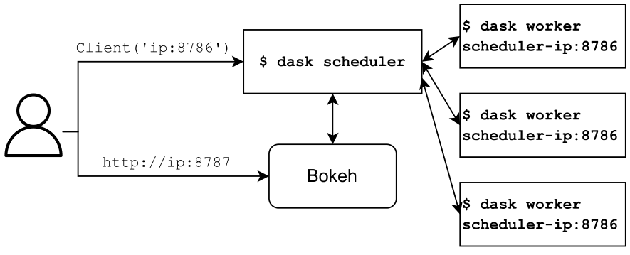

**图 7.10** Dask 集群的架构

我们先在本地环境中探索 dask.distributed 的功能。可以通过运行两个命令启动 Dask 集群：

```bash
$ dask scheduler
$ dask worker localhost:8786
```
命令 dask-scheduler 初始化 Dask 集群的调度器。命令 dask-worker 启动工作进程。
集群初始化后，dask-scheduler 充当服务器。然后我们可以创建一个 Client 来连接调度器。Dask 客户端的 .submit() 方法
可用于将计算任务卸载到 Dask 工作进程。该操作返回一个 Future 对象，表示分布式任务尚未完成的结果。这个 Future 对象提供的功能与 Python 内置的 concurrent.futures.Future 类类似。此外，Dask 客户端提供了一个快捷方法 .gather()，用于快速获取计算结果。

```python
import pyscf
from dask.distributed import Client
client = Client( 'localhost:8786')
def dft_energy(molecule):
    mol = pyscf.M(atom=molecule, basis= 'def2-tzvp', verbose=4)
    mf = mol.RKS(xc= 'wb97x').density_fit().run()
    return mf.e_tot
molecules = [ ' O000 ;H 0.757 0.5 0; H -0.757 0.5 0' , ' O000 ;H 0.757 0.6 0; H -0.757 0.6 0' ]
results = [client.submit(dft_energy,x ) for x in molecules]
print(client.gather(results))
```
默认情况下，启动调度器时会自动在同一台机器的 8787 端口提供 bokeh 仪表板。在本地环境中，可以通过以下地址访问仪表板：

```text
http://localhost:8787/status
```
我们可以使用这个仪表板监控 Dask 集群的状态。
接下来，看看如何在云中部署 Dask 集群。部署 Dask 集群调度器和 Dask 工作进程可能涉及不同的配置。Dask 调度器需要能通过其公共 IP 地址或代理，供本地设备上运行的 Client 访问。通过公共 IP 地址进行数据传输需要付费。为避免通过公共 IP 地址传输数据，工作进程和调度器之间可以通过内部网络通信。
如果使用 ECS 部署 Dask 调度器，还需要进行额外的网络配置，以确保 Dask 调度器可访问。为简单起见，我们可以启动一个 EC2 实例来托管 Dask 调度器。EC2 实例可以同时拥有公共和私有 IP 地址。在 EC2 实例中安装 dask、distributed 和 bokeh 等必要的软件包后，我们可以像在本地环境中那样启动 dask-scheduler。
另一方面，对于 Dask 工作进程，我们仍可使用容器化服务。与 Celery 的 ECS 部署方法类似，我们可以创建一个 Docker 镜像

```text
FROM nvidia/cuda:12.0.1-runtime-ubuntu22.04
RUN apt-get update && \
  apt-get install -y python3 python3-pip && \
  rm -rf /var/lib/apt/lists/ *
RUN pip install --no-cache-dir gpu4pyscf-cuda12x boto3 dask distributed
```
工作进程的 ECS 任务定义与 Celery 工作进程的基本相同，可以在这里复用。
一个 ECS 工作进程可能被分配多个 IP 地址。为确保 Dask 工作进程绑定到私有地址，我们应在启动 dask-worker 命令时指定该地址。可以从 AWS 网页控制台或通过 boto3 库获取此地址。然后，我们覆盖任务定义中的镜像和命令，得到如下 ECS 任务配置来启动 Dask 工作进程：

```python
ec2_client = boto3.client( 'ec2')
resp = ec2_client.describe_subnets()
subnets = [v[ 'SubnetId'] for v in resp['Subnets']]
private_ip = ec2_client.describe_instances( Filters=[{'Name': 'tag:Name', 'Values':[ 'dask-server']}]
)['Reservations'][0]['Instances'][0]['PrivateIpAddress']
config = yaml.safe_load( '''
cluster: python-qc
taskDefinition: celery-gpu-worker
count: 2
overrides:
  containerOverrides:
  - name: dask-gpu-worker
    image: 987654321000.dkr.ecr.us-east-1.amazonaws.com/python-qc/dask-dft
    :1.0
    command:
    - dask-worker
    - "{0}:port"
    resourceRequirements:
    - type: GPU
      value: "1"
networkConfiguration:
  awsvpcConfiguration:
    subnets: {1}
'''.format(private_ip, subnets}))
ecs_client = boto3.client( 'ecs')
resp = ecs_client.run_task( **config)
print(yaml.dump(resp))
```
与 Celery 相比，Dask 分布式方案的一大优势是支持一般的 Python 函数和对象（但受到某些序列化约束，如第 6 章所述）。然而，在云中部署 Dask 分布式系统比较复杂。此外，与 Celery 面临的自动扩缩容问题类似，在云环境中管理 Dask 工作进程以及对其进行扩容或缩容也相对不便。

### 7.2.3 Ray

Ray 不仅是单纯的分布式任务执行器，更是完整的分布式计算与应用框架。它专为构建和运行高扩展性分布式应用程序而设计，同时提供了面向分布式机器学习的高性能工具包。
当把 Ray 作为分布式任务调度器使用时，其核心功能与 Dask 颇有重叠，均支持将普通 Python 函数派发到远程工作节点并发执行。Ray 的显著优势在于原生深度集成了 AWS、GCP、Azure 和阿里云等主流云平台。开发者即便缺乏底层云架构专业知识，也能借助 Ray 便捷管理分布式计算集群。
如图 7.11 所示，Ray 集群由一个头节点（head node）与若干工作节点组成。不同于 Dask 在各个节点运行简单轻量服务的模式，Ray 采用了更加系统化的架构体系。在每个节点上，Ray 分别运行负责网络通信、作业调度、分布式存储及系统监控的多项后台服务。头节点还内置了自动扩缩容服务，能够根据实时计算负载自动增减工作节点。部署这套复杂系统无需繁琐的手动逐步配置；只需一份简洁的集群配置，Ray 便能在云端自动编排网络链路、消息队列、调度器、持久存储和弹性扩缩容器等全套云服务。

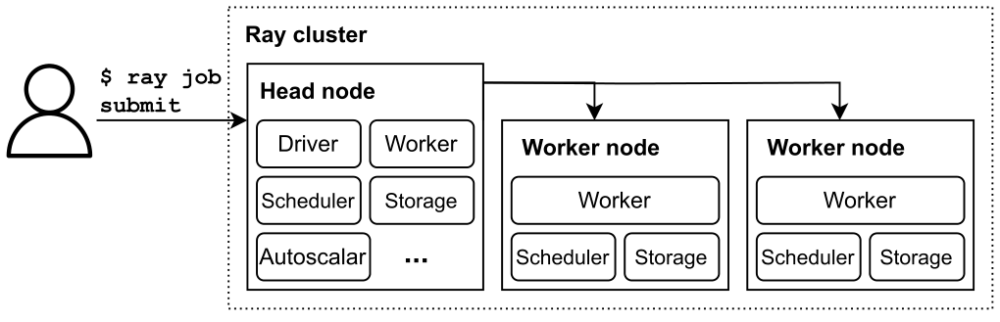

**图 7.11** Ray 集群的架构

软件包同时集成了分布式计算功能和集群管理能力。Ray 集群的管理可以在本地进行。
以 AWS 云为例，要在 AWS 云上部署 Ray 集群，应安装以下软件包：

```bash
$ pip install -U ray[default ,aws] boto3
```
依赖 boto3 库访问 AWS API，因此需要安装该库。
要将计算任务卸载到 Ray 集群，我们需要准备并提交一个 Ray 作业。Ray 作业通常由以下部分组成：

- 用于分发的函数。这些函数用 @ray.remote 装饰器标注，该装饰器为它们添加 .remote() 方法。
- 在这些函数上调用 .remote() 方法以生成 Future 对象。
- 为确保完成，使用该函数获取 Future 对象的结果。下面是适用于上述 DFT 计算任务的 Ray 作业示例。

```bash
$ cat dft_job.py
import pyscf
import ray
                                        @ray.remote
def dft_energy(molecule):
    mol = pyscf.M(atom=molecule, basis='def2-tzvp', verbose=4)
    mf = mol.RKS(xc='wb97x').density_fit().run()
    return mf.e_tot
molecules = [' O000 ;H 0.757 0.5 0; H -0.757 0.5 0 ', ' O000 ;H 0.757 0.6 0; H -0.757 0.6 0 ']
futures = [dft_energy.remote(x) for x in molecules]
print(ray.get(futures))
```
为体验 Ray 作业的基本用法，我们可以先运行以下命令，在本地环境中启动一个 Ray 集群：

```bash
$ ray start --head
```
根据输出中显示的说明，可以使用以下命令提交 Ray 作业：

```bash
$ export RAY_ADDRESS= 'http://127.0.0.1:8265'
$ ray job submit --working -dir . -- python3 dft_job.py
```
双横线 -- 是分隔符，用于将 Ray 选项与要远程执行的作业命令分开。working-dir 是本地目录，我们可以在其中存放作业脚本和必要的输入数据。
请注意 --working-dir 路径，它经常引起混淆。云环境不像高性能计算（HPC）环境那样具有共享文件系统。我们在本地开发的脚本文件，例如 dft_job.py，不会自动在工作节点上可用。为解决文件共享问题，命令

```text
ray job submit
```
会将 working-dir 复制到工作节点上。作业命令（例如本例中的 python3 dft_job.py）在该目录内执行。因此，我们应避免在作业命令中使用本地机器特有的绝对路径。此外，还需要限制 working-dir 中存放的数据量。发送大量数据可能导致 Ray 作业提交过程中出现文件传输错误。
如果作业需要大型库或大量输入数据，该如何将它们传输到 Ray 工作节点？
一种方法是在 working-dir 中创建一个脚本，用于安装所需的库并从云对象存储下载必要的数据。该脚本可以在运行主要计算任务之前执行。
另一种方法是在部署 Ray 集群时预先将库或数据安装到工作节点上。这些数据准备命令可以在集群配置中指定，后续讨论会进一步说明。
接下来设置 AWS 上的 Ray 集群。下面是 AWS 上 Ray 集群的示例配置，我们已将其保存在一个 YAML 文件中，文件名为

```text
cluster_name: dft-ray
provider:
  type: aws
  region: us-east-1
  availability_zone: us-east-1a
available_node_types:
  ray.head.default:
    node_config:
      InstanceType: m5.xlarge
      ImageId: ami-080e1f13689e07408 # Ubuntu 22.04
  ray.worker.default:
    max_workers: 3
    node_config:
      InstanceType: p3.2xlarge # GPU instance
      ImageId: ami-0b54855df82eef3a3 # Ubuntu 22.04 with Deep learning
    tools
setup_commands:
- sudo apt install -y python3-pip
- pip install ray[default] boto3 pyscf gpu4pyscf-cuda12x
```
此配置指定了几个关键设置：

- 如 provider 字段所示，资源在 AWS 云平台上分配。
- 配置了自动扩缩容方案，允许启动一个头节点和最多三个工作节点。
- 配置为每个节点指定 EC2 实例类型和操作系统。我们可以在 AWS 市场中搜索公开的操作系统镜像，也可以使用自己创建的自定义镜像。在本例中，ImageId: ami0b54855df82eef3a3 是一个公开的深度学习镜像，预装了 CUDA 12 驱动程序和运行时工具。
- setup_commands 字段指定节点启动后运行的初始化命令，可用于安装新软件包和准备数据。在此阶段安装的软件必须与操作系统镜像提供的 CUDA 工具包兼容。

集群配置中还有更多自定义选项，例如磁盘大小、自动扩缩容策略等。有关更多配置选项，可以参阅 Ray 文档 [28] 或 Ray 源代码中提供的集群配置示例。
定义集群配置后，我们可以使用 ray up 命令创建或更新集群。

```bash
$ ray up -y config.yaml
```
所有计算完成后，可以使用以下命令关闭 Ray 集群：

```bash
$ ray down -y config.yaml
```
执行该命令时，Ray 会向云平台发送请求，以释放和清理已分配的资源。然而，该命令不会完全跟踪这些请求是否成功。为避免潜在的资源浪费和意外账单，建议登录网页控制台，手动核实每项资源的状态。

## 小结

本章系统梳理了云端量子化学模拟工作流的设计与落地路径。我们借助容器化云服务调度算力，利用云对象存储高效流转数据。在编排云服务时，我们选择直接调用
服务 API 实施管控，并配合 Python 模板渲染提升可维护性。虽然本书主要基于 AWS 云展开演示，这套工程方法同样适用于其他主流云平台。
掌握云端基础之后，我们进一步探讨了 Celery、Dask 和 Ray 等分布式作业执行框架。我们不仅展示了各框架在云上的部署策略，也演示了如何向远端集群分发计算作业。其中，Ray 与云生态的原生结合尤为紧密，是开展云端分布式计算的高效方案。
在编写云端程序时，我们借助 AI 编程助手（具体采用 GPT-4 模型）快速搭建计算与配置逻辑的原型，随后在此基础上补全业务功能。云计算生态技术繁杂且迭代迅速，将 AI 工具引入云原生开发，正是应对复杂技术栈的高效实践路径。

## 参考文献

::: {.ref-list}

[1] Amazon Web Services, Amazon machine images (AMIs), [amazon.com](https://docs.aws.amazon.com/AWSEC2/latest/UserGuide/AMIs.html), 2024.

[2] Amazon Web Services, Amazon EBS volumes, [amazon.com](https://docs.aws.amazon.com/ebs/latest/userguide/ebs-volumes.html), 2024.

[3] Amazon Web Services, What is Amazon elastic container service?, [amazon.com](https://docs.aws.amazon.com/AmazonECS/latest/developerguide/Welcome.html), 2024.

[4] Amazon Web Services, What is Amazon VPC?, [amazon.com](https://docs.aws.amazon.com/vpc/latest/userguide/what-is-amazon-vpc.html), 2024.

[5] Amazon Web Services, How Amazon VPC works, [amazon.com](https://docs.aws.amazon.com/vpc/latest/userguide/how-it-works.html), 2024.

[6] Amazon Web Services, Get started with Amazon S3, [amazon.com](https://docs.aws.amazon.com/AmazonS3/latest/userguide/GetStartedWithS3.html), 2024.

[7] Amazon Web Services, Moving an image through its lifecycle in Amazon ECR, [amazon.com](https://docs.aws.amazon.com/AmazonECR/latest/userguide/getting-started-cli.html), 2024.

[8] Amazon Web Services, Control traffic to your AWS resources using security groups, [amazon.com](https://docs.aws.amazon.com/vpc/latest/userguide/vpc-security-groups.html), 2024.

[9] Amazon Web Services, Configuration and credential file settings, [docs.aws](https://docs.aws). amazon.com/cli/latest/userguide/cli-configure-files.html, 2024.

[10] Amazon Web Services, IAM roles, [amazon.com](https://docs.aws.amazon.com/IAM/latest/UserGuide/id_roles.html), 2024.

[11] The PySCF Developers, Quantum chemistry with Python, [pyscf.org](https://pyscf.org/), 2024.

[12] R. Li, Q. Sun, X. Zhang, G.K.-L. Chan, Introducing GPU-acceleration into the Python-based simulations of chemistry framework, arXiv:2407.09700, [arxiv.org](https://arxiv.org/abs/2407.09700), 2024.

[13] X. Wu, Q. Sun, Z. Pu, T. Zheng, W. Ma, W. Yan, X. Yu, Z. Wu, M. Huo, X. Li, W. Ren, S. Gong, Y. Zhang, W. Gao, Enhancing GPU-acceleration in the Python-based simulations of chemistry framework, arXiv:2404.09452, [arxiv.org](https://arxiv.org/abs/2404.09452), 2024.

[14] Amazon Web Services, Aws fargate for Amazon ECS, [amazon.com](https://docs.aws.amazon.com/AmazonECS/latest/developerguide/AWS_Fargate.html), 2024.

[15] Amazon Web Services, What is Amazon EC2 Auto Scaling?, [amazon.com](https://docs.aws.amazon.com/autoscaling/ec2/userguide/what-is-amazon-ec2-auto-scaling.html), 2024.

[16] Amazon Web Services, Amazon ECS task definitions for GPU workloads, [amazon.com](https://docs.aws.amazon.com/AmazonECS/latest/developerguide/ecs-gpu.html), 2024.

[17] Amazon Web Services, Amazon ECS task networking options for the EC2 launch type, [amazon.com](https://docs.aws.amazon.com/AmazonECS/latest/developerguide/task-networking.html), 2024.

[18] Amazon Web Services, Amazon ECS task metadata endpoint version 3, [amazon.com](https://docs.aws.amazon.com/AmazonECS/latest/developerguide/task-metadata-endpoint-v3.html), 2024.

[19] Amazon Web Services, Tutorial: create a REST API with a Lambda proxy integration, [amazon.com](https://docs.aws.amazon.com/apigateway/latest/developerguide/api-gatewaycreate-api-as-simple-proxy-for-lambda.html), 2024.

[20] Amazon Web Services, Define Lambda function handler in Python, [amazon.com](https://docs.aws.amazon.com/lambda/latest/dg/python-handler.html), 2024.

[21] Amazon Web Services, Authenticating using an API gateway method, [amazon.com](https://docs.aws.amazon.com/transfer/latest/userguide/authentication-api-gateway.html#) authentication-custom-ip, 2024.

[22] A. Solem, contributors, Celery - distributed task queue, [celeryq.dev](https://docs.celeryq.dev/en/stable/), 2024.

[23] Dask Development Team, Dask: library for dynamic task scheduling, [pydata.org](http://dask.pydata.org), 2016.

[24] P. Moritz, R. Nishihara, S. Wang, A. Tumanov, R. Liaw, E. Liang, M. Elibol, Z. Yang, W. Paul, M.I. Jordan, I. Stoica, Ray: a distributed framework for emerging AI applications, in: 13th USENIX Symposium on Operating Systems Design and Implementation (OSDI 18), USENIX Association, Carlsbad, CA, 2018, pp. 561–577, [usenix.org](https://www.usenix.org/conference/osdi18/presentation/moritz).

[25] A. Solem, contributors, Celery documentation - backends and brokers, [celeryq.dev](https://docs.celeryq.dev/en/stable/getting-started/backends-and-brokers/index.html), 2024.

[26] Amazon Web Services, Environment variables to configure the AWS CLI, [docs](https://docs). aws.amazon.com/cli/latest/userguide/cli-configure-envvars.html, 2024.

[27] M. Movsisyan, Flower documentation, [readthedocs.io](https://flower.readthedocs.io/en/latest/), 2024.

[28] The Ray Team, Ray documentation cluster yaml configuration options, [docs.ray](https://docs.ray). io/en/latest/cluster/vms/references/ray-cluster-configuration.html#cluster-config, 2024.

:::

