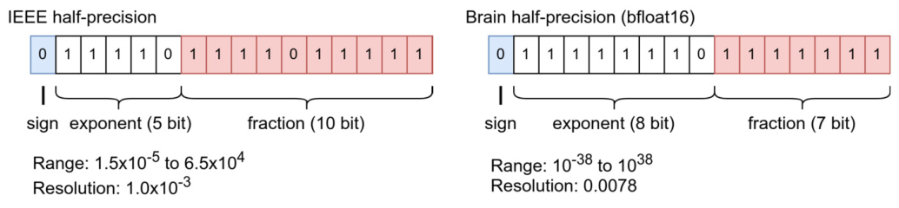

# 外部语言接口 {#ch08 .unnumbered}

在 Python 项目中，许多场景需要集成不同编程语言编写的代码或库。针对计算密集型任务，通常会用 C 或 C++ 等语言实现特定功能以优化性能。在其他情况下，项目往往需要调用已有的编译型语言库，而全盘用 Python 重写这些代码并不现实。因此，我们需要一个接口来执行其他编程语言编写的函数。
开发这类接口有多种选择。从技术上讲，它们主要分为两类：进程间通信（IPC）与同一内存空间内的函数调用。
使用进程间通信时，Python 程序和外部语言程序可以通过文件、消息传递或共享内存交换数据。然而，进程间通信接口往往伴随着较高的开销。同一内存空间内的函数调用能够避免这类进程间通信的开销和复杂性；该方案通常借助 Python/C API 实现，是工程实践中的首选方案。
开发外部语言接口时需要考虑几个技术细节。其中一些技术问题与底层编译型语言乃至操作系统的特性紧密相关。阅读本章时，你将找到以下问题的答案：

- Python 与其他语言的数据类型有什么区别？
- 如何在 Python 软件包中编译扩展？此外，如何利用 CMake 在 Python 软件包中编译 C/C++ 库？
- 如何检查和管理 Python 扩展所用外部库的运行时依赖？
- 是否有工具能够自动实现 Python 与编译型语言之间的接口，而不必手动使用 Python/C API？
- 如何在不实现 Python/C API 代码的情况下，从 Python 直接调用 C 函数？
- 开发 Python 与 Fortran 之间的接口有哪些方法？

## 8.1 进程间通信接口

通过进程间通信将 Python 与外部库连接时，基本上有两个问题需要解决：

1. 如何执行外部库？
2. 如何在 Python 与外部库之间交换数据？

绝大多数传统量子化学程序均可通过 shell 命令执行。为了与这些程序交互，Python 内置的 os.system 与 os.popen 函数提供了运行 shell 命令的基础能力。不过更可靠的选择是标准库内置的 subprocess 模块，它提供了更完善的流程控制和错误处理能力。我们特别推荐使用该模块的 subprocess.check_call 或 subprocess.check_output 函数，它们既能执行 shell 命令，又可捕获并妥善处理执行中抛出的异常。subprocess 既可在宿主 shell 中运行命令，也能以不启动 shell 的直接模式执行；通常建议采用直接模式。在该模式下，外部命令应以独立字符串构成的列表形式传入，如下例所示：

```python
try:
    cmd = 'pyldd chap01/pyldd'
    output = subprocess.check_output(cmd.split())
    print(output.decode())
except subprocess.CalledProcessError as e:
    print(e.returncode)
    print(e.cmd)
    print(e.output.decode())
    print(e.stderr)
```
在这种进程间通信接口中，Python 与外部库的数据交互通常基于文件。该方案需要读写 Python 脚本和外部库都能访问的临时文件。如何管理这类用于数据交换的临时文件？计算结束后将临时文件留在磁盘上通常并不可取。为了确保用后及时清理，tempfile 模块提供了完善的临时文件管理功能。
若使用临时文件作为外部程序的输入文件，可调用 tempfile.NamedTemporaryFile 类创建该文件。关闭时，这个临时文件会自动删除。执行外部程序时，应将 subprocess.check_call 函数置于 NamedTemporaryFile 上下文中，如下例所示：

```python
In [1]: with tempfile.NamedTemporaryFile(mode='w', dir='.') as f:
            print(f.name)
            f.write('hello')
            f.flush()
```

```python
            subprocess.check_call(['cat', f.name])
        print(os.path.exists(f.name))
Out[1]:
/home/ubuntu/tmpzpt80qxt
hello
False
```
请注意，写入 NamedTemporaryFile 的操作存在缓冲，写入内容未必立即对外部程序可见。因此，在执行外部 shell 命令前，务必调用 flush 确保所有数据都已同步落盘到文件中。
默认情况下，NamedTemporaryFile 创建的临时文件存放在环境变量 TMPDIR 指定的目录中。若要更改这些文件的保存位置，可调节 dir 关键字参数。NamedTemporaryFile 的默认操作模式是二进制模式，仅允许写入 bytes 或 bytearray 对象。为支持写入常规文本字符串，本例将文件操作模式显式改为了文本模式。
对于涉及多个临时文件的场景，TemporaryDirectory 类提供了便捷的方案。该类创建一个临时目录，退出 with 上下文时会自动删除该目录。

```python
In [2]: with tempfile.TemporaryDirectory() as tmpdir:
            input_file = f '{tmpdir}/input.dat'
            print(input_file)
            subprocess.call(..., cwd=tmpdir)
            ...
        print(os.path.exists(input_file))
Out[2]:
/tmp/tmpvczd6f5c/input.dat
False
```

## 8.2 C/C++ 接口

C 和 C++ 常用于编写 Python 扩展。Python 提供了原生 C API，允许将 C 和 C++ 代码集成到 Python 项目中。这使 Python 能以极小开销在同一内存空间内调用 C/C++ 函数。开发扩展时需要考虑的一个关键方面，是理清 Python 与 C/C++ 间的数据类型差异。此外，必须正确配置底层编译选项与构建系统。

### 8.2.1 数据类型与类型转换

诸如整数、浮点数等基本数据类型，可以轻松在 Python 与 C/C++ 之间直接映射。然而，复杂数据结构或类并没有直接的映射方式。Python 数据类型的约束较少，通常比 C/C++ 类型更容易操纵。C/C++ 数据类型的限制往往会影响接口乃至算法的设计。协调两门语言之间的数据类型，可能需要重新设计数据结构，并在互操作层补充内存管理代码。下面我们系统考察与 Python 量子化学扩展有关的数据类型。

#### 8.2.1.1 整数

C/C++ 拥有多种整数类型，用于表示不同范围的数值。long long 类型是 64 位整数，能表示范围 [− 263, 263 1] 内的数。64 位整数是 NumPy 库中最大的整数类型，也是其默认整数类型。此外，NumPy 还提供 np.int32、np.int16 与 np.int8，分别对应 C 中的标准 32 位 int、int16_t 和 int8_t 类型。
对于大整数，Python 可以处理任意大的数。C/C++ 没有原生支持任意大数值的数据类型。因此，在将 Python 整数传给 C 函数之前，往往需要做额外检查，以确保数值范围合适。
至于 Python 的 bool 类型，它可以直接映射到 C 中的任意整数类型。NumPy 里的 np.bool_ 是单字节数据类型，与 C++ 的 std::boolean、C 中的 Bool_ 类型或 int8_t 类型相互兼容。

#### 8.2.1.2 浮点数

Python 的 float 是双精度（64 位）浮点类型，与 C 中的 double 类型完全兼容。它也是 NumPy 库中的默认浮点类型，称为 np.float64。NumPy 还分别提供 32 位和 128 位浮点类型 np.float32 和 np.float128。它们可以映射到 C 中的单精度 float 类型和四倍精度 __float128 类型。请注意，C 中的 long double 类型保证其精度不低于 double 类型。然而，它未必满足 float128 的精度要求。long double 的精度取决于平台。因此，不应使用 long double 表示 128 位精度的数据。
16 位浮点类型（半精度）因其性能和内存效率优势而广泛用于机器学习应用。然而，16 位浮点数有两种不兼容的格式，即 IEEE 标准半精度格式和脑浮点格式（Brain Floating Point，bfloat16），如图 8.1 所示。NumPy 中的 np.float16 类型采用 IEEE 754 半精度浮点数标准。此外，PyTorch 和 Tensorflow 等机器学习库支持 bfloat16 类型。
数据类型 std::float16_t 和 std::bfloat16_t 是在较新的 C++ 标准中引入的。不幸的是，这些类型没有在



**图 8.1** IEEE 浮点数（float16）与 Brain 浮点数（bfloat16）的比较

C 语言标准。不同的 C 和 C++ 编译器对半精度类型的支持可能并不普遍，也可能不一致。在 GCC [1] 和 Clang [2] 中使用 float16 类型需要额外的编译标志。bfloat16 类型仅在某些硬件平台上可用。在 Python 的 C/C++ 扩展中使用半精度浮点数时必须谨慎，因为这可能涉及依赖平台和编译器的问题。

#### 8.2.1.3 字符串

Python、C 与 C++ 对字符串类型的规范截然不同。Python 字符串采用 Unicode 编码，而 C 字符串则表示为以 NUL 字符（`\0`）结尾的 char 数组。因此，无法在 C 或 C++ 函数中直接操纵 Python 字符串对象。只有 Python 的 bytes 或 bytearray 对象能与 C 的 char 类型直接兼容。要在 C/C++ 中处理 Python 字符串，可通过 .encode() 与 .decode() 方法在 Unicode 与 bytes 之间相互转换。

```python
a_str = 'py-str'
b_obj = a_str.encode() # converts string to bytes
a_str = b_obj.decode() # converts bytes to string
```
对于 NumPy 数组中的字符串，我们可以使用.astype()方法将数组中的所有字符串转换为 bytes，或进行反向转换 [3]。

```python
str_arr = np.array([ 'py-str', 'xyz'])
b_arr = str_arr.astype(bytes) # converts all strings in the array to bytes
str_arr = b_arr.astype( str) # converts all bytes to string objects
```
转换操作 .astype(bytes) 会得到由 bytes 对象组成的数组。这个数组 b_arr 的步幅（stride）等于 str_arr 数组中最长字符串的大小。较短的字符串会在末尾补 0，以匹配最长字符串的长度。因此，b_arr 中的每个元素大小相同，对应于 b_arr.itemsize。需要留意的是，数组中的字符串元素没有结尾的 NUL 字符。strcpy 和 strcmp 等 C 字符串函数不适用于单个元素。在 C 函数中处理 b_arr 时，我们可以按 b_arr.itemsize 的步幅遍历底层数据，以访问每个元素。b_arr 的 .dtype 属性
显示诸如|S6 的记法。它表示数组元素是 bytes 对象，每个对象的长度为 6 字节。
Python 字符串与 C 或 C++ 字符串之间的转换可以通过 Python/C API 或 C++ 的 std::string 构造函数实现：

```python
#include <Python.h>
// Create a Python string from C string
PyObject* strObject = PyUnicode_FromString( "c-str");
Py_DECREF(strObject);
// Get the pointer to the Python string data
char* strData = PyUnicode_AsUTF8(strObject);
// strData is a null-terminated char array, from which a C++ string can be
// constructed
std::string cpp_str(strData);
```
虽然可以手动转换，但在构建接口模块时，这种方法既繁琐又容易出错。可以使用 Cython 和 pybind11 等工具自动完成这些转换。

#### 8.2.1.4 类和结构体

站在 C/C++ 代码的角度看，Python 类的实例本质上是一个 PyObject。由于 PyObject 结构复杂，它无法直接映射到 C/C++ 代码中的普通结构体或类。我们必须使用 Python/C API 在 C/C++ 中访问其内部属性。
为了简化 Python 和 C 之间的数据转换，一种高效方案是将 Python 对象序列化（serialize）为与 C/C++ 数据结构兼容的二进制格式。例如，在把 Python 类的实例传递给 C/C++ 函数前，我们可以调用 Python 的 struct.pack 函数将其序列化。随后只需借助简单的类型转换，就能把序列化后的二进制数据按 C 结构体或 C++ 类对象来解析。反之，对于 C/C++ 函数输出的数据，我们也可以使用 Python 的 struct.unpack 函数或 ctypes.Structure 类进行反序列化（deserialize）。
假设 C++ 中实现了一个 Atom 类，用于保存分子中一个原子的元素符号和坐标。

```python
class Atom {
    char symbol[2];
    float x;
    float y;
    float z;
};
```
我们可以相应地使用 struct.pack 和 struct.unpack 函数定义一个序列化协议。可以为该协议实现序列化方法 dumps 和反序列化方法 loads：

```python
from dataclasses import dataclass
PROTOCOL = '2sfff'
@dataclass
class Atom:
    symbol: str
    x: float
    y: float
    z: float
    def dumps(self) -> bytearray:
        '''Serializes the Atom object'''
        return bytearray (struct.pack( PROTOCOL, self.symbol.encode(), self.x, self.y, self.z))
    @classmethod
    def loads(cls, buffer: Union[bytes, bytearray]) -> Atom:
        '''Deserializes binary data and constructs an Atom object'''
        symbol,x ,y , z = struct.unpack(PROTOCOL, buffer)
        return cls(symbol.decode(), x,y ,z )
```
Python 标准模块 dataclasses [4] 中的 dataclass 装饰器（decorator）可以自动添加双下划线方法，例如__init__和__repr__。classmethod 是一种用于类中方法的特殊装饰器，它使方法能够操作类本身，而不是类的实例。由 classmethod 装饰的方法通常用于创建新实例，作为标准类初始化方法的替代方案 [5]。
使用 ctypes.Structure 是表示 C 结构体数据的另一种方法。例如，我们可以使用 ctypes.Structure 实现以下序列化和反序列化方法：

```python
class Atom(ctypes.Structure):
    _fields_ = [
        ('symbol', ctypes.c_char *2), ('x', ctypes.c_float), ('y', ctypes.c_float), ('z', ctypes.c_float), ]
    def dumps(self) -> bytearray:
        '''Serializes the Atom object'''
        return bytearray (self)
```

```python
    @classmethod
    def loads(cls, buffer: Union[bytes, bytearray]) -> Atom:
        '''Deserializes binary data and constructs an Atom object'''
        if isinstance (buffer, bytearray):
            return cls.from_buffer(buffer)
        else:
            return cls.from_buffer_copy(buffer)
```
有关 ctypes.Structure 的更多细节将在第 8.3.1.4 节中讨论。
另一种选择是使用 cffi 库 [6] 包装数据：

```python
from cffi import FFI
ffi = FFI()
ffi.cdef('''
typedef struct {
    char symbol[2];
    float x;
    float y;
    float z;
} Atom;
''')
@dataclass
class Atom:
    symbol: str
    x: float
    y: float
    z: float
    def dumps(self) -> bytearray:
        '''Serializes the Atom object'''
        c_atom = ffi.new( 'Atom *')
        c_atom.symbol = self.symbol
        c_atom.x = self.x
        c_atom.y = self.y
        c_atom.z = self.z
        return ffi.buffer(c_atom)
    @classmethod
    def loads(cls, buffer: Union[bytes, bytearray]) -> Atom:
        '''Deserializes binary data and constructs an Atom object'''
        c_atom = ffi.cast( 'Atom *', ffi.from_buffer( buffer))[0]
        return cls(c_atom.symbol.decode(), c_atom.x, c_atom.y, c_atom.z)
```
有关 cffi 的更多细节将在第 8.3.2 节中讨论。
如果目的是操作一组 C 结构体数据，NumPy 结构化数组（structured array）（参见第 2 章第 2.2.5 节）是打包或解包复杂数据的高效选择。

```python
atom_type = np.dtype([
    ('symbol', 'S2'), ('x', 'f4'), ('y', 'f4'), ('z', 'f4')
], align=True)
@dataclass
class Atom:
    symbol: str
    x: float
    y: float
    z: float
    def dumps(self) -> bytearray:
        '''Serializes the Atom object'''
        arr = np.array([(self.symbol, self.x, self.y, self.z)], dtype=atom_type)
        return bytearray (arr.data)
    @classmethod
    def loads(cls, buffer: Union[bytes, bytearray]) -> Atom:
        return cls(*np.frombuffer(buffer, dtype=atom_type))
```
请注意创建结构化数组的 dtype 时设置的 align=True。该设置确保每个字段在内存地址上的对齐（alignment）。C 结构体中的填充（padding）由 C 编译器自动处理。默认情况下，NumPy 结构化数组不会在字段之间添加填充。启用 align 选项后，结构化数组的 dtype 就与使用 ctypes.Structure 定义的类型等价。然后，我们可以使用以下方式初始化结构化数组的 dtype：

```python
class Atom(ctypes.Structure):
    _fields_ = [
        ('symbol', ctypes.c_char *2), ('x', ctypes.c_float), ('y', ctypes.c_float), ('z', ctypes.c_float), ]
atom_type = np.dtype(Atom)
```
使用 NumPy 结构化数组，可以方便地初始化或修改结构体的元素。

```python
arr = np.empty(shape, dtype=atom_type)
arr['symbol']=[ 'C', 'H', 'H', ...]
arr['x'] = corrdinates[:,0]
arr['y'] = corrdinates[:,1]
arr['z'] = corrdinates[:,2]
```

#### 8.2.1.5 数组

多维 NumPy 数组与 C/C++ 中的多维数组截然不同。在 C/C++ 中，多维数组本质上是嵌套指针。相比之下，NumPy 多维数组是一个连续的数据块，附带形状和步幅元数据。为了索引数组中的元素，多维索引会被转换为该数据块中的单一地址。因此，必须向 C/C++ 函数提供 NumPy 数组的形状和步幅信息，才能完成这种索引转换。
在编写 C/C++ 函数时，通常会假定多维数组中的数据连续存储在内存中。然而正如第 2 章所讨论的，NumPy 数组并不总能保证数据连续。使用数组视图（array view）可能导致不连续的内存布局。在将 NumPy 数组数据传给 C/C++ 函数前，验证并确保数据的连续性至关重要。
为确保连续存储，可以使用 np.copy(a, order=’C’) 创建一个以 C 连续顺序存储的数组副本。然而对于已经按 C 连续顺序排列的数组，复制数据会带来多余的开销。为了避免这种开销，可以使用 np.asarray 或 np.require 等函数。

```python
a = np.asarray(a, order= 'C')
a = np.require(a, requirements=[ 'C'])
```
这些函数只在必要时才触发数据复制。

#### 8.2.1.6 函数指针和回调

与 C/C++ 不同，Python 没有为回调函数（callback function）提供函数指针这类特殊类型。在 Python 中，函数是一等对象（first-class object），可以像任何其他 Python 对象一样传递。要从 C/C++ 调用 Python 回调函数，一种方法是用 Python/C API 解析并执行作为回调的 Python 对象；另一种方法是创建指向 C 包装函数的函数指针，再由包装函数调用 Python 回调函数。这可以通过 ctypes.CFUNCTYPE 或 cffi 模块提供的回调包装器实现。有关 ctypes 回调的更多细节将在第 8.3.1 节深入讨论。
如果回调函数向 C 返回任何 Python 对象，在 C/C++ 函数中调用回调可能会意外干扰 Python 对象的生命周期管理。回调中创建的对象可能会被垃圾回收器释放
一旦程序控制权返回 C/C++ 程序，访问这些 Python 对象的内存块就可能导致非法内存操作。

### 8.2.2 Cython

是在 Python 中集成 C 和 C++ 程序的优秀工具。通过将 Python 代码转换为 C 代码，Cython 可以显著提高代码效率。此外，Cython 可以生成接口，简化从 Python 调用 C 函数的过程。因此，Cython 可以作为连接 Python 与外部 C/C++ 库的中间层。包括 NumPy、SciPy 和 scikit-learn 等知名库在内的许多科学计算库，都使用 Cython 优化特定功能并将外部库嵌入 Python。
支持编译纯 Python 代码。不过，更常见的做法是直接用 Cython 语言编写程序。Cython 程序文件通常以 .pyx 为后缀。Cython 语言基于 Python 语言，引入了额外的关键字，帮助 Cython 编译器推断每个变量的数据类型。许多 Cython 语言关键字是在 Python 关键字前加上 c，例如 cdef、cimport 和 __cinit__。这些关键字表明 Cython 源代码中的代码块或语句被视为 C 层面的操作。
例如，scipy.special 模块中有一个名为 comb 的函数，用于计算二项式系数。这个函数调用了一个 C 函数，该函数在 SciPy 源代码 scipy/special/_comb.pyx 中用 Cython 语言实现。除了少量使用 cdef 的数据类型声明之外，函数 _comb_int_long 看起来非常像一个 Python 函数。

```python
cdef extern from "limits.h":
    unsigned long ULONG_MAX
...
cdef unsigned long _comb_int_long(unsigned long N, unsigned long k):
    """
    Compute binom(N, k) for integers.
    Returns 0 if error/overflow encountered.
    """
    cdef unsigned long val,j ,M , nterms
    if k>N or N == ULONG_MAX:
        return 0
    M=N+1
    nterms = min(k,N-k )
    v a l=1
    for j in xrange (1, nterms + 1):
        # Overflow check
        if val > ULONG_MAX // (M - j):
            return 0
        val *=M-j
        val //= j
    return val
```
为了有效组织 Cython 代码，我们可以根据源代码的角色或功能将其分散到多个文件中。函数签名以及类和数据类型声明通常放在以 .pxd 为后缀的 Cython 头文件中。函数和类的实现则集中在 .pyx 文件中。使用 cimport 关键字，我们可以将 .pxd 文件中的声明代码导入 .pyx 文件。要包含普通的 C/C++ 头文件，例如 math.h，可以使用语句

```python
cdef extern from "..."
```
编译 Cython 程序时，编译器只处理 .pyx 文件。与编译 C/C++ 源代码类似，编译器会沿着 -I 选项或 cythonize() 中的 include_path 选项指定的路径，以及 sys.path 中的路径，搜索所依赖的 .pxd 文件和 C/C++ 头文件。
将 Cython 代码编译为 Python 扩展有两种常见方法。

#### cythonize 编译器

我们可以从命令行执行 cythonize 编译器，例如：

```bash
$ cythonize --inplace scipy/special/_comb.pyx
```
这条命令会创建一个可由 Python 导入的共享库（shared library），名为

```text
_comb.cpython-310-x86_64-linux-gnu.so
```
，并将其放在源代码所在的目录中。
编译器并不直接生成共享库。实际上，它首先将 Python 代码转换为 C 代码，然后调用 C/C++ 编译器生成共享库。cythonize 编译器还会在源代码目录中为每个 .pyx 文件生成一个中间 C 文件。该文件包含生成的 C 函数以及相应 Python/C API 的详细信息，有助于追踪接口中的性能问题和错误。

#### setuptools 扩展

可以配置 setuptools 扩展来编译 Cython 代码。例如，编译 _comb.pyx 的最简单 setup.py 如下：

```python
from setuptools import setup
from Cython.Build import cythonize
setup( ext_modules=cythonize('scipy/special/_comb.pyx'), package_data={'my_pkg':[ 'scipy/special/_comb.pyx']}, )
```
然后我们可以从命令行构建扩展：

```bash
$ python setup.py build_ext --inplace
```

### 8.2.3 pybind11

旨在提供类似 Python 的编程体验。它面向 Python 程序员，使他们能够基于 Python 代码快速开发 Python 扩展。在 C++ 方面，pybind11 的设计则是利用 C++ 模板，由 C++ 编译器生成 Python 绑定（bindings）。虽然这两种工具都能创建 Python 扩展，但它们采用不同的方法，适用于不同的场景。Cython 适合优化现有 Python 代码。pybind11 则更适合将 C++ 程序的功能暴露给 Python。
许多 Python 库都使用 pybind11。例如，PyTorch 使用 pybind11 创建 Python 扩展。为了简化 PyTorch 扩展的开发流程，它提供了一个基于 pybind11 的工具 torch.utils.cpp_extension。有一篇 PyTorch 教程 [7]，指导你使用 pybind11 构建 PyTorch 扩展。
为定义 Python 接口提供了非常直观的抽象。一个典型的代码示例如下：

```python
#include <pybind11/pybind11.h>
double square(double x) {
    return x * x;
}
PYBIND11_MODULE(example_module,m ){
  m.def("square", &square);
}
```
编译 pybind11 扩展有多种方法。根据扩展是在 Python 项目还是 C++ 项目中编译，推荐的方法也有所不同。在 Python 项目中，可以安装 pybind11 Python 软件包（pip install pybind11），并在 setup.py 中使用它，例如：

```python
from setuptools import setup
from pybind11.setup_helpers import Pybind11Extension
setup(ext_modules=[
    Pybind11Extension('example_module',[ 'example.cpp']), ])
```
使用命令构建这个 setup.py：

```bash
$ python setup.py build_ext --inplace
```
我们得到 Python 模块 example_module，可以直接将其导入 Python 程序。

```python
In [1]: import example_module
        print(example_module.square(9))
Out[1]: 81.0
```
关于在 Python 项目中使用 pybind11 库的更多示例，可以在其 GitHub 仓库 [8] 中找到。
对于 C++ 项目，使用 CMake 系统编译 Python 扩展很方便。假设 pybind11 源代码位于 C++ 项目代码库中名为 pybind11 的目录内，以下 CMake 配置可以编译 Python 扩展：

```text
add_subdirectory(pybind11)
pybind11_add_module(example_module example.cpp)
```

### 8.2.4 将 C++ 代码编译为 Python 模块

在 Python 项目中，使用 setup.py 脚本和 setuptools.Extension 函数是编译 C++ 扩展的标准方法。如前所示，编译扩展需要执行以下命令：

```bash
$ python setup.py build_ext --inplace
```
例如，我们可以创建一个简单的 setup.py 来处理多个 C++ 文件，如下所示：

```python
from setuptools import setup, Extension
setup(ext_modules=[
    Extension( 'example.simple_cpp', sources=['src/cpp/example_A.cpp', 'src/cpp/example_B.cpp'], language='c++',
    )], )
```
这个配置示例指定了三个关键方面：

- 扩展是一个名为 example.simple_cpp 的 Python 模块。在 Linux 上，模块文件 simple_cpp.cpython-310-x86_64-linux-gnu.so 会在 example 目录中生成。
- 扩展由两个 C++ 文件组成。
- 扩展的编译需要 C++ 编译器。

通过在 Extension 配置中添加更多设置，例如 extra_compile_args、libraries、library_dirs、include_dirs 和 extra_link_args，开发者可以构建满足更复杂需求的扩展。下面来看看如何在以下场景中配置 C/C++ 扩展。

#### 启用 OpenMP

通过将编译器标志 -fopenmp 添加到 extra_compile_args 和

```text
Extension( ...
    extra_compile_args=['-fopenmp'], extra_link_args=['-fopenmp'], )
```

#### 使用 Intel 编译器

启用 Intel 编译器的一种简单方法是在运行 setup.py 之前设置环境变量 CC=icc 和 CXX=icpc。setuptools 软件包读取 CC、CFLAGS、LDFLAGS 等环境变量，以统一配置编译器和编译选项。请注意，CXXFLAGS 是个例外，setuptools 不支持它。

#### 链接外部库

BLAS 和 LAPACK 等外部库在量子化学程序中经常使用。要使用外部库构建扩展，我们需要配置 libraries 和 library_dirs 条目。例如，要在程序中使用 Intel MKL（Math Kernel Library，数学核心库），根据 Intel MKL 链接顾问 [9] 的建议，GCC 编译器需要以下命令行选项：

```text
-L${MKLROOT}/lib/intel64 -lmkl_intel_lp64 -lmkl_sequential -lmkl_core
```
这些选项可以转换为以下配置：

```text
Extension( ...
    libraries=['mkl_intel_lp64', 'mkl_sequential', 'mkl_core'], library_dirs=[f'{os.getenv("MKLROOT")}/lib/intel64'], )
```
Linux 上的大多数共享库遵循 lib{name}.so 的命名约定。在配置 Extension 的 libraries 选项时，我们只需包含共享库名称中的 name 部分。setuptools 可以在 library_dirs 中列出的每个目录前加上 -L，在 libraries 中列出的每个名称前加上 -l。然而，有些共享库可能不遵循常规命名模式。例如，在某些 Linux 发行版中，BLAS 库位于 /usr/lib/libblas.so.3。要链接这样的库，我们可以写：

```python
libraries=[':libblas.so.3']
```
这一设置会生成命令行选项 -l:libblas.so.3，使链接器能够找到 /usr/lib/libblas.so.3，而不是使用标准名称 libblas.so 的那一个。
如果 Python 项目调用 C/C++ 扩展，就需要正确配置动态库的路径，这与运行标准 C/C++ 应用程序类似。在 Linux 上，一种方法是设置 LD_LIBRARY_PATH 环境变量。另一种方法是使用链接器选项 -Wl,-rpath，将 rpath 信息直接嵌入扩展中。这个选项可以通过 extra_link_args 参数添加。例如，下面的设置可以将 Python 项目的目录添加到动态库搜索路径中：

```yaml
if platform.system() == "Linux":
    link_args = [ '-Wl,-rpath,$ORIGIN']
elif platform.system() == "Darwin": # MacOS
    link_args = [ '-Wl,-rpath,@loader_path']
else:
    link_flags = []
Extension( ...
    libraries=['mkl_intel_lp64', 'mkl_sequential', 'mkl_core'], library_dirs=[f'{os.getenv("MKLROOT")}/lib/intel64'], extra_link_flags=link_flags, )
```
这里，$ORIGIN 和 @loader_path 分别指 Linux 和 macOS 上扩展所在的目录。
在标准 C/C++ 程序中，我们可能会遇到依赖库的版本和路径问题。Python 中的 C/C++ 扩展也可能出现类似问题。在 Linux 上，几种工具可以帮助我们识别 Python 扩展的运行时问题：

- . ELF（Executable and Linkable Format，可执行与可链接格式）是一种标准格式，用于存储共享库的变量符号、运行时路径、依赖关系和其他信息。有关 ELF 工作方式的更多细节，可以参阅《Computer Systems: A Programmer’s Perspective》第 7 章 [10]。readelf 是用于检查 ELF 文件内容的工具。
- . 这个工具可以显示共享库的依赖关系。
- . 这个工具可以列出共享库中的所有全局符号 [11]。我们可以用它来确定共享库中的哪些函数符号依赖外部库。

#### 使用 MPI 的扩展

要在 C/C++ 扩展中启用 MPI（Message Passing Interface，消息传递接口），我们需要使用 MPI 编译器编译源代码。设置环境变量 CC=mpicc 和 CXX=mpicxx 会将 MPI 编译器用于所有扩展。然而，如果只有一个扩展需要 MPI，我们可以通过自定义 setup 配置中的 build_ext 组件来限制 MPI 编译器的使用范围。setup.py 中的编译工作由 build_ext 类的 build_extension 方法执行。对于 MPI 扩展，我们可以在调用这个方法之前配置编译器。编译 MPI 扩展后，应当恢复编译器设置，因为所有扩展都共享这些设置。

```python
from setuptools import setup, Extension
from setuptools.command.build_ext import build_ext
class MPIExtension(Extension):
    pass
class MPIBuild(build_ext):
    def build_extension(self, ext: Extension):
        if not isinstance (ext, MPIExtension):
            return super ().build_extension(ext)
        # Back up the existing settings.
        compiler_c = self.compiler.compiler_c
        compiler_cxx = self.compiler.compiler_cxx
        compiler_so = self.compiler.compiler_so
        linker_so = self.compiler.linker_so
        self.compiler.set_executables( compiler_c='mpicc', compiler_cxx= 'mpicxx', compiler_so='mpicxx', linker_so= 'mpicxx')
        build_ext.build_extension(self, ext)
        # Restore old compiler settings
        self.compiler.set_executables(
            compiler_c=compiler_c, compiler_cxx=compiler_cxx, compiler_so=compiler_so, linker_so=linker_so)
setup( ext_modules=[
        Extension('example.serial_ext', sources=[ 'serial_ext.cpp'], language='c++'), MPIExtension('example.mpi_ext', sources=[ 'mpi_ext.cpp'], language='c++'), ], cmdclass={"build_ext": MPIBuild}, )
```

#### 调用 CMake

某些 Python 软件包，例如 PyTorch，使用 CMake 编译扩展。在这种情况下，setup.py 只用于触发 cmake 命令。方法是绕过 build_ext.build_extension 方法中的编译任务，直接调用 cmake 命令。如果需要其他预处理或后处理步骤，也可以将其集成到这个方法中。

```python
from setuptools.command.build_ext import build_ext
class CMakeExtension(Extension):
    pass
class CMakeBuild(build_ext):
    def build_extension(self, ext: Extension):
        if not isinstance (ext, CMakeExtension):
            return super ().build_extension(ext)
        # Process cmake configuration
        cmd = [ 'cmake',f '-B{self.build_temp}']
        self.spawn(cmd)
        # Process building
        cmd = [ 'cmake', '--build', self.build_temp]
        if hasattr (self, "parallel") and self.parallel:
            cmd += [f "-j{self.parallel}"]
        self.spawn(cmd)
setup( ...
    ext_modules=[
        CMakeExtension('my_pkg.ext_via_cmake', sources=[]),
    ], cmdclass={"build_ext": CMakeBuild}, package_data={'my_pkg':[ 'src/CMakeLists.txt']}, )
```
此外，在 pyproject.toml 文件中，我们将 cmake 软件包列为构建时依赖。

```text
[build-system]
requires = ['setuptools', 'wheel', 'cmake']
```

#### NumPy 头文件

在 Cython 代码中使用语句 cimport numpy 时，代码必须能够访问 NumPy 头文件。这些头文件的路径可以通过 numpy.get_include() 获取，然后按如下方式赋给 Extension 对象的 include_dirs 参数：

```text
setup( ...
    ext_modules=cythonize([
        Extension('example.cython_ext',[ 'src/example/cython_code.pyx'], include_dirs=[numpy.get_include()]), ]), ...
)
```

## 8.3 函数接口

虽然 Python 提供 C API 来调用 C 函数，但直接使用这些接口并不方便，需要额外编写一层 C 胶水代码。实际上，Python 还可以通过外部函数接口（FFI）直接执行 C 函数，而无需编写或编译任何 Python/C API 代码。在 Python 中，ctypes 和 cffi 是利用 FFI 调用 C 函数的常用方案。

### 8.3.1 Ctypes

ctypes 是一个 Python 标准库，用于从 Python 与 C 函数交互。然而，ctypes 的使用受到一些限制：

- 与原生 Python/C API 相比，这种方法发起函数调用的开销相对较高。
- 不支持原生 C++ 函数。
- 只能加载使用 -fPIC 选项编译的共享库。

一般来说，使用 ctypes 开发 Python/C 接口包括两个步骤：

1. 使用 ctypes.CDLL 函数加载共享库。
2. 声明 C 函数的原型，其中包括用 argtypes 指定

所有输入参数的类型，以及用 restype 指定返回值的类型。
例如，我们可以使用 ctypes 与 BLAS 函数 ddot_ 交互，再利用该函数计算两个 NumPy 数组的内积。

```python
import numpy as np
import ctypes
libblas = ctypes.CDLL( 'libblas.so.3')
c_int_p = ctypes.POINTER(ctypes.c_int)
c_double_p = ctypes.POINTER(ctypes.c_double)
libblas.ddot_.argtypes = [ # (1)
    c_int_p, c_double_p, c_int_p, c_double_p, c_int_p]
libblas.ddot_.restype = ctypes.c_double
def blas_ddot(x: np.ndarray, y: np.ndarray) -> float:
    assert x.size == y.size
    assert x.dtype == y.dtype == np.float64
    assert x.ndim == y.ndim == 1
    px = x.ctypes.data_as(c_double_p)
    py = y.ctypes.data_as(c_double_p)
    size = ctypes.c_int(x.size)
    incx = ctypes.c_int(x.strides[0] // x.itemsize)
    incy = ctypes.c_int(y.strides[0] // y.itemsize)
    out = libblas.ddot_(size,p x, incx,p y, incy)
    return out
```
第 (1) 行的 libblas.ddot_.argtypes 函数原型根据 ddot_ 的签名声明：

```text
double ddot_(int *n, double *dx, int *incx, double *dy, int *incy);
```

#### 8.3.1.1 函数原型

C 函数原型 argtypes 是一个 ctypes 转换器列表，它不仅反映数据类型信息，还定义如何将每个 Python 输入参数转换为 C 变量。调用 C 函数时，ctypes 调用转换器的 from_param 方法 [12] 来验证输入参数的数据类型，并执行必要的转换。ctypes 内置数据类型，如 ctypes.c_int 和 ctypes.c_double，有自己的 from_param 方法。对于我们在项目中实现的类，可以自定义 from_param 以接入 ctypes 接口。在 from_param
方法中，我们可以将必要的属性打包到一个 C 结构体变量中，然后返回它的内存地址。这种方法无需在调用 C 函数时为每个输入参数手动编写转换语句。例如，我们可以为第 8.2.1 节介绍的 Atom 类实现 ctypes 接口，并在 C 函数原型中使用它。

```python
import struct
@dataclass
class Atom:
    symbol: str
    x: float
    y: float
    z: float
    def dumps(self) -> bytearray:
        '''Serializes the Atom object'''
        return bytes(struct.pack(PROTOCOL, self.symbol.encode(), self.x, self.y, self.z))
    @classmethod
    def loads(cls, buffer: Union[bytes, bytearray]) -> Atom:
        '''Deserializes binary data and constructs an Atom object'''
        symbol,x ,y , z = struct.unpack(PROTOCOL, buffer)
        return cls(symbol.decode(), x,y ,z )
    @classmethod
def from_param(cls, obj: bytes): # (1)
        # Passing the pointer of struct
        return ctypes.cast(obj, ctypes.c_void_p)
    @property
def _as_parameter_(self): # (2)
        return self.dumps()
...
atom_distance.argtypes = [Atom, Atom]
atom_distance.restype = ctypes.c_float
atom1 = atom2 = Atom( 'H',0,0 ,0 )
dist = atom_distance(atom1, atom2)
```
只有声明了 C 函数的函数原型（由 .argtypes 定义）时，才会调用第 (1) 行的数据转换方法 from_param。如果没有指定函数原型，就会使用每个输入参数的 _as_parameter_ 属性
并将其传递给 C 函数。因此，我们还为这种情况实现了 _as_parameter_ 属性，如第 (2) 行所示。

#### 8.3.1.2 NumPy 数组

NumPy 数组可以顺利地与 ctypes 配合使用。有几种方法可以将 NumPy 数组，更确切地说是 NumPy 数组的指针，传递给 C 函数。一种方法是访问 NumPy 数组的 .ctypes 属性来获取指针。以 BLAS 的 ddot_ 函数为例，这种方法将 C 函数接口简化为：

```python
import numpy as np
import ctypes
libblas.ddot_.restype = ctypes.c_double
def blas_ddot(x: np.ndarray, y: np.ndarray) -> float:
    assert x.size == y.size
    assert x.dtype == y.dtype == np.float64
    assert x.ndim == y.ndim == 1
    size = ctypes.c_int(x.size)
    incx = ctypes.c_int(x.strides[0] // x.itemsize)
    incy = ctypes.c_int(y.strides[0] // y.itemsize)
    out = libblas.ddot_(size, x.ctypes, incx, y.ctypes, incy)
    return out
```
然而，这个接口在传递指针之前仍需要多次检查，以验证数据类型、数组形状和数据的连续性。为了简化这一过程，numpy.ctypeslib 模块提供了一个简洁的包装器 ndpointer，自动执行检查和数据类型转换。如下面的代码片段所示，通过指定带有 dtype 和 ndim 等参数的 np.ctypeslib.ndpointer，我们可以省去 blas_ddot 函数中的数据类型转换和相关检查。

```python
import numpy as np
import ctypes
c_int_p = ctypes.POINTER(ctypes.c_int)
nparray_p = np.ctypeslib.ndpointer(ctypes.float64, ndim=1)
libblas = ctypes.CDLL( 'libblas.so.3')
libblas.ddot_.argtypes = [c_int_p, nparray_p, c_int_p, nparray_p, c_int_p]
libblas.ddot_.restype = ctypes.c_double
def blas_ddot(x: np.ndarray, y: np.ndarray) -> float:
    assert x.size == y.size
    size = ctypes.c_int(x.size)
    incx = ctypes.c_int(x.strides[0] // x.itemsize)
```

```python
    incy = ctypes.c_int(y.strides[0] // y.itemsize)
    out = libblas.ddot_(size,x , incx,y , incy)
    return out
```

#### 8.3.1.3 指针

对于整数、浮点数和字符串等标准 Python 对象，无法使用 ctypes 函数获取它们的地址。如果需要用指针引用标准 Python 对象的值，就必须创建一个临时 ctypes 对象来存储该 Python 对象的值。然后可以将指向这个临时 ctypes 对象的指针传递给 C 函数。下面的示例演示如何获取 bytes、NumPy 数组和 int 的指针。

```python
import ctypes
liblapack = ctypes.CDLL( 'liblapack.so')
# work is the workspace buffer for the general eigenvalue solver dgeev_
lwork = 4000
work = np.empty(lwork)
liblapack.dgeev_( ctypes.c_char_p(b'N'), ctypes.c_char_p(b'V'), ..., work.ctypes, ctypes.byref(ctypes.c_int(lwork)), ...)
```
在这个例子中，创建了几个临时对象。ctypes.c_char_p 函数为 bytes 创建一个临时副本，并返回指向该副本的指针。为了传递整数的指针，我们用该整数的值创建一个 ctypes.c_int 对象，然后使用 ctypes.byref 获取对该 ctypes.c_int 对象的引用，可以将其视为指针。

#### 8.3.1.4 结构体和复数

ctypes 通过 ctypes.Structure 类全面支持 C 结构体类型。ctypes.Structure 的一个典型用途是表示复数。虽然 C99 标准定义了复数，但 ctypes 没有提供原生复数数据类型。复数由两个在内存中连续存储的浮点数表示。表示复数的数据类型可以定义如下：

```python
import ctypes
class c_complex(ctypes.Structure):
    _fields_ = [
        ('real', ctypes.c_double), ('imag', ctypes.c_double), ]
```
我们可以使用这个自定义数据类型与需要复数作为输入或输出的 C/C++ 函数交互。例如，BLAS 函数 zdotu_ 计算两个复向量的点积，并返回一个复数。

```text
double complex zdotu_(int *n, double complex *zx, int *incx, double complex
     *zy, int *incy);
```
zdotu_ 的 Python 函数包装器可以实现如下：

```python
import numpy as np
import ctypes
libblas = ctypes.CDLL( 'libblas.so.3')
c_int_p = ctypes.POINTER(ctypes.c_int)
nparray_p = np.ctypeslib.ndpointer(np.complex128, ndim=1)
libblas.zdotu_.argtypes = [c_int_p, nparray_p, c_int_p, nparray_p, c_int_p]
libblas.zdotu_.restype = c_complex
def blas_zdot(x: np.ndarray, y: np.ndarray) -> complex:
    assert x.size == y.size
    size = ctypes.c_int(x.size)
    incx = ctypes.c_int(x.strides[0] // x.itemsize)
    incy = ctypes.c_int(y.strides[0] // y.itemsize)
    out = libblas.zdotu_(size,x , incx,y , incy)
    return complex (out.real, out.imag)
```

#### 8.3.1.5 回调

在某些情况下，我们可能希望在 C/C++ 代码中调用 Python 函数。一个例子是在 C/C++ 函数中使用 numpy.load 函数从文件读取数组。为此，我们可以使用 ctypes.CFUNCTYPE 将 Python 函数转换为 C/C++ 可调用的函数指针。在 C 代码中，函数指针作为输入参数传入。

```text
void callback_example(void (*np_load)(char *filename, double *buf))
{
        char filename = "example.npy";
        double *b u f=( double *)malloc(sizeof(double) * 100);
        (*np_load)(&filename[0], buf);
        free(buf);
}
```
在 Python 端，我们按如下方式实现回调函数 np_load。

```python
import numpy as np
import ctypes
```

```python
libcb = ctypes.CDLL(...)
@ctypes.CFUNCTYPE(None, ctypes.c_char_p, ctypes.POINTER(ctypes.c_double))
def np_load(filename: bytes, buf: ctypes.c_void_p):
    arr = np.load(filename.decode())
    out = np.ctypeslib.as_array(buf, dtype=arr.dtype, shape=arr.shape)
    out[:] = arr
libcb.callback_example( np_load
)
```
ctypes.CFUNCTYPE 装饰器用于指定回调函数指针的类型提示。第一个参数指定返回值的类型，在这个例子中为 None，表示不需要返回值。后续参数指定回调函数的输入类型。然后将 Python 回调的函数指针传递给 C 函数 callback_example。当 C 中调用回调时，CFUNCTYPE 包装器会自动创建 Python 对象，并根据类型提示将 C 变量映射到各个参数。
需要注意的是，回调中执行的 Python 代码并不支持所有 Python 特性。例如，Python 无法捕获回调函数内部引发的错误。如果回调内部发生错误，控制流会立即返回 C 调用者。因此，所有关于该错误的信息都会丢失。随后 C 调用者会继续执行，并返回其 Python 调用者，仿佛没有发生错误一样。

### 8.3.2 CFFI

软件包 [6] 是加载外部共享库并将其绑定到标准 Python 代码的另一种选择。与 ctypes 类似，cffi 也提供应用程序二进制接口（Application Binary Interface，ABI）级别的接口来执行 C/C++ 函数。ctypes 函数原型以 Python 风格编写，与之不同，cffi 内置了一个 C 语言解析器，允许以 C 风格声明 C 函数签名。
例如，要使用 cffi 执行 BLAS 的 ddot_ 函数，我们可以按如下方式实现接口代码：

```python
import numpy as np
from cffi import FFI
ffi = FFI()
ffi.cdef('''
double ddot_(int *n, double *dx, int *incx, double *dy, int *incy);
''')
# Load the external library, similar to ctypes.CDLL
```

```python
libblas = ffi.dlopen( 'libblas.so.3')
def blas_ddot(x: np.ndarray, y: np.ndarray) -> float:
    assert x.size == y.size
    assert x.dtype == y.dtype == np.float64
    assert x.ndim == y.ndim == 1
    # Get the address of array, similar to x.ctypes.data_as(c_double_p)
px = ffi.cast( 'double *', x.ctypes.data) # (1)
    py = ffi.cast( 'double *', y.ctypes.data)
    # Allocate one int, similar to ctypes.byref(ctypes.c_int(x.size))
    size = ffi.new( 'int *', x.size)
    incx = ffi.new( 'int *', x.strides[0] // x.itemsize)
    incy = ffi.new( 'int *', y.strides[0] // y.itemsize)
    out = libblas.ddot_(size,p x, incx,p y, incy)
    return out
```
NumPy 库没有像对 ctypes 那样为 cffi 提供专门的包装器。使用 cffi 操作 NumPy 数组不如使用 ctypes 方便。调用 C 函数之前，我们需要为 NumPy 数组编写类型转换代码。我们可以使用 ffi.cast 方法获取指向 NumPy 数组的指针，如第 (1) 行所示。
还有另一种处理 NumPy 数组指针的方法。我们可以使用 cffi 分配内存，然后将其用作 NumPy 数组的数据缓冲区。例如：

```python
float_p = ffi.new( 'double []' , 100)
buf = ffi. buffer(float_p)
arr = np.ndarray(shape=(100,), dtype=np.float64, buffer=buf)
```
cffi 指针对象 float_p 可以直接供 C 函数使用。ffi.buffer 方法将 cffi 指针转换为类 bytes 对象，这是 numpy.ndarray 函数所需的数据缓冲区格式。
cffi 库还提供管理指针、C 结构体和回调的 API。这些功能在 cffi 官方文档 [13] 中有详细说明。
与 ctypes 相比，cffi 的一个主要优势是能够提供 API 级别的 C 函数集成。使用 API 级别的接口代码时，cffi 会生成包含 Python/C API 的中间 C 文件，然后可以将其编译为 C 扩展。这种方法在提供简单接口的同时确保最佳性能。例如，运行以下脚本，可以将 BLAS 库的 ddot_ 函数接口编译成普通 C 扩展：

```python
from cffi import FFI
```

```python
sig = '''
double ddot_(int *n, double *dx, int *incx, double *dy, int *incy);
'''
ffibuilder = FFI()
ffibuilder.set_source('_blas_lite', sig, libraries=[ ':libblas.so.3'])
ffibuilder.cdef(sig)
if __name__ == '__main__':
 ffibuilder.compile(verbose=True)
```
编译后的扩展可以导入 Python。C 函数可以通过 lib 模块的命名空间访问。

```python
import numpy as np
from _blas_lite import ffi, lib
def blas_ddot(x: np.ndarray, y: np.ndarray) -> float:
 assert x.size == y.size
 assert x.dtype == y.dtype == np.float64
 assert x.ndim == y.ndim == 1
 # Get the address of array, similar to x.ctypes.data_as(c_double_p)
    px = ffi.cast( 'double *', x.ctypes.data)
 py = ffi.cast( 'double *', y.ctypes.data)
 # Allocate one int, similar to ctypes.byref(ctypes.c_int(x.size))
 size = ffi.new( 'int *', x.size)
 incx = ffi.new( 'int *', x.strides[0] // x.itemsize)
 incy = ffi.new( 'int *', y.strides[0] // y.itemsize)
 out = lib.ddot_(size,p x, incx,p y, incy)
 return out
```
我们可以在 setup.py 中添加 cffi 扩展：

```python
# setup.py (with automatic dependency tracking)
from setuptools import setup
setup( name='blas_lite', version='0.1', cffi_modules=['blas_lite_builder.py:ffibuilder'], )
```
并在 pyproject.toml 中添加构建时依赖：

```text
[build-system]
requires = ['setuptools', 'wheel', 'cffi>=1.0.0']
```

### 8.3.3 泄漏

Python 采用基于引用计数的对象生命周期管理机制。通常开发者无需担心 Python 中的内存泄漏；但在 Python 代码中暴露 C 指针却容易导致内存泄漏。
在 C/C++ 中，有两种常见的内存泄漏：

- 内存：当内存被分配但未被释放时，就会发生这种情况。
- 指针：当内存已被释放，但程序仍持有对该指针的引用时，就会发生这种情况。访问悬空指针（dangling pointer）可能导致段错误（Segmentation Fault）崩溃。

通常得益于 Python 的垃圾回收机制，无需担心不可达内存（unreachable memory）。内存缓冲区由 Python 函数创建并自动获得引用。当没有对象引用该缓冲区时，垃圾回收器会自动释放它。这就是 Python 引用计数机制的运行方式，它保证每个分配的内存缓冲区都有引用追踪。
如果在 Python 程序中创建指针，可能会因为悬空指针而遭遇内存泄漏。Python 本身无法跟踪这些指针所指的内容。因此，即使指针对象引用了无效的内存地址，Python 也无法替我们安全处置它们。
在某些情况下，我们可能希望使用 Python 为 C/C++ 扩展管理内存。这涉及在 Python 中分配内存缓冲区，然后将其指针传递给 C/C++ 函数。例如，下面是一些分配内存缓冲区并将其传递给 C 函数的有效方法。

```python
import numpy as np
import ctypes
from cffi import FFI
ffi = FFI()
# Method 1: allocating buffer with ctypes array.
libc = ctypes.CDLL( '')
buf = (ctypes.c_byte * n * 4)()
libc.memset(ctypes.addressof(buf), ctypes.c_int(0), ctypes.c_size_t(200))
# Method 2: allocating buffer with numpy array, then extracting its pointer with array.ctypes.data_as
buf = np.empty(n, dtype=np.int32)
libc.memset(buf.ctypes.data_as(ctypes.POINTER(ctypes.c_int)), ctypes.c_int(0), ctypes.c_size_t(200))
```

```python
# Method 3: allocating buffer with numpy array, then extracting its pointer with ctypes.cast
buf = np.empty(n, dtype=np.int32)
libc.memset(ctypes.cast('double *', buf.ctypes.data), ctypes.c_int(0), ctypes.c_size_t(200))
# Method 4: allocating buffer with numpy array, then extracting its pointer with ffi.cast
ffi.cdef('void *memset(void *s, int c, size_t n);' )
libc = ffi.dlopen(None)
buf = np.empty(n, dtype=np.int32)
libc.memset(ffi.cast('double *', buf.ctypes.data), ctypes.c_int(0), ctypes.c_size_t(200))
```
然而，将这些内存缓冲区分配代码移到 Python 函数中，可能因悬空指针而导致内存泄漏。

```python
import numpy as np
import ctypes
from cffi import FFI
def alloc_buffer1(n):
    buf = (ctypes.c_byte * n * 4)()
    return ctypes.addressof(buf)
def alloc_buffer2(n):
    buf = np.empty(n, dtype=np.int32)
    return buf.ctypes.data_as(ctypes.POINTER(ctypes.c_int))
def alloc_buffer3(n):
    buf = np.empty(n, dtype=np.int32)
    return ctypes.cast('double *', buf.ctypes.data)
def alloc_buffer4(n):
    buf = np.empty(n, dtype=np.int32)
    return ffi.cast('double *', buf.ctypes.data)
```
在这些函数中，内存缓冲区在 Python 函数内部被分配，返回的却只有引用这些缓冲区的裸指针。内存缓冲区与其指针的生命周期并不一致：缓冲区仅在函数作用域内存活，函数返回时便自动释放；然而外部却仍能访问这些指针。这类指针属于悬空指针，绝不应该被解引用。
如下面的示例所示，在调用 C 函数时内联分配缓冲区也可能导致内存泄漏。问题源于内存缓冲区和指针的生命周期不一致：

```python
ffi.cfunc(ffi.cast('double *', np.empty(100).ctypes.data))
ctypes_lib.cfunc(ctypes.cast(ctypes.c_char_p, np.empty(100).ctypes.data))
```
这里，np.empty() 创建一个匿名 NumPy 数组作为缓冲区。这个缓冲区对象只存在于 ffi.cast 和 ctypes.cast 函数的作用域内。一旦 cast 函数执行完毕，缓冲区对象就会因为没有任何对象引用而被释放。cast 函数返回的指针仍然引用该缓冲区，从而导致悬空指针。
在一些程序中，会分配 NumPy 数组，并在调用 C/C++ 函数时使用 .ctypes.data_as() 方法访问其指针。例如：

```python
ctypes_lib.cfunc(np.empty(100).ctypes.data_as(ctypes.c_void_p))
```
你可能担心这种情况下有内存泄漏的风险。好在 NumPy 库已经解决了这个问题。.ctypes.data_as() 提供的指针保持着对 NumPy 数组对象的引用。这确保 NumPy 数组缓冲区的生命周期不短于指针的生命周期。换言之，只要 .ctypes.data_as() 返回的指针仍在使用，NumPy 数组缓冲区就仍然可以访问。
还有其他情况可能产生悬空指针。我们的目的并不是涵盖所有情况。一般规则是，每当函数返回指针时，我们都必须关注指针以及它所引用的数据缓冲区的生命周期。为了避免悬空指针问题，确保数据缓冲区对象的存活时间长于指针对象至关重要。

### 8.3.4 扩展中的函数名

在使用 C/C++ 开发的动态库中，若多个被依赖的动态库中存在相同的函数（或符号）名称，动态链接器会按照 LD_LIBRARY_PATH 与 ld.so.cache 定义的搜索顺序，从依赖库中选择首个可用符号。通过这一机制，可以在运行时使用 LD_PRELOAD 环境变量覆盖符号 [14,15]。当一个 Python 软件包包含多个 C/C++ 扩展，且同一个函数名出现在其中几个扩展中时，Python 如何处理这种名称重复？Python 是在所有扩展中只使用该函数的一个版本，还是每个扩展都使用自己的独立函数版本？
这个问题的一个典型场景是在 C/C++ 扩展中使用 BLAS 库。不同厂商提供了多种 BLAS 实现。不同软件包可能通过扩展链接到不同的 BLAS 实现。例如，一个扩展可能使用 Intel 多线程 MKL 库构建，而另一个可能使用 OpenBLAS。
在 Linux 上，我们可以进行一个小测试，调查这种情况下的符号解析问题。首先，创建一个名为 test_blas.c 的文件，内容如下：

```text
void dcopy_(int *, double *, int *, double *, int *);
void test_copy(double *in, double *out, int n)
{
  int inc1 = 1;
  dcopy_(&n,i n, &inc1, out, &inc1);
}
```
然后编译这段代码，并将其链接到 MKL 库：

```bash
$ gcc -g -fPIC -shared -o libtest_ld_mkl.so test_blas.c \
  -L${MKLROOT}/lib/intel64 -lmkl_intel_lp64 -lmkl_sequential -lmkl_core -lm
```
我们还将这段代码编译并链接到 OpenBLAS：

```bash
$ gcc -g -fPIC -shared -o libtest_ld_openblas.so test_blas.c \
  -L/usr/lib/x86_64-linux-gnu -lopenblas
```
接下来，编写一个 Python 测试程序 ffi_load_test.y，使用 ctypes 加载这两个库：

```python
import ctypes
ld_mkl = ctypes.CDLL( 'libtest_ld_mkl.so')
print(ld_mkl.test_copy)
ld_openblas = ctypes.CDLL( 'libtest_ld_openblas.so')
print(ld_openblas.test_copy)
```
为了检查运行时函数／符号解析，我们可以设置环境变量 LD_DEBUG=bindings，然后执行该程序。

```bash
$ LD_DEBUG=bindings python ffi_load_test.py
```
LD_DEBUG 设置会使系统显示动态链接器执行的函数绑定详情。有关 LD_DEBUG 设置的更多细节，请参阅 ld.so 的手册。在输出中搜索关键字 dcopy_，可以找到如下信息：

```text
...
516985: binding file libtest_ld_mkl.so [0] to /opt/intel/lib/
    intel64/lib/libmkl_intel_lp64.so [0]: normal symbol 'dcopy_'
...
516985: binding file libtest_ld_openblas.so [0] to /usr/lib/x86_64 -
    linux-gnu/libopenblas.so.0 [0]: normal symbol 'dcopy_'
...
```
这表明两个扩展中的两次 dcopy_ 函数调用分别绑定到了不同的 BLAS 库。
导入两个动态库（或保存在不同目录中的同一个库）时，默认情况下动态链接器（dynamic linker）会独立解析每个库的符号。请注意，该行为受 dlopenflags 设置影响，可以通过 sys.getdlopenflags() 查看设置。某些软件包（如 MKL 与 PyTorch）可能会更改这一设置并导致符号冲突 [16,17]。每个 Python 扩展都可以拥有各自独立的全局符号定义，这些符号会被解析到不同的内存地址。这与运行单个 C/C++ 可执行文件不同：在 C/C++ 可执行文件中，如果多个共享库包含同名函数，通常只会使用依赖库中首次出现的那个版本。
解析每个扩展的函数符号时，动态链接器读取 ELF 头中的 NEEDED 条目（可通过 readelf -d 查看），以确定依赖库。为了定位这些库，链接器随后沿着 RUNPATH（或 RPATH）、LD_LIBRARY_PATH 与 ld.so.cache 指定的路径搜索，直到找到匹配项。在上例中，两个扩展的 NEEDED 条目包含不同的 BLAS 库，动态链接器能够毫无歧义地解析不同依赖库中的 dcopy_ 符号。
当系统中存在某个库的多个版本时，链接器可能会选择错误的版本。C/C++ 和 Python 程序都会遇到这个问题。解决方法之一是显式配置 -Wl,-rpath 选项，如第 8.2.4 节所述。另一种方法是使用 auditwheel 工具，将库及其版本信息嵌入 Python 软件包。第 1 章的第 1.3.4 节讨论了这一工具。

## 8.4 接口

Fortran 是科学应用中广泛使用的语言。许多量子化学程序完全用 Fortran 编写，尤其是那些几十年前启动的项目。
有多种方法可以连接 Fortran 和 Python。一种方法是利用 Fortran/C 互操作性，通过 FFI（使用 ctypes 或 cffi 库）从 Python 调用 Fortran 函数。另一种方法是使用 f2py 等专用工具。f2py 自动生成所需的接口 C 代码，从而简化这一过程。

### 8.4.1 Fortran 的接口

Fortran 使用的 ABI 约定与 C 语言不同。因此，Fortran 与 Python 之间的接口处理方式也不同于 C 与 Python 之间的接口。下面概述可能遇到的主要区别。更多信
息可参见 Fortran/C 互操作性文档 [18] 和编译器手册 [19]。

- 函数（或子程序）名称。编译 Fortran 程序时，编译器会对 Fortran 函数名进行名称改编（name mangling）。具体来说，这一过程使 Fortran 函数名不区分大小写，并通过添加下划线来修改名称。例如，GNU 和 Intel Fortran 编译器（gfortran 和 ifort）会将函数名转换为小写，并在末尾添加一个下划线 [20]。名称改编过程因编译器和操作系统而异。开发 Fortran-Python 接口时，理解编译器和操作系统如何处理这一过程至关重要。
- 参数传递方式。Fortran 按引用传递所有参数，这意味着在函数内部对参数的任何修改都会反映到函数外部。这与按值传递参数的 C 不同。
- 字符串的处理。Fortran 和 C 处理字符串的方式不同。C 字符串以 NUL 字符终止，而 Fortran 单独保存字符串的长度信息。向 Fortran 函数传递字符串时，也必须提供其长度。传递字符串参数的约定，包括长度信息的处理方式，取决于编译器和平台。对于 gfortran 和 ifort，字符串以指针形式传递，其长度信息追加在参数列表末尾 [21]。

下面是一个基于 gfortran 编译器和 Python ctypes 模块的 Python-Fortran 接口示例。考虑一个提供多个数据复制子程序的 Fortran 程序：

```text
subroutine dcopy(len, inArray, outArray)
integer*4, intent(in): : len
real*8, intent(in) :: inArray( *)
real*8, intent(out) :: outArray( *)
integer :: i
do i=1 , len
 outArray(i) = inArray(i)
end do
end subroutine
subroutine strcopy(inStr, outStr)
character(*), intent(in) :: inStr
character(*), intent(out) :: outStr
print*, inStr
outStr = inStr
end subroutine
```
假设其文件名为 fcopy.f90，我们可以编译这段代码，生成共享库 libfcopy.so。

```bash
$ gfortran -fPIC -shared -o libfcopy.so fcopy.f90
```
下面是创建 Python 接口的代码。

```python
import ctypes
import numpy as np
libcopy = ctypes.CDLL( 'libfcopy.so')
libcopy.dcopy_.argtypes = [ # (1)
    ctypes.POINTER(ctypes.c_int), ctypes.c_void_p, ctypes.c_void_p, ]
libcopy.strcopy_.argtypes = [ # (2)
    ctypes.c_char_p, ctypes.c_char_p, ctypes.c_size_t, # length of inStr
ctypes.c_size_t, # length of outStr
]
def dcopy(a: np.ndarray) -> np.ndarray:
    assert a.dtype == np.float64
    assert a.ndim == 1
    assert a.flags.contiguous
    b = np.empty_like(a)
    size = ctypes.c_int(a.size)
    libcopy.dcopy_(ctypes.byref(size), a.ctypes, b.ctypes)
    return b
def strcopy(a: bytes) -> bytes:
    assert isinstance (a, bytes)
    b = bytes( len(a))
    libcopy.strcopy_(a,b , len(a), len(b))
    return b
```
为适应 gfortran 使用的名称改编方案，我们在 Python 中使用函数名 dcopy_ 和 strcopy_。在 strcopy 函数中，每个字符串的长度都需要追加到参数列表末尾。长度参数的类型为 size_t，按照 gfortran 的约定，该变量按值传递 [21]。
Fortran 还支持通过 function 关键字定义子程序，这些子程序用于返回一个值。向这些子程序传递参数的方法与 subroutine 子程序相同。可以通过 ctypes 中函数的 restype 属性访问返回值。例如，下面是一个计算向量欧几里得范数（Euclidean norm）的 Fortran 函数：

```text
function dnorm(len, inArray)
  real*8 :: dnorm
  integer*4, intent(in): : len
  real*8, intent(in) :: inArray( *)
  integer :: i
  real*8 :: norm
  norm = 0.0
  do i=1 , len
    norm = norm + inArray(i) * inArray(i)
  end do
  dnorm = sqrt(norm)
end function
```
其 Python 接口可以按如下方式开发：

```python
libcopy = ctypes.CDLL( 'libfcopy.so')
libcopy.dnorm_.argtypes = [
    ctypes.POINTER(ctypes.c_int), ctypes.POINTER(ctypes.c_double), ]
libcopy.dnorm_.restype = ctypes.c_double
```

### 8.4.2 编译器

Python 与 Fortran 之间的 ctypes 接口要求深入了解 Fortran ABI 约定，开发和维护通常较为繁琐困难。f2py 编译器提供了一种解决方案，它将 Fortran 函数签名转换为中间 C 代码。这些 C 代码充当 Python 与 Fortran 之间的通信桥梁。f2py 是 NumPy 库的一个组件 [22]。
例如，要为前面的例子编译 Fortran 扩展，我们可以使用 f2py 扫描 Fortran 源代码，并生成一个名为 fcopy.pyf 的初步签名文件。

```bash
$ f2py -m fcopy fcopy.f90 -h fcopy.pyf
```
签名文件的内容如下：

```bash
$ cat fcopy.pyf
!- * - f90 - *-
! Note: the context of this file is case sensitive.
python module fcopy ! in
interface ! in :fcopy
        subroutine dcopy(len_bn,inarray,outarray) ! in :fcopy:fcopy.f90
```

```text
            integer*4, optional,intent(in),check(len(inarray)>=len_bn), depend(inarray) :: len_bn= len(inarray)
            real*8 dimension(len_bn),intent( in) :: inarray
            real*8 dimension(len_bn),intent(out),depend(len_bn) :: outarray
        end subroutine dcopy
        subroutine strcopy(instr,outstr) ! in :fcopy:fcopy.f90
            character*(*) intent( in) :: instr
            character*(*) intent(out) :: outstr
        end subroutine strcopy
    end interface
end python module fcopy
! This file was auto-generated with f2py (version:1.21.6).
! See http://cens.ioc.ee/projects/f2py2e/
```
这个签名文件用于生成中间 C 代码。然而，在继续生成代码之前，需要解决该签名中的一个问题。在 strcopy 块中，输出参数 outStr 的长度尚未定义。由于输入参数 inStr 的长度可以在运行时根据实际字符串参数确定，我们可以使用语句 len=slen(inStr)，使 outStr 的长度与 inStr 一致。修改签名文件后，我们得到一个修订后的签名文件。

```text
python module fcopy
    interface
    subroutine dcopy( len, inArray, outArray)
      integer*4,intent(in,hide),depend(inArray) :: len_bn= len(inArray)
      real*8,dimension(len_bn),intent(in) :: inArray
      real*8,dimension(len_bn),intent(out),depend(len_bn) :: outArray
    end subroutine
    subroutine strcopy(inStr, outStr)
      character(*),intent(in) :: instr
      character(len=slen(inStr)),intent(out) :: outstr
    end subroutine
  end interface
end python module fcopy
```
接下来，我们可以使用 gfortran 编译 Fortran 源代码，并使用 f2py 编译签名文件：

```bash
$ gfortran -fPIC -shared -o libcopy.so fcopy.f90
$ f2py -c -m fcopy fcopy.pyf -L. -lcopy
```
输出是一个共享库 fcopy.cpython-310-x86_64-linux-gnu.so，可以作为 Python 模块导入。

```python
import fcopy
import numpy as np
def dcopy(a: np.ndarray) -> np.ndarray:
    assert a.dtype == np.float64
    assert a.ndim == 1
    assert a.flags.contiguous
    return fcopy.dcopy(a)
def str_copy(a: bytes) -> bytes:
    assert isinstance (a, bytes)
    return fcopy.strcopy(a)
```
最后，我们讨论如何将 f2py 接口集成到 Python 构建系统中。你可能已经注意到 numpy.distutils 模块，它提供 Extension 类，可在 setup.py 中编译 Fortran 代码和 f2py 接口 [23]。这一工具基于 Python 标准库 distutils 开发，与 setuptools 软件包中的 Extension 类不兼容。换句话说，应避免在同一个 setup.py 脚本中同时使用 numpy.distutils 和 setuptools。如果选择使用 setuptools 打包，如何用 setuptools 编译 Fortran 扩展和 f2py 接口呢？为了解决这个问题，我们可以使用 f2py 编译器手动生成中间 C 文件：

```bash
$ f2py -m fcopy fcopy.pyf
```
该命令生成两个额外的中间文件 fcopy-f2pywrappers.f 和 fcopymodule.c。随后，我们可以将 fcopymodule.c 视为普通 C 代码，仅使用 setuptools 中的 Extension 类编译这个中间 C 文件。

## 8.5 接口

近年来，Rust 语言凭借其现代化设计和出色的特性受到欢迎。Rust 的一个突出特点是性能足以媲美 C/C++。此外，Rust 的所有权系统（ownership system）在编译时实施严格的内存安全检查，有效消除了 C 和 C++ 等语言中的许多内存泄漏隐患。这些特点使 Rust 成为需要兼顾高性能和安全性的科学计算应用的一个有吸引力的选择。
有多种方法可以将 Rust 集成到 Python 项目中。Rust 社区提供了 PyO3 软件包，通过 Python/C API 生成 Python 绑定。由于 Rust 与 C 具有互操作性，也可以通过 FFI 使用 Rust 库。借助 ctypes 和 cffi 等工具，可以动态
地在 Python 中加载 Rust 库，方式与加载标准 C 库类似。
要通过 FFI 访问 Rust 扩展，第一步是将 Rust 代码编译为可动态加载的库。以前面的 dcopy 扩展为例，我们可以使用以下命令创建一个 Rust 项目 rust_copy：

```bash
$ cargo new --lib rust_copy
```
然后编辑 Cargo.toml 文件，启用动态库编译。

```text
[package]
name = "rcopy"
version = "0.1.0"
[lib]
crate-type = ["cdylib"]
```
函数 dcopy 可以在 src/lib.rs 中定义。

```yaml
#[no_mangle]
pub extern "C" fn dcopy( len: i32, input: *mut f64, output: *mut f64) {
    let size = len as usize;
    let i_vec = unsafe { std:: slice::from_raw_parts(input, size) };
    let o_vec = unsafe { std:: slice::from_raw_parts_mut(output, size) };
    for i in 0..size {
        o_vec[i] = i_vec[i];
    }
}
```
为确保与 C ABI 兼容，指定了 pub extern "C" 标记，以禁用库中的函数名称改编。此外，Rust 函数的参数必须与 C 内置数据类型兼容。
接下来，我们可以执行 cargo build 命令编译项目，在 target/debug 目录中生成一个名为 librcopy.so 的共享库。该库可以像普通 C 库一样，通过 Python 中的 cffi 或 ctypes 加载。

```python
import ctypes
c_double_p = ctypes.POINTER(ctypes.c_double)
nparray_p = np.ctypeslib.ndpointer(ctypes.float64, ndim=1)
librcopy = ctypes.CDLL( 'target/debug/librcopy.so')
librcopy.dcopy.argtypes = [ctypes.c_int, nparray_p, nparray_p]
def dcopy(a: np.ndarray) -> np.ndarray:
    assert a.dtype == np.float64
    assert a.ndim == 1
```

```python
    assert a.flags.contiguous
    b = np.empty_like(a)
    librcopy.dcopy(a.size,a ,b )
    return b
```

## 小结

本章探讨了将 Python 与其他编程语言连接的几种方法。对于使用命令行输入的软件，可以使用 Python 的 subprocess 模块开发接口。如果外部程序提供可在内存中调用的函数，则可以使用 Python/C API 或外部函数接口（FFI）封装接口。借助这些互操作技术，我们展示了如何将 C、C++、Fortran 和 Rust 程序集成到 Python 中。
Python/C API 是开发可导入模块接口的标准方法。尽管 Python/C API 的开销较低、可移植性更好，但手写 Python/C API 代码通常较为繁琐。对于 C 和 C++ 项目，Cython 和 pybind11 等工具可以自动生成接口，简化开发过程。FFI 为集成动态库提供了更简便的开发过程。ctypes 和 cffi 等工具可用于直接连接 Python 与其他语言编译的库。然而，FFI 通常带来更大的开销，其接口也不如 Python/C API 方式的接口健壮。
在 Python 中集成外部库时，会遇到纯 Python 程序中鲜少出现的若干底层技术挑战。我们必须掌握 Python 与其他语言间的数据类型差异，以避免类型不兼容导致的错误。外部接口直接引入了指针，极易在 Python 中引发内存泄漏；应仔细管理指针及其对应数据缓冲区的生命周期。此外，外部库通常带有运行时依赖；外部库的运行时路径与重复符号问题，可按照常规 C/C++ 程序的方式进行排查与管理。

## 参考文献

::: {.ref-list}

[1] GNU Compiler Collection Team, Gcc documentation - half-precision floating point, [gnu.org](https://gcc.gnu.org/onlinedocs/gcc/Half-Precision.html), 2024.

[2] The Clang Team, Clang documentation - half-precision floating point, [clang.llvm](https://clang.llvm). org/docs/LanguageExtensions.html#half-precision-floating-point, 2024.

[3] NumPy Developers, Numpy reference data types, [numpy.org](https://numpy.org/doc/stable/reference/arrays.dtypes.html), 2024.

[4] E.V. Smith, Pep 557 – data classes, [python.org](https://peps.python.org/pep-0557/), Jun. 2017.

[5] D. Bader, Python’s instance, class, and static methods demystified, [realpython](https://realpython). com/instance-class-and-static-methods-demystified, 2024.

[6] A. Rigo, M. Fijalkowski, Cffi documentation, [readthedocs.io](https://cffi.readthedocs.io/en/latest/), 2024.

[7] P. Goldsborough, Custom C++ and CUDA extensions, [pytorch.org](https://pytorch.org/tutorials/advanced/cpp_extension.html), 2024.

[8] W. Jakob, pybind11 — seamless operability between C++11 and Python, [readthedocs.io](https://pybind11.readthedocs.io/en/stable/index.html), 2024.

[9] Intel Corporation, Intel oneapi math kernel library link line advisor, [intel.com](https://www.intel.com/content/www/us/en/developer/tools/oneapi/onemkl-link-line-advisor.html), 2024.

[10] R.E. Bryant, D.R. O’Hallaron, Computer Systems: A Programmer’s Perspective, 2nd edition, Addison-Wesley Publishing Company, USA, 2010.

[11] H. Arora, Linux nm command tutorial for beginners, [howtoforge.com](https://www.howtoforge.com/linuxnm-command/), 2024.

[12] Python Software Foundation, Python documentation - ctypes: specifying the required argument types, [python.org](https://docs.python.org/3/library/ctypes.html#specifying-the-requiredargument-types-function-prototypes), 2024.

[13] A. Rigo, M. Fijalkowski, Cffi documentation using the ffi/lib objects, [readthedocs.io](https://cffi.readthedocs.io/en/latest/using.html), 2024.

[14] M. Kerrisk, ld.so(8) — Linux manual page, [man7.org](https://man7.org/linux/man-pages/man8/ld.so.8.html), 2024.

[15] M. Kerrisk, The Linux Programming Interface: A Linux and UNIX System Programming Handbook, 1st edition, No Starch Press, USA, 2010.

[16] PyTorch developers, Pytorch github issue avoid loading with rtld_global, [github.com](https://github.com/pytorch/pytorch/issues/3059), 2024.

[17] NumPy Developers, Numpy github issue how we want to link with mkl, and a missing symbol issue, [github.com](https://github.com/numpy/numpy/issues/24824), 2024.

[18] FortranWiki, Fortran wiki - C interoperability, [fortranwiki.org](https://fortranwiki.org/fortran/show/C+) interoperability, 2024.

[19] GNU Compiler Collection Team, Gfortran documentation naming and argument-passing conventions, [gnu.org](https://gcc.gnu.org/onlinedocs/gfortran/Naming-and-argument-passing-conventions.html), 2024.

[20] GNU Compiler Collection Team, Gfortran documentation naming conventions, [gnu.org](https://gcc.gnu.org/onlinedocs/gfortran/Naming-conventions.html), 2024.

[21] GNU Compiler Collection Team, Gfortran documentation - argument passing conventions, [gnu.org](https://gcc.gnu.org/onlinedocs/gfortran/Argument-passing-conventions.html), 2024.

[22] P. Peterson, F2py: a tool for connecting Fortran and Python programs, International Journal of Computational Science and Engineering 4 (4) (2009) 296–305, [inderscience.com](https://www.inderscience.com/info/inarticle.php?artid=29165).

[23] NumPy Developers, F2py and build systems using via numpy.distutils, [numpy.org](https://numpy.org/doc/stable/f2py/buildtools/distutils.html), 2024.

:::

