# 程序性能优化 {#ch09 .unnumbered}

性能是量子化学程序的核心问题。尽管学界与工业界持续致力于提高 Python 实现的效率[1]，它在量子化学应用中的性能表现依然受限。NumPy 与 SciPy 等数值计算库显著加快了矩阵与数组运算，让 Python 应用于量子化学变得切实可行。然而，与经过深度优化的 C/C++ 程序相比，两者依然存在明显的性能差距。
怎样让 Python 量子化学程序运行得更快？有人主张直接用 C++ 重写。虽然用 C++ 重写是一种路线，但即便不编写 C++，我们也能借助多种手段达成相当的性能提升。如何以最低成本优化 Python 程序、尽量不编写 C++ 代码？这正是本章的核心主旨。
性能优化涉及软硬件多层知识。盲目用 C/C++ 移植 Python 代码并不会凭空带来性能飞跃。C/C++ 主要消除了 Python 解释器动态分派的开销，要榨干硬件性能，仅靠重写代码远远不够。在求助于 C/C++ 之前，我们完全可以采用以下策略全面优化 Python 程序：

- 优化 Python 程序的性能通常应采取哪些步骤？
- 可以使用哪些性能剖析（profiling）方案，如何解读剖析输出？
- 程序瓶颈究竟在哪里？如何识别并定位每个瓶颈？

优化这些瓶颈需要哪些策略？

- 如果 I/O 操作是瓶颈，可以采用哪些技术来优化 I/O 性能？
- 执行一条 Python 语句的开销是多少，C/C++ 中对应的开销是多少？用 C/C++ 重写某段特定 Python 代码可以预期获得多大的性能提升？
- 如何根据字节码和 Python 解释器的源代码准确估计 Python 代码的开销？
- 有哪些工具可以编译 Python 代码？针对特定项目应选择哪一种？
- Python 即时编译（JIT compilation）如何提高性能？在哪些场景下只能使用编译型语言，而 Python 即时编译或其他编译技术不适用？
- 如何使用记忆化（memoization）和惰性求值（lazy evaluation）等编程技术来优化性能？

## 9.1 性能优化原则

#### 优化策略

为提高程序执行速度，可以采用多种策略，包括改进算法、优化实现以及利用并行计算技术。
改进算法通常是最有效的方法。通过应用改进算法，可以在不需要额外计算资源的情况下大幅提高速度或处理规模更大的问题。
并行计算也可以提高程序执行速度，并使处理更大的系统成为可能。然而，并行化往往会引入额外的复杂性与挑战，例如非确定性行为、故障率增加以及可扩展性受限。
在不改变底层算法的情况下优化代码实现，难度处于两者之间。与设计新算法或开发并行实现相比，这类工程技术更易于掌握。这种方法侧重于重构代码以贴合硬件特性、改进数据结构以实现高效数据访问，以及利用外部工具或库加速程序运行。

#### 优化流程

通常，优化 Python 代码的实现可按以下步骤有序推进：

1. 建立一个正确的版本作为参考点，它构成

单元测试的基础，以确保今后重构的正确性。

2. 建立基准测试以验证优化的有效性。
3. 剖析程序性能，排查出运行缓慢的瓶颈部分。
4. 每次优化一个函数，并定期运行测试以确保

正确性。

5. 对每项有效优化均做版本管理，以供将来参考

和可能的回退。

#### 开销估计

了解各类计算操作所涉及的实际开销大有裨益。
熟悉 Python 和 C/C++ 语句的时间开销，能为程序优化提供坚实依据。这些知识有助于我们准确判断
代码的哪些部分可以更高效地执行，并预估用 C/C++ 重写代码可能带来的加速提升。深入理解这些开销后，我们在架构设计之初就能恰当地选取数据结构和算法。
与操作系统相关的开销是影响性能的另一重要因素，却常常被忽视。Python 和 C/C++ 程序都无法避免这类系统开销。单纯用 C/C++ 重写 Python 并不能将该开销降至最低，使用常规方法也很难优化它们。

### 9.1.1 Python 和 C/C++ 操作的开销比较

CPU 可以以极高的速度执行计算。CPU 的工作频率通常在数 GHz 范围内。这意味着每个 CPU 周期耗时很短，通常约为 0.5 纳秒甚至更少。大多数计算机设备无法与 CPU 的处理速度匹敌。在程序中执行单个操作通常比 CPU 的工作速度慢。为了衡量相对于 CPU 性能的速度，我们可以使用 CPU 周期作为计量单位。
Python 执行指令有多快？表 9.1 给出了常见 Python 操作的开销估计（以 CPU 周期为单位）。相比之下，C/C++ 中的单个操作通常只产生不到 10 个 CPU 周期的开销。这些估计没有考虑缓存未命中（cache miss）的影响，而这是影响 C/C++ 代码性能的关键因素。访问冷内存（之前未访问过的内存）可能导致超过 100 个 CPU 周期的性能损失。这些性能损失在 Python 程序中也可以观察到。
将 C/C++ 中的单个操作与 Python 中的操作比较，可以预期多大的性能差异？下面我们总结并比较 Python 操作及其对应 C/C++ 操作的开销。

#### 原子指令

普通的 Python 原子指令通常消耗 50–100 个 CPU 周期。以下是属于这一类的 Python 原子操作示例：算术表达式，例如 a * b；

- 索引列表或元组中的一个元素；
- 引用对象的一个属性；
- for i in range(n)子句中的一次迭代步骤。

C/C++ 中相应的操作通常只消耗几个 CPU 周期。对于这些操作，原生 C/C++ 程序与 Python 代码之间的性能差异为 10 到 100 倍。
请注意，一条 Python 语句可能是一项复杂操作，执行时涉及多条原子指令。例如，Python 中的 import module 语句是一项复杂操作。dis 库可以告诉我们如何将一条 Python 语句分解为单独的指令。通过将开销相加

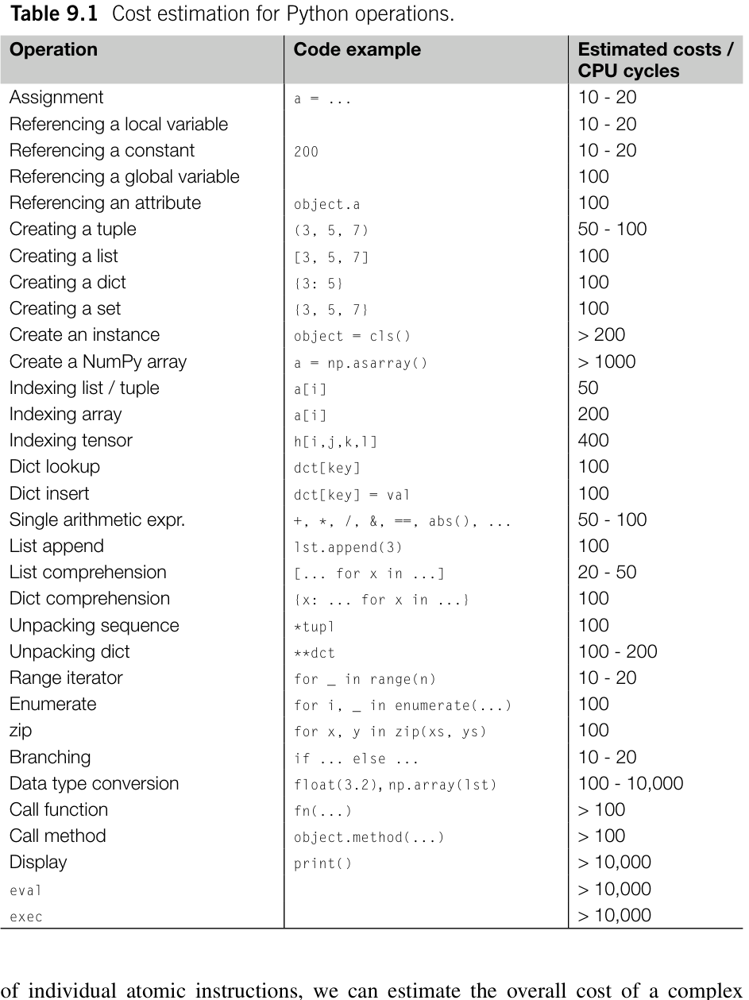

**表 9.1** Python 操作的开销估算。

#### 字典查找

Python 中的字典查找比普通原子指令稍慢，大约需要 100 个或更多 CPU 周期，具体开销取决于
键的数据类型。字典查找过程包括哈希计算与键查找两个步骤。Python 内置数据类型的哈希函数均由 C 语言实现，具体源码见各名为 {datatype}object.c 文件中的 {datatype}_hash 函数。
对于整数、浮点数、布尔值及 bytes 单字节等标量对象，哈希运算极快，耗时通常仅 10–30 个 CPU 周期。若算上随后的查找函数以及与 Python 对象相关的其他操作，字典查找的总开销仍在 100 个 CPU 周期上下。而对于元组、集合或字符串等容器，哈希耗时与对象所含元素数量成正比。
unordered_map 是 C++ 中与 Python 字典对应的容器。C++ 社区提供了多种 unordered_map 与哈希函数实现[2]，其在不同任务中的性能各异。unordered_map 的效率在很大程度上受哈希函数性能的影响。对于标准 C++ 类型，使用 std::hash 访问 unordered_map 的开销据估接近 100 个 CPU 周期，与 Python 字典相仿。因此，单纯把 Python 字典改写为 C++ unordered_map，很难带来明显的性能飞跃。

#### 引用变量

在 Python 中引用全局变量，必须在全局命名空间内查找字典。其开销与使用字符串键检索字典相当，大约需要 100 个 CPU 周期。
与全局变量不同，函数局部变量不存放在字典中，而是直接通过索引 C 原生数组访问，该步骤通常仅需约 1 个 CPU 周期。即便加上 Python 解释器后续操作带来的约 10 个 CPU 周期开销，访问局部变量依然比访问全局变量快 5–10 倍。
在 C/C++ 中，读取或写入局部变量只需约 1 个 CPU 周期，访问类属性的开销稍高，需 2–3 个 CPU 周期。因此仅就访问局部变量而言，C/C++ 约比 Python 快 10 倍。
在矢量化代码的理想情形下，索引 C++ 向量（或 C 数组）的一个元素仅消耗 1 个 CPU 周期。相比 Python 中的显式循环迭代，这能带来高达 100 倍的性能提升。

#### NumPy 数组中的矢量化操作

NumPy 中的矢量化操作足以匹敌经过良好优化的 C/C++ 实现，粗略估计每个元素的开销仅 3 到 5 个 CPU 周期。然而，单元素标量索引 NumPy 数组效率极低，甚至比操作普通 Python 列表或元组还要慢。
C/C++ 中的单个算术表达式通常需 3 到 5 个 CPU 周期，比 Python 算术表达式快近 10 倍。在矢量化场景下，每个算术表达式的开销可压低至 1 个 CPU 周期。如果
矢量化代码契合 SIMD（单指令多数据，Single Instruction Multiple Data）模式，CPU 便能利用 SIMD 指令在一个周期内执行多项运算。例如 AVX2 指令集每周期可并发处理 16 次单精度浮点运算。这表明计算密集型 Python 代码蕴含着巨大的优化潜力，经过深入调优，甚至能达成千倍以上的加速效果。

#### 分支

Python 中 if... else...分支的开销相对较低，约为 10 个 CPU 周期。这个估计没有考虑条件求值的开销。条件求值需要多条指令，消耗超过 100 个 CPU 周期。
C/C++ 中的分支由于延迟较高，通常被认为计算开销很大。某些硬件支持基于分支预测的推测执行。如果预测准确，分支开销就会降低到仅 1 个 CPU 周期，这种情况常见于循环控制语句。稍后我们将更详细地讨论分支的延迟。

#### 函数调用

Python 函数调用过程通常至少需要 100 个 CPU 周期。此外，Python 解释器在发起调用之前需要引用每个输入参数，每个参数约需 10–20 个 CPU 周期。函数调用涉及将执行帧和环境转移给被调用者。在此期间，被调用者分派输入参数、将其分配到局部变量数组等。这些环节是函数调用开销的主要来源，尽管它们都用 C 实现，并不涉及 Python 解释器的任何操作。
如果函数参数包含可变长度参数（*args）和关键字参数（**kwargs），函数调用过程需要构造元组或字典作为中间变量，额外增加 50 到 100 个 CPU 周期。
C/C++ 中直接调用函数的开销约为 10 个 CPU 周期，比 Python 快约 10 倍。然而，C/C++ 中调用虚方法比直接调用函数慢得多，需要近 100 个 CPU 周期。如果将 Python 类的方法转换为 C/C++ 类的虚方法，性能收益可能并不显著。

#### 数据类型转换

Python 中数据类型转换的开销差异很大。算术表达式中的隐式数据类型转换，例如表达式 8*2.5 中将整数转换为浮点数（8 → 8.0），其开销可以忽略不计。对标量变量显式转换数据类型，例如 int(1.25) 或 float(15)，其开销与普通函数调用相当，为 100 到 200 个 CPU 周期。当类型转换涉及字符串时，例如 float('3.75') 或 str(20)，开销要高得多，可能需要 200–2000 个 CPU 周期。numpy.ndarray 与 Python
列表或元组之间的转换尤其昂贵。例如，使用 np.array(lst) 将列表转换为数组，不仅会产生创建新 numpy.ndarray 的开销，还需要对列表中的每个元素显式转换数据类型。这个转换过程可能需要数千个甚至更多 CPU 周期才能完成。
在 C/C++ 中，字符或字符串与数值之间的数据类型转换同样开销很大。特别是，使用 C/C++ 中的 std::cin 或 scanf 完成这些转换可能需要 100–1000 个 CPU 周期。也就是说，用 C/C++ 重写文本解析器来处理字符串数据和类型转换，可能不会带来显著的性能提升。

#### I/O 操作

使用 Python 文件对象的 .read() 方法读取分块数据，速度主要受物理磁盘性能制约。写入分块数据通常更快，因为写操作带有系统缓存。Python 读写封装仅在操作系统高度优化的系统调用上增加微不足道的耗时，在这种纯 I/O 场景下，换用 C/C++ 代码并没有任何性能优势。

#### 运行 shell 命令

在 Python 中派生子进程执行 shell 命令开销极大，调用 subprocess.call 或 os.system 往往引入近 1 毫秒的系统延迟。只要能在同一进程内存空间内调用函数，就应当优先直接调用，避免反复派生外部 shell 命令。第 8 章已详细探讨过这项混合编程技术。
概括而言，用 C/C++ 重写 Python 代码带来的性能收益因任务性质而异，一般能取得 10 到 50 倍的加速倍率。

### 9.1.2 硬件和操作系统开销

硬件和操作系统（OS）带来的开销会影响 Python 程序和重写后的 C/C++ 程序的性能。

#### 内存分配

总体而言，内存分配是一项高开销操作，且耗时并非固定常数。单次内存分配所需时间取决于分配器库、操作系统、硬件架构、分配块大小以及运行时系统负载等多重因素。粗略估计，开销大约在 100 到 10,000 个 CPU 周期之间。调用 malloc 分配内存时，这项开销不容小觑；在多线程并行场景下，由于 malloc 锁竞争导致扩展性下降，性能损失尤为严重。为此，Python 实现了专属的小对象分配器 _PyObject_Malloc，专门管理小于 512 字节的内存块。用 C/C++ 优化计算密集型 Python 代码时，极力规避频繁动态分配是提高吞吐量的关键手段。量子化学程序中的典型
案例便是分子积分计算，我们将在第 12 章作专门剖析。

#### 缺页

程序以固定页面为单位与物理主存交互。当所需页面未映射进物理内存时，便会触发缺页异常（page fault）[3,4]。此时操作系统与硬件必须介入完成高成本的页面调度与初始化，消耗数千个 CPU 周期（约数微秒）。首次访问新分配内存时往往遭遇缺页，例如读写 numpy.empty 创建的数据缓冲区。向新分配缓冲区首度填充数据，耗时远多于直接复用既有缓冲区。下方基准测试清晰展示了首次填充新数组的额外开销：

```python
In [1]: buf = np.empty((1000,1000,1000))
In [2]: %time buf[:] = 0.0
CPU times: user 193 ms, sys: 1.73 s, total: 1.93 s
Wall time: 1.95 s
In [3]: %time buf[:] = 0.0
CPU times: user 582 ms,s y s :0n s, total: 582 ms
Wall time: 581 ms
```
第一次赋值触发了大量缺页，在执行数据填充操作之前频繁暂停以初始化页面。第二次测试主要涉及 CPU 和内存之间的数据传输，反映了内存带宽。这些测试中的开销差异可以归因于缺页的影响。
为减少缺页的发生，建议尽可能复用内存缓冲区，并使程序占用的内存保持最小。例如，许多 NumPy 函数提供 out 关键字，用作存储返回结果的缓冲区。利用 out 缓冲区，我们可以减少内存占用并提高 NumPy 函数的性能。

#### 上下文切换

上下文切换（context switch）是操作系统在多进程或多线程之间调度 CPU 资源的核心机制。切换在内核空间内由系统调度器隐式触发，用户态程序无法直接干预。上下文切换需要完整保存当前运行任务的状态并恢复另一任务的上下文。这是典型的高开销操作，每次切换动辄增加 1–10 微秒的执行延迟。
在 Python 中，对于由 threading 模块派生的线程，上下文切换开销通常不致成为主要瓶颈，这主要受制于全局解释器锁（GIL）对字节码并发执行的限制。然而在 multiprocessing 或 OpenMP 并行场景下，派生过多进程或线程会加剧调度负担。

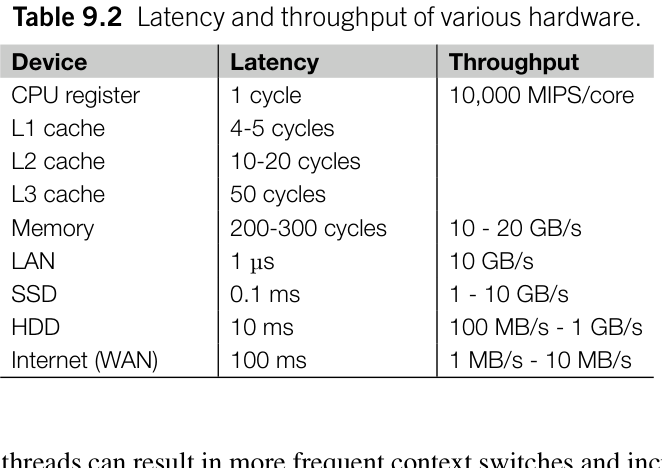

**表 9.2** 各种硬件的延迟与吞吐。

### 9.1.3 延迟和吞吐量

延迟（latency）和吞吐量（throughput）是影响代码性能的两个关键指标：

- 延迟指计算机完成一项操作所需的时间。
- 吞吐量（对于某些设备也称带宽）衡量特定时间内可以完成的操作数量。

在最简单的同步模型中，计算设备依次串行处理请求。处理单次请求越快，系统整体吞吐量便越高；换言之，单次任务的耗时（延迟）与系统吞吐量呈严格的反比关系。
然而受制于物理规律与体系结构，进一步压低延迟往往极其困难，这反过来制约了同步串行模式下的吞吐上限。现代硬件通常支持并发流水工作，无需等待前序任务结束即可启动新任务。并发机制成功解耦了延迟与吞吐量：即使单项任务本身的耗时依然偏高，系统依然能凭借高并发达成可观的吞吐水平。
表 9.2 列出了与量子化学计算调优密切相关的各类硬件延迟与吞吐参数，后文将逐一展开深入评估。

#### CPU

CPU 采用流水线（pipeline）[5]来实现低延迟。现代 X86 CPU 具有 20–30 级的长流水线来完成一项操作。CPU 以高时钟频率运行，以缩短每一级的时间。如果分支等操作使流水线停顿，代价就会很大。CPU 必须清空并恢复整个流水线，导致 20–30 个 CPU 周期的延迟。
另一方面，每个 CPU 核心都包含多个执行单元。这一特性使 CPU 能够在每个周期执行多条指令，实现并行执行。以每秒百万条指令（MIPS）衡量的吞吐量可以超过 CPU 的工作频率。

#### CPU 缓存

从内存获取数据的延迟是影响 CPU 性能的关键因素。为缓解这个问题，CPU 芯片配备了各种类型的缓存，例如 L1I（L1 指令）缓存、L1D（L1 数据）缓存、L2 缓存和 TLB（地址转换后备缓冲区，Translation Lookaside Buffer）缓存。
L1 缓存专门针对速度做了优化，数据索引只产生 4 到 5 个周期的延迟。然而，代价是 L1 缓存的容量有限。例如，现代 X86 CPU 通常每个核心只有 32 KB 的 L1 缓存。由于设计快速 L1 缓存的复杂性，未来不太可能出现容量更大的 L1 缓存。L2 缓存比 L1 缓存慢，延迟为 10–20 个周期。L3 缓存便于不同 CPU 核心之间共享数据。其延迟通常介于 L2 缓存和主存之间，约为 50 个 CPU 周期。有关 CPU 缓存延迟的更多详细信息，可以参考 Intel 文档 Intel 64 and IA-32 Architectures Optimization Reference Manual [6]。
没有必要过分担忧缓存的吞吐量。L1 和 L2 缓存可以以与 CPU 工作频率相同的速度运行，实现每周期 1 次或 2 次缓存访问的吞吐量。

#### 内存

访问冷内存中的数据，即发生缓存未命中时的访问，延迟为 200 到 300 个 CPU 周期。每个通道的内存带宽约为 20 GB/s。考虑多个通道后，内存访问的总体吞吐量可以接近100 GB/s。需要注意的是，内存带宽由所有CPU核心共享，每个CPU核心的平均带宽实际上相当有限。

#### 存储

访问硬盘驱动器（HDD）或固态驱动器（SSD）上数据的延迟是影响性能的关键因素。HDD 的延迟约为 10 毫秒。SSD 性能更好，比 HDD 快约 100 倍，延迟约为 0.1 毫秒。非常不建议在 HDD 或 SSD 上操作单个数据，因为这可能浪费数百万个 CPU 周期。对于存储相关操作，以较大的块或批次处理数据更高效，也更值得推荐。

#### 网络

不同网络设备的性能可能差异很大。某些网络连接的数据传输速度可以超过磁盘访问速度。高速
网络设备，例如 InfiniBand，可以提供亚微秒级的延迟和高带宽，其带宽与主存相当。

### 9.1.4 优化延迟和吞吐量的策略

兼顾超低延迟与极高吞吐固然是最理想的追求，在工程上却极具挑战。当前硬件体系的主流演进方向，正从片面追求单核低延迟转向全面追求系统级高吞吐。这一转变源于能效比的物理制约：耗费海量晶体管与功耗往往只能换取边际递减的延迟改善。正因如此，现代 CPU 不再盲目堆砌主频，转而通过集成更多能效核心来强化吞吐算力。算法设计与工程实践必须主动顺应这一发展趋势。
延迟与吞吐往往相互交织，但在开销分析中，准确定位特定操作究竟受制于延迟还是受制于吞吐至关重要。调优时需分清主次：若核心诉求是在单位时间内完成尽可能多的批量作业（例如从磁盘顺序加载巨型双电子积分张量），调优重心应放在吞吐量上；反之，若核心诉求是尽可能缩短单个请求的往返时间（例如网络远程检索零散数据），则必须将降低延迟置于首位。
针对延迟与吞吐两类不同指标，应采取差异化的调优策略。对于降低延迟，常见策略包括：

- 使用低延迟缓存。CPU 缓存属于这一类，有助于隐藏内存访问的延迟。消息队列和各种内存数据库经常用于隐藏网络访问的延迟。
- 提高缓存利用率。这一策略侧重于缓存的有效性。

为降低缓存未命中率，可能需要重新设计
算法和数据结构，以增强数据的时间局部性和空间局部性。

- 异步执行。为隐藏 I/O 延迟，可以在后台执行 I/O 操作，使其与计算任务充分重叠。更多细节参见第 10 章。
- 预取数据。某些硬件能够粗略预测近期将使用哪些数据，并提前读取这些数据。当数据访问模式可预测时，可以在程序中实施软件预取，提前异步地将数据加载到缓存中。更多讨论见第 9.6.3 节。
- 函数内联和代码展开。这些技术可以减少函数调用和分支的开销。内联指删除不必要的函数调用，并将其替换为实际代码块。展开指扩展循环以减少分支次数。更多细节见第 9.4.1.1 节。
- 内存映射。通常，数据必须从磁盘等外部设备传输到内存缓冲区，处理器才能访问。内存映射（memory mapping）技术允许处理器直接访问外部设备上的数据，就像访问内存中的数据一样。这消除了复制数据及相关系统调用的开销。使用该技术访问磁盘数据的更多细节见第 6 章

第 9.6 节。

- 内存访问（DMA）。如果使用 CPU 管理内存缓冲区，在缓冲区和外部设备之间传输数据会消耗宝贵的 CPU 资源。某些硬件设备，例如 GPU 和网络适配器，支持 DMA 模式，可以不经过 CPU 直接向特定内存空间写入数据。该策略的一个应用是 GPU 编程中使用的固定内存（更多细节见第 11 章）。DMA 模式可以加快数据传输并减少通信延迟。使用 DMA 管理数据传输过程，可以释放 CPU 资源执行其他任务，进一步提高系统的整体效率。

针对吞吐量优化程序时，常采用以下策略：

- 高吞吐量缓冲区。例如，共享内存可以用作缓冲区，促进不同进程之间的通信。更多细节将在第 10 章第 10.9.4 节讨论。
- 计算。
- 分批或分块处理数据。硬件设备针对批量或分块处理数据进行了优化，而不是逐个处理元素。例如，现代 CPU 被设计为以缓存行为单位从内存读取数据，缓存行通常长 64 字节。即使只需要缓存行中的几个字节，整个缓存行也会被载入缓存。同样，磁盘上的数据按块组织，块大小通常为 512 字节或 1 KB。磁盘读写操作以块为单位执行。
- 顺序、连续地访问数据。随机访问速度慢，因为缓存未命中的可能性更高，而且访问整个缓存行或存储块会产生额外流量。
- 数据表示。这是指根据稀疏性或其他特征压缩数据，以尽量减少数据量。

### 9.1.5 计算受限与 I/O 受限

计算受限（computation bound）和 I/O 受限（I/O bound）用于描述进程的性能受到 CPU 速度还是输入/输出（I/O）操作速度的限制。

- 受限：如果进程的大部分执行时间用于算术计算或其他 CPU

密集型任务，则认为该进程计算受限。其性能直接取决于核心
子系统（CPU 和内存）的效率。

- 受限：如果进程花费大量时间等待从存储设备或网络读取数据或向其写入数据，则认为该进程 I/O 受限。

系统吞吐主要受 I/O 子系统（存储介质或
网络总线）的传输速率瓶颈制约，而非处理器本身的运算速度。
在量子化学模拟中，双电子积分评估是极为典型的计算受限任务（第 12 章详述）；而当中间态高维张量暂存磁盘或跨计算节点分发时，第 15 章所述的耦合簇方法往往表现出明显的 I/O 受限特征。
厘清程序究竟属于计算受限还是 I/O 受限，是确立调优路线的前提：对于计算受限的 Python 逻辑，换用 C/C++ 或 JIT 重构往往能立竿见影，引入多核并行亦十分有效；而针对 I/O 受限任务，异步并发或预取掩盖才是更契合的解法。
计算密集型代码中存在一种特殊亚型，即内存受限（memory-bound）。此时程序吞吐高度受制于各级缓存容量与主存带宽。处理器由于持续等待主存向寄存器送料而陷入大面积空闲气泡，算力无法充分释放。第 14 章的全组态相互作用（FCI）实现即属此类典型。

#### 9.1.5.1 程序是计算受限还是内存受限？

要区分程序属于算力受限还是内存受限，直接手段是借助 Linux perf 剖析器测量 IPC（每周期指令数）与缓存未命中率。极低的 IPC 或居高不下的未命中率，通常预示着程序深陷内存墙。现代 x86 CPU 满载时每周期可发射 4 条乃至更多指令；IPC 低迷说明核心因等待数据送料而频繁停摆，高缓存缺失则直接佐证了访存堵塞。
下方展示了对大矩阵朴素转置时采集的 perf 统计数据：

```python
np.transpose(a).copy()
695.31 msec task-clock # 0.999 CPUs utilized
2 context -switches # 0.003 K/sec
0 cpu -migrations # 0.000 K/sec
6,039 page -faults # 0.009 M/sec
2,126,239,844 cycles # 3.058 GHz
1,097,502,672 instructions # 0.52 insn per cycle
152,534,052 branches # 219.376 M/sec
2,655,018 branch -misses # 1.74% of all
                        branches
```

```text
228,338,188 L1 -dcache-loads # 328.398 M/sec
182,549,765 L1 -dcache-load-misses # 79.95% of all L1 -
    dcache accesses
80,043,333 LLC -loads # 115.119 M/sec
15,678,968 LLC -load-misses # 19.59% of all LL -
    cache accesses
```
在这次性能分析中，我们观察到较低的 IPC（标记为 insn per cycle）和极高的 L1 缓存未命中率。显然，这样的矩阵转置操作是一项内存受限任务。我们将在第 9.2.4 节更详细地探讨 perf。
随着硬件架构不断演进以及计算能力提高，一些传统上被认为计算受限的问题实际上正转向内存受限。例如，量子化学 FCI 问题传统上被视为浮点计算密集型问题。然而，由于现代 CPU 使用 SIMD 指令，数据传输成本已成为 FCI 程序的主导因素。另一个例子是解析积分求值。过去，解析积分求值算法是根据浮点运算次数开发和优化的。将这些算法移植到 GPU 时，实际上发现性能受到 GPU 缓存大小和 GPU 内存带宽的限制[7]。

#### 9.1.5.2 如何加速内存受限应用？

单纯拉升 CPU 主频对改善内存受限场景收效甚微，因为症结在于核外内存总线的数据中转，而非核心自身的计算主频。增加物理核心数有时能间接缓解缓存压力——更多物理核带来了更大的总缓存池；但算力随核数增长的线性度通常很差，在多核争抢总线时性能甚至不升反降。这种负收益源于多核并发诱发的总线带宽挤兑、伪共享及昂贵的缓存一致性同步，额外开销迅速吞噬了增添核心的微弱收益。
调优内存受限程序往往是一项精细活。在现代硬件体系下，底层硬件拓扑对算法与数据结构已非透明黑盒；编译期自动优化对复杂存取模式的改善空间相当有限，这倒逼开发者设计缓存感知（cache-aware）的算法与数据结构，最大限度压低慢速主存访问的频次。
在现代计算架构中，搬运数据的功耗与时间开销已远甚于对数据实施算术运算。许多时候，优化应当优先关照内存排布与缓存复用，而非机械计较理论浮点运算次数。全面吃透 CPU 缓存与主存层次结构是编写高效科学计算代码的基石，读者可进一步研读经典文献《What Every Programmer Should Know About Memory》[4]。
设计缓存友好型算法通常需要统筹评估以下内存存取特征：

- 缓存大小，即可以缓存的数据量。
- 局部性，例如高维数组中的步长。
- 一致性。

#### 9.1.5.3 针对缓存大小优化

如前所示，使用朴素实现转置矩阵，

```text
a.T.copy(order='C')
```
对大矩阵而言不利于缓存。在对 10000 × 10000 的测试中，L1 缓存的未命中率约为 80%。这一高缓存未命中率表明 CPU 必须频繁从内存访问数据。
循环分块（loop tiling）是解决高缓存未命中率问题的有效技术。循环分块将巨大的矩阵划分为较小的块，并在每个小块内执行矩阵转置。如果单个块能放入缓存，就很可能在缓存中找到该块内的数据。这提高了缓存利用率并降低了内存访问延迟。
以下分块算法比朴素转置代码快 50%。

```python
def transpose(a):
    block_size = 200
    arow, acol = a.shape
    out = np.empty((acol,arow), a.dtype)
    for c0 in range (0, acol, block_size):
        c1 = min(acol, c0 + block_size)
        for r0 in range (0, arow, block_size):
            r1 = min(arow, r0 + block_size)
            out[c0:c1,r0:r1] = a[r0:r1,c0:c1].T
    return out
a = np.ones((10000, 10000))
b = a.T.copy( 'C') # 479 ms
b = transpose(a) # 311 ms
```
本次测试使用的 CPU 具有 1024 KB 的 L2 数据缓存。为了将输入和输出矩阵都存放在缓存中，每个块最多可以占用 512 KB 缓存空间。这相当于 64k 个 float64 元素，或尺寸最大为 256 × 256 的块。因此，小于 256 × 256 的块大小适合这个问题。

#### 9.1.5.4 优化数据局部性

CPU 从内存获取数据时，首先将数据载入缓存。缓存行是在主存和
缓存之间传输数据的最小单位。在 X86 CPU 架构上，缓存行大小为 64 字节。载入缓存行时，不仅会获取所请求内存位置的数据，还会获取同一缓存行中周围的数据。访问同一缓存行内附近的数据不需要向内存发出新的访问请求。因此，访问连续的内存位置很高效，因为后续内存访问所需的数据很可能已在缓存中。
如第 2 章所述，高维数组（张量）的形状和遍历张量的循环顺序对程序效率有显著影响。遍历张量时，最好在内层循环中访问连续内存，以最大限度提高缓存效率。当数组按行主序存储时，建议在最内层循环中遍历最后一个索引。对于列主序数组，建议在最内层循环中遍历第一个索引。
下面使用矩阵乘法程序说明步长和循环顺序对程序性能的影响。矩阵乘法的公式为

$$
C_{ij}=\sum_{k}A_{ik}B_{jk}.
\qquad (9.1)
$$

[]{#eq-09-001}

矩阵乘法的一种朴素实现如下面的 matmul_nn_v1 函数所示。

```python
import numpy as np
from transpose import transpose
import numba
@numba.njit
def matmul_nn_v1(a, b):
    arow, acol = a.shape
    brow, bcol = b.shape
    assert acol == brow
    c = np.zeros((arow, bcol))
    for i in range (arow):
        for j in range (bcol):
            c_ij = 0
            for k in range (acol):
c_ij += a[i,k] * b[k,j] # (1)
            c[i,j] = c_ij
    return c
def matmul_nn_v2(a, b):
    arow, acol = a.shape
    brow, bcol = b.shape
    assert acol == brow
b_t = transpose(b) #(2)
    return matmul_nt(a, b_t)
```

```python
@numba.njit(cache=True)
def matmul_nt(a, b):
    arow, acol = a.shape
    brow, bcol = b.shape
    assert acol == bcol
    c = np.zeros((arow, brow))
    for i in range (arow):
        for j in range (brow):
            c_ij = 0
            for k in range (acol):
                c_ij += a[i,k] * b[j,k]
            c[i,j] = c_ij
    return c
@numba.njit
def matmul_nn_v3(a, b):
    arow, acol = a.shape
    brow, bcol = b.shape
    assert acol == brow
    c = np.zeros((arow, bcol))
    for i in range (arow):
        for k in range (acol):
a_ik = a[i,k] # (3)
            for j in range (bcol):
                c[i,j] += a_ik * b[k,j]
    return c
m=n=k= 5000
a = np.random.rand(m,k )
b = np.random.rand(k,n )
c = matmul_nn_v1(a,b ) # 215 s
c = matmul_nn_v2(a,b ) # 142 s
c = matmul_nn_v3(a,b ) # 77.4 s
```
在 matmul_nn_v1 中，我们在第(1)行使用临时变量 c_ij 表示矩阵元素 c[i,j]。这个局部变量减少了在最内层循环中访问矩阵元素 c[i,j]的开销。在这个函数中，矩阵 b 以不连续的方式访问，导致内存访问模式效率低下。每次载入 b[k,j]时，都会传输包含 8 个元素的整个缓存行，尽管实际上只需要一个元素。访问后续元素 b[k+1,j]时，它可能不在之前为 b[k,j]载入的缓存行中。除非包含 b[k+1,j-1]的缓存行仍然可用，否则访问 b[k+1,j]将导致
缓存未命中，并从主存传输新的缓存行，增加计算延迟。
在 matmul_nn_v2 中，我们重新排列矩阵中的元素，以确保顺序访问内存。通过在第(2)行转置矩阵 b，我们使最内层循环连续访问矩阵 b。最内层循环现在遍历转置后的矩阵 b 的行，这些行在内存中是连续的，而不是遍历原矩阵 b 的列。这本质上是一种新的矩阵乘法 matmul_nt，其中 t 表示第二个矩阵转置，

$$
C_{ij}=\sum_{k}A_{ik}B_{jk}.
\qquad (9.2)
$$

[]{#eq-09-002}

矩阵乘法的理论复杂度为 O(n³)，而矩阵转置仅为 O(n²)。面对足够庞大的计算体系，预先转置所耗费的时间微不足道。
如函数 matmul_nn_v3 所示，仅需对调 k 与 j 的循环嵌套层级，同样能确保对矩阵 b 实现连续流式访存。在该实现中，第 (3) 行引入标量寄存器暂存 a_ik，消除了最内层循环重复索引 a[i,k] 的开销。matmul_nn_v3 在最内层循环中对 c[i,j] 与 b[k,j] 各发起一次访存，与 matmul_nn_v1 保持一致，但两次访存均沿行主序紧凑内存连续推进。这种循环重排既保障了访存连续性，又省去了额外的转置计算与临时空间分配。在理论预期中，matmul_nn_v3 应当是这三者中吞吐最佳的版本；而 matmul_nn_v2 虽有转置开销，其缓存连续性依然显著优于未优化的 matmul_nn_v1。
在基准测试中，若以纯 Python 解释执行这三个函数，性能差距往往被解释器动态开销彻底掩盖。因此我们借助 Numba JIT 编译器进行原生编译后测试。当矩阵规模足够大时，基准测试表明 matmul_nn_v2 较 matmul_nn_v1 提速约 50%；matmul_nn_v3 更是取得近 3 倍的惊人加速。这一飞跃的核心推手在于循环对调后 JIT 编译器成功触发了底层 SIMD 自动矢量化（详见第 9.4.1 节）。若显式禁用自动矢量化，matmul_nn_v3 与 matmul_nn_v2 的耗时差距迅速收窄至 3% 以内，这部分残余差距完全源自 matmul_nn_v2 的单次显式转置开销。
若想在最内层访存连续的基础上进一步压榨硬件性能，还须将工作集控制在高速缓存容量以内。引入循环分块（loop tiling）技术后，我们在 matmul_nn_v3 的基础上再度取得 30% 的稳定提速。

```python
@numba.njit(cache=True)
def matmul_nn_tiling(a, b):
```

```python
    '''Matrix multiplication a * b with loop tiling'''
    arow, acol = a.shape
    brow, bcol = b.shape
    assert acol == brow
    c = np.zeros((arow, bcol))
    block_size = 200
    for i0 in range (0, arow, block_size):
        i1 = min(i0 + block_size, arow)
        for j0 in range (0, bcol, block_size):
            j1 = min(j0 + block_size, bcol)
            for k0 in range (0, acol, block_size):
                k1 = min(k0 + block_size, acol)
                for i in range (i0, i1):
                    for k in range (k0, k1):
            a_ik = a[i,k]
                        for j in range (j0, j1):
                            c[i,j] += a_ik * b[k,j]
    return c
```

#### 9.1.5.5 优化缓存一致性

缓存一致性（cache coherence）机制在多核系统的多个 CPU 缓存之间保持数据一致。当多个 CPU 核心访问缓存行中的数据时，只要缓存行的任何部分被修改，就会触发缓存同步以确保一致性。具体而言，如果一个 CPU 核心改变缓存行的状态，其他核心必须停顿，等待缓存行在整个系统中同步。这确保所有核心都能访问最新版本的数据。维护缓存一致性会引入延迟和开销，从而抵消多核并行带来的性能提升。
在讨论 FCI 理论的第 14 章中，我们会遇到一个程序，它根据预先计算的查找索引表向内存缓冲区分配数据。相关代码块如下，为便于演示已作简化：

```python
from cython.parallel import prange
def build_d(fciwfn, norb, lookup):
    ma, mb = fciwfn.shape
    d = np.zeros((norb,norb,ma,mb))
    for I in prange(mb, nogil=True, schedule= 'dynamic', chunksize=1):
        for a,i ,J , sign in lookup[I]:
            for K in range (ma):
                d[i,a,K,I] += sign * fciwfn[K,J]
    return d
```
对变量 I 实施多核并行时，d 张量最后一个索引的缓存行由多个 CPU 核心共享。如果一个线程更新 d 张量，可能需要执行缓存同步，以确保所有核心看到一致的数据。
如果多个 CPU 核心通过不同 CPU 芯片上的多个内存控制器访问 d 张量，即非统一内存访问（non-uniform memory access，NUMA），缓存同步的开销可能更大。这是运行在具有多个 CPU 插槽的工作站（或集群节点）上的程序常见的情况。为了改善缓存一致性，我们可以重新排列循环顺序，将代码改写如下：

```python
from cython.parallel import prange
def build_d(fciwfn, norb, lookup):
    ma, mb = fciwfn.shape
    d = np.zeros((norb,norb,ma,mb))
    for K in prange(ma, nogil=True, schedule= 'dynamic', chunksize=1):
        for I in prange(mb):
            for a,i ,J , sign in lookup[I]:
                d[i,a,K,I] += sign * fciwfn[K,J]
    return d
```

### 9.1.6 指令级并行

现代 X86 CPU 可以并行执行各种指令[8]，例如流水线、超标量执行、乱序执行和推测执行等。在这些指令级并行（instruction level parallelism，ILP）技术中，超标量指令 SIMD（单指令多数据，Single Instruction, Multiple Data）提供同时执行多个算术运算的能力。这种并行特性是优化量子化学程序性能的关键因素。
SIMD 可以显著提高 CPU 的算术计算吞吐量。吞吐量取决于 SIMD 寄存器的宽度和执行单元的数量，例如乘法（MUL）单元、加法（ADD）单元和融合乘加（FMA）单元。MUL 和 ADD 单元各提供一次浮点运算吞吐量，而 FMA 单元可以提供两次（一次乘法和一次加法）。单个 CPU 核心的 SIMD 指令总吞吐量可以计算为：表 9.3 给出了一些典型的 SIMD 指令浮点吞吐量。例如，每个 AVX2 寄存器可以处理 256 位数据，相当于 4 个 double 值。有两个 FMA 单元时，CPU 可以在两个

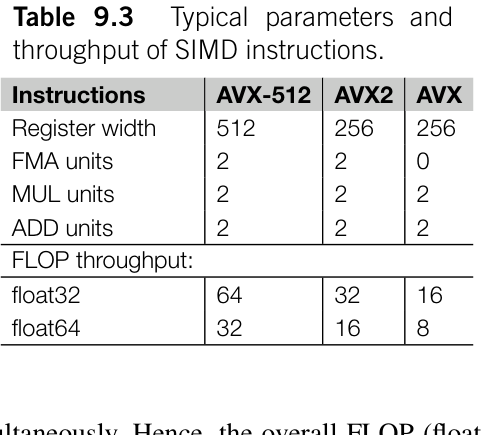

**表 9.3** SIMD 指令的典型参数与吞吐。

## 9.2 性能分析

性能分析（profiling）是程序优化中常见的任务。通过分析性能分析结果，我们可以找出程序中的热点。优化工作应首先集中在这些热点上。
我们将使用施密特正交化（Schmidt orthogonalization）算法说明程序性能分析和优化所涉及的技术。给定与一组基向量 u 对应的重叠矩阵 S，我们可以确定一个上三角系数矩阵 C，表示正交归一基 v

$$
\begin{aligned}
\mathbf{v}_{i} &= \sum_{m}C_{mi}\mathbf{u}_{m}, \qquad (9.6)\\
\sum_{mn}C_{mi}S_{mn}C_{nj} &= \delta_{ij}. \qquad (9.7)
\end{aligned}
$$

[]{#eq-09-003}

C 可以通过以下施密特正交化过程获得

$$
\begin{aligned}
\tilde{\mathbf{v}}_{j} &= \mathbf{u}_{j}-\sum_{k}\mathbf{v}_{k}\mathbf{v}_{k}\cdot\mathbf{u}_{j}, \qquad (9.8)\\
\mathbf{v}_{j} &= \frac{\mathbf{v}'_{j}}{\sqrt{\tilde{\mathbf{v}}_{j}\cdot\tilde{\mathbf{v}}_{j}}}. \qquad (9.9)
\end{aligned}
$$

[]{#eq-09-004}

其中

$$
\begin{aligned}
\tilde{\mathbf{v}}_{j}\cdot\tilde{\mathbf{v}}_{j} &= S_{jj}-\sum_{k}d_{kj}^{2}, \qquad (9.10)\\
d_{kj} &= \mathbf{v}_{k}\cdot\mathbf{u}_{j}=\sum_{m}C_{mk}S_{mj}. \qquad (9.11)
\end{aligned}
$$

[]{#eq-09-005}

这些方程可转换为如下的 schmidt_orth 函数：

```python
@profile
def schmidt_orth(s):
    n = s.shape[0]
    cs = np.zeros((n, n))
    for j in range (n):
        fac = s[j,j]
        for k in range (j):
            dot_kj = np.dot(cs[:,k], s[:,j])
            cs[:,j] -= dot_kj * cs[:,k]
            fac -= dot_kj * dot_kj
```

```python
        if fac <= 0:
            raise RuntimeError(f'schmidt_orth fail. {j=} {fac=}' )
        fac = fac **-.5
        cs[j,j] = fac
        for i in range (j):
            cs[i,j] *= fac
    return cs
```

### 9.2.1 基准测试

基准测试（benchmark tests）评估程序的整体运行性能。这些测试需要专门设计，这使它们有别于单元测试和功能测试：

- 测试旨在突出热点，并尽量减少无关部分的噪声。
- 测试可以包括不同的问题规模，以识别系统规模扩大时的性能瓶颈和限制。如果问题规模不够大，许多缓存效率问题可能无法准确识别。
- 为避免偏向特定工作负载，基准测试可以包含多种场景，例如最坏情况测试、最好情况测试以及一些来自实际应用的测试。
- 在收集性能数据之前安排预热期，以确保系统稳定。
- 将结果与系统配置一起收集，例如硬件规格、Python 版本、依赖库和编译器的版本。

### 9.2.2 Python 内置性能分析工具

在 Jupyter notebook 中，我们可以使用%time 和%timeit 魔法命令测量单条 Python 语句的性能。%time 魔法命令基于 Python 的 time 模块，%timeit 魔法命令使用 timeit 模块。这两个魔法命令在 Jupyter notebook 中都可以用于行模式和单元模式。

```python
In [1]: from schmidt import schmidt_orth
In [2]: s = np.eye(500)
In [3]: %time c = schmidt_orth(s)
CPU times: user 586 ms, sys: 20.1 ms, total: 606 ms
Wall time: 588 ms
In [4]: %timeit c = schmidt_orth(s)
562 ms , 1 loop each)
```

```text
In [5]: %%time
        for _ in range (10):
            schmidt_orth(s)
CPU times: user 5.6 s, sys: 8.04 ms, total: 5.61 s
Wall time: 5.6 s
```
%time 魔法命令的输出显示标记为 CPU 时间和墙钟时间的计时信息。CPU 时间表示处理器执行程序所花费的实际时间。它不包括等待 I/O 操作的时间和 CPU 空闲的时段。CPU 时间一词指处理器执行程序所花费的实际时间。它不包括等待 I/O 操作的时间或 CPU 空闲的时段。另一方面，墙钟时间表示现实世界中经过的总时间，包括花在 I/O 操作上的时间和任何其他延迟。此外，CPU 时间的信息包括：

- `sys`：在操作系统内核空间中管理系统资源和与硬件交互所花费的时间。
- `user`：执行程序代码所花费的时间，不包括内核空间中的函数。
- `total`：程序消耗的总时间，包括用户空间和内核空间时间。

%timeit 魔法命令的默认输出报告代码片段多次执行后的平均墙钟时间。我们可以使用%timeit c 命令仅测量 CPU 时间。通常，%timeit 报告的时间会略少于%time 命令报告的墙钟时间。这种差异是因为多次执行相同代码可以尽量减少初始化、缓存未命中等因素的影响。
如果 CPU 总时间显著小于墙钟时间，说明 CPU 未得到充分利用。可能有以下几个原因：

- 程序可能正在产生大量 I/O 请求，导致 CPU 等待 I/O 操作完成。
- 系统可能正在处理其他任务，这会延迟当前程序的执行。
- 在多进程并行程序中，主进程可能在等待与其他进程同步时被阻塞。
- 如果代码涉及互斥锁（见第 10 章），执行可能因等待锁释放而延迟。

CPU 时间也可能超过墙钟时间，这表明程序使用多线程并行计算。理想情况下，CPU 总时间与墙钟时间之比应对应计算中使用的并行线程数。
sys 时间是 CPU 时间输出中另一个有用的指标。高效的程序应尽量减少在内核空间中花费的时间。较高的 sys 时间表明内核空间中的操作消耗了大量资源。遗憾的是，内核空间中的大多数操作无法并行化，这限制了程序的可扩展性。在量子化学程序中，sys 时间过高的常见原因包括：

- 大量 I/O 操作。
- 频繁的内存分配、释放和缺页。
- 系统中运行过多线程或进程，导致大量上下文切换。

对于复杂的 Python 程序，我们还希望了解其执行效率的细节。Python 内置模块 cProfile 是识别消耗最多执行时间的函数的有用工具。在 Jupyter notebook 中，我们可以使用%prun 魔法命令通过 cProfile 分析 Python 代码的性能。

```yaml
In [6]: %%prun
        for i in range (5):
            schmidt_orth(s)
         1871263 function calls in 3.181 seconds
   Ordered by: internal time
ncalls tottime percall cumtime percall filename:lineno(function)
5 2.179 0.436 3.180 0.636 schmidt.py:3(schmidt_orth)
623750 0.729 0.000 0.729 0.000 {built -in method numpy.core.
    _multiarray_umath.implement_array_function}
623750 0.218 0.000 1.001 0.000 <__array_function__ internals
    >:177(dot)
623750 0.053 0.000 0.053 0.000 multiarray.py:740(dot)
5 0.000 0.000 0.000 0.000 {built -in method numpy.zeros}
1 0.000 0.000 3.181 3.181 <string >:1(<module>)
1 0.000 0.000 3.181 3.181 {built -in method builtins.
    exec}
1 0.000 0.000 0.000 0.000 {method 'disable' of '_lsprof
    .Profiler' objects}
```
cProfile 的输出按各函数内部花费的执行时间排序，如 Ordered by: internal time 一行所示。性能统计也可以按其他指标排序，例如累计时间或调用次数。根据内部时间，相当多的计算时间花在 NumPy 库的 ufunc 和 dot 函数中。识别最耗时的函数是优化过程中的关键步骤。接下来，我们可以将重点转向需要最多执行时间的函数。

### 9.2.3 行性能分析器

cProfile 工具不提供函数内部执行效率的详细信息。为了获得函数内部更精确的计时，我们可以使用第三方工具 line-profiler。该工具提供函数的逐行分析。
要从命令行使用 line_profiler，可以向想要分析的函数添加@profile 装饰器。

```python
@profile
def schmidt_orth(s):
```
然后执行以下命令：

```bash
$ kernprof -lv schmidt_v1.py
```
命令行选项-v 使程序执行后显示性能统计信息。行性能分析器将分析数据保存在以.lprof 为后缀的文件中。要查看已有的性能统计信息，可以使用 line_profiler 模块查看.lprof 文件：

```bash
$ python -m line_profiler schmidt_v1.py.lprof
```
在 Jupyter notebook 中，可以加载 line_profiler 模块并执行%lprun 魔法命令来分析函数。%lprun 的-f 选项指定要分析的函数。可以指定多个-f 选项，同时分析多个函数。以下以 schmidt_orth 函数为例说明如何使用行性能分析器：

```python
In [7]: %load_ext line_profiler
In [8]: %lprun -f schmidt_orth schmidt_orth(s)
Timer unit: 1e-09 s
Total time: 0.812276 s
File: /home/ubuntu/code-examples/schmidt/schmidt_v1.py
Function: schmidt_orth at line 3
Line # Hits Time Per Hit % Time Line Contents
==============================================================
3 def schmidt_orth(s):
4 1 5043.0 5043.0 0.0 n = s.shape[0]
5 1 263741.0 263741.0 0.0 cs = np.zeros((n ,n ) )
6 500 81657.0 163.3 0.0 for j in range(n):
7 500 154634.0 309.3 0.0 fac = s[j ,j]
8 124750 20412051.0 163.6 2.5 for k in range(j):
```

```python
9 124750 327342723.0 2624.0 40.3 dot_kj = np.
    dot(cs[:,k], s[:,j])
10 124750 362190394.0 2903.3 44.6 cs[: ,j] -=
    dot_kj * cs[:,k]
11 124750 39026926.0 312.8 4.8 fac -= dot_kj
    * dot_kj
    12
13 500 203630.0 407.3 0.0 if fac <= 0:
14 raise
    RuntimeError(f'schmidt_orth fail. {j=} {fac=}')
15 500 209276.0 418.6 0.0 fac = fac ** -.5
16 500 163808.0 327.6 0.0 cs[j ,j] = fac
17 124750 17723304.0 142.1 2.2 for i in range(j):
18 124750 44498893.0 356.7 5.5 cs[i ,j] *= fac
19 1 131.0 131.0 0.0 return cs
```
逐行性能分析器（line profiler）的输出相当直观。它显示每行代码的总耗时、平均耗时和相对耗时。在这些指标中，平均耗时（标为 Per Hit）和相对耗时（标为 % Time）尤其有用。
函数中的少数几行代码往往占据大部分执行时间。% Time 列有助于我们找出这些关键行。优化时应优先考虑这些代码块。如果热点涉及外部函数，我们可以将这些函数加入跟踪列表，然后重新运行逐行性能分析器。
运行缓慢的 Python 语句的耗时是否符合成本估计？这里的 Per Hit 时间可以帮助我们进行分析。如 Timer unit: 1e-09 s 一行所示，Per Hit 时间以纳秒为单位。在这个例子中，语句

```python
dot_kj = np.dot(cs[:,k], s[:,j])
cs[:,j] -= dot_kj * cs[:,k]
```
合计消耗了总执行时间的 85%。Per Hit 时间表明，这两个 NumPy 语句的平均执行时间分别为 2600 和 2900 纳秒。考虑到此例的问题规模为 500，每个元素的成本约为 5.5 纳秒，接近 16 个 CPU 周期。这比 NumPy ufunc 语句的成本估计（3–5 个 CPU 周期）慢得多。造成这一差异的原因可能有：

- 测试系统可能太小。函数调用和性能分析的开销在 Per Hit 时间中占据了主要部分。
- 矩阵按列访问，而数组按行主序存储。这种访问模式与存储方式的不匹配会导致缓存未命中，进而增加成本。

根据这一分析，我们对代码稍作优化，得到对缓存更友好的实现：

```python
                                        def schmidt_orth(s):
                                        n = s.shape[0]
                                        cs = np.zeros((n, n))
                                        for j in range (n):
                                        fac = s[j,j]
                                        for k in range (j):
dot_kj = np.dot(cs[k], s[j]) # (1)
cs[j] -= dot_kj * cs[k] # (2)
            fac -= dot_kj * dot_kj
                                        if fac <= 0:
            raise RuntimeError(f'schmidt_orth fail. {j=} {fac=}' )
                                        fac = fac **-.5
                                        cs[j,j] = fac
        cs[j,:j] *= fac
    return cs.T
```
接下来，我们使用一个包含 2000 × 2000 个元素的重叠矩阵对这个函数进行性能分析。第 (1) 行和第 (2) 行语句的 Per Hit 时间为 3000–3200 纳秒。每个元素的成本降至 5 个 CPU 周期，与 NumPy 函数的成本估计一致。这一成本表明，除非使用 NumPy ufunc 以外的技术，否则已没有进一步优化的空间。
分析其他行的 Per Hit 时间时，我们发现这个值显著高于上一节表 9.1 中给出的成本估计。例如，for 循环语句中每一步的成本为 160 纳秒（约 500 个 CPU 周期）。然而，我们已经知道迭代的成本约为 50–100 个 CPU 周期。这表明逐行性能分析器引入了超过 400 个 CPU 周期的开销。
逐行性能分析器利用 Python 的 PyEval_SetTrace() 钩子跟踪函数内的事件。它会为所跟踪函数的每个操作码（opcode，即 operation code）事件增加开销。操作码是 Python 解释器执行的反汇编操作，我们将在第 9.3 节讨论。单条 Python 语句可能涉及多个操作码事件。这种开销可能显著影响性能分析的准确性。因此，简单 Python 语句的 % Time 值可能被高估，而 Per Hit 值较高的行的这一数值可能被低估。使用逐行性能分析器时应考虑这一误差。

### 9.2.4 性能分析器

逐行性能分析器和 cProfile 都利用 Python 的跟踪钩子机制来监控 Python 程序中的事件。这些性能分析方法有相当大的开销，可能导致分析结果不准确。相比之下，基于采样的性能分析器
会定期收集 Python 程序的运行时信息，而不是监控每个函数调用或指令。这种方法不会干扰 Python 解释器的执行，因此不会影响 Python 程序的性能。它能够提供准确的运行时性能统计数据。
采样性能分析器（sampling profiler）可用于评估 Python 中 C/C++ 扩展的性能。

#### 9.2.4.1 py-spy

采样性能分析器 py-spy [10] 同时支持 Python 代码和 C/C++ 扩展。例如，要分析 schmidt_orth 程序，我们使用以下命令。

```bash
$p y-spy record -o profile.svg python schmidt_v2.py
```
选项 -o profile.svg 要求将性能分析结果保存为文件名为 profile.svg 的火焰图（flame graph，图 9.1）。

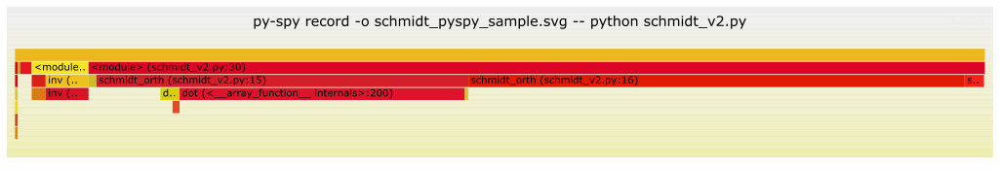

**图 9.1** py-spy 性能分析结果的火焰图

性能分析图便于找出耗时较多的函数。例如，对于 schmidt_orth 函数，schmidt_v2.py 文件中的两行代码分别占总计算时间的 38% 和 51%。相对于 schmidt_orth 函数占据的 92% 耗时，这两行合计占该函数执行时间的 95%。这一时间比例高于 line-profiler 报告的结果。两者的差异很大程度上可归因于

```text
line-profilertool.
```
要分析 Python 中的 C/C++ 代码，必须使用 --native 选项执行 py-spy 性能分析器。与 Python 的输出类似，性能分析图可以突出显示 C 或 C++ 源代码中的特定行。
的一个强大功能是能够分析正在运行的 Python 程序。我们可以使用以下命令将 py-spy 性能分析器附加到指定进程：

```bash
$ py-spy record -o profile.svg --pid <PID>
```
收集足够的数据后，可以按 Ctrl-C 中断性能分析过程，而不终止正在运行的进程。

### 9.2.5 Perf

perf 性能分析器是分析 C/C++ 代码性能的强大工具 [11]。在大多数 Linux 发行版中，可以通过软件包管理系统轻松安装它。我们可以使用 perf 分析 Python 中 C/C++ 扩展的性能。一般来说，perf 用于识别运行缓慢的函数和代码块，并监控 CPU 利用率统计数据。
识别慢代码的功能与 py-spy record --native 提供的功能类似。以 schmidt_orth 函数为例，以下命令分析调用栈并将采样保存到 perf.data 文件中。

```bash
$ perf record python schmidt_v2.py
```
要查看性能分析结果，可以使用 perf report 或 perf annotate 命令。perf report 命令以文本格式显示每个函数的采样计数，概览执行最频繁的函数。另一方面，perf annotate 命令可以将采样计数归属到源代码的特定行。
以下是 perf report 的输出示例：

```text
# Samples: 42K of event 'cycles' Event count (approx.): 37014407361
                                        #
# Overhead Command Shared Object
    Symbol
# ........ ....... .................................................
    ...................................................
                                        #
15.91% python libopenblas64_p -r0-15028c96.3.21.so [.]
     dot_compute
7.59% python _multiarray_umath.cpython -310-x86_64-linux-gnu.so [.]
     DOUBLE_subtract_AVX512F
6.59% python _multiarray_umath.cpython -310-x86_64-linux-gnu.so [.]
     DOUBLE_multiply_AVX512F
6.19% python python3.10 [.]
     _PyEval_EvalFrameDefault
3.37% python _multiarray_umath.cpython -310-x86_64-linux-gnu.so [.]
     ufunc_generic_fastcall
2.08% python _multiarray_umath.cpython -310-x86_64-linux-gnu.so [.]
     PyArray_NewFromDescr_int
1.87% python _multiarray_umath.cpython -310-x86_64-linux-gnu.so [.]
     PyArray_DiscoverDTypeAndShape_Recursive
[...]
```
输出显示，最耗时的函数是 dot_compute。这个函数由 OpenBLAS 提供，已经过充分优化。通过直接优化 dot_compute 来提高性能几乎是不可能的。
dot_compute 函数由 np.dot 函数调用；line-profiler 和 py-spy 显示，后者占总计算成本的近 40%。这意味着各种开销因素可能消耗了大量资源。减少开销可以成为今后优化的重点。可以通过即时（Just-In-Time，JIT）编译、Cython 编译或编写 C/C++ 扩展等技术来实现。我们将在后续章节详细讨论这些方法。

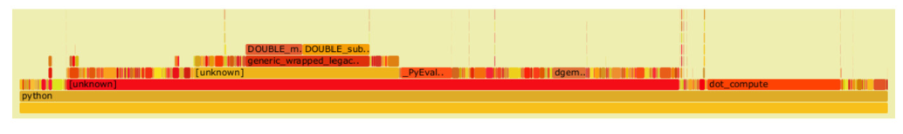

**图 9.2** perf 性能分析结果的火焰图

perf 的性能分析结果也可以使用火焰图可视化（见图 9.2）。这需要使用 -g 选项记录采样。默认情况下，perf record 只记录调用栈上函数的采样。配置 -g 选项后，perf record 还会收集调用链中所有子函数的采样。然后，我们可以使用开源工具 FlameGraph [12] 从 perf.data 文件生成火焰图：

```bash
$ perf record -g python schmidt_v2.py
$ git clone https://github.com/brendangregg/FlameGraph
$ perf script | FlameGraph/stackcollapse -perf.pl > out.perf
$ cat out.perf | FlameGraph/flamegraph.pl > perf.svg
```
现在我们来查看 perf 提供的 CPU 利用率统计数据。这些统计数据表明程序利用可用 CPU 资源的效率。运行

```bash
$ perf stat python schmidt_v2.py '
```
可以得到以下统计数据：

```text
Performance counter stats for 'python schmidt_v2.py':
11,295.77 msec task-clock # 0.998 CPUs utilized
52 context -switches # 0.005 K/sec
3 cpu -migrations # 0.000 K/sec
22,369 page -faults # 0.002 M/sec
34,860,872,792 cycles # 3.086 GHz
56,693,690,277 instructions # 1.63 insn per cycle
11,688,583,612 branches # 1034.776 M/sec
26,498,322 branch -misses # 0.23% of all
    branches
```

```text
      11.314251488 seconds time elapsed
      11.260627000 seconds user
       0.036014000 seconds sys
```
将统计数据中各事件的数据与前面介绍的成本估计结合起来，可以粗略估计各种操作的总体开销。例如，单次缺页的开销为 1000–10000 个周期，那么 22369 次缺页造成的总损失为 2200 万至 2.2 亿个周期。按照 cycles 行报告的数据，这约占总周期数的 0.7%。
perf stat 命令提供多种事件的统计数据，可以使用 perf list 命令列出这些事件。除了上述默认配置下的统计数据，还可以使用 -d 和 -e 选项在性能分析输出中加入其他指标。例如，运行命令

```bash
$ perf stat -d -d -e instructions ,L1-dcache-stores,L1-dcache-store-misses, LLC-stores,LLC-store-misses python schmidt_v2.py
```
可以得到以下输出：

```text
 Performance counter stats for 'python schmidt_v2.py':
56,793,613,373 instructions
9,362,101,055 L1 -dcache-stores
<not supported>L 1 -dcache-store-misses
600,183 LLC -stores
201,100 LLC -store-misses
16,468,021,779 L1 -dcache-loads
4,810,295,651 L1 -dcache-load-misses # 29.21% of all L1 -
    dcache accesses
148,302,646 LLC -loads
60,267,214 LLC -load-misses # 40.64% of all LL -
    cache accesses
<not supported>L 1 -icache-loads
2,777,017,686 L1 -icache-load-misses
16,576,195,387 dTLB -loads
7,306,971 dTLB -load-misses # 0.04% of all dTLB
    cache accesses
144,804,462 iTLB -loads
137,492 iTLB -load-misses # 0.09% of all iTLB
    cache accesses
      11.486423819 seconds time elapsed
```

```text
   11.433589000 seconds user
    0.052007000 seconds sys
```
在这些事件中，我们尤其关注四组指标。

- 指令数（输出的第一行）。指令数较少通常意味着成本较低。此外，在 instructions 指标所在的同一行，可以找到标为 insn per cycle 的每周期指令数（instructions per cycle，IPC）指标。该指标反映 CPU 执行指令的效率。IPC 较低可能是由于过多的分支中断了流水线、缓存未命中率较高，或 CPU 等待数据时处于空闲状态。
- 分支和分支未命中。分支未命中（branch miss）发生在 CPU 错误预测分支指令的结果时。预测错误可能使 CPU 流水线停顿，导致显著的性能损失。如果分支未命中次数或未命中率较高，程序很可能运行效率低下。
- L1 缓存的效率，包括事件

```text
- -dcache-load-misses,
- -dcache-store-misses,
- -icache-load-misses.
```
L1-dcache-loads 和 L1-dcache-stores 指标反映访问数据的总体成本。L1 缓存未命中包括数据缓存未命中和指令缓存未命中。当 L1 缓存未命中时，必须从 L2 缓存获取数据，其延迟超过 10 个周期。较高的缓存未命中率是 CPU 利用率不佳的信号。

- L3 缓存的效率，包括事件
- -loads,
- -stores,

LLC 是末级缓存（last level cache）的缩写。每次 LLC-loads 和 LLC-stores 都表示 L2 缓存未命中，以及从 L3 缓存访问数据产生了 50 个周期的延迟。另一方面，LLC-load-misses 和 LLC-store-misses 表示需要从主内存获取数据，造成超过 200 个周期的损失。这些损失无法通过 CPU 流水线或乱序执行来掩盖。通过将这些指标与延迟估计进行比较，我们可以确定等待数据浪费了多少 CPU 时间。
前面我们提到，较低的 IPC 值通常表明效率不佳。然而，这是否意味着较高的 IPC 值一定能保证良好的效率？
在数值计算程序中，最常执行的指令包括算术计算、数据访问操作和分支条件。这些
指令占总指令数的大部分。要估计用于数据访问的指令数，可以近似地将 L1-dcache-loads 和 L1-dcache-stores 指标相加。从总指令数中减去数据访问和分支的计数，就可以近似得到用于算术计算的指令数。在当前例子中，分支和数据访问消耗的指令数约为 376 亿，占总计 568 亿条指令的 66%。因此，我们可以推断算术操作的效率约为每周期 1.64 × 1 0.5 条指令。
在量子化学程序中，算术计算是计算工作量的主要来源。优化程序时，应着重提高每周期的算术操作数，而非 IPC，并减少分支与数据访问指令的数量。
我们能做些什么来减少非算术指令，尤其是分支和数据访问操作的开销？
为减少分支开销，可以采用函数内联（function inline）和循环展开（loop unrolling）等技术。尽管这些方法不会直接提高 Python 脚本代码的性能，但在使用 JIT（即时编译）或 Cython 等 Python 编译技术时尤其有用。我们将在第 9.4 节更详细地探讨这些技术。
为减少数据访问所需的指令，先对齐内存，再使用 SIMD 存储和加载指令是一种有效方法，因为它允许在一条指令中访问多个数据。不过，即使使用 JIT 或 Cython 编译，这种策略也无法直接在 Python 代码中实现。它只适用于用原生 C 或 C++ 代码编写的扩展。

## 9.3 层级优化

### 9.3.1 dis 模块

执行之前，Python 解释器将 Python 代码编译成字节码（bytecode），即程序的一种内部表示。解释器随后读取字节码，并在基于栈的虚拟机中执行其中的指令。dis 模块可用于显示反汇编后的 Python 源代码字节码。这使我们能够逐步查看 Python 解释器执行程序时遵循的指令。例如，算术表达式 x * 2 被编译成以下字节码指令：

```python
In [1]: import dis
In [2]: dis.dis( 'x * 2')
2 0 LOAD_FAST 0 (x)
2 LOAD_CONST 1 (2)
              4 BINARY_MULTIPLY
              6 RETURN_VALUE
```
输出有六列。

- 第一列显示原始代码中的行号。
- 第二列在本例中为空，但可能出现 >> 符号。

它们标记代码其他位置的循环和 if-else 分支的跳转点。

- 第三列是指令的地址。
- 第四列是操作码（opcode）的名称。
- 第五列是操作的参数。
- 最后一列包含有助于解释字节码的注释。

操作码的实现可以在源代码文件 ceval.c 中找到（自 Python 3.12 起移至 generated_cases.c.h）。我们可以分析源代码，粗略了解每条指令所需的计算工作量。例如，LOAD_FAST 指令的实现如下：

```text
TARGET(LOAD_FAST) {
    PyObject *value = GETLOCAL(oparg);
    if (value == NULL) {
        format_exc_check_arg(PyExc_UnboundLocalError, UNBOUNDLOCAL_ERROR_MSG, PyTuple_GetItem(co->co_varnames, oparg));
        goto error;
    }
    Py_INCREF(value);
    PUSH(value);
    FAST_DISPATCH();
}
```
LOAD_FAST 的核心是 GETLOCAL 宏，它被展开为一个简单的数组索引操作（fastlocals[i]）。这个操作非常高效，执行只需 1 个 CPU 周期。Py_INCREF 和 PUSH 宏也是简单语句，各需约 1 个 CPU 周期。FAST_DISPATCH 宏执行 Python 解释器的基本读取求值循环，引入约 10 个 CPU 周期的开销。因此，LOAD_FAST 指令的总体成本估计为 10–20 个 CPU 周期。
我们可以在 Jupyter notebook 中运行一个简单测试，考察各条指令的成本。例如，为估计算术指令 BINARY_MULTIPLY 的成本，我们执行基准测试：

```text
In [1]: %%timeit
        for _ in range (1000000):
            pass
21.1 ms , 10 loops
    each)
```
然后测试实际操作：

```text
In [2]: %%timeit
        x=1 .
        for _ in range (1000000):
            pass
                                        x * 2
48.5 ms , 10 loops
    each)
```
两次测试的差值代表执行一百万次 x * 2 的成本。总耗时为 27.4 毫秒，在 CPU 时钟频率为 3.1 GHz 的计算机上相当于 8500 万个 CPU 周期。扣除 LOAD_FAST 和 LOAD_CONST 指令消耗的 30–40 个 CPU 周期后，我们得到算术指令 BINARY_MULTIPLY 的粗略估计成本，即 40–50 个 CPU 周期。
使用 dis 模块可以获得反汇编的字节码，进而估计计算成本。通过采用这一方法分析 ceval.c 中的源代码，我们得到了第 9.1.1 节中 Python 指令的成本估计。对整个 Python 程序进行字节码分析通常并不现实。一般来说，字节码信息只用于确保特定代码语句得到了有效优化。

### 9.3.2 Python 代码

了解 Python 虚拟机如何执行字节码以及每条 Python 指令的成本后，就更容易理解为什么某些编码风格性能更好并受到推荐。下面介绍一些常见场景和推荐的 Python 代码实践。

#### 使用 enumerate 迭代索引和对象

使用 enumerate 同时生成索引和迭代对象，比遍历一个范围后再索引元素更高效、更简洁。

```text
# Recommended:
for i,x in enumerate (a_list):
# Not recommended:
for i in range (len(a_list)):
```
根据两种方法反汇编后的字节码可以清楚地看到，enumerate 函数只需要一条 UNPACK_SEQUENCE 指令即可同时获得 i 和 x，而使用范围索引的版本需要两次加载操作和一次索引操作。

```text
# for i, x in enumerate(a_list):
# ...
>> 8 FOR_ITER 4 (to 18)
10 UNPACK_SEQUENCE 2
12 STORE_NAME 2 (i)
14 STORE_NAME 3 (x)
16 JUMP_ABSOLUTE 4 (to 8)
# for i in range(len(a_list)):
# x = a_list[i] ...
>> 12 FOR_ITER 6 (to 26)
14 STORE_NAME 3 (i)
3 16 LOAD_NAME 2 (a_list)
18 LOAD_NAME 3 (i)
             20 BINARY_SUBSCR
22 STORE_NAME 4 (x)
4 24 JUMP_ABSOLUTE 6 (to 12)
```
同样，遍历多个列表时，推荐使用 zip 函数，因为它涉及的操作比先用 range 再索引的方法更少。

```text
# Recommended:
for x,y in zip (list1, list2):
# Not recommended:
for i in range (len(list1)):
    x = list1[i]
    y = list2[i]
```

#### 使用生成器代替显式构造列表或元组

在适用的情况下，最好使用生成器表达式（generator expression），而不是先创建列表或元组再遍历。生成器表达式按需产生元素，而创建列表或元组需要消耗额外内存。

```text
# Recommended:
sum(func(i) for i in a_list)
# Not recommended:
sum([func(i) for i in a_list])
```

#### 使用列表推导式创建新列表

列表推导式（list comprehension）使用专门的 LIST_APPEND 指令向目标列表添加元素。它在迭代期间只涉及一次操作。相比之下，先循环再追加的方法需要在每次迭代时加载目标列表、访问其 append 方法并调用该方法。

```text
# Recommended:
result = [x * 2 for x in a_list]
# Not recommended:
result = []
for x in some_list:
    result.append(x * 2)
```

#### 使用字典推导式创建字典

与列表推导式类似，字典推导式（dictionary comprehension）也得益于专门的 MAP_ADD 指令和简化的迭代结构。它比其他字典初始化方法更高效。

```yaml
# Recommended:
result = {k: func(k) for k in a_list}
# Not recommended:
result = dict((k, func(k)) for k in a_list)
# Not recommended:
result = {}
for k in a_list
    result[k] = func(k)
```

#### 合并字典

字典解包（dictionary unpacking）操作（**）利用 DICT_UPDATE 指令，按照指定的顺序依次更新字典。此过程不涉及对字典内元素的 for 循环迭代。它是将多个字典合并为一个字典的高效方法。

```yaml
# Recommended:
result = { **dict1, **dict2}
# Not recommended:
result = {}
for key in dict1:
    result[key] = dict1[key]
for key in dict2:
```

```text
    result[key] = dict2[key]
```

#### 交换两个变量

Python 解释器有一条专门用于交换变量的 ROT_TWO 指令，适合这种情况。

```text
# Recommended:
x,y=y ,x
# Not recommended:
temp = x
x=y
y = temp
```

#### 拼接字符串

拼接两个字符串最有效的方法是使用 str1 + str2。然而，拼接多个字符串时，{string}.join 方法更高效。这是因为用于拼接的 sum 函数实际上将该过程变成一系列 str1 + str2 操作。每次操作都涉及创建和消除临时对象。

```text
# Recommended:
combined = ''.join(['s', 't', 'r', 'i', 'n', 'g', 's'])
# Not recommended:
combined = sum(['s', 't', 'r', 'i', 'n', 'g', 's'])
```

#### 使用局部变量

创建和访问局部变量（local variable）的开销通常很低。访问局部变量比引用全局变量（global variable）快得多。函数调用是频繁引用全局变量的典型情况。例如，在循环中多次调用 math.cos 这样的函数时，每次迭代都会访问全局变量 math 及其 cos 属性。这种引用过程每次迭代可能耗费约 200 个 CPU 周期。建议将此类函数赋给局部变量。这样可以大幅降低重复访问全局变量或对象属性的成本。

```python
# Efficient
def f():
    cos = math.cos
    return [cos(i) for i in range (10000)]
# Inefficient
```

```python
def f():
    return [math.cos(i) for i in range (10000)]
```

### 9.3.3 张量操作

Python 使用 for 循环逐元素对数组和列表执行算术运算的速度很慢。一种优化方法是用 NumPy 向量操作替代逐元素代码。NumPy 的向量操作速度可以达到朴素 for 循环实现的 10 倍或更高。
NumPy 提供了各种高效的向量化（vectorization）函数和张量操作。通过消除 for 循环并使用张量操作，可以获得与 Python 编译技术或 C/C++ 实现相当甚至更高的性能。然而，要达到这种性能水平，程序可能需要完全重新设计，以满足向量化和张量操作的要求。
例如，第 9.2 节中的 schmidt_orth 函数可以使用矩阵分块和矩阵乘法重写。分块表示下的重叠矩阵

$$
\mathbf{S}=\begin{pmatrix}
\mathbf{S}_{11} & \mathbf{S}_{12}\\
\mathbf{S}_{21} & \mathbf{S}_{22}
\end{pmatrix}.
\qquad (9.12)
$$

[]{#eq-09-006}

S =.) 假设 S11 可以用系数矩阵 C11 正交化，我们便可以变换整个重叠矩阵：

$$
\begin{aligned}
&\begin{pmatrix}\mathbf{C}_{11}^{T} & \mathbf{0}\\ \mathbf{0} & \mathbf{1}\end{pmatrix}
\begin{pmatrix}\mathbf{S}_{11} & \mathbf{S}_{12}\\ \mathbf{S}_{21} & \mathbf{S}_{22}\end{pmatrix}
\begin{pmatrix}\mathbf{C}_{11} & \mathbf{0}\\ \mathbf{0} & \mathbf{1}\end{pmatrix}\\
&=\begin{pmatrix}\mathbf{1} & \mathbf{C}_{11}^{T}\mathbf{S}_{12}\\ \mathbf{S}_{12}\mathbf{C}_{11} & \mathbf{S}_{22}\end{pmatrix}.
\end{aligned}
\qquad (9.13)
$$

[]{#eq-09-007}

然后，我们将剩余基投影到 C11。

$$
\begin{aligned}
&\begin{pmatrix}\mathbf{1} & \mathbf{0}\\ -(\mathbf{C}_{11}^{T}\mathbf{S}_{12})^{T} & \mathbf{1}\end{pmatrix}
\begin{pmatrix}\mathbf{1} & \mathbf{C}_{11}^{T}\mathbf{S}_{12}\\ \mathbf{S}_{12}\mathbf{C}_{11} & \mathbf{S}_{22}\end{pmatrix}
\begin{pmatrix}\mathbf{1} & -\mathbf{C}_{11}^{T}\mathbf{S}_{12}\\ \mathbf{0} & \mathbf{1}\end{pmatrix}\\
&=\begin{pmatrix}\mathbf{1} & \mathbf{0}\\ \mathbf{0} & \tilde{\mathbf{S}}_{22}\end{pmatrix}.
\end{aligned}
\qquad (9.14)
$$

[]{#eq-09-008}

此变换修改重叠矩阵块 S22

$$
\tilde{\mathbf{S}}_{22}=\mathbf{S}_{22}-\mathbf{S}_{12}\mathbf{C}_{11}\mathbf{C}_{11}^{T}\mathbf{S}_{12}.
\qquad (9.15)
$$

[]{#eq-09-009}

S22 = S 22 − S 12C11C S12.) 将 schmidt_orth 函数应用于 S˜，得到系数矩阵的子块 C22。结合这两步正交化变换，我们得到正交化系数。

$$
\begin{aligned}
\mathbf{C} &= \begin{pmatrix}\mathbf{C}_{11} & \mathbf{0}\\ \mathbf{0} & \mathbf{1}\end{pmatrix}
\begin{pmatrix}\mathbf{1} & -\mathbf{C}_{11}^{T}\mathbf{S}_{12}\\ \mathbf{0} & \mathbf{1}\end{pmatrix}
\begin{pmatrix}\mathbf{1} & \mathbf{0}\\ \mathbf{0} & \mathbf{C}_{22}\end{pmatrix}\\
&= \begin{pmatrix}\mathbf{C}_{11} & -\mathbf{C}_{11}\mathbf{C}_{11}^{T}\mathbf{S}_{12}\mathbf{C}_{22}\\ \mathbf{0} & \mathbf{C}_{22}\end{pmatrix}.
\end{aligned}
\qquad (9.16)
$$

[]{#eq-09-010}

这些公式可以转化为

```python
def schmidt_orth_vectorized(s):
    n = s.shape[0]
    m=n/ /2
    c_block11 = schmidt_orth(s[:m,:m])
    s_block12 = np.dot(c_block11.T, s[:m,m:])
    c_block12 = -np.dot(c_block11, s_block12)
    s_block22 = s[m:,m:] - np.dot(s_block12.T, s_block12)
    c_block22 = schmidt_orth(s_block22)
    cs = np.zeros((n, n))
    cs[:m,:m] = c_block11
    cs[m:,m:] = c_block22
    cs[:m,m:] = np.dot(c_block12, c_block22)
                                        return cs
```
这个向量化版本利用矩阵乘法函数 np.dot 消除了 for 循环。它的性能几乎是前一个版本 schmidt_v2.py 的两倍。line-profiler 显示，函数的瓶颈在于两次调用 schmidt_orth 来计算 C11 和 C22。为了进一步提高性能，我们可以将这两次对 schmidt_orth 的调用替换为对函数自身的调用，得到如下所示的递归版本：

```python
def schmidt_orth_recursive(s):
    n = s.shape[0]
    if n<8 :
        return schmidt_orth(s)
    n = s.shape[0]
    m=n/ /2
    c_block11 = schmidt_orth_recursive(s[:m,:m])
    s_block12 = np.dot(c_block11.T, s[:m,m:])
    c_block12 = -np.dot(c_block11, s_block12)
    s_block22 = s[m:,m:] - np.dot(s_block12.T, s_block12)
    c_block22 = schmidt_orth_recursive(s_block22)
    cs = np.zeros((n, n))
    cs[:m,:m] = c_block11
    cs[m:,m:] = c_block22
    cs[:m,m:] = np.dot(c_block12, c_block22)
    return cs
```
递归函数比前一个版本（schmidt_v2.py）快近 60 倍。根据 perf stat 的结果，最显著的改进来自 L1D 缓存访问和分支指令的减少。这种提升主要归功于 NumPy 库中高效的矩阵乘法函数，它有效利用了缓存和 SIMD 指令。

### 9.3.4 张量索引效率

对 NumPy 数组的单个元素索引效率较低，处理高维数组时尤其如此。索引过程涉及将高维索引转换为一维地址。这种转换需要多个步骤，包括对每个索引做边界检查、遍历索引和步长，以及计算索引与步长乘积的总和。
为提高索引效率，一种策略是通过降低数组维度来简化地址计算过程。例如，在第 9.1.5.4 节讨论的矩阵乘法程序中，使用两个下标访问矩阵元素。通过引入中间向量，矩阵索引转换为一维数组索引，可以提高程序性能。

```python
def matmul_nn_v3(a, b):
    arow, acol = a.shape
    brow, bcol = b.shape
    assert acol == brow
    c = np.zeros((arow, bcol))
    for i in range (arow):
        c_i = c[i]
        for k in range (acol):
                        a_ik = a[i,k]
            b_k = b[k]
            for j in range (bcol):
                c[j] += a_ik * b[j]
    return c
```
提高索引效率的另一种方法是使用间接索引（indirect indexing）。虽然间接索引由于缓存利用率低和数据预取效果不佳而通常不受青睐，但在某些情况下，它对高维数组的处理可能比直接索引方法更快。例如，在第 12 章将要讨论的积分计算程序中，我们会遇到一个用于计算张量元素的递归程序：

```text
l k l=l k+l l
for lx in range (1, ll+1):
    for ly in range (ll+1-lx):
        for lz in range (ll+1-lx-ly):
            l s u m=l x+l y+l z
            for kx in range (lkl+1-lsum):
                for ky in range (lkl+1-lsum-kx):
                    for kz in range (lkl+1-lsum-kx-ky):
                        a[kx,ky,kz,lx,ly,lz] = a[kx+1,ky,kz,lx-1,ly,lz] \
+ Xcd * a[kx ,ky ,kz,lx-1,ly,lz]
```
这个递归程序的计算成本主要取决于张量索引的成本。在这种情况下，可以使间接索引比直接索引更高效。具体而言，我们预先计算嵌套迭代中涉及的每个张量元素的地址。然后将张量转换为一维数组，并使用缓存的间接索引遍历一维数组。

```python
def cache_indexing(lk,l l, a):
    lkl = lk + ll
    for lx in range (1, ll+1):
        for ly in range (ll+1-lx):
            for lz in range (ll+1-lx-ly):
                l s u m=l x+l y+l z
                for kx in range (lkl+1-lsum):
                    for ky in range (lkl+1-lsum-kx):
                        for kz in range (lkl+1-lsum-kx-ky):
idx0.append((kx , ky ,k z,l x ,l y , lz))
                            idx1.append((kx+1,k y,k z,l x-1,l y, lz))
idx2.append((kx , ky ,k z,l x-1,l y, lz))
    idx0 = np.ravel_multi_index(np.array(idx0).T, a.shape)
    idx1 = np.ravel_multi_index(np.array(idx1).T, a.shape)
    idx2 = np.ravel_multi_index(np.array(idx2).T, a.shape)
    return idx0, idx1, idx2
idx0, idx1, idx2 = cache_indexing(lk,l l,a )
assert sub.flags.c_contiguous
a_view = a.ravel()
a_view[idx0] = a_view[idx1] + Xcd * a_view[idx2]
```

## 9.4 Python 代码编译

纯 Python 代码速度慢，主要是因为运行时动态类型和逐行解释的开销。编译技术可以解决这些问题并加快 Python 代码的运行速度。常见的编译方法包括即时编译（Just-in-Time，JIT）和提前编译（Ahead-of-Time，AOT）。即时编译是在运行期间、执行某段特定代码之前，将 Python 字节码转换为机器码（二进制代码）的过程。Numba [13]、JAX [14] 和 PyPy 是采用即时编译的典型例子。对于提前编译，常用工具包括 Cython [15]、Pythran [16]、Nuitka [17]、ShedSkin [18] 和 Codon [19]。然而，对于科学应用，PyPy、Nuitka、Shedskin 和 Codon 并不合适，因为它们对 NumPy 功能的支持有限。本节将探讨 Numba、JAX、Cython 和 Pythran 中使用的优化技术。

### 9.4.1 Numba

是专门用于数值计算任务的即时编译工具。它尤其适合加速算术运算和循环。然而，它不太适合大量使用面向对象编程或 Python 动态特性的代码片段。Numba 支持针对 CPU 和 GPU 架构的即时编译。本节将重点讨论 CPU，GPU 的讨论留待第 11 章。
的基本用法很简单。只需为想要优化的函数添加 @numba.jit 装饰器即可。Numba 会在第一次运行时编译目标函数，产生一定的预热开销。
如 Numba 文档 [20] 所述，Numba 利用 llvmlite 库 [21] 将 Python 代码转换为 LLVM 中间表示（Intermediate Representation，IR）。然后使用 LLVM（Low-Level Virtual Machine，低级虚拟机）编译器执行生成的中间表示。在此期间，它不会生成任何 C 或 C++ 代码文件作为中间层。因此，传统的代码检查工具，如 GDB（GNU Debugger）或 perf 注释，并不适用。可以使用以下 Numba 命令转储 LLVM 中间表示：

```bash
$ numba --annotate --dump -llvm coulomb_2e_OS.py
$ numba --dump -optimized coulomb_2e_OS.py
$ numba coulomb_2e_OS.py --annotate -html coulomb_2e_OS.html
```
原则上，可以分析 LLVM 中间表示，以确定即时编译是否生成了合理的机器码。然而，我们将跳过这项分析，因为它需要深入理解 LLVM，超出了本书的范围。
即时编译装饰器有几个可能影响运行性能的关键字选项 [22]：

- 模式。使用 nopython 模式装饰器 @numba.njit 时，Numba 完全舍弃 Python 对象的动态特性，并生成性能最高的代码。
- 内联（inline）。内联可以减少函数调用的开销。Numba 即时编译提供关键字 inline=’always’ 来实现函数内联。inline 关键字也可以设置为其他值，以启用条件内联 [23]。
- 执行。将装饰器 @numba.njit(parallel=True) 与 numba.prange 迭代器一起使用时，Numba 可以使用多个线程并行执行迭代器。如下面的示例所示，每个线程累加自己的部分和，再通过跨线程归约将各线程的结果合并。

```python
                                        @numba.njit(parallel=True)
   def do_sum_parallel(A):
       n= len(A)
       a c c=0 .
```

```python
    for i in numba.prange(n):
        acc += np.sqrt(A[i])
    return acc
```

- 签名（signatures）。即时编译优化的一个挑战是预热开销，尤其是在编译复杂函数时。使用 @numba.njit(cache=True) 选项缓存 LLVM 中间表示有助于减少预热开销。此外，指定显式函数签名可以简化类型推断过程，从而加快预热速度。不过请注意，函数签名和 LLVM 中间表示缓存都不能提高运行性能。
- 数学运算。设置 fastmath=True 可以启用精度较低但速度更快的数学运算。要让 LLVM 编译器使用融合乘加（Fused Multiply-Add，FMA）指令，启用此选项很重要。

在某些情况下，需要应用 Numba 即时编译来优化涉及 NumPy 数组对象和函数的代码。下面介绍几种优化 NumPy 相关代码的策略。

- NumPy 数组类和许多 NumPy 函数在 Numba 软件包中重新实现，以便更好地适应即时编译。Numba 可以识别这些 NumPy 函数，并从其内部代码库中选择最合适的实现 [24]。手动实现 NumPy 函数再使用即时编译来编译代码通常没有必要，也不太可能提高性能。
- Numba 可以自动将 NumPy ufunc 和广播代码展开成迭代代码。处理步长为 1 的数组，即连续内存访问时，Numba 不仅展开 ufunc，还会为 LLVM 编译器启用向量化选项。在这种情况下，通过 Numba 即时编译可以显著提高性能。然而，对于非连续内存访问，即时编译与 NumPy ufunc 之间的性能差异并不显著。
- 处理 NumPy 广播代码的循环展开时，LLVM 无法准确检测潜在的数据依赖或内存重叠。因此，它采取保守策略，不对广播操作实施 SIMD 向量化。如果在程序中手动展开广播代码，LLVM 编译器就能看到更多关于迭代中变量的上下文。这些额外上下文提高了 LLVM 编译器成功使用 SIMD 向量化的可能性。通常建议手动展开广播代码的循环。
- 如第 9.1.5 节所述，即使使用 Numba 即时编译，步长、循环顺序和缓存效率也是需要考虑的重要因素。
- 循环展开（loop unrolling）有助于优化 Numba 即时编译代码的性能。

#### 9.4.1.1 展开

展开技术不能提高纯 Python 代码的性能。它是优化 Numba 即时编译代码的有效方法。展开技术可以减少迭代次数，并尽量减少与循环控制逻辑相关的开销。此外，它还降低了 CPU 流水线停顿的可能性。
中没有用于循环展开的关键字。相反，必须针对特定循环索引显式写出展开后的语句。循环展开的一个重要考虑是确定要展开哪个索引。如果展开短循环，迭代可能经常落入不适用展开的边界情况。另一方面，展开最内层循环可能使编译器产生混淆。编译器可能错误地检测到内存重叠，从而拒绝应用 SIMD 向量化。一般而言，最好展开外层循环中的长循环。例如，在下面的 matmul_nn_tiling 函数中，我们选择展开中间一个长度为 200 的循环。展开后的代码运行速度约为第 9.1.5.4 节中先前实现的两倍。

```python
@numba.njit(cache=True)
def matmul_nn_tiling_unrolled(a, b):
    '''Matrix multiplication a * b with loop tiling'''
    arow, acol = a.shape
    brow, bcol = b.shape
    assert acol == brow
    c = np.zeros((arow, bcol))
    block_size = 200
    for i0 in range (0, arow, block_size):
        i1 = min(i0 + block_size, arow)
        for j0 in range (0, bcol, block_size):
            j1 = min(j0 + block_size, bcol)
            for k0 in range (0, acol, block_size):
                k1 = min(k0 + block_size, acol)
                for i in range (i0,i 1-3,4 ) :
                    for k in range (k0, k1):
                        a_ik0 = a[i+0,k]
                        a_ik1 = a[i+1,k]
                        a_ik2 = a[i+2,k]
                        a_ik3 = a[i+3,k]
                        for j in range (j0, j1):
                            b_kj = b[k,j]
                            c[i+0,j] += a_ik0 * b_kj
                            c[i+1,j] += a_ik1 * b_kj
                            c[i+2,j] += a_ik2 * b_kj
                            c[i+3,j] += a_ik3 * b_kj
```

```python
                for i in range (i+4, i1):
                    for k in range (k0, k1):
            a_ik = a[i,k]
                        for j in range (j0, j1):
                            c[i,j] += a_ik * b[k,j]
    return c
```
在某些情况下，仅展开单个循环可能无法获得令人满意的性能。特别是在循环规模较小时，处理边界情况的开销可能占据计算的主要部分。在这种情况下，我们可以大幅展开整个函数，为每种可能的问题规模生成特定函数。这种穷举展开方法可以使用第 5 章讨论的元编程技术以编程方式实现。
以 schmidt_orth 函数为例，我们可以实现下面的函数生成器 unroll_schmidt_orth，根据 schmidt_orth 的原始 Python 实现自动生成展开后的代码。与原始版本相比，除了迭代索引以外，计算语句全部转换为字符串表示。给定以 n 表示的问题规模，运行字符串混合代码，就可以得到一个以字符串表示的展开后的 Python 函数。然后使用 exec 函数编译并注册生成的 Python 代码。

```python
import jinja2
import numpy as np
from numba.pycc import CC
unroll_tpl = jinja2.Template( '''
def schmidt_orth_n{{ n }}(s):

    {{ line }}

''')
def unroll_schmidt_orth(n):
    code = []
    code.append(f'cs = np.zeros(({n}, {n}))' )
    for j in range (n):
        code.append(f'fac = s[{j},{j}]')
        for k in range (j):
            code.append('dot_kj = 0.' )
            for i in range (n):
                code.append(f'dot_kj += cs[{k},{i}] * s[{j},{i}]')
            for i in range (n):
                code.append(f'cs[{j},{i}] -= dot_kj * cs[{k},{i}]')
            code.append('fac -= dot_kj * dot_kj')
```

```python
        code.append('fac = fac **-.5')
        code.append(f'cs[{j},{j}] = fac' )
                                        for i in range (j):
            code.append(f'cs[{j},{i}] *= fac' )
    code.append('return cs.T' )
    exec(unroll_tpl.render(n=n, code=code))
    return vars ()[f'schmidt_orth_n{n}']
cc = CC( 'schmidt_unrolled')
for i in range (8):
    fn = unroll_schmidt_orth(i)
    print(fn.__name__)
    cc.export(fn.__name__, 'f8[:,:](f8[:,:])')(fn)
cc.compile()
```
函数展开（function unrolling）可能产生大量代码，从而延长即时编译（JIT compilation）的预热时间。为了降低预热成本，这里使用提前编译（AOT compilation）[25]。AOT 编译会输出一个可导入的 Python 模块，在我们的 Python 3.10 环境中名为

```text
schmidt_unrolled.cpython-310-x86_64-linux-gnu.so
```
然后，我们开发一个名为

```text
schmidt_orth_small_size
```
的函数，专门用于小规模的 schmidt_orth。处理小型重叠矩阵时，展开后的函数比原始 Python 函数 schmidt_orth 快近 150 倍。

```python
import numpy as np
import schmidt_unrolled
schmidt_orth_small_size = [
    getattr(schmidt_unrolled,f 'schmidt_orth_n{n}') for n in range (8)]
def schmidt_orth_recursive_unrolled(s):
    n = s.shape[0]
    if n<8 :
        return schmidt_orth_small_size[n](s)
    n = s.shape[0]
    m=n/ /2
    c_block11 = schmidt_orth_recursive(s[:m,:m])
    s_block12 = np.dot(c_block11.T, s[:m,m:])
```

```python
    c_block12 = -np.dot(c_block11, s_block12)
    s_block22 = s[m:,m:] - np.dot(s_block12.T, s_block12)
    c_block22 = schmidt_orth_recursive(s_block22)
    cs = np.zeros((n, n))
    cs[:m,:m] = c_block11
    cs[m:,m:] = c_block22
    cs[:m,m:] = np.dot(c_block12, c_block22)
    return cs
```
尽管展开通常可以提高性能，但重要的是权衡展开（以及函数内联）的好处与其对指令缓存性能的潜在影响。使用内联和展开技术会显著增加 CPU 必须加载和解码的指令数量。由于解码后的指令存储在 L1I 缓存中，这可能增加缓存压力。L1I 缓存未命中的代价与 L1D 缓存未命中的代价相当，这意味着至少会产生访问 L2 缓存的延迟。因此，L1I 缓存未命中的总开销可能超过 L1D 缓存未命中的总开销。

#### 9.4.1.2 Numba 矢量化问题

不直接支持使用汇编代码或 SIMD 内在函数（intrinsics）实施矢量化。它依赖底层的 LLVM 分析内存布局和矢量化模式，以判断程序是否适合 SIMD 矢量化。有时，LLVM 可能错误地判定数据重叠。这会导致 Numba JIT 忽略实际上可以开展 SIMD 矢量化的情况，例如第 9.1.5.4 节所示的分块程序 matmul_nn_tiling。
为了检查 Numba JIT 是否使用了 SIMD 矢量化，可以向 LLVM 编译器添加选项 --debug-only=loop-vectorize [26]。

```python
import llvmlite.binding as llvm
llvm.set_option('', '--debug-only=loop-vectorize')
```
该选项会提供 LLVM 如何检查矢量化的细节。例如，下面的输出表明编译器找到了一个可以矢量化的候选项，但拒绝对代码进行矢量化。

```text
    LV: Can 't vectorize due to memory conflicts
```
检查 SIMD 矢量化的另一种方法是查看 Numba JIT 编译生成的汇编代码。我们可以利用下面的 find_instr 函数搜索特定的汇编指令或 SIMD 寄存器。例如，要识别 AVX 级别的矢量化，可以搜索 ymm 寄存器。

```python
import numpy as np
from matmul import matmul_nn_tiling
```

```python
def find_instr(func, keyword, sig=0, limit=5):
    count = 0
    for l in func.inspect_asm(func.signatures[sig]).split('\n'):
        if keyword in l:
            count += 1
            print(l)
            if count >= limit:
                break
    if count == 0:
        print('No instructions found' )
matmul_nn_tiling(np.eye(3), np.eye(3))
find_instr(matmul_nn_tiling, 'ymm')
```
当数组边界在循环过程中动态生成时，矢量化常常因数组边界的不确定性而失败。目前并不清楚 LLVM 为什么无法识别数组边界。为绕过 LLVM 边界检查器的限制，一种方法是简化数组索引，例如在下面的例子中使用临时一维数组 cp。

```python
@numba.njit(fastmath=True, cache=True)
def matmul_nn_tiling_simd(a, b):
    '''Matrix multiplication a * b with loop tiling'''
    arow, acol = a.shape
    brow, bcol = b.shape
    assert acol == brow
    c = np.zeros((arow, bcol))
    block_size = 200
    for i0 in range (0, arow, block_size):
        i1 = min(i0 + block_size, arow)
        for j0 in range (0, bcol, block_size):
            j1 = min(j0 + block_size, bcol)
            for k0 in range (0, acol, block_size):
                k1 = min(k0 + block_size, acol)
                for i in range (i0, i1):
                    c p=c [ i,j0:j1]
                    for k in range (k0, k1):
                        a_ik = a[i,k]
                        bp = b[k,j0:j1]
                        for j in range (j1-j0):
                            cp[j] += a_ik * bp[j]
    return c
```
请注意本例中的配置 fastmath=True。fastmath 模式如何影响 SIMD 矢量化？许多 CPU 支持 FMA（融合乘加，fused multiply-add）指令。FMA 和其他算术 SIMD 指令一样，被认为会影响数值计算的精度。LLVM 只在启用 fastmath 模式时生成 FMA 指令。这是 LLVM 编译器和 GCC 编译器在处理 FMA 指令时的一个细微差别。

### 9.4.2 Cython

是一款优秀的 AOT 工具，它将 Python 代码转换为中间 C 代码，再使用 GCC（或 Clang）编译。这类工具通常称为转译器（transpiler），因为它们只做源代码到源代码的转换，而不直接编译为机器代码。以 C 代码作为中间层的主要优点是，我们可以使用 GDB 和标准 C 程序性能分析器检查中间 C 代码。
如第 8 章第 8.2.2 节所述，使用 Cython 编译 Python 代码很直接。然而，Cython 编译的纯 Python 代码只能带来有限的性能提升。
优化 Cython 代码的策略旨在消除 Python 对象的所有痕迹。遵循这一思路，可以采用多种技术让 Cython 生成更高效的代码。

- 为每个变量声明类型，包括所有函数参数和返回值。Cython 无法准确推断数据类型。没有精确的数据类型信息时，Cython 会将这些变量视为 Python 对象。Cython 的类型声明采用 C 风格语法，以 cdef 前缀表示，例如 cdef int、

```text
cdef double,orcdef class.
```

- 使用带类型的内存视图（typed memoryview）指定 NumPy 数组的结构，包括数据类型、维数和步长。例如，在类型声明

```text
   cdef double[:, ::1] a_view = a
```
中，double[:,::1] 表示数组为 double 类型且是二
维的。最后一个索引中的 ::1 表示最后一个维度的步长为 1，表明该内存视图是 C 连续的。Cython 内存视图支持
多种步长模式 [27]。编程中常用的两种布局是
C 连续的 [:,::1] 和 Fortran 连续的 [::1,:]。Cython 能够优
化这两种特定步长模式的索引效率。

- 对 NumPy ufunc 和广播操作使用显式循环。与 Numba 不同，Cython 无法自动优化 NumPy ufunc 或广播操作。

将它们视为普通的 Python 语句。为了获得更好的性能，我们必须手动展开 NumPy ufunc 和广播操
作的循环。

- 避免使用任何 Python 语法糖（syntax sugar）。Cython 转译器无法处理大多数 Python 语法糖。它通常将它们视为普通的 Python 语句，并

生成速度慢且涉及 Python 的代码。例如，Cython 不支持遍历可迭代对象的 Python 语法。

```text
for x in array:
```
即使 x 和 array 的类型都已显式声明，Cython 仍无法完全消除 Python 痕迹，并为这一迭代生成高效的 C 代码。生成的代码首先从可迭代对象（array）中提取一个元素，作为中间 Python 对象，然后使用 Python-C API 将中间变量绑定到 x。同样，enumerate 和 zip 等其他循环迭代器也是 Cython 编译不支持的语法糖。最高效的迭代方法是先使用 range 再索引，这与优化纯 Python 代码的做法完全相反。

```text
for i in range (len(array)):
    x = array[i]
```

- 使用 Cython 编译器指令禁用 Python 特有的检查 [28]。编译器指令可以在源代码中标注，也可以通过命令行指定。下面列出源代码中几个有利于数值计算的设置。

```text
#cython: boundscheck=False
#cython: wraparound=False
#cython: overflowcheck.fold=False
#cython: cdivision=True
```

- 使用 OpenMP 线程实现并行 [29]。要在 Cython 中启用 OpenMP 并行化，需要将 range 语句替换为 cython.parallel.prange 函数，并在 .pyx 文件中加入以下编译器指令。

```text
#distutils: extra_compile_args=-fopenmp
#distutils: extra_link_args=-fopenmp
```

- 使用其他优化技术，如 Numba 优化（第 9.4.1 节）中讨论的技术，包括但不限于优化数组步长、调整循环顺序、提高缓存利用率以及实施循环展开。

在 Cython 中使用 OpenMP 并行化时，归约（reduction）约定可能有些不同寻常，而且容易出错。Cython 在推断归约操作时不如 Numba 智能。Numba 可以根据变量的作用域自动判断是否需要归约，避免对 prange 上下文中的私有变量应用归约。相比之下，Cython 仅根据是否存在原地运算符（+=、-=、*= 等）来推断归约。例如，在下面的代码片段中，尽管 x 只是 prange 上下文中的临时变量，Cython 仍会错误地在 prange 结束时对 x 和 v 都执行归约。

```text
cdef double v = 0
cdef double x
for i in cython.parallel.prange(n, nogil=True):
    x=0 .
    x+ =a [ i ] * a[i]
    v+ =x
```
为帮助 Cython 准确识别归约操作，我们应当避免在 prange 上下文中对局部变量使用原地运算符。应据此修正上述代码片段。

```text
cdef double v = 0
cdef double x
for i in cython.parallel.prange(n, nogil=True):
    x=0 .
    x=x+ a[i] * a[i]
    v+ =x
```
运用上述所有优化技巧，我们可以为 schmidt_orth 问题实现 Cython 代码。

```python
#cython: boundscheck=False
#cython: wraparound=False
#cython: overflowcheck.fold=False
#cython: cdivision=True
#cython: language_level=3
#distutils: extra_compile_args=-fopenmp
#distutils: extra_link_args=-fopenmp
import numpy as np
from cython.parallel import prange
def schmidt_orth(double[:, ::1] s):
    cdef int n = s.shape[0]
    _cs = np.zeros((n, n))
    cdef double[:, ::1] cs = _cs
    cdef int i,j ,k
    cdef double dot_kj, fac
    cdef double[::1] dot_kj_buf = np.empty(n)
    for j in range (n):
        fac = s[j,j]
        for k in prange(j, schedule= 'static', nogil=True):
            dot_kj = 0.
            for i in range (n):
```

```python
                dot_kj = dot_kj + cs[k,i] * s[j,i]
            fac -= dot_kj * dot_kj
            dot_kj_buf[k] = dot_kj
        for i in prange(n, schedule= 'static', nogil=True):
        for k in range (j):
                cs[j,i] -= dot_kj_buf[k] * cs[k,i]
        if fac <= 0:
            raise RuntimeError(f'schmidt_orth fail. {j=} {fac=}' )
        fac = fac **-.5
        cs[j,j] = fac
        for i in range (j):
            cs[j,i] *= fac
    return _cs.T
```

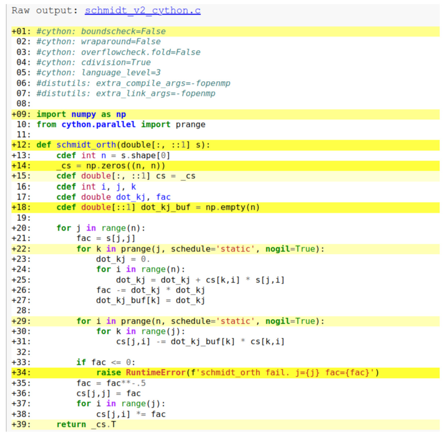

**图 9.3** 在 HTML 中可视化的 Cython 注释，章节

我们的 Cython 代码是否实现得足够合理，即所有不必要的 Python 语句都已消除？我们可以使用 Cython 注释（annotations）分析代码：

```bash
$ cython -a schmidt_v2_cython.pyx
```
该命令在 HTML 文件中生成带注释的结果，可以在网页浏览器中查看（图 9.3）。Cython 注释使用颜色编码，突出显示 Cython 编译后的代码中存在的 Python 代码。黄色越深（印刷版中为灰色），Python 痕迹就越多，效率也就越低。目标是尽可能消除或减少黄色突出显示的部分。在 schmidt_orth 函数的注释中，我们可以看到对应 NumPy 数组分配、错误处理、函数签名行和返回语句的黄色行。如果问题规模足够大，这些黄色行对性能的影响并不显著，因为大部分执行时间花在循环内部。然而，对于小规模问题，这些黄色行引入的开销可能不可忽略。因此，虽然 Cython 是提高慢速 Python 函数性能的有用工具，但它可能不是小规模问题的理想选择。

### 9.4.3 Pythran

是一种提前编译（AOT）工具，它将 Python 代码转换为中间 C++ 代码。中间 C++ 代码可以编译成可导入的 Python 扩展。
它不需要对 Python 代码做大量修改。它只要求在 Python 代码中加入函数签名注释，称为 Pythran 指令。这些指令帮助 Pythran 推断数据类型并优化函数。例如，schmidt_orth 函数的 Pythran 指令如下：

```python
#pythran export schmidt_orth(float64[:,:])
def schmidt_orth(s):
```
显然，注释行中的 Pythran 指令不会影响原始 Python 代码的执行。在 Pythran 中使用 OpenMP 并行化时，可以将如下 OpenMP 指令

```text
#pragma omp for schedule(static)
```
作为注释行插入 Python 代码。这是 Pythran 相对于 Cython 的一个优势，因为它的输入就是标准 Python 代码。使用者不需要像学习新语言那样记住特定细节。
不要求指定局部变量的类型细节，也不要求遵循任何特定的 Python 语法糖。它使用 C++ 表达式模板（expression template）技术来推断类型、生成循环、优化数组索引，

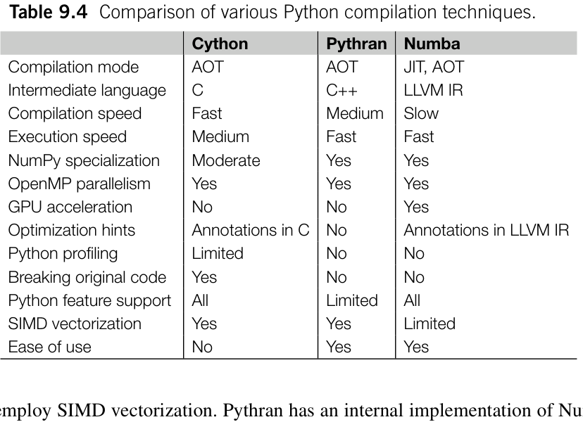

**表 9.4** 各种 Python 编译技术的比较。

### 9.4.4 Cython、Pythran 和 Numba

表 9.4 总结了 Numba、Cython 和 Pythran 的技术方面。下面详细比较这三种技术。

#### 易用性

使用 Numba 和 Pythran 只需一行装饰器或指令。此外，这两个工具不会修改原始 Python 代码，因此更容易调试和测试。相比之下，Cython 引入了一种新语言，尽管其语法接近 Python。掌握这门新语言需要一定的学习过程，尤其是在追求最佳性能时。此外，Cython 代码不能由 Python 解释器直接执行。调试 Cython 代码不如使用另外两个工具那样直接。

#### 对 Python 特性的支持

Numba 和 Cython 支持大多数 Python 语言特性，尽管使用这些特性可能导致性能下降。可以向使用 Numba 和 Cython 编译的程序导入 Python 模块。然而，Pythran 不支持将其他 Python 模块或函数导入 Pythran 编译的代码。这一限制缩小了 Pythran 能够有效应用的范围。

#### 优化提示

Cython 和 Numba 都提供以 HTML 标注代码的功能。这些注释有助于分析编译后代码中每条 Python 语句的复杂度和效率。Cython 的注释更进一步，突出显示可能未得到最佳优化的代码。Pythran 生成的 C++ 代码包含注释行，用于将 C++ 代码映射回原始 Python 语句。然而，Pythran 大量使用 C++ 模板，使代码分析更具挑战性。

#### 性能分析

三种编译方法都无法与 cProfile 或 Line profiler 等传统 Python 性能分析器配合使用。然而，py-spy 性能分析器可以解释嵌入 Cython 编译后代码中的行指令。在 py-spy 生成的火焰图中，可以汇总 C 函数调用的开销，并将其归属于 Cython .pyx 文件中的对应行。

#### NumPy 专门优化

Cython 和 Pythran 对 NumPy 功能做专门优化。代码中所有 NumPy 语句，例如数组对象和函数调用，都会被各自的定制实现替换。这样，NumPy 操作的性能便得到自动优化，调用 NumPy 的开销也降至最低。在 Cython 中，NumPy 操作要么被视为普通 Python 对象，要么链接到 NumPy 提供的共享库。除非显式展开 NumPy ufunc 和广播代码，否则 Cython 中 NumPy 操作的性能与纯 Python 中几乎相同。Cython 只通过内存视图对数组索引代码做专门优化，使单个元素的访问效率可与 C 语言级别相媲美。

#### SIMD 矢量化

当可以实施 SIMD 矢量化时，Cython 和 Pythran 占据优势，因为它们可以利用先进的 C 和 C++ 编译器的能力。由这两者编译的程序更有可能使用 SIMD 矢量化。在某些情况下，Pythran 中的 NumPy 实现可能更积极地使用 SIMD，从而比 Cython 编译更高效。由于这一特性，Cython 提供了一个选项，可以使用 Pythran 作为后端来优化 NumPy 操作 [31]。在 Numba 中，SIMD 矢量化则不那么直接。为了确保正确性，Numba JIT 倾向于不使用 SIMD 矢量化。

#### 编译成本

如果只需要编译一次或几次，其成本通常不是主要问题。然而，在程序的开发和优化阶段，编译速度可能会产生一定影响。三者之中，Numba JIT 通常编译时间最长，而 Cython 最快。Numba JIT 速度慢可归因于其用 Python 实现的编译器前端。Cython 和 Pythran 的代码转换速度很快，成本可以忽略。编译 Cython 生成的 C 代码比编译 Pythran 生成的大量使用模板的 C++ 代码更快。

#### 执行速度

理论上，即时编译（JIT compilation）有可能生成性能最好的代码。JIT 编译能够访问和收集大量运行时信息。这使编译器能够执行跨函数优化，并针对特定的底层架构定制优化。然而，JIT 编译的优势受到优化过程的复杂性、资源限制、编译成本以及各种其他因素的制约。因此，在实际应用中，JIT 编译可能只能利用有限范围的信息，导致性能有所折衷。

## 9.5 使用编译型语言

Python JIT 和 AOT 编译器的发展，使我们无需使用编译型语言编写代码就能达到这些语言的性能。尽管这些工具功能强大，仍有一些任务在编译型语言中很直接，在 Python 编译中却不方便或无法实现。下面列出一些典型场景：

#### 使用指针对数组元素进行索引

在 C/C++ 中，有多种方法可以使用指针简化高维数组的索引。然而，在 Python 中无法直接操作指针。为了提高 Python 中数组索引的效率，我们必须从高维数组中切出一个低维数组，获得一个数组视图
优化其子块。然而，这种方法引入了管理低维数组的开销。

#### 内存管理

在编译型语言中，我们可以采用各种内存管理技术来提高内存效率，例如使用效率更高的内存分配器，以及为 SIMD 操作对齐内存地址。这些方法无法直接在 Python 代码中使用。

#### 与编译器交互

在 C 和 C++ 中，我们可以使用函数属性 [32] 和编译器指令与编译器交互，例如用于内存对齐的函数属性：

```text
double roots[8] __attribute__((aligned(32)));
```
以及用于执行 SIMD 指令的编译器指令

```text
#pragma omp simd
```
。这些特性在 Python 编译工具中不可用。

#### 硬件专用指令和操作

在 C 和 C++ 中，我们可以使用编译器内建函数（compiler intrinsics）[33] 显式调用 SIMD 指令。这些编译器内建函数也可以在 Cython 中调用，在那里它们被视为普通的外部 C 函数。然而，在使用即时编译的 Python 代码中直接控制 SIMD 指令并不方便。
在这些情况下优化程序时，使用编译型语言比使用 Python 编译技术更为自然。为了将编译型语言集成到 Python 代码中，我们可以使用 ctypes 或 cffi 包，如第 8 章所述。

### 9.5.1 编译器

除了程序代码本身的优化，编译器和编译选项也会影响程序性能。GCC（GNU Compiler Collection）和 LLVM 编译器提供了大量编译标志，其中一些会显著影响性能优化。这里我们以 GCC 为例，展示有利于优化 Python 扩展的编译器选项。虽然这些选项在 LLVM 中的名称可能略有不同，但原理大体相同。

-O2 优化级别是 Cython 和 Pythran 的默认设置。这个级别在性能、可移植性、代码大小和编译速度之间取得了平衡。如果要为通用平台发布程序，通常建议使用 -O2 优化级别。
-O3 标志在 -O2 级别应用的优化之外引入了几项额外优化。这些额外优化的详情可以在文档（man gcc）中找到。在量子化学应用中，以下额外选项尤其重要：

```text
- -loops-for-strides.
```

- -loop-vectorize 和 -ftree-slp-vectorize。这两个选项有助于在抽象语法树（Abstract Syntax Tree，AST）上检测矢量化能力。如果没有检测到指针依赖或内存重叠，编译器就会生成 SIMD 矢量化代码。请注意，这些选项只是启用 SIMD 矢量化的检测，并不保证生成 SIMD 操作。仍然需要适当的设计和实现，才能确保代码可以实施 SIMD 矢量化。
- -loops-for-strides。启用此选项后，编译器会针对不同的数组步长生成多个版本的代码。这对于优化单位步长情况下的内存访问尤其有益。在 Cython 等提前编译（AOT）中，数组的访问模式可能无法预先确定。因此，让编译器生成多个代码版本以针对不同步长模式进行优化是有益的。不过，此编译选项对即时编译（JIT）的帮助并不大。在即时编译中，通常可以在生成中间表示（IR）时对步长做专门处理。
-march=native 标志指示 GCC 编译器专门针对当前平台的硬件优化代码。它使编译器能够利用机器上支持的所有指令和特性。对于 Cython 和 Pythran 编译，生成更优化的机器代码的最简单方法是将 -O3 标志与 -march=native 结合使用。然而，使用此选项生成的机器代码不具有可移植性，可能无法在不同机器上运行。公开发布的软件包不应使用此选项。
- -math。此选项可提高 sqrt、log、sin、cos 等特定数学函数的性能。在 -ffast-math 模式下，这些函数使用速度更快但精度较低的算法近似计算。在某些编译器中，只有启用 -ffast-math 才会生成 SIMD 指令，因为 SIMD 并行化可能破坏结合律 [34]。然而，GCC 允许 SIMD 矢量化而不检查 -ffast-math 选项。

如何在 Python 编译中启用这些编译选项？Numba JIT 提供了多个环境变量 [35]，用于调整编译设置。Numba 的默认配置已经相当激进，通常不需要自定义编译器选项。编译器选项主要用于 Cython 和 Pythran 的提前编译过程。下面是一些配置编译器选项的方法：

- 设置环境变量 CFLAGS 和 CXXFLAGS，适用于 Cython 和 Pythran。
- 在 setup.py 中添加编译标志，适用于 Cython 和 Pythran。

```python
from setuptools import setup, Extension
from Cython.Build import cythonize
setup( ext_modules=cythonize([
        Extension('schmidt',[ 'schmidt_v2_cython.pyx'], extra_compile_args=['-fopenmp', '-O3', '-march=native'])
    ]), )
from setuptools import setup, Extension
from pythran.dist import PythranExtension
setup( ext_modules=[
        PythranExtension('schmidt',[ 'schmidt_v2_pythran.py'], extra_compile_args=['-fopenmp', '-O3', '-march=native'])
    ], )
```

- 添加带有 distutils: 前缀的 Cython 编译器指令。使用 setup.py 或

```text
#distutils: extra_compile_args=-fopenmp -O3 -march=native
```

- Pythran 的配置文件 ~/.pythranrc。它只影响从命令行执行的 pythran 命令。setup.py 中的 PythranExtension 不会读取此配置文件中的设置。

## 9.6 I/O 优化

在大多数量子化学应用中，I/O 操作主要涉及文件 I/O。某些在高性能计算（HPC）集群上运行的应用也可能通过 MPI 并行执行网络 I/O。优化 I/O 效率涉及提高带宽和降低延迟。可以采用以下几种策略优化 I/O：

- 改进数据布局和存储格式。这种方法使数据更容易访问和传输，有效降低延迟。
- 压缩数据。这可以减小存储大小，提高数据传输的带宽效率。
- 将计算与 I/O 操作重叠，以隐藏延迟。
- 利用数据缓存来改善带宽和延迟。

### 9.6.1 存储布局

#### HDF5 格式

许多高精度的电子结构方法必须将海量的高维中间张量落地暂存到物理磁盘上。HDF5 提供了与 NumPy 原生兼容的二进制存储布局，支持灵活切片检索巨型数组中的局部子块。
默认情况下，HDF5 采用紧凑的行主序线性存储，这对于全量顺序吞吐非常高效；但当程序频繁切片访问高维张量任意子空间时，会导致大范围的离散跨步访存。操作系统通常以 4 KiB 的物理页为单位与磁盘块交互，即便程序仅需检索单个浮点数值，底层也不得不强行将整个 4 KiB 页（乃至由预读引发的多个连续页）整体载入系统缓存，由此诱发严重的 I/O 读写放大效应。针对该痛点，分块存储（chunked storage，图 9.4）技术通过将物理邻近的多维张量切片重新组织为自包含的独立数据块，大幅减少了检索局部子集时的无效数据吞吐。

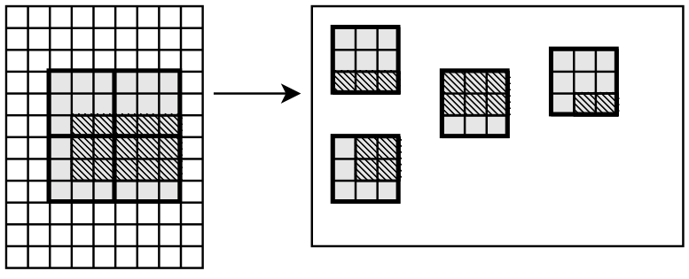

**图 9.4** HDF5 分块存储

在以下测试中，通过使用分块数据集，第二个测试达到了 252 MB/s 的吞吐量。相比之下，未使用分块存储的第一个测试只达到了 14.4 MB/s 的吞吐量。

```python
In [1]: import h5py
In [2]: %%time
        with h5py.File('test_plain.h5', 'w') as f:
            d = f.create_dataset( 'test', (20000,20000), dtype= 'f8')
            d[:,:600] = 1.
CPU times: user 369 ms, sys: 1.11 s, total: 1.48 s
Wall time: 6.66 s
In [3]: %%time
        with h5py.File('test_chunk.h5', 'w') as f:
```

```text
            d = f.create_dataset( 'test', (20000,20000), dtype= 'f8', chunks=(200,200))
            d[:,:600] = 1.
CPU times: user 321 ms, sys: 56.9 ms, total: 378 ms
Wall time: 380 ms
```
测试在 AWS EC2 c5d.xlarge 类型的实例上进行。这台虚拟机配备了 16 GB 物理内存和 SSD 本地存储。为了限制可用内存（在这些测试中为 2 GB），我们在运行测试前在另一个进程中分配了一个巨大的数组。为了消除文件系统缓存的影响，我们在每次测试前使用以下命令手动清除了缓存：

```bash
$ sync; echo 1 > /proc/sys/vm/drop_caches
```
虽然分块存储提高了访问数据子集的效率，但它引入了额外的复杂性和新的开销。在 HDF5 中，数据块被视为原子对象。访问块中的任何元素时，都需要从磁盘读取整个块。访问跨越块边界的数据可能导致一些开销。使访问模式与块的形状对齐有助于减少这种开销。例如，在下面的例子中，第一个测试需要读取 200 个块，而第二个测试需要读取 400 个块。这一差异导致性能相差 50%。

```text
In [4]: %%time
        with h5py.File('test_chunk.h5', 'r') as f:
            f['test'][200:400]
CPU times: user 13.7 ms, sys: 13.8 ms, total: 27.5 ms
Wall time: 52.2 ms
In [5]: %%time
        with h5py.File('test_chunk.h5', 'r') as f:
            f['test'][610:810]
CPU times: user 14.4 ms, sys: 28.9 ms, total: 43.2 ms
Wall time: 86.6 ms
```
分块存储的第二个特性是，数据集的各个块随机存储在磁盘上。因此，顺序访问数据集时，读写操作实际上都涉及一定程度的随机性。在下面的例子中，读取 640 MB 连续数据时，与普通行主序存储相比，分块存储产生了 50% 的额外开销。

```text
In [6]: %%time
        with h5py.File('test_plain.h5', 'r') as f:
            a=f [ 'test'][5000:9000]
CPU times: user 38 ms, sys: 495 ms, total: 533 ms
Wall time: 1.65 s
```

```text
In [7]: %%time
        with h5py.File('test_chunk.h5', 'r') as f:
            a=f [ 'test'][5000:9000]
CPU times: user 142 ms, sys: 658 ms, total: 800 ms
Wall time: 2.49 s
```

#### 内存映射

使用内存映射（memory mapping，memmap）存储数组时，存储布局也对 I/O 效率有关键影响。memmap 允许以行主序或列主序格式存储数据。顺序访问数据时，它的性能可能优于 HDF5。这是因为 memmap 在内存中移动数据的开销较低。然而，memmap 不具备分块存储数据的能力，访问非连续数据时性能会显著下降。为了评估 memmap 相对于 HDF5 格式的 I/O 性能，我们采用与之前针对 HDF5 开展的测试类似的方法。

```python
In [10]: %%time
         d = np.memmap( 'test_plain.mmap', mode='w+', shape=(20000,20000), dtype= float)
         d[:,:600] = 1.
         d.flush()
CPU times: user 84 ms, sys: 992 ms, total: 1.08 s
Wall time: 1.28 s
In [11]: %%time
         d = np.memmap( 'test_plain.mmap', mode='r+', shape=(20000,20000), dtype= float)
         d[5000:9000] = 0.
         d.flush()
CPU times: user 122 ms, sys: 365 ms, total: 487 ms
Wall time: 6.23 s
In [12]: %%time
         d = np.memmap( 'test_plain.mmap', mode='r', shape=(20000,20000), dtype= float)
         a = d[5000:9000]
CPU times: user 14.6 ms, sys: 19.4 ms, total: 33.9 ms
Wall time: 33.5 ms
In [13]: %%time
         d = np.memmap( 'test_plain.mmap', mode='r', shape=(20000,20000), dtype= float)
         a = d[5000:9000].copy()
```

```text
CPU times: user 103 ms, sys: 378 ms, total: 481 ms
Wall time: 1.81 s
```
请注意 numpy.memmap 和 h5py 在处理数组切片时的区别。对 memmap 对象切片只会生成一个 memoryview。实际的 I/O 操作会推迟到显式访问数据时才进行。这一特性简化了编程，因为它无需显式调用文件读写命令。操作系统可以自动在内存和内存映射文件之间同步必要的数据。然而，这也意味着我们失去了灵活控制 I/O 操作发生时间的能力。除非复制 memmap 对象的片段，否则我们无法准确地为即将进行的计算任务预取所需数据。在某些应用中，这可能降低整体性能。
例如，考虑以下对两个 memmap 对象进行矩阵乘法的测试，完成该测试需要 42 秒。如果两个数组完全位于内存中，计算时间只需 29 秒。额外的 13 秒是从 memmap 文件加载数据的开销。

```python
In [14]: %%time
         a = np.memmap( 'test_a.mmap', mode='r', shape=(40000,10000), dtype= float)
         b = np.memmap( 'test_b.mmap', mode='r', shape=(40000,10000), dtype= float)
         c = a.T.dot(b)
CPU times: user 3 min 47s, sys: 9.34 s, total: 3 min 56s
Wall time: 42.2 s
```
将矩阵乘法问题重构为一系列 10000 × 10000 子矩阵乘法，并使用 iterate_with_prefetch 函数（如第 9.6.3 节所述）使计算与 I/O 重叠，可以将计算时间缩短至 37 秒。

```python
a = np.memmap( 'test_a.mmap', mode= 'r', shape=(40000,10000), dtype= float)
b = np.memmap( 'test_b.mmap', mode= 'r', shape=(40000,10000), dtype= float)
def loader(task):
    sub_a = a[task *10000:(task+1)*10000].copy()
    sub_b = b[task *10000:(task+1)*10000].copy()
    return sub_a, sub_b
c = np.zeros((10000,10000))
for task, (sub_a, sub_b) in iterate_with_prefetch(range(4), loader):
    c += sub_a.T.dot(sub_b)
# Wall time: 37.1 s
```

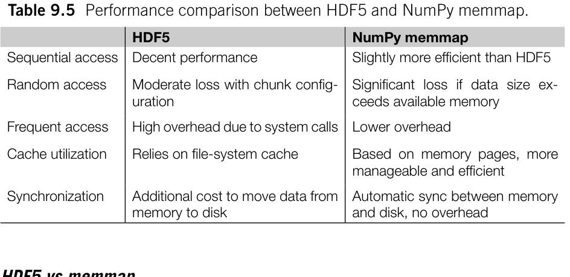

**表 9.5** HDF5 与 NumPy memmap 的性能比较。

#### HDF5 与 memmap

访问大型数组对象时，HDF5 和 memmap 哪种技术更好？表 9.5 列出了若干需要考虑的因素。一般来说，HDF5 格式在各种场景下都能提供令人满意的性能。不过，memmap 在某些特定情况下表现更优，包括：

- 大规模顺序连续访存。memmap 的压倒性优势在于绕过了用户态与内核态之间繁重的重复数据中转。
- 针对局部热页的高频往复读写。一旦特定数据页加载进物理主存，通过 memmap 读写该页完全等价于直接操作原生内存指针；对内存页的写操作随后由系统调度器异步刷新落盘，彻底省去了类似 HDF5 那样显式调用 write API 的数据封包开销。
- 物理内存容量极其宽裕的场景。若物理内存足以整卷容纳映射文件，memmap 的实际吞吐与读写原生物理内存几乎无异。

### 9.6.2 压缩数据

压缩数据是一种广泛使用的优化技术，可以减轻 I/O 压力。
量子化学数据通常具有特定的对称性，例如哈密顿矩阵的厄米性质，以及电子排斥积分中的八重置换对称性。此外，量子化学计算中的原始数据通常包含大量接近零的值。为了压缩量子化学数据，我们可以利用对称性减少数据量，然后利用稀疏性进一步压缩。
存储压缩数据的一种选择是使用 HDF5 库提供的压缩过滤器 [36]。这种方法在创建 HDF5 数据集时需要几个额外参数来配置压缩过滤器，如下面的例子所示。

```python
import h5py
import hdf5plugin
eri = np.ones((5050, 5050))
with h5py.File('test_lzf.h5', 'w') as f:
    d = f.create_dataset( 'test', eri.shape, dtype= 'f8', chunks=(100,100), compression='lzf')
    d[:] = eri
with h5py.File('test_blosc.h5', 'w') as f:
    d = f.create_dataset( 'test', eri.shape, dtype= 'f8', chunks=(100,100), **hdf5plugin.Blosc())
    d[:] = eri
```
有几种可用的无损压缩过滤器：Blosc、LZF 和 LZ4。这些压缩器使用单个 CPU 线程可达到约 1 GB/s 的吞吐量（实际上 Python 仅支持一个线程）。h5py 库原生支持 LZF 过滤器。要使用 Blosc 或 LZ4 压缩器，需要 hdf5plugin 扩展 [37]。PyTables 库提供了一份关于压缩器性能与块大小之间关系的详尽指南 [38]。一般而言，块大小对各压缩器性能的影响相对较小。
另一种压缩数据的方法是使用 scipy.sparse 模块将数据转换为稀疏格式，例如压缩稀疏行（Compressed Sparse Row，CSR）、块稀疏行（Block Sparse Row，BSR）或坐标（Coordinate，COO）格式。稀疏格式与高维数组不兼容。在应用稀疏格式之前，必须将高维数组重塑为矩阵。稀疏数组不能直接存储在 HDF5 文件中。为了存储稀疏数组，我们需要保存非零元素以及指示非零元素位置的元数据。下面是保存和加载稀疏数组的辅助函数。

```python
from scipy.sparse import csr_array, bsr_array, coo_array
def save_sparse(h5obj, a):
    if isinstance (a, (csr_array, bsr_array)):
        h5obj['data'] = a.data
        h5obj['indices'] = a.indices
        h5obj['indptr'] = a.indptr
        h5obj['shape'] = a.shape
    elif isinstance (a, coo_array):
        h5obj['data'] = a.data
        h5obj['row'] = a.row
        h5obj['col'] = a.col
        h5obj['shape'] = a.shape
    else:
```

```python
        raise NotImplementedError
def load_sparse(h5obj):
    assert 'data' in h5obj
    data = h5obj[ 'data'][()]
    shape = h5obj[ 'shape'][()]
    if 'indices' in h5obj:
        indices = h5obj[ 'indices'][()]
        indptr = h5obj[ 'indptr'][()]
        if data.ndim == 1:
            return csr_array((data, indices, indptr), shape=shape)
        else:
            return bsr_array((data, indices, indptr), shape=shape)
    elif 'row' in h5obj:
        row = h5obj[ 'row'][()]
        col = h5obj[ 'col'][()]
        return coo_array((data, (row, col)), shape=shape)
    else:
        raise NotImplementedError
```

### 9.6.3 计算与 I/O 重叠

为了使计算与 I/O 重叠，我们可以使用非阻塞 I/O 操作和数据预取。
在阻塞程序中，任务依次顺序执行。程序会暂停并等待 I/O 操作完成，然后才继续执行下一个任务。相反，非阻塞 I/O 允许程序启动 I/O 操作后继续执行其他任务，而不必等待 I/O 操作完成。程序可以定期检查 I/O 操作的状态，同时执行其他任务。使用 concurrent.futures 模块中的 ThreadPoolExecutor 类是实现非阻塞 I/O 的一种便捷方法。ThreadPoolExecutor 可以在单独的线程中执行 I/O 任务并返回一个 future 对象。通过调用 future.result() 方法，程序可以被阻塞，直到后台任务完成。下面的代码是使用 ThreadPoolExecutor 类使计算与 I/O 操作重叠的示例。

```python
from concurrent.futures import ThreadPoolExecutor
with h5py.File('test_block.h5', 'r+') as f:
    def save_data(task_id, data):
        f[f'test/{task_id}'] = data
    with ThreadPoolExecutor() as worker:
        for task_id in range (100):
```

```python
            # code to generate data
            data = np.ones((10000,100))
            # save data asynchronously
            future = worker.submit(save_data, task_id)
```
使用非阻塞 I/O（non-blocking I/O），我们可以实现数据预取（data prefetching）技术，隐藏数据访问的延迟。在实际需要数据之前，我们可以启动一个线程，在后台从存储中读取数据。需要数据时，可以使用 .result() 方法获取预先加载的数据。例如：

```python
with h5py.File('test_plain.h5', 'r') as f:
    block_size = 200
    rows = f[ 'test'].shape[0]
    def loader(row0):
        row1 = min(row + block_size, rows)
        return f['test'][row0:row1]
    with ThreadPoolExecutor(max_workers=1) as worker:
        future = worker.submit(loader, task)
        data1 = prefetch(task1)
        do_some_computation()
        data2 = prefetch(task2)
        do_some_computation()
        computing_with_data(data1.result())
        computing_with_data(data2.result())
```
数据预取技术可以与循环迭代代码结合。在每次迭代中，发出加载数据的指令时，我们可以为下一次迭代启动预取操作，并使用 .result() 方法访问当前步骤预取的数据。为了简化这一过程，我们按如下方式实现一个名为 iterate_with_prefetch 的包装器。

```python
from concurrent.futures import ThreadPoolExecutor
def iterate_with_prefetch(tasks, loader):
    with ThreadPoolExecutor(max_workers=1) as worker:
        task_to_run = None
        for task in tasks:
            if task_to_run is None:
                future = worker.submit(loader, task)
                task_to_run = task
                continue
```

```text
            data = future.result()
            future = worker.submit(loader, task)
            yield task_to_run, data
            task_to_run = task
        data = future.result()
        yield task_to_run, data
```
使用 iterate_with_prefetch，我们可以按以下方式编写数据加载和计算任务。

```python
with h5py.File('test_plain.h5', 'r') as f:
    block_size = 200
    rows = f[ 'test'].shape[0]
    def loader(row0):
        row1 = min(row0 + block_size, rows)
        return f['test'][row0:row1]
    tasks = range(0, rows, block_size)
    for task, data in iterate_with_prefetch(tasks, loader):
        # code to process data
```
还有其他技术可以实现异步 I/O（asynchronous I/O），例如 asyncio 库，它允许计算和 I/O 操作并发执行。asyncio 可以大大简化异步代码的实现，使代码更易理解。然而，HDF5 不支持异步函数。在此我们不探讨 asyncio 的用法。

## 9.7 记忆化

避免冗余计算可以减少计算成本。如果程序中多次执行相同的计算，可以预先计算结果并存储起来，以供之后使用。
实现预计算（precomputation）有多种策略。例如，如果某些代码片段重复出现，可以调整数据结构和循环顺序，只预先计算一次这些片段。如果一个函数的可能结果数量有限，可以预先计算这些结果并制成表格。调用函数时，可以通过查表获取结果。
基于函数的预计算也可以换一种方式实现。首次使用特定输入调用函数时，可以将其结果存储在缓存（cache）中。之后使用相同输入调用时，从缓存中获取结果，而不是重新计算。这种方法称为记忆化（memoization）。
记忆化要求结果仅由输入决定，且函数不影响其他函数。这让记忆化的概念与函数式编程（functional programming）紧密相连。本节将探讨记忆化、函数式编程及相关技术。

### 9.7.1 缓存

在 Python 中实现记忆化很简单。只需要一个 Python 字典，为函数提供缓存和查找功能。下面是一个简单的记忆化装饰器示例。

```python
def cache(f):
    cache = {}
    def f_cached(*args):
        if args in cache:
            return cache[args]
        result = f( *args)
        cache[args] = result
        return result
    return f_cached
@cache
def factorial(n):
    if n< =1 :
        return 1
    return factorial(n-1) * n
```
如果不加限制地缓存所有值，缓存最终可能占用大量内存。为解决这一问题，我们需要一种策略，决定哪些数据应保留在缓存中，哪些应被逐出。管理缓存有多种可用的策略，例如：

- 先进先出（First-In/First-Out，FIFO），使最旧的条目失效；
- 后进先出（Last-In/First-Out，LIFO），使最新的条目失效；
- 最近最少使用（Least Recently Used，LRU），保留最近访问的条目；
- 最不经常使用（Least Frequently Used，LFU），保留访问最频繁的条目。

由于数据中普遍存在时间局部性（temporal locality），LRU 缓存策略非常适用，在软件和硬件的各种应用中都得到广泛使用。Python 在标准库 functools 中提供了 lru_cache 的实现。除了 lru_cache，cachetools 库 [39] 还提供了其他缓存管理策略的实现。
lru_cache 能否应用于任何 Python 函数？
在 Python 中使用 lru_cache 时，有几个技术问题需要注意：

- 输入变量必须可哈希且可比较。这是字典查找的基本要求。
- 变量应当是不可变的。
- 输出无法被释放。请注意，如果缓存的对象引用了其他对象，那么在该缓存对象被逐出之前，这些对象都不会被释放。

这不仅影响记忆化的内存使用，还会影响操作系统中的某些资源
[40]。通常，我们应避免缓存或引用
文件描述符或套接字等资源，因为系统中的这些资源有限。

- 多次访问输出时，其行为必须保持一致。并发函数返回的某些对象 [41] 不适合缓存。

其中包括 Future 对象、Thread 对象（由
threading 库提供）或协程对象（由异步函数返回）。当
这些对象被使用时，例如对 Thread 调用 .join() 方法，它们的状态会发生改变。多次使用这些对象可能导致
错误或意外结果。同样，输出中的其他对象，例如生成
器和迭代器，也不应被缓存。虽然 lru_cache 函数
没有明确禁止缓存这些结果，但我们应避免使用
LRU 缓存优化这些函数。

- 输出应当是不可变的。我们想要记忆化的函数可能返回可变对象，例如 NumPy 数组。Python 不会强制缓存对象保持不可变。我们应避免修改记忆化函数返回的对象。

为安全地应用记忆化，调用方和被缓存函数都最好采用函数式编程风格。在深入探讨函数式编程之前，我们先看看如何管理用于记忆化的函数输入参数。
函数输入参数必须可哈希。在 Python 中，大多数不可变数据类型，例如数字、字符串和元组，都是可哈希的。我们可以使用内置函数 hash() 获取这些对象的哈希值。然而，包括列表、集合、字典和 NumPy 数组在内的可变对象不可哈希。要在记忆化中使用这些可变对象，应将它们转换为对应的不可变数据类型。下面是一些典型的转换：

- 将列表转换为元组；
- 将集合转换为 frozenset；
- 将 NumPy 数组转换为字节（使用 ndarray.tobytes() 方法）。

缓存 NumPy 数组时，可能需要处理与浮点数舍入有关的问题。如果可以接受浮点数中的微小误差，就可以使用 np.round 函数去掉不重要的小数位。这种方法可能使较小的负值被舍入为 -0.0。为了去掉负零，只需将舍入后的数组加上 0.0。例如，要将数组限制为仅保留 6 位小数，可以使用下面的语句计算数组哈希：

```text
hash((a.round(6) + 0.0).tobytes())
```
Python 没有内置的不可变（冻结）字典。要对以字典形式提供的输入进行哈希，一种常见的变通方法是将字典转换为键值对组成的元组。也可以使用 collections 模块中的 namedtuple 类。

```python
class CustomHash:
    def __hash__(self):
        return hash ((tuple(self.list), frozenset(self.set), self.array.tobytes(), tuple(self.dict.items())))
```
hash() 函数可以为某些可变对象生成哈希值，例如用户自定义 Python 类的实例。

```python
In [1]: class Empty:
            pass
In [2]: print(hash(Empty()))
Out[2]:
8733822284401
```
Python 会自动为用户自定义类实现 __hash__ 和 __eq__ 方法。默认情况下，__hash__ 方法为不同的实例生成不同的哈希值，即使它们由同一个类创建且包含相同的数据。因此，使用默认 __hash__ 实现的用户自定义类不适合记忆化技术。即使缓存中已有相同的实例，缓存查找也无法识别这种类的实例。因此，使用这样的实例调用记忆化函数总会触发对底层函数的调用。为了准确识别相同的实例，必须重写 __hash__ 和 __eq__ 方法，将关键属性编码进去。
另一方面，如何对某些对象禁用记忆化？可以通过设置 __hash__ 方法来实现：

```python
class NotHashable:
    __hash__ = None
```
将该实例传给记忆化函数时，这会导致不可哈希类型错误。

### 9.7.2 编程

在前面的示例中，程序包含若干修改变量和程序状态的语句，例如为数组的某个元素赋值。这些语句必须按照实现时的严格顺序执行。这种编程风格称为命令式编程（imperative programming）。
与命令式编程不同，程序也可以采用仅依赖纯函数（pure function）的风格编写。纯函数是一种数学过程，它
计算结果而不产生任何副作用（不修改非局部变量或输入参数）。通过适当定义纯函数 f1、f2 等，整个计算可以看作一系列嵌套的函数调用：

```text
f_n(..., f_2(f_3(f_1(x), f_2(x)), f_4(x)), ...)
```
这种编程风格称为函数式编程（functional programming，FP）。
FP 在程序优化方面有几个优点：

- 对于相同的输入，纯函数总是产生相同的输出。

这种确定性有利于使用记忆化技术。

- 使用闭包（closure）。闭包可以用来存储预先计算的状态。

通过捕获外层函数的变量，闭包保留了计算得到的
数据。调用闭包时，这些状态不需要重新计算。

- FP 使计算任务更容易分解为更小的独立单元。这些单元可以并行执行，无须考虑执行顺序。
- 对不可变数据。FP 鼓励使用不可变数据，这简化了某些优化操作，例如矢量化（vectorization）。矢量化的一个常见障碍是无法确定算术操作的输出是否与另一个操作数的内存地址重叠。如果能保证数据不可变，应用矢量化就很简单。
- 求值。FP 支持惰性求值（lazy evaluation），即只有在实际需要表达式的值时才对其求值。这种策略可以通过避免不必要的计算来降低计算成本。

如果你有兴趣探索 Python 中的 FP 技术，*SICP in Python* [42] 一书可以作为一个很好的起点。
像纯 FP 风格所要求的那样完全放弃赋值语句，在 Python 中可能不太方便。实际上，我们只需确保赋值不会引入副作用。如果赋值语句仅用于创建局部变量，而不修改任何已有对象，就可以认为它没有副作用。这类赋值完全可以转换为函数调用，使代码与不含赋值的 FP 风格等价。例如，在下面的代码中，我们不使用赋值语句 dx = point1 - point2，而是通过一个绑定局部变量 dx 的辅助函数得到相同的结果。

```python
def euclidean_distance(point1: ndarray, point2: ndarray) -> float:
                        dx = point1 - point2
    return sum (dx * dx) ** .5
def euclidean_distance_assignment_free(point1, point2):
    def norm(dx):
        return sum (dx * dx) ** .5
    return norm(point1 - point2)
```
现在让我们重新看看前面讨论过的 schmidt_orth 函数。

```python
def schmidt_orth(s):
n = s.shape[0] # (1)
cs = np.eye(n) # (2)
    for j in range (n):
fac = s[j,j] # (3)
            for k in range (j):
dot_kj = np.dot(cs[k], s[j]) # (4)
cs[j] -= dot_kj * cs[k] # (5)
fac -= dot_kj * dot_kj # (6)
cs[j] /= fac **.5 # (7)
    return cs.T
```
第 (1) 至 (4) 行的语句创建了不受任何副作用影响的局部变量。第 (5) 行和第 (7) 行涉及原位操作，它们会修改 cs 数组，因此引入副作用。根据局部变量 fac 与输入元素 s[j,j] 的关联机制，第 (6) 行可能改变 s[j,j] 的值并引入副作用。为消除第 (5) 至 (7) 行的副作用，我们可以使用普通赋值语句代替原位修改，例如：

```text
fac = fac- dot_kj * dot_kj
```
虽然赋值语句两侧使用了相同的变量名 fac，但左侧的实例现在指向一个新的局部对象，而不是表达式 fac - dot_kj * dot_kj 中的那个对象。由此得到无副作用的实现。

```python
def schmidt_orth_side_effects_free(s):
    n = s.shape[0]
    c s=[ ]
    guess = np.eye(n)
    for j in range (n):
        fac = s[j,j]
        vec = guess[j]
        for k in range (j):
            dot_kj = np.dot(cs[k], s[j])
            vec = vec - dot_kj * cs[k]
            fac = fac - dot_kj * dot_kj
        cs = cs + [vec / fac **.5]
    return np.array(cs).T
```
这一实现还可以进一步简化为：

```python
def schmidt_orth_side_effects_free(s):
    n = s.shape[0]
    c s=[ ]
    guess = np.eye(n)
    for j in range (n):
```

```python
dot_kj = [np.dot(cs[k], s[j]) for k in range (j)] # (1)
fac = s[j,j] - sum(x * x for x in dot_kj) # (2)
vec = guess[j] - sum(dot_kj[k] * cs[k] for k in range (j)) # (3)
cs = cs + [vec / fac **.5] # (4)
    return np.array(cs).T
```
在这个版本中，我们可以识别函数中的子任务以及这些任务之间的依赖关系，如图 9.5 所示。值得注意的是，第 (2) 行和第 (3) 行的任务相互独立，因此可以并行执行。用 Dask 或 JAX 库替代 NumPy 库，可以使这些独立任务更容易跨多个设备和机器并行执行。

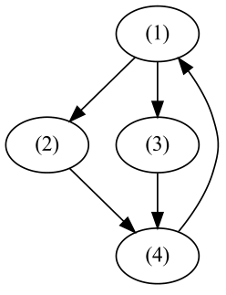

**图 9.5** 函数 schmidt_orth_side_effects_free 中的任务依赖关系

### 9.7.3 编程

递归（recursion）是函数式编程中广泛使用的技术。它使我们能够递归地将复杂问题分解为更易处理的子问题。通过解决这些较小的问题，我们最终可以解决原始问题。为了提高这一过程的效率，可以使用记忆化来避免不必要的重复计算。递归与记忆化相结合，构成了动态规划（dynamic programming，DP）方法的基础。
要开发一个 DP 求解器，我们可以先回答以下问题：

- 如何构造问题，特别是输入和输出的定义？
- 问题的边界是什么？
- 给定子问题的解，如何在问题规模增加一个单位后推导出解？

一旦清楚地回答了这些问题，我们就可以将答案转换为程序代码，让计算机搜索解。
例如，考虑推导完全组态相互作用（full configuration interaction，FCI）方法中 Slater 行列式基的问题。该问题表述为：给定 n 个轨道和 m 个电子，行列式基由所有可能的组合构成
从 n 个中选取 m 个轨道。显然，可能的
行列式数量等于二项式系数。

- 输入和输出：问题的输入 (n, m) 是轨道数 n 和电子数 m。输出是一个行列式列表。每个行列式由一个占据轨道列表表示。
- 边界位于 (t, 0) 和 (t, t)。在 (t, 0) 处的值是空列表，而在 (t, t) 处的值是一个包含全部 t 个轨道的列表。
- 递推：大小为 (n, m) 的解可以由子问题 (n-1, m-1) 和 (n-1, m) 推导出来。具体方法是在 (n-1, m-1) 的结果中的每个行列式里加入轨道 n，并保留 (n-1, m) 的全部行列式。

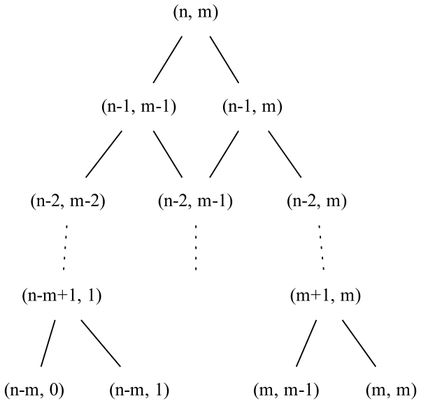

**图 9.6** 生成 FCI 行列式基的动态规划递归

图 9.6 通过递归过程生成行列式的过程。上述创建 FCI 行列式基的规则可以转换为如下 DP 代码。

```python
from typing import List
class Determinant:
 def __init__(self, occupied_orbitals: List):
     self.occupied_orbitals = occupied_orbitals
 def __repr__(self):
```

```python
        return f'Det{self.occupied_orbitals}'
    @classmethod
    def vacuum(cls):
        return cls([])
    @classmethod
    def fully_occupied(cls, n):
        return cls(list(range(n)))
    def add_occupancy(self, orbital_id):
        assert orbital_id not in self.occupied_orbitals
        return Determinant(sorted(self.occupied_orbitals + [orbital_id]))
@lru_cache(1000)
def dets(n, m) -> List[Determinant]:
    assert n> =m
    if m= =0 :
        return [Determinant.vacuum()]
    elif n= =m :
        return [Determinant.fully_occupied(n)]
    return (dets(n-1,m )+
            [det.add_occupancy(n-1) for det in dets(n-1,m -1)])
```
到目前为止，我们展示了使用递归和记忆化的自顶向下 DP 方法。DP 问题也可以使用自底向上（迭代）的方法求解。这种方法从较小的子问题开始，迭代地构建原始问题的解。在自底向上方法中，DP 中间状态通常存储在数组中。然后使用嵌套循环遍历数组，系统地生成 DP 状态。表 9.6 对比了自顶向下和自底向上方法。
自顶向下方法只在需要时计算必要的 DP 中间状态。相比之下，自底向上方法通常需要计算几乎所有子问题才能得到最终的解。这有时会带来额外的不必要工作量。然而，自顶向下方法中的递归涉及大量函数调用、调用栈规模增大、哈希成本以及缓存表中的查找操作成本，因此开销很高。就效率而言，现代计算机处理循环和数组索引操作比处理函数调用和字典查找更高效。因此，自底向上方法往往比自顶向下方法更高效。
将递归转换为迭代，本质上是将自顶向下的 DP 代码改写为自底向上的 DP 代码。这种转换通常是优化过程中困难且容易出错的一步。在开始编写迭代代码之前，有必要分析递归代码，以便：

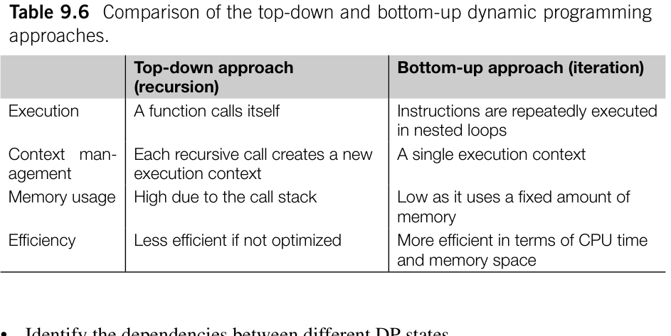

**表 9.6** 自顶向下与自底向上的动态规划方法比较。

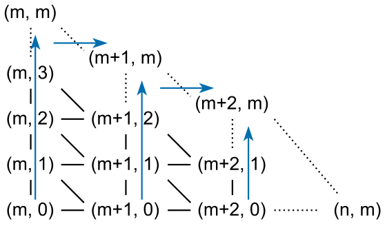

**图 9.7** 生成 FCI 行列式基的自底向上迭代

根据这些分析，我们可以按以下步骤编写迭代代码：1. 一个 N 维数组，其中 N 表示
递归函数中的参数个数。数组中的每个元素代表一个 DP 状态。DP 状态数组的大小
根据先前的分析确定。

2. N 层嵌套的 for 循环，遍历 DP 状态数组中的所有元素。

迭代的方向根据先前的分析确定。

3. 将递归函数的代码块放入嵌套循环。将

函数调用替换为对动态规划状态数组的索引。将 return 语句
替换为赋值语句，并继续下一次循环迭代。

4. 测试以验证迭代代码。如果测试失败，检查动态规划状态是否

按正确顺序生成。必要时，调整迭代方向或
for 循环的顺序。为了避免访问未初始化的动态规划状态，可以用某些无效值
初始化动态规划状态数组。这些值可以帮助判断
所依赖的动态规划状态是否已正确初始化。
现在，我们可以将 FCI 递归程序转换为迭代程序：

```python
dets = np.empty((n_orbitals+1, n_electrons+1), dtype= object)
for m in range (n_electrons+1):
    for n in range (m, n_orbitals+1):
        if m= =0 :
            dets[n,m] = [Determinant.vacuum()]
        elif n= =m :
            dets[n,m] = [Determinant.fully_occupied(n)]
        else:
            dets[n,m] = dets[n-1, m ]+[
                    det.add_occupancy(n-1) for det in dets[n-1,m-1]]
```

## 9.8 使用惰性求值优化

通常，程序采用及早求值（eager evaluation）风格编写，即程序必须计算出一个表达式的结果，然后才能执行下一条指令。在某些情况下，某些计算结果可能不会在后续代码中使用，从而产生不必要的计算。这正是惰性求值（lazy evaluation）发挥作用的地方。惰性求值是一种编程策略，它将表达式的求值推迟到实际需要其值的时候。通过将求值推迟到必要时刻，惰性求值可以避免不必要的计算，从而提高程序效率。
在 Python 语言中，有几种工具提供惰性求值的基本功能，例如迭代器（range、zip、map、enumerate）和生成器。这些工具不会预先生成整个元素序列，而只在迭代时按需产生所需元素。
除了这些 Python 特性外，惰性求值还经常借助额外的函数包装器来推迟计算。例如，人们通常不直接构造日志消息，而是定义一系列日志方法
（例如 debug、info、warning），以推迟日志消息的构造。采用这种方法是因为格式化某些对象或将其转换为字符串可能是资源密集型操作。通过在自定义日志方法中推迟消息构造，我们可以跳过一些不必要的格式化操作。

```python
def debug(message, args):
    if LOGLEVEL >= DEBUG:
        print(message.format(args))
```
惰性求值在并发计算、自动微分和计算图优化等更复杂的场景中特别有用。为了有效实现惰性求值，我们可以遵循以下指导原则：

1. 确定系统中需要惰性求值的语句。
2. 确定这些语句所需的函数调用，并将其转换为

惰性函数。惰性函数返回一个惰性对象，也称为 Promise。3. Promise 可以传递给其他惰性函数，形成 Promise 链。
需要注意的是，Promise 不能直接用于标准
（及早求值）函数。将 Promise 传递给标准函数之前，必须
显式计算其值。

4. 对一个 Promise 求值会触发对所有后续 Promise 的求值。

以 schmidt_orth 函数为例，看看如何在程序中实现惰性求值。在下面的实现中，我们使用 defer 函数生成一个 Promise 对象，它本质上是一个 Python 函数。

```python
import numpy as np
def defer(func, *args):
    promise = lambda: func( *[force_eval(x) for x in args])
    return promise
def force_eval(x):
    if callable (x):
        x = x()
    return x
def dot(a,b ) :
    return defer(np.dot,a ,b )
def subtract(a, b):
    return defer(np.subtract,a ,b )
def multiply(a, b):
```

```python
    return defer(np.multiply,a ,b )
def divide(a, b):
    return defer(np.divide,a ,b )
def power(a, b):
    return defer(np.power,a ,b )
def array(a):
    return defer(lambda: np.array([x() for x in a]))
def schmidt_orth_lazy(s):
    n = s.shape[0]
    c s=[ ]
    guess = np.eye(n)
    for j in range (n):
        fac = s[j,j]
        vec = guess[j]
        for k in range (j):
            dot_kj = dot(cs[k], s[j])
            vec = subtract(vec, multiply(dot_kj, cs[k]))
            fac = subtract(fac, multiply(dot_kj, dot_kj))
        cs = cs + [divide(vec, power(fac, .5))]
    return defer(np.transpose, array(cs))
if __name__ == '__main__':
    s = np.eye(3)
    cs = schmidt_orth_lazy(s)
    print(cs())
```
现在，我们更新实现，以展示惰性求值如何帮助避免不必要的计算。这里，我们用 Promise 类替换 defer 函数。这一修改增强了惰性对象的面向对象特性，使其在未来的开发中更易于扩展。在 Promise 类中，我们加入一个计数器来监控已执行的操作。

```python
class Promise:
    count = 0
    def __init__(self, func, *args):
        self._func = func
        self._args = args
```

```python
def __repr__(self):
return f'Deferred {self._func}'
def __call__(self):
return self.compute()
def compute(self):
Promise.count += 1
args = [force_eval(x) for x in self._args]
return self._func(*args)
def force_eval(x):
if isinstance (x, Promise):
x = x.compute()
return x
def array(a):
def build_array(a):
if isinstance (a, Promise):
    return np.array(a.compute())
if not isinstance (a,( tuple, list)):
    return np.array(a)
# Nested list should be considered for a complete implementation.
# For simplicity, we only consider a plain list.
return np.array([force_eval(x) x for x in a])
return Promise(build_array,a )
def schmidt_orth_lazy(s, idx= slice(None)):
    n = s.shape[0]
c s=[ ]
guess = np.eye(n)
    for j in range (n):
        fac = s[j,j]
vec = guess[j]
        for k in range (j):
    dot_kj = dot(cs[k], s[j])
    vec = subtract(vec, multiply(dot_kj, cs[k]))
    fac = subtract(fac, multiply(dot_kj, dot_kj))
cs = cs + [divide(vec, power(fac, .5))]
return Promise(np.transpose, array(cs[idx]))
if __name__ == '__main__':
s = np.eye(3)
cs = schmidt_orth_lazy(s)
```

```python
    cs()
    print(Promise.count) # 113
    Promise.count = 0
    cs = schmidt_orth_lazy(s, idx=-1)
    cs()
    print(Promise.count) #9 4
```
在测试中，我们观察到，只计算最后一个正交基需要的操作较少，为 94 次；而计算所有正交基之后再选取最后一个，总共需要 113 次。操作次数的差异表明，惰性求值「智能地」避免了 15% 的不必要计算，尽管我们并不知道具体跳过了哪些计算。对于这个特定问题，需要注意的是，如果对 Promise.compute 方法采用记忆化，两种情况下的操作次数实际上相同。为了展示惰性求值的效果，我们没有使用记忆化技术优化操作次数。
在 Promise 类中，可以实现更多功能，例如并发计算、自动微分、试运行方法、合理性检查、调用图可视化以及分配计算任务的动态调度器等。这些功能在 PyTorch、JAX、Dask 和 Joblib 等工具中很常见。这些工具的基础是使用 Promise 对象的惰性求值技术。
作为示例，我们引入 parallel_compute 方法来展示并发计算能力。

```python
import time
from concurrent.futures import ThreadPoolExecutor, Future
import numpy as np
import networkx as nx
concurrent_executor = ThreadPoolExecutor(max_workers=4)
class Promise:
    _edges = []
    def __init__(self, func, *args):
        self._func = func
        self._args = args
        self._future = None
        Promise._edges.extend(
            # A directed edge, means self depends on x
            [(x, self) for x in args if isinstance (x, Promise)])
    def __repr__(self):
        return f'Deferred {self._func}'
```

```python
def compute(self):
return self._func(*[force_eval(x) for x in self._args])
def __call__(self):
return self.compute()
# Many features can be done in lazy evaluation mode, such as automatic
# differentiation, visualization of the call graph, etc
def submit(self):
def task():
    time.sleep(0.1)
# dependent tasks will be blocked by the .result() method in force_eval() function.
    return self._func(*[force_eval(x) for x in self._args])
self._future = concurrent_executor.submit(task)
return self._future
def result(self):
if self._future is None:
    return self.compute()
else:
    return self._future.result()
def parallel_compute(self):
# Build a dependency tree based on directed edges.
tree = nx.DiGraph(Promise._edges)
Promise._edges.clear()
# topological_sort generates an iterator to traverse the dependency tree. Leaves are evaluated first.
futures = [task.submit() for task in nx.topological_sort(tree)]
print(f'{len(futures)} tasks to execute' )
# self is the last task (the root) in the dependency tree.
return futures[-1].result()
def force_eval(x):
if isinstance (x, Promise):
return x.result()
return x
if __name__ == '__main__':
s = np.eye(3)
cs = schmidt_orth_lazy(s)
```

```python
    t0 = time.perf_counter()
    print(cs.parallel_compute())
    t1 = time.perf_counter()
    print(t1 - t0)
```
为了说明并发执行的效果，我们在每个计算任务中插入 time.sleep(0.1)。在这个场景中，总共有 23 个任务。顺序执行这些任务大约需要 2.3 秒。然而，使用惰性求值和 4 个工作线程进行并行计算后，执行时间缩短到仅 0.6 秒。显然，操作是并发执行的。
惰性求值生成一个计算图，充当任务的依赖树（图 9.8）。parallel_compute 方法本质上是一个作业调度器：它遍历计算图，然后启动任务。依赖树表示为有向图，其有向边保存在属性 Promise._edges 中。我们使用 networkx 提供的 topological_sort 函数遍历有向图的所有节点。该过程从最底层的依赖节点开始，向根节点移动。
parallel_compute 方法使用 ThreadPoolExecutor（详见第 10 章）启动任务。计算结果由 Future 对象表示。通过 Future 对象的 .result() 方法对其求值时，计算会暂停，直到所有依赖任务完成。除了本例所示的 ThreadPoolExecutor，还可以使用其他执行器启动实际计算，例如 Celery 工作进程（第 7 章）、ECS 工作进程（第 7 章）或 SLURM 作业运行器等。如果有 GPU 或其他专用硬件，可以修改作业调度器，将作业分配到这些设备上。这样便可以简单地实现异构计算。

## 小结

本章介绍了 Python 程序优化的各种技术和方法，包括性能剖析技术、性能分析、Python 代码优化策略、Python 编译技术、I/O 优化、预计算和惰性求值。
本章比较了常见 Python 操作及其在 C/C++ 中对应操作的开销估计。这些估计揭示了将 Python 程序用 C/C++ 重写后可能获得的性能提升。Python 执行字节码，其速度通常比 C++ 中对应操作慢约 10 倍。对于算术计算，C++ 程序的速度可能达到 Python 算术计算代码的 100 倍。然而，当 Python 程序的开销来自操作系统内核空间（如内存管理）时，C/C++ 程序没有显著的性能优势。

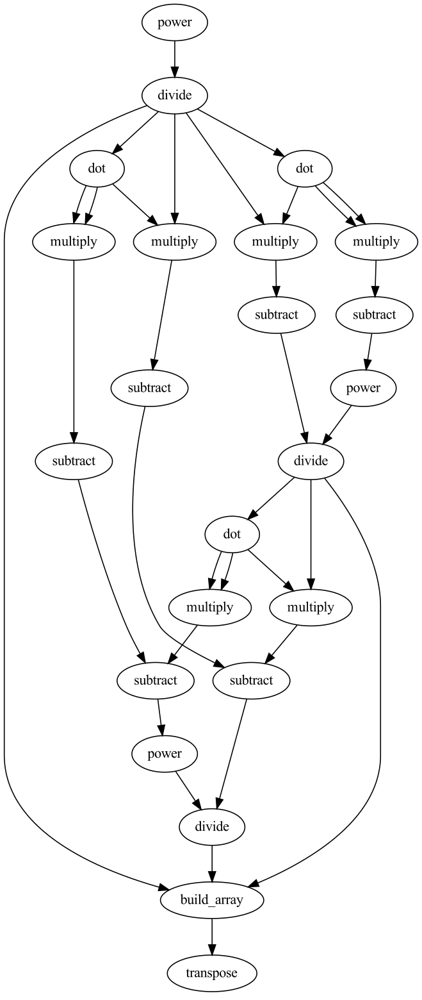

**图 9.8** 函数 schmidt_orth_lazy 通过惰性求值生成的任务树，391

某些 Python 编码实践，例如高效迭代、列表和字典推导式以及使用张量操作，可以提高效率。在考虑编译 Python 代码或用 C/C++ 重写之前，应先实施这些优化。优化的下一步是 Python 编译技术，它能减少动态解释 Python 字节码所带来的开销。可以使用 Numba、Cython 和 Pythran 等工具编译 Python 程序。为了达到最佳效率，这些编译技术也要求对代码做适当调整。在这一步，核心原则是消除 Python 风格的代码，并减少数据结构和数据类型的不确定性。此外，为了实现高效的数值计算，有必要微调循环结构、数组索引和数组视图，以便在 Python 编译时实现 SIMD 矢量化。Numba 的即时（Just in Time，JIT）编译通常能提高常规 Python 代码的效率，但在利用 SIMD 矢量化方面较为保守。Cython 和 Pythran 更擅长编译利用 SIMD 矢量化的数值计算代码。如果优化涉及对内存管理的精确控制、与编译器的交互以及针对特定硬件的优化，仍然需要直接为这些操作编写 C/C++ 代码。
识别热点和分析瓶颈是程序优化的主要挑战。本章介绍了几种用于识别程序热点的性能剖析器。常用的 Python 性能剖析器包括 cProfile 和 lineprofiler。它们可能略微降低 Python 程序的执行速度，并影响性能剖析的准确性。py-spy 性能剖析器基于事件采样剖析 Python 程序，因此可以将这些影响降至最低。对 Python 程序的 C/C++ 扩展进行性能剖析时，常用 py-spy 和 perf 性能剖析器。
根据其特征，程序瓶颈通常可分为计算受限、I/O 受限和内存受限。本章展示了如何通过性能剖析识别这些瓶颈。不同类型的瓶颈需要不同的优化策略。为了提高程序的 I/O 性能，优化策略包括重新设计存储布局、减少数据传输，以及使用异步计算使计算与 I/O 操作重叠。对于计算受限和内存受限的应用，优化应侧重于数据局部性、缓存利用率和缓存一致性。
预计算和惰性求值也是优化程序的有用方法。尽管它们无法加快单个 Python 语句的执行，但这些技术可以帮助程序消除不必要的计算，减轻计算负载。
没有任何技术能够凭空产生最佳性能。优化程序时，必须找出瓶颈的来源，并运用合适的技术解决具体的性能问题。优化 Python 程序通常需要掌握 C/C++ 编程知识并理解操作系统。强烈建议读者对 C/C++ 编程和操作系统原理有基本的了解。

## 参考文献

::: {.ref-list}

[1] M. Shannon, Implementation plan for speeding up CPython, [github.com](https://github.com/markshannon/faster-cpython/blob/master/plan.md), 2024.

[2] M. Ankerl, Comprehensive C++ hashmap benchmarks 2022, [ankerl.com](https://martin.ankerl.com/2022/08/27/hashmap-bench-01/), Aug. 2022.

[3] R.E. Bryant, D.R. O’Hallaron, Computer Systems: A Programmer’s Perspective, 2nd edition, Addison-Wesley Publishing Company, USA, 2010.

[4] U. Drepper, What every programmer should know about memory, [freebsd.org](https://people.freebsd.org/~lstewart/articles/cpumemory.pdf), Nov. 2007.

[5] Wikipedia Contributors, Instruction pipelining, [wikipedia.org](https://en.wikipedia.org/wiki/Instruction_pipelining), 2024.

[6] Intel Corporation, Intel 64 and IA-32 architectures software developer manuals, [intel.com](https://www.intel.com/content/www/us/en/developer/articles/technical/intel-sdm.html), 2024.

[7] A. Asadchev, E.F. Valeev, High-performance evaluation of high angular momentum 4-center Gaussian integrals on modern accelerated processors, The Journal of Physical Chemistry A 127 (51) (2023) 10889–10895, [DOI](https://doi.org/10.1021/acs.jpca.3c04574), pMID: 38090753.

[8] Wikipedia Contributors, Instruction-level parallelism, [wikipedia.org](https://en.wikipedia.org/wiki/Instruction-level_parallelism), 2024.

[9] T. Downs, Gathering Intel on Intel A VX-512 transitions, [github.io](https://travisdowns.github.io/blog/2020/01/17/avxfreq1.html), 2020.

[10] B. Fred, py-spy: sampling profiler for Python programs, [github.com](https://github.com/benfred/py-spy), 2024.

[11] B. Gregg, perf examples, [brendangregg.com](https://www.brendangregg.com/perf.html), 2024.

[12] B. Gregg, Flame graphs, [brendangregg.com](https://www.brendangregg.com/flamegraphs.html), 2024.

[13] S.K. Lam, A. Pitrou, S. Seibert, Numba: a LLVM-based Python JIT compiler, in: Proceedings of the Second Workshop on the LLVM Compiler Infrastructure in HPC, LLVM ’15, Association for Computing Machinery, New York, NY, USA, 2015, pp. 1–6, [DOI](https://doi.org/10.1145/2833157.2833162).

[14] J. Bradbury, R. Frostig, P. Hawkins, M.J. Johnson, C. Leary, D. Maclaurin, G. Necula, A. Paszke, J. VanderPlas, S. Wanderman-Milne, Q. Zhang, JAX: composable transformations of Python+NumPy programs, [github.com](http://github.com/google/jax), 2018.

[15] S. Behnel, R. Bradshaw, C. Citro, L. Dalcin, D.S. Seljebotn, K. Smith, Cython: the best of both worlds, Computing in Science & Engineering 13 (2) (2011) 31–39, [DOI](https://doi.org/10.1109/MCSE.2010.118).

[16] S. Guelton, P. Brunet, M. Amini, A. Merlini, X. Corbillon, A. Raynaud, Pythran: enabling static optimization of scientific Python programs, Computational Science and Discovery 8 (1) (2015) 014001, [DOI](https://doi.org/10.1088/1749-4680/8/1/014001).

[17] K. Hayen, Nuitka Contributors, Nuitka the Python compiler, [nuitka.net](https://nuitka.net/), 2024.

[18] M. Dufour, the Shed Skin contributors, Shed skin documentation, [readthedocs.io](https://shedskin.readthedocs.io/en/latest/documentation.html), 2024.

[19] A. Shajii, G. Ramirez, H. Smajlovi´c, J. Ray, B. Berger, S. Amarasinghe, I. Numanagi´c, Codon: a compiler for high-performance Pythonic applications and DSLs, in: Proceedings of the 32nd ACM SIGPLAN International Conference on Compiler Construction, CC 2023, Association for Computing Machinery, New York, NY, USA, 2023, pp. 191–202, [DOI](https://doi.org/10.1145/3578360.3580275).

[20] Numba Developers, Numba architecture, [readthedocs.io](https://numba.readthedocs.io/en/stable/developer/architecture.html), 2024.

[21] Continuum Analytics, llvmlite: a lightweight LLVM-Python binding for writing JIT compilers, [readthedocs.io](https://llvmlite.readthedocs.io/en/latest/index.html), 2024.

[22] Numba Developers, Numba performance tips, [pydata.org](https://numba.pydata.org/numba-doc/dev/user/performance-tips.html), 2024.

[23] Numba Developers, Numba developer manual - notes on inlining, [readthedocs.io](https://numba.readthedocs.io/en/stable/developer/inlining.html), 2024.

[24] Numba Developers, Extending numba - implementing @overload for numpy functions, [readthedocs.io](https://numba.readthedocs.io/en/stable/extending/overloading-guide.html#) implementing-overload-for-numpy-functions, 2024.

[25] Numba Developers, Numba user manual - compiling code ahead of time, [readthedocs.io](https://numba.readthedocs.io/en/stable/user/pycc.html), 2024.

[26] Numba Developers, Numba faq: why is my loop not vectorized?, [readthedocs.io](https://numba.readthedocs.io/en/latest/user/faq.html#why-has-my-loop-not-vectorized), 2024.

[27] S. Behnel, R. Bradshaw, D.S. Seljebotn, G. Ewing, W. Stein, G. Gellner, Cython documentation - typed memoryviews, [readthedocs.io](https://cython.readthedocs.io/en/latest/src/userguide/memoryviews.html?specifying-more-general-memory-layouts=), 2024.

[28] S. Behnel, R. Bradshaw, D.S. Seljebotn, G. Ewing, W. Stein, G. Gellner, et al., Cython documentation - compiler directives, [readthedocs.io](https://cython.readthedocs.io/en/latest/src/userguide/source_files_and_compilation.html#compiler-directives), 2024.

[29] S. Behnel, R. Bradshaw, D.S. Seljebotn, G. Ewing, W. Stein, G. Gellner, Cython documentation using multiple threads, [readthedocs.io](https://cython.readthedocs.io/en/latest/src/userguide/numpy_tutorial.html#using-multiple-threads), 2024.

[30] P. Brunet, S. Guelton, Pythran documentation - supported modules and functions, [readthedocs.io](https://pythran.readthedocs.io/en/latest/SUPPORT.html), 2024.

[31] S. Behnel, R. Bradshaw, D.S. Seljebotn, G. Ewing, W. Stein, G. Gellner, et al., Cython documentation - pythran as a numpy backend, [readthedocs.io](https://cython.readthedocs.io/en/latest/src/userguide/numpy_pythran.html), 2024.

[32] GNU Compiler Collection Team, Gcc documentation - declaring attributes of functions, [gnu.org](https://gcc.gnu.org/onlinedocs/gcc/Function-Attributes.html), 2024.

[33] Intel Corporation, Intel intrinsics guide, [intel.com](https://www.intel.com/content/www/us/en/docs/intrinsics-guide/index.html), 2024.

[34] S. Byrne, Beware of fast-math, [github.io](https://simonbyrne.github.io/notes/fastmath/), 2015.

[35] Numba Developers, Numba reference manual - compilation options, [pydata.org](https://numba.pydata.org/numba-doc/dev/reference/envvars.html#compilation-options), 2024.

[36] The HDF Group, HDF5 Filter Plugins, [hdfgroup.org](https://support.hdfgroup.org/documentation/hdf5/latest/_h5_p_l__u_g.html), 2024.

[37] European Synchrotron Radiation Facility, hdf5plugin, [silx.org](http://www.silx.org/doc/hdf5plugin/latest/index.html), 2024.

[38] PyTables maintainers, Pytables user’s guide - optimization tips, [pytables.org](https://www.pytables.org/usersguide/optimization.html), 2024.

[39] T. Kemper, cachetools, [github.com](https://github.com/tkem/cachetools), 2024.

[40] M. Kerrisk, limits.conf(5) — Linux manual page, [man7.org](https://www.man7.org/linux/manpages/man5/limits.conf.5.html), 2024.

[41] Python Software Foundation, The Python standard library - concurrent execution, [python.org](https://docs.python.org/3/library/concurrency.html), 2024.

[42] J. Denero, SICP in Python, [gitbooks.io](https://wizardforcel.gitbooks.io/sicp-in-python/content/), 2024.

:::

