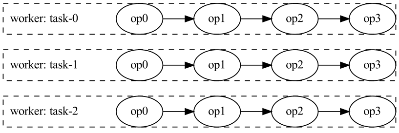
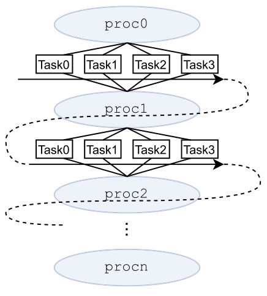
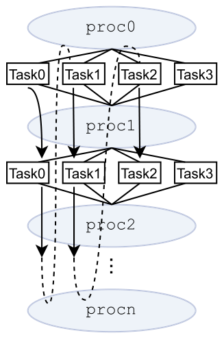
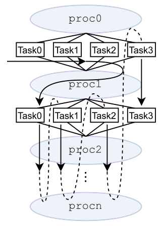
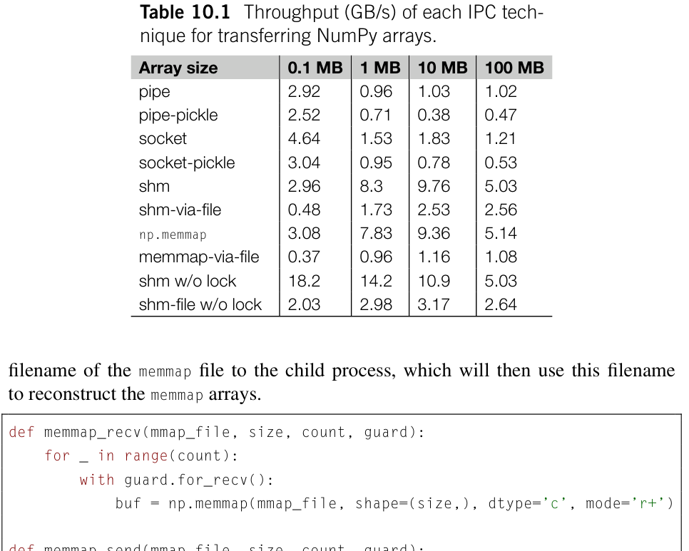
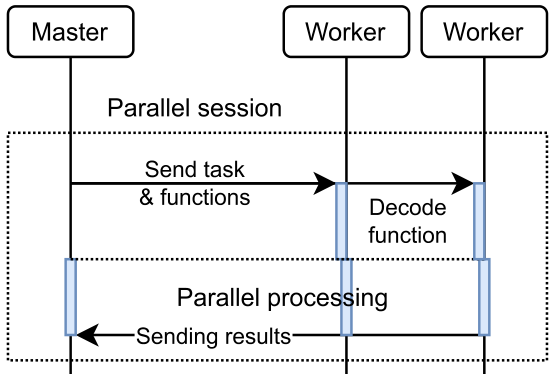

# 并行计算 {#ch10 .unnumbered}

为什么我们需要在 Python 程序中使用并行计算（parallel computation）？答案很简单：为了提高程序性能。尽管可以通过使用更快的硬件、经过优化的库或更高效的 Python 解释器来提升性能，并行执行仍然是一种有吸引力且有效的方法。
然而，并行编程（parallel programming）与串行编程（serial programming）有着根本区别。它带来了几个独特的挑战：

与串行程序不同，由于并行计算具有非确定性，并行程序可能产生更多错误或完全不同的结果。可复现性问题会给并行程序的调试造成很大困难。此外，并行程序中的竞态条件有时会导致错误的结果，而这些错误可能不容易察觉。
并行编程引入了新的计算模型和抽象，进而带来了竞态条件、死锁和通信问题等新的技术挑战。与串行程序相比，并行程序的代码要复杂得多，更难理解和维护。
并行程序的效率受到硬件架构、计算模型、软件和操作系统等多种因素的影响。在某些情况下，盲目增加并行资源实际上会降低并行程序的效率。开发高效并行程序时，硬件、操作系统以及底层组件并不是透明的。

有多种技术和工具可用于在 Python 程序中实现并行，包括：

- 级并行（SIMD 矢量化），用于细粒度并行处理。
提供自动线程并行化。
- threading 模块，用于管理并发线程。
- multiprocessing 模块，用于跨进程并行。
- 传递接口（MPI），用于跨处理器和计算机节点并行。
- 协程和异步模块，例如 asyncio，用于并发执行。
- 计算框架，例如 dask、Celery 和 Ray。
- 工具，例如 pyCUDA、cupy、pytorch 等。

SIMD 矢量化、GPU 加速和分布式计算分别在第 9 章、第 11 章和第 7 章中介绍。本章将讨论其余技术主题。本章将解答以下关键问题，这些问题对掌握任何并行计算技术都至关重要：

- 如何启动多个并发工作者或任务？
- 如何使工作者保持高占用率？
- 如何在工作者或任务之间交换信息？
- 如何管理计算任务的状态和结果？

## 10.1 多线程

线程级并行（threading level parallelism）使多个线程能够并发执行并访问同一内存空间。这使不同线程能够方便地通过共享内存空间交换信息。在 Python 中，可以使用 threading 模块和 concurrent.futures.ThreadPoolExecutor 类来实现线程级并行。

### 10.1.1 threading 模块

threading 模块的核心功能是 threading.Thread 类，它负责创建新线程。调用 Thread 实例的 .start() 方法即可启动该线程。为确保线程同步，可以使用 .join() 方法阻塞主线程，直到创建的子线程执行完毕。
下面以库仑矩阵（Coulomb matrix）计算的并行化为例。这是量子化学中常见的计算任务，我们将在第 13 章介绍更多相关理论背景。这个问题本质上是四指标张量 eri（电子排斥积分的缩写）与方阵 dm（表示密度矩阵）之间的张量收缩。使用 einsum 函数，即可把库仑矩阵的计算程序精简为以下 get_j 函数。

```python
def get_j(eri, dm):
    return np.einsum('ijkl,ji->kl', eri,d m )
```
在实际应用中，eri 张量通常过大，无法一次性计算并存储在内存中。它的元素往往是在需要时即时计算的。为了演示并行计算技术，我们将省略 eri 张量计算的细节，并使用占位函数 compute_eri 模拟 eri 张量子块的实时计算。以下是 get_j 函数的一种并行实现，它采用多线程来分配 eri 张量第三个指标的工作负载：

```python
def compute_eri(k, n):
    # Mimic the computation of ERIs
    np.random.seed(k)
    return np.random.rand(n,n,n)
output = np.zeros((n,n))
def get_j_task(k, dm):
    output[k] += np.einsum( 'jil,ij->l', compute_eri(k, n), dm)
threads = [threading.Thread(target=get_j_task, args=(k,d m ) )
           for k in range (n)]
for t in threads:
    t.start()
for t in threads:
    t.join()
```
threading 模块提供了多线程的基本组件。用户需要处理线程管理、数据交换和错误管理。下面讨论有关多线程并行的一些技术问题。

#### 如何管理线程之间的数据共享？

虽然在线程之间共享数据并不困难，但访问共享内容时主要有两个问题：

- 条件，即多个线程写入同一个内存地址。
- 问题，即一个线程在另一个线程完成对共享变量的写入之前，读取了该变量尚未写入完整的值。

为了解决这些问题，threading 模块提供了锁、信号量、事件和条件变量等工具。这些工具有助于控制程序流程，并保护多线程并行程序中的共享内容。我们将在第 10.2 节讨论这些工具。

#### 如何监控在子线程上运行的任务？

threading.Thread 类本身不足以监控子线程上执行的任务的状态。它没有提供管理子线程上运行的任务的输出或异常的机制。如果子线程上发生错误，主线程无法处理该错误。

#### 如何确保线程效率？

多种因素会影响多线程函数的效率：

- 解释器锁（GIL）。GIL 是多线程并行性能的主要限制。Python 解释器执行字节码时会获取 GIL。它只在特定情况下释放，例如执行

I/O 操作或调用外部 C 库时。因此，多线程无法促进字节码的并行处理，在某些情况下甚至可能降低性能。然而，从事数值计算的程序情况有所不同。尽管 GIL 可能影响字节码的执行，多线程通常仍能带来显著的加速。这是因为许多数值函数，尤其是 NumPy 等库和其他张量库中的函数，是用 C 和 C++ 等编译型语言实现的。这些函数可以在没有 Python 解释器参与的情况下运行，并且在执行期间会释放 GIL。

- 线程的数量。多线程的一个限制是上下文切换（context switching）的开销，它会减少可用于计算的有效 CPU 资源。当线程数量远远超过 CPU 核心数量时，上下文切换的成本可能使程序变慢。
- 一致性。缓存一致性（cache coherence）可能成为多线程程序的瓶颈。请看以下版本的 get_j_task 函数：

```python
output = np.zeros((n, n))
def get_j_task(l,d m, output):
    output[:, l] += np.einsum( 'jik,ij->k', eri[:,:,:,l], dm)
```
对此任务进行多线程并行化时，每个线程都需要更新全局变量 output 矩阵的一列。output 矩阵按行主序存储。访问列会破坏顺序内存操作。相邻的内存地址可能被不同的 CPU 核心访问，导致 CPU 缓存中的伪共享（false sharing）[1]。这种情况迫使硬件频繁锁定和同步缓存行，显著降低内存访问效率。有关这些技术问题的更多细节，读者可以参考 *What Every Programmer Should Know About Memory* 一书 [2]。
显然，threading.Thread 类有几个缺点。它缺少一种简洁的方式来监控任务的运行状态、错误和执行结果。此外，它无法管理和复用线程资源。在实践中，threading.Thread 类很少单独用于多线程并行化。它主要作为多线程并行化的基本组件。其他基于 threading 模块构建的多线程工具能够创建更加健壮的并行执行框架。concurrent.futures 模块提供的 ThreadPoolExecutor 就是一个例子。它对 threading.Thread 的功能作出了显著改进，并经常用于并行计算。

### 10.1.2 ThreadPoolExecutor

类提供了 .submit() 方法来分派任务，并返回一个表示尚未完成的结果的 Future 对象。要获取结果，我们可以使用 Future 对象的 .result() 方法。显式调用该
10.1 多线程（multithreading） 即使不需要任务的输出，我们也要对每个 Future 对象调用 .result() 方法，以确保任务执行。与错误总会显示出来的串行程序不同，ThreadPoolExecutor 不会自动抛出子线程中的错误。没有错误消息并不一定意味着子线程没有发生错误。
为了说明如何使用 ThreadPoolExecutor，我们再次以 get_j 函数为例。下面的示例代码对 eri 张量的第一个索引进行并行处理。然后，由 np.sum 函数汇总各个并行任务产生的部分收缩结果。

```python
def get_j_task(i, dm):
    n = dm.shape[0]
    return np.einsum('jkl,j->kl', compute_eri(i, n), dm[:,i])
with concurrent.futures.ThreadPoolExecutor(max_workers=8) as scheduler:
    fs = [scheduler.submit(get_j_task,i , dm) for i in range (n)]
    output = np. sum([f.result() for f in fs])
```
退出 ThreadPoolExecutor 的 with 上下文时，主线程将被阻塞，直到所有工作线程完成任务且调度器关闭。如果我们打算在主线程中异步执行某些代码，同时让 ThreadPoolExecutor 在后台执行一些操作，就必须把异步部分放在 with 上下文块内。这可以确保异步代码不会被 ThreadPoolExecutor.__exit__ 方法阻塞。
虽然 ThreadPoolExecutor 提供的功能比 Thread 类更多，但它是否解决了与 threading.Thread 有关的所有问题？与 threading.Thread 相比，使用 ThreadPoolExecutor 有哪些优势？

- ThreadPoolExecutor 并未解决线程的 GIL 限制。
- 线程资源管理。顾名思义，ThreadPoolExecutor 通过线程池（pool）管理线程。每个线程都是可以重复使用的工作线程，这减少了创建线程和上下文切换的开销。默认情况下，工作线程的最大数量限制为 32。
- 通过 Future 对象管理任务。使用 Future.result() 方法，我们可以获取任务的结果，并捕获执行过程中发生的任何错误或异常。此外，Future 对象允许我们跟踪任务的状态，状态可以是 PENDING、RUNNING、CANCELLED 或 FINISHED。

如有需要，我们可以调用 Future.cancel() 方法取消任务。

- 调度（scheduling）。ThreadPoolExecutor 提供了作为任务调度器的基本功能。它使用先进先出（first-in-first-out，FIFO）队列管理和执行任务，该队列以单生产者多消费者的执行模式运行。消费者或工作线程的数量由初始化执行器时的 max_workers 参数确定。任务完成后，消费者立即转向队列中的下一个任务，直到所有任务都完成。

动态负载均衡通过生产者-消费者模式（producer-consumer pattern）实现。这一
模式是并行计算中非常有用的模型。我们将在第 10.3 节
更详细地探讨这一模式。

- 接口。ThreadPoolExecutor 提供了更高层次的接口，简化了并行执行算法的设计。只需记住用于执行单个任务的 .submit() 方法和用于处理一批任务的 .map() 方法。这些概念也应用于其他并行任务执行模型。例如，切换到 concurrent.futures.ProcessPoolExecutor 时，可以遵循相同的接口约定。更高层次的接口有助于我们专注于计算算法本身，而不是线程创建和同步操作等烦琐的语法和技术细节。

虽然 ThreadPoolExecutor 具有许多出色的特性，但它可能带来额外内存开销的问题。这是因为并行任务的参数和结果存储在 Future 对象中，会造成额外的内存消耗。如果程序生成大量 Future 对象，这就会成为问题。如果 Future 对象不能被消费和释放，相应的临时对象就可能继续占用内存。例如，在前面的 get_j 程序中，我们为所有并行任务创建了一个 Future 对象列表。ThreadPoolExecutor 的工作线程不断将每个任务的输出，也就是一个大小为 n 的矩阵，写入 Future 对象。尽管最终结果的矩阵只包含 n，但存储中间结果的 Future 对象列表占用的空间为 n。这会造成不必要的内存占用，还可能影响程序性能。
使用 ThreadPoolExecutor.map 方法处理批量任务可以在一定程度上缓解内存占用问题。该方法返回一个 Future 对象生成器（generator）。与 Future 对象的列表容器不同，遍历生成器可以持续消费它产生的 Future 对象。已消费的 Future 对象所占内存可以立即释放。例如在 get_j 程序中，通过遍历 map 函数返回的生成器对象，就不必在内存中常驻 n 个矩阵。在处理 Future 对象的同时累加输出：

```python
output = np.zeros((n,n))
with concurrent.futures.ThreadPoolExecutor(max_workers=8) as scheduler:
    mapped = scheduler. map(get_j_task, range(n), itertools.repeat(dm,n ) )
    for v in mapped:
        output += v
```
尽管 ThreadPoolExecutor.map 方法返回的生成器有助于减少内存占用，但它并不能彻底解决 Future 对象造成的内存占用过高的问题。所有任务的 Future 对象都在 map 方法中初始化并提交。工作线程处理任务时，结果会不断写入相应的 Future 对象。如果这些 Future 对象没有被主线程及时消费，它们仍可能占用大量内存。
除了用相似的任务并行处理数据，ThreadPoolExecutor 也适合并发运行不同的任务。并发任务的一个常见场景是协调 CPU 密集型计算和 I/O 操作。在这种场景中，I/O 操作被交给 ThreadPoolExecutor 的工作线程，而主线程用于执行 CPU 计算。第 9 章第 9.6.3 节中的 iterate_with_prefetch 函数展示了这一功能。

## 10.2 与线程同步

在前面使用 ThreadPoolExecutor 的 get_j 示例中，我们创建了大量 Future 对象来存储中间矩阵。如果这些中间结果没有立即被消费，就可能导致大量内存消耗。为了避免存储中间矩阵，应在它们生成后立即消费。然而，当多个线程同时访问同一内存位置时，存在竞态条件（race condition）的风险。为了解决竞态条件，互斥锁（mutex，mutual exclusion lock）是保护共享变量最常用的选择，在本例中该变量是输出矩阵。

```python
mutex = threading.Lock()
output = np.zeros((n,n))
def get_j_task(i, dm):
    j_priv = np.einsum( 'jkl,j->kl', eri[i], dm[:,i])
    with mutex:
        output += j_priv
with concurrent.futures.ThreadPoolExecutor(max_workers=8) as scheduler:
    mapped = scheduler. map(get_j_task, range(n), itertools.repeat(dm,n ) )
```
我们将对输出矩阵的原位更新放在 with mutex 上下文中。互斥锁的 with 语句在进入临界区（critical section）前自动触发 lock.acquire() 操作，并在完成后触发 lock.release() 操作。互斥锁保证在任何特定时刻，只有一个线程修改共享的输出矩阵。

### 10.2.1 互斥锁

互斥锁是保护共享变量免受竞态条件影响的有效方案。互斥锁可以处于以下两种状态之一：

表示有一个线程正在访问临界区。当线程调用 lock.acquire() 时，锁被设为已持有。此操作会阻塞其他任何试图获取该锁的线程。
- 持有，表示临界区目前未被占用。当线程调用 lock.release() 时，锁被设为未持有。此操作允许其中一个等待的线程获取锁并进入临界区。

当多个线程试图进入临界区时，每个线程都会调用 lock.acquire() 请求控制互斥锁。在任何给定时刻，只有一个线程能够持有互斥锁并执行临界区内的代码。
对共享变量的所有操作都需要用互斥锁防范竞态条件吗？答案是否定的。并非对共享变量的所有操作都容易受到竞态条件的影响。例如，原子操作（atomic operation）可以在单个步骤中完成，不可能被中断，因此不需要互斥锁。在 Python 文档 [3] 中，列出了 Python 中的一些原子操作，它们大多针对内置数据类型（例如整数、列表和字典）。然而，有些看似原子的操作（例如 i = i + 1）实际并非如此。如有疑问，使用互斥锁始终是更稳妥的做法。
在 C/C++ 程序中，操作互斥锁通常被认为是一种开销较大的操作，因为获取或释放锁时涉及系统调用，并且可能需要进行线程上下文切换。正如我们在第 9 章中讨论的，上下文切换是操作系统的一项基本功能，其开销很高。这种开销有时可能高于 Python 解释器执行数百条字节码指令的代价。这引出了一个问题：在 Python 中，是否有必要尽量减少互斥锁的使用，以降低系统调用的开销？
简短的回答是并不需要。Python 本身的 GIL 机制会阻止频繁的线程上下文切换。GIL 会定期释放以允许线程切换，通常每 5 毫秒释放一次。即使频繁获取或释放互斥锁，通常也是由同一个线程执行。这一操作只涉及少量 CPU 指令，在大多数情况下不会触发系统调用。其代价通常与执行一条或几条普通 Python 字节码指令相当。因此，在 Python 中使用互斥锁对整体性能的影响很小。这是 Python 和 C/C++ 程序使用互斥锁时的一个显著区别。

### 10.2.2 事件与条件变量

除了互斥锁，Python 的 threading 模块还提供了各种协调和同步线程的机制。这些机制扩展了互斥锁的基本功能，使线程之间可以采用更复杂的同步模式。

- `Semaphore`：信号量（semaphore）限制对共享资源的并发访问数量。它允许一定数量的线程同时持有信号量，并阻塞任何额外的线程，直到有信号量被释放。
- `Barrier`：屏障（barrier）阻塞一组线程，直到它们全部到达屏障点。
- `Event`：事件（event）是一种同步原语（synchronization primitive），它允许一个线程通知其他线程某个特定条件已满足。
- `Condition variable`变量：条件变量（condition variable）允许线程等待条件满足后再继续执行。

事件和条件变量是特别有用的技术。下面探讨一些应用事件和条件变量的典型场景。
写后读同步（read-after-write synchronization）是多线程程序中的常见场景，其中一个线程需要访问由其他线程产生的某些共享资源。在这种情况下，我们需要阻塞读取线程，直到它收到写入线程发来的信号，表明所需条件已满足。事件和条件变量可以使线程等待某个条件得到满足，也可以向其他等待中的线程发出条件已满足的信号。
使用事件和条件变量的另一个场景涉及数据处理线程和数据预取线程之间的协调。在这个场景中，计算线程需要等待 I/O 线程将数据完整读入缓冲区，然后才能对数据进行操作。下面的代码片段是这一并行计算场景的一个原型。

```python
ready_for_read = threading.Event()
ready_for_read.clear() # mark the initial state: unsafe for reading
ready_for_write = threading.Event()
ready_for_write.set() # mark the initial state: safe to write
def computation_task(buffer):
    while True:
        ready_for_read.wait()
        # code to manipulate data in buffer
        ...
ready_for_read.clear()
        # notify the I/O thread that data in buffer are consumed,
        # the buffer can be reused
ready_for_write.set()
        # Other code which do not need to access buffer
        ...
def prefetch(buffer):
    while True:
        ready_for_write.wait()
        # code to read data
        ...
        ready_for_write.clear()
        ready_for_read.set()
```
为了管理这种同步，我们可以使用事件 ready_for_read 来表示数据是否已完整加载到缓冲区。可以使用 ready_for_read.is_set() 函数检查事件的状态，使用 ready_for_read.clear() 函数清除该状态。如果事件被清除，调用 buf_ready.wait() 会阻塞调用线程，阻止它继续执行，直到 I/O 线程调用 ready_for_read.set() 重新设置事件。此外，I/O 线程需要等待缓冲区被释放以供复用。为此，我们使用另一个事件 ready_for_write，表示数据已被计算线程处理完毕，缓冲区可以写入。
这一场景也可以使用条件变量处理。条件变量提供三种操作来管理和更新其状态：

- .wait() 方法表示线程应当「等待条件满足」。
- .notify() 方法在条件满足时唤醒一个被阻塞的线程。
- .notifyall() 方法在条件满足时唤醒与该条件变量关联的所有被阻塞线程。

与 Event 对象类似，我们需要条件变量 ready_for_read 和 ready_for_write 来表示缓冲区的状态。除了这两个条件变量，还需要引入标志 buf_empty，明确表示缓冲区是否为空。程序原型如下所示。

```python
mutex = threading.Lock()
ready_for_read = threading.Condition(mutex)
ready_for_write = threading.Condition(mutex)
buf_empty = True
def computation_task(buffer):
    global buf_empty
    while True:
        with mutex:
            if buf_empty:
                ready_for_read.wait()
            # code to manipulate data in buffer
            ...
            buf_empty = True
            ready_for_write.notify()
        # Other code which do not need to access buffer
        ...
def prefetch(buffer):
    global buf_empty
    while True:
        with mutex:
            if not buf_empty:
                ready_for_write.wait()
            # code to read data into the buffer
            ...
            buf_empty = False
            ready_for_read.notify()
```
为什么需要用 buf_empty 标志来明确控制是否调用 ready_for_write.wait()？如果没有这个标志，程序会遇到什么问题？我们将这些问题留给读者探索。
在 Python 的实现中，条件变量与一个互斥锁（mutex lock）绑定。线程在操作条件变量之前，必须获取关联的互斥锁。这可以显式完成，也可以使用条件变量的上下文管理器完成。当线程执行 ready_for_read.wait() 语句时，关联的互斥锁会被释放，尽管该线程仍处于阻塞状态（被条件变量内部的另一把锁阻塞）。这种设置允许其他线程进入临界区（critical section）并修改共享资源。一旦条件满足，等待中的线程会重新获取互斥锁，然后继续执行后续代码。
在上面的例子中，事件和条件变量似乎具有类似的功能，可以互换使用。这可能引出一个问题：什么时候应该使用条件变量，什么时候应该使用事件？
如果并发程序涉及单个生产者和单个消费者，例如上例中的 I/O 线程和计算线程，我们只需确保生产者或消费者线程等待对方的信号。在这种场景下，事件和条件变量都足以提供所需功能。你可以使用自己最熟悉的技术。
然而，当线程之间的依赖关系变得更加复杂时，例如在有多个消费者或多个生产者的程序中，条件变量通常是更好的选择，因为它能更精确地控制线程。例如，Python 标准库 queue 中的 Queue 类支持多个生产者和多个消费者。Queue 类的核心功能使用了条件变量，如下所示。

```python
from collections import deque
class Queue:
    def __init__(self, max_size):
        self._queue = deque([])
        self.max_size = max_size
        self.mutex = threading.Lock()
        self.not_full = threading.Condition(self.mutex)
        self.not_empty = threading.Condition(self.mutex)
```

```python
    def put(self, item):
        with self.mutex:
            while len (self._queue) >= self.max_size:
                self.not_full.wait()
            self._queue.append(item)
            self.not_empty.notify()
    def get(self):
        with self.mutex:
            while len (self._queue) == 0:
                self.not_empty.wait()
            item = self._queue.popleft()
            self.not_full.notify()
            return item
```
Queue 实例将任务存储在 _queue 属性中。生产者可以通过 put 方法添加任务，而消费者使用 get 方法获取任务进行处理。条件变量 not_empty 和 not_full 可以阻塞生产者和消费者的线程，以控制 _queue 的大小。

## 10.3 模型

虽然在并行程序中引入互斥锁可以解决竞态条件（race condition），但它不可避免地会使程序更加复杂，并增加死锁（deadlock）的风险。死锁是指两个或更多任务各自等待对方释放资源的情况。如何在不引入互斥锁的情况下规避竞态条件问题？生产者—消费者模型（producer-consumer model）与队列配合使用，为这个问题提供了一种巧妙的解决方案。
以第 10.2 节中的 get_j 函数为例。在这种情况下，我们可以采用生产者—消费者模型。某些函数可以充当生产者，只负责生成中间结果并将其推入队列。一个专用函数充当消费者，只与队列交互以处理中间结果。队列是一个重要的中间缓冲区，它将生产者和消费者解耦，并将生产者彼此隔离。这种设置使生产者能够以全速运行，而不被互斥锁阻塞。在这个例子中，共享资源即输出矩阵，仅由一个消费者访问。这种方法有效消除了竞态条件和对互斥锁的需求。利用上一节实现的 Queue 类，即可基于生产者—消费者模型构建 get_j 程序。

```python
from concurrent.futures import ThreadPoolExecutor
import numpy as np
def compute_eri(i, n):
    # Mimic the function to compute ERIs
    np.random.seed(i)
    return np.random.rand(n,n,n)
def get_j_task(i,d m, q):
    '''The producer'''
    n = dm.shape[0]
    jmat = np.einsum( 'jkl,j->kl', compute_eri(i,n), dm[:,i])
    q.put(jmat)
def reduce (n, q):
    '''The consumer'''
    output = np.zeros((n,n))
    for i in range (n):
        output += q.get()
    return output
n = 200
dm = np.identity(n)
q = Queue(max_size=8)
with ThreadPoolExecutor(max_workers=16) as scheduler:
    fut = scheduler.submit(consumer,n ,q )
    for _ in scheduler.map(get_j_task, range(n), [dm] *n, [q] *n):
        pass
print(fut.result().sum())
```
需要注意的是，本例中的队列限制了并行化程度。最大并行度为 8，由队列对象 q 的容量决定，并受 q.get() 和 q.put() 方法的约束。ThreadPoolExecutor 只负责启动消费者和生产者。即使在 ThreadPoolExecutor 中分配了 16 个工作线程，在 q 中出现空闲位置之前，也无法执行更多的 get_j_task 任务。消费者 reduce 可以在数据可用时立即处理，而不必等所有数据都生成后才开始处理。每次消费 q 中的一个条目，q.put() 方法就会向队列中插入一个新条目。随后 get_j_task 完成，释放该工作线程以执行下一个任务。
基于生产者—消费者模型，可以开发更高级的并行化框架。流水线执行器（pipeline executor）就是一个例子，它能够并发执行一系列相互依赖的任务。

## 10.4 执行器

假设一个程序由一系列相互独立的操作 op0、op1、……、op_last 处理。通过适当地连接这些函数，可以构成一个类似 Unix 管道的流式处理系统。当一批任务流经该系统时（图 10.1），系统执行一系列中间操作并生成一个结果列表。这个过程本质上与下面的表达式相同：

```text
[op_last(... op2(op1(op0(task)))...) for task in tasks]
```
为了并行执行这些任务，可以使用 ThreadPoolExecutor。然而，如果中间操作很多而任务数量有限，简单地用 ThreadPoolExecutor 按任务并行执行可能无法充分利用并行能力。



**图 10.1** 使用多个中间函数执行的并发任务

不妨设计一个流水线执行器（pipeline executor），以并行方式流式处理操作与任务。流水线是一条由生产者和消费者组成的链。流水线中的每个操作都可以充当消费者，从任务队列中获取任务并执行。这些操作也可以充当生产者，将其输出传入任务队列，供后续消费者处理。基本上，pipeline 函数提供以下功能：

```python
from concurrent.futures import ThreadPoolExecutor
def pipeline(ops, tasks):
    with ThreadPoolExecutor() as q:
        def proc0():
            return [queue.submit(ops[0], task) for task in tasks]
        def proc1():
            return [queue.submit(ops[1], task.result()) for task in proc0()
    ]
        def proc2():
            return [queue.submit(ops[2], task.result()) for task in proc1()
    ]
        ...
        return [future.result() for future in proc_last()]
```
然而，这个基础版本可能无法高效地并行执行流式任务。资源利用率可能较低，序列中的任务（例如 op0 -> op1 -> op2...）也可能无法连续执行。相反，proc? 函数经常处于等待状态，等待前面的 proc 函数完成，导致执行延迟。
让我们检查这个 pipeline 函数中的过程，找出并行执行受阻的原因。proc0 函数遍历列表并提交所有任务。此步骤不会发生阻塞。它创建一个 Future 对象列表，然后将其传给 proc1 函数。在 proc1 中，调用 task.result() 方法获取操作 ops[0] 的实际结果。如果任何 Future 对象尚未完成，它就会阻塞列表推导式，从而使 proc1 函数的 return 语句停滞。proc2 函数依赖 proc1 的输出，在 proc1 完成列表推导式之前，它无法开始为操作 ops[2] 调度任何任务。换言之，只有在 ops[0] 的所有任务（由 proc0 创建）完成后，proc2 函数才会开始提交任务。即使 ops[2] 的某些任务的上游依赖已经满足，由于 proc1 中的阻塞，这些任务也无法提交。同样，由于相同的阻塞问题，ops 列表中的后续操作也无法及时执行。
在流水线执行器中，应避免直接调用 task.result()，因为它可能阻塞流水线。我们可以改为引入一个闭包（closure）来包装 task.result() 方法，将阻塞操作推迟到运行时引用其值时才执行。这种方法与惰性求值（lazy evaluation）技术有些相似。

```python
from concurrent.futures import ThreadPoolExecutor, Future
def _ensure(task):
    if isinstance (task, Future):
        return task.result()
    else:
        return task
def scheduler(queue,f n, tasks):
    def fn_with_future(task):
        return fn(_ensure(task))
    return [queue.submit(fn_with_future, task) for task in tasks]
def pipeline(ops, tasks):
    with ThreadPoolExecutor() as queue:
        def proc0():
            return scheduler(queue, ops[0], tasks)
        def proc1():
            return scheduler(queue, ops[1], proc0())
        def proc2():
            return scheduler(queue, ops[2], proc1())
        ...
        return [future.result() for future in proc_last()]
```
经过这一改进，流式处理可以迅速提交所有任务，并按如下方式填充任务队列：

```text
ops[0](tasks[0]), ops[0](tasks[1]), ops[0](tasks[2]), ..., ops[1](ops[0](tasks[0])), ops[1](ops[0](tasks[1])), ...
```
如果并行能力有限，例如只允许同时执行 4 个任务，那么即使所有上游依赖都已满足，较晚入队的任务仍会因资源限制而处于等待状态。因此，下游任务无法及时执行，导致上游任务产生的结果不能及时被消费。上游结果不得不在内存中保存较长时间，导致内存使用效率低下，内存管理效率降低。
为解决这个问题，我们可以为流式执行实现多个队列。通过将不同的消费者分配给不同的队列，可以利用每个队列独立的任务调度。一旦任务的上游依赖得到解决，与消费者关联的队列就可以立即调度该任务执行。下面这个版本的 pipeline 函数展示了这一思路。

```python
def pipeline(ops, tasks):
    with ThreadPoolExecutor() as queue1:
        def proc0():
            return scheduler(queue1, ops[0], tasks)
        with ThreadPoolExecutor() as queue2:
            def proc1():
                return scheduler(queue2, ops[1], proc0())
            with ThreadPoolExecutor() as queue3:
                def proc2():
                    return scheduler(queue3, ops[2], proc1())
                with ThreadPoolExecutor() as ...:
                    ...
                    return [future.result() for future in proc_last()]
```
请注意，这个示例中的 with 语句是嵌套的。这是使用 ThreadPoolExecutor 的直接结果。当退出 with 上下文的作用域时，ThreadPoolExecutor 会对所有已提交的任务强制执行同步操作（相当于调用 .result() 方法）。如果不嵌套 with 上下文，应用于 proc0 函数的同步操作就会阻塞 proc1 及所有后续函数的执行。



**图 10.2** 使用广度优先搜索遍历任务

前面展示的调度器优先提交所有可用任务，然后才继续处理 ops 列表中的下一个操作。如果将 ops 中的每个操作视为树中的一个节点，前面的调度器便以类似广度优先搜索（breadth-first search）的方式遍历这棵树（图 10.2）。因此，我们称其为 bf_scheduler。另一种方式是修改任务调度器的遍历方法，使其类似深度优先搜索（depth-first search，DFS）模式（图 10.3）。这里可以创建一个 df_scheduler，利用生成器的惰性求值特性来改变任务提交顺序。

```python
def df_scheduler(queue,f n, tasks, args):
    def fn_with_future(task):
        return fn(_ensure(task), *args)
    for task in tasks:
        yield queue.submit(fn_with_future, task)
```
当 df_scheduler 应用于 pipeline 函数时，下游任务会递归地引用每个 proc 函数创建的生成器中的元素，



**图 10.3** 使用深度优先搜索遍历任务

直到到达 proc0 函数中定义的根任务。生成器的每个元素仅在被引用时创建，其余元素不会提前创建。因此，对于 pipeline 函数的输入变量 tasks 中的每个元素，ops 列表中指定的操作都会沿依赖链依次提交到任务队列。
例如，假设 pipeline 函数只由三个函数组成：proc0、proc1 和 proc2，每个函数都使用 df_scheduler 提交任务。

```python
def pipeline(ops, tasks):
    with ThreadPoolExecutor() as queue1:
        def proc0():
            return df_scheduler(queue1, ops[0], tasks)
        with ThreadPoolExecutor() as queue2:
            def proc1():
                return df_scheduler(queue2, ops[1], proc0())
            with ThreadPoolExecutor() as queue3:
                def proc2():
                    return df_scheduler(queue3, ops[2], proc1())
                return [future.result() for future in proc2()]
```
在 proc2 中，从 tasks 生成器访问一个元素会触发 proc1 中的 yield 语句。这一操作又会从 proc0 创建的 tasks 生成器中取出一个元素。访问 proc0 的生成器时，任务提交命令
10.4 流水线执行器 queue.submit(fn_with_future, task) 被执行。这个命令向任务队列追加一个作业，并通过生成器将一个 Future 对象传给 proc1。随后，proc1 接收该 Future 对象并用它提交一个任务。由此产生的 Future 对象随后被传给 proc2。处理接收到的 Future 对象后，proc2 继续处理 tasks 生成器中的下一个元素，再次触发上述循环。proc0、proc1 和 proc2 将生成新任务并依次将它们加入任务队列。最终，任务队列可能填充如下：

```text
ops[0](tasks[0]), ops[1](Future(ops[0])), ops[2](Future(ops[1])), ops[0](tasks[1]), ops[1](Future(ops[0])), ops[2](Future(ops[1])), ...
```
df_scheduler 可以主动消化上游任务的结果，解决 bf_scheduler 可能出现的内存使用过多问题。然而，df_scheduler 可能导致某些正在运行的任务在等待上游任务完成时陷入非活动状态。这些任务占用工作线程，却无法充分利用计算资源，造成计算能力的浪费。



**图 10.4** 使用广度优先与深度优先混合搜索遍历任务

为了平衡并行效率和内存利用率，我们可以设计实现不同策略的新调度器。例如，下面介绍的 df_warmup_scheduler 采用混合方法（图 10.4）。

```python
def df_warmup_scheduler(queue,f n, tasks, args, max_workers=8):
    '''Launches several tasks at beginning then fills task queue like
    df_scheduler'''
    def fn_with_future(task):
        return fn(_ensure(task), *args)
    future_buf = deque()
```

```text
    for task in tasks:
        future_buf.append(queue.submit(fn_with_future, task))
        if len (future_buf) > max_workers:
            yield future_buf.popleft()
    while future_buf:
        yield future_buf.popleft()
```
它最初像 bf_scheduler 一样提交一部分任务，然后对剩余任务切换到 df_scheduler 模式。这个调度器旨在一开始就用非阻塞任务迅速占用线程执行器中可用的工作线程。随着初始任务完成，它随后以深度优先调度器的方式逐步重新填充队列。其基本假设是，通过立即处理初始任务，后续任务所需的上游依赖很可能在它们被调度时已经得到满足。这种方法旨在尽量降低任务陷入非活动状态的可能性。得到的任务队列可能包含如下任务：

```text
ops[0](tasks[0]), ops[0](tasks[1]), ..., ops[0](tasks[7]), ops[1](Future(ops[0])), ops[2](Future(ops[1])), ops[0](tasks[8]), ops[1](Future(ops[0])), ...
```
基于 df_warmup_scheduler，我们可以进一步开发一个 dynamic_scheduler，只启动那些可以立即执行的任务。后续任务会被推迟，只有在上游任务完成后才提交。任务队列不会完全被初始任务填满。为了便于在上游任务完成时启动任务，引入了 LaunchInFuture 类。这个类提供一个 submit 方法，使一个任务（以 Future 对象表示）能够在另一个任务完成时作为回调执行。

```python
class LaunchInFuture(Future):
    def __init__(self, queue, fn):
        self.queue = queue
        self.fn = fn
        super().__init__()
def submit(self, task): # (1)
future = self.queue.submit(self.fn, task) # (2)
future.add_done_callback(self.pass_result) # (3)
def pass_result(self, value: Future): # (4)
        self.set_result(value.result())
def dynamic_scheduler(queue,f n, tasks, args, max_workers=8):
    '''Dynamic scheduler submits tasks only if they are ready to proceed'''
    def fn_with_future(task):
        return fn(_ensure(task), *args)
```

```text
    future_buf = deque()
    for task in tasks:
# Block the submission to prevent the task queue being filled with too many operations of the same type
        if len (future_buf) >= max_workers:
            future_buf.popleft().result()
        if not isinstance (task, Future):
            future = queue.submit(fn_with_future, task)
        else:
future = LaunchInFuture(queue, fn_with_future) # (5)
task.add_done_callback(future.submit) # (6)
        future_buf.append(future)
        yield future
```
在第 (6) 行，add_done_callback 向当前任务追加一个后续操作。第 (1) 行定义的后续操作 future.submit 将在当前任务完成后提交。第 (1) 行中的参数 task 指的是第 (6) 行中提到的任务对象。为了获取第 (2) 行启动的任务的结果，在第 (3) 行注册了另一个回调，它将结果传回第 (5) 行创建的实例 future。在第 (4) 行的回调函数 pass_result 中，参数 value 实际上是第 (2) 行创建的实例 future。
最后，为了提高 pipeline 函数的可读性和易用性，我们改进该函数并将其转换为递归形式。重构后的 pipeline 函数现在支持使用各种任务调度器的一般流式处理计算。

```python
def pipeline(ops, tasks, scheduler=dynamic_scheduler):
    '''
    Streams operations and tasks
    '''
    queue,f n, args = ops[0]
    if queue is None:
        with ThreadPoolExecutor() as queue:
            return pipeline([(queue,f n, args), *ops[1:]], tasks, schduler)
    if len (ops) == 1:
        # Call list() to traverse through the entire schduler generator
    which
        # will launch all tasks and their upstream tasks.
        return [_ensure(f) for f in list (scheduler(queue,f n, tasks, args))
    ]
    return pipeline(ops[1:], scheduler(queue,f n, tasks, args), scheduler)
```
在第 14 章，我们将以完全组态相互作用（Full Configuration Interaction，FCI）程序为例，演示如何使用流水线执行器并行处理复杂的计算任务。

## 10.5 程序

在同步程序中，任务一个接一个地执行。程序流程必须等待一个操作完成，才能继续下一个操作。通过使用 Future 对象引用任务的结果，程序可以异步执行操作，正如前几节中 ThreadPoolExecutor 的示例所示。严格来说，这是一种非阻塞执行技术，与异步编程不同。然而，由于这两个概念通常密切相关，本书不对它们加以区分。Jan Palach 所著的 Parallel Programming with Python 一书更详细地讨论了这些概念。

### 10.5.1 异步编程与惰性求值之间

异步计算方法与我们在第 9 章讨论的惰性求值方法密切相关。在惰性求值中，我们显式调用 defer 函数创建一个 Promise 对象，它代表尚未求值的结果。Promise 对象与 Future 对象的作用相似。通过将 defer 函数转换为装饰器，如下所示，我们可以统一惰性求值与异步计算代码的结构。

```python
from pychem_book.chap09.lazy_eval import Promise
executor = concurrent.futures.ThreadPoolExecutor()
lazy_mode = True
def defer(f):
    @functools.wraps(f)
    def deferred_f(args):
        if lazy_mode:
            return Promise(f, args)
        else:
            return executor.submit(f, args)
    return deferred_f
```
值得一提的是，上面的示例使用 ThreadPoolExecutor 来说明这一功能。也可以使用其他执行器，例如 dask.distributed 函数，来实现异步计算。
我们可以对 get_j 函数使用 defer 装饰器。程序可以根据全局标志 lazy_mode 的配置，在惰性求值模式和异步模式之间无缝切换。

```python
@defer
def compute_eri(i, n):
    ...
    return eri
@defer
def get_j_task(i, dm):
    n = dm.shape[0]
    eri = compute_eri(i, n).result()
    return np.einsum('jkl,j->kl', eri, dm[:,i])
@defer
def get_j(dm):
    n = dm.shape[0]
    output = np.zeros((n,n))
    for i in range (n):
        output += get_j_task(i, dm).result()
    return output
get_j(dm).result()
```

### 10.5.2 使用协程和 asyncio 的程序

Python 中的异步编程通常与使用协程（coroutine）和 asyncio 模块的并发编码相关 [4]。这种方法使用 async 和 await 关键字，以及用于管理任务执行的事件循环（event loop）。
协程是在函数定义中使用 async 关键字定义的函数。协程使用 await 关键字暂停执行，并将计算资源让给其他协程。之后，事件循环可以恢复暂停的协程并继续执行。使用协程进行异步编程是一种执行多个并发任务的优雅而有效的解决方案。它有几个优点：

- 任务切换的开销。为了实现并发，协程将执行权让给其他协程，而不是通过代价高昂的线程上下文切换来暂停和恢复。
- 异步代码的结构与传统同步代码仍然非常相似。
- 竞态条件。协程由运行在单个线程中的事件循环调度。任何时刻都只有一个协程访问资源。

协程技术的一个主要局限是缺乏对多 CPU 核心并行计算的支持。这一局限使协程不适合加速计算密集型量子化学应用。因此，我们不打算深入讨论这项技术。我们将简要展示 get_j 函数的协程版本，作为对线程级异步编程讨论的补充。如果你对这项技术感兴趣，可以在 Python Parallel Programming Cookbook 和 Fluent python 两本书中找到更多解释和示例。
从上一节讨论的由 defer 装饰的 get_j 程序出发，我们只需用 async 关键字替换 defer 装饰器，并将 .result() 调用替换为带 await 的语句。这样修改后得到的 get_j 协程版本如下：

```python
async def compute_eri(i,n ) :
    ...
    return eri
async def get_j_task(i, dm):
    n = dm.shape[0]
    eri = await compute_eri(i,n )
    await asyncio.sleep(0.5)
    return np.einsum('jkl,j->kl', eri, dm[:,i])
async def get_j(dm):
    n = dm.shape[0]
    output = np.zeros((n,n))
    fs = [asyncio.ensure_future(get_j_task(i, dm)) for i in range (n)]
    for fut in fs:
        output += await fut
    return output
n = 200
dm = np.identity(n)
co = get_j(dm)
output = asyncio.get_event_loop().run_until_complete(co)
print(output.sum())
```
在 get_j_task 函数中，语句 asyncio.sleep(0.5) 暂时暂停各个任务的执行。尽管有这一有意设置的延迟，程序没有明显变慢，这证明代码是并发执行的。运行这个异步程序时，你可能会注意到只有一个 CPU 核心在工作。其执行时间与不含任何暂停、在单个线程中运行的同步程序相当。

## 10.6 多进程

多进程并行化是 Python 中一种常用的并行计算策略，因为它克服了线程并行化中全局解释器锁（GIL）的限制。可以使用 Python 标准库实现多进程并行化。
multiprocessing 模块的作用与 threading 模块相似。它提供基于进程的并行化所需的基本工具。例如，multiprocessing 模块提供 Process 类来创建子进程。multiprocessing.Process 的用法与 threading.Thread 类类似。可以使用 start 方法启动子进程，并使用 join 方法同步子进程。
multiprocessing 模块也会遇到与 threading 模块类似的任务管理问题。例如，如果子进程中发生错误，父进程无法处理该错误。为了增强多进程并行化的能力，concurrent.futures 模块还引入了 ProcessPoolExecutor 来管理进程资源和任务。ProcessPoolExecutor 和 ThreadPoolExecutor 提供类似的 API，便于将使用 ThreadPoolExecutor 的代码改为使用 ProcessPoolExecutor。
鉴于 multiprocessing 和 threading 模块及其各自的池执行器之间的相似性，我们将省略这些多进程并行化工具的基本用法。Python 官方文档提供了有关多进程编程的全面指南 [5]。本节将重点讨论多进程环境中的数据通信。
多进程并行计算的效率受到各库所采用的进程间通信（Inter-Process Communication，IPC）方法的显著影响。在 multiprocessing 模块中，默认方法是用于单向通信的匿名管道和用于双向通信的套接字。在这两种方法中，数据传输过程均使用 pickle 进行序列化与反序列化。需要注意的是，并非所有 Python 数据类型都能在进程之间传输。我们必须确保打算传输的数据与 pickle 序列化兼容，如第 6 章所讨论的。除了管道和套接字，共享内存和内存映射文件也常用于数据传输。然而，这两种技术支持的数据类型较少。

### 10.6.1 multiprocessing.Process 中的通信

首先来看父进程与子进程之间的函数参数传递。当使用 multiprocessing.Process 类创建子进程时，无需通过 IPC 将函数参数从父进程传递给子进程。
操作系统采用写时复制（copy-on-write，COW）技术，使数据能够从父进程传递给子进程。这项技术允许父进程和子进程以只读模式共享内存空间。如果某个进程需要修改共享空间，就会在其私有内存空间中创建相关
内存页的私有副本。因此，子进程创建后，可以无额外开销地访问父进程拥有的所有数据，包括函数参数。
COW 有效解决了向子进程传递函数参数的问题。就函数参数的数据传输而言，multiprocessing.Process 方法与多线程并行一样高效。此外，COW 允许向子进程传递任何参数，包括无法用 pickle 序列化的对象。例如，向子进程传递迭代器也是完全可行的。然而，每个子进程都使用自己的迭代器，彼此不会干扰。这与多线程的情况不同，在多线程中，迭代器的状态由不同线程共享。

```python
In [1]: import time
        from multiprocessing import Process
        from threading import Thread
        def f(thread_id, tasks):
            for task in tasks:
                print(thread_id, task)
                time.sleep(.1)
In [2]: iters = enumerate(range(5))
        ps = [Thread(target=f, args=(i, iters)) for i in range (3)]
        [p.start() for p in ps]
        [p.join() for p in ps]
Out[2]:
0( 0,0 )
1( 1,1 )
2( 2,2 )
0( 3,3 )
1( 4,4 )
In [3]: iters = enumerate(range(5))
        ps = [Process(target=f, args=(i, iters)) for i in range (3)]
        [p.start() for p in ps]
        [p.join() for p in ps]
Out[3]:
0( 0,0 )
1( 0,0 )
2( 0,0 )
0( 1,1 )
1( 1,1 )
2( 1,1 )
...
```
父进程如何获取子进程的输出？与 threading.Thread 创建的子线程类似，子进程中函数的输出无法直接返回给父进程。在多线程的情况下，子线程中的函数可以修改输入参数，从而将信息传回主线程。虽然一般不推荐这样做，但这种方法能够在主线程与子线程之间交换数据。在多进程中，当子进程内的函数修改参数时，由于 COW 机制会产生一个本地副本。因此，父进程无法访问子进程对参数所做的修改。
为了使父进程与子进程之间能够交换数据，multiprocessing 模块提供了 Manager 类。这个类模拟了列表和字典等几种 Python 数据结构。当子进程进行修改时，Manager 可以将修改传回父进程，从而实现进程间的数据共享。Manager 通过套接字或管道处理数据传输，自动完成服务器与客户端之间的数据传输。要使用 Manager 数据传输服务，需要正确初始化和终止 Manager，例如使用 with 上下文 [6]。

```python
from multiprocessing import Process, Manager
def append(lst, elem):
    lst.append(elem)
with Manager() as manager:
    l = manager. list()
    p = Process(target=append, args=(l, 'a'))
    p.start()
    p.join()
    l= list(l) # convert to regular list
assert len (l) == 1
```
Manager.list 提供的 API 与 Python 标准列表相当。然而，不应简单地将它视为标准列表的直接替代品。将其与 multiprocessing.Process 一起使用时，我们需要认识到额外的要求：

- 只能在 Manager 的 with 上下文中访问。要在该作用域之外访问列表，必须将其转换为标准列表对象，如上例所示。
- Manager.list 的元素必须能够用 pickle 序列化。Manager.list 内部通过匿名管道或套接字对进行通信。两种方法都要求元素能够用 pickle 序列化。

在量子化学程序中，经常需要在进程之间分发大量数据，尤其是 NumPy 数组。在这种情况下，multithreading.SharedMemory、multithreading.Array 和 memmap 文件都是可用于数据共享的选项。我们可以使用这些工具为 NumPy
数组创建数据缓冲区，然后将其连同其他函数参数传递给子进程。当子进程修改这些 NumPy 数组时，修改会直接写入底层共享内存或相应的内存映射文件。下面的示例展示如何使用这些技术实现共享 NumPy 数组。

```python
from multiprocessing import Array, Process
from multiprocessing.shared_memory import SharedMemory
def get_j_task(k,d m, output):
    n = dm.shape[0]
    output[k] = np.einsum( 'ijl,ji->l', compute_eri(k, n), dm)
def get_j(dm, output):
    output[:] = 0.
    ps = [Process(target=get_j_task, args=(k,d m, output))
          for k in range (n)]
    [p.start() for p in ps]
    [p.join() for p in ps]
    return output
if __name__ == '__main__':
    n=5 0
    dm = np.identity(n)
    shm = Array(dm.dtype.char, dm.size)
    output = np.ndarray(dtype=dm.dtype, shape=dm.shape, buffer=shm.get_obj())
    print(get_j(dm, output). sum())
    shm = SharedMemory(create=True, size=dm.nbytes)
    shm.unlink()
    output = np.ndarray(dtype=dm.dtype, shape=dm.shape, buffer=shm.buf)
    print(get_j(dm, output). sum())
    output = np.memmap( '/dev/shm/output', dtype=dm.dtype, shape=dm.shape, mode='w+')
    print(get_j(dm, output). sum())
```

### 10.6.2 ProcessPoolExecutor 中的通信

ProcessPoolExecutor 抽象掉了进程间数据传输的技术细节。其 API 与 ThreadPoolExecutor 中的 API 类似，只需调用 submit 方法即可启动并行任务。submit 方法产生一个 Future 对
对象，表示正在进行的任务。结果和异常都可以通过 Future.result() 方法获取。
尽管 ProcessPoolExecutor 和 ThreadPoolExecutor 的 API 相似，但它们与底层 threading 和 multiprocessing 模块的关系不同。使用 threading.Thread 的场景可以无须修改地直接迁移到 ThreadPoolExecutor。然而，由于写时复制（COW）机制赋予 multiprocessing.Process 几项独特的功能，ProcessPoolExecutor 无法完全取代 multiprocessing.Process。
ProcessPoolExecutor 使用任务队列向子进程分发数据。ProcessPoolExecutor 中的任务队列依靠匿名管道或套接字对发送和接收数据。所有 Python 对象在通过任务队列传输时都会经过 pickle 序列化和反序列化。因此，ProcessPoolExecutor 不适合并行化任意函数。我们需要确保函数、其参数和结果都可以用 pickle 序列化。
由于 pickle 序列化的限制，一些 multiprocessing.Process 并行任务无法由 ProcessPoolExecutor 直接执行。与 ProcessPoolExecutor 不兼容的任务可分为三类：

- 完全不兼容的任务。例如，当任务涉及闭包或参数包含生成器对象时，ProcessPoolExecutor 无法工作。在这种情况下，必须重新设计算法。
- 有替代方案的任务。例如，如果函数参数包含列表、字典、Lock 或 Queue，可以将它们替换为 multiprocessing.Manager 提供的对应对象。
- 可以由 ProcessPoolExecutor 执行但可能引入潜在错误的任务。例如，依赖共享内存或 memmap 文件的共享 NumPy 数组可以用 pickle 序列化。当共享内存 NumPy 数组传给 ProcessPoolExecutor 的工作进程时，数组内容会正确分发，但数据共享能力会丧失。子进程写入这些数组的数据不会反映到父进程的数组中。

在 ProcessPoolExecutor 中为 NumPy 数组启用共享内存需要额外编写代码。由于所有进程都可以访问共享内存 NumPy 数组的内容，唯一需要传输的信息是文件名、数据类型和数组形状。可以使用 ProcessPoolExecutor 提供的默认进程间通信方法广播这些信息。例如，通过 SharedMemory 对象共享数据可以实现为：

```python
from multiprocessing.shared_memory import SharedMemory
def get_j_task(k,d m, output_attr):
    filename, dtype, shape = output_attr
    shm = SharedMemory(filename, create=False)
    output = np.ndarray(dtype=dtype, shape=shape, buffer=shm.buf)
    n = dm.shape[0]
```

```python
    output[k] = np.einsum( 'ijl,ji->l', compute_eri(k, n), dm)
def get_j(dm):
    n = dm.shape[0]
    shm = SharedMemory(create=True, size=dm.nbytes)
    output = np.ndarray(dtype=dm.dtype, shape=dm.shape, buffer=shm.buf)
    output[:] = 0.
    output_attr = (shm.name, output.dtype, output.shape)
    with ProcessPoolExecutor(max_workers=4) as executor:
        futures = [executor.submit(get_j_task,i ,d m, output_attr)
                   for i in range (n)]
        [f.result() for f in futures]
    shm.unlink()
    return output.copy()
```
借助辅助函数 np.memmap，使用 memmap 文件共享数据的代码很简单：

```python
def get_j_task(k,d m, output_attr):
    filename, dtype, shape = output_attr
    output = np.memmap(filename, shape=shape, dtype=dtype, mode= 'r+')
    n = dm.shape[0]
    output[k] = np.einsum( 'ijl,ji->l', compute_eri(k, n), dm)
def get_j(dm):
    n = dm.shape[0]
    output = np.memmap( '/dev/shm/output', dtype=dm.dtype, shape=dm.shape, mode= 'w+')
    output[:] = 0.
    output_attr = ( '/dev/shm/output', output.dtype, output.shape)
    with ProcessPoolExecutor(max_workers=4) as executor:
        futures = [executor.submit(get_j_task,i ,d m, output_attr)
                   for i in range (n)]
        [f.result() for f in futures]
    return output
```
请注意，这种方法不能用于使用 multiprocessing.Array 缓冲区的 NumPy 数组，因为共享的 multiprocessing.Array 对象没有关联的文件名。
比较使用 ThreadPoolExecutor 和 multiprocessing.Process 进行并行计算的情况时，ProcessPoolExecutor 往往产生更高的初始化开销。如果函数以大型 NumPy 数组为参数，使用共享内存技术可以降低开销。然而，即使使用共享内存传输大型数组，ProcessPoolExecutor 的数据共享效率仍低于
使用 multiprocessing.Process 并行计算。我们将在第 10.7 节进一步分析。

### 10.6.3 多进程程序中的锁

在第 10.2 节中，我们探讨了使用锁和相关同步原语进行线程同步。由于子线程共享同一内存空间，线程锁自然适用于 threading.Thread 和 ThreadPoolExecutor 并行计算。然而，多进程并行计算的情况不同，每个进程都使用自己的内存空间。这就引出了一个问题：如何使用锁保护共享资源？
使用 multiprocessing.Process 创建子进程时，我们仍然可以使用锁和同步原语，与它们在线程并行化中的用法相似。关键区别在于，必须使用 multiprocessing 模块提供的同步原语。例如，第 10.2 节中 get_j 函数的 multiprocessing.Process 版本可以实现如下。

```python
from multiprocessing import Lock, Process
import numpy as np
def compute_eri(i, n):
    # Mimic the function to compute ERIs
    np.random.seed(i)
    return np.random.rand(n,n,n)
def get_j_task(i,d m, output, lock):
    n = dm.shape[0]
    jmat = np.einsum( 'jkl,j->kl', compute_eri(i, n), dm[:,i])
    with lock:
        output += jmat
def get_j(dm):
    output = np.memmap( '/dev/shm/output', dtype=dm.dtype, shape=dm.shape, mode= 'w+')
    output[:] = 0.
    lock = Lock()
    ps = [Process(target=get_j_task, args=(i,d m, output, lock))
          for i in range (n)]
    [p.start() for p in ps]
    [p.join() for p in ps]
    return output
if __name__ == '__main__':
    n=5 0
    dm = np.identity(n)
```

```python
    print(get_j(dm).sum())
```
multiprocessing.Lock 对象在共享内存空间中创建，并在每个子进程创建时分发给它。当进程获取或释放锁时，会修改共享内存的状态。所有子进程都能看到这些变化。
请注意，multiprocessing.Lock 对象无法使用 pickle 序列化。使用 ProcessPoolExecutor 时，不能将它们作为参数传递。为了克服这一限制，可以使用 Manager 类提供的替代方案。Manager 类的 Lock 实例可以在后台于进程之间传递锁状态。我们可以修改上面的例子，使其使用 ProcessPoolExecutor：

```python
def get_j_task(i,d m, output_attr):
    filename, dtype, shape = output_attr
    output = np.memmap(filename, shape=shape, dtype=dtype, mode= 'r+')
    n = dm.shape[0]
    jmat = np.einsum( 'jkl,j->kl', compute_eri(i, n), dm[:,i])
    with lock:
        output += jmat
def get_j(dm):
    output = np.memmap( '/dev/shm/output', dtype=dm.dtype, shape=dm.shape, mode= 'w+')
    with Manager() as mgr, ProcessPoolExecutor(max_workers=4) as scheduler:
        lock = mgr.Lock()
        output_attr = ( '/dev/shm/output', output.dtype, output.shape, lock)
        for _ in scheduler.map( get_j_task, range(n), [dm] *n, [output_attr] *n):
            pass
    return output
```

## 10.7 进程间通信

进程间通信（Inter-Process communication，IPC）涵盖一系列使进程能够交换信息的机制 [7]。在 Python 多进程计算中，通常使用以下几种进程间通信机制：

- 管道（Pipes）在两个进程之间提供单向通信通道。

Python 支持两种管道：

- 匿名管道，使用 os.pipe 函数创建；
- 命名管道，使用 os.mkfifo 函数建立。
- 套接字（Sockets）支持双向通信。管道和套接字构成了以下模块和类中实现的函数及方法的通信基础：

multiprocessing 模块和 ProcessPoolExecutor 类。Python 标准库 socket 为套接字通信提供了低层接口。然而，在 Python 并行编程中直接调用 socket 模块并不常见。各种通信工具都构建在 socket 模块之上。

- 信号（Signals）主要用于中断正在运行的程序。常见信号包括 SIGTERM（由 kill 命令发出）和 SIGKILL（由 kill -9 触发）。信号不能用于传输数据。
- 内存映射文件（Memory Mapped Files）。这项技术将文件直接映射到内存，使我们能够像操作内存一样操作文件。
- 共享内存（Shared Memory）。共享内存是可由多个进程访问的一段内存。在 Linux 系统上，这段内存挂载到 /dev/shm 目录。
- 消息传递（Message Passing）。这项技术常用于分布式工作进程之间的通信。此类技术包括 MPI（Message Passing Interface，消息传递接口）和 RPC（Remote Procedure Call，远程过程调用）。第 6 章已经讨论过 RPC。我们将在第 10.9 节更详细地探讨 MPI。
- 消息队列（Message Queue）：这项技术使进程之间能够间接通信。Python 没有访问操作系统提供的消息队列的原生接口 [8]。这项功能通常使用第三方消息队列实现，例如 RabbitMQ 和 ZMQ。

不同的进程间通信机制具有不同的特性和性能。共享内存和内存映射文件（memmap）比管道和套接字更高效。下面我们将评估这些进程间通信技术传输 NumPy 数组时的性能。这将使我们具体了解使用 multiprocessing 模块和 ProcessPoolExecutor 类的并行程序中的通信开销。
为了进行这些基准测试，我们首先编写以下辅助函数：

```python
import multiprocessing
from contextlib import contextmanager
def timing(f):
 def timing_f(*args):
     t0 = time.perf_counter()
     f(*args)
     t1 = time.perf_counter()
     return t 1-t 0
 return timing_f
def communicate(server, client, channel, args):
 if isinstance (channel, tuple):
     r, w = channel
 else:
     r = w = channel
```

```python
    proc = multiprocessing.Process(target=client, args=(r, *args))
    proc.start()
    server(w, *args)
    proc.join()
class Guard:
    def __init__(self):
        self.ready_for_write = multiprocessing.Event()
        self.ready_for_write.set()
        self.ready_for_read = multiprocessing.Event()
        self.ready_for_read.clear()
    @contextmanager
    def for_send(self):
        self.ready_for_write.wait()
        yield
        self.ready_for_write.clear()
        self.ready_for_read.set()
    @contextmanager
    def for_recv(self):
        self.ready_for_read.wait()
        yield
        self.ready_for_read.clear()
        self.ready_for_write.set()
```
timing 函数是一个用于测量函数执行时间的装饰器。communicate 函数建立一对分别充当服务器和客户端的进程，它们使用指定的通道交换数据。为了消除访问共享内存和 memmap 时发生竞态条件的风险，我们在 Guard 类的上下文管理器中采用第 10.2 节描述的同步算法。该类确保服务器和客户端交替访问共享资源。
通过匿名管道传输 NumPy 数组有两种方法。一种方法是发送数据缓冲区以及 NumPy 数组的形状和数据类型，然后在客户端重建数组。第二种方法使用 pickle 序列化对 NumPy 数组对象进行编码，然后在客户端接收并反序列化。无论选择哪种方法，由于管道缓冲区大小的限制，都无法一次完成数据传输。因此，客户端需要分多次读取数据，然后将它们拼接到缓冲区中。有多种分配缓冲区的方法。我们可以使用内存中 I/O 技术（由 io.BytesIO 类提供，见第 6 章）管理缓冲区。multiprocessing 模块也采用这种方法。下面的程序展示了传输 NumPy 数组的第一种方法。

```python
import io
def pipe_recv(fd, size, count):
    for _ in range (count):
        buf = io.BytesIO()
        remaining = size
        while remaining > 0:
            dat = os.read(fd, remaining)
            buf.write(dat)
            remaining -= len(dat)
        buf = np.ndarray(shape=(size,), dtype= 'c', buffer=buf.getvalue())
def pipe_send(fd, size, count):
    a = np.ones(size, dtype= 'c')
    buf = a.data
    for _ in range (count):
        start = 0
        while start < size:
            m = os.write(fd, buf[start:])
            start += m
@timing
def pipe_transfer(size, count):
    r, w = os.pipe()
    communicate(pipe_send, pipe_recv,( r, w), (size, count))
    os.close(r)
    os.close(w)
```
第二种方法在上述实现的基础上增加数据序列化代码。该程序模拟 ProcessPoolExecutor 执行的操作。正如我们将在吞吐量基准测试中看到的，序列化引入的开销很大，几乎等于数据传输所需的时间。

```python
def pipe_pickle_recv(fd, size, count):
    for _ in range (count):
        buf = io.BytesIO()
        remaining = int.from_bytes(os.read(fd, 8), sys.byteorder)
        while remaining > 0:
            dat = os.read(fd, remaining)
            buf.write(dat)
            remaining -= len(dat)
        pickle.loads(buf.getvalue())
def pipe_pickle_send(fd, size, count):
    a = np.ones(size, dtype= 'c')
```

```python
    for _ in range (count):
        buf = pickle.dumps(a)
        os.write(fd, len(buf).to_bytes(8, sys.byteorder))
        start = 0
        while start < size:
            m = os.write(fd, buf[start:])
            start += m
@timing
def pipe_pickle_transfer(size, count):
    r,w=o s .pipe()
    communicate(pipe_pickle_send, pipe_pickle_recv,( r, w), (size, count))
    os.close(r)
    os.close(w)
```
与管道的两种选择类似，通过套接字传输 NumPy 数组也有两种方法。使用数据序列化的方法产生的开销与管道中观察到的开销相当。因此，我们只实现使用套接字直接传输 NumPy 数组数据缓冲区的方法。

```python
def socket_recv(sock, size, count):
    for _ in range (count):
        buf = io.BytesIO()
        remaining = size
        while remaining > 0:
            dat = sock.recv(remaining)
            buf.write(dat)
            remaining -= len(dat)
        buf = np.ndarray(shape=(size,), dtype= 'c', buffer=buf.getvalue())
def socket_send(sock, size, count):
    a = np.ones(size, dtype= 'c')
    buf = a.data
    for _ in range (count):
        start = 0
        while start < size:
            m = sock.send(buf[start:])
            start += m
@timing
def socket_transfer(size, count):
    r, w = socket.socketpair()
    communicate(socket_send, socket_recv,( r, w), (size, count))
    r.close()
```

```text
    w.close()
```
使用共享内存（shm）传输 NumPy 数组时，最好只传输数组的数据缓冲区，并在客户端重建数组。这可以通过在服务器端将数据复制到共享内存来实现。在客户端，共享内存直接映射到 NumPy 数组，从而无需在重建数组时再次复制数据。
在下面的程序中，借助写时复制技术，我们直接将共享内存对象分发给子进程。请注意，这种机制与 ProcessPoolExecutor 不兼容，因为共享内存对象无法序列化和分发。

```python
def shm_recv(shm, size, count, guard):
    for _ in range (count):
        with guard.for_recv():
            buf = np.ndarray(shape=(size,), dtype= 'c', buffer=shm.buf)
def shm_send(shm, size, count, guard):
    data = np.ones(shape=(size,), dtype= 'c')
    for _ in range (count):
        with guard.for_send():
            buf = np.ndarray(shape=(size,), dtype= 'c', buffer=shm.buf)
            buf[:] = data
@timing
def shm_transfer(size, count):
    shm = SharedMemory(create=True, size=size)
    communicate(shm_send, shm_recv, shm, (size, count, Guard()))
    shm.unlink()
```
为防止服务器和客户端同时修改共享内存，程序使用 Guard 类进行同步。在实际应用中，如果在创建子进程之前已将数据复制到共享内存，这一步同步可能没有必要。
对于使用 ProcessPoolExecutor 的程序，共享内存可以通过文件系统传递。我们可以分发与共享内存关联的文件名，并在每个进程中重建共享内存对象。随后，可以将共享内存对象连接到 NumPy 数组，作为数据缓冲区。以下代码片段实现了这一过程。

```python
def shm_file_recv(shm_file, size, count, guard):
    for _ in range (count):
        with guard.for_recv():
            shm = SharedMemory(name=shm_file)
            buf = np.ndarray(shape=(size,), dtype= 'c', buffer=shm.buf)
```

```python
def shm_file_send(shm_file, size, count, guard):
    data = np.ones(shape=(size,), dtype= 'c')
    for _ in range (count):
        with guard.for_send():
            shm = SharedMemory(name=shm_file)
            buf = np.ndarray(shape=(size,), dtype= 'c', buffer=shm.buf)
            buf[:] = data
@timing
def shm_file_transfer(size, count):
    shm = SharedMemory(create=True, size=size)
    communicate(shm_file_send, shm_file_recv, shm.name, (size, count, Guard()))
    shm.unlink()
```
在传输 NumPy 数组时，memmap 技术与共享内存方法有许多相似之处。通过使用 np.memmap 函数，我们创建可以直接传递给子进程的 NumPy 数组。服务器和客户端都可以操作这些 memmap 数组，无须任何额外操作。

```python
def np_memmap_recv(buf, size, count, guard):
    for _ in range (count):
        with guard.for_recv():
            pass
def np_memmap_send(buf, size, count, guard):
    data = np.ones(shape=(size,), dtype= 'c')
    for _ in range (count):
        with guard.for_send():
            buf[:] = data
@timing
def np_memmap_transfer(size, count):
    mmap_file = tempfile.mktemp()
    buf = np.memmap(mmap_file, shape=(size,), dtype= 'c', mode= 'w+')
    communicate(np_memmap_send, np_memmap_recv, buf, (size, count, Guard()))
    os.remove(mmap_file)
```
直接分发 memmap 对象不适用于 ProcessPoolExecutor。对于 ProcessPoolExecutor，必须使用文件系统传输数据，类似于 shm_file_transfer 测试中实现的方法。我们可以发送



**表 10.1** 各种 IPC 技术传输 NumPy 数组的吞吐量（GB/s）。

```python
def memmap_recv(mmap_file, size, count, guard):
    for _ in range (count):
        with guard.for_recv():
            buf = np.memmap(mmap_file, shape=(size,), dtype= 'c', mode= 'r+')
def memmap_send(mmap_file, size, count, guard):
    data = np.ones(shape=(size,), dtype= 'c')
    for _ in range (count):
        with guard.for_send():
            buf = np.memmap(mmap_file, shape=(size,), dtype= 'c', mode= 'w+')
            buf[:] = data
@timing
def memmap_transfer(size, count):
    mmap_file = tempfile.mktemp()
    communicate(memmap_send, memmap_recv, mmap_file, (size, count, Guard()))
    os.remove(mmap_file)
```

- 共享内存和 memmap 对小数组的性能较差，很大程度上可归因于事件锁的开销。在小数组测试中，这些锁频繁获取和释放，带来不可忽略的代价。然而，如果数据在子进程开始访问之前已复制到共享内存，就不需要锁。这可以显著提高性能，尤其是在传输小数组时，如标为「shm w/o lock」的行所示。
- 对于管道与套接字，序列化开销十分显著，在处理大型数组时尤为突出。pickle 序列化可能增加内存使用量。对小数组而言，开销很小，因为用于反序列化的数据很可能已经位于 CPU 的 L2 缓存中。然而，对于大型数组，序列化过程需要额外的内存，导致内存管理成本增加和缓存未命中的可能性提高。在这种情况下，序列化的成本可能超过数据传输本身。
- 管道和套接字的性能可认为相当，尽管在这些测试中管道比套接字略慢。它们的性能高度依赖系统配置。
- 通过文件系统传输数据比直接与子进程共享对象的方法慢得多。标为「shm」和「np.memmap」的测试对应直接共享方法，而标为「shm-via-file」和「memmap-via-file」的测试对应基于文件系统的方法。直接共享方法的性能相近，比基于文件系统的方法快 2–8 倍。基于文件系统的数据传输开销可归因于两个主要因素。首先，子进程收到共享内存（或 memmap 对象）的文件名时，必须执行代价高昂的 mmap 系统调用，将文件映射到虚拟内存。其次，新创建的数据对象可能遭遇严重的内存缺页和缓存未命中，进一步拖慢后续操作。「memmap-via-file」测试的代价更大，因为其内存与磁盘上的文件相关联。

在数据传输效率方面，multiprocessing.Process 的性能优于 ProcessPoolExecutor，尤其是向子进程传输大型数组时。ProcessPoolExecutor 效率较低可归因于以下原因：

- pickle 序列化相关的开销。
- 管道和套接字在传输大量数据时性能相对较慢。
- 代价高昂的 mmap 系统调用产生的开销，尤其是对小数组使用共享内存或 memmap 文件时。
- 通过文件系统共享大型数组时，与冷缓存和内存管理相关的代价。

[]{#eq-10-001}

如果程序使用 multiprocessing.Process 并行化，应当仔细考虑数据传输方法的选择。对于大型函数参数，尤其是超过 10 MB 的数组，使用共享内存或内存映射文件更高效。反之，对于较小的函数参数，基于管道和 pickle 序列化的默认机制由于开销较低，比共享内存或 memmap 文件更合适。

## 10.8 OpenMP

是一种广泛用于 C/C++ 和 Fortran 程序的并行编程框架。它通过程序中的简单 OpenMP 指令实现数据并行化。然而，纯 Python 代码无法直接使用 OpenMP 指令。Python 中的 OpenMP 并行计算依赖底层 C 扩展，这些扩展可以通过第 8 章和第 9 章讨论的多种方法实现。
由于 OpenMP 并行计算只能在编译型语言中实现，Python 管理 OpenMP 功能的能力有限。通常，在 Python 程序中，我们只配置线程数并设置 OpenMP 并行调度方式。
配置 OpenMP 的一种常见方法是使用环境变量。例如，环境变量 OMP_NUM_THREADS 可用于设置 OpenMP 线程数。OMP_SCHEDULE 可以调整 OpenMP 并行执行的调度策略 [9]。类似地，环境变量 NUMBA_NUM_THREADS 可用于配置程序中由 Numba 即时编译（JIT）的部分的并行度。环境变量 MKL_NUM_THREADS 和 OPENBLAS_NUM_THREADS 通常用于控制 BLAS 库（供 NumPy 和 SciPy 函数使用）使用的线程数。
设置 OpenMP 环境变量相当于为 OpenMP 并行计算指定默认参数。若需在运行时动态调节 OpenMP 参数，可借助 ctypes 直接与 OpenMP 共享库交互。OpenMP 并行计算通常由 GNU 的 libgomp.so 或 Intel 的 libiomp.so 等库提供。通过调用这些库中的 OpenMP API，例如 omp_set_num_threads，我们可以动态设置线程数。例如，以下 ctypes 代码可以为 GNU OpenMP 库将线程数设为 4，并将调度策略设为 guided：

```python
import ctypes
omp_sched = { # refer to the omp_sched_t enum in OpenMP documentation
    'static':1 , 'dynamic':2 , 'guided':3 , 'auto':4 , }
chunk_size = 8
# The path should be replaced with the actual path on the user's system.
gomp = ctypes.CDLL( 'path/to/libgomp')
```

```text
gomp.omp_set_num_threads(4)
gomp.omp_set_schedule(omp_sched['guided'], chunk_size)
```
基于这种方法，threadpoolctl 库 [10] 提供了更易使用的 Python API 来管理 OpenMP 线程。然而，threadpoolctl 不支持配置 OpenMP 调度方式。我们可以结合使用上面的代码片段和 threadpoolctl 来管理 OpenMP 并行计算。
不同的 Python 模块可能使用来自不同供应商、不同版本和不同文件位置的 OpenMP 库。使用 ctypes.CDLL 加载 OpenMP 库时，必须指定正确的文件路径。threadpoolctl 库提供了一种自动识别 Python 中已加载的 OpenMP 库路径的方法。调用 threadpoolctl.threadpool_info() 函数即可获取这些路径。

## 10.9 MPI

消息传递接口（Message Passing Interface，MPI）是高性能计算（high-performance computing，HPC）中设计并行程序的基本工具。它针对并行应用中的高效网络通信进行了优化。MPI 可以整合硬件和软件以最大限度地提高通信性能，尤其是跨不同节点的进程间通信性能。由于要求稳定的高性能网络，MPI 通常用于高性能计算超级计算机。当计算资源由云工作进程提供时，尽管技术上可行，MPI 并行计算通常不是首选。在这种环境中，Dask 和 Ray 等分布式执行器是更合适的替代方案（进一步讨论见第 7 章）。
虽然常用的 MPI 库用 C 实现，但不必直接访问 MPI 库的 C/C++ API。Python 的 mpi4py 库 [11] 提供了全面的 MPI 接口，使我们能够完全使用 Python 实现 MPI 并行计算。
安装 mpi4py 可能比较复杂，因为它没有预构建的 wheel。执行

```bash
pip install mpi4py
```
将从源代码编译该软件包，这需要预先安装 MPI 库和相应的 mpicc 编译器。如果通过 conda 使用 Python，一种方便的 mpi4py 安装方法是使用 conda-forge 频道：

```bash
conda install -c conda-forge mpi4py openmpi
```
该命令安装以 Open MPI 为后端的 mpi4py 库。
在高性能计算集群上，经常会遇到多个 MPI 库、各种编译器和不同版本的 Python 解释器。如果使用特定的编译器、MPI 库和 Python 版本组合来编译 mpi4py，就必须使用
相同的组合运行 mpi4py 程序，就像运行 C/C++ 或 Fortran MPI 程序一样。

### 10.9.1 MPI4Py 中的命名约定

mpi4py 支持多种 MPI 后端，例如 Open MPI 和 MPICH。不同的 MPI 库提供的功能可能略有不同。mpi4py 已将直到 MPI-2 标准的最常用 MPI API 集成到 Python 中。
导入 mpi4py 库时，它会初始化一个默认的 Communicator 实例。可以使用 import 语句访问该实例：

```python
from mpi4py.MPI import COMM_WORLD as comm
```
在下文中，除非另有说明，我们将使用 comm 对象表示默认的 COMM_WORLD 通信器。
mpi4py 中的 Communicator 类与 MPI 标准 API 非常接近。将 MPI API 转换为 mpi4py.MPI 模块中 Communicator 类的方法时，通常会省略前缀 MPI_ 和 MPI_Comm_。Communicator 类的方法可分为以下几类：

- 点对点通信方法，例如 comm.send、comm.recv，支持进程之间直接交换数据。
- 用于多个进程之间通信的集合通信方法，例如 comm.gather、comm.scatter、comm.alltoall、comm.allreduce。
- 进程管理方法，例如用于同步的 comm.Barrier、用于终止的 comm.Abort、用于创建新通信器的 comm.split。
- MPI 信息获取方法，例如 comm.Get_rank 和 comm.Get_size。

comm 对象提供 comm.rank 和 comm.size 两个属性，作为
这两个方法的快捷方式。comm.rank 是各 MPI 进程的 ID，范围从 0 到
程序启动的进程总数，即 comm.size。
我们不在此记录每个 MPI 通信方法的细节，因为现有的 MPI 并行编程参考资料中可以方便地找到全面的文档和解释，例如 Rauber 和 Rünger 的著作 Parallel Programming: for Multicore and Cluster Systems [12] 和 Open MPI 文档。
API 的函数遵循一定的命名约定。例如，函数名前缀字母 I 表示非阻塞操作。这类函数立即将控制权返回给调用者，并在后台执行数据传输。mpi4py 定义方法名时继承了这些命名约定。此外，它还引入了约定，以区分普通 Python 对象和缓冲区对象（例如 NumPy 数组和 bytes 对象）的处理方式。

- 普通模式：对于将数据作为普通 Python 对象处理的方法，方法名的首字母为小写。例如 comm.isend、

comm.gather。在这种模式下，Python 对象由发送方自动使用 pickle 序列化，并由接收方反序列化。序列化和反序列化操作会带来额外的计算开销和内存占用。

- 缓冲区模式（buffer mode）：对于支持连续内存缓冲区对象的方法，方法名称的首字母大写，例如 comm.Isend、comm.Allreduce。由于省去了对象序列化的开销，这种模式比通用模式高效得多。

在 mpi4py 中，可以用两种方法传输 NumPy 数组。一种方法是将 NumPy 数组作为 Python 对象序列化，并使用通用模式传输。另一种方法是通过缓冲区模式传输 NumPy 数组的元素，通过通用模式传输元数据（dtype 和 shape）。在缓冲区模式下，可以用以下几种方式指定缓冲区 [13]：

- 传输单个 NumPy 数组对象时，可以直接将数组传给 MPI 函数。mpi4py 能够自动确定数据类型和缓冲区对象。
- 显式指定缓冲区对象和数据类型时，可以指定一个列表。双元素列表结构 [data_buffer, data_type] 和三元素列表结构 [data_buffer, size, data_type] 都是有效格式。
- 对于名称带有后缀 v 的集合通信操作，例如

```text
comm.Allgatherv,a four-elementlist[data, count, displ, datatype] can be
```
可以提供该列表。
下面是一个简单的包装函数示例，它使用缓冲区模式向所有节点广播 NumPy 数组：

```python
rank = comm.Get_rank()
def broadcast(arr):
 if rank == 0:
     # The master node sends the array shape and data type
     comm.bcast((arr.shape, arr.dtype.char))
 else:
     # The other nodes receive the shape and data type
     shape, dtype = comm.bcast(None)
     # An empty array is created to receive the data
     arr = np.empty(shape, dtype=dtype)
 # The actual data of the array is broadcasted
 # MPI automatically discovers the data type
 # The array data is directly written into the buffer
 comm.Bcast(arr)
 return arr
```

### 10.9.2 Python 中的 MPI 程序

Python 中的 MPI 程序可以使用单程序多数据（Single Program Multiple Data，SPMD）设计模式实现。这是用 C/C++ 或 Fortran 编写 MPI 程序时最常采用的方法。在这种设计模式下，所有 MPI 进程执行相同的程序。程序利用 comm.rank 区分进程，并为不同进程执行不同的代码块。
另一方面，多程序多数据（Multiple Program Multiple Data，MPMD）设计模式可以灵活地在不同 MPI 进程上运行不同程序。Python 的解释执行特性使其非常适合这种设计模式。例如，mpi4py.futures 模块提供了 MPIPoolExecutor 类，允许在各个 MPI 进程上执行不同的任务。
本节将探讨 SPMD MPI 程序。由于所有进程都执行相同的函数，我们必须区分每个 MPI 进程的角色，例如发送方或接收方，并为每个进程实现相应的逻辑。例如，get_j 函数可以按以下方式实现：

```python
# filename: get_j_mpi.py
from mpi4py.MPI import COMM_WORLD as comm
rank = comm.Get_rank()
size = comm.Get_size()
def compute_eri(i, n):
    # Mimic the function to compute a sub-block of the ERI tensor
    return np.random.rand(n,n,n)
def get_j(dm):
    if rank == 0:
        n = dm.shape[0]
        comm.bcast(n)
    else:
        n = comm.bcast(None)
        dm = np.empty((n,n ) )
    comm.Bcast(dm)
    try:
        output = np.zeros((n, n))
        for i in range (0,n , size):
            output += np.einsum( 'jkl,j->kl', compute_eri(i, n), dm[:,i])
    except Exception:
comm.Abort(1) # (1)
    jmat = np.zeros((n, n))
    req = comm.Iallreduce(output, jmat) # Communication in background
    req.wait()
```

```python
    return output
if rank == 0:
    dm = np.identity(150)
    output = get_j(dm)
else:
    get_j(None)
```
Python 的错误异常机制允许在一处捕获错误，并推迟到另一处处理。然而，在 Python MPI 程序中，及时处理异常尤为重要。如果错误发生在关键 MPI 通信操作之前，而错误处理被推迟，程序可能会跳过这些 MPI 操作。这很容易导致死锁，使 MPI 程序挂起。除非有工作进程退出或崩溃，否则 MPI 守护进程无法终止 MPI 的执行。为了正常终止 Python MPI 程序，可能需要对通信操作增加错误检查，并在错误处理代码中手动调用 comm.Abort，如第 (1) 行所示。
可以使用以下命令启动这个 MPI Python 程序：

```bash
$ mpirun -n 8 --host node1 ,node2 python get_j_mpi.py
```
该命令指定将 8 个 MPI 进程平均分布在两个节点上，这两个节点由主机名 node1 和 node2 标识。全部 8 个进程都将执行相同的 Python 程序 get_j_mpi.py。

### 10.9.3 在串行程序中集成 MPI

在许多情况下，我们只需要将少数计算密集型函数并行化，它们只占串行程序的一小部分。SPMD 设计要求从程序开始就仔细规划并行算法。这种方法可能使程序变得不必要地复杂，尤其是在涉及共享资源的部分，例如 I/O 操作。
为了简化串行程序中的 MPI 并行计算，mpi4py 提供了 mpi4py.futures.MPIPoolExecutor 类。该类提供与 ProcessPoolExecutor 类似的功能。然而，截至 mpi4py 3.1 版本，MPIPoolExecutor 仅限于节点内 MPI 并行。
应用多程序多数据模型，便能在串行程序中实现跨节点的 MPI 并行化。在这种方法中（图 10.5），MPI 主进程作为单个进程运行串行程序，其余 MPI 进程则充当守护进程，随时准备执行任务。这些任务包含数据和待执行函数的实例。当到达并行执行阶段时，主进程将数据和函数分发给工作进程，进行并行计算。守护工作进程收到任务后，对函数进行解码，然后执行计算。因此，程序能够执行主进程发送的任何并行任务，而不只是预先定义的 SPMD 代码。



**图 10.5** 使用 MPI 多程序多数据（MPMD）执行器并行执行串行程序

实现守护工作进程时，应考虑以下技术方面：

1. 工作进程必须运行无限循环，持续接收主进程发送的任务。
2. 守护工作进程需要一种退出无限循环的机制。这可以通过接收主进程发出的特定终止信号来实现。
3. 任务（包括数据和函数）应当正确序列化，以便进行网络通信。mpi4py 使用 Python 内置的 pickle 模块进行对象序列化。然而，某些函数，例如闭包，无法用 pickle 序列化。遇到这类问题时，可以使用 cloudpickle 序列化复杂对象。
4. 为避免消息意外混杂，应在 send 和 recv 函数中使用唯一的通信标签。

下面的代码说明如何在文件中实现一个简单的守护工作进程：

```bash
$ cat mpi_worker.py
from mpi4py.MPI import COMM_WORLD as comm
TAG = 92815
def wait():
 assert comm.rank != 0
 func = None
 while True:
     label, args = comm.recv(tag=TAG)
```

```text
     match label:
         case 'Terminate': return
         case 'Func': func = args
         case 'Args':
             result = func( *args)
             comm.send(result, dest=0, tag=TAG)
if __name__ == '__main__':
 wait()
```
在主进程中，我们可以实现几个辅助函数来增强
功能。例如，我们可以创建 map 函数的 MPI 版本。

```python
import itertools
from mpi4py.MPI import COMM_WORLD as comm
size = comm.Get_size()
workers = range(1, size)
TAG = 92815
if comm.rank == 0:
 import atexit
 from time import sleep
 def wait_all(requests, timeout=None):
     if timeout is None:
         return [req.wait() for req in requests]
     if not all (req.test() for req in requests):
         elapsed, interval = 0, 0.1
while elapsed < timeout: # (1)
             sleep(interval)
             if all (req.test() for req in requests):
                 break
             elapsed += interval
         else:
             print('Response from receivers timeout' )
             comm.Abort()
             raise TimeoutError
     return [req.wait() for req in requests]
 def shutdown():
     reqs = [comm.isend(( 'Terminate', None), i, tag=TAG)
             for i in workers]
     wait_all(reqs, timeout=0.5)
```

```python
    atexit.register(shutdown)
def _build_chunks(iterable): # (2)
    iterable = iter(iterable)
    while True:
chunk = list(itertools.islice(iterable, size)) # (3)
        if not chunk:
            return
        yield chunk
def map (func, *iterables): # (4)
    assert comm.rank == 0
    for i in workers:
        comm.send(('Func', func), dest=i, tag=TAG)
    results = []
    for args_list in _build_chunks(zip(*iterables)):
reqs = [comm.isend(( 'Args', args), i, tag=TAG) # (5)
                for args,i in zip (args_list[1:], workers)]
        reqs = wait_all(reqs, timeout=0.5)
        results.append(func(*args_list[0]))
        for i in workers[:len(reqs)]:
            results.append(comm.recv(source=i, tag=TAG))
    return results
```
在 map 函数中，我们可能需要将第 (4) 行的可迭代对象所表示的任务划分为较小的批次进行处理。第 (2) 行的生成器 _build_chunks 旨在根据可用的 MPI 进程数量重新分组任务。这通过第 (3) 行的 itertools.islice 函数实现，每次调用生成器时，该函数从任务列表中选取前 comm.size 个任务。因此，任务的分配与 MPI 进程数量相匹配，确保工作负载均衡。
如第 (5) 行所示，程序调用非阻塞函数 MPI.isend 来分发任务。由于在 MPI 数据传输期间 Python GIL 会被释放，这种方法允许多个通信操作重叠执行。非阻塞函数返回一个 MPI.Request 对象。我们可以使用其 test 方法检查发送或接收操作是否完成。必须确保所有非阻塞发送操作完成后，才能继续执行后续操作。这种同步通过 wait_all 函数实现。网络通信的一般经验是始终采用超时机制。为了避免 MPI 操作中发生死锁，如第 (1) 行所示，wait_all 会定期检查数据传输状态，直到达到超时时间。
任务通过 MPI 点对点操作分发。对于参数较大的任务，这种传输方式效率不高。在这种情况下，我们可以考虑将数据密集型传输移到自定义函数 func 内部。这样
一来，当工作进程执行自定义函数时，就可以利用集合通信操作高效传输大型数据集。
为了正常终止工作进程，我们实现了 shutdown 函数并将其注册到 atexit 模块。该函数负责在主进程退出时向所有工作进程发送终止请求。虽然 MPI 驱动程序可以使用 SIGTERM 和 SIGKILL 信号终止工作进程，但这种方法可能导致资源未被正确释放。例如，尚未刷新或关闭的文件可能丢失其内容。为防止终止阶段发生死锁，我们以非阻塞方式发送终止请求，随后执行带超时的 wait_all 操作。
map 函数的 MPI 版本可以集成到串行程序中。以 get_j 函数为例，我们可以按以下方式实现 get_j_mpi_map.py 模块。

```python
import itertools
import numpy as np
import mpi_map
def compute_eri(i, n):
    # Mimic the function to compute ERIs
    np.random.seed(i)
    return np.random.rand(n,n,n)
def get_j_task(i, dm):
    n = dm.shape[0]
    return np.einsum('jkl,j->kl', compute_eri(i, n), dm[:,i])
def get_j(dm):
    n = dm.shape[0]
    output = mpi_map. map(get_j_task, range(n), itertools.repeat(dm, n))
    jmat = sum(output)
    return jmat
```
该模块可以作为普通 Python 模块用于顺序程序中。

```bash
$ cat run.py
import numpy as np
import get_j_mpi_map
n=2 5
dm = np.identity(n)
out = get_j_mpi_map.get_j(dm)
print(out.shape)
```
执行这个 Python 程序时，我们使用 MPMD 风格的命令启动进程。不同程序使用分隔符「:」隔开，如下所示：

```bash
$ mpirun -n 1 python run.py : -n 7 python mpi_worker.py
```
在 MPMD 中，mpirun 命令中指定程序的顺序至关重要。为了确保 MPI COMM_WORLD 中的 rank 0 分配给串行程序，必须首先指定串行程序。
基于 MPMD 方法，可以实现其他并行功能，例如日志系统和错误处理机制。如果你有兴趣进一步探索这些概念，可以在 Python 软件包 schwimmbad [14] 中找到这些技术的实际示例。

### 10.9.4 内存

在第 10.6 节研究 multiprocessing 模块时，我们介绍了使用共享内存（shared memory）传输数据，因为它的效率很高。自然地，人们可能会考虑如何在 MPI 程序中利用共享内存提高数据传输效率。
需要注意的是，MPI 标准中的共享内存一词与 multiprocessing 上下文中的含义不同。在 MPI 标准中，共享内存称为全局内存，与单边通信模型一致，该模型也称为远程内存访问（Remote Memory Access，RMA）模型 [15]。这一模型旨在简化跨节点的内存管理并降低数据访问延迟。mpi4py 库提供 Win 类来管理 RMA，该类充当通信处理器，类似于双边通信 API 中的 COMM_WORLD 通信器。Win 类中的 Get、Put 和 Accumulate 等方法的用法与 MPI RMA 的 C API 类似。各种 MPI 文献都介绍了 MPI RMA 的用法，例如 Rauber 和 Rünger 所著的 *Parallel Programming: for Multicore and Cluster Systems* [12]。然而，详细讨论这一主题超出了本书的范围。
如果目标是使用共享内存提高同一节点内的数据交换效率，我们可以考虑以下三种情况及其相应的解决方案：

- 由 MPI 后端优化。某些 MPI 实现，例如 Open MPI，会自动优化位于同一节点上的进程之间的通信 [16]。这些库能够检测是否可以使用共享内存，并相应调整数据传输操作。如果打算以这种方式使用共享内存，则无需修改 MPI 程序。
- 手动管理节点内通信。这种方法类似于 MPI 进程处理文件操作的策略。在每个节点上，我们可以为每个共享内存对象操作一个共享内存文件。通过调用 comm.Split_type(MPI.COMM_TYPE_SHARED) 函数，进程被重新组织

成多个组，创建节点内通信器。对于每个节点内通信器，然后可以实现特定代码，手动处理共享内存，使用 Python mmap 模块或 multiprocessing.SharedMemory 类。

- MPI 与 X 混合方法。这里的 X 代表任何节点内并行化技术，例如 OpenMP、ThreadPoolExecutor、ProcessPoolExecutor。在这种混合方法中，MPI 专门用于节点间通信，而节点内并行由另一种技术管理。由于并行化由最适合节点内场景的方法处理，这种安排能够更高效地利用节点内的内存资源。

## 小结

本章简要讨论了并行计算技术。我们展示了如何在并行计算程序中使用多线程、异步编程、多进程、OpenMP 和 MPI 并行。我们还讨论了并行计算中与数据通信和同步相关的问题。讨论涵盖线程间和进程间同步、生产者—消费者模型、流水线执行器，以及进程间通信中的数据交换方法。
Python 提供 threading 模块和 ThreadPoolExecutor 来实现多线程并行。ThreadPoolExecutor 提供了非常有用的 API，在多线程并行化中几乎可以完全替代 threading 模块。为了克服 Python 全局解释器锁（Global Interpreter Lock，GIL）对多线程效率的影响，可以使用 multiprocessing 模块或 ProcessPoolExecutor 实现多进程并行。ProcessPoolExecutor 的 API 与 ThreadPoolExecutor 类似，使用方便。然而，它不能像 ThreadPoolExecutor 替代 threading 模块那样完全替代标准 multiprocessing 库。由于写时复制技术，多进程在数据传输方面更加高效和稳健。当需要进一步使用更多节点来并行化 Python 程序时，除了第 7 章介绍的分布式作业执行器，mpi4py 软件包也能帮助我们利用 MPI 库实现跨节点并行。通过结合 Python 的动态语言特性和 MPI MPMD（多程序多数据）范式，我们可以将 MPI 集成到串行程序中。这种集成提供了传统 MPI SPMD（单程序多数据）框架之外运用 MPI 并行的新途径。
数据通信带来了复杂的技术挑战。进程间数据传输的常见解决方案包括管道、套接字、共享内存、MPI、RPC（远程过程调用）和消息队列。传输小型 NumPy 数组时，管道和套接字的延迟较低。然而，在同一节点内传输较大数组时，管道和套接字的开销很高，而共享内存的性能最好。
工作进程之间的同步是并行计算程序面临的另一项挑战。当不同工作进程需要同时访问相同资源时，必须考虑潜在的竞态条件或先读后写错误。Python 提供了多种同步原语，例如互斥锁、事件和条件变量，来处理这些问题。然而，使用这些同步原语可能使程序变得复杂且难以维护。在许多情况下，生产者—消费者模型可以简化并行程序中的数据通信方式，避免使用同步原语。此外，生产者—消费者模型可以充当任务调度器，帮助平衡并行计算中的计算负载。基于生产者—消费者方法，我们介绍了一种流水线执行器，以并行执行更复杂的任务。

## 参考文献

::: {.ref-list}

[1] Wikipedia Contributors, False sharing, [wikipedia.org](https://en.wikipedia.org/wiki/False_sharing), 2024.

[2] U. Drepper, What every programmer should know about memory, [freebsd.org](https://people.freebsd.org/~lstewart/articles/cpumemory.pdf), Nov. 2007.

[3] Python Software Foundation, Python frequently asked questions what kinds of global value mutation are thread-safe?, [python.org](https://docs.python.org/3/faq/library.html#what-kindsof-global-value-mutation-are-thread-safe), 2024.

[4] Python Software Foundation, The Python standard library: asyncio - asynchronous I/O, [python.org](https://docs.python.org/3/library/asyncio.html), 2024.

[5] Python Software Foundation, multiprocessing - programming guidelines, [python.org](https://docs.python.org/3/library/multiprocessing.html#programming-guidelines), 2024.

[6] Python Software Foundation, multiprocessing - sharing state between processes, [python.org](https://docs.python.org/3/library/multiprocessing.html#sharing-state-between-processes), 2024.

[7] Wikipedia Contributors, Inter-process communication, [wikipedia.org](https://en.wikipedia.org/wiki/Inter-process_communication), 2024.

[8] M. Kerrisk, queue(7) — Linux manual page, [man7.org](https://man7.org/linux/man-pages/man7/queue.7.html), 2024.

[9] OpenMP Architecture Review Board, OpenMP API specification: environment variables, [openmp.org](https://www.openmp.org/spec-html/5.0/openmpch6.html#openmpse50.html), 2020.

[10] Joblib, threadpoolctl: thread-pool controls, [github.com](https://github.com/joblib/threadpoolctl), 2024.

[11] L. Dalcin, Y. - L. L. Fang, mpi4py: status update after 12 years of development, Computing in Science & Engineering 23 (4) (2021) 47–54, [DOI](https://doi.org/10.1109/MCSE.2021.3083216).

[12] T. Rauber, G. Rnger, Parallel Programming: for Multicore and Cluster Systems, 1st edition, Springer Publishing Company, Incorporated, 2010.

[13] L. Dalcin, MPI for Python tutorial, [readthedocs.io](https://mpi4py.readthedocs.io/en/stable/tutorial.html), 2024.

[14] A.M. Price-Whelan, D. Foreman-Mackey, schwimmbad: a uniform interface to parallel processing pools in Python, The Journal of Open Source Software 2 (17) (2017) 357, [DOI](https://doi.org/10.21105/joss.00357).

[15] L. Dalcin, MPI for Python - one-sided communications, [readthedocs.io](https://mpi4py.readthedocs.io/en/stable/overview.html#one-sided-communications), 2024.

[16] Open MPI Development Team Faq, Tuning the run-time characteristics of MPI shared memory communications, [open-mpi.org](https://www.open-mpi.org/faq/?category=sm), 2024.

:::

