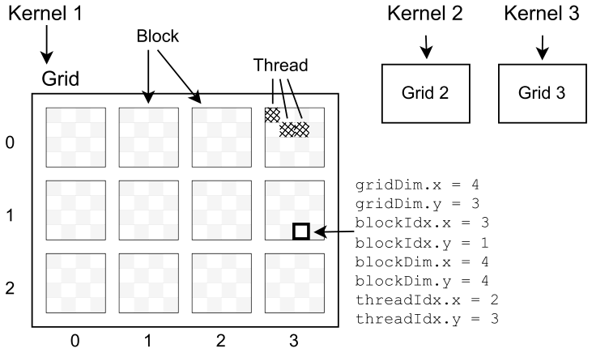
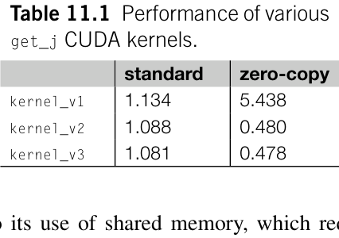

# GPU 编程 {#ch11 .unnumbered}

图形处理器（Graphics Processing Units，GPU）配备了数千个核心，能够并行执行任务。这种架构赋予了 GPU 低成本、高吞吐量的计算优势。在浮点运算密集型应用中，例如线性代数程序，GPU 的运算性能可以明显超出 CPU。利用 GPU 实现数据并行化，是大幅提高量子化学应用性能的极佳选择。
如何在 Python 程序中启用 GPU 加速？如果 GPU 运行时环境配置正确，支持 GPU 的 Python 软件包，例如 PyTorch、CuPy 和 JAX，通常很容易使用。然而，要充分利用 GPU 硬件的计算能力，就必须深入了解 GPU 架构、运行时、硬件规格和 CUDA 编程模型。
本章提供在 Python 应用中集成 GPU 计算的指导，重点讨论：

- 能否将基于 NumPy 的程序逐步改造为 GPU 程序？
- 能否在 Python 层面利用固定内存（pinned memory）与异步计算（asynchronous computation）等特性加速 GPU 计算？
- 遇到 GPU 硬件利用率低或缺少所需功能时，如何自定义 GPU 内核并在 Python 中启动内核？

在讨论这些技术过程时，我们会介绍若干软件包和技术。

## 11.1 配置 GPU 运行时环境

GPU 硬件的快速发展带来了种类繁多的 GPU 编程工具包。这些工具包的组合不当可能导致兼容性问题。因此，为 Python 应用配置 GPU 运行时环境成为一项复杂的任务。
与普通 Python 应用不同，仅靠 Conda 软件包或 Python wheel 都不足以管理 GPU 应用。运行 GPU
应用时，用户可能无法完全了解 GPU 硬件规格和运行时配置。要正确安装和运行 Python GPU 应用，我们需要基本了解 GPU 运行时环境和架构，包括：

- GPU 应用的框架和厂商选择，例如用于 Nvidia GPU 的 CUDA，以及用于 AMD GPU 的 OpenCL 和 ROCm。
- CUDA 工具包和运行时的版本，例如 CUDA 11 和 CUDA 12。使用较新版本 CUDA 工具包开发的应用可能与旧版 CUDA 运行时不兼容。为确保兼容性和最佳性能，建议编译和 CUDA 运行时使用相同版本的 CUDA。
- CUDA 计算架构（Compute Architectures）和计算能力（Compute Capabilities）的版本 [1,2]。我们需要确保 GPU 应用的计算能力，例如 sm_70、sm_80 和 sm_90，与 GPU 硬件的计算架构，例如 Volta、Ampere 和 Hopper，兼容。不同版本的计算能力之间不保证二进制兼容性。
- 真实架构与虚拟架构的区别 [3]。GPU 应用可能包含针对特定硬件的真实二进制文件，例如 CUDA 中的 cubin 文件，也可能包含虚拟中间指令集，例如 CUDA 中的 PTX（Parallel Thread Execution，并行线程执行）代码，或同时包含两者。CUDA 运行时可以执行即时编译（JIT），将虚拟代码转换为当前使用的特定 GPU 硬件的真实指令。然而，有些应用编译时可能没有以虚拟架构为目标，导致代码无法在不同 GPU 架构之间移植。
- 特定 GPU 型号。即使属于同一微架构，例如 Hopper，各个 GPU 的硬件规格也可能不同，特别在显存容量与双精度计算能力方面。有些应用专门针对特定 GPU 型号做了优化。即使满足 GPU 计算能力、CUDA 版本及其他软件先决条件，这些应用也可能无法按预期运行。

下面概述识别和配置 CUDA 运行时的一些常用方法。

#### 选择 CUDA 版本

通常建议使用最新版本的 CUDA，因为它提供最佳兼容性并支持更多 Nvidia GPU 产品。然而，在某些情况下可能需要使用旧版 CUDA。例如，有些库可能尚未发布与最新 CUDA 版本兼容的二进制版本。
CUDA 工具包的安装过程已在 Nvidia 官方文档 [4] 中介绍，此处不再重复。在云端运行 GPU 实例时，云服务商可能提供预装了多个 CUDA 版本的 Linux 操作系统。例如，AWS 云提供的深度学习镜像同时附带 CUDA 11 和 CUDA 12，并将 CUDA 12 设为默认环境。要切换
到另一个版本，我们可以修改 PATH 和 LD_LIBRARY_PATH 环境变量。

```bash
$ export PATH=/usr/local/cuda -12.0/bin:${PATH}
$ export LD_LIBRARY_PATH=/usr/local/cuda -12.0/lib64:${LD_LIBRARY_PATH}
```
或者，我们可以修改默认 CUDA 安装位置 /usr/local/cuda 的符号链接 [5]：

```bash
$ sudo ln -fs /usr/local/cuda -12.0 /usr/local/cuda
```

#### 为 Docker 容器配置运行时环境

Python 应用经常在 Docker 容器中执行。然而，仅使用默认 Docker 命令启动支持 CUDA 的镜像，并不能正确加载 CUDA 运行时。要在容器中运行 CUDA 应用，需要 Nvidia Container Toolkit [6]。安装该工具包后，CUDA 运行时环境将集成到 Docker 配置文件 /etc/docker/daemon.json 中，如下例所示：

```yaml
{
    "runtimes": {
        "nvidia": {
            "path": "/usr/bin/nvidia-container-runtime", "runtimeArgs": []
        }
    }
}
```
然后，我们可以指定 --runtime 选项来使用 CUDA 运行时：

```bash
docker run--runtime=nvidia
```
如果使用云端的 GPU 实例，Docker 所需的 CUDA 运行时可能已预装在虚拟机镜像中。要确认是否启用了 Docker 的 CUDA 运行时工具包，可以检查以下可执行文件是否存在：

```bash
$ which nvidia -container-toolkit
```

#### 检查计算能力

GPU 应用可以设计为针对多个计算能力类别，从而包含每个类别的可执行指令。然而，这种策略可能显著增加程序大小。为减小程序大小，有些 GPU 应用仅针对特定 GPU 硬件或所需的计算能力完成编译。执行预编译的 GPU 应用时，必须确
保硬件支持所需的计算能力 [2]。可以使用以下命令列出 CUDA 库中支持的 PTX 文件 [7]：

```bash
$ cuobjdump --all -fatbin /path/to/library.so
```

#### 选择合适的软件版本

由于 CUDA 版本和计算能力多种多样，一些 Python GPU 应用打包成多个版本，以适应不同的运行时环境。用户应选择最符合其系统规格的版本。例如，本章讨论的 PyTorch [8]、CuPy [9] 和 JAX [10] 等库都提供多个 CUDA 后端供安装。

## 11.2 与架构无关的优化

在 Python 科学计算应用中，执行大量线性代数运算时，GPU 的计算能力可以显著提升性能。在 CPU 平台上，这些运算通常使用 NumPy 和 SciPy 库开发。要优化性能，第一步是重写 NumPy 函数或重构所需的代码块，引入能够利用 GPU 硬件的函数。在这个阶段，无须考虑具体的 GPU 架构。一种实用策略是使用 CuPy、PyTorch 或 JAX 等库，作为现有 NumPy/SciPy 代码的直接替代品。
为了说明这一过程，让我们重新看一下第 10 章介绍的 get_j 函数。这个函数可以简单地使用 einsum 函数计算。然而，为了展示各个 Python GPU 软件包的功能以及 GPU 应用的优化过程，我们在本例中特意没有使用 einsum。

```python
def get_j(eri, dm):
    '''Perform einsum("ijkl,ji->kl", eri, dm)'''
    n = dm.shape[0]
    output = np.zeros((n,n ) )
    for k in range (n):
        for l in range (n):
            for i in range (n):
                for j in range (n):
                    output[k,l] += eri[i,j,k,l] * dm[j,i]
    return output
```
请注意，对这个函数使用 GPU 计算未必能显著提高性能。在这种情况下，瓶颈是主机与 GPU 设备之间的数据传输，它限制了 GPU 计算能力的发挥。

### 11.2.1 CuPy

将基于 NumPy 的程序转换为使用 CuPy 的程序非常直接。CuPy 提供 NumPy 中的大多数功能。有关 CuPy API 与对应 NumPy API 的详细比较，可以参考 CuPy 文档 [11,12]。在大多数情况下，我们只需将模块名从 numpy 改为 cupy，例如

```python
np.dot-> cupy.dot
np.zeros-> cupy.zeros
np.stack-> cupy.stack
np.transpose -> cupy.transpose
```
与 NumPy 相比一个值得留意的 API 差异 [12] 是 cupy.count_nonzero、cupy.sum、cupy.max 和 cupy.argmax 等归约函数的返回类型。调用 NumPy 归约函数时，它返回标量，而对应的 CuPy 函数返回零维数组。混合使用 CuPy 与 NumPy 代码时，这种差异可能导致兼容性问题，主要是由于标量和零维数组之间的区别，如第 2 章第 2.2.2 节所述。这并不是 CuPy 的缺陷，而是为了减少 CPU 与 GPU 之间同步开销而特意采用的设计选择。CPU 和 GPU 可以异步执行计算。当归约结果作为标量用于 CPU 上的计算时，必须将它们从 GPU 同步到 CPU。这种同步会阻塞 CPU 或 GPU 的执行管线。这些归约结果经常作为后续 GPU 张量运算的中间数据。CuPy 的零维数组不会影响 GPU 上的这些计算。
让我们以 get_j 函数为例，说明从 NumPy 转换为 CuPy 的过程。在基于 CuPy 的程序中，我们需要管理数组数据的位置。为确保数据位于设备（GPU）内存中，可以使用 cupy.asarray() 函数。同样，cupy.asnumpy() 函数可以将数据传回主机（CPU）内存。除这些改动外，算法和代码结构与 CPU 版本基本相同。

```python
import cupy as cp
def get_j(eri, dm):
    n = dm.shape[0]
eri = cp.asarray(eri) # Transfer to memory on GPU
    dm = cp.asarray(dm)
    output = cp.zeros((n,n ) )
    for k in range (n):
        for l in range (n):
            for i in range (n):
                for j in range (n):
                    output[k,l] += eri[i,j,k,l] * dm[j,i]
    return cp.asnumpy(output)
```
使用 CuPy 时，可能会遇到原生 NumPy 程序中不曾存在的某些问题：

- 内存管理。为尽量减少 GPU 上内存分配和初始化的开销，CuPy 使用内存池（memory pool）管理 GPU 设备上的内存。删除 CuPy 数组对象时，CuPy 不会立即释放数组的内存，而是将内存保留在内存池中以供复用，这有助于 CuPy 减少内存分配的开销。只有新数组无法放入现有内存池时，内存池才会扩展。在某些情况下，即使 nvidia-smi 命令显示有足够的空闲 GPU 内存，创建新 CuPy 数组对象时仍可能遇到 OutOfMemoryError。要解决这个问题，可能需要使用以下方法手动调整内存池大小 [13]：

```python
cupy.get_default_memory_pool().set_limit()
```
内存池扩展后不会自动收缩。因此，程序占用的 GPU 内存可能超过实际需要。要解决这个问题，可以调用

```python
cupy.get_default_memory_pool().free_all_blocks()
```
来释放未使用的内存块并减小内存池大小。

- 异步执行。除了 cupy.asarray() 和 cupy.asnumpy() 等少数数据传输函数外，CuPy 库中的大多数函数都异步执行。调用 CuPy 函数时，它会被加入队列，在 GPU 上执行。随后控制流立即返回 Python 解释器，处理下一条语句。这种异步执行可能误导 Python 性能分析器。Python 性能分析器通常记录在 CPU 上执行每条 Python 语句所花费的时间。它们只能捕获 CuPy 函数向 GPU 设备提交任务所需的时间，而不是 GPU 本身的执行时间。因此，CPU 性能分析器报告的计时数据对 CuPy 函数并不可靠。为解决这个问题，CuPy 开发了一个性能分析模块。该模块引入了 cupyx.profiler.benchmark() 和 cupyx.profiler.profile() 方法，用于测量涉及 GPU 操作的 Python 函数或代码片段的运行时间 [14]。一般来说，CuPy 的性能分析工具功能有限，不如传统 Python 性能分析工具全面。

### 11.2.2 PyTorch

的张量对象和 API 与 NumPy 非常相似，因此大多数 NumPy 函数都可以无缝替换为对应的 PyTorch 函数。然而，与 CuPy 和 NumPy 的相似程度相比，PyTorch API 的差异更多。下面列出使用 PyTorch 替代 NumPy 时一些常见的不兼容问题：

- PyTorch 缺少 NumPy 中的某些函数，例如 np.array_equal 和 np.append 函数。
- 除非显式配置 torch.set_default_tensor_type 函数，否则 PyTorch 张量对象的默认数据类型为 float32，而 NumPy 的默认数据类型为 float64。例如，torch.zeros(5)、

```text
torch.rand(5),and torch.as_tensor([1., 2., 3.])allyieldfloat32tensorsby
```
默认情况下都会产生 float32 张量。

- 当多个索引适用时，NumPy 函数使用关键字 axis 指定对张量的哪个索引操作。PyTorch 中对应的关键字参数是 dim。
- 某些 PyTorch 函数的函数签名与对应的 NumPy 函数不同。例如，np.unique 和 torch.unique 对返回值遵循不同的约定 [15]。在程序中直接用 torch.unique 替换 np.unique 可能产生非预期的结果。

不像 CuPy，没有全面的文档跟踪 PyTorch 和 NumPy API 的所有差异。建议在用对应的 PyTorch 函数替换任何 NumPy 函数之前查阅 PyTorch 文档，以确保兼容性。除此之外，将 CPU 程序转换为 PyTorch 版本的方法与前面展示的 CuPy 方法类似。
以 get_j 函数为例。要使用 PyTorch，首先需要设置默认数据类型。接着添加在主机和设备之间传输数据的语句。可以使用 torch.as_tensor 函数将数据传输到 GPU 内存。必须在该函数中加入关键字 device=’cuda’，因为 PyTorch 默认在主机内存中创建 Tensor 对象。或者，可以使用 torch.from_numpy 函数将 NumPy 数组转换为 Tensor 对象，然后调用通用转换方法 to 将数据传输到 GPU。

```python
import torch
torch.set_default_tensor_type(torch.float64)
def get_j(eri, dm):
    n = dm.shape[0]
eri = torch.as_tensor(eri, device= 'cuda') # Transfer to GPU
    dm = torch.as_tensor(dm, device= 'cuda')
    output = torch.zeros((n, n), device= 'cuda')
    for k in range (n):
        for l in range (n):
            for i in range (n):
                for j in range (n):
                    output[k,l] += eri[i,j,k,l] * dm[j,i]
    return output.to(device='cpu').numpy()
```
与 CuPy 库类似，为减少内存分配开销，PyTorch 也会缓存并复用为 GPU 设备上创建的张量对象分配的内存。
然而，该库不会自动释放缓存的内存。你也需要手动释放未使用的内存块 [16]。

### 11.2.3 JAX

库包含一个模块 jax.numpy，它紧密遵循 NumPy API。JAX 采用的设计和数据处理方式与 NumPy 有很大不同。将程序直接从 NumPy 转换为 JAX 可能导致性能大幅下降。高效的 JAX 实现通常需要对原程序进行大幅修改。
的逐元素操作速度较慢。推荐采用面向向量的编码风格。官方文档 How to Think in JAX [17] 提供了指导，帮助我们更好地理解 JAX 的编码风格。前面几节介绍的 get_j 实现不适合 JAX。我们可以使用 NumPy ufunc 和广播规则完成矢量化操作。消除显式迭代后，可以应用 JAX 即时编译，将计算卸载到 GPU 设备。

```python
import jax.numpy as jnp
jax.config.update('jax_enable_x64', True)
@jax.jit
def get_j(eri, dm):
    return (eri.transpose(2,3 ,1 ,0 ) * dm).sum(axis=(2, 3))
```
请注意，与 PyTorch 类似，JAX 函数默认使用 float32 数据类型。要使用 float64 精度，必须使用以下语句配置库：

```python
jax.config.update('jax_enable_x64', True)
```
以更改默认数据类型。

## 11.3 考虑架构的优化

在上一节中，我们只是用 GPU 加速的对应函数替换了 NumPy 函数。然而，我们没有考虑 GPU 架构的具体特性。某些与 GPU 架构相关的优化技术无需在 C++ 程序中访问 CUDA API 就可以使用。这些特性可通过 CuPy 和 PyTorch 等库提供的 Python API 使用。本节重点介绍 CuPy 中固定内存和 GPU 流（GPU streams）的使用。虽然 PyTorch 的 API 略有不同，但底层原理相似。

### 11.3.1 固定内存

固定内存（pinned memory），也称为页锁定内存（page-locked memory），是一种操作系统不能将其分页换出到磁盘的内存。在数据传输时使用固定内存可以显著提升传输带宽。
通常，程序使用的内存是可分页的。然而，GPU 不能直接访问可分页主机内存中的数据。当数据从可分页主机内存传输到设备内存时，数据移动分两个阶段完成。首先，将数据从可分页内存复制到页锁定缓冲区，随后从缓冲区传输到设备。CPU 参与这一两步数据传输过程，具体负责在可分页内存和页锁定内存之间移动数据的步骤。如果主机上的数据一开始就创建在固定内存中，便可以跳过这一步。这消除了与 CPU 内存管理相关的延迟和开销 [18]。
在 cupy.cuda.pinned_memory 模块中提供了几个操作固定内存的函数。为了与 NumPy 更无缝地集成，CuPy 还在 cupyx 软件包中提供高级 API，用于创建由固定内存支持的 NumPy 数组。cupyx 中一些常用的 API 包括：
  - `cupyx.empty_pinned`
  - `cupyx.empty_like_pinned`
  - `cupyx.zeros_pinned`
  - `cupyx.zeros_like_pinned`
请注意，这些函数输出的是 NumPy 数组，而不是 GPU 上的 CuPy 数组。我们可以使用这些函数在固定内存中创建 NumPy 数组缓冲区，并通过 out 关键字参数将它们传给 NumPy 函数。随后 NumPy 函数直接将数据写入固定内存。
例如，传给 get_j 函数的 eri 张量可以在固定内存上初始化。

```python
import cupy as cp
import cupyx
pinned_buffer = cupyx.empty_pinned((n,n,n,n))
rng = np.random.default_rng()
eri_cpu = rng.random((n,n ,n , n), out=pinned_buffer)
# host to device transfer
eri_gpu = cp.empty_like(eri_cpu)
eri_gpu.set(eri_cpu)
output = get_j(eri_gpu, dm)
```
在这个例子中，我们使用随机数生成器 rng 的 random() 方法填充 pinned_buffer。接着，在 GPU 上创建所需大小的 CuPy 数组，并使用 .set() 方法将数据从固定内存传输到设备。
创建空数组并调用 .set() 方法的两行代码可能显得不够简洁，但它们对使用固定内存至关重要。我们不能使用 cupy.asarray(eri_cpu) 等函数将创建 CuPy 数组和数据传输合并为一步来简化这个过程。这是因为 cupy.asarray 函数是一种异步操作。数据传输完成之前，输入数组中的数据可能被写入。为避免这些异步操作中潜在的竞态条件（race conditions），CuPy 始终在 cupy.asarray 函数中创建输入 NumPy 数组的副本，即使使用固定内存也是如此。这给数据传输增加了开销。
要将数据从设备传输到固定内存，可以创建一个固定缓冲区并使用 CuPy 数组对象的 .get() 方法，通过 out 关键字选项指定数据的目标位置。

```python
output_cpu = output.get(out=cupyx.empty_pinned((n, n)))
```
除了优化数据传输，固定内存还用于各种其他场景。例如，它是异步数据传输和零复制（zero-copy）技术的先决条件；零复制技术允许 GPU 直接访问主机内存的地址。然而，使用固定内存也有一些缺点。固定内存始终驻留在物理内存中，这可能减少其他应用可用的分页内存。此外，固定系统内存是一项资源密集型操作，比普通系统内存分配的开销更大。传输小型数组时，无须使用固定内存。

### 11.3.2 CUDA 流

GPU 流（GPU stream）是由 GPU 执行的操作队列。GPU 可以并行执行多个流，从而并发执行多个操作。使用 GPU 流可以更高效地利用 GPU。GPU 流的一种常见使用场景是使计算和数据传输重叠，从而减少总执行时间。
CUDA 使用一个称为 NULL 流的默认流。GPU 上的所有处理器都执行该流中排队的任务。CuPy 函数通常使用 NULL 流，使整个 GPU 执行相同的指令集。要管理多个 GPU 流，可以使用 cupy.cuda.stream 模块。例如，可以创建专用流来处理异步数据传输。关于异步数据传输，有几个关键方面：

- 主机内存必须分配为固定内存，这是异步传输的要求 [19]。
- 在调用对应流的 synchronize 方法之前，应避免修改固定内存的内容。
- 通过非默认流传输的数据可能无法立即被默认（NULL）流访问。为确保数据已准备好供默认流处理，应在默认流访问数据之前，调用非默认流的 synchronize 方法。

以将巨大的 eri 张量从主机传输到设备为例。下面的代码片段展示了异步数据传输的过程：

```python
pinned_buffer = cupyx.empty_pinned((n,n,n,n))
rng = np.random.default_rng()
eri_cpu = rng.random((n,n ,n , n), out=pinned_buffer)
sm = cp.cuda.stream.Stream(non_blocking=True)
eri_gpu = cp.empty_like(eri_cpu)
eri_gpu.set(eri_cpu, stream=sm)
...
sm.synchronize() # (1)
output = get_j(eri_gpu, dm)
```
这里创建了一个设置为 non_blocking=True 的新流。这使该流能够与默认流一起异步运行。将新流赋给 stream 关键字参数，即可配置 CuPy 函数使用这个新流。在本例中，数据传输放在新流上，而 get_j 的计算放在默认流上。如果两个流并发执行，默认流可能尝试访问尚未填入所需数据的内存地址，导致先读后写错误。为确保缓冲区中的数据已准备好，如第 (1) 行所示，在继续执行 get_j 函数之前对新流执行同步。
或者，我们可以使用 Stream 类提供的上下文管理器来管理流的执行。在 Stream 上下文中，无须为 CuPy 函数指定 stream 关键字。除非显式关联到其他流对象，否则 CuPy 函数将在新流上执行。

```python
with cp.cuda.stream.Stream(non_blocking=True) as sm:
    eri_gpu = cp.empty_like(eri_cpu)
    eri_gpu.set(eri_cpu)
    output = get_j(eri_gpu, dm)
sm.synchronize()
```
在这个代码示例中，get_j 函数在新创建的流的上下文中调用。与另外两个 CuPy 操作类似，get_j 中的函数也被加入新流的队列。同一流中的函数按顺序执行。
应注意，上下文管理器的作用仅仅是设置默认流。它既不会阻塞其他流的执行，也不会在退出上下文管理器时自动同步。为避免新流和默认流之间潜在的竞态条件或冲突，建议在退出上下文管理器后显式发出 synchronize() 命令。
如前所述，大多数 CuPy 函数异步运行，这可能导致 GPU 程序的计时和性能分析不准确。要获得特定函数的精确计时，可以在 NULL 流上调用 .synchronize() 方法来强制同步，该方法可通过 cupy.cuda.Stream.null.synchronize 访问。这确保此前所有异步操作都已完成。

## 11.4 在 Python 中自定义 GPU 内核

若要使用 CuPy 或任何现有库尚未提供的功能，就必须自定义 GPU 内核。基本上，自定义内核涉及两个主要问题：

- 如何设计内核以获得最佳性能？
- 如何将自定义内核嵌入 Python 程序？

要在 Python 中开发和嵌入自定义内核，有多种选择，包括 Numba [20]、CuPy RawKernel [21]、PyCUDA [22,23]、CUDA-Python [24] 和 ctypes。每种方法为集成 CUDA 编程能力提供了不同层次的抽象。
Numba 提供了一种非常符合 Python 风格的方法，将 Python 代码转换为 GPU 内核。它使用户无需深入了解 CUDA 编程模型或 GPU 架构即可编写 GPU 程序。
自定义内核以及 PyCUDA 和 CUDA-Python 允许用户将原始 CUDA 源代码集成到 Python 中，同时抽象掉运行时配置的复杂性。这些工具要求对 CUDA C++ 编程模型有一定程度的理解。
ctypes 模块可以与原生 CUDA C++ 项目结合使用。这种组合在 GPU 功能和性能方面提供了最大的灵活性和潜力。然而，使用 ctypes 模块需要更深入地了解 GPU 编程工具包，并投入更多精力维护 C++ 后端和 Python 接口。
在探索自定义 CUDA 内核之前，我们想强调，在许多场景中，应用的瓶颈在于主机与设备之间的数据交换，或 GPU 板载内存的带宽。开发自定义内核不一定能够提高性能。只要性能损失可以接受，使用 CuPy 或 PyTorch 函数的纯 Python 实现仍是一个不错的选择。它们比自定义内核容易维护得多。

### 11.4.1 CUDA 代码中的内核

如图 11.1 所示，GPU 并行化模型组织成由网格、块和线程组成的层次结构。网格是块的集合，执行相同的内核代码。在每个线程块内，一组线程运行相同的指令，各自操作不同的数据元素。



**图 11.1** GPU 并行化模型：由网格、块和线程组成的层次结构

从本质上说，编写 GPU 内核就是将数据并行化问题映射到 GPU 并行模型的任务。这里我们将简要讨论 get_j 函数的 CUDA 代码设计与优化。这个 CUDA 内核随后将集成到 Python 代码中。如果你对 GPU 架构和优化方法的细节感兴趣，官方手册 *CUDA C Programming Guide* [25] 以及 *CUDA by Example: An Introduction to General-Purpose GPU Programming* [26] 等教材都是很好的资源，全面介绍了 GPU 编程概念。
我们的初始版本源自第 11.2 节介绍的 CPU 代码。在这个版本中，循环索引 i 和 j 被映射到 CUDA 线程。高维数组用一维数组表示，其寻址方式由多维格式转换而来。这是在 CUDA 内核中处理多维数组的常用技术。确保 Python 端数组的连续性至关重要。

```c
#include <cuda_runtime.h>
__global__ void _kernel_v1(double *output, double *eri, double *dm, int n)
{
    size_t ij = blockIdx.x * blockDim.x + threadIdx.x;
    size_t nn = n * n;
    if (ij > nn) return;
    size_t i = ij / n;
    size_t j = ij % n;
    size_t kl;
    double dm_ji = dm[j *n+i];
    for (kl = 0; kl < nn; ++kl) {
        atomicAdd(&output[kl], eri[(i *n+j)*nn+kl] * dm_ji);
    }
}
```
这个 GPU 内核对 output 数组的元素执行归约加法操作。由于 output 数组由 CUDA 线程共享，直接向数组写入数据可能导致竞争条件（race conditions）。我们使用 CUDA 原子操作 atomicAdd 来确保归约不会发生竞争条件。虽然 atomicAdd 在硬件层面经过优化，但跨 CUDA 线程块执行归约仍然是成本很高的操作，通常应当避免。
为了消除跨线程归约，第二个版本的 CUDA 内核交换了 ij 和 kl 的循环顺序。随后，索引 k 和 l 被映射到 CUDA 线程。通过这些修改，归约求和在每个线程内的寄存器中累积。

```c
__global__ void _kernel_v2(double *output, double *eri, double *dm, int n)
{
    size_t kl = blockIdx.x * blockDim.x + threadIdx.x;
    size_t nn = n * n;
    if (kl > nn) return;
    size_t i,j ;
    double s = 0.;
    for ( i=0 ;i<n ; ++i) {
        for ( j=0 ;j<n ; ++j) {
            s += eri[(i *n+j)*nn+kl] * dm[j*n+i];
        }
    }
    output[kl] = s;
}
```
在该实现中，每个线程在内层循环都需要反复读取 dm 数组元素。如果不考虑 GPU 处理器中缓存的影响，这会导致总共 n 次全局内存操作。访问全局内存会带来很高的延迟。因此，在 GPU 内核中最好尽量减少或避免通过全局内存访问数据。
为了优化全局内存访问，可以使用分块（tiling）和共享内存（shared memory）技术。共享内存是位于 CUDA 流处理器上的一块小型、低延迟内存空间。同一线程块内的线程可以访问共享内存中的数据，从而有效减少对全局内存的访问。分块技术将数据集划分成能够放入共享内存的小块。这些技术可以看作手动控制 GPU 缓存行为的一种方式。通过采用这些技术，我们可以开发一个新版本的 CUDA 内核。

```c
#define BLOCK 16
__global__ void _kernel_v3(double *output, double *eri, double *dm, int n)
{
    int tx = threadIdx.x;
    int ty = threadIdx.y;
    size_t kl = blockIdx.x * blockDim.x*blockDim.y + ty * blockDim.x + tx;
    size_t nn = n * n;
    size_t i,j ,i 0, j0;
    __shared__ double dm_t[BLOCK][BLOCK];
    double s = 0.;
    for (i0 = 0; i0 < n; i0 += BLOCK) {
        for (j0 = 0; j0 < n; j0 += BLOCK) {
            __syncthreads();
            dm_t[tx][ty] = dm[(j0+ty) *n+i0+tx];
            __syncthreads();
            for (i = 0; i < BLOCK; ++i) {
                for (j = 0; j < BLOCK; ++j) {
                    s += eri[((i0+i) *n+j0+j)*nn+kl] * dm_t[i][j];
                }
            }
        }
    }
    output[kl] = s;
}
```
这是简化的教学实现，假设相关张量和数组的维度都是 BLOCK 大小 16 的整数倍。完整版本必须包含检查边界处未对齐元素的代码。不过，使用共享内存的分块算法核心保持不变。这里，每个分块都是一个 16 × 16 矩阵。分配的共享内存缓冲区 dm_t 可容纳这个大小。为了建立二维共享内存与 CUDA 线程之间的映射，启动这个内核时，应将 CUDA 线程块配置为包含 16 × 16

```text
dim3 threads(16, 16);
```
CUDA 线程块内的每个线程负责从全局内存读取一个元素，以填充共享内存。在修改共享内存时，确保对它的独占访问至关重要。为此，使用 __syncthreads() 函数同步线程块中的所有线程，确保它们执行到相同的位置。这种同步可防止同时以写入和读取模式访问共享内存。
通过采用分块算法，读取 dm 数组所需的全局内存访问减少到。因此，GPU 内核需要访问
eri 张量只需从全局内存访问 n。与 kernel_v2 相比，这种方法使全局内存访问总次数大约减半。
与 CPU 算法设计不同，GPU 算法更适合采用面向吞吐量的方法。虽然浮点运算次数（FLOP counting）仍是一项重要指标，但它往往不是 GPU 内核性能的主要约束。优化工作应侧重数据访问延迟、全局内存访问频率和缓存命中率等因素。

### 11.4.2 CUDA JIT

Numba 提供即时编译（JIT）选项，可从 Python 函数生成 GPU 内核。这是开发新内核最简单的方法，甚至不需要理解 GPU 并行化模型。例如，可以使用 numba.cuda.jit 装饰器创建 get_j 函数的 GPU 内核。

```python
from numba import cuda
@cuda.jit(fastmath=True)
def naive_kernel(output, eri, dm):
    n = dm.shape[0]
    for i in range (n):
        for j in range (n):
            for k in range (n):
                for l in range (n):
                    output[k,l] += eri[i,j,k,l] * dm[j,i]
def get_j(eri, dm):
    n = dm.shape[0]
    output = np.empty_like(dm)
    grids = ((n *n+255) // 256,)
    threads = (256,)
    naive_kernel[grids, threads](output, eri, dm)
    return output
```
JIT 生成的 GPU 内核采用以下函数签名 [27]：

```python
func[griddim, blockdim, stream, sharedmem]( *arguments)
```
内核函数与 CUDA C++ 使用的内核启动语法相同：

```text
func<<<griddim, blockdim, sharedmem, stream>>>(*arguments)
```
面向普通 Python 代码的 Numba JIT 隐藏了 GPU 并行化模型的许多细节，这通常会导致性能欠佳。可以使用 Numba JIT 获得更好的性能，但需要在 Python JIT 代码中加入更多 GPU 专用语言和特性。为了使用高级 CUDA 特性，
Numba 通过 numba,cuda 模块提供了全面的 CUDA API [20]。例如，可以使用 cuda.atomic.add 函数执行原子加法操作，也可以使用 cuda.shared.array 函数在共享内存中分配数组。

```python
from numba import cuda
@cuda.jit(fastmath=True)
def _kernel_v1(output, eri, dm):
    n = dm.shape[0]
    ij = cuda.blockIdx.x * cuda.blockDim.x + cuda.threadIdx.x
    if ij > n * n: return
    i,j= divmod(ij ,n )
    for k in range (n):
        for l in range (n):
            cuda.atomic.add(output,( k,l), eri[i,j,k,l] * dm[j,i])
def get_j(eri, dm):
    n = dm.shape[0]
    output = np.zeros_like(dm)
    grids = ((n *n+255) // 256,)
    threads = (256,)
    _kernel_v1[grids, threads](output, eri, dm)
    return output
BLOCK = 16
@cuda.jit(fastmath=True)
def kernel_v3(output, eri, dm):
    n = dm.shape[0]
    tx = cuda.threadIdx.x
    ty = cuda.threadIdx.y
    k, l = cuda.grid(2)
    dm_t = cuda.shared.array((BLOCK, BLOCK), dtype= 'f8')
    s=0 .
    for i0 in range (0,n , BLOCK):
        for j0 in range (0,n , BLOCK):
            cuda.syncthreads()
            dm_t[tx,ty] = dm[j0+ty,i0+tx]
            cuda.syncthreads()
            for i in range (BLOCK):
                for j in range (BLOCK):
                    s += eri[i0+i,j0+j,k,l] * dm_t[i,j]
    output[k, l ]=s
def get_j_v3(eri, dm):
    n = dm.shape[0]
    assert n % BLOCK == 0
    output = np.empty_like(dm)
    grids = ((n **2+BLOCK**2-1) // BLOCK **2,)
    threads = (BLOCK, BLOCK)
    kernel_v3[grids, threads](output, eri, dm)
    return output
```
平心而论，与编写原始 CUDA 内核代码相比，在 Python JIT 代码中使用 Numba CUDA API 并没有降低 GPU 内核开发的复杂性。它只是简化了编译配置和 Python 粘合接口的编写。从这个角度看，使用 CuPy 或 PyCUDA 等工具构建原生 CUDA 内核的复杂度相差无几。

### 11.4.3 自定义内核

CuPy、PyCUDA 和 CUDA-Python 都是允许我们在 Python 程序中嵌入原始 CUDA 内核的工具。
在这三者中，Nvidia 提供的 CUDA-Python 不太常用。CUDA-Python 提供了一整套 CUDA API，其命名约定和 API 结构与 CUDA C++ API 几乎完全相同。理论上，它可以完成 CUDA C++ 能完成的几乎所有工作。然而，CUDA-Python 只是将 CUDA API 函数导出到 Python，并未适配 Python 语言的惯例。使用 CUDA-Python 时，需要注意数据类型、错误代码以及通常与 C++ 编程有关的其他细节。编译配置也要求深入理解 CUDA 二进制文件和运行时框架。与完全使用 C++ 编写后再通过 ctypes 或 CFFI 导出到 Python 相比，单独使用 CUDA-Python 并不能精简开发流程。
CuPy 和 PyCUDA 都在 CUDA 编程与 Python 集成之间提供了更好的平衡。使用 CuPy 和 PyCUDA 时，只需专注于 CUDA 内核代码。这些工具会自动处理其余任务，包括编译配置和 Python 接口。它们提供访问大多数基本 CUDA 特性的 API，尽管不如 CUDA-Python 全面。这些 API 分别位于 CuPy 的 cupy.cuda.runtime 模块和 PyCUDA 的 pycuda.driver 模块中。例如，第 11.4.4 节将要使用的零拷贝（zero-copy）内存访问技术，需要直接调用 cupy.cuda.runtime 模块的 API。
我们以 CuPy RawKernel 为例，探讨如何将原始 CUDA 内核集成到 Python 程序中。虽然 PyCUDA 的 API 命名和包结构与 CuPy 不同，但它们的用法非常相似。基于 CuPy 示例，使用 PyCUDA 达到相同目的并不困难。
使用第 11.4.1 节开发的原始 CUDA 内核源代码，我们可以按如下方式初始化一个 RawKernel 实例：

```python
kernel_v2 = cupy.RawKernel( '''
extern "C" __global__
void _kernel_v2(double *output, double *eri, double *dm, long long n)
{
    size_t kl = blockIdx.x * blockDim.x + threadIdx.x;
    size_t nn = n * n;
    if (kl > nn) return;
    size_t i,j ;
    double s = 0.;
    f o r( i=0 ;i<n ; ++i) {
        f o r( j=0 ;j<n ; ++j) {
            s += eri[(i *n+j)*nn+kl] * dm[j*n+i];
        }
    }
    output[kl] = s;
}
''', '_kernel_v2')
def get_j(eri, dm):
    n = dm.shape[0]
    eri = cupy.asarray(eri)
    dm = cupy.asarray(dm)
    output = cupy.empty_like(dm)
    grids = ((n *n+255) // 256,)
    threads = (256,)
    kernel_v2(grids, threads, (output, eri,d m, n))
    return output
```
生成的内核函数具有以下函数签名：

```python
func(griddim, blockdim, args, shared_mem=0, stream=None)
```
如果打算使用多个流启动内核，方法与使用其他 CuPy 函数时类似。你可以使用上下文管理器为自定义内核设置默认流，也可以显式地向内核传入一个 Stream 实例。
与自动处理参数数据类型的 Numba JIT 不同，我们必须根据参数在 Python 中对应的类型显式定义其数据类型。CuPy 文档 [28] 解释了这一要求。例如，整数 n 被指定为 long long 类型，以便与 Python 整数类型对应。
你可能想了解嵌入式原始 CUDA 内核的编译性能和运行时性能。下面我们解答一些常见问题：原始 CUDA 代码何时编译？原始 CUDA 代码采用延迟编译。编译发生在首次调用 RawKernel 对象时。
每次调用内核时都会编译吗？不会，内核在同一次运行中只编译一次并被缓存。CuPy 还会缓存编译得到的 PTX 汇编代码，以加快后续运行时的编译 [14]。
RawKernel、PyCUDA 和 Numba 这几种 Python 工具中，哪一种的运行时性能最好？只要使用相同算法并采用合理的编写方式，CuPy RawKernel、PyCUDA 和使用 CUDA API 的 Numba 性能相近。虽然这些工具提供了不同的接口和语言规范来实现 CUDA 内核，但最终的 GPU 内核都由 nvrtc 编译器生成。它们的效率几乎相同。差异主要在于 Python 接口，而这些接口的性能差异很小。
在某些场景下，使用针对 C/C++ 的 CUDA 特性可以改善主机代码与 GPU 内核之间的交互。然而，CuPy 和 PyCUDA 只能自定义和启动 CUDA 内核，不支持集成在 CPU 上执行的 C/C++ 函数。要使用全部 CUDA 特性，可以采用 ctypes 库。

### 11.4.4 使用 ctypes 集成 CUDA 内核

如果你熟悉 CUDA C++ 编程，ctypes 模块始终是将 GPU 内核集成到 Python 项目的一个好选择。GPU 应用程序可以独立于 Python 项目开发，并编译为标准的 C/C++ 共享库。如第 8 章所述，可以使用 ctypes 模块或其他接口工具将 C/C++ 共享库动态加载到 Python 中。
在这种方法中，C 函数包装器充当 GPU 内核与 Python 之间的桥梁。例如，我们可以按如下方式为第 11.4.1 节开发的内核添加 C 函数包装器：

```bash
$ cat get_j.cu
#include <stdio.h>
#include <cuda_runtime.h>
__global__ void _kernel_v1(double *output, double *eri, double *dm, int n)
...
extern "C"
void kernel_v1(double *output, double *eri, double *dm, int n)
{
    int grids = (n *n+255)/256;
    int threads = 256;
    _kernel_v1<<<grids, threads>>>(output, eri,d m, n);
    cudaError_t err = cudaGetLastError();
    if(err != cudaSuccess){
        fprintf(stderr, "CUDA error %s\n" , cudaGetErrorString(err));
    }
}
extern "C"
void kernel_v2(double *output, double *eri, double *dm, int n)
...
extern "C"
void kernel_v3(double *output, double *eri, double *dm, int n)
{
    int grids = (n *n+255)/256;
    dim3 threads(16,1 6,1 ) ;
    _kernel_v3<<<grids, threads>>>(output, eri,d m, n);
    cudaError_t err = cudaGetLastError();
    if(err != cudaSuccess){
        fprintf(stderr, "CUDA error %s\n" , cudaGetErrorString(err));
    }
}
```
使用以下命令编译 CUDA 代码，会生成共享库 libget_j.so。

```bash
$ nvcc -g -shared -Xcompiler= -fPIC -arch=sm_60 -o libget_j.so get_j.cu
```
编译标志 -shared 和 -Xcompiler=-fPIC 对创建可由 ctypes 动态加载的库至关重要。旧版本的 CUDA 计算能力（Compute Capability）不支持 atomicAdd 等原子操作。启用 _kernel_v1 中的 atomicAdd 函数需要使用 -arch=sm_60 标志（或更高版本的 sm）。随后我们可以加载编译后的共享库，并使用 ctypes 调用 C 函数 kernel_v1，后者进而启动 GPU 内核。
ctypes 接口中剩下的问题是如何将 Python 对象，特别是 GPU 内存中数组对象的指针，传递给 C 函数。主流 GPU 张量库 CuPy、PyTorch 和 JAX 对显存指针的处理方式各不相同：

- CuPy 数组对象的设备地址可以通过 .data.ptr 属性获得。
- PyTorch 张量对象的设备地址可以使用
- 不支持这样的功能，也不允许直接修改其内容。JAX 中无法获取 GPU 指针。

需要注意，CuPy 和 PyTorch 提供的设备地址是整数。在传递给底层 C 函数之前，必须将它们转换为适当的指针类型。例如，在接口函数 get_j 中，CuPy 数组的地址按如下方式转换：

```python
gpu_ext = ctypes.CDLL( './libget_j.so')
def get_j(eri, dm):
    n = dm.shape[0]
    eri = cp.asarray(eri)
    dm = cp.asarray(dm)
    output = cp.zeros_like(dm)
    gpu_ext.kernel_v1(ctypes.c_void_p(output.data.ptr), ctypes.c_void_p(eri.data.ptr), ctypes.c_void_p(dm.data.ptr), ctypes.c_int(n))
    return output
```
在 get_j 函数中，NumPy 数组 eri 使用 cupy.asarray 函数转换为 CuPy 数组。这个转换将数组数据传输到 GPU 内存。随后，GPU 函数 kernel_v1 从 GPU 内存读取数据。这种两步方法效率不高，因为它引入了不必要的写入和读取操作。
为了提高数据传输效率，一种方法是在调用 get_j 函数之前，使用异步数据传输发送 eri 数组。实际上，针对这种场景更合适的方法是采用 CUDA 零拷贝技术 [29]，也称为直接内存访问（direct memory access，DMA）技术。零拷贝允许 GPU 线程直接访问主机内存。这样就无需将数据存储在 GPU 内存中，从而减少每个元素一次写入和一次读取操作的开销。然而，零拷贝内存访问的速度受 NVLink 或 PCIe 总线带宽的限制 [30,31]。如果数据需要多次访问，将数据缓存在 GPU 内存中是更好的选择，因为 GPU 内存能够提供高得多的带宽。
要使用零拷贝技术，必须固定并映射主机内存。这种特殊的主机内存可以使用 cupy.cuda.runtime 模块中的底层 CUDA API 分配。随后，使用 cp.cuda.PinnedMemoryPointer 类将这块主机内存转换为 Python 缓冲区对象，并可将该对象赋给一个空的 NumPy 数组。下面的 Python 代码片段展示了这些步骤：

```python
def empty_mapped(shape, dtype= float, order= 'C'):
    nbytes = np.prod(shape) * np.dtype(dtype).itemsize
    mem = cp.cuda.PinnedMemoryPointer( cp.cuda.PinnedMemory(nbytes, cp.cuda.runtime.hostAllocMapped), 0)
    out = np.ndarray(shape, dtype=dtype, buffer=mem, order=order)
    return out
```
在对应的 C 函数中，需要使用 CUDA API cudaHostGetDevicePointer 将 GPU 上的内存地址绑定到主机上的内存页。随后，绑定的地址可以传递给 GPU 内核，并作为普通的设备端地址使用。

```c
extern "C"
void kernel_v2_mapped(double *output, double *eri_cpu, double *dm, int n)
{
    double *eri_gpu;
    cudaError_t err = cudaHostGetDevicePointer(&eri_gpu, eri_cpu, 0);
    if(err != cudaSuccess){
        fprintf(stderr, "CUDA error %s\n" , cudaGetErrorString(err));
    }
    kernel_v2(output, eri_gpu,d m, n);
    err = cudaGetLastError();
    if(err != cudaSuccess){
        fprintf(stderr, "CUDA error %s\n" , cudaGetErrorString(err));
    }
}
```
最后，在 Python 函数中，我们删除 CuPy 数组转换代码。现在，将锁页的 NumPy 数组地址直接传给 CUDA 内核。

```python
def get_j_zero_copy(eri,d m ) :
    n = dm.shape[0]
    dm = cp.asarray(dm)
    output = cp.zeros_like(dm)
    gpu_ext.kernel_v2_mapped( ctypes.c_void_p(output.data.ptr), eri.ctypes, ctypes.c_void_p(dm.data.ptr), ctypes.c_int(n))
    return output
if __name__ == '__main__':
    n = 160
    rng = np.random.default_rng(seed=1)
    eri = empty_mapped((n,n ,n , n))
    rng.random((n,n ,n , n), out=eri)
    dm = np.random.rand(n,n )
    output = get_j_zero_copy(eri, dm)
```
为了评估不同计算内核的性能，我们使用 V100 GPU 卡对 kernel_v1、kernel_v2 和 kernel_v3 及其零拷贝版本开展了基准测试，系统大小设为 n = 160。结果详见表 11.1。kernel_v2 的性能优于 kernel_v1，因为它确保了对 eri 张量的合并内存访问（coalesced memory access）[32,33]，并且不再使用 atomicAdd。合并内存事务是相邻线程同时访问相邻内存地址的过程。kernel_v3 的性能略好



**表 11.1** 各种 get_j CUDA kernel 的性能。

## 小结

本章介绍了在 Python 中利用 GPU 编程加速计算的核心技术。CuPy 和 PyTorch 等库提供了类似 NumPy 的功能，用于管理数组和加速 GPU 上的线性代数运算。要在 Python 程序中启用 GPU 加速，一个直接的方法是将 NumPy 代码替换为 CuPy 或 PyTorch 中对应的函数或类。
如果 CuPy 或 PyTorch 的性能不足，或者这些库没有提供所需功能，就可能需要自定义 GPU 内核并将其集成到 Python 程序中。Numba JIT 编译提供了一种将 Python 函数转换为 GPU 内核的方法。然而，采用这种方法不容易对 GPU 特性进行精细控制。为了更精确地控制 GPU 的能力，可以开发原生 CUDA 代码，并使用 CuPy 或 PyCUDA 将其集成到 Python 代码中，也可以利用 ctypes 将 CUDA C++ 项目纳入 Python 程序。
为了更好地利用 GPU 的计算能力，我们可以利用 GPU 架构的独有特性来提高程序性能。例如，可以利用 CUDA 流在 GPU 上并发执行多个任务。这一能力使计算与数据传输能够重叠。使用
参考文献 锁页内存可以减少主机与 GPU 之间数据移动的开销。此外，使用零拷贝技术可以进一步减少这种数据移动开销。在 GPU 内核中恰当使用共享内存可以降低全局内存访问的频率。内存访问模式对性能有显著影响，尤其是在通过零拷贝技术访问主机内存时。GPU 计算受益于合并内存访问。在设计数据结构和算法时应考虑这一特性。

## 参考文献

::: {.ref-list}

[1] NVIDIA Corporation, CUDA C programming guide - compute capabilities, [nvidia.com](https://docs.nvidia.com/cuda/cuda-c-programming-guide/index.html#compute-capabilities), 2024.

[2] NVIDIA Corporation, Your GPU compute capability, [nvidia.com](https://developer.nvidia.com/cudagpus#compute), 2024.

[3] NVIDIA Corporation, CUDA compiler DRIVER nvcc the CUDA compilation trajectory, [nvidia.com](https://docs.nvidia.com/cuda/cuda-compiler-driver-nvcc/index.html#thecuda-compilation-trajectory), 2024.

[4] NVIDIA Corporation, NVIDIA CUDA installation guide for Linux, [nvidia.com](https://docs.nvidia.com/cuda/cuda-installation-guide-linux/#installation), 2024.

[5] Amazon Web Services, Using the deep learning base AMI - c onfiguring CUDA versions, [amazon.com](https://docs.aws.amazon.com/dlami/latest/devguide/tutorial-base.html), 2024.

[6] NVIDIA Corporation, Installing the NVIDIA container toolkit, [nvidia.com](https://docs.nvidia.com/datacenter/cloud-native/container-toolkit/latest/install-guide.html), 2024.

[7] NVIDIA Corporation, CUDA binary utilities - cuobjdump, [nvidia.com](https://docs.nvidia.com/cuda/cuda-binary-utilities/index.html#cuobjdump), 2024.

[8] PyTorch developers, Get started with PyTorch start locally, [pytorch.org](https://pytorch.org/getstarted/locally/), 2024.

[9] CuPy Developers, Installing CuPy, [cupy.dev](https://docs.cupy.dev/en/stable/install.html#installing-cupy), 2024.

[10] The JAX Authors, Installing JAX, [readthedocs.io](https://jax.readthedocs.io/en/latest/installation.html#pip-installation-nvidia-gpu-cuda-installed-via-pip-easier), 2024.

[11] CuPy Developers, CuPy API reference - comparison table, [cupy.dev](https://docs.cupy.dev/en/stable/reference/comparison.html), 2024.

[12] CuPy Developers, CuPy user guide - differences between CuPy and NumPy, [cupy.dev](https://docs.cupy.dev/en/stable/user_guide/difference.html), 2024.

[13] CuPy Developers, CuPy user guide memory management, [cupy.dev](https://docs.cupy.dev/en/latest/user_guide/memory.html), 2024.

[14] CuPy Developers, CuPy user guide - performance best practices, [cupy.dev](https://docs.cupy.dev/en/stable/user_guide/performance.html#benchmarking), 2024.

[15] NumPy Developers, NumPy 2.0.0 release notes - np.unique return_inverse shape for multi-dimensional inputs, [numpy.org](https://numpy.org/devdocs/release/2.0.0-notes.html#npunique-return-inverse-shape-for-multi-dimensional-inputs), 2024.

[16] PyTorch Contributors, CUDA semantics memory management, [pytorch.org](https://pytorch.org/docs/stable/notes/cuda.html#memory-management), 2024.

[17] The JAX authors, How to think in JAX, [readthedocs.io](https://jax.readthedocs.io/en/latest/notebooks/thinking_in_jax.html), 2024.

[18] NVIDIA Corporation, CUDA C++ best practices guide - pinned memory, [nvidia.com](https://docs.nvidia.com/cuda/cuda-c-best-practices-guide/index.html#pinned-memory), 2024.

[19] NVIDIA Corporation, CUDA toolkit documentation API synchronization behavior, [nvidia.com](https://docs.nvidia.com/cuda/cuda-runtime-api/api-sync-behavior.html#api-syncbehavior), 2024.

[20] Numba Developers, Numba for CUDA GPUs, [pydata.org](https://numba.pydata.org/numba-doc/dev/cuda/index.html), 2024.

[21] CuPy Developers, CuPy user guide user - d efined kernels, [cupy.dev](https://docs.cupy.dev/en/stable/user_guide/kernel.html), 2024.

[22] A. Klöckner, PyCUDA documentation, [tician.de](https://documen.tician.de/pycuda/index.html), 2024.

[23] A. Klöckner, N. Pinto, Y. Lee, B. Catanzaro, P. Ivanov, A. Fasih, PyCUDA and Py-OpenCL: a scripting-based approach to GPU run-time code generation, Parallel Computing 38 (3) (2012) 157–174, [DOI](https://doi.org/10.1016/j.parco.2011.09.001), [sciencedirect.com](https://www.sciencedirect.com/science/article/pii/S0167819111001281).

[24] NVIDIA Corporation, CUDA Python manual, [github.io](https://nvidia.github.io/cuda-python/), 2024.

[25] NVIDIA Corporation, CUDA C++ programming guide, [nvidia.com](https://docs.nvidia.com/cuda/cuda-c-programming-guide/), 2024.

[26] NVIDIA Corporation, CUDA by example: an introduction to general-purpose gpu programming, [nvidia.com](https://developer.nvidia.com/cuda-example), 2024.

[27] Numba Developers, Numba CUDA kernel API - dispatcher objects, [pydata.org](https://numba.pydata.org/numba-doc/dev/cuda-reference/kernel.html#dispatcher-objects), 2024.

[28] CuPy Developers, CuPy user guide kernel arguments, [cupy.dev](https://docs.cupy.dev/en/stable/user_guide/kernel.html#kernel-arguments), 2024.

[29] NVIDIA Corporation, CUDA C++ best practices guide - zero copy, [nvidia.com](https://docs.nvidia.com/cuda/cuda-c-best-practices-guide/index.html#zero-copy), 2024.

[30] A. Li, S.L. Song, J. Chen, J. Li, X. Liu, N.R. Tallent, K.J. Barker, Evaluating modern GPU interconnect: PCIe, NVLink, NV-SLI, NVSwitch and GPUDirect, IEEE Transactions on Parallel and Distributed Systems 31 (1) (2020) 94–110, [DOI](https://doi.org/10.1109/TPDS.2019.2928289).

[31] S.W. Min, K. Wu, S. Huang, M. Hidayeto˘glu, J. Xiong, E. Ebrahimi, D. Chen, W.-m. Hwu, Large graph convolutional network training with GPU-oriented data communication architecture, Proceedings of the VLDB Endowment 14 (11) (2021) 2087–2100, [DOI](https://doi.org/10.14778/3476249.3476264).

[32] M. Harris, How to access global memory efficiently in CUDA C/C++ kernels, [nvidia.com](https://developer.nvidia.com/blog/how-access-global-memory-efficiently-cuda-c-kernels/), 2013.

[33] NVIDIA Corporation, CUDA C++ programming guide device memory accesses, [nvidia.com](https://docs.nvidia.com/cuda/cuda-c-programming-guide/index.html#device-memoryaccesses), 2024.

:::

