# 积分计算 {#ch12 .unnumbered}

积分计算是量子化学计算中的一项基础任务。为兼顾高效与准确，量子化学程序普遍采用高斯型轨道（Gaussian-type orbital，GTO）充当基函数。过去人们曾提出多种计算 GTO 积分的算法，且格外注重计算效率。
使用编译型语言为 GTO 基组编写高效的解析积分程序颇具挑战。解析积分本身的公式就相当繁复。此外，文献中提出的诸多积分算法为了优化效率又综合权衡了各种工程因素，这令积分程序本身的具体实现更显复杂。单凭文献里的公式与描述很难独立写出积分程序。虽然有若干开源积分库可供参考，但这些库通常经过了大量专门优化，这往往让理解其开源实现细节变得相当困难。
怎样借助 Python 简化积分程序的开发？又该如何逐步优化程序，让 Python 代码逼近编译型语言编写的程序性能？这些问题正是本章聚焦的核心。
我们先以直接的方式实现最基本的解析积分公式，建立一个正确的参考版本。随后逐步引入优化技术，持续提高积分程序的性能。为此，我们将利用前几章开发的技术，包括第 9 章讨论的代码优化方案和第 5 章介绍的代码生成方法。在某些优化过程中，需要运用第 2 章讨论的 NumPy 数组数据结构和内存视图（memoryview）知识，以改善内存访问效率。此外，本章还将探讨以下技术问题：

- 哪些积分公式更容易用 Python 实现？哪些更高效？
- 在求助于编译型语言之前，Python 积分程序能够达到怎样的性能？
- Cython 和 Numba 即时编译（JIT compilation）在积分程序中的效果如何？可以采用哪些技巧用这些工具优化程序？
- 哪些因素会影响积分的效率？如何逐步优化这些因素？

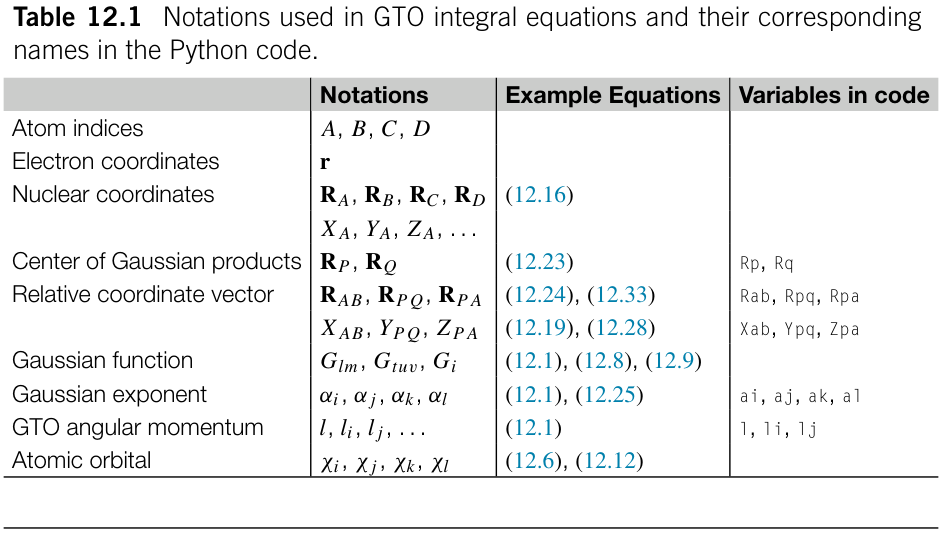

**表 12.1** GTO 积分方程中使用的记号及其对应的 Python 代码中的变量名。

## 12.1 高斯型轨道的解析积分计算

高斯型轨道（GTO）基函数是量子化学程序中最常用的基函数。针对一般量子化学分子体系的哈密顿量，完全可以解析求出 GTO 积分。若用 Python 编写解析积分程序，计算性能便是首要挑战。在本节中，我们将展示如何实现积分程序。我们将从数学方程起步，反复优化程序，直到其性能接近原生 C/C++ 实现。

### 12.1.1 GTO 基组的数据结构

以位置 RA 为中心、由高斯指数 α 表征的原始 GTO 具有以下形式：

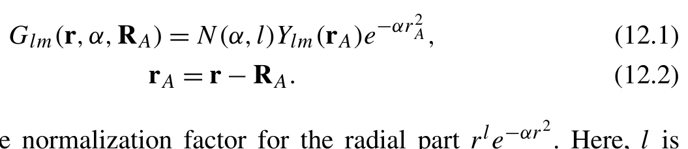{width=51%}

**公式 (12.1)(12.2)**[]{#eq-12-001}

rA = r − R A. (12.2) N(α,l) 是径向部分 r e 的归一化因子。这里，l 称为 GTO 函数的角动量。Ylm(r) 是实值固体谐函数（solid harmonics）。高斯基函数和积分的其他记号约定，以及本章 Python 代码中使用的变量，汇总于表 12.1。
式 (12.1) 中的归一化因子 N(α,l) 可以计算为：

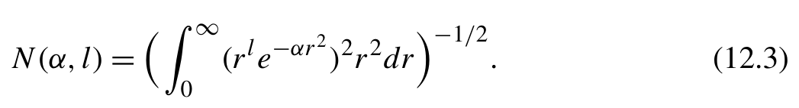{width=51%}

[]{#eq-12-002}

与 scipy.special.gamma 函数相比，

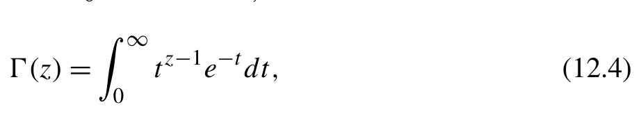{width=45%}

[]{#eq-12-003}

我们得到归一化因子的值

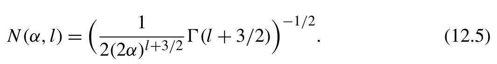{width=52%}

[]{#eq-12-004}

原始 GTO 的径向部分可以与收缩系数（contraction coefficients）Cn 组合，定义收缩 GTO 基函数：

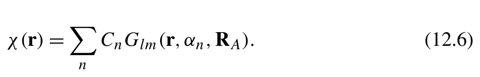{width=48%}

[]{#eq-12-005}

具有相同径向部分和角动量的收缩 GTO 构成一个壳层（shell）。在量子化学软件中，积分引擎通常以 GTO 壳层为最小单位进行处理，而不是处理壳层内单个 GTO 基函数。这种方法很高效，因为同一壳层内 GTO 的积分具有许多共同的中间量，可以在计算中反复使用。最基本的积分函数应当接受一组 GTO 壳层作为输入参数，并将这些壳层内的所有积分直接输出到内存缓冲区中。
有了这些背景，我们可以设计 basis 模块，为收缩 GTO 基组提供基本数据类型。可以使用 dataclass API 定义最小数据结构 CGTO：

```python
@dataclass
class CGTO:
    angular_momentum: int
    exponents: np.ndarray
    coefficients: np.ndarray
    coordinates: np.ndarray
```
为表示 CGTO 类的基组数据，我们可以采用 YAML 格式的配置。例如，下面的配置表示位于 (0., 0., 0.) 的氢原子的 6-31G 基组。

```text
- angular_momentum: 0
  exponents:
  - 18.7311370
- 2.8253937
- 0.6401217
  coefficients:
  - 0.03349460
  - 0.23472695
  - 0.81375733
```

```text
  coordinates:
  -0 .
  -0 .
  -0 .
- angular_momentum: 0
  exponents:
  - 0.1612778
  coefficients:
  - 1.0000000
  coordinates:
  -0 .
  -0 .
  -0 .
```
该配置包含两个收缩 GTO 壳层，可用于定义两个 CGTO 对象。实例化方法可以实现如下：

```python
@dataclass
class CGTO:
    ... # Code omitted for brevity
    @classmethod
    def from_dict(cls, dic: dict):
        angular_momentum = int(dic['angular_momentum'])
        exponents = np.asarray(dic[ 'exponents'], dtype= float)
        coefficients = np.asarray(dic[ 'coefficients'], dtype= float)
        coordinates = np.asarray(dic[ 'coordinates'], dtype= float)
        assert angular_momentum >= 0
        assert all (exponents > 0)
        assert exponents.ndim == 1
        assert coefficients.ndim == 1
        assert coordinates.shape == (3,)
        return cls(angular_momentum, exponents, coefficients, coordinates)
    @classmethod
    def from_yaml(cls, conf: str) -> List[CGTO]:
        '''Creates CGTOs from yaml configuration'''
        conf = yaml.load(conf, Loader=yaml.SafeLoader)
        return [cls.from_dict(x) for x in conf]
```
Basis Set Exchange [1]（BSE）数据库是获取量子化学基组的标准资源。基于 BSE 数据库为 CGTO 类实现一个 from_bse 方法相当实用。

```python
from functools import lru_cache
import basis_set_exchange as bse
```

```python
@dataclass
class CGTO:
    ... # Code omitted for brevity
    @classmethod
    def from_bse(cls, name, element, coordinates) -> List[CGTO]:
        '''Creates CGTOs from BSE database'''
        return [cls.from_dict({'coordinates': coordinates, **basis})
                for basis in bse_basis(name, element)]
@lru_cache(1000)
def bse_basis(name: str, element: str) -> List[ dict]:
    '''Reads and converts BSE GTO basis'''
data = bse.get_basis(name, elements=[element]) # (1)
    basis = []
    for elem_basis in data['elements'].values():
        for raw_basis in elem_basis['electron_shells']:
            exps = np.array(raw_basis[ 'exponents']).astype(float)
            coefs = np.array(raw_basis[ 'coefficients']).astype(float)
            ls = raw_basis[ 'angular_momentum']
            if len (ls) == len(coefs): # SP basis
                for l,c in zip (ls, coefs):
                    basis.append({
                        'angular_momentum': int(l), 'exponents': exps, 'coefficients':c , })
            else:
                for c in coefs:
                    basis.append({
                        'angular_momentum': int(ls[0]), 'exponents': exps, 'coefficients':c , })
    return basis
```
利用 Python 包 basis-set-exchange 即可访问 BSE 数据库。在 bse_basis 函数中，我们将所有 BSE 基组数据转换为与 CGTO 类属性一致的数据类型。第 (1) 行的 BSE API bse.get_basis 会返回嵌套的 Python dict 对象，其中所有数据都以字符串格式存储。随后，我们使用 CGTO.from_bse 方法创建一个 CGTO 对象列表，表示某一位置处一个原子的所有 GTO 壳层。
对于收缩 GTO，式 (12.5) 中的归一化因子可以按如下方式计算：

```python
def gaussian_int(n, alpha):
    r'''int_0^inf x^n exp(-alpha x^2) dx'''
    assert n> =0
    n 1=( n+1 ) * .5
    return scipy.special.gamma(n1) / (2. * alpha**n1)
def gto_norm(l, expnt):
    '''Radial part normalization'''
    assert l> =0
    norm = (gaussian_int(l *2+2,2 *expnt)) ** -.5
    # Racah normalization, assuming angular part is normalized to unity
    norm *= ((2 *l+1)/(4*np.pi))**.5
    return norm
@dataclass
class CGTO:
    ... # Code omitted for brevity
    @property
def norm_coefficients(self): # (1)
        return gto_norm(self.momentum, self.exponents) * self.coefficients
```
如第 (1) 行的属性 norm_coefficients 所示，归一化因子随后与收缩系数（contraction coefficients）结合，形成复合系数，用于缩放原始高斯型轨道（primitive GTO）积分。
式 (12.1) 中的球面高斯型轨道（spherical GTO）可以用笛卡尔高斯型轨道（Cartesian GTO）函数表示：

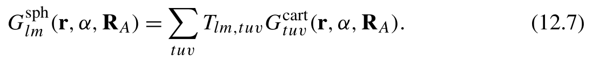{width=53%}

[]{#eq-12-006}

一个笛卡尔高斯型轨道可以分解为三个笛卡尔分量的乘积

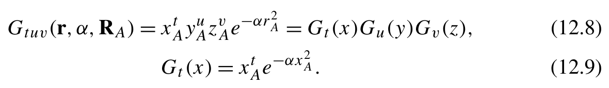{width=58%}

**公式 (12.8)(12.9)**[]{#eq-12-007}

与球谐高斯型轨道（spherical-harmonic GTO）相比，这种分解显著简化了笛卡尔高斯型轨道积分的计算。通常先计算笛卡尔高斯型轨道上的积分，然后将其转换为球谐高斯型轨道上的积分。变换系数 Tlm,tuv 记载于各种文献中 [2,3]，可以预先计算并缓存。作为线性变换，式 (12.7) 在积分计算程序中不是一个重大挑战。在后续讨论中，我们将省略这一变换，转而关注笛卡尔高斯型轨道的积分。
式 (12.8) 中的指标 t、u、v 表示笛卡尔高斯型轨道函数的角动量 l：
它们是大于或等于零的整数。在每个高斯型轨道壳层（GTO shell）中，该约束产生 (l +1)(l +2) 个函数。basis 模块中的 n_cart 函数给出了这一数目。每个壳层中的 (l + 1)(l + 2) 个高斯型轨道按字典序排列。按照这一顺序，可以通过程序访问三个笛卡尔分量 (t, u, v)，如下方的 iter_cart_xyz 函数所示

```python
def n_cart(l):
    return (l+1) * (l+2) // 2
def iter_cart_xyz(l):
    for t in reversed (range(l+1)):
        for u in reversed (range(l+1-t)):
            v=l-t-u
            yield t,u ,v
```
例如，d 型高斯型轨道壳层中的 6 个笛卡尔函数按以下顺序排列

```python
In [1]: for t,u ,v in iter_cart_xyz(2):
            print(f'x^{t}y^{u}z^{v}')
Out[1]:
x^2y^0z^0
x^1y^1z^0
x^1y^0z^1
x^0y^2z^0
x^0y^1z^1
x^0y^0z^2
```
为了简化索引高斯型轨道在基函数中位置的代码，我们引入了辅助函数 gto_offsets：

```python
def gto_offsets(gtos):
    '''Offsets are the position of the first GTO function for each GTO
    shell inside all GTO basis functions. The last element of the offsets
    is the total number of basis functions.
    '''
    dims = [n_cart(b.angular_momentum) for b in gtos]
    return np.append(0, np.cumsum(dims))
```
除了用于积分计算的基础类 CGTO 之外，我们还引入了 Molecule 类来管理分子的几何结构与基组（basis set）。Molecule.assign_basis 方法为指定的基组生成分子的所有高斯型轨道壳层。

```python
@dataclass
class Molecule:
    elements: List[ str]
    coordinates: np.ndarray
    @classmethod
    def from_xyz(cls, xyz: str):
        elements = []
        coordinates = []
        for line in xyz.splitlines():
            line = line.strip()
            if not line or line[0] == '#':
                continue
            elements.append(line.split()[0])
            coordinates.append(line.split()[1:4])
        # In atomic unit
        coordinates = np.array(coordinates).astype( float) / 0.52917721
        assert coordinates.shape[1] == 3
        return cls(elements=elements, coordinates=coordinates)
    def assign_basis(self, basis_set: Dict[ str, str]) -> List[CGTO]:
        '''Creates a list of CGTOs for the molecule in xyz geometry
        '''
        gtos = []
        for elem,r in zip (self.elements, self.coordinates):
            gtos.extend(CGTO.from_bse(basis_set[elem], elem, r))
    return gtos
```

### 12.1.2 解析高斯型轨道积分的类型

量子化学计算需要计算各种类型的积分。以下两类积分尤为重要，因为其他积分可以从这些基础类型推导或变换得到。

- 重叠积分（overlap integrals）

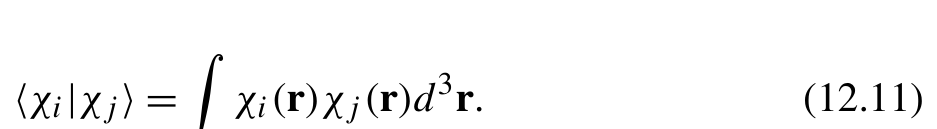{width=46%}

[]{#eq-12-008}

- 库仑排斥积分（Coulomb repulsion integrals，ERI）

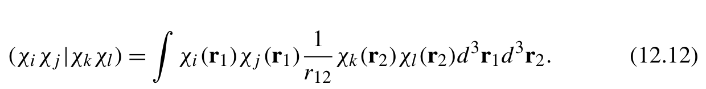{width=60%}

[]{#eq-12-009}

例如，动能算符的积分可以从重叠积分推导得到

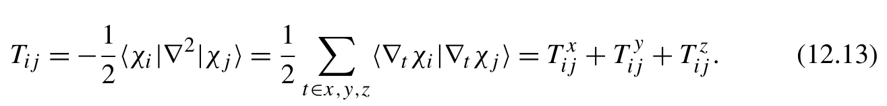{width=64%}

[]{#eq-12-010}

一个原始笛卡尔高斯型轨道的导数产生两个原始高斯型轨道

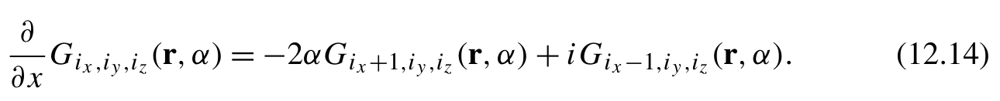{width=63%}

[]{#eq-12-011}

因此，式 (12.13) 中的每一项得到

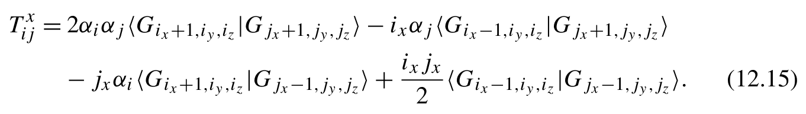{width=66%}

**公式 (12.15)**[]{#eq-12-012}

另一个例子是核吸引算符的积分，其定义为

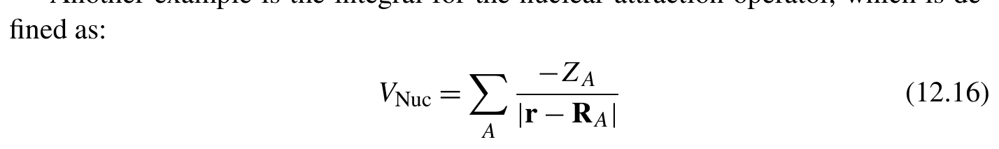{width=70%}

[]{#eq-12-013}

其中 ZA 表示原子 A 的核电荷。通过引入两个非常紧凑的 s 型高斯型轨道 Gs，我们可以利用电子排斥积分公式 (12.12) 模拟两个高斯型轨道与位于 RA 的单位点电荷之间的相互作用。该方法将核吸引积分转换为

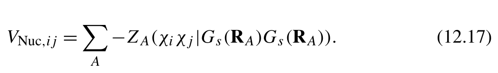{width=53%}

[]{#eq-12-014}

积分程序的核心是计算重叠积分与电子排斥积分（electron repulsion integrals）。在后续各节中，我们将使用各种解析积分算法实现积分程序。如何用 Python 开发和优化一个高性能的积分程序？我们可以遵循以下步骤：

1. 推导必要的公式，具体来说是递推关系。
2. 使用动态规划（dynamic programming，DP）方法，以递归方式将这些积分公式转换为 Python 代码。
3. 基于递归动态规划代码创建测试，以确保可复现性。
4. 将递归动态规划代码转换为使用嵌套 for 循环迭代的版本。
5. 使用编译技术优化程序的热点。
6. 针对特定硬件或架构优化程序。

### 12.1.3 递推关系与动态规划实现

量子化学中的解析积分通常涉及递推关系（recurrence relations，RR）的使用。这些公式通过复用先前计算的值，提供了一种高效计算积分的方法。本节将重点介绍如何使用递推关系公式逐步开发计算重叠积分和电子排斥积分的程序。这些递推关系公式的数学推导超出了本书的范围。有关积分公式的详细推导，读者可以参考其他量子化学文献，例如 Helgaker 的著作 Molecular Electronic Structure Theory [4]，以及 Flocke 和 Lotrich 的论文 Efficient Electronic Integrals and their Generalized Derivatives for Object Oriented Implementations of Electronic Structure Calculations [5]。

#### 12.1.3.1 两个原始笛卡尔高斯型轨道之间的重叠积分

一个重叠积分可以分解为三个笛卡尔分量的乘积
单个笛卡尔分量的递推关系公式为
当 jx = 0 时，可以使用另一种递推关系

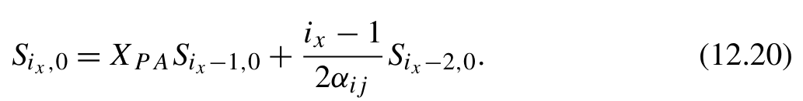{width=50%}

[]{#eq-12-015}

递推关系的起点和边界条件为

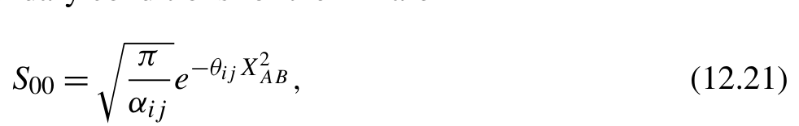{width=48%}

**公式 (12.21)**[]{#eq-12-016}

在这些公式中，RA 和 RB 分别是左矢和右矢高斯型轨道的中心。电荷中心坐标 RP 计算如下

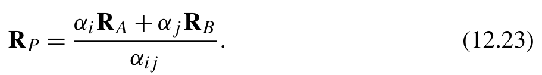{width=44%}

[]{#eq-12-017}

两个中心之间的位移向量计算如下

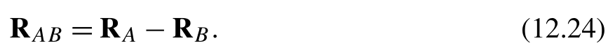{width=43%}

[]{#eq-12-018}

XAB 和 XPA 分别表示位移向量 RAB 和 RPA 的一个笛卡尔方向。参数 αij 和 θij 计算如下

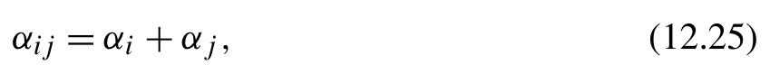{width=41%}

**公式 (12.25)**[]{#eq-12-019}

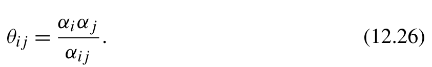{width=41%}

**公式 (12.26)**[]{#eq-12-020}

我们可以采用自顶向下的动态规划策略，直接将递推关系公式转换为重叠积分代码。首先创建一个接受两个参数的递归函数 get_S，准确对应于递推关系公式 (12.21)。

```python
def get_S(i: int,j : int):
    if j= =0 :
        return Rpa * get_S(i-1,j )+( i-1)/(2*aij) * get_S(i-2,j )
    return get_S(i+1,j-1) + Rab * get_S(i,j-1)
```
get_S 函数同时计算三个笛卡尔分量。接下来，将起点和边界条件纳入递归动态规划函数。

```python
@lru_cache(1000)
def get_S(i: int,j : int):
    if i<0 or j<0 :
        return 0.
    if i == j == 0:
        return (np.pi/aij)**.5 * np.exp(-theta_ij*Rab**2)
    if j= =0 :
        return (i-1)/(2*aij) * get_S(i-2, j) + Rpa * get_S(i-1,j )
    return Rab * get_S(i,j -1) + get_S(i+1,j -1)
```
在递归调用时，某些动态规划状态可能会被多次访问。为避免重复计算中间状态，我们可以使用 lru_cache 装饰器对这些状态进行记忆化缓存。
根据这个动态规划函数，可以按照式 (12.18) 计算重叠积分。

```text
for i, (ix,i y, iz) in enumerate (iter_cart_xyz(li)):
    for j,( j x,j y, jz) in enumerate (iter_cart_xyz(lj)):
        S[i,j] = get_S(ix,jx)[0] * get_S(iy,jy)[1] * get_S(iz,jz)[2]
```
这里，指标 0、1 和 2 表示三个笛卡尔方向。为了遍历左矢和右矢壳层中的所有笛卡尔高斯型轨道，我们使用 iter_cart_xyz 函数来

```text
generatetheirCartesianpowers (ix, iy, iz)and (jx, jy, jz).
```
将上述所有部分组合起来，我们得到一个计算一对原始笛卡尔高斯型轨道之间重叠积分的函数。

```python
def primitive_overlap(li: int, lj: int,a i : float, aj: float, Ra: np.ndarray, Rb: np.ndarray) -> np.ndarray:
    aij = ai + aj
    Rab = Ra - Rb
    Rp = (ai * R a+a j * Rb) / aij
```

```python
Rpa = Rp - Ra
theta_ij = ai * aj / aij
@lru_cache(1000)
def get_S(i: int,j : int):
if i<0 or j<0 :
return 0
if j>0 :
return get_S(i+1,j -1) + Rab * get_S(i,j-1)
if i>1 :
return Rpa * get_S(i-1,j )+( i -1)/(2*aij) * get_S(i-2,j )
if i= =1 :
return Rpa * get_S(i-1,j )
return (np.pi/aij)**.5 * np.exp(-theta_ij * Rab**2)
nfi = n_cart(li)
nfj = n_cart(lj)
overlap = np.zeros((nfi, nfj))
for i,( i x,i y, iz) in enumerate (iter_cart_xyz(li)):
for j, (jx,j y, jz) in enumerate (iter_cart_xyz(lj)):
overlap[i,j] = (get_S(ix,jx)[0] * get_S(iy,jy)[1] *
get_S(iz,jz)[2])
return overlap
```

#### 12.1.3.2 使用 McMurchie-Davidson 算法计算电子排斥积分

使用 McMurchie-Davidson（MD）算法，可以通过张量收缩（tensor contraction）求解四指标电子排斥积分（ERI）张量。

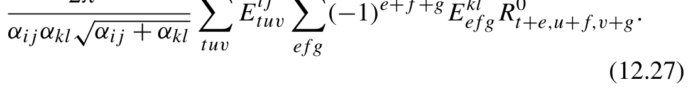{width=54%}

**公式 (12.27)**[]{#eq-12-021}

(12.27) 计算 R 张量的递推关系（RR）公式如下：

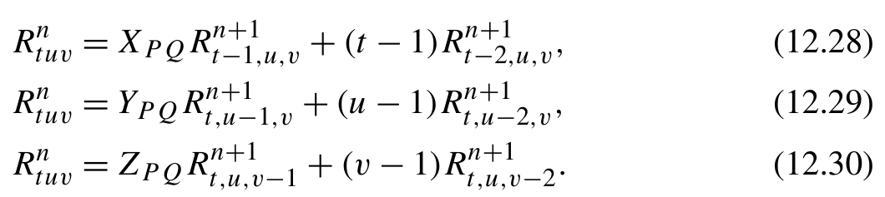{width=52%}

**公式 (12.28)(12.29)(12.30)**[]{#eq-12-022}

= XP QRn + (t − 1)Rn, (12.28)
= YP QRn + (u − 1)Rn, (12.29)
= ZP QRn (v − 1)Rn. (12.30) The starting point and boundary conditions are

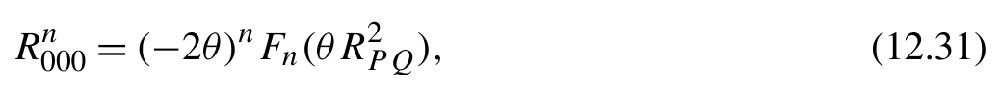{width=51%}

**公式 (12.31)**[]{#eq-12-023}

= 0 if t < 0o r u< 0o r v < 0, (12.32)
其中 XPQ、YPQ 和 ZPQ 表示矢量 RPQ 的三个笛卡尔方向，该矢量是两个电荷中心坐标之间的间隔。

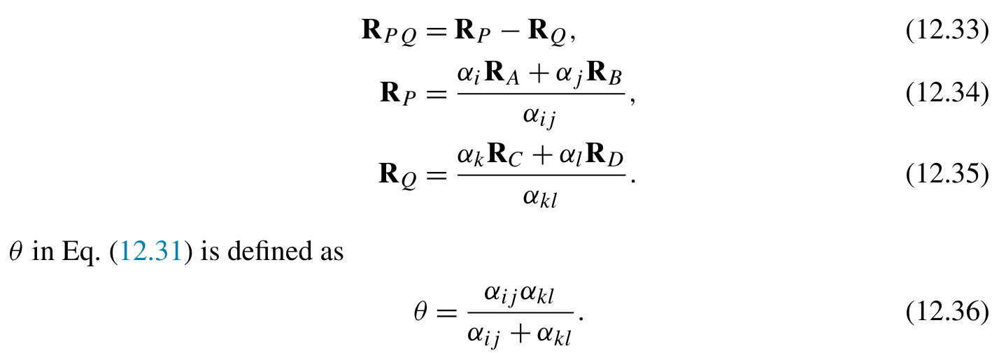{width=70%}

**公式 (12.33)(12.34)(12.35)(12.31)**[]{#eq-12-024}

式 (12.31) 中的 θ 定义为：在式 (12.31) 中，Fn 表示 n 阶函数：

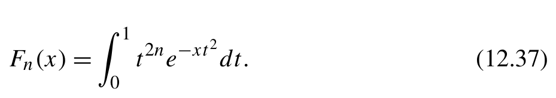{width=45%}

[]{#eq-12-025}

计算 Boys 函数的程序将在第 12.2.2 节讨论。
与重叠积分（overlap integrals）所用的方法类似，我们可以构建递归动态规划（DP）函数 get_R，应用递推关系公式和边界条件。这个递归函数接收四个整数作为输入，分别对应 R 张量的下标 t、u、v 和阶数索引 n。

```python
def get_R_tensor(l, theta, Rpq):
    @lru_cache(4000)
    def get_R(n,t ,u , v):
        if t<0 or u<0 or v<0 :
            return 0.
        elif t>0 :
            return ((t-1) * get_R(n+1,t-2,u ,v )+
                    Rpq[0] * get_R(n+1,t-1,u , v))
        elif u>0 :
            return ((u-1) * get_R(n+1,t ,u -2,v )+
                    Rpq[1] * get_R(n+1,t ,u -1, v))
        elif v>0 :
            return ((v-1) * get_R(n+1,t ,u ,v-2) +
                    Rpq[2] * get_R(n+1,t ,u ,v-1))
        #t= =u= =v= =0 :
        return (-2*theta)**n * boys(n, theta *np.array(Rpq).dot(Rpq))
    Rt = np.zeros((l+1, l+1, l+1))
    for t in range (l+1):
        for u in range (l+1):
            for v in range (l+1):
```

```python
Rt[t,u,v] = get_R(0,t ,u ,v )
return Rt
```
式 (12.27) 中的 E 张量是三个笛卡尔分量的乘积。
为推导每个笛卡尔分量，可以使用以下递推关系：

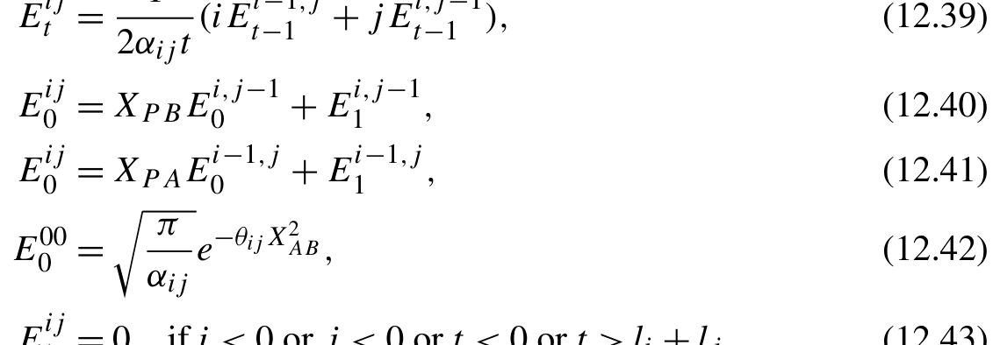{width=56%}

**公式 (12.40)(12.41)(12.42)**[]{#eq-12-026}

− θij X
这些递推关系可以转换为递归动态规划函数。

```python
def get_E_cart_components(li,l j,a i,a j,R a, Rb):
aij = ai + aj
Rab = Ra - Rb
Rp = (ai * R a+a j * Rb) / aij
Rpa = Rp - Ra
Rpb = Rp - Rb
theta_ij = ai * aj / aij
@lru_cache(1000)
def get_E(i,j , t):
if t<0 or i<0 or j<0 or t > li+lj:
return 0.
if t>0 :
return (i*get_E(i-1,j,t- 1 )+j *get_E(i,j-1,t-1)) / (2 *aij*t)
if j>0 : #t=0
return Rpb * get_E(i,j-1,0) + get_E(i,j-1,1)
if i>0 : #t=0
return Rpa * get_E(i-1,j,0) + get_E(i-1,j,1)
#i= =j= =t= =0
return np.exp(-theta_ij * Rab**2)
E_cart = np.zeros((li+1, lj+1, li+lj+1, 3))
for i in range (li+1):
for j in range (lj+1):
for t in range (li+lj+1):
```

```python
                E_cart[i,j,t] = get_E(i,j ,t )
    return E_cart
```
然后，我们用笛卡尔分量构造 E 张量 (12.38)：

```python
def get_E_tensor(li,l j,a i,a j,R a, Rb):
    E_cart = get_E_cart_components(li,l j,a i,a j,R a,R b )
    Ex = E_cart[:,:,:,0]
    Ey = E_cart[:,:,:,1]
    Ez = E_cart[:,:,:,2]
    ix,i y, iz = np.array( list(iter_cart_xyz(li))).T
    jx,j y, jz = np.array( list(iter_cart_xyz(lj))).T
    return np.einsum('ijx,ijy,ijz->ijxyz', Ex[ix[:,np.newaxis],jx], Ey[iy[:,np.newaxis],jy], Ez[iz[:,np.newaxis],jz])
```
求得 E 和 R 张量后，我们可以用张量收缩代码构造电子排斥积分张量 (12.27)：

```python
from itertools import product
def primitive_ERI(li,l j,l k,l l,a i,a j,a k,a l,R a,R b,R c, Rd):
    aij = ai + aj
    akl = ak + al
    theta = aij * akl / (aij + akl)
    Rp = (ai * R a+a j * Rb) / aij
    Rq = (ak * R c+a l * Rd) / akl
    Rpq = Rp - Rq
    Rt = get_R_tensor(li+lj+lk+ll, theta, Rpq)
    l i j 1=l i+l j+1
    l k l 1=l k+l l+1
    Rt2 = np.zeros((lij1,lij1,lij1, lkl1,lkl1,lkl1))
    for e,f ,g in product(range(lkl1), range(lkl1), range(lkl1)):
        Rt2[:,:,:,e,f,g] = (-1)**(e+f+g) * Rt[e:e+lij1,f:f+lij1,g:g+lij1]
    Etab = get_E_tensor(li,l j,a i,a j,R a, Rb)
    Etcd = get_E_tensor(lk,l l,a k,a l,R c, Rd)
    e r i=( 2 *np.pi**2.5/(aij*akl*(aij+akl)**.5) *
           np.einsum('abtuv,tuvefg,cdefg->abcd', Etab, Rt2, Etcd))
    return eri
```
在这个示例中，使用 itertools.product 函数生成嵌套循环结构。

#### 12.1.3.3 使用 Obara-Saika 算法计算电子排斥积分

在 Obara-Saika（OS）算法中，笛卡尔高斯型轨道（Cartesian GTO）的三个笛卡尔分量被显式编码到四中心电子排斥积分张量中，得到一个十二
维张量：
OS 算法从 Boys 函数起步，依次历经三个递推步骤：垂直递推关系（VRR）、电子转移递推关系（TRR）和水平递推关系（HRR）。顺次执行完这些步骤后，便得到十二维张量，进而可将其转换为四指标电子排斥积分张量。
第一步是垂直递推关系，它增加第一中心的角动量 (ix, iy, iz)。增加幂次 ix 的方程为：

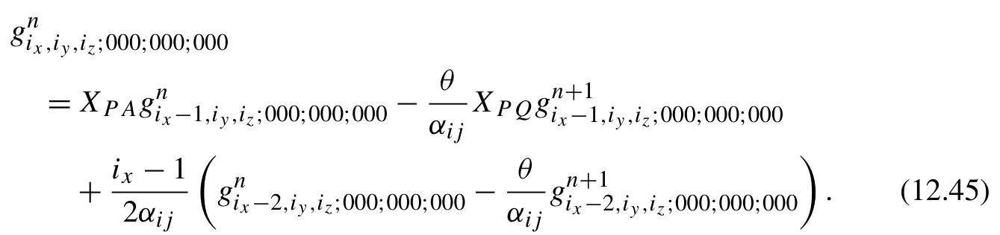{width=65%}

**公式 (12.45)**[]{#eq-12-027}

可以推导出类似的垂直递推方程来增加 iy 和 iz。垂直递推的起点是 Boys 函数：

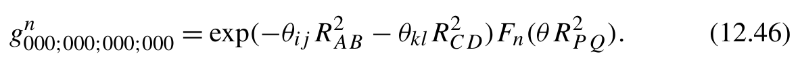{width=58%}

[]{#eq-12-028}

这些垂直递推方程可以写成一个动态规划函数，它接收式 (12.45) 中的阶数 n 作为一个输入参数，以及代表第一中心三个笛卡尔幂次的三个整数输入。张量 g 的其余九个下标在垂直递推方程中全为零，因此直接省略。

```python
def primitive_ERI(li,l j,l k,l l,a i,a j,a k,a l,R a,R b,R c, Rd):
    aij = ai + aj
    Rp = (ai * R a+a j * Rb) / aij
    theta_ij = ai * aj / aij
    Rab = Ra - Rb
    akl = ak + al
    Rq = (ak * R c+a l * Rd) / akl
    theta_kl = ak * al / akl
    Rcd = Rc - Rd
    Rpq = Rp - Rq
    theta = aij * akl / (aij + akl)
    theta_r2 = theta * Rpq.dot(Rpq)
    Kabcd = 2 *np.pi**2.5/(aij*akl*(aij+akl)**.5)
    Kabcd *= np.exp(-theta_ij*Rab.dot(Rab) - theta_kl *Rcd.dot(Rcd))
    Xpq, Ypq, Zpq = Rpq
    Xpa, Ypa,Z p a=R p-R a
```

```python
    @lru_cache(10000)
    def vrr(n,i x,i y, iz):
        if iz > 0:
            val = Zpa *vrr(n,i x,i y,i z-1)
            val -= theta/aij *Zpq*vrr(n+1,i x,i y,i z-1)
            if i z>1 :
                val += (iz-1)*.5/aij * (vrr(n,i x,i y,i z-2) -
                                        theta/aij*vrr(n+1,i x,i y,i z-2))
            return val
        if iy > 0:
            val = Ypa *vrr(n,i x,i y-1, iz)
            val -= theta/aij *Ypq*vrr(n+1,i x,i y-1, iz)
            if i y>1 :
                val += (iy-1)*.5/aij * (vrr(n,i x,i y-2, iz) -
                                        theta/aij*vrr(n+1,i x,i y-2, iz))
            return val
        if ix > 0:
            val = Xpa *vrr(n,i x-1,i y, iz)
            val -= theta/aij *Xpq*vrr(n+1,i x-1,i y, iz)
            if i x>1 :
                val += (ix-1)*.5/aij * (vrr(n,i x-2,i y, iz) -
                                        theta/aij*vrr(n+1,i x-2,i y, iz))
            return val
        return Kabcd * boys(n, theta *Rpq.dot(Rpq))
```
第二步使用电子转移递推关系，将笛卡尔幂次从第一个电子（第一中心）转移到第二个电子（第三中心）。沿 x 方向的电子转移递推方程为：

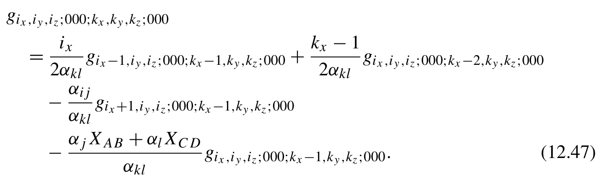{width=64%}

**公式 (12.47)**[]{#eq-12-029}

y 和 z 方向也有结构类似的电子转移递推方程。当笛卡尔幂次到达 kx = ky = kz = 0 的边界时，就到达了电子转移递推的起点，它对应于式 (12.45) 中垂直递推公式的结果。电子转移递推方程的递归动态规划函数为：

```python
def primitive_ERI(li,l j,l k,l l,a i,a j,a k,a l,R a,R b,R c, Rd):
    ... # Code omitted for brevity
```

```python
    Xab, Yab, Zab = Rab
    Xcd, Ycd, Zcd = Rcd
    @lru_cache(10000)
    def trr(ix,i y,i z,k x,k y, kz):
        if kz > 0:
            val = -(aj *Zab+al*Zcd)/akl * trr(ix,i y,i z,k x,k y,k z-1)
            val -= aij/akl * trr(ix,i y,i z + 1,k x,k y,k z-1)
            if k z>1 :
                val += (kz-1)*.5/akl * trr(ix,i y,i z,k x,k y,k z-2)
            if i z>0 :
                val += iz *.5/akl * trr(ix,i y,i z-1,k x,k y,k z-1)
            return val
        if ky > 0:
            val = -(aj *Yab+al*Ycd)/akl * trr(ix,i y,i z,k x,k y-1, kz)
            val -= aij/akl * trr(ix, iy+1,i z,k x,k y-1, kz)
            if k y>1 :
                val += (ky-1)*.5/akl * trr(ix,i y,i z,k x,k y-2, kz)
            if i y>0 :
                val += iy *.5/akl * trr(ix,i y-1,i z,k x,k y-1, kz)
            return val
        if kx > 0:
            val = -(aj *Xab+al*Xcd)/akl * trr(ix,i y,i z,k x-1,k y, kz)
            val -= aij/akl * trr(ix+1,i y,i z,k x-1,k y, kz)
            if k x>1 :
                val += (kx-1)*.5/akl * trr(ix,i y,i z,k x-2,k y, kz)
            if i x>0 :
                val += ix *.5/akl * trr(ix-1,i y,i z,k x-1,k y, kz)
            return val
        return vrr(0,i x,i y, iz)
    ... # Code omitted for brevity
```
注意，当该因子较大时，TRR 公式 (12.47) 可能出现数值稳定性问题。该因子可能放大某些中间变量并导致大数相减，从而产生舍入误差。为缓解数值稳定性隐患，可以使用另一种 TRR 方程：

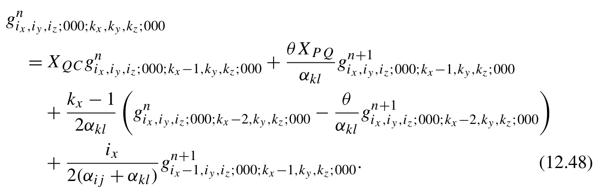{width=65%}

**公式 (12.48)**[]{#eq-12-030}

为简单起见，接下来的几节暂时使用式 (12.47)，因为它不影响我们演示如何实现和优化积分程序。不过在第 12.1.8 节实现的最终版本中，我们将换用更精确的公式 (12.48)。
在 TRR 之后，我们可以继续应用水平递推关系（HRR），在同一电子的两个中心之间转移笛卡尔幂次。下面是针对第一个电子沿 x 方向转移幂次的 HRR 方程
另外还有五个 HRR 方程，用于转移电子排斥积分（ERI）张量中其余笛卡尔方向的幂次。这六个 HRR 方程同样可以转换成一个新的动态规划（DP）函数，如下所示：

```python
@lru_cache(100000)
def hrr(ix,i y,i z,j x,j y,j z,k x,k y,k z,l x,l y, lz):
    if lz > 0:
        return (hrr(ix,i y,i z,j x,j y,j z,k x,k y, kz+1,l x,l y,l z-1) +
Zcd * hrr(ix,i y,i z,j x,j y,j z,k x,k y,k z ,l x ,l y,l z-1))
    if ly > 0:
        return (hrr(ix,i y,i z,j x,j y,j z,k x, ky+1,k z,l x,l y-1, lz) +
Ycd * hrr(ix,i y,i z,j x,j y,j z,k x,k y ,k z ,l x,l y-1, lz))
    if lx > 0:
        return (hrr(ix,i y,i z,j x,j y,j z, kx+1,k y,k z,l x-1,l y, lz) +
Xcd * hrr(ix,i y,i z,j x,j y,j z,k x ,k y ,k z,l x-1,l y, lz))
    if jz > 0:
        return (hrr(ix,i y, iz+1,j x,j y,j z-1,k x,k y,k z,l x,l y, lz) +
Zab * hrr(ix,i y,i z ,j x ,j y,j z-1,k x,k y,k z,l x,l y, lz))
    if jy > 0:
        return (hrr(ix, iy+1,i z,j x,j y-1,j z,k x,k y,k z,l x,l y, lz) +
Yab * hrr(ix,i y ,i z ,j x,j y-1,j z,k x,k y,k z,l x,l y, lz))
    if jx > 0:
        return (hrr(ix+1,i y,i z,j x-1,j y,j z,k x,k y,k z,l x,l y, lz) +
Xab * hrr(ix , iy ,i z,j x-1,j y,j z,k x,k y,k z,l x,l y, lz))
    return trr(ix,i y,i z,k x,k y, kz)
```
将前面提到的所有递推关系（RR）函数组合起来，得到 OS 算法的 ERI 函数：

```python
def primitive_ERI(li,l j,l k,l l,a i,a j,a k,a l,R a,R b,R c, Rd):
    ... # Code omitted for brevity
    @lru_cache(10000)
    def vrr(n,i x,i y, iz):
        ...
```

```python
    @lru_cache(10000)
    def trr(ix,i y,i z,k x,k y, kz):
        ...
        return vrr(0,i x,i y, iz)
    @lru_cache(100000)
    def hrr(ix,i y,i z,j x,j y,j z,k x,k y,k z,l x,l y,l z ) :
        ...
        return trr(ix,i y,i z,k x,k y, kz)
    nfi, nfj, nfk, nfl = map(n_cart, (li,l j,l k, ll))
    eri = np.empty((nfi, nfj, nfk, nfl))
    for i,( i x,i y, iz) in enumerate (iter_cart_xyz(li)):
        for j, (jx,j y, jz) in enumerate (iter_cart_xyz(lj)):
            for k, (kx,k y, kz) in enumerate (iter_cart_xyz(lk)):
                for l, (lx,l y, lz) in enumerate (iter_cart_xyz(ll)):
                    eri[i,j,k,l] = hrr(ix,iy,iz,jx,jy,jz,kx,ky,kz,lx,ly,lz)
    return eri
```

#### 12.1.3.4 用 Rys 求积算法计算 ERI

可以使用求积法（quadrature method）计算 ERI：

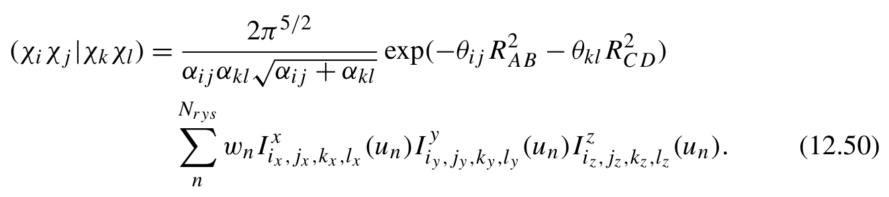{width=65%}

**公式 (12.50)**[]{#eq-12-031}

wnIx (un)Iy (un)Iz (un). (12.50)
这里，un 和 wn 分别表示由 NRys 阶多项式导出的求积根和权重。式 (12.50) 的求和范围等于求积根的数量

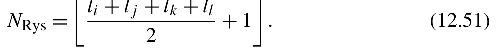{width=48%}

[]{#eq-12-032}

计算求积根和权重的程序将在第 12.2.2 节讨论。
为计算 I 张量，我们可以应用以下 RR 方程

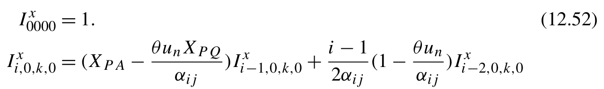{width=62%}

**公式 (12.52)**[]{#eq-12-033}

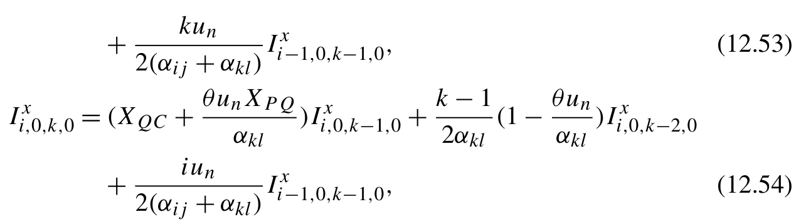{width=62%}

**公式 (12.53)(12.54)**[]{#eq-12-034}

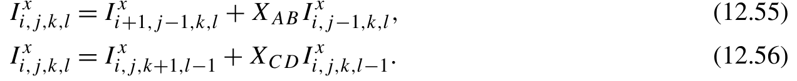{width=62%}

**公式 (12.56)**[]{#eq-12-035}

Ix = Ix XC DIx, (12.56)。张量 Iy 和 Iz 也可以用类似的 RR 方程计算。将这些方程转换为计算程序，得到以下 DP 函数：

```python
def primitive_ERI(li,l j,l k,l l,a i,a j,a k,a l,R a,R b,R c, Rd):
aij = ai + aj
Rab = Ra - Rb
Rp = (ai * R a+a j * Rb) / aij
theta_ij = ai * aj / aij
akl = ak + al
Rcd = Rc - Rd
Rq = (ak * R c+a l * Rd) / akl
theta_kl = ak * al / akl
Rpq = Rp - Rq
theta = aij * akl / (aij + akl)
theta_r2 = theta * Rpq.dot(Rpq)
Kabcd = 2 *np.pi**2.5/(aij*akl*(aij+akl)**.5)
Kabcd *= np.exp(-theta_ij*Rab.dot(Rab) - theta_kl *Rcd.dot(Rcd))
lij = li + lj
lkl = lk + ll
nroots = (lij + lkl + 2) // 2
rt, wt = rys_roots_weights(nroots, theta_r2)
wt *= Kabcd
Rpq = Rpq[:,np.newaxis]
R p a=R p [ :,np.newaxis] - Ra[:,np.newaxis]
R q c=R q [ :,np.newaxis] - Rc[:,np.newaxis]
@lru_cache(10000)
def trr(i, k):
if i<0 or k<0 :
return 0.
if i= =k= =0 :
return np.ones((3, nroots))
if k= =0 :
```

```python
            return ((Rpa - Rpq *theta/aij*rt) * trr(i-1,k )+
                    (i-1)*.5/aij*(1-theta/aij*rt) * trr(i-2, k))
        if i= =0 :
            return ((Rqc + Rpq *theta/akl*rt) * trr(i,k-1) +
                    (k-1)*.5/akl*(1-theta/akl*rt) * trr(i,k-2))
        else:
            val = (Rqc + Rpq *theta/akl*rt) * trr(i,k-1)
            val += (k-1)*.5/akl*(1-theta/akl*rt) * trr(i,k -2)
            val += i *.5/(aij+akl)*rt * trr(i-1,k-1)
        return val
    @lru_cache(10000)
    def hrr(i,j ,k , l):
if j>0 :
            return hrr(i+1,j-1,k,l) + Rab[:,np.newaxis] * hrr(i,j-1,k,l)
        if l>0 :
            return hrr(i,j,k+1,l-1) + Rcd[:,np.newaxis] * hrr(i,j,k,l-1)
        return trr(i,k )
    nfi, nfj, nfk, nfl = map(n_cart, (li,l j,l k, ll))
    eri = np.empty((nfi, nfj, nfk, nfl))
    for i,( i x,i y, iz) in enumerate (iter_cart_xyz(li)):
        for j, (jx,j y, jz) in enumerate (iter_cart_xyz(lj)):
            for k, (kx,k y, kz) in enumerate (iter_cart_xyz(lk)):
                for l, (lx,l y, lz) in enumerate (iter_cart_xyz(ll)):
                    Ix = hrr(ix,jx,kx,lx)[0]
                    Iy = hrr(iy,jy,ky,ly)[1]
                    Iz = hrr(iz,jz,kz,lz)[2]
                    eri[i,j,k,l] = np.einsum( 'n,n,n,n->',w t,I x,I y,I z )
    return eri
```

#### 12.1.3.5 积分收缩

推导出计算原始高斯型轨道（GTO）的 ERI 程序后，现在可以继续计算收缩基组的 ERI。给定一个壳层四元组 (i,j,k,l)，它表示 ERI 中四个收缩 GTO 函数壳层，执行积分收缩的最简单函数可实现如下：

```python
def contracted_ERI(f, bas_i, bas_j, bas_k, bas_l):
    li, lj = bas_i.angular_momentum, bas_j.angular_momentum
    lk, ll = bas_k.angular_momentum, bas_l.angular_momentum
    Ra, Rb = bas_i.coordinates, bas_j.coordinates
    Rc, Rd = bas_k.coordinates, bas_l.coordinates
    norm_ci = bas_i.norm_coefficients
    norm_cj = bas_j.norm_coefficients
```

```python
    norm_ck = bas_k.norm_coefficients
    norm_cl = bas_l.norm_coefficients
    nfi, nfj, nfk, nfl = map(n_cart, (li,l j,l k, ll))
    eri = np.zeros((nfi, nfj, nfk, nfl))
    for ai,c i in zip (bas_i.exponents, norm_ci):
        for aj,c j in zip (bas_j.exponents, norm_cj):
            for ak,c k in zip (bas_k.exponents, norm_ck):
                for al,c l in zip (bas_l.exponents, norm_cl):
                    eri += ci *cj*ck*cl * f(li,l j,l k,l l,a i,a j,a k,a l, Ra,R b,R c,R d )
    return eri
```
应当指出，这种简单的积分收缩方案在浮点运算（FLOP）次数上并非最优。可以采用提前收缩技术，调换 HRR 迭代和积分收缩的顺序，以减少浮点运算次数。
在 HRR 方程中，例如式 (12.49)，向量 RAB 对壳层四元组中的所有原始 ERI 都保持不变。它可以作为公因子从 primitive_ERI 函数中提取出来。如图 12.1 所示，在收缩 GTO 基函数的 ERI 算法中，应用 vrr、trr、hrr 和收缩等中间步骤的顺序可以调整。请注意，图 12.1 中使用的记号 [χiχj|χkχl] 和 (χiχj|χkχl) 分别用于区分原始 GTO 和收缩 GTO 的积分。在量子化学文献中，原始 GTO 的 ERI 通常用方括号表示，例如 [χiχj|χkχl]；收缩 GTO 的 ERI 则用圆括号表示，例如 (χiχj|χkχl)。进一步考虑角动量和收缩度的细节，还可以优化 ERI 的计算路径，减少浮点运算次数。

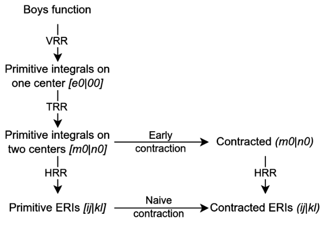

**图 12.1** 求值收缩 ERI 的不同路径，499 和将要

有关最优路径的讨论可见各种量子化学教材和文献 [4]。
以 OS 算法为例，为应用提前收缩方案，可将第 12.1.3.3 节所述程序修改如下：

```python
def primitive_trr(li,l j,l k,l l,a i,a j,a k,a l,R a,R b,R c, Rd):
    ... # Code omitted for brevity
    def vrr(n,i x,i y, iz):
        ...
    def trr(ix,i y,i z,k x,k y, kz):
        ...
        return vrr(0,i x,i y, iz)
    return trr
def contracted_ERI(f_prim, bas_i, bas_j, bas_k, bas_l):
    li, lj = bas_i.angular_momentum, bas_j.angular_momentum
    lk, ll = bas_k.angular_momentum, bas_l.angular_momentum
    ... # Code omitted for brevity
    @lru_cache(10000)
    def trr_adapter(ai,a j,a k, al):
        return primitive_trr(li,l j,l k,l l,a i,a j,a k,a l, Ra,R b,R c,R d )
    def contracted_trr(ix,i y,i z,k x,k y, kz):
        eri_2c = 0.
        for ai,c i in zip (bas_i.exponents, norm_ci):
            for aj,c j in zip (bas_j.exponents, norm_cj):
                for ak,c k in zip (bas_k.exponents, norm_ck):
                    for al,c l in zip (bas_l.exponents, norm_cl):
                        trr = trr_adapter(ai,a j,a k, al)
                        eri_2c += ci *cj*ck*cl * trr(ix,i y,i z,k x,k y, kz)
        return eri_2c
    def hrr(ix,i y,i z,j x,j y,j z,k x,k y,k z,l x,l y,l z ) :
        ...
        return contracted_trr(ix,i y,i z,k x,k y, kz)
    ...
```
提前收缩算法将收缩代码与递推关系（RR）代码耦合在一起。这种耦合使递归动态规划（DP）函数的优化过程更显复杂。为保持代码示例简洁，本书将省略提前收缩算法的具体实现。

#### 12.1.3.6 ERI 的单元测试

到目前为止，我们已经用自顶向下的 DP 方法开发了计算重叠积分和电子排斥积分（ERI）的程序。虽然这不是计算积分的高效实现，但采用 DP 方法的程序严格贴合数学方程。这个程序易于开发和维护，很适合作为日后调试和优化的参考基准。在这个阶段，建立单元测试至关重要，以确保今后的任何优化都能严格重现这一版本的结果。
这里，我们在与源代码相同的目录下创建了一个名为 test_eri.py 的测试文件。这种设置使我们能够直接导入刚刚在该目录中开发的模块。如果你把积分代码开发成包（目录中有 __init__.py 文件），测试代码应当通过包路径或使用相对导入（from . import）来导入模块。

```python
from basis import CGTO, n_cart, gto_offsets
from eri_MD import contracted_ERI
import eri_MD
import eri_OS
import eri_rys
prim_gtos = '''
- angular_momentum: 0
  exponents: [0.75]
  coefficients: [1.0]
  coordinates: [0.3, 0.0, 1.0]
- angular_momentum: 1
  exponents: [0.32]
  coefficients: [1.0]
  coordinates: [0.2, 1.9, 0.0]
- angular_momentum: 2
  exponents: [0.51]
  coefficients: [1.0]
  coordinates: [0.5, 0.0, 0.5]
'''
def new_gtos():
    gtos = (CGTO.from_bse( 'STO-3G', 'C', np.array([0.1, 0.5, 0.8]))
            + CGTO.from_yaml(prim_gtos))
    return gtos
def get_eri_tensor(f, gtos):
    offsets = gto_offsets(gtos)
    nao = offsets[-1]
    buf = np.empty((nao, nao, nao, nao))
    for i, bas_i in enumerate (gtos):
```

```python
        i0, i1 = offsets[i], offsets[i+1]
        for j, bas_j in enumerate (gtos):
            j0, j1 = offsets[j], offsets[j+1]
            for k, bas_k in enumerate (gtos):
                k0, k1 = offsets[k], offsets[k+1]
                for l, bas_l in enumerate (gtos):
                    l0, l1 = offsets[l], offsets[l+1]
                    buf[i0:i1,j0:j1,k0:k1,l0:l1] = \
                            contracted_ERI(f, bas_i, bas_j, bas_k, bas_l)
    return buf
def test_eri_MD():
    gtos = new_gtos()
    V = get_eri_tensor(eri_MD.primitive_ERI, gtos)
    assert abs (abs(V).sum() - 1277.9590013752) < 1e-8
def test_eri_OS():
    gtos = new_gtos()
    V = get_eri_tensor(eri_OS.primitive_ERI, gtos)
    assert abs (abs(V).sum() - 1277.9590013752) < 1e-8
def test_eri_rys():
    gtos = new_gtos()
    V = get_eri_tensor(eri_rys.primitive_ERI, gtos)
    assert abs (abs(V).sum() - 1277.9590013752) < 1e-8
```
我们可以执行以下命令来运行单元测试。

```bash
$ pytest -v test_eri.py
```
这里展示的单元测试可在优化积分代码时提供快速回归检查。我们可以在每次修改代码后经常运行这些测试，确保修改不会改变输出。然而，作为初始测试套件，它们没有覆盖极端边界情况，也没有涵盖优化过程中可能出现的数值稳定性问题。设计完备有效的测试是一项挑战性工作，需要投入大量精力、专业知识以及对算法的深入理解。在代码开发过程中，可以逐步添加更多测试。

### 12.1.4 从递归转换为迭代

由于函数调用和 lru_cache 查找带来的开销，递归通常比迭代效率要低。更高效的方法是改用嵌套 for 循环迭代来生成中间张量。
在第 9 章中，我们讨论了将递归代码转换为迭代代码的过程。这个过程涉及分析变量依赖关系、for 循环
的迭代顺序和问题规模。为便于分析，我们利用 LRU 缓存捕获 DP 状态之间的依赖关系。如以下代码片段所示，我们使用有序字典定制了 lru_cache 函数。

```python
def lru_cache(f):
    cache = {}
    def f_cached(*args):
        if args in cache:
            return cache[args]
        result = f( *args)
        cache[args] = result
        return result
    f_cached._cache = cache
    return f_cached
```
运行小型测试系统后，字典的键揭示了 DP 状态的生成顺序。据此可以推断迭代顺序。此外，缓存键的数量表明 DP 状态空间的上限。
例如，通过对重叠函数使用这个 lru_cache 实现，我们可以轻松确定 DP 状态数组所需的形状。显而易见，DP 状态数组的形状由 (li+lj+1, lj+1) 决定。

```python
@lru_cache
def get_S(i, j):
    if i<0 or j<0 :
        return 0.
    if i == j == 0:
        return (np.pi/aij)**.5 * np.exp(-theta_ij*Rab**2)
    if j= =0 :
        if i= =1 :
            return Rpa * get_S(i-1,j )
        return (i-1)/(2*aij) * get_S(i-2, j) + Rpa * get_S(i-1,j )
    return Rab * get_S(i,j -1) + get_S(i+1,j -1)
get_S(2,2 )
keys = get_S._cache.keys()
print(max(i for i,j in keys)) #4
print(max(j for i,j in keys)) #2
print(keys) # dict_keys([(0, 0), (1, 0), (2, 0), (3, 0), (2, 1), (4, 0), (3, 1), (2, 2)])
```
图 12.2 展示了一个说明 DP 状态如何生成的示意图。从图中可以推断，应当先对 i 进行迭代（在最内层循环中），然后再对 j 进行迭代。j 的迭代范围从 0 到 lj，而 i 的迭代范围取决于 j 的值。这些迭代可以组织成以下嵌套 for 循环结构：

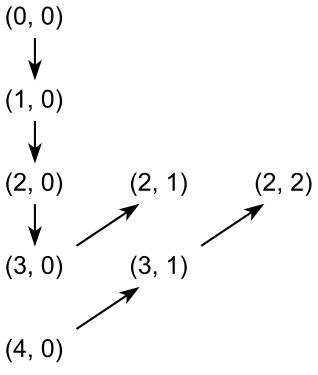

**图 12.2** 重叠积分中中间 DP 状态的依赖关系

```text
for j in range (lj+1):
    for i in range (li+lj+1-j):
```
因此，可以用以下迭代代码计算重叠积分

```python
def primitive_overlap(li,l j,a i,a j,R a, Rb):
    ... # Code omitted for brevity
    lij = li + lj
    S = np.zeros((lij+1,l j + 1, 3))
    for j in range (lj+1):
        for i in range (lij+1-j):
        if j>0 :
                S[i,j] = S[i+1,j-1] + Rab * S[i,j-1]
            elif i>1 :
                S[i,j] = Rpa * S[i-1,j] + (i-1)/(2*aij) * S[i-2,j]
            elif i= =1 :
                S[1,0] = Rpa * S[0,0]
            else:
                S[0,0] = (np.pi/aij) **.5 * np.exp(-theta_ij * Rab**2)
    ...
    for i,( i x,i y, iz) in enumerate (iter_cart_xyz(li)):
        for j, (jx,j y, jz) in enumerate (iter_cart_xyz(lj)):
            overlap[i,j] = S[ix,jx,0] * S[iy,jy,1] * S[iz,jz,2]
    return overlap
```
使用类似的方法，我们可以将递归 DP 代码转换为 ERI 程序的迭代
代码。

#### 12.1.4.1 McMurchie-Davidson 算法

在 MD 算法中，我们需要实现 R 张量和 E 张量的迭代代码。
R 张量本身是三维张量。不过，存储 R 的中间 DP 状态需要一个四索引数组：一个索引 n 表示阶数，三个索引 t、u 和 v 分别表示三个笛卡尔分量。在递归代码中，每当一个笛卡尔索引减一时，阶数索引 n 就加一。n 能达到的最大值恰好等于三个笛卡尔索引之和。因此，给定 t、u 和 v 的上限 l，DP 状态数组的大小为 (3l + 1,l + 1,l + 1,l + 1)。t、u 和 v 之间没有依赖关系。t、u 和 v 的三个嵌套循环可以按任意顺序排列。下面是计算 R 张量的迭代代码：

```python
def get_R_tensor(l, theta, Rpq):
    Rt = np.zeros((l *3+1,l + 1, l+1, l+1))
    for t in range (l+1):
        for u in range (l+1):
            for v in range (l+1):
                for n in range (l*3):
                    if t>1 :
                        Rt[n,t,u, v ]=( t-1) * Rt[n+1,t-2,u,v]
                        Rt[n,t,u,v] += Rpq[0] * Rt[n+1,t-1,u,v]
                    elif t= =1 :
                        Rt[n,1,u,v] = Rpq[0] * Rt[n+1,0,u,v]
                    elif u>1 :
                        Rt[n,t,u, v ]=( u-1) * Rt[n+1,t,u-2,v]
                        Rt[n,t,u,v] += Rpq[1] * Rt[n+1,t,u-1,v]
                    elif u= =1 :
                        Rt[n,t,1,v] = Rpq[1] * Rt[n+1,t,0,v]
                    elif v>1 :
                        Rt[n,t,u, v ]=( v-1) * Rt[n+1,t,u,v-2]
                        Rt[n,t,u,v] += Rpq[2] * Rt[n+1,t,u,v-1]
                    elif v= =1 :
                        Rt[n,t,u,1] = Rpq[2] * Rt[n+1,t,u,0]
                    else: #t= =u= =v= =0
                        Rt[n,0,0, 0 ]=(-2*theta)**n\
                                * boys(n, theta *np.array(Rpq).dot(Rpq))
    return Rt[0]
```
在递归的 get_E_cart_components 函数中，DP 状态由三个整数索引：辅助索引 t，以及笛卡尔幂次索引 i 和 j。i 和 j 之间没有依赖关系。然而，i 和 j 都依赖于 t。t 的最大值是 i 和 j 的最大值之和。由此可以推导出计算 E 张量各个笛卡尔分量的具体迭代代码。

```python
def get_E_cart_components(li,l j,a i,a j,R a, Rb):
    ... # Code omitted for brevity
    lij = li + lj
    E_cart = np.zeros((li+1, lj+1, lij+1, 3))
    for j in range (lj+1):
        for i in range (li+1):
            for t in range (lij+1):
                if t>0 :
                    v a l=0
if i>0 :
                        val += i *E_cart[i-1,j,t- 1 ]/( 2 *aij*t)
            if j>0 :
                        val += j *E_cart[i,j-1,t- 1 ]/( 2 *aij*t)
                    E_cart[i,j,t] = val
                elif j>0 :
                    E_cart[i,j,0] = Rpb * E_cart[i,j-1,0] + E_cart[i,j-1,1]
                elif i>0 :
                    E_cart[i,j,0] = Rpa * E_cart[i-1,j,0] + E_cart[i-1,j,1]
                else: #i= =j= =t= =0
                    E_cart[0,0,0] = np.exp(-theta_ij * Rab**2)
    return E_cart
```

#### 12.1.4.2 Obara-Saika 算法

在 OS 算法中，我们需要重写 VRR、TRR 和 HRR 张量的递归动态规划函数。
对于 VRR 张量，动态规划状态数组的大小和变量依赖关系与 MD 算法中 R 张量相似。我们可以按照如下方式编写 VRR 张量的迭代代码。

```python
Kabcd = 2 *np.pi**2.5/(aij*akl*(aij+akl)**.5)
Kabcd *= np.exp(-theta_ij*Rab.dot(Rab) - theta_kl *Rcd.dot(Rcd))
l i j=l i+l j
l k l=l k+l l
l4 = lij + lkl
vrr = np.empty((l4 *3+1, l4+1,l4+1,l4+1))
for ix in range (l4+1):
    for iy in range (l4+1):
        for iz in range (l4+1):
            for ni in range (l4*3):
                if i x>0 :
                    val = Xpa *vrr[ni,i x-1,i y, iz]
                    val -= theta/aij *Xpq*vrr[ni+1,i x-1,i y, iz]
                    if ix > 1:
```

```text
                        val += (ix-1)*.5/aij * (vrr[ni,i x-2,i y, iz] -
                                        theta/aij*vrr[ni+1,i x-2,i y,i z ] )
                    vrr[ni,ix,iy,iz] = val
                elif i y>0 :
                    val = Ypa *vrr[ni,i x,i y-1, iz]
                    val -= theta/aij *Ypq*vrr[ni+1,i x,i y-1, iz]
                    if iy > 1:
                        val += (iy-1)*.5/aij * (vrr[ni,i x,i y-2, iz] -
                                        theta/aij*vrr[ni+1,i x,i y-2,i z ] )
                    vrr[ni,ix,iy,iz] = val
                elif i z>0 :
                    val = Zpa *vrr[ni,i x,i y,i z-1]
                    val -= theta/aij *Zpq*vrr[ni+1,i x,i y,i z-1]
                    if iz > 1:
                        val += (iz-1)*.5/aij * (vrr[ni,i x,i y,i z-2] -
                                        theta/aij*vrr[ni+1,i x,i y,i z-2])
                    vrr[ni,ix,iy,iz] = val
                else:
                    vrr[ni,0,0,0] = Kabcd * boys(ni, theta *Rpq.dot(Rpq))
```
对于 TRR 张量，动态规划状态数组具有六个索引：三个笛卡尔分量中各有两个。每个笛卡尔分量内部的两个索引之间存在依赖关系，而不同笛卡尔分量之间互无依赖。下面推导 TRR 张量的迭代代码：

```python
from itertools import product
l4 = lij + lkl
Xjl, Yjl, Zjl = -(aj *Rab+al*Rcd)/akl
trr = np.empty((l4+1,l4+1,l4+1, lkl+1,lkl+1,lkl+1))
for kx,k y,k z in product(range(lkl+1), range(lkl+1), range(lkl+1)): # (1)
for ix in range (l4+1-kx): # (2)
for iy in range (l4+1-ky): # (3)
for iz in range (l4+1-kz): # (4)
                if k x>0 :
                    val = Xjl * trr[ix,iy,iz,kx-1,ky,kz]
                    val -= aij/akl * trr[ix+1,iy,iz,kx-1,ky,kz]
                    if kx > 1:
                        val += (kx-1)*.5/akl * trr[ix,iy,iz,kx-2,ky,kz]
                    if ix > 0:
                        val += ix *.5/akl * trr[ix-1,iy,iz,kx-1,ky,kz]
                    trr[ix,iy,iz,kx,ky,kz] = val
                elif k y>0 :
                    val = Yjl * trr[ix,iy,iz,kx,ky-1,kz]
                    val -= aij/akl * trr[ix,iy+1,iz,kx,ky-1,kz]
```

```text
                    if ky > 1:
                        val += (ky-1)*.5/akl * trr[ix,iy,iz,kx,ky-2,kz]
                    if iy > 0:
                        val += iy *.5/akl * trr[ix,iy-1,iz,kx,ky-1,kz]
                    trr[ix,iy,iz,kx,ky,kz] = val
                elif k z>0 :
                    val = Zjl * trr[ix,iy,iz,kx,ky,kz-1]
                    val -= aij/akl * trr[ix,iy,iz+1,kx,ky,kz-1]
                    if kz > 1:
                        val += (kz-1)*.5/akl * trr[ix,iy,iz,kx,ky,kz-2]
                    if iz > 0:
                        val += iz *.5/akl * trr[ix,iy,iz-1,kx,ky,kz-1]
                    trr[ix,iy,iz,kx,ky,kz] = val
                else:
                    trr[ix,iy,iz,0,0,0] = vrr[0,ix,iy,iz]
```
在第 (1) 行中，三个笛卡尔分量的循环顺序完全灵活。然而在每个笛卡尔分量内，第一个索引的循环必须嵌套在第二个索引的循环中。如第 (2) 至 (4) 行所示，内层与外层索引的迭代范围相互耦合。
对于 HRR 张量，依赖关系只存在于每个电子的索引内部。两个电子的 HRR 迭代可以分别独立进行，得到以下迭代代码：

```python
hrr = np.zeros((lij+1,lij+1,lij+1, lkl+1,lkl+1,lkl+1, ll+1,ll+1,ll+1))
hrr[:,:,:,:,:,:,0,0,0] = trr[:lij+1,:lij+1,:lij+1]
for lx,l y,l z in product(range(ll+1), range(ll+1), range(ll+1)):
    for kx in range (lkl+1-lx):
        for ky in range (lkl+1-ly):
            for kz in range (lkl+1-lz):
                if l x>0 :
                    hrr[:,:,:,kx,ky,kz,lx,ly,lz] = \
( hrr[: ,:,:,kx+1,ky,kz,lx-1,ly,lz] +
Xcd * hrr[:,:,:,kx ,ky ,kz,lx-1,ly,lz])
                elif l y>0 :
                    hrr[:,:,:,kx,ky,kz,lx,ly,lz] = \
( hrr[: ,:,:,kx,ky+1,kz,lx,ly-1,lz] +
Ycd * hrr[:,:,:,kx,ky ,kz ,lx,ly-1,lz])
                elif l z>0 :
                    hrr[:,:,:,kx,ky,kz,lx,ly,lz] = \
( hrr[: ,:,:,kx,ky,kz+1,lx,ly,lz-1] +
Zcd * hrr[:,:,:,kx,ky,kz ,lx ,ly,lz-1])
eri = np.zeros((lij+1, lij+1, lij+1, lj+1, lj+1, lj+1, lk+1, lk+1 , lk+1 , ll+1 , ll+1, ll+1))
```

```text
eri[:,:,:,0,0,0] = hrr[:,:,:,:lk+1,:lk+1,:lk+1]
for jx,j y,j z in product(range(lj+1),range(lj+1),range(lj+1)):
    for ix in range (lij+1-jx):
        for iy in range (lij+1-jy):
            for iz in range (lij+1-jz):
                if j x>0 :
                    eri[ix,iy,iz,jx,jy,jz] = (eri[ix+1,iy,iz,jx-1,jy,jz] +
Xab * eri[ix ,iy ,iz,jx-1,jy,jz])
                elif j y>0 :
                    eri[ix,iy,iz,jx,jy,jz] = (eri[ix,iy+1,iz,jx,jy-1,jz] +
Yab * eri[ix,iy ,iz ,jx,jy-1,jz])
                elif j z>0 :
                    eri[ix,iy,iz,jx,jy,jz] = (eri[ix,iy,iz+1,jx,jy,jz-1] +
Zab * eri[ix,iy,iz ,jx ,jy,jz-1])
```

#### 12.1.4.3 Rys 求积算法

Rys ERI 算法需要分别为三个笛卡尔分量中的每一个构造 TRR 和 HRR 张量。问题规模和变量依赖关系与 OS 方案中的 TRR 和 HRR 张量类似。我们可以推导出如下 Rys ERI 算法的对应迭代代码。

```python
l4 = lij + lkl
trr = np.zeros((l4+1,lkl+1,3,nroots))
for k in range (lkl+1):
    for i in range (l4+1):
        if i= =k= =0 :
            trr[0,0] = np.ones((3,nroots))
        elif k= =0 :
            trr[i,k] = (Rpa - Rpq *theta/aij*rt) * trr[i-1,k]
            trr[i,k] += (i-1)*.5/aij*(1-theta/aij*rt) * trr[i-2,k]
        elif i= =0 :
            trr[i,k] = (Rqc + Rpq *theta/akl*rt) * trr[i,k-1]
            trr[i,k] += (k-1)*.5/akl*(1-theta/akl*rt) * trr[i,k-2]
        else:
            trr[i,k] = (Rqc + Rpq *theta/akl*rt) * trr[i,k-1]
            trr[i,k] += (k-1)*.5/akl*(1-theta/akl*rt) * trr[i,k-2]
            trr[i,k] += i *.5/(aij+akl)*rt * trr[i-1,k-1]
hrr = np.zeros((lij+1, lj+1, lkl+1, ll+1,3 , nroots))
for j in range (lj+1):
    for i in range (lij+1-j):
        for l in range (ll+1):
            for k in range (lkl+1-l):
                    if j>0 :
```

```text
                    hrr[i,j,k,l] = hrr[i+1,j-1,k,l] + Rab *hrr[i,j-1,k,l]
                elif l>0 :
                    hrr[i,j,k,l] = hrr[i,j,k+1,l-1] + Rcd *hrr[i,j,k,l-1]
                else:
                    hrr[i,0,k,0] = trr[i,k]
```

### 12.1.5 分支与迭代调整

通过将递归函数转换为迭代代码，我们消除了函数调用、哈希运算和缓存查找的开销。然而，得到的迭代代码可能仍只是初步实现。在考虑编译优化之前，还需要解决几个问题，包括：

- 最内层循环中的分支。这个问题会导致额外的计算工作并中断执行流水线。
- 中间状态。动态规划状态数组中的某些中间状态是不必要的。为避免浪费计算工作，可以通过设置适当的迭代范围将其省略。
- 数组访问模式。动态规划状态数组的访问模式尚未优化，可能导致缓存未命中和内存访问延迟较高。

为了消除最内层循环中的 if-else 分支，我们可以重新安排分支与 for 循环迭代的顺序。这需要将分支移到外层循环，并针对每个条件展开 for 循环代码块。以重叠积分为例，S[0,0] 和 S[1,0] 是可以从循环中提取出来的特殊情况。其他元素在迭代代码中按 RR 公式计算。重叠积分函数可以相应优化如下：

```python
def primitive_overlap(li,l j,a i,a j,R a, Rb):
    ... # Code omitted for brevity
    lij = li + lj
    S = np.zeros((lij+1,l j + 1, 3))
    S[0,0] = (np.pi/aij) **.5 * np.exp(-theta_ij * Rab**2)
    if lij > 0:
        S[1,0] = Rpa * S[0,0]
        for i in range (1, lij):
            S[i+1,0] = Rpa * S[i,0] + i/(2 *aij) * S[i-1,0]
    for j in range (1, lj+1):
        for i in range (lij+1-j):
            S[i,j] = Rab * S[i,j-1] + S[i+1,j-1]
    ...
```
类似的步骤也可以用于优化 ERI 迭代代码，这里不再赘述。
接下来，我们来考察MD和OS电子排斥积分（ERI）算法中不必要的中间状态。
在MD方案中，五指标张量E具有很高的稀疏性。Eituv的下标t、u、v与乘积χi(r)χj(r)的笛卡尔幂次有关。它们受约束t + u + v ≤ li + lj，其中li和lj是两个高斯型轨道（GTO）的角动量。复合指标tuv的大小等于

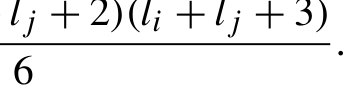{width=30%}

[]{#eq-12-036}

通过合并指标t、u、v，可以将E张量压缩为三指标张量。

```python
def get_E_tensor(li,l j,a i,a j,R a, Rb):
    Ex,E y, Ez = get_E_cart_components(li,l j,a i,a j,R a, Rb)
    lij = li + lj
    Et = np.empty(((li+1) *(li+2)//2, (lj+1) *(lj+2)//2, (lij+1)*(lij+2)*(lij+3)//6))
    for i,( i x,i y, iz) in enumerate (iter_cart_xyz(li)):
        for j, (jx,j y, jz) in enumerate (iter_cart_xyz(lj)):
            for n,( t,u ,v ) in enumerate (reduced_cart_iter(lij)):
                Et[i,j,n] = Ex[ix,jx,t] * Ey[iy,jy,u] * Ez[iz,jz,v]
    return Et
```
这里，我们引入了下面的生成器，以便在嵌套迭代中纳入笛卡尔幂次的约束：

```python
def reduced_cart_iter(n)
    '''Nested loops for Cartesian components, subject to x+y+z <= n'''
    for x in range (n+1):
        for y in range (n+1-x):
            for z in range (n+1-x-y):
                yield x,y ,z
```
使用压缩后的E张量应用收缩方程(12.27)时，tuv与efg的迭代范围缩小了。因此，下面的代码使用复合指标ij和kl。

```python
def primitive_ERI(li,l j,l k,l l,a i,a j,a k,a l,R a,R b,R c, Rd):
    ... # Code omitted for brevity
    nf_ij = (lij+1) *(lij+2)*(lij+3)//6
    nf_kl = (lkl+1) *(lkl+2)*(lkl+3)//6
    Rt = get_R_tensor(li+lj+lk+ll, theta, Rpq)
    Rt2 = np.empty((nf_kl, nf_ij))
    for kl,( e,f ,g ) in enumerate (reduced_cart_iter(lkl)):
        phase = (-1)**(e+f+g)
```

```python
        for ij,( t,u ,v ) in enumerate (reduced_cart_iter(lij)):
            Rt2[kl,ij] = phase * Rt[t+e,u+f,v+g]
    Etab = get_E_tensor(li,l j,a i,a j,R a, Rb)
    Etcd = get_E_tensor(lk,l l,a k,a l,R c, Rd)
    gcd = np.dot(Rt2.T, Etcd.reshape(nfk *nfl,nf_kl).T)
    eri = np.dot(Etab.reshape(nfi *nfj,nf_ij), gcd)
    eri *=2 *np.pi**2.5/(aij*akl*(aij+akl)**.5)
    return eri
```
复合指标的大小明显小于嵌套的tuv或efg指标大小。因此，张量收缩使用较小的张量执行，需要的浮点运算次数（FLOPs）也更少。
类似地，构造R张量时，下标tuv受约束t + u + v ≤ l，其中l表示壳层四元组中四个GTO的总角动量，即等于li + lj + lk + ll。第12.1.4.1节给出的迭代代码可调整如下：

```python
def get_R_tensor(l, theta, Rpq):
    ... # Code omitted for brevity
    Rt = np.zeros((l *3+1,l + 1, l+1, l+1))
    for t,u ,v in reduced_cart_iter(l):
        for n in range (l*3):
            if t>1 :
                Rt[n,t,u,v] = (t-1) * Rt[n+1,t-2,u,v]
                Rt[n,t,u,v] += Rpq[0] * Rt[n+1,t-1,u,v]
            elif t= =1 :
                Rt[n,1,u,v] = Rpq[0] * Rt[n+1,0,u,v]
            ...
```
在get_R_tensor函数中，我们注意到索引t − 1、u − 1和v − 1只在迭代内部使用，而且只有其中一个与n的递增相关联。由此可得，n的最大值为l，并受约束n + t + u + v ≤ l。因此，R张量的迭代可以进一步改进如下：

```python
def get_R_tensor(l, theta, Rpq):
    ...
    Rt = np.zeros((l+1, l+1, l+1, l+1))
    for t,u ,v in reduced_cart_iter(l):
        for n in range (l+1-t-u-v):
            if t>1 :
                Rt[n,t,u,v] = (t-1) * Rt[n+1,t-2,u,v]
                Rt[n,t,u,v] += Rpq[0] * Rt[n+1,t-1,u,v]
            elif t= =1 :
```

```text
                Rt[n,1,u,v] = Rpq[0] * Rt[n+1,0,u,v]
            ...
```
优化后的迭代总共生成

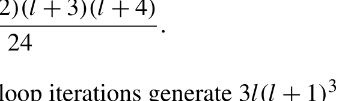{width=30%}

[]{#eq-12-037}

个动态规划（DP）状态。相比之下，朴素的for循环迭代生成3l(l + 1)个状态。这项优化将计算成本降低了约72倍。
在OS算法的垂直递推关系（VRR）实现中也可以观察到类似的互斥模式。对于TRR张量trr[ix,iy,iz,kx,ky,kz]，角动量存在多个约束

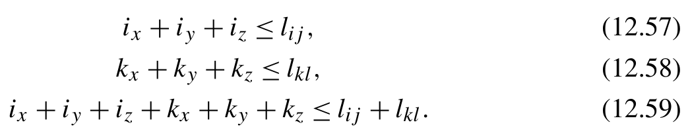{width=51%}

**公式 (12.57)(12.58)(12.59)**[]{#eq-12-038}

ix + iy + iz + kx + ky + kz ≤ li j + lk l. (12.59)
对于第12.1.4.2节中的代码实现，TRR张量的迭代范围

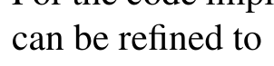{width=30%}

[]{#eq-12-039}

```text
l4 = lij + lkl
for kx,k y,k z in reduced_cart_iter(lkl):
    k s u m=k x+k y+k z
    for ix,i y,i z in reduced_cart_iter(l4-ksum):
        if kx > 0:
            val = -(aj *Xab+al*Xcd)/akl * trr[ix,iy,iz,kx-1,ky,kz]
            val -= aij/akl * trr[ix+1,iy,iz,kx-1,ky,kz]
            if k x>1 :
                val += (kx-1)*.5/akl * trr[ix,iy,iz,kx-2,ky,kz]
            if i x>0 :
                val += ix *.5/akl * trr[ix-1,iy,iz,kx-1,ky,kz]
            trr[ix,iy,iz,kx,ky,kz] = val
        ...
```
这种对迭代范围的优化也可以应用于第12.1.4.2节中的水平递推关系（HRR）张量实现。
如果积分完全用Python计算，这些中间张量的指标结构和顺序对性能的影响较小。然而，使用编译技术（第12.1.6节）优化数组索引后，其影响可能变得更加显著。在这种情况下，最好在采用编译优化之前充分考虑数组的内存布局并进行必要的调整。
在前面给出的积分代码中，张量使用np.zeros或np.empty分配，因此按C顺序排列。为了利用这种内存访问
模式，通常将最后一个指标的迭代放在最内层循环中更高效。这可以通过重新排列张量指标或循环顺序来实现。例如，在前面展示的MD收缩代码中，分配Rt2数组时把指标ij放在最后。这种空间分配与循环顺序完全一致。
在get_R_tensor函数中，R张量的第一个指标在最内层循环中被访问，这可能导致内存访问效率低下。改变循环顺序可以使内存访问与R张量的结构一致。由于指标n的迭代移到了最外层循环，受n对n + 1的依赖关系影响，我们必须反转其迭代方向。

```python
def get_R_tensor(l, theta, Rpq):
    ... # Code omitted for brevity
    for n in range (l-1,- 1, -1):
        for t,u ,v in reduced_cart_iter(l -n):
            if t>1 :
                Rt[n,t,u,v] = (t-1) * Rt[n+1,t-2,u,v]
                Rt[n,t,u,v] += Rpq[0] * Rt[n+1,t-1,u,v]
            elif t= =1 :
                Rt[n,1,u,v] = Rpq[0] * Rt[n+1,0,u,v]
            ...
```
这种循环交换优化很容易引入细微错误。在优化过程中，完善并频繁运行单元测试对于确保所有修改的正确性至关重要。
在第12.1.4.2节的HRR实现中，最内层循环对HRR张量前几个维度中的一个子张量进行操作。由于内存访问不连续，访问该子张量中的数据效率低下。因此，应当将这些迭代移到外层循环。

```python
... # Code omitted for brevity
hrr = np.zeros((lij+1,lij+1,lij+1, lkl+1,lkl+1,lkl+1, ll+1,ll+1,ll+1))
hrr[:,:,:,:,:,:,0,0,0] = trr[:lij+1,:lij+1,:lij+1]
for ix,i y,i z in product(range(lij+1), range(lij+1), range(lij+1))
    l x=0
    l y=0
    for lz in range (1, ll+1-ly):
        lsum = lx + ly + lz
        for kx,k y,k z in reduced_cart_iter(lkl-lsum):
            hrr[ix,iy,iz,kx,ky,kz,lx,ly,lz] = \
( hrr[ix ,iy,iz,kx,ky,kz+1,lx,ly,lz-1] +
Zcd * hrr[ix,iy,iz,kx,ky,kz ,lx ,ly,lz-1])
    for ly in range (1, ll+1-lx):
        for lz in range (ll+1-ly):
            l s u m=l x+l y+l z
```

```text
            for kx,k y,k z in reduced_cart_iter(lkl-lsum):
                hrr[ix,iy,iz,kx,ky,kz,lx,ly,lz] = \
( hrr[ix ,iy,iz,kx,ky+1,kz,lx,ly-1,lz] +
Ycd * hrr[ix,iy,iz,kx,ky ,kz ,lx,ly-1,lz])
    for lx in range (1, ll+1):
        for ly in range (ll+1-lx):
            for lz in range (ll+1-lx-ly):
                l s u m=l x+l y+l z
                for kx,k y,k z in reduced_cart_iter(lkl-lsum):
                    hrr[ix,iy,iz,kx,ky,kz,lx,ly,lz] = \
( hrr[ix ,iy,iz,kx+1,ky,kz,lx-1,ly,lz] +
Xcd * hrr[ix,iy,iz,kx ,ky ,kz,lx-1,ly,lz])
```

### 12.1.6 使用Numba JIT编译进行优化

在这个阶段，我们采用编译技术来提高积分程序的性能。Numba和Cython是编译Python代码的两种常见选择。
我们先从使用Numba进行即时（JIT）编译开始。应用Numba JIT编译前面给出的积分函数可以加快程序速度，但加速效果往往有限。为了充分发挥Numba JIT编译器的潜力，可以对积分代码做一些调整。

#### 展开NumPy ufunc

建议将所有NumPy ufunc和广播代码替换为显式的for循环迭代，尤其是嵌套循环中的操作。例如，在前面演示的重叠积分迭代代码中，

```text
for j in range (lj+1):
    for i in range (lij+1-j):
        S[i,j] = S[i+1,j-1] + Rab * S[i,j-1]
```
算术计算和赋值涉及三个笛卡尔方向上的广播操作。这段广播代码应使用循环块改写。

```text
for j in range (lj+1):
    for i in range (lij+1-j):
        for m in range (3):
            S[i,j,m] = S[i+1,j-1,m] + Rab[m] * S[i,j-1,m]
```
虽然Numba对这些操作提供自动循环展开，但手动实现的for循环有时更为高效。在Numba生成的代码中，每条ufunc或广播语句都会产生额外开销，用于获取数组结构信息、执行连续性检查以及确定循环边界。
这些额外步骤的开销通常微不足道。然而，对于较小的数组块或在循环中反复执行时，其累积开销不可忽视。

#### 使用非Python模式进行JIT编译

可以使用@numba.njit装饰器在非Python模式下编译计算密集型函数。在这种JIT模式下，任何涉及Python对象或Python函数的语句都可能产生警告和错误。我们需要相应地调整代码，主要包括：

- 将enumerate、zip和生成器等Python风格的迭代器替换为使用range()函数的基本迭代。这与第9章针对纯Python代码建议的优化做法相反。
- 将np.einsum替换为np.dot。Numba可以识别np.dot并将其编译为BLAS函数。
- 将scipy.special函数替换为NumPy或math库中的等价函数[6]。需要注意的是，Numba对某些NumPy模块的支持有限，例如np.fft或np.polynomials。如果代码使用这些模块中的函数，可能需要采用变通方法或重新设计算法。

#### 循环展开

在Rys求积算法中，三个笛卡尔分量的递推关系（RR）公式相互独立。可以展开对三个笛卡尔分量的循环，以略微降低for循环中的分支成本。第12.1.4.3节中的HRR迭代代码可以展开如下：

```python
... # Code omitted for brevity
I4dx, I4dy, I4dz = hrr = np.zeros((3, lij+1, lj+1, lkl+1, ll+1, nroots))
Xab, Yab, Zab = Rab
Xcd, Ycd, Zcd = Rcd
for i in range (lij+1):
  for k in range (lkl+1):
    for n in range (nroots):
      I4dx[i,0,k,0,n] = trr[i,k,0,n]
      I4dy[i,0,k,0,n] = trr[i,k,1,n]
      I4dz[i,0,k,0,n] = trr[i,k,2,n]
for i in range (lij+1):
  for l in range (1, ll+1):
    for k in range (lkl+1-l):
      for n in range (nroots):
        I4dx[i,0,k,l,n] = I4dx[i,0,k+1,l-1,n] + Xcd * I4dx[i,0,k,l-1,n]
        I4dy[i,0,k,l,n] = I4dy[i,0,k+1,l-1,n] + Ycd * I4dy[i,0,k,l-1,n]
        I4dz[i,0,k,l,n] = I4dz[i,0,k+1,l-1,n] + Zcd * I4dz[i,0,k,l-1,n]
for j in range (lj):
  for i inrange(lij-j):
```

```text
    for k in range (lk+1):
      for l in range (ll+1):
        for n in range (nroots):
          I4dx[i,j+1,k,l,n] = I4dx[i+1,j,k,l,n] + Xab * I4dx[i,j,k,l,n]
          I4dy[i,j+1,k,l,n] = I4dy[i+1,j,k,l,n] + Yab * I4dy[i,j,k,l,n]
          I4dz[i,j+1,k,l,n] = I4dz[i+1,j,k,l,n] + Zab * I4dz[i,j,k,l,n]
```
需要注意，循环展开可能破坏SIMD矢量化。然而，在这个例子中，最内层循环的长度，即Rys多项式的根数，通常很小（一般小于10）。与for循环中的分支开销相比，SIMD矢量化带来的性能收益实际上很小。

#### 优化数组寻址效率

访问高维NumPy数组中的元素时，需要多次整数乘法和加法，将数组下标转换为内存物理地址。这种转换可能带来显著开销，尤其是对维数很多的数组。例如，第12.1.4.2节所述OS方案中的hrr张量是一个九维数组。其内存地址计算如下

```text
sum(hrr.shape[i] * hrr.strides[i] for i in range(9))
```
其中涉及9次乘法和8次加法。为了减少这一开销，一种有效方法是使用较低维的中间张量，如下例中的sub张量。

```python
... # Code omitted for brevity
nfk = n_cart(lk)
nfl = n_cart(ll)
sub = np.empty((lkl+1,lkl+1,lkl+1, ll+1,ll+1,ll+1))
hrr = np.empty((lij+1,lij+1,lij+1, lj+1,lj+1,lj+1, nfk *nfl))
for ix in range (lij+1):
  for iy in range (lij+1-ix):
    for iz in range (lij+1-ix-iy):
      for kx in range (lkl+1):
        for ky in range (lkl+1-kx):
          for kz in range (lkl+1-kx-ky):
            sub[kx,ky,kz,0,0,0] = trr[ix,iy,iz,kx,ky,kz]
      lx,l y=0 ,0
      for lz in range (1, ll+1):
        lsum = lx + ly + lz
        for kx in range (lkl+1-lsum):
          for ky in range (lkl+1-lsum-kx):
            for kz in range (lkl+1-lsum-kx-ky):
              sub[kx,ky,kz,lx,ly,lz] = \
( sub[kx ,ky,kz+1,lx,ly,lz-1] +
```

```text
Zcd * sub[kx,ky,kz ,lx ,ly,lz-1])
      for ly in range (1,l l + 1-lx):
        for lz in range (ll+1-lx-ly):
      ...
      k l=0
      for kx in range (lk,- 1, -1):
        for ky in range (lk-kx,- 1, -1):
          k z=l k-k x-k y
          for lx in range (ll,- 1, -1):
            for ly in range (ll-lx,- 1, -1):
              l z=l l-l x-l y
              hrr[ix,iy,iz,0,0,0,kl] = sub[kx,ky,kz,lx,ly,lz]
              kl += 1
...
```

#### 在函数签名中显式指定数据类型

与Cython中的数据类型声明不同，提供显式类型信息虽然可以改善JIT编译，但不能提高运行时性能。非Python模式中的自动类型推断能够准确确定类型，其结果与手动创建的函数签名中的类型相同。然而，显式声明数据类型仍然有益，因为它可以帮助防止类型不一致造成的潜在错误。

#### 消除Python类

Numba对Python类的支持有限，这意味着涉及Python类的函数无法直接以njit模式编译。为了处理Python类，我们需要重新设计类，使其与Numba的实验性功能numba.experimental.jitclass兼容。在经JIT装饰的类中，应显式声明每个属性的数据类型。例如，可以如下修改CGTO类：

```python
@numba.experimental.jitclass([
    ('angular_momentum', numba.int64), ('exponents', numba.float64[::1]), ('coefficients', numba.float64[::1]), ('coordinates', numba.float64[::1]), ('norm_coefficients', numba.float64[::1]), ])
class jitCGTO:
    def __init__(self, angular_momentum: int, exponents: np.ndarray, coefficients: np.ndarray, coordinates: np.ndarray):
```

```text
        self.angular_momentum = angular_momentum
        self.exponents = exponents
        self.coefficients = coefficients
        self.coordinates = coordinates
        norm = gto_norm(angular_momentum, exponents)
        self.norm_coefficients = norm * coefficients
```

### 12.1.7 使用Cython编译进行优化

如第9章所述，优化Cython代码的关键策略是将速度较慢的Python对象和Python风格语句替换为类似C的变量和语句。这里我们创建一个名为_tensors.pyx的.pyx文件，其中包含所有要编译的函数。
大多数优化技术与Numba编译版本中使用的技术相似。具体来说，我们对pyx代码采用的优化包括：

- 使用显式的for循环迭代改写NumPy ufunc和广播代码。
- 将Python风格的迭代器替换为使用range()函数的简单迭代。
- 展开Rys求积算法中三个笛卡尔分量的循环。
- 指定所有变量和函数签名的数据类型。
- 使用类型化内存视图（typed memoryviews）[7]声明所有NumPy数组的数据类型、形状和连续性。例如，Rys求积算法中的HRR张量和中间张量分配如下：

```python
       hrr = np.zeros((3, lij+1, lj+1, lkl+1,l l + 1, nroots))
       cdef double[:,:,:,:,::1] I4dx = hrr[0]
       cdef double[:,:,:,:,::1] I4dy = hrr[1]
       cdef double[:,:,:,:,::1] I4dz = hrr[2]
```
与Numba编译相比，这是Cython中额外需要完成的一步。

- 使用Cython编译器指令提高NumPy数组索引的效率：

```text
   #cython: boundscheck=False
   #cython: wraparound=False
   #cython: overflowcheck.fold=False
   #cython: cdivision=True
```
在这个改写过程中，我们可以使用命令

```text
cython-a _tensors.pyx
```
为.pyx文件生成注释，并检查Cython化代码是否经过适当优化。这里不明确展示Cython化代码。根据第12.1.5节开发的Python代码和Cython注释，读者应该能够开发积分程序的Cython版本。

### 12.1.8 使用元编程技术进行优化

我们开发的ERI代码使用相同的代码路径处理所有类型的GTO。然而，处理低角动量基组时，这种实现会产生显著的额外开销。这些开销主要来自嵌套循环中的分支以及管理高维数组所需的操作。为了减少开销，我们可以展开某些基函数的代码，尤其是低角动量基函数。
代码展开可以通过代码生成技术实现。为了尽量减少计算开销，我们决定以C语言输出展开后的源码，然后将C代码编译为Python程序的扩展模块。这里我们以OS ERI方案为例演示展开过程。类似技术也可以推广应用于其他算法。
第12.1.3.3节中的递归DP函数vrr(n, ix, iy, iz)是第一个需要优化的函数。我们可以按照以下步骤展开vrr计算代码：

1. 替换递归函数中的返回语句。

我们需要设计一个唯一的名称来表示vrr函数的返回值。该名称可以根据函数参数动态生成，例如

```text
asf'vrr_{n}_{ix}{iy}{iz}'.
```

2. 替换函数中的计算语句。

每条Python计算语句都应封装为一个f-string。这些语句需要进行一些修改，例如添加数据类型和C风格的语句终止符（;）。这些修改应确保计算语句符合C语言语法。

3. 在f-string中将函数调用vrr(...)替换为({vrr(...)})。

这一修改可以触发代码生成器对vrr函数的递归调用。请注意这些语句中使用的{}记法。在这些记法内执行函数调用，可以确保按适当的顺序生成中间量的C语言代码。此外，除了调用{vrr(...)}中的引用外，对n、ix、iy和iz的任何引用都应使用{}封装。4. 对递归函数使用lru_cache。
对vrr函数应用lru_cache至关重要，它能防止多次生成完全相同的中间计算代码。
vrr代码生成器的输出如下：

```python
@lru_cache(10000)
def vrr(n,i x,i y, iz):
v a l=f 'vrr_{n}_{ix}{iy}{iz}'
if i z>0 :
 print(f'double {val} = Zpa *({vrr(n,ix,iy,iz-1)}) - theta/aij *({vrr(n+1, ix,iy,iz-1)});')
 if iz > 1:
```

```python
      print(f'{val} += ({iz}-1)*.5/aij * (({vrr(n,ix,iy,iz-2)}) - theta/aij
    *({vrr(n+1,ix,iy,iz-2)}));')
    return val
  if i y>0 :
    print(f'double {val} = Ypa *({vrr(n,ix,iy-1,iz)}) - theta/aij *({vrr(n+1, ix,iy-1,iz)});')
    if iy > 1:
      print(f'{val} += ({iy}-1)*.5/aij * (({vrr(n,ix,iy-2,iz)}) - theta/aij
    *({vrr(n+1,ix,iy-2,iz)}));')
    return val
  if i x>0 :
    print(f'double {val} = Xpa *({vrr(n,ix-1,iy,iz)}) - theta/aij *({vrr(n+1, ix-1,iy,iz)});')
    if ix > 1:
      print(f'{val} += ({ix}-1)*.5/aij * (({vrr(n,ix-2,iy,iz)}) - theta/aij
    *({vrr(n+1,ix-2,iy,iz)}));')
    return val
  print(f'double {val} = Kabcd * _boys[{n}];')
  return val
```
我们可以采用类似的步骤，基于递归函数trr和hrr实现代码生成器：

```python
@lru_cache(10000)
def trr(n,i x,i y,i z,k x,k y, kz):
  v a l=f 'e_trans{n}_{ix}{iy}{iz}_{kx}{ky}{kz}'
  if k z>0 :
    print(f'double {val} = Zqc * ({trr(n,ix,iy,iz,kx,ky,kz-1)}) +
    Ztheta_akl * ({trr(n+1,ix,iy,iz,kx,ky,kz-1)});')
    if kz > 1:
      print(f'{val} += {(kz-1)*.5}/akl * ({trr(n,ix,iy,iz,kx,ky,kz-2)} -
    theta_akl*({trr(n+1,ix,iy,iz,kx,ky,kz-2)}));')
    if iz > 0:
      print(f'{val} += {iz *.5}/aa * ({trr(n+1,ix,iy,iz-1,kx,ky,kz-1)});')
    return val
  if k y>0 :
    print(f'double {val} = Yqc * ({trr(n,ix,iy,iz,kx,ky-1,kz)}) +
    Ytheta_akl * ({trr(n+1,ix,iy,iz,kx,ky-1,kz)});')
    if ky > 1:
      print(f'{val} += {(ky-1)*.5}/akl * ({trr(n,ix,iy,iz,kx,ky-2,kz)} -
    theta_akl*({trr(n+1,ix,iy,iz,kx,ky-2,kz)}));')
    if iy > 0:
```

```python
      print(f'{val} += {iy *.5}/aa * ({trr(n+1,ix,iy-1,iz,kx,ky-1,kz)});')
    return val
  if k x>0 :
    print(f'double {val} = Xqc * ({trr(n,ix,iy,iz,kx-1,ky,kz)}) +
    Xtheta_akl * ({trr(n+1,ix,iy,iz,kx-1,ky,kz)});')
    if kx > 1:
      print(f'{val} += {(kx-1)*.5}/akl * ({trr(n,ix,iy,iz,kx-2,ky,kz)} -
    theta_akl*({trr(n+1,ix,iy,iz,kx-2,ky,kz)}));')
    if ix > 0:
      print(f'{val} += {ix *.5}/aa * ({trr(n+1,ix-1,iy,iz,kx-1,ky,kz)});')
    return val
  return vrr(n,i x,i y, iz)
@lru_cache(10000)
def hrr(ix,i y,i z,j x,j y,j z,k x,k y,k z,l x,l y, lz):
  v a l=f 'hrr_{ix}{iy}{iz}_{jx}{jy}{jz}_{kx}{ky}{kz}_{lx}{ly}{lz}'
  if l z>0 :
    print(f'double {val} = ({hrr(ix,iy,iz,jx,jy,jz,kx,ky,kz+1,lx,ly,lz-1)})
     + Zcd * ({hrr(ix,iy,iz,jx,jy,jz,kx,ky,kz,lx,ly,lz-1)});')
    return val
  if l y>0 :
    print(f'double {val} = ({hrr(ix,iy,iz,jx,jy,jz,kx,ky+1,kz,lx,ly-1,lz)})
     + Ycd * ({hrr(ix,iy,iz,jx,jy,jz,kx,ky,kz,lx,ly-1,lz)});')
    return val
  if l x>0 :
    print(f'double {val} = ({hrr(ix,iy,iz,jx,jy,jz,kx+1,ky,kz,lx-1,ly,lz)})
     + Xcd * ({hrr(ix,iy,iz,jx,jy,jz,kx,ky,kz,lx-1,ly,lz)});')
    return val
  if j z>0 :
    print(f'double {val} = ({hrr(ix,iy,iz+1,jx,jy,jz-1,kx,ky,kz,lx,ly,lz)})
     + Zab * ({hrr(ix,iy,iz,jx,jy,jz-1,kx,ky,kz,lx,ly,lz)});')
    return val
  if j y>0 :
    print(f'double {val} = ({hrr(ix,iy+1,iz,jx,jy-1,jz,kx,ky,kz,lx,ly,lz)})
     + Yab * ({hrr(ix,iy,iz,jx,jy-1,jz,kx,ky,kz,lx,ly,lz)});')
    return val
  if j x>0 :
    print(f'double {val} = ({hrr(ix+1,iy,iz,jx-1,jy,jz,kx,ky,kz,lx,ly,lz)})
     + Xab * ({hrr(ix,iy,iz,jx-1,jy,jz,kx,ky,kz,lx,ly,lz)});')
    return val
  return trr(ix,i y,i z,k x,k y, kz)
```
这三个递归函数构成了展开过程代码生成器的核心。
给定四个整数，分别表示ERI中四个GTO的角动量，就可以使用下面描述的展开函数执行展开过程，生成C代码。

```python
c_tpl = jinja2.Template( '''
void {{ name }}(double *eri, double ai, double aj, double ak, double al, double *Ra, double *Rb, double *Rc, double *Rd, void ( *boys_fn)(int, double, double [])) {
double aij = ai + aj;
double akl = ak + al;
double theta = aij * akl / (aij + akl);
double Xab = Ra[0] - Rb[0];
double Yab = Ra[1] - Rb[1];
double Zab = Ra[2] - Rb[2];
double Xcd = Rc[0] - Rd[0];
double Ycd = Rc[1] - Rd[1];
double Zcd = Rc[2] - Rd[2];
double theta_rij = ai * aj / aij * (Xab*Xab + Yab *Yab + Zab *Zab);
double theta_rkl = ak * al / akl * (Xcd*Xcd + Ycd *Ycd + Zcd *Zcd);
double fac = 34.986836655249725; // 2 *pi**2.5
double Kabcd = fac / (aij *akl*sqrt(aij+akl)) * exp(-theta_rij - theta_rkl);
double Xp = (ai * Ra[0] + aj * Rb[0]) / aij;
double Yp = (ai * Ra[1] + aj * Rb[1]) / aij;
double Zp = (ai * Ra[2] + aj * Rb[2]) / aij;
double Xq = (ak * Rc[0] + al * Rd[0]) / akl;
double Yq = (ak * Rc[1] + al * Rd[1]) / akl;
double Zq = (ak * Rc[2] + al * Rd[2]) / akl;
double Xpq = Xp - Xq;
double Ypq = Yp - Yq;
double Zpq = Zp - Zq;
double Xpa = Xp - Ra[0];
double Ypa = Yp - Ra[1];
double Zpa = Zp - Ra[2];
double theta_r2 = theta * (Xpq*Xpq + Ypq *Ypq + Zpq *Zpq);
double Xab_cd = -(aj *Xab + al *Xcd) / akl;
double Yab_cd = -(aj *Yab + al *Ycd) / akl;
double Zab_cd = -(aj *Zab + al *Zcd) / akl;
double _boys[32];
boys_fn({{ order + 1 }}, theta_r2, _boys);
''')
def unrolling(li,l j,l k,l l ) :
```

```python
  print(c_tpl.render(name=f'run_eri_{li}{lj}{lk}{ll}', order=li+lj+lk+ll))
  n=0
  for i, (ix,i y, iz) in enumerate (iter_cart_xyz(li)):
    for j,( j x,j y, jz) in enumerate (iter_cart_xyz(lj)):
      for k, (kx,k y, kz) in enumerate (iter_cart_xyz(lk)):
        for l, (lx,l y, lz) in enumerate (iter_cart_xyz(ll)):
          print(f'eri[{n}] = {hrr(ix,iy,iz,jx,jy,jz,kx,ky,kz,lx,ly,lz)};')
          n+ =1
  print('}')
if __name__ == '__main__':
  lmax = 5
  max_roots = 5
  for li in range (lmax):
    for lj in range (lmax):
      for lk in range (lmax):
        for ll in range (lmax):
          if li + lj + lk + ll > max_roots:
            continue
          unrolling(li,l j,l k, ll)
```
请注意，展开高角动量基函数可能生成大量C代码。为了在代码体积和计算效率之间取得平衡，通常只需对低角动量GTO进行展开，例如li + lj + lk + ll < 6。
我们可以用C语言创建一个驱动函数，根据每个基函数的角动量选择适当的展开后的C函数。

```yaml
driver_tpl = jinja2.Template( '''
int run_eri_unrolled(double *eri, int li, int lj, int lk, int ll, double ai, double aj, double ak, double al, double *Ra, double *Rb, double *Rc, double *Rd, void ( *boys_fn)(int, double, double []))
{
{%-s e tl 1=l m a x+1% }
    int ijkl = li *{{ l1 **3} }+l j *{{ l1 **2} }+l k *{{ l1 }} + ll;
    switch (ijkl) {





{%- set ijkl = li *l1**3+l j *l1**2+l k *l 1+l l% }
    case {{ ijkl }}: run_eri_{{ li }}{{ lj }}{{ lk }}{{ ll }}(eri,a i,a j, ak,a l,R a,R b,R c,R d, boys_fn); break;
```

```python





    default: return 1; }
    return 0;
}''')
print(driver_tpl.render(lmax=5, max_roots=5))
```
C函数的最后一个参数是指向Boys函数的函数指针，其签名定义如下：

```text
void ( *boys_fn)(int max_order, double x, double output[]);
```
在vrr函数中，Boys函数会被多次调用。为了提高效率，可以一次性计算直到给定阶数max_order的所有Boys函数值，并将其暂存在输出缓冲区中。
然而，Boys函数目前是用Python实现的。如何在C中访问Boys函数？可以考虑三种方法：

- 将Boys函数的Python实现翻译为C代码，然后将该C函数集成到C扩展中。然而，对于复杂的Python代码，这种方案可能不切实际。代码翻译可能需要将所有依赖项从Python转换为C，涉及大量编程工作。
- 在Python中预先计算Boys函数，然后将结果传给C积分函数。这种方法效率低下，因为某些中间变量可能需要在Python和C中分别计算。
- 为Python函数创建一个C包装器，并将C包装器的函数指针传给C积分代码。

在这个例子中，Boys函数的实现并不过于复杂。将Boys函数翻译为C代码是可行的方法。尽管如此，我们选择使用带C包装器的函数指针，因为它所需的编码开发工作量最少。
假设我们希望对代码的其余部分使用Python编译技术，如何在Python编译框架内执行这些C函数？在Cython中集成C函数很简单，因为Cython支持执行外部C函数。下面我们来看看如何用Numba实现。
如果Python函数以numba.jit模式编译，可以使用ctypes库执行外部C函数。然而，numba.njit模式仅支持ctypes的有限功能。ctypes.POINTER创建的指针对象就是一个例子。作为变通方法，要将指针传给C，我们必须将其转换为
ctypes.c_void_p，如下面代码示例的第 (1) 行和第 (2) 至 (6) 行所示。

```python
from rys_roots import boys
liberi_OS = ctypes.CDLL( 'liberi_OS.so')
run_eri_unrolled = liberi_OS.run_eri_unrolled
run_eri_unrolled.argtypes = [
ctypes.c_void_p, # eri # (1)
ctypes.c_int, #l i
ctypes.c_int, #l j
ctypes.c_int, #l k
ctypes.c_int, #l l
    ctypes.c_double, #a i
    ctypes.c_double, #a j
    ctypes.c_double, #a k
    ctypes.c_double, #a l
ctypes.c_void_p, # Ra # (2)
ctypes.c_void_p, # Rb # (3)
ctypes.c_void_p, # Rc # (4)
ctypes.c_void_p, # Rd # (5)
ctypes.c_void_p, # boys_fn # (6)
]
@numba.cfunc('void(int32, double, numba.types.CPointer(double))' , nopython=True)
def boys_for_c(m,t , out):
out_array = numba.carray(out, (m+1,)) # (7)
    out_array[:] = boys(m,t )
boys_fn = boys_for_c.address # (8)
```
为了访问用 Python 实现的 Boys 函数，我们可以使用 numba.cfunc 装饰器创建一个 C 包装器。通过该 C 包装器的 address 属性可以访问函数指针，如第 (8) 行所示。请注意，运行时由 C 函数调用这个经过包装的 Python 函数。因此，Numba JIT 编译器无法准确推断该函数内部的数据类型。必须显式声明此函数所有输入参数的数据类型。此外，对于此函数中使用的数组对象，我们需要指定其形状，如第 (7) 行所示。
对 primitive_ERI 函数应用展开优化后，GTO 收缩函数（第 12.1.3.5 节）的开销变得更加突出。为了减少其开销，我们进一步优化 contracted_ERI 函数，并使用 numba.njit 编译它。

```python
from basis import n_cart, gto_offsets
from eri_rys import primitive_ERI
    @numba.njit
def contracted_ERI(li,l j,l k,l l, exps_i, exps_j, exps_k, exps_l, coef_i, coef_j, coef_k, coef_l,R a,R b,R c,R d, out,i 0,j 0,k 0, l0): # (1)
nfi = n_cart(li)
nfj = n_cart(lj)
nfk = n_cart(lk)
nfl = n_cart(ll)
if l i+l j+l k+l l<6 : # (2)
buf = np.zeros((nfi, nfj, nfk, nfl))
_buf = buf.ctypes.data
_Ra = Ra.ctypes.data
_Rb = Rb.ctypes.data
_Rc = Rc.ctypes.data
_Rd = Rd.ctypes.data
for ai,c i in zip (exps_i, coef_i):
for aj,c j in zip (exps_j, coef_j):
for ak,c k in zip (exps_k, coef_k):
  for al,c l in zip (exps_l, coef_l):
    f a c=c i * cj * ck * cl
    err = run_eri_unrolled( _buf,l i,l j,l k,l l,a i,a j,a k,a l, _Ra, _Rb, _Rc, _Rd, boys_fn)
for i in range (nfi): # (3)
for j in range (nfj): # (4)
for k in range (nfk): # (5)
for l in range (nfl): # (6)
out[i0+i,j0+j,k0+k,l0+l] += fac * buf[i,j,k,l] # (7)
else:
for ai,c i in zip (exps_i, coef_i):
for aj,c j in zip (exps_j, coef_j):
for ak,c k in zip (exps_k, coef_k):
  for al,c l in zip (exps_l, coef_l):
    f a c=c i * cj * ck * cl
    buf = primitive_ERI( li,l j,l k,l l,a i,a j,a k,a l,R a,R b,R c, Rd)
for i in range (nfi): # (8)
for j in range (nfj): # (9)
for k in range (nfk): # (10)
for l in range (nfl): # (11)
```

```text
out[i0+i,j0+j,k0+k,l0+l] += fac * buf[i,j,k,l] # (12)
```
JIT 编译大幅降低了第 (3) 行至第 (12) 行代码中嵌套循环的开销和数据移动的成本。此外，为了尽量减少内存管理开销，我们将输出 ERI 张量直接传递给 contracted_ERI 函数，如第 (1) 行所示。这一改动使计算结果能够直接写入输出张量中。对于满足条件 li + lj + lk + ll < 6 的 ERI 计算，直接执行代码展开，如第 (2) 行所示。如果不满足该条件，contracted_ERI 函数将自动回退到经 Numba 编译的 Rys 算法。
在 contracted_ERI 函数之后，我们需要一个程序，为一组 GTO 基函数构建 ERI 张量。该程序在四重嵌套循环中调用 contracted_ERI()。

```python
def pack_gto_attrs(gtos):
    '''Pack GTO attributes, making them more efficient to load'''
    offsets = gto_offsets(gtos)
    gto_params = []
    for i, bas_i in enumerate (gtos):
        i0 = offsets[i]
        li = bas_i.angular_momentum
        Ra = bas_i.coordinates
        exps_i = bas_i.exponents
        norm_ci = bas_i.norm_coefficients
        gto_params.append((i0,l i,R a, exps_i, norm_ci))
    return gto_params
def eri_OS_unrolled(gtos):
    offsets = gto_offsets(gtos)
    gto_params = pack_gto_attrs(gtos)
    nao = offsets[-1]
    out = np.zeros((nao, nao, nao, nao))
    for ((i0,l i,R a, exps_i, norm_ci), (j0,l j,R b, exps_j, norm_cj), (k0,l k,R c, exps_k, norm_ck), (l0,l l,R d, exps_l, norm_cl)) \
                 in itertools.product(*(gto_params,)*4):
        contracted_ERI(li,l j,l k,l l, exps_i, exps_j, exps_k, exps_l, norm_ci, norm_cj, norm_ck, norm_cl,R a,R b,R c,R d, out,i 0,j 0,k 0,l 0 )
    return out
```
我们在该程序中实现的一项特殊优化是 pack_gto_attrs 函数。这个辅助函数将 GTO 实例所需的属性打包成一个五元素元组。从单个元组中解包变量比通过单独语句访问多个属性更简单、更高效。将迭代器 itertools.product 与 pack_gto_attrs 函数一起使用，比直接使用四重嵌套 for 循环效率稍高。

### 12.1.9 基准测试

现在我们对 ERI 程序的性能进行基准测试。在测试中，我们使用 Pople 基组 6-31G(*) 为苯分子生成一个四维 ERI 张量。该基组总共包含 102 个笛卡尔基函数。测试脚本如下。

```python
import time
import numpy as np
from basis import CGTO, Molecule, n_cart, gto_offsets
def build_eri_tensor(f, gtos):
    offsets = gto_offsets(gtos)
    nao = offsets[-1]
    V = np.empty((nao, nao, nao, nao))
    for i, bas_i in enumerate (gtos):
        i0, i1 = offsets[i], offsets[i+1]
        for j, bas_j in enumerate (gtos):
            j0, j1 = offsets[j], offsets[j+1]
            for k, bas_k in enumerate (gtos):
                k0, k1 = offsets[k], offsets[k+1]
                for l, bas_l in enumerate (gtos):
                    l0, l1 = offsets[l], offsets[l+1]
                    V[i0:i1,j0:j1,k0:k1,l0:l1] = contracted_ERI( f, bas_i, bas_j, bas_k, bas_l)
    return V
def timing(f, gtos):
build_eri_tensor(f, gtos[:1]) # warm up
    t0 = time.perf_counter()
    v = build_eri_tensor(f, gtos)
    t1 = time.perf_counter()
    return t1 - t0
benzene = '''
C 0.0000 1.3990 0.0000
C -1.2095 0.7442 0.0000
C -1.2095 -0.7442 0.0000
C 0.0000 -1.3990 0.0000
C 1.2095 -0.7442 0.0000
C 1.2095 0.7442 0.0000
```

```python
H 0.0000 2.4939 0.0000
H -2.1994 1.3083 0.0000
H -2.1994 -1.3083 0.0000
H 0.0000 -2.4939 0.0000
H 2.1994 -1.3083 0.0000
H 2.1994 1.3083 0.0000
'''
mol = Molecule.from_xyz(benzene)
gtos = mol.assign_basis({ 'C': '6-31G*', 'H': '6-31G'})
import eri_OS, eri_MD_numba, eri_MD_cython, ...
for imp in (eri_OS, eri_MD_numba, ...):
    print(f'{imp} timing:' , timing(imp.primitive_ERI, gtos))
```
在本例中，使用 time.perf_counter 函数测量 CPU 时间来衡量性能。为了更准确地测量实际耗费的时间，包括在内核空间中花费的时间，可以使用 time.time 函数测量墙钟时间。
基准测试评估了以下代码实现：纯 Python 实现、Numba 编译程序、Cython 编译程序以及展开后的实现。我们将前两个 Python 版本（第 12.1.3 节中的递归动态规划代码和第 12.1.4 节中的朴素迭代代码）排除在测试之外，因为它们太慢。第 12.1.5 节中采用优化迭代结构的实现代表基准测试中的纯 Python 方法。作为参考，我们还对使用 PySCF 软件包进行的积分计算进行基准测试，

```yaml
pyscf.M(atom=benzene, basis={'C': '6-31g*', 'H': '6-31g'}).intor('int2e_cart')
```
请注意，由于基函数归一化方式不同，PySCF 软件包计算的 ERI 数值与本书展示的 ERI 不同。PySCF 仅对 s 型和 p 型基函数应用 Racah 归一化。如果希望与 PySCF 的输出一致，可以修改第 12.1.1 节中的 gto_norm 函数

```python
def gto_norm(l, expnt):
    '''Radial part normalization'''
    norm = (gaussian_int(l *2+2,2 *expnt)) ** -.5
    if l<2 :
        norm *= ((2 *l+1)/(4*np.pi))**.5
    return norm
```
基准测试结果汇总在表 12.2 中。编译技术带来了显著加速，与纯 Python 实现相比，速度提高了约 20 倍。代码展开优化进一步

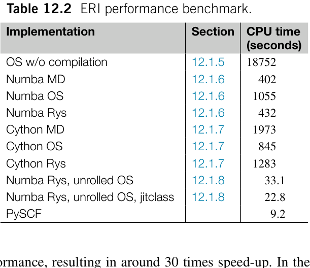

**表 12.2** ERI 性能基准。

### 12.1.10 性能因素

从前面的基准测试中，我们观察到 Python 积分程序与 PySCF 中经过激进优化的积分程序之间存在 2.5 倍的性能差距。性能差异部分归因于示例程序中使用了大量 Python 对象，而 PySCF 的积分代码完全使用 C 语言开发。除了
除了操作 Python 对象，还有其他因素会影响积分程序的性能吗？在不完全用 C 重写 Python 代码的前提下，可以对其应用哪些优化？在进行后续优化之前，我们需要理解这些额外因素。

#### 积分筛选

积分筛选（integral screening）可以有效减少需要计算的积分数量。筛选积分的一种常用方法是估计电子排斥积分（ERI）的上界，该方法基于施瓦茨不等式（Schwartz inequality）：

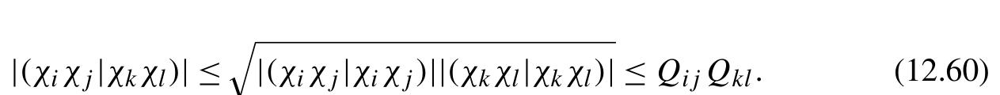{width=62%}

[]{#eq-12-040}

这里，Qij 表示 GTO 壳层 i 和 j 内所有积分 |(χiχj|χiχj)| 的最大值。施瓦茨不等式估计量可用于 get_eri_tensor 函数，在遍历壳层时筛除 ERI。如果 Qij Qkl 的值小于预先设定的阈值，则丢弃壳层四元组 (i,j,k,l) 内的所有 ERI。此外，施瓦茨估计量也可用于 contracted_ERI 函数，筛选原始 GTO 壳层四元组。

#### 循环顺序

根据 ERI 中四个 GTO 壳层的角动量，优化 VRR、TRR 和 HRR 迭代中的嵌套循环顺序，可以使计算成本达到最小。
在 VRR 迭代中，首先将第一个电子上的笛卡尔幂次提升到 li + lj + lk + ll，然后将其转移到第二个电子，直到第二个电子上的笛卡尔幂次达到 lk+ll。在这一过程中，我们当前的实现必须生成第一个电子上阶数大于 li + lj、第二个电子上阶数小于 lk + ll 的所有中间量。如果 li + lj <l k + ll，先提升第二个电子上的笛卡尔幂次，再将其转移到第一个电子会更高效（图 12.3）。
类似的循环顺序优化也可应用于 TRR 和 HRR 迭代。例如，当 lk <l l 时，如果在 TRR 中将笛卡尔幂次转移到第四个中心，并在 HRR 中填充第三个中心上的笛卡尔幂次，程序所需的计算成本会更低。

#### 中间量的多项式近似

为了计算 Boys 函数以及 Rys 求积的根和权重等中间量，代码使用了一些计算密集型函数，包括 erf、特征值求解器和线性方程求解器。这些中间量完全可以预先计算并制成表格。然后可以使用多项式或样条拟合技术近似求得它们的值。第 12.2.3 节将更为详细地讨论这些实用技术。

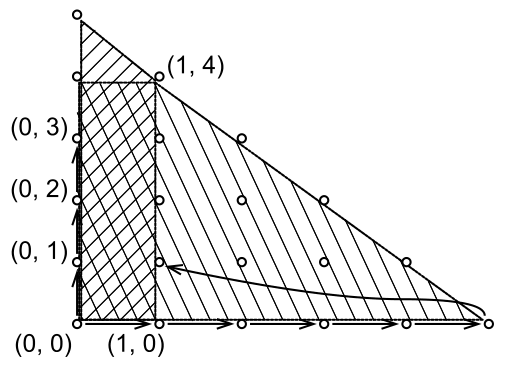

**图 12.3** 优化 RR 迭代中嵌套循环的顺序。RR 迭代的计算成本与梯形的面积成正比。通过根据目标选择最佳迭代方向，即垂直或水平，可以有效地最小化成本，根据目标的

#### 提前收缩与收缩路径

如第 12.1.3.5 节所述，积分收缩可以在调用 TRR 或 HRR 之前进行。实现提前收缩（early contraction）方案可以减少收缩 GTO 的 ERI 所需的浮点运算次数。为了优化收缩路径，可以考虑各种经典 ERI 收缩方案，例如 Head-Gordon-Pople（HGP）算法 [8] 和 PRISM 算法 [9]。

#### 收缩系数的稀疏性

在前面展示的积分程序中，我们只考虑了分段收缩基组（segment contracted basis sets）。在量子化学计算中，一般收缩基组（generally contracted basis sets）也得到广泛使用。在这类基组中，例如 cc-pVDZ，相同的原始 GTO 由多个收缩 GTO 共享。在一般收缩基组中，一些收缩系数严格为零。可以利用收缩系数的这种稀疏性来降低计算成本。

#### 预计算与记忆化

对原始 GTO 对的某些中间量，在不同的壳层四元组中会被重复计算。其中一些中间量，例如 e AB 和 e CD，是计算成本较高的算术函数。为了提高效率，可以提前计算并缓存这些中间量。

#### 绕过中间数组

在当前的 Python 实现中，我们创建了多个临时数组来存储中间量。某些中间量的存储完全可以得到优化。通过适当组织中间量的结构并将数据直接写入结果数组，我们可以避免不必要的数据移动。
例如，在第 12.1.4.2 节中构造的 OS 算法的 TRR 张量可以嵌入 HRR 张量中。通过适当设计 HRR 张量的形状，可以将 TRR 张量视为 HRR 张量的一个子块。因此，当 TRR 张量被计算时，其结果会自动传送到 HRR 张量的对应部分：

```python
l4 = lij + lkl
hrr = np.zeros((l4+1,l4+1,l4+1, lkl+1,lkl+1,lkl+1, ll+1,ll+1,ll+1))
trr = hrr[:,:,:,:,:,:,0,0,0]
for kx,k y,k z in product(range(lkl+1), range(lkl+1), range(lkl+1)):
    for ix in range (l4+1-kx):
        for iy in range (l4+1-ky):
            for iz in range (l4+1-kz):
                trr[ix,iy,iz,kx,ky,kz] = ...
for lx,l y,l z in product(range(ll+1), range(ll+1), range(ll+1)):
    for kx in range (lkl+1-lx):
        for ky in range (lkl+1-ly):
            for kz in range (lkl+1-lz):
                if l x>0 :
                    hrr[:,:,:,kx,ky,kz,lx,ly,lz] = \
( hrr[: ,:,:,kx+1,ky,kz,lx-1,ly,lz] +
Xcd * hrr[:,:,:,kx ,ky ,kz,lx-1,ly,lz])
                ...
```
另一个例子是 primitive_ERI 函数返回的原始 ERI，它们作为积分收缩程序的中间量。通过融合积分收缩与原始积分的计算，我们可以不必先在缓冲区中生成原始 ERI，再将它们乘以收缩系数，最后加到输出中。假设 Np 表示原始 GTO 的数量，这种优化可以为每个积分节省至少 N 次运算。
上述因素主要通过减少浮点运算次数来优化积分程序。除了浮点运算次数，在开发高性能积分程序时还必须考虑计算机体系结构的特性。几个典型因素包括内存访问延迟、缓存命中率以及分支预测的有效性。为了优化这些因素，可以采用以下编程技术。

#### 展开

Rys ERI 算法中的内层点积以及笛卡尔 GTO 到球谐 GTO 的变换都可以展开。此外，由于收缩变换只限于少数几种模式，基组收缩代码也可以展开。
如前所示，展开（unrolling）应用于涉及低角动量 GTO 的积分时非常有效。然而，对高角动量基函数进行完全
展开所带来的收益可能有限，甚至可能损害效率。这是因为过度展开会显著增加二进制代码的大小，进而对指令缓存（instruction cache，I-cache）提出更高要求。I-cache 的压力可能会对性能产生负面影响，因为缓存未命中的可能性更高，而且指令解码的延迟也会增加。

#### 指令级并行

SIMD 并行化可能适用于积分代码的多个部分，例如积分收缩、HRR 迭代以及 Rys ERI 算法中的内层点积。为了帮助编译器识别可以进行 SIMD 并行化的代码，可以使用 restrict 关键字 [10]、编译器指令 #pragma GCC ivdep [11]，以及用于显式矢量化的编译器内建函数 [12]。为了通过 SIMD 操作实现高效的数据加载和存储，需要考虑内存对齐。

#### 缓存 RR 迭代的张量地址

RR 迭代中对元素的遍历可能涉及对高维数组元素的非顺序访问。这一过程的迭代范围通常很短，因而迭代边界会导致大量分支。处理这些短迭代的边界时，分支预测经常失败。此外，对高维数组进行索引会消耗大量 CPU 资源来计算内存地址。减少这些开销的一种策略是将高维数组转换为一维向量，并缓存 RR 迭代引用的所有内存地址。这样，访问高维数组中的一个元素就可以简化为几次索引操作。此外，这种转换简化了循环结构，从而减少循环内分支预测错误造成的损失。
例如，OS 算法中的 HRR 迭代具有以下循环结构：

```python
hrr = np.empty((lkl+1,lkl+1,lkl+1, ll+1,ll+1,ll+1))
hrr[:,:,:,0,0,0] = trr
for lx in range (1, ll+1):
    for ly in range (ll+1-lx):
        for lz in range (ll+1-lx-ly):
            l s u m=l x+l y+l z
            for kx,k y,k z in reduced_cart_iter(lkl-lsum):
                hrr[kx,ky,kz,lx,ly,lz] = (hrr[kx+1,ky,kz,lx-1,ly,lz] +
Xcd * hrr[kx ,ky ,kz,lx-1,ly,lz])
```
这段迭代代码可以优化为

```python
def hrr_address(lk, ll):
    lkl = lk + ll
    def addr(kx,k y,k z,l x,l y, lz):
```

```python
        k_idx = (kx * (lkl+1) + ky) * (lkl+1) + kz
        return ((k_idx * (ll+1) + lx) * (ll+1) + ly) * (ll+1) + lz
    adr0, adr1,a d r 2=[ ],[ ],[ ]
    for lx in range (1, ll+1):
        for ly in range (ll+1-lx):
            for lz in range (ll+1-lx-ly):
                l s u m=l x+l y+l z
                for kx,k y,k z in reduced_cart_iter(lkl-lsum):
adr0.append(addr(kx , ky ,k z,l x ,l y , lz))
                    adr1.append(addr(kx+1,k y,k z,l x-1,l y, lz))
adr2.append(addr(kx , ky ,k z,l x-1,l y, lz))
    return adr0, adr1, adr2
# cache the addresses for all possible angular momentum combinations
lmax = 5
address_cache = {(lk, ll): hrr_address(lk, ll)
                 for lk in range (lmax) for ll in range (lmax)}
def primitive_ERI(li,l j,l k,l l,a i,a j,a k,a l,R a,R b,R c, Rd):
    ...
    hrr = np.empty((lkl+1,lkl+1,lkl+1, ll+1,ll+1,ll+1))
    hrr[:,:,:,0,0,0] = trr
    hrr_view = hrr.ravel()
    adr0, adr1, adr2 = address_cache[lk,l l ]
    for i in range (len(adr0)):
        hrr_view[adr0[i]] = hrr_view[adr1[i]] + Xcd * hrr_view[adr2[i]]
    ...
```

#### 复用寄存器以降低内存访问开销

即使数据位于高速 L1 缓存中，内存访问的延迟也绝不可忽略。在递推关系（RR）迭代中，可以通过复用存储在寄存器中的数据来降低内存访问开销。例如，重叠积分函数包含以下水平递推关系（HRR）迭代结构：

```text
for j in range (1, lj+1):
    for i in range (lij+1-j):
        S[i,j] = Xab * S[i,j-1] + S[i+1,j-1]
```
为计算一个元素 S[i,j]，这段代码需要两次内存访问来加载 S[i,j-1] 和 S[i+1,j-1]。S[i+1,j-1] 可以在相邻迭代中复用，从而将内存访问次数减少 50%。这项优化将代码转换为

```text
for j in range (1, lj+1):
    s0 = S[0,j-1]
    for i in range (lij+1-j):
        s1 = S[i+1,j-1]
        S[i,j] = Xab * s0 + s1
        s0 = s1
```

#### 自定义内存分配器

为中间数组分配内存的操作也会对性能产生不可忽略的影响。调用 C 语言 libc 库提供的 malloc 函数会明显降低性能。分配新内存不仅消耗许多 CPU 周期，还会导致 CPU 缓存未命中和缺页。为尽量减少内存分配的开销，可以使用自定义内存分配器（custom memory allocator）。例如，PySCF 中的积分代码实际上普遍使用栈式分配器（stack allocator）[13] 来管理内存。
除收缩路径优化之外，上述所有优化因素都已用于用 C 语言编写的 PySCF 积分代码。它们是与当前 Python 积分程序相比产生 2.5 倍性能差异的原因。
在 Python 版本的积分程序中，实现显式 SIMD 并行化和自定义内存分配器具有挑战性。这些技术需要与底层系统操作交互。不过，其他优化因素可以应用于 Python 代码。然而，这些激进的优化会显著增加 Python 代码的复杂性并降低其可读性。我们不再深入讨论这些优化的实现细节。

## 12.2 积分

数值积分（numerical integration）是量子化学程序中计算积分的常用技术。给定积分网格 rn 及其对应的权重（体积）wn，三维空间中的积分可计算为：

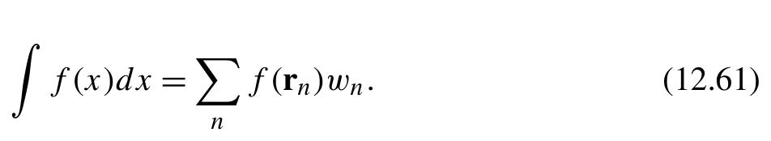{width=46%}

[]{#eq-12-041}

实现数值积分方案相当直观。只需在积分网格上求函数值，然后与权重进行点积，即可得到积分值。积分网格可以是均匀间隔的，也可以通过求积方法进行采样。

### 12.2.1 求积

通过选择适当的权重和节点，数值积分可以对某一类被积函数精确成立。这些被积函数通常可以写成多项式与一个已有的权函数（weight function）W (x) 的乘积。
例如，可以使用高斯-埃尔米特求积（Gauss-Hermite quadrature）有效地计算重叠积分。方法是在高斯-埃尔米特求积的根处计算高斯轨道乘积的多项式部分：

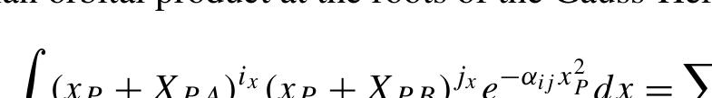{width=38%}

[]{#eq-12-042}

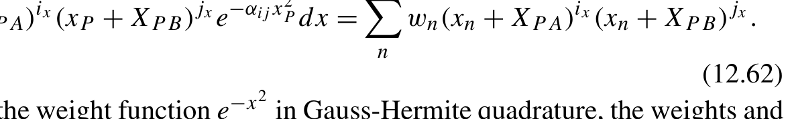{width=58%}

**公式 (12.62)**[]{#eq-12-043}

(12.62) 为了与高斯-埃尔米特求积中的权函数 e 对应，权重和
节点按 1/ j 缩放，如下面代码片段的第 (1) 行和第 (2) 行所示。按照求积公式，积分计算的实现如下：

```python
def primitive_overlap(li,l j,a i,a j,R a, Rb):
    aij = ai + aj
    Rab = Ra - Rb
    Rp = (ai * R a+a j * Rb) / aij
    Rpa = Rp - Ra
    Rpb = Rp - Rb
    theta_ij = ai * aj / aij
    Kab = np.exp(-theta_ij * Rab**2)
    r, w = roots_hermite((li+lj+2)//2)
rt = r / aij **.5 # (1)
wt = w / aij **.5 # (2)
    poly_i = (Rpa[:,None,None] + rt) **(np.arange(li+1)[:,None])
    poly_j = (Rpb[:,None,None] + rt) **(np.arange(lj+1)[:,None])
    I2d = np.einsum( 'x,xin,xjn->xijn', Kab, poly_i, poly_j)
    Ix,I y, Iz = np.einsum( 'n,xijn->xij',w t, I2d)
    nfi = n_cart(li)
    nfj = n_cart(lj)
    S = np.zeros((nfi, nfj))
    for i,( i x,i y, iz) in enumerate (iter_cart_xyz(li)):
        for j, (jx,j y, jz) in enumerate (iter_cart_xyz(lj)):
            S[i,j] = Ix[ix,jx] * Iy[iy,jy] * Iz[iz,jz]
    return S
```

### 12.2.2 求积节点和权重

scipy.special 模块提供了一系列常用求积公式：

- 权函数为 1，区间为 [− 1, 1]。
- 权函数为 e，区间为 (∞ , ∞ )。
- 权函数为 e，区间为 [0, ∞ )。
- 权函数为 √，区间为 [− 1, 1]。

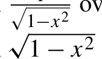{width=30%}

[]{#eq-12-044}

- 权函数为 1 − x，区间为 [− 1, 1]。

在某些情况下，我们可能需要针对新的权函数计算积分。可以采用系统的方法，为任意给定权函数的正交多项式构造求积节点和权重。为了展示这一过程，我们以 Rys 求积（Rys quadrature）为例，生成 Rys 多项式的节点和权重。

#### 12.2.2.1 Boys 函数

构造积分求积公式的第一步是计算权函数的矩（moment）

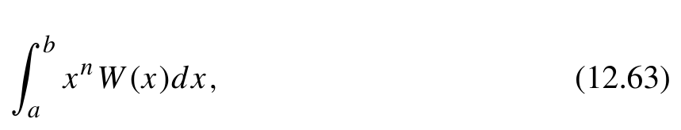{width=42%}

[]{#eq-12-045}

其中 n 是非负整数，W (x) 是权函数。在 Rys 求积中，权函数是 e，积分区间为 [0, 1]，

{width=50%}

[]{#eq-12-046}

∑
该权函数的矩由 Boys 函数给出。

{width=46%}

[]{#eq-12-047}

Boys 函数可以使用向上递推（upward recursion）公式计算

{width=49%}

**公式 (12.66)(12.67)**[]{#eq-12-048}

然而，重复应用该公式 N 次会将 F0 中的数值误差放大一个因子。如果 t 值很小，那么用这个向上递推公式从 F0 计算高阶 Boys 函数并不合适。相反，我们应当重新整理递推公式，改用向下递推（downward recursion）方法：

{width=50%}

[]{#eq-12-049}

该递推的起点是

{width=50%}

[]{#eq-12-050}

当 m 足够大时，可以截断这个级数求和。向下递推通常比向上递推更准确。然而，当 t 是一个大数时，其性能比向上递推慢。在向上递推的精度可以接受的情况下，通常优先采用向上递推。向上递推精度变得不可接受的转折点可以预先测试并制成表格。
大致而言，当 t 接近 n + 1.5 时，向上递推与向下递推的精度相当。因此，我们编写一个结合两种递推公式的程序。

```python
def boys(n, t):
    assert n> =0
    assert t> =0
    if t < n + 1.5:
        return downward(n,t )
    else:
        return upward(n,t )
def upward(n, t):
    tt = math.sqrt(t)
    f = math.sqrt(math.pi)/2 / tt * math.erf(tt)
    e = math.exp(-t)
    o u t=[ f ]
    for i in range (n):
        f = ((2 *i+1) * f-e )/( 2 *t)
        out.append(f)
    return out
def downward(n,t , prec=1e-15):
    b=n+. 5
    e=. 5 * math.exp( -t)
    x=e
    f=e
    while x > prec * e:
        b+ =1
        x *=t/b
        f+ =x
    b=n+. 5
    f/ =b
```

```python
    o u t=[ f ]
    for i in range (n):
        b- =1
        f=( e+t * f )/b
        out.append(f)
    return out[::-1]
```

#### 12.2.2.2 求解求积节点和权重的通用程序

Rys 多项式记为 pi(x) = ∑ cikx，它们关于该权函数构成正交集：

{width=52%}

[]{#eq-12-051}

这一正交性可以转化为关于 Boys 函数的系数 c 的线性代数问题：为求 N 阶 Rys 多项式的根，可以使用 numpy.roots 函数求解系数矩阵 c 的第 (N + 1) 列中的系数。
两个 Rys 多项式 pi 和 pj 之间的积分，可以使用 N 阶 Rys 多项式的根 xn 和权重 wn 计算：这个线性方程的解是求积权重 wn，其表达式为：

{width=44%}

[]{#eq-12-052}

根据这些方程，我们得到 rys_roots_weights 函数，它按如下方式计算 Rys 多项式的根和权重：

```python
def schmidt_orth(moments, nroots):
    '''
    Returns the coefficients of the orthogonal polynomials
    \sum_{kl} c_{i,k} c_{j,l} moments_{k+l} = \delta_{ij}
    '''
    s = np.zeros((nroots+1, nroots+1))
    for j in range (nroots+1):
```

```python
        for i in range (nroots+1):
            s[i,j] = moments[i+j]
    return np.linalg.inv(np.linalg.cholesky(s))
def find_polyroots(cs, nroots):
    return np.roots(cs[::-1])
def rys_roots_weights(nroots, t):
    moments = boys(nroots *2,t )
    cs = schmidt_orth(moments)
    roots = find_polyroots(cs[nroots])
    rtp = roots[:,np.newaxis]**np.arange(nroots+1)
    weights = 1. / (rtp.dot(cs.T) **2).sum(axis=1)
    return roots, weights
```
上面展示的 rys_roots_weights 代码实际上是一个通用函数，也可用于计算其他类型权重函数的求积公式。唯一需要做的改动是将 Boys 函数替换为所需的矩函数。函数中计算正交多项式系数并确定根和权重的其余部分保持不变。
然而，在求解高阶求积根时，这种实现可能遇到严重的数值稳定性问题。数值问题源于高阶项中多项式系数的剧烈振荡。实际中，当求积阶数超过12时，具有16位有效数字的双精度所提供的精度便不足了。因此，程序可能在正交化过程或求根函数中失败。即使没有出现错误，计算得到的求积根和权重仍可能存在显著误差。
有一些替代算法可以提高数值精度。其大致思路是使用众所周知的正交多项式作为基函数来表示目标多项式。辅助多项式能够有效地对振荡的多项式系数进行采样，将其替换为变化平缓的系数，从而降低数值不稳定性。例如，使用拉盖尔多项式（Laguerre polynomials）或雅可比多项式（Jacobi polynomials）表示 Rys 多项式，可以得到精度更高的计算结果 [5]。

#### 12.2.2.3 使用 mpmath 库提高精度

我们可以采用另一种方法来提高 Python 中的数值精度。利用任意精度浮点库（arbitrary precision floating-point library）mpmath，我们无需借助其他求积根计算算法就能计算出高精度结果。为确保不会意外损失精度，我们需要对第 12.2.2.1 节和第 12.2.2.2 节中实现的代码做以下调整：

- 在 boys 函数中，应将所有 math 函数替换为 mpmath 提供的等价函数。
- 在 rys_roots_weights 函数中，我们需要使用 mpmath 库中的相应函数重新实现某些 NumPy 函数，例如求根函数和施密特正交化（Schmidt orthogonalization）。有关求根函数的算法，请参阅 Numerical Recipes 一书第 9 章中的基础理论 [14]。此外，我们为 NumPy 数组使用自定义数据类型，以便对 mpf 数据进行矢量化操作。这种方法在第 2 章第 2.2.4 节中有详细讨论。
- 应使用 mpmath.mpf 函数将所有浮点常数替换为多精度数。例如，将 0.5 替换为

```text
mpmath.mpf('0.5').
```
这些修改的结果见下面的代码示例：

```python
import mpmath as mp
mp.mp.dps = 30
mp.mp.pretty = True
def schmidt_orth(moments, nroots):
 r'''
 Returns the coefficients of the orthogonal polynomials
 \sum_{kl} c_{i,k} c_{j,l} moments_{k+l} = \delta_{ij}
 '''
 cs = np.full((nroots+1, nroots+1), mp.mpf(0))
 for j in range (nroots+1):
     fac = moments[j+j]
     for k in range (j):
         dot = cs[k,:j+1].dot(moments[j:j+j+1])
         cs[j,:j] -= dot * cs[k,:j]
         fac -= dot * dot
     if fac <= 0:
         raise RuntimeError(f'schmidt_orth fail. {nroots=} {fac=}' )
     fac = fac **mp.mpf('-.5')
     cs[j,j] = fac
     cs[j,:j] *= fac
 return cs
def find_polyroots(cs, nroots):
 assert len (cs) == nroots + 1
 if nroots == 1:
     return np.array([-cs[0] / cs[1]])
 A = mp.matrix(nroots)
 for m in range (nroots-1):
```

```python
        A[m+1,m] = mp.mpf(1)
    for m in range (nroots):
        A[0,m] = -cs[nroots-1-m] / cs[nroots]
    roots = mp.eig(A, left=False, right=False)
    return np.array([x.real for x in roots])
def rys_roots_weights(nroots, t):
    moments = boys(nroots *2, mp.mpf(t))
    cs = schmidt_orth(moments, nroots)
    roots = find_polyroots(cs[nroots], nroots)
    rtp = roots[:,np.newaxis]**np.arange(nroots+1)
    # Solve rtp.T.dot(diag(weights)).dot(rtp) = identity
    weights = 1. / (rtp.dot(cs.T) **2).sum(axis=1)
    return roots, weights
```

### 12.2.3 求积公式

使用 mpmath 库计算求积公式非常耗时。用这种方法即时在线计算求积公式并不实际。更可行的方法是使用 mpmath 库计算精确的根和权重，然后用多项式近似求积公式。在实际应用中，我们可以通过计算近似多项式，高效地求出求积公式。
首先，考虑 t 趋近于0或∞时的特殊情况。在 t → 0 的区域，Rys 求积公式的权重函数近似等于1。我们可以使用勒让德求积公式（Legendre quadrature）来近似 Rys 求积公式：

{width=56%}

[]{#eq-12-053}

∑
当 t 足够大时，我们可以按如下方式近似该积分：

{width=66%}

[]{#eq-12-054}

∞ √ ∞ ′
通过变量代换 x x，我们可以将该积分与厄米求积公式（Hermite quadrature）联系起来。当 t = 50 时，dx 和 dx 之间的差仅为 7.49e-18。因此，我们用以下代码近似 Rys 求积公式：

```python
import scipy.special
def rys_roots_weights(nroots, t):
    if t<1 e -8:
        leg_r, leg_w = scipy.special.roots_legendre(nroots *2)
        roots = leg_r[nroots:] **2
```

```python
        weights = leg_w[nroots:] * (1-t*roots)
    elif t > 50:
        hermit_r, hermit_w = scipy.special.roots_hermite(nroots *2)
        roots = hermit_r[nroots:] **2/t
        weights = hermit_w[nroots:] / sqrt(t)
    else:
        # polynomial approximation
        roots, weights = polynomial_approx(nroots,t )
    return roots, weights
```
nroots 通常小于15，其可能取值对应的勒让德求积公式和厄米求积公式都已制成表格。在这两种情况下，通过查阅勒让德和厄米求积公式表，都可以高效地得到 Rys 求积公式的近似值。
在区间 (1e-8, 50) 内的其余区域，我们开发 polynomial_approx 函数来近似 Rys 求积公式。有多种拟合方法可以用于近似求积根和权重。

#### B 样条插值

在区间 (10, 50) 内的其余区域，我们开发 polynomial_approx 函数来近似 Rys 求积公式。为了近似复杂函数的值，B 样条插值（B-spline interpolation）是一种常见选择。使用 scipy 库提供的 bsplines 模块，编写 B 样条插值程序很简单。

```python
from scipy.interpolate import make_interp_spline
MAX_RYS_ROOTS = 12
NODES = 2000
def tabulate_bspline():
    xs = np.linspace(0,5 0, NODES)
    b s=[ ]
    for nrys in range (1, MAX_RYS_ROOTS+1):
        rws = np.empty(( len(xs),2,nrys))
        for i,x in enumerate (xs):
            r, w = rys_roots_weights(nrys,x )
            rws[i, 0 ]=r
            rws[i, 1 ]=w
        bs.append(make_interp_spline(xs, rws.reshape( len(xs),2*nrys)))
    return bs
with open ('bspline_tab.pkl', 'wb') as f:
    pickle.dump(tabulate_bspline(), f)
```
在 polynomial_approx 函数中，可以加载缓存的 B 样条数据进行计算。

```python
with open ('bspline_tab.pkl', 'rb') as f:
    bspline_tab = pickle.load(f)
def polynomial_approx(nroots, t):
    bs = bspline_tab[nroots-1]
    rws = bs(t)
    return rws.reshape(2, nroots)
```

#### 切比雪夫近似

切比雪夫多项式（Chebyshev polynomials）[14] 能够有效地近似区间 [− 1, 1] 内的光滑函数。为了确定能产生最精确拟合函数的最优拟合系数，采用以下公式选取次数不超过 N 的多项式的切比雪夫节点：

{width=50%}

[]{#eq-12-055}

对于范围在 (10, 50) 内的 Rys 求积公式输入参数，我们可以使用下式进行分段拟合，将区间 [a,b] 映射到区间

{width=70%}

[]{#eq-12-056}

随后，我们使用 np.polynomial.chebyshev.chebfit 函数计算拟合系数。

```python
MAX_RYS_ROOTS = 12
INTERVAL = 3.
DEGREE = 11
def tabulate_chebfit():
    n = DEGREE + 1
    cheb_nodes = np.cos(np.pi / n * (np.arange(n) + .5))
    intervals = [(a, a+INTERVAL) for a in np.arange(0., 50., INTERVAL)]
    n_intervals = len(intervals)
    c s=[ ]
    for nrys in range (1, MAX_RYS_ROOTS+1):
        cs_i = []
        for a,b in intervals:
            # Map chebyshev nodes between (-1, 1) to the sample points
```

```python
            # between interval (a,b )
            xs = cheb_nodes *(b-a)/2 + (b+a)/2
            rws = np.empty((n,2,nrys))
            for i,x in enumerate (xs):
                r, w = rys_roots.rys_roots_weights(nrys,x )
                rws[i,0] = r
                rws[i,1] = w
            cs_i.append( np.polynomial.chebyshev.chebfit( cheb_nodes, rws.reshape(n,2*nrys), DEGREE))
        cs.append(np.array(cs_i))
    return cs
with open ('chebfit_tab.pkl', 'wb') as f:
    pickle.dump(tabulate_chebfit(), f)
```
在 polynomial_approx 函数中，需要按照式 (12.77) 给出的区间变换来变换输入变量。然后，我们调用 np.polynomial.chebyshev.chebval 计算求积根和权重。

```python
with open ('chebfit_tab.pkl', 'rb') as f:
    chebfit_tab = pickle.load(f)
def polynomial_approx(nroots, t):
    interval_id = int(t // INTERVAL)
    c = chebfit_tab[nroots-1][interval_id]
    a = interval_id * INTERVAL
    b=a+ INTERVAL
    x = (t - (a+b)/2) / ((b-a)/2)
    rws = np.polynomial.chebyshev.chebval(x,c )
    return rws.reshape(2,nroots)
```
其他正交多项式也可用于近似光滑函数。例如，要使用勒让德多项式，我们可以在上面的代码中做以下替换：

```python
np.polynomial.chebyshev.chebfit -> np.polynomial.legendre.legfit
np.polynomial.chebyshev.chebval -> np.polynomial.legendre.legval
```
尽管如此，在大多数情况下，切比雪夫多项式更受青睐，因为可以使用克伦肖递推算法（Clenshaw recursion algorithm）高效地计算它们。克伦肖递推的实现可在 np.polynomial.chebyshev.chebval 函数的源代码中找到。我们可以使用 Numba 编译器优化克伦肖递推程序。

```python
@numba.njit
def chebval(x, c):
    x 2=2 *x
    c 0=c [-2]
    c 1=c [-1]
    for i in range (3, len(c) + 1):
        tmp = c0
        c0 = c[- i ]-c 1
        c1 = tmp + c1 *x2
    return c0 + c1 *x
```


**图 12.4** 使用不同近似方法时 Rys 根和权重的误差。第一行显示 B 样条拟合所得的根和权重误差。第二行显示 Chebyshev 多项式拟合所得的误差

多项式近似与解析计算之间的最大误差如图 12.4 所示。总体而言，B 样条（B-spline）和切比雪夫多项式（Chebyshev polynomial）方法都能很好地近似 Rys 根和权重。请注意，B 样条方法中的拟合参数 NODES = 2000 和


**表 12.3** 双电子相互作用的傅里叶变换。

### 12.2.4 利用傅里叶变换进行积分

双电子库仑型相互作用（Coulomb-type interactions）的积分可以在倒易空间（reciprocal space）中计算，并可表示为对单粒子算符的积分：

{width=63%}

[]{#eq-12-057}

其中 F (k) G(k) 分别为函数 f (r) g(r) 的傅里叶变换。2 为库仑算符的傅里叶变换。一些库仑型双电子算符及其傅里叶变换列于表 12.3。式 (12.78) 使我们能够在倒易空间中数值计算库仑型积分。它可用作参考，以验证解析积分程序的正确性。
对于倒易空间中的三维积分，我们可以使用球坐标和适当的求积方案（quadrature scheme）来生成积分网格：

{width=45%}

[]{#eq-12-058}

勒让德求积（Legendre quadrature）适合用于生成径向网格。可以应用对数变换，将其区间 [-1, 1] 映射到定义域 (0, ∞ )。角度分量的积分是二维的。角度网格的一种选择是球面上的勒贝德夫网格（Lebedev grids）[15]。这里我们展示另一种选择，即使用勒让德求积在球面上生成二维网格点。式 (12.79) 中 t 的网格位于区间 [-1, 1]，可以直接使用勒让德求积获得。为了生成 θ 的网格，可以应用线性映射

{width=30%}

[]{#eq-12-059}

将勒让德求积映射到区间 (0, 2 π)。
最终的网格点记为 kv，相应的积分权重由下面的程序生成：

```python
def pw_3d_grids(n_r, n_theta, n_phi):
    x, w_x = scipy.special.roots_legendre(n_r)
    t, w_t = scipy.special.roots_legendre(n_phi)
    theta, w_theta = scipy.special.roots_legendre(n_theta)
    r = np.log(2/(1-x)) / np.log(2)
    w_r = w_x /np.log(2) / (1-x)
    theta = theta * np.pi + np.pi
    w_theta = w_theta * np.pi
    phi = np.arccos(t)
    kv = np.zeros((w_r.size, w_t.size, w_theta.size, 3))
    kv[:,:,:,0] = einsum( 'i,j,k->ijk',r , np.sin(phi), np.cos(theta)) #x
    kv[:,:,:,1] = einsum( 'i,j,k->ijk',r , np.sin(phi), np.sin(theta)) #y
kv[:,:,:,2] = einsum( 'i,j->ij',r , np.cos(phi))[:,:,np.newaxis] #z
    weights = einsum( 'i,j,k->ijk',r **2 * w_r, w_t, w_theta)
    return kv.reshape(-1,3), weights.ravel()
```
在倒易空间中，每个积分网格 k 对应一个平面波函数（plane-wave function）。我们可以计算每个网格上轨道乘积的傅里叶变换：

{width=30%}

[]{#eq-12-060}

e χi(r)χj(r)d r = Six jx (kx)Siyjy (ky)Sizjz (kz).) 各个笛卡尔分量的递推关系（RR）公式与我们在第 12.1.3.1 节中介绍的重叠积分公式类似：

{width=63%}

**公式 (12.81)(12.82)**[]{#eq-12-061}

{width=61%}

**公式 (12.83)**[]{#eq-12-062}

S00 (kx) = e. (12.83)
傅里叶变换程序可以按如下方式开发：

```python
from basis import n_cart, iter_cart_xyz
def ft_primitive_overlap(li,l j,a i,a j,R a,R b, kv):
aij = ai + aj
Rab = Ra - Rb
Rp = (ai * R a+a j * Rb) / aij
Rpa = Rp - Ra - 1j/(2 *aij) * kv
theta_ij = ai * aj / aij
@lru_cache(1000)
def get_S(i: int,j : int):
if i<0 or j<0 :
  return 0
if i= =j= =0 :
  e = -theta_ij *Rab**2-k v **2/(4*aij) - 1j *kv*Rp
  return (np.pi/aij)**.5 * np.exp(e)
if j= =0 :
  return Rpa * get_S(i-1,j )+( i -1)/(2*aij) * get_S(i-2,j )
return get_S(i+1,j -1) + Rab * get_S(i,j-1)
nfi = n_cart(li)
nfj = n_cart(lj)
nk = kv.shape[0]
ft = np.zeros((nfi, nfj, nk))
for i,( i x,i y, iz) in enumerate (iter_cart_xyz(li)):
for j, (jx,j y, jz) in enumerate (iter_cart_xyz(lj)):
  ft[i,j] = (get_S(ix,jx)[:,0] * get_S(iy,jy)[:,1] *
             get_S(iz,jz)[:,2])
return ft
```
现在，我们可以开发一个数值积分程序来近似计算电子排斥积分（ERIs）。

```python
def primitive_ERI_with_ft(li,l j,l k,l l,a i,a j,a k,a l,R a,R b,R c,R d ) :
kv, weights = pw_3d_grids(30,2 0, 20)
Fij = ft_primitive_overlap(li,l j,a i,a j,R a,R b,k v )
Fkl = ft_primitive_overlap(lk,l l,a k,a l,R c,R d, -kv)
coul_ft = .5/np.pi **2 / einsum( 'gx,gx->g',k v, kv)
return einsum('g,g,ijg,klg->ijkl', weights, coul_ft, Fij, Fkl)
```

## 12.3 积分变换

量子化学中的积分变换（integral transformation）通常是指将算符的矩阵表示从由高斯型轨道（GTOs）描述的原子轨道（AOs）变换到分子轨道（MOs）的计算过程。
使用 np.einsum 函数正确实现这一变换通常相当简单。例如，给定第 12.1 节中解析积分程序生成的四指标电子排斥积分张量，可以使用下面的 einsum 代码来进行积分变换：

```python
mo_eri = np.einsum( 'pqrs,pi,qj,rk,sl->ijkl', eri,m o,m o,m o,m o, optimize=True)
```
optimize=True 参数是必需的，因为它将五个张量的缩并分解为四步，每一步变换一个指标。这使得计算复杂度随 N 变化，中间状态的内存消耗随 N 变化。变换在内存中执行，通常称为核内变换（incore transformation）。
当体系中涉及更多原子轨道函数时，内存可能不足以容纳整个电子排斥积分张量、存储变换后的积分，或容纳 einsum 函数生成的任何中间结果。在这种情况下，我们需要使用所谓的核外方法（outcore method）来执行积分变换，利用磁盘存储处理中间张量。
核外方法的瓶颈在于磁盘 I/O 性能。第 9 章讨论的 I/O 优化技术可用于提高 I/O 效率。此外，在设计核外积分变换算法时，我们可以采用以下优化策略：

- 减少 I/O 操作传输的数据量。
- 使用内存缓冲区，在调用 I/O 之前存储大量数据，以减少 I/O 操作次数。
- 确保顺序读写，以降低每次 I/O 操作的开销。
- 异步执行 I/O 操作，使计算与 I/O 操作重叠。

#### 减少 I/O 操作的数据量

四指标积分变换需要四步张量缩并，涉及三个中间张量。如果将这三个中间张量全部存储在磁盘上，就需要对大小为 N 的张量进行三次读写。可以合并其中一些缩并操作，以减少所需的存储空间。例如，我们可以采用两步变换算法，只需存储一个中间张量。在第一步中，我们变换两个指标，例如 ijkl 中的 ij，并将得到的中间张量保存到磁盘。在第二步中，我们读取中间张量，变换其余两个指标，然后得到完全变换后的积分。
为了减少输入输出（I/O）量，我们还可以利用电子排斥积分（ERI）张量内部的对称性。在两步变换算法中，原子轨道（AO）基组中的 ERI 张量和部分变换后的中间量都具有四重置换对称性（four-fold permutation symmetry）
通过利用这种对称性，我们不仅减少了计算工作量，还将 I/O 量降低到 N。

#### 用于顺序读写的存储格式

在两步积分变换算法中，由于可用内存的限制，积分计算和张量收缩（tensor contraction）通常需要分成多个批次处理。对第一个电子进行积分变换时，内存只足以存储第二个电子的一部分 AO 索引。第二个电子的完整 AO 列表需要分成多个批次处理。同样，对第二个电子进行积分变换时，我们可能需要分批读入第一个电子的索引。
这一过程在磁盘上隐式引入了张量转置。如果第一步将第一个电子的索引（ijkl 中的 ij）连续存储在磁盘上，索引 kl 就无法连续存储。在第二步中读取一部分 ij 索引以及全部 kl 索引时，就无法实现连续数据访问。如果存储方式设计为使 kl 索引在第二步中保持连续，就会中断第一步中 ij 索引的连续存储。因此，我们无法有效利用 np.memmap 来存储 ERI 张量或中间张量。不连续的读取或写入会严重恶化 np.memmap 的实际性能。
带分块（chunk）的 HDF5 格式更适合这种情况。虽然分块机制不偏向任何特定的数据访问模式，但在访问一小部分行或列时，它可以缓解数据不连续的问题。
配置块大小时，最好使块与文件系统的块大小对齐。操作系统按块读写数据。从理论上讲，对齐的块大小可以使 I/O 操作的开销最小。大多数文件系统使用 4096 字节（4 KB）的块大小，相当于 512 个双精度元素。可以将块的最佳大小选为 512 的倍数。

#### 内存缓冲区

在积分变换的第一步中，我们需要一个内存缓冲区（memory buffer）来临时存放积分。一旦积累了足够的数据，就调用 HDF5 数据存储 API。这种方法有助于避免重复调用 I/O API，从而减少 I/O 操作的开销。
内存缓冲区是否越大越好？答案是否定的，尽管通常较大的内存缓冲区更为可取。考虑到 einsum 收缩过程可能产生额外的临时数据，非常大的中间张量会导致内存管理开销，甚至可能超出
可用内存，导致内存不足错误。此外，大的内存缓冲区会增加缺页（page fault）次数，显著影响效率。

#### 异步 I/O 操作

利用 Python 多线程，可以将 I/O 放在单独的线程中，使计算和 I/O 操作重叠进行。第一步中的数据写入可以异步执行。然而，异步写入可能不会显著提高性能，因为操作系统可以自动使用主存来缓存写入操作，隐式地实现异步数据写入。更有效的异步 I/O 操作方法是在第二步的读取操作期间预取数据。可以使用第 9 章开发的函数 iterate_with_prefetch 来实现数据预取。
考虑上述要点后，我们可以实现积分变换程序。以下代码展示了对第一个电子的 AO 进行变换的第一步：

```python
import tempfile, itertools, h5py, numpy as np
from contextlib import contextmanager
from basis import gto_offsets
from eri_OS_rys import contracted_ERI, pack_gto_attrs
IO_BUF_SIZE = 1e7 # 800 MB
def transform_outcore(gtos, mo):
  '''Outcore integral transformation for two-electron integrals:
  einsum('pqrs,pi,qj,rk,sl->ijkl', eri,m o,m o,m o, mo)
  '''
  n_shells = len(gtos)
  offsets = gto_offsets(gtos)
  gto_params = pack_gto_attrs(gtos)
  nao, nmo = mo.shape
  ao_idx1, ao_idx2 = np.tril_indices(nao)
  mo_idx1, mo_idx2 = np.tril_indices(nmo)
  nao_pair = len(ao_idx1)
  nmo_pair = len(mo_idx1)
  @contextmanager
  def temp_h5dat():
    with tempfile.TemporaryDirectory(dir='.') as tmpdir:
      with h5py.File(f'{tmpdir}/eri.h5', 'w') as f:
        yield f.create_dataset('eri', (nmo_pair, nao_pair), dtype='f8', chunks=(320,320)) # (1)
  with temp_h5dat() as dataset:
```

```python
    p 1=0
    def save_data(buf):
      nonlocal p1
      dat = np.hstack(buf)
      p0,p 1=p 1 , p1 + dat.shape[1]
      dataset[:,p0:p1] = dat
with background(save_data) as write: # (2)
      buf = []
      for shell_k in range (n_shells):
        k0,l k,R c, exps_k, norm_ck = gto_params[shell_k]
        k1 = offsets[shell_k+1]
eri = np.empty((nao, nao,k 1-k0,k 1 ) ) # (3)
        for ((i0,l i,R a, exps_i, norm_ci), (j0,l j,R b, exps_j, norm_cj)) \
                     in itertools.product(*(gto_params,)*2):
if i0 < j0: # symmetry between ij in (ij|kl) # (4)
            continue
          for l0,l l,R d, exps_l, norm_cl in gto_params[:shell_k+1]: # (5)
            contracted_ERI(li,l j,l k,l l, exps_i, exps_j, exps_k, exps_l, norm_ci, norm_cj, norm_ck, norm_cl, Ra,R b,R c,R d, eri,i 0,j 0,0 , l0)
eri[ao_idx2, ao_idx1] = eri[ao_idx1, ao_idx2] # (6)
        for k,l 0 in enumerate (range(k0, k1)):
dat = eri[:,:,k,:l0+1] # (7)
          dat = np.einsum( 'pqs,pi,qj->ijs', dat,m o,m o, optimize=True)
          dat = dat[mo_idx1, mo_idx2] # symmetry between ij in (ij|kl)
          buf.append(dat)
          if sum (x.size for x in buf) > IO_BUF_SIZE:
            write(buf)
            b u f=[ ]
      if buf: # sync the remaining data in buf
        write(buf)
```
在第 (1) 行中，我们选择了 (320, 320) 的块大小，相当于 200 个块，每块大小为 4 KB。生成 AO 基组中的 ERI 时启用了四重置换对称性（对于 (ij|kl)，有 i ≥ j 且 k ≥ l）。在第 (4) 行和第 (6) 行中，利用了第一个电子的 AO 的置换对称性。在第 (3)、(5) 和 (7) 行中，考虑了第二个电子的 AO 的置换对称性。因此，我们在第 (3) 行中只分配所需大小的临时数组，在第 (7) 行中只访问所需的元素。当内存缓冲区达到约 800 MB 时，程序触发数据写入操作并重置内存缓冲区。第 (2) 行初始化了一个专门用于数据写入操作的线程。异步函数的实现如下：

```python
@contextmanager
def background(fn):
with ThreadPoolExecutor(max_workers=1) as ex:
 future = None
 def bg_worker(*args, **kwargs):
   nonlocal future
   # Block the IO operation to avoid using too many memory
   if future is not None:
     future.result()
   future = ex.submit(fn, *args, **kwargs)
 try:
   yield bg_worker
 finally:
   if future is not None:
     future.result()
```
然后我们可以实现第二个电子的积分变换。

```python
from pychem_book.chap09.io_utils import iterate_with_prefetch
def transform_outcore(gtos, mo):
...
with temp_h5dat() as dataset:
 ...
block_size = 320 # (1)
 tasks = range(0, nmo_pair, block_size)
 def loader(i0):
   i1 = min(i0 + block_size, nmo_pair)
   return dataset[i0:i1]
out = np.empty((nmo_pair, nmo_pair)) # (2)
 for i0, buf in iterate_with_prefetch(tasks, loader):
   di = buf.shape[0]
   dat = np.empty((di, nao, nao))
   dat[:, ao_idx1, ao_idx2] = buf # fill lower triangular part
   dat[:, ao_idx2, ao_idx1] = buf # fill upper triangular part
   dat = np.einsum( 'xrs,rk,sl->xkl', dat,m o,m o, optimize=True)
   out[i0:i0+di] = dat[:, mo_idx1, mo_idx2]
return out
```
最好使 block_size 与 HDF5 文件的分块配置对齐，如第 (1) 行所示。为简单起见，我们在第 (2) 行分配了一个 NumPy 数组作为输出容器，用于存储变换后的积分。输出也可以是 np.memmap 或普通的 HDF5 数据集。

## 小结

本章探讨了高斯型轨道（Gaussian type orbitals）的解析积分计算算法，包括 McMurchie-Davidson、Obara-Saika 和 Rys 求积（Rys quadrature）方法。此外，我们介绍了积分求积的计算方法、利用多项式近似降低 Rys 求积算法计算开销的方法、使用傅里叶变换计算双电子积分的近似算法，以及用于计算分子轨道基组中积分的积分变换程序。
我们展示了如何从数学公式出发，逐步优化积分算法。使用 Python 实现积分程序时，一开始不必优先考虑程序效率。我们展示了如何利用动态规划技术快速开发出一个正确的版本。随后，我们利用 LRU 缓存分析递归程序，并将其改写为迭代代码。然后，我们引入 Python 编译技术来优化迭代代码。最后，我们采用元编程技术展开程序，将各种开销降到最低。通过这一系列循序渐进的程序优化步骤，Python 积分程序的性能达到了与原生 C/C++ 实现相当的优异水平。
积分程序是 Python 编译的一个经典示例。在这个例子中，我们展示了 Numba 即时编译（JIT）和 Cython 编译处理复杂数值计算问题的技术。Python 编译的主要技巧是尽可能去除 Python 风格的元素。此外，对于 Numba JIT 编译，也建议避免使用面向对象代码。Numba 和 Cython 各有优势。Numba JIT 编译可以自动优化 NumPy 操作和函数，有效减少 Python 函数调用的开销。另一方面，Cython 编译在处理高维数组时效率更高。为了充分发挥每种工具的优势，可以使用 ctypes 将这些编译技术与原生 C/C++ 程序结合起来，从而达到最佳效率。

## 参考文献

::: {.ref-list}

[1] B.P. Pritchard, D. Altarawy, B. Didier, T.D. Gibson, T.L. Windus, New basis set exchange: an open, up-to-date resource for the molecular sciences community, Journal of Chemical Information and Modeling 59 (11) (2019) 4814–4820, [DOI](https://doi.org/10.1021/acs.jcim.9b00725), pMID: 31600445.

[2] H.B. Schlegel, M.J. Frisch, Transformation between Cartesian and pure spherical harmonic Gaussians, International Journal of Quantum Chemistry 54 (2) (1995) 83–87, [DOI](https://doi.org/10.1002/qua.560540202), [wiley.com](https://onlinelibrary.wiley.com/doi/pdf/10.1002/qua.560540202), [wiley.com](https://onlinelibrary.wiley.com/doi/abs/10.1002/qua.560540202).

[3] R. Flores-Moreno, R.J. Alvarez-Mendez, A. Vela, A.M. Köster, Half-numerical evaluation of pseudopotential integrals, Journal of Computational Chemistry 27 (9) (2006) 1009–1019, [DOI](https://doi.org/10.1002/jcc.20410), [wiley.com](https://onlinelibrary.wiley.com/doi/pdf/10.1002/jcc.20410), [wiley.com](https://onlinelibrary.wiley.com/doi/abs/10.1002/jcc.20410).

[4] T. Helgaker, P. Jørgensen, J. Olsen, Molecular Integral Evaluation, John Wiley & Sons, Ltd, 2000, Ch. 9, pp. 336–432, [DOI](https://doi.org/10.1002/9781119019572.ch9), [wiley.com](https://onlinelibrary.wiley.com/doi/pdf/10.1002/9781119019572.ch9), [wiley.com](https://onlinelibrary.wiley.com/doi/abs/10.1002/9781119019572.ch9).

[5] N. Flocke, V. Lotrich, Efficient electronic integrals and their generalized derivatives for object oriented implementations of electronic structure calculations, Journal of Computational Chemistry 29 (16) (2008) 2722–2736, [DOI](https://doi.org/10.1002/jcc.21018), [wiley.com](https://onlinelibrary.wiley.com/doi/pdf/10.1002/jcc.21018), [wiley.com](https://onlinelibrary.wiley.com/doi/abs/10.1002/jcc.21018).

[6] Numba Developers, Numba reference manual - supported NumPy features, [readthedocs.io](https://numba.readthedocs.io/en/stable/reference/numpysupported.html), 2024.

[7] S. Behnel, R. Bradshaw, D.S. Seljebotn, G. Ewing, W. Stein, G. Gellner, et al., Cython for NumPy users - efficient indexing with memoryviews, [readthedocs.io](https://cython.readthedocs.io/en/latest/src/userguide/numpy_tutorial.html#efficient-indexing-with-memoryviews), 2024.

[8] M. Head-Gordon, J.A. Pople, A method for two-electron Gaussian integral and integral derivative evaluation using recurrence relations, Journal of Chemical Physics 89 (9) (1988) 5777–5786, [DOI](https://doi.org/10.1063/1.455553), [aip.org](https://pubs.aip.org/aip/jcp/articlepdf/89/9/5777/18972946/5777_1_online.pdf).

[9] P.M. Gill, Molecular integrals over Gaussian basis functions, in: J.R. Sabin, M.C. Zerner (Eds.), Advances in Quantum Chemistry, in: Advances in Quantum Chemistry, vol. 25, Academic Press, 1994, pp. 141–205, [DOI](https://doi.org/10.1016/S0065-3276(08)60019-2), [sciencedirect.com](https://www.sciencedirect.com/science/article/pii/S0065327608600192).

[10] GNU Compiler Collection Team, GCC documentation - restricting pointer aliasing, [gnu.org](https://gcc.gnu.org/onlinedocs/gcc/Restricted-Pointers.html), 2024.

[11] GNU Compiler Collection Team, GCC documentation - loop-specific pragmas, [gnu.org](https://gcc.gnu.org/onlinedocs/gcc/Loop-Specific-Pragmas.html), 2024.

[12] Intel Corporation, Intel intrinsics guide, [intel.com](https://www.intel.com/content/www/us/en/docs/intrinsics-guide/index.html), 2024.

[13] G. Bill, Memory allocation strategies, [gingerbill.org](https://www.gingerbill.org/series/memoryallocation-strategies/), 2024.

[14] W.H. Press, S.A. Teukolsky, W.T. Vetterling, B.P. Flannery, Numerical Recipes 3rd Edition: The Art of Scientific Computing, 3rd edition, Cambridge University Press, USA, 2007.

[15] V. I. Lebedev, D.N. Laikov, A quadrature formula for the sphere of the 131st algebraic order of accuracy, Doklady. Mathematics 59 (1999) 477–481, [api.semanticscholar](https://api.semanticscholar). org/CorpusID:118893131.

:::

