# 平均场方法 {#ch13 .unnumbered}

平均场计算是量子化学应用的基础。几乎所有量子化学方法都以平均场计算作为初始步骤。本章着重介绍平均场方法的具体实现，涵盖 Hartree-Fock（HF）方法与 Kohn-Sham 密度泛函理论（Kohn-Sham Density Functional Theory，KS-DFT）。
在平均场计算中，积分求值最具挑战且最为耗时。我们可以借助第 12 章编写的积分程序开发平均场代码。除积分计算外，构建平均场程序通常还会涉及以下关键问题：

- 如何在构造库仑矩阵和交换矩阵时有效利用电子排斥积分的置换对称性？
- 如何在 KS-DFT 方法中数值计算交换相关势的积分？
- 如何在积分求值代码和库仑矩阵构造代码之间实现跨函数优化？
- 鉴于许多平均场方法的结构非常相似，如何设计和组织程序，以便为不同的平均场方法复用函数？
- 如何调整初始猜测，以加快平均场计算的收敛？

本章不会深入讨论平均场方法的详细理论。HF 和 KS-DFT 的理论基础可以在标准量子化学教材中找到。要理解这些理论，强烈推荐以下两本参考书：

- Attila Szabo 和 Neil S. Ostlund 的 *Quantum Chemistry: Introduction to Advanced Electronic Structure Theory* [1]；
- Robert G. Parr 和 Weitao Yang 的 *Functional Theory of Atoms and Molecules* [2]。

本章建立在前面章节开发的若干技术之上。为了管理繁多的平均场变体，我们将借鉴第 1 章介绍的 Python 模块化设计原则与第 5 章讨论的元编程技术。为了保存平均场计算的中间数据并
方便随时断点重启计算，我们将运用第 6 章介绍的持久化技术。

## 13.1 自洽迭代程序

在平均场方法中，波函数由单个 Slater 行列式（Slater determinant）表示。利用一组单粒子轨道 φi，既能直接构建 Slater 行列式，也能推导出平均场方法的总能量表达式：

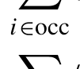{width=30%}

[]{#eq-13-001}

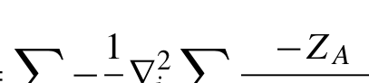{width=30%}

[]{#eq-13-002}

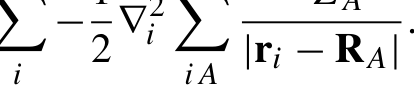{width=30%}

[]{#eq-13-003}

Ecoul、Ex 和 Exc 分别对应与双电子相互作用相关的库仑能、精确交换能和交换相关（exchange-correlation，XC）能。Enn 表示核排斥能。
将变分原理应用于总能量，可以得到轨道的本征值方程

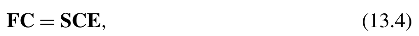{width=40%}

[]{#eq-13-004}

其中，F 是 Fock 矩阵，S 是重叠矩阵，C 是轨道系数，E 是轨道能量。Fock 矩阵由两项组成：一般来说，Veff 可以表示为若干分量的组合：

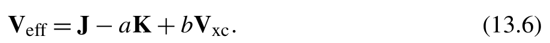{width=45%}

[]{#eq-13-005}

J 矩阵源于库仑能 Ecoul，而 K 和 Vxc 分别由精确交换能 Ex 和交换相关能 Exc 导出。Veff 是区分不同平均场模型的关键量，例如闭壳层方法、开壳层方法和广义自旋轨道方法中的 Hartree-Fock（HF）和 Kohn-Sham（KS）模型。例如，在闭壳层 HF 方法中，Veff
对应于 a = 1、b = 0。

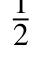{width=30%}

[]{#eq-13-006}

其中

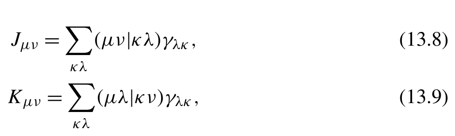{width=45%}

**公式 (13.8)(13.9)**[]{#eq-13-007}

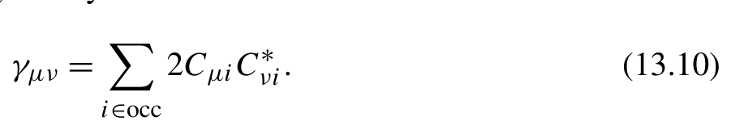{width=44%}

[]{#eq-13-008}

平均场波函数本质上是一组正交归一轨道。为了求解这些平均场轨道，我们需要构造 Fock 矩阵。然而，Fock 矩阵的组装反过来又依赖轨道本身，由此构成了递归关系。为了解决这一循环依赖，通常采用不动点迭代法求解平均场问题。该迭代过程给出了平均场计算最直接的算法实现，称为自洽场（self-consistent field，SCF）迭代。SCF 迭代始于对轨道（或密度矩阵）的初始猜测，并据此组装 Fock 矩阵；随后求解 Fock 矩阵的本征值问题，获得一组新轨道。重复该过程，直至解收敛到稳定点。
借助 NumPy 和 SciPy 提供的 einsum 与对角化函数，再结合第 12 章实现的积分程序，写出一个简单的限制性 HF 方法 SCF 迭代并不困难。然而，若要开发适应各种平均场方法的通用 SCF 架构，程序设计就必须保持足够灵活。整个 SCF 流程应当拆解为若干中间步骤，各步骤对应独立的函数调用。这些函数作为接口暴露出来，允许不同平均场模型灵活覆盖，从而便于最大程度复用 SCF 代码。这些接口可统一组织为一个包含下列功能的 SCF 类：

- 构造 hcore 和重叠矩阵的方法，它们在整个 SCF 迭代过程中保持不变。
- 构造初始猜测的方法，初始猜测可以是轨道或密度矩阵。
- get_veff 方法，用于计算给定平均场波函数的有效势矩阵。
- get_fock 方法，用于根据 hcore 和有效势矩阵组装 Fock 矩阵。
- 本征值求解器，用于生成分子轨道和轨道能量。
- 根据轨道和轨道能量构造新波函数的方法。
- check_convergence 方法，在其中计算密度矩阵、轨道梯度和平均场能量等额外量，以评估 SCF 迭代的收敛情况。

下面是一个纳入上述考虑的 SCF 程序的最简实现。

```python
class SCFWavefunction:
 gtos = None
 orbitals = None
 energies = None
 occupancies = None
 density_matrices = None
def scf_iter(model, wfn: SCFWavefunction = None) -> SCFWavefunction:
 hcore, s = model.get_hcore_s()
 if wfn is not None:
     wfn = model.get_initial_guess()
 converged = False
 while not converged:
     f = model.get_fock(wfn, hcore,s )
     mo_orbitals, mo_energies = model.eigen(f,s , wfn)
     wfn, wfn_old = model.make_wfn(mo_orbitals, mo_energies), wfn
     if model.check_convergence(wfn, wfn_old):
         converged = True
 return wfn
```
可以按照这个 SCF 程序中定义的接口，实现一个限制性闭壳层 HF 类：

```python
class RHF:
 def __init__(self, mol, gtos):
     self.mol = mol
     self.gtos = gtos
     self.threshold = 1e-6
 @lru_cache
 def get_hcore_s(self):
     mol = self.mol
```

```python
s = overlap_MD.get_matrix(self.gtos, overlap_MD.primitive_overlap)
t = overlap_MD.get_matrix(self.gtos, overlap_MD.primitive_kinetic)
v= sum( -z * coulomb_1e_MD.get_matrix(self.gtos, Rc)
        for z,R c in zip (mol.nuclear_charges, mol.coordinates))
return t+v,s
def get_initial_guess(self):
h, s = self.get_hcore_s()
return self.make_wfn(*self.eigen(h, s))
@property
@lru_cache
def eri_tensor(self):
return eri_OS_unrolled(self.gtos)
@lru_cache(2) # (1)
def get_jk(self, wfn):
dm = wfn.density_matrices
j = einsum( 'ijkl,lk->ij', self.eri_tensor, dm)
k = einsum( 'ijkl,jk->il', self.eri_tensor, dm)
return j,k
def get_veff(self, wfn):
j, k = self.get_jk(wfn)
return j-k * .5
def get_fock(self, wfn, hcore, s):
veff = self.get_veff(wfn)
return hcore + veff
def eigen(self, fock, overlap):
e, c = scipy.linalg.eigh(fock, overlap)
return c,e
def make_wfn(self, orbitals, energies):
return RestrictedCloseShell(self, orbitals, energies)
def check_convergence(self, wfn, wfn_old):
t1 = t2 = self.threshold * 1e3
t3 = self.threshold
dm = wfn.density_matrices
dm_old = wfn_old.density_matrices
return (np.linalg.norm(dm - dm_old) < t1
    and np.linalg.norm(self.orbital_gradients(wfn)) < t2
```

```python
            and abs (self.total_energy(wfn)
                    - self.total_energy(wfn_old)) < t3)
    def total_energy(self, wfn):
        hcore, s = self.get_hcore_s()
        j, k = self.get_jk(wfn)
        dm = wfn.density_matrices
        e = einsum( 'ij,ji', hcore, dm)
        e += einsum( 'ij,ji',j , dm) * .5 - einsum( 'ij,ji',k , dm) * .25
        e += self.mol.nuclear_repulsion_energy()
        return e
    def orbital_gradients(self, wfn):
        hcore, s = self.get_hcore_s()
        fock = self.get_fock(wfn, hcore,s )
        fock_mo = wfn.orbitals.T.dot(fock).dot(wfn.orbitals)
        occ = wfn.occupancies
        return fock_mo[occ!=0, occ[:,None]==0].ravel() * 2.
class RestrictedCloseShell(SCFWavefunction):
    def __init__(self,m f, orbitals, energies):
        self.gtos = mf.gtos
        self.orbitals = orbitals
        self.energies = energies
        nocc = mf.mol.nelectron // 2
        self.occupancies = np.zeros_like(energies)
        self.occupancies[:nocc] = 2.
    @property
    @lru_cache
    def density_matrices(self):
        c = self.orbitals
        return (c * self.occupancies).dot(c.T)
```
积分函数，包括 primitive_overlap、primitive_kinetic、coulomb_1e_MD 和 eri_OS_unrolled，已在第 12 章中开发。这些积分被缓存起来，以避免在 SCF 迭代过程中重复计算。某些函数，如 get_jk 和 get_veff，会被类的多个方法调用，例如 orbital_gradients、total_energy 和 convergence_check。在 SCF 迭代中，这些函数很可能针对同一个波函数对象被多次求值。为了优化性能，缓存这些函数最近一次调用的结果很有用，如第 (1) 行所示。为确保缓存的正确性，SCFWavefunction 对象应当不可变。这意味着，每当我们想要修改波函数对象的属性，例如轨道占据数时，我们
应当创建一个新的波函数对象，而不是就地修改属性。
通过覆盖 RHF 类的特定方法，我们可以派生出各种平均场模型。例如，要实现限制性 Kohn-Sham（restricted Kohn-Sham，RKS）方法，只需修改 RHF 类的 get_veff 和 total_energy 方法，同时保持其他所有部分不变。这两个方法中交换相关（XC）能 exc 和 XC 矩阵 vxc 的计算将在第 13.3 节讨论。

```python
class RKS(RHF):
 def get_veff(self, wfn):
     j, k = self.get_jk(wfn)
     vxc = get_vxc(wfn)
     return j - hybrid_factor * k + vxc
 def total_energy(self, wfn):
     hcore, s = self.get_hcore_s()
     j, k = self.get_jk(wfn)
     exc = get_exc(wfn)
     dm = wfn.density_matrices
     return (einsum('ij,ji', hcore, dm) + einsum( 'ij,ji',j , dm) * .5
             - einsum( 'ij,ji',k , dm) * .25 * hybrid_factor
             + exc + self.mol.nuclear_repulsion_energy())
```
通过覆盖 SCF 基类的特定函数，可以将其他平均场模型适配到同一个框架中。下面我们将概述一些平均场模型，以及每种模型需要覆盖的函数。具体实现细节将被省略。

- 非限制性 HF（UHF）：此方法需要为自旋向上和自旋向下的轨道构造两个 Veff 矩阵和两个 Fock 矩阵。这两组轨道导致需要修改 get_veff、total_energy、orbital_gradients、eigen 和 make_wfn。
- 限制性开壳层 HF（ROHF）：此方法也需要两个 Veff 矩阵，分别对应自旋向上和自旋向下的密度矩阵。Fock 矩阵的

构造方式有所不同，并非仅仅相加 h + V eff。受影响的函
数包括 get_veff、get_fock、total_energy、orbital_gradients 和 make_wfn。

- 对轨道不施加自旋限制的广义 HF（GHF）：此方法使重叠矩阵、h 和 Veff 的维度增大。受影响的函数包括 get_hcore_s、get_veff 和 make_wfn。
- UKS：作为一种 DFT 方法，UKS 方法需要在 Veff 和总能量计算中加入 XC 泛函，与 RKS 方法类似。

应当在 UHF 方法的基础上覆盖 get_veff 和 total_energy
函数。

- ROKS：与 UKS 类似，ROKS 方法需要在 ROHF 方法的基础上覆盖 get_veff 和 total_energy 函数。
- GKS：与 UKS 类似，GKS 方法需要在 GHF 方法的基础上覆盖 get_veff 和 total_energy 函数。
- 四分量 Dirac-Hartree-Fock（DHF）：与非相对论方法相比，这种相对论方法使用不同的哈密顿量和基函数。它影响涉及积分计算的函数，包括 get_hcore_s、get_veff 和 make_wfn。
- Dirac-Kohn-Sham（DKS）：相对论 DFT 方法 DKS 需要在 DHF 方法的基础上覆盖 get_veff 和 total_energy 函数。

在这些 HF 和 KS 类的基础上，可以加入额外的处理，派生出更多平均场模型的变体：

- 标量相对论修正：可以对非相对论方法应用标量相对论修正。只需修改 get_hcore_s 函数。
- 自旋轨道耦合：加入单电子自旋轨道耦合效应，会在 GHF 和 GKS 方法的 get_hcore_s 中引入一个额外的矩阵。
- 双分量相对论理论 [3–6]：这种相对论方法扩展了 GHF 或 GKS 方法，需要修改 get_hcore_s 函数。
- 密度拟合（density fitting，DF）近似 [7,8]：DF 技术可用于加速电子排斥积分（electron repulsion integrals，ERI）的计算。要实现这一近似，需要覆盖 get_jk 函数。
- 伪谱方法 [9]：与 DF 技术类似，这种方法可以加速交换矩阵的计算。因此，需要覆盖 get_jk 函数。
- QM/MM 方法 [10,11]：在经典分子力学（molecular mechanics，MM）粒子的静电势下进行量子力学（quantum mechanical，QM）计算。可以覆盖 get_hcore_s 函数以引入静电势，并调整 total_energy 函数以包含 MM 部分的能量贡献。
- 隐式溶剂模型：溶剂效应用一个依赖于密度矩阵的外势表示。这个势需要在 SCF 迭代过程中更新。相关函数是 get_veff 和 total_energy。
- 经典色散修正：这些修正不改变量子哈密顿量。只需调整底层类的 total_energy 函数。
- 点群对称性适配：可以利用对称性信息将 Fock 矩阵块对角化。利用这种对称性信息的一种直接方法是覆盖 eigen 函数。此外，对称性信息还可用于构造波函数和计算积分。在这些情况下，需要覆盖 make_wfn 和 get_veff。
- 热展宽方法：展宽方法可以通过修改轨道占据数来改善 SCF 收敛。函数 make_wfn、total_energy 和 orbital_gradients 与此方法有关。
- 约束 DFT：通过使用 get_veff 调整有效势，此方法会影响电子密度和波函数的分布。
- Γ 点的周期性边界条件（periodic boundary condition，PBC）：由于 Γ 点的轨道可以取为实数，Γ 点的平均场 PBC 类可以复用分子平均场类的大部分功能。周期性的使用直接影响 get_hcore_s 和 get_veff 函数中的积分计算。

total_energy 函数也需要修改，因为采用 PBC 计算
总能量的方式不同于分子中的计算方式。

- 适配 k 点的 PBC：k 点 PBC 方法引入了一个额外的索引，用于标记轨道和积分的 k 点对称性。这使得底层变量的数据结构不同于分子平均场类中的数据结构。所有方法都必须重写，以适应额外的 k 点索引。然而，PBC 平均场类仍可适配现有的 SCF 迭代程序。

这些平均场特征可以组合形成新的平均场模型。这种灵活性使代码结构和平均场方法的层次结构变得复杂。我们将在第 13.5 节进一步讨论这个问题。

## 13.2 库仑矩阵和交换矩阵

在第 13.1 节中，我们使用 einsum 函数计算了库仑矩阵 J 和交换矩阵 K。此功能可以抽象为以下代码片段：

```python
from eri_OS_rys import get_eri_tensor
eri_tensor = eri_OS_unrolled(gtos)
jmat = einsum( 'ijkl,ji->kl', eri, dm)
kmat = einsum( 'ijkl,jk->il', eri, dm)
```
在此过程中，积分张量 eri_tensor 的计算是计算量最大的步骤。这里我们计算整个 ERI 张量，其中包含大量冗余积分。为了提高性能，我们可以利用 ERI 的八重置换对称性：
利用八重对称性的一种方法是修改 get_eri_tensor 函数。我们可以计算 ERI 张量中的必要积分，然后根据置换关系 (13.11) 填充张量的其余部分。然而，这种算法需要大量内存来存储 ERI 张量，并且填充整个张量会产生显著的内存访问开销。
一种改进方法是只计算不重复的积分，并根据八重对称性通过八种缩并方式使用这些积分。以交换矩阵为例，八种缩并模式如下：

```text
einsum('ijkl,jk->il', eri, dm)
einsum('ijkl,ik->jl', eri, dm)
einsum('ijkl,jl->ik', eri, dm)
einsum('ijkl,il->jk', eri, dm)
einsum('ijkl,kj->li', eri, dm)
einsum('ijkl,ki->lj', eri, dm)
einsum('ijkl,lj->ki', eri, dm)
einsum('ijkl,li->kj', eri, dm)
```
请注意，第 12 章开发的积分程序以单个高斯型轨道（Gaussian-type orbital，GTO）壳层为基本单位。给定四个 GTO 壳层的指标（一组四壳层），我们可以计算一个小型四指标 ERI 张量，并立即用八种缩并模式对其进行处理。这种方法更节省内存。
为实现这一算法，我们先从一个不考虑任何对称性的函数开始。

```python
def dispatch(gto_params, shell_idx):
    '''This function gives all positions of the four GTO shells in the
    shell-quartet'''
    i,j ,k , l = shell_idx
    i0, i1 = gto_params[i][:2]
    j0, j1 = gto_params[j][:2]
    k0, k1 = gto_params[k][:2]
    l0, l1 = gto_params[l][:2]
    return i0,i 1,j 0,j 1,k 0,k 1,l 0,l 1
def contract_k_s1(kmat, gto_params,d m, shell_idx):
    i0,i 1,j 0,j 1,k 0,k 1,l 0, l1 = dispatch(gto_params, shell_idx)
    sub_eri = get_eri_sub_tensor(gto_params, shell_idx)
    kmat[i0:i1,l0:l1] += einsum( 'ijkl,jk->il', sub_eri, dm[j0:j1,k0:k1])
    return
def build_k(gtos, dm):
    nao = num_functions(gtos)
    kmat = np.zeros((nao, nao))
    gto_params = pack_gto_attrs(gtos)
    ngtos = len(gtos)
    for i,j ,k ,l in itertools.product(*[range(ngtos)]*4):
        contract_k_s1(kmat, gto_params,d m,( i,j,k,l))
    return kmat
```
基于这一实现，很容易应用四重置换对称性

```python
def contract_k_s4(kmat, gto_params,d m, shell_idx):
  '''i>=j and k>=l'''
  i,j ,k , l = shell_idx
  if i<j or k<l :
    return
  i0,i 1,j 0,j 1,k 0,k 1,l 0, l1 = dispatch(gto_params, shell_idx)
  sub_eri = get_eri_sub_tensor(gto_params, shell_idx)
  if i>j and k>l :
    kmat[i0:i1,l0:l1] += einsum( 'ijkl,jk->il', sub_eri, dm[j0:j1,k0:k1])
    kmat[j0:j1,l0:l1] += einsum( 'ijkl,ik->jl', sub_eri, dm[i0:i1,k0:k1])
    kmat[i0:i1,k0:k1] += einsum( 'ijkl,jl->ik', sub_eri, dm[j0:j1,l0:l1])
    kmat[j0:j1,k0:k1] += einsum( 'ijkl,il->jk', sub_eri, dm[i0:i1,l0:l1])
  elif i>j : #k= =l
    kmat[i0:i1,l0:l1] += einsum( 'ijkl,jk->il', sub_eri, dm[j0:j1,k0:k1])
    kmat[j0:j1,l0:l1] += einsum( 'ijkl,ik->jl', sub_eri, dm[i0:i1,k0:k1])
  elif k>l : #i= =j
    kmat[i0:i1,l0:l1] += einsum( 'ijkl,jk->il', sub_eri, dm[j0:j1,k0:k1])
    kmat[i0:i1,k0:k1] += einsum( 'ijkl,jl->ik', sub_eri, dm[j0:j1,l0:l1])
  else: #i= =ja n dk= =l
    kmat[i0:i1,l0:l1] += einsum( 'ijkl,jk->il', sub_eri, dm[j0:j1,k0:k1])
  return
```
条件 (ij) ≥ (k l) 的应用更为复杂，需要谨慎处理。当 i >k 时，条件 (ij)>( k l) 自然得到满足。由此得到八重对称性版本 contract_k_s8，其中可以在 contract_k_s4 实现的基础上交换 ij 和 kl。当 i = k 时，对于某些 j 和 l 的值，仍然可以施加 ij 和 kl 之间的对称性。然而，在这种情况下正确处理 ij 和 kl 之间的对称性更具挑战性。在当前实现中，我们忽略它们的对称性，直接调用 contract_k_s4 函数，尽管这种方法可能会略微牺牲性能。

```python
def contract_k_s8(kmat, gto_params,d m, shell_idx):
  '''i>=j,k >=l,i j> =k l '''
  i,j ,k , l = shell_idx
  if i<j or k<l or i<k :
    return
```

```python
  if i= =k :
    return contract_k_s4(kmat, gto_params,d m, shell_idx)
  i0,i 1,j 0,j 1,k 0,k 1,l 0, l1 = dispatch(gto_params, shell_idx)
  sub_eri = get_eri_sub_tensor(gto_params, shell_idx)
  if i>j and k>l :
    kmat[i0:i1,l0:l1] += einsum( 'ijkl,jk->il', sub_eri, dm[j0:j1,k0:k1])
    kmat[j0:j1,l0:l1] += einsum( 'ijkl,ik->jl', sub_eri, dm[i0:i1,k0:k1])
    kmat[i0:i1,k0:k1] += einsum( 'ijkl,jl->ik', sub_eri, dm[j0:j1,l0:l1])
    kmat[j0:j1,k0:k1] += einsum( 'ijkl,il->jk', sub_eri, dm[i0:i1,l0:l1])
    kmat[l0:l1,i0:i1] += einsum( 'ijkl,kj->li', sub_eri, dm[k0:k1,j0:j1])
    kmat[l0:l1,j0:j1] += einsum( 'ijkl,ki->lj', sub_eri, dm[k0:k1,i0:i1])
    kmat[k0:k1,i0:i1] += einsum( 'ijkl,lj->ki', sub_eri, dm[l0:l1,j0:j1])
    kmat[k0:k1,j0:j1] += einsum( 'ijkl,li->kj', sub_eri, dm[l0:l1,i0:i1])
  elif i>j : #k= =l
    kmat[i0:i1,l0:l1] += einsum( 'ijkl,jk->il', sub_eri, dm[j0:j1,k0:k1])
    kmat[j0:j1,l0:l1] += einsum( 'ijkl,ik->jl', sub_eri, dm[i0:i1,k0:k1])
    kmat[l0:l1,i0:i1] += einsum( 'ijkl,kj->li', sub_eri, dm[k0:k1,j0:j1])
    kmat[l0:l1,j0:j1] += einsum( 'ijkl,ki->lj', sub_eri, dm[k0:k1,i0:i1])
  elif k>l : #i= =j
    kmat[i0:i1,l0:l1] += einsum( 'ijkl,jk->il', sub_eri, dm[j0:j1,k0:k1])
    kmat[i0:i1,k0:k1] += einsum( 'ijkl,jl->ik', sub_eri, dm[j0:j1,l0:l1])
    kmat[l0:l1,i0:i1] += einsum( 'ijkl,kj->li', sub_eri, dm[k0:k1,j0:j1])
    kmat[k0:k1,i0:i1] += einsum( 'ijkl,lj->ki', sub_eri, dm[l0:l1,j0:j1])
  else: #i= =ja n dk= =l
    kmat[i0:i1,l0:l1] += einsum( 'ijkl,jk->il', sub_eri, dm[j0:j1,k0:k1])
    kmat[l0:l1,i0:i1] += einsum( 'ijkl,kj->li', sub_eri, dm[k0:k1,j0:j1])
  return
```
在对利用对称性的 J/K 构造程序进行基准测试时，我们发现它比直接使用 einsum 的实现运行得更慢，后者生成完整的 ERI 张量，然后对完整张量应用 einsum 缩并。简单的性能分析表明，contract_k_s8 中 80% 的计算时间花在 einsum 函数上。这种开销源于对 einsum 函数的频繁调用。对于 N 个 GTO 壳层，einsum 被调用 N 次。为了减少 einsum 的开销，可以考虑两种策略：

- 即时编译（JIT compilation）。

将 einsum 缩并代码展开为嵌套的 for 循环后，可以直接
借助 Numba JIT 编译循环代码。编译后的代码具有更低的
函数调用开销。
此外，我们可在同一循环内融合不同缩并模式。这
使 sub_eri 张量的每个元素只需载入一次，便能反复复用

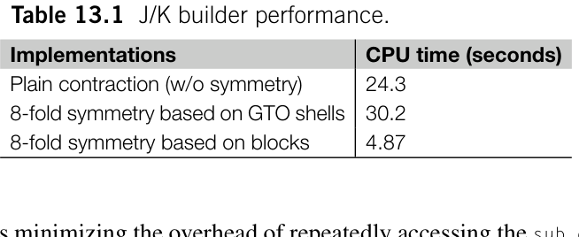

**表 13.1** J/K builder 的性能。

### 13.2.1 库仑矩阵和交换矩阵的积分筛选

细心的读者会发现，ERI 的数值跨度往往极大。在中等大小的分子中，绝大多数 ERI 的值非常接近零，它们对 J/K 矩阵的贡献完全可以忽略。同样，若密度矩阵元素的值极小，就可以省略相关 ERI 与张量缩并计算。根据 ERI 和密度矩阵元素的大小，引入筛选机制即可排除对最终结果贡献微弱的计算。
为了估算 ERI 的数值大小，可使用 Schwarz 不等式求得 ERI 的严格上界：

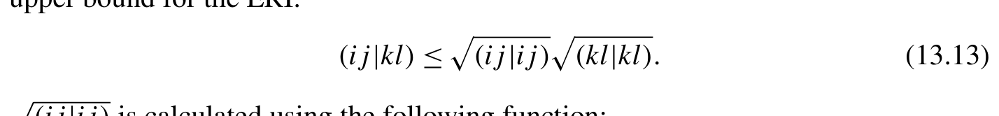{width=70%}

[]{#eq-13-009}

```python
def schwarz_halfcond(gtos):
    '''sqrt((ij|ij)) for all GTOs'''
    gto_params = pack_gto_attrs(gtos)
    nao = num_functions(gtos)
    v = np.zeros((nao, nao))
    for params_i, params_j in itertools.product(gto_params, gto_params):
        i0,i 1,l i,R a, exps_i, norm_ci = params_i
        j0,j 1,l j,R b, exps_j, norm_cj = params_j
        out = np.zeros((i1-i0,j 1-j0,i 1-i0,j 1-j0))
        contracted_ERI(li,l j,l i,l j, exps_i, exps_j, exps_i, exps_j, norm_ci, norm_cj, norm_ci, norm_cj, Ra,R b,R a,R b, out,0 ,0 ,0 ,0 )
        v[i0:i1,j0:j1] = einsum( 'ijij->ij', out) ** .5
    return v
```
为了给 contract_k 函数添加积分筛选功能，可以应用以下 screen_k 装饰器。这个筛选函数考虑了 ERI 张量中的八重置换对称性以及平均场密度矩阵的厄米对称性。

```python
def screen_k(contract_k, gtos,d m, threshold=1e-12):
    sc_half = schwarz_halfcond(gtos)
    offsets = gto_offsets(gtos)
    ngtos = len(gtos)
    sc = np.zeros((ngtos, ngtos))
    dc = np.zeros((ngtos, ngtos))
    for i,( i 0, i1) in enumerate (itertools.pairwise(offsets)):
        for j, (j0, j1) in enumerate (itertools.pairwise(offsets)):
            sc[i,j] = sc_half[i0:i1,j0:j1].max()
            dc[i,j] = dm[i0:i1,j0:j1].max()
```

```python
    def screen_contract_k(kmat, gto_params,d m, shell_idx):
        i,j ,k , l = shell_idx
        dm_max = max(dc[j,k], dc[i,k], dc[j,l], dc[i,l])
        if threshold > sc[i,j]*sc[k,l] * dm_max:
            return
        return contract_k(kmat, gto_params,d m, shell_idx)
    return screen_contract_k
def build_k_8fold(gtos, dm):
    contract_k = screen_k(contract_k_s8, gtos, dm)
    nao = num_functions(gtos)
    kmat = np.zeros((nao, nao))
    gto_params = pack_gto_attrs(gtos)
    ngtos = len(gtos)
    for i in range (ngtos):
        for j in range (i+1):
            for k in range (i+1):
                for l in range (k+1):
                    contract_k(kmat, gto_params,d m,( i,j,k,l))
    return kmat
```
为了在单个壳层四元组（shell-quartet）层面更精细地筛选电子排斥积分（ERI），可以为 contracted_ERI 或 primitive_ERI 函数开发类似的装饰器。我们不深入讨论这些装饰器的具体代码细节，因为它们的实现应该很直接。
J/K 矩阵是密度矩阵的线性函数。这一性质使我们能够在自洽场（SCF）迭代中增量构建 J/K 矩阵。利用上一次迭代的 J/K 矩阵，以及密度矩阵相对于上一次迭代的变化，我们可以计算当前步骤的 J/K 矩阵。

```text
kmat = build_k(gtos,d m-dm_prev) + kmat_prev
```
随着 SCF 迭代的进行，密度矩阵的变化逐渐减小。采用前面提到的积分筛选技术，在 SCF 接近收敛时可以省略更多积分计算。请注意，增量构建 J/K 矩阵可能导致误差累积。应适当收紧积分筛选阈值。

### 13.2.2 J 引擎

在 McMurchie-Davidson ERI 算法（第 12 章第 12.1.3.2 节）中，特定高斯型轨道（GTO）壳层四元组的单个 ERI 块 sub_eri 通过中间 R 和 E 张量的张量收缩构建：

```text
sub_eri = einsum( 'ijp,pq,qkl->ijkl',E ,R ,E )
```
这里我们暂时不考虑基函数收缩的问题。计算它对 J 矩阵的贡献时，可以得到以下收缩操作：

```text
jmat[k0:k1,l0:l1] = einsum( 'ji,ijp,pq,qkl->kl', dm[j0:j1,i0:i1],E ,R ,E , optimize=True)
```
优化收缩顺序可以减少积分计算所需的计算量。可以先进行密度矩阵与其中一个 E 张量的收缩，然后再与 R 张量和另一个 E 张量收缩。我们可以将这一过程应用于每个 ERI 块，并按如下方式实现计算 J 矩阵的函数：

```python
from pychem_book.chap12.analytical_integrals.v5.coulomb_1e_MD import ( get_R_tensor, get_E_tensor)
def build_j(gtos, dm):
    nao = num_functions(gtos)
    jmat = np.zeros((nao, nao))
    gto_params = pack_gto_attrs(gtos)
    ngtos = len(gtos)
    @lru_cache(ngtos*ngtos)
    def contract_Et_dm(i,j ) :
        i0,i 1,l i,R a, exps_i, norm_ci = gto_params[i]
        j0,j 1,l j,R b, exps_j, norm_cj = gto_params[j]
        dm_block = dm[j0:j1,i0:i1]
        Et_dm = []
        for ai,c i in zip (exps_i, norm_ci):
            for aj,c j in zip (exps_j, norm_cj):
                Et = get_E_tensor(li,l j,a i,a j,R a, Rb)
                Et_dm.append(ci * cj * einsum('ijt,ji->t',E t, dm_block))
        return Et_dm
    for i in range (ngtos):
        for j in range (ngtos):
            Rt_dm = 0.
            for k in range (ngtos):
                for l in range (ngtos):
Et_dm = contract_Et_dm(k,l ) # (1)
Rt_dm += contract_dm_R( # (2)
                            gto_params,( i,j,k,l), Et_dm)
            i0,i 1,l i,R a, exps_i, norm_ci = gto_params[i]
            j0,j 1,l j,R b, exps_j, norm_cj = gto_params[j]
            i j=0
```

```python
            jblock = 0.
            for ai,c i in zip (exps_i, norm_ci):
                for aj,c j in zip (exps_j, norm_cj):
                    Et = get_E_tensor(li,l j,a i,a j,R a, Rb)
                    R_cicj = ci * cj * Rt_dm[ij]
jblock += einsum( 'ijt,t->ij',E t, R_cicj) # (3)
                    ij += 1
            jmat[i0:i1,j0:j1] = jblock
    return jmat
```
如第 (1) 行所示，密度矩阵与 E 张量收缩得到的中间量可以预先计算并缓存。在第 (2) 行，contract_dm_R 函数执行中间量与 R 张量之间的收缩。最后，在第 (3) 行，我们使用另一个 E 张量将 R 中间量变换为 J 矩阵。为简单起见，此示例没有利用八重置换对称性。可以按照前几节所述的类似方法启用八重对称性。
MD 算法中的 R 张量仅针对原始 GTO 构建。通过修改第 12 章的 MD 积分程序，我们可以将 R 张量程序嵌入收缩代码，得到如下 contract_dm_R 函数：

```python
def contract_dm_R(gto_params, shell_idx, Et_dm):
    i,j ,k , l = shell_idx
    i0,i 1,l i,R a, exps_i, norm_ci = gto_params[i]
    j0,j 1,l j,R b, exps_j, norm_cj = gto_params[j]
    k0,k 1,l k,R c, exps_k, norm_ck = gto_params[k]
    l0,l 1,l l,R d, exps_l, norm_cl = gto_params[l]
    o u t=[ ]
    for ai in exps_i:
        for aj in exps_j:
            Rt_dm = 0.
            k l=0
            for ak in exps_k:
                for al in exps_l:
                    Rt = primitive_R_tensor(li,l j,l k,l l,a i,a j,a k,a l, Ra,R b,R c,R d )
                    Rt_dm += einsum( 'pq,q->p',R t, Et_dm[kl])
                    kl += 1
            out.append(Rt_dm)
    return np.array(out)
def primitive_R_tensor(li,l j,l k,l l,a i,a j,a k,a l,R a,R b,R c, Rd):
    lij = li + lj
    aij = ai + aj
    Rp = (ai * R a+a j * Rb) / aij
```

```python
    lkl = lk + ll
    akl = ak + al
    Rq = (ak * R c+a l * Rd) / akl
    Rpq = Rp - Rq
    theta = aij * akl / (aij + akl)
    Rt = get_R_tensor(lij + lkl, theta, Rpq)
    nf_ij = (lij+1) *(lij+2)*(lij+3)//6
    nf_kl = (lkl+1) *(lkl+2)*(lkl+3)//6
    Rt2 = np.empty((nf_ij, nf_kl))
    for ij,( e,f ,g ) in enumerate (reduced_cart_iter(lij)):
        phase = (-1)**(e+f+g)
        for kl,( t,u ,v ) in enumerate (reduced_cart_iter(lkl)):
            Rt2[ij,kl] = phase * Rt[t+e,u+f,v+g]
    Rt2 *=2 *np.pi**2.5/(aij*akl*(aij+akl)**.5)
    return Rt2
@lru_cache(20)
def reduced_cart_iter(n):
    '''Nested loops for Cartesian components, subject to x+y+z <= n'''
    return [(x,y ,z ) for x in range (n+1)
            for y in range (n+1-x) for z in range (n+1-x-y)]
```
与先构建四指标积分张量、再进行 einsum 收缩的方法相比，上述三步收缩策略可以减少浮点运算次数（FLOP）和中间量的内存占用，从而提高 J 矩阵构建的性能。这种用于计算 J 矩阵的优化技术称为 J 引擎（J-engine）算法 [12]。

## 13.3 交换关联泛函

Kohn-Sham 密度泛函理论（KS-DFT）方法需要在 get_veff 函数中计算交换关联（exchange-correlation，XC）势 Vxc。这涉及两项计算任务：计算 XC 泛函 ϵxc 的导数，以及进行数值积分以获得 XC 矩阵 Vxc。
在一些文献中，XC 泛函定义为每个粒子的 XC 能量 exc[ρ]，由此得到 XC 能量的以下积分：

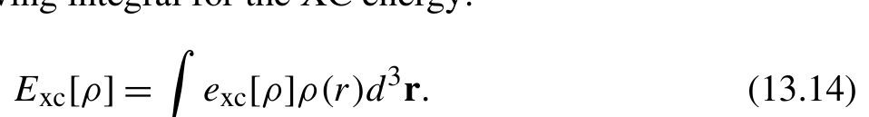{width=47%}

[]{#eq-13-010}

Exc[ρ]= exc[ρ]ρ (r)d r.) 然而，为简单起见，本节将 XC 泛函 ϵxc[ρ] 定义为 Exc 的被积函数：

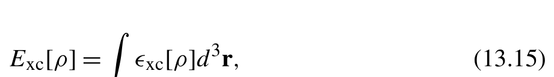{width=45%}

[]{#eq-13-011}

的积分，其中

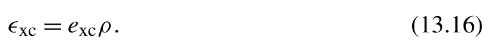{width=40%}

[]{#eq-13-012}

LibXC [13] 和 XCFun [14] 等常用 XC 泛函库采用这一约定。该积分中的电子密度使用密度矩阵 γ 和原子轨道（AO）函数 χ (r) 计算。例如，自旋向上电子的密度可以表示为

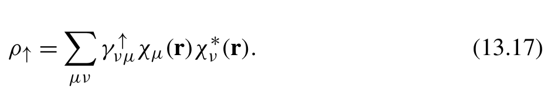{width=46%}

[]{#eq-13-013}

对于局域密度近似（Local Density Approximation，LDA）泛函 ϵxc[ρ↑,ρ ↓]，自旋向上轨道的 XC 矩阵可以表示为

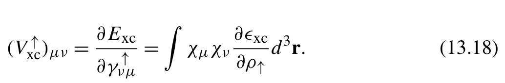{width=50%}

[]{#eq-13-014}

采用一组合适的积分网格 rn 和权重 ωn，可以通过数值方法计算 LDA 矩阵元素。

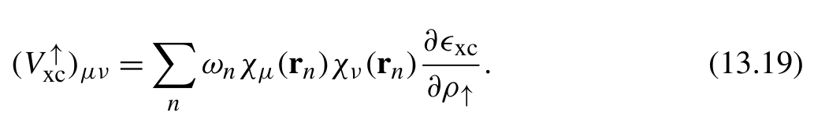{width=50%}

[]{#eq-13-015}

对于广义梯度近似（Generalized Gradient Approximation，GGA）泛函 ϵxc[ρ,σ]，它还依赖于收缩后的密度梯度
σ↑↑ =∇ ρ ↑ ·∇ ρ↑, σ ↑↓ =∇ ρ ↑ ·∇ ρ↓, σ ↓↓ =∇ ρ ↓ ·∇ ρ↓.) 自旋向上轨道的 XC 矩阵元素可以计算为

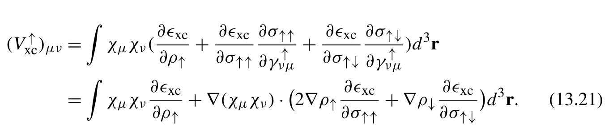{width=66%}

**公式 (13.21)**[]{#eq-13-016}

这一积分可以转换为如下数值积分程序：

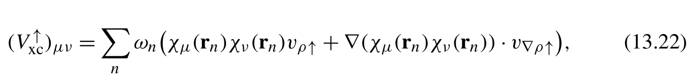{width=65%}

[]{#eq-13-017}

(V ↑)μν = ωn χμ(rn)χν (rn)vρ ↑ +∇ (χμ(rn)χν (rn)) · v ∇ ρ↑,) 其中

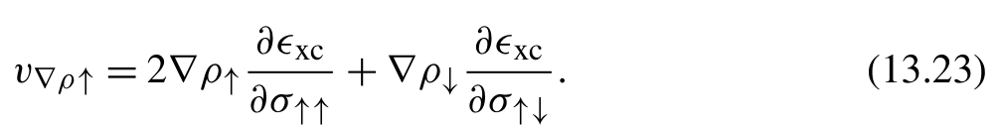{width=49%}

[]{#eq-13-018}

对于 meta-GGA 泛函 ϵxc[ρ,σ,τ]，动能密度 τ 定义为

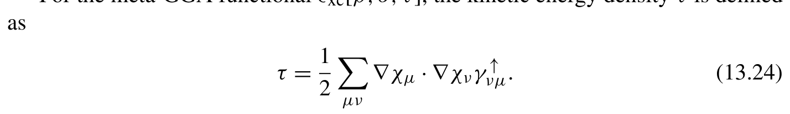{width=70%}

[]{#eq-13-019}

τ = 1 ∇ χμ ·∇ χνγ) 我们可以对 XC 矩阵进行数值积分：

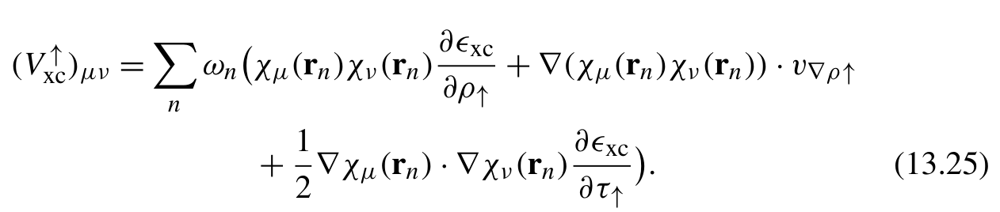{width=62%}

**公式 (13.25)**[]{#eq-13-020}

在稳定性分析与含时密度泛函理论等平均场应用中，可能需要 XC 泛函的高阶导数。这些高阶 XC 导数的积分计算更为繁复。我们以 GGA 泛函的二阶导数为例展开讨论，f ↑↑xc 的积分可写为：

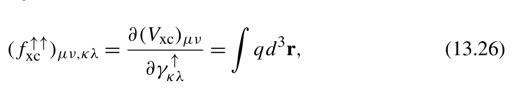{width=50%}

**公式 (13.26)**[]{#eq-13-021}

其中被积函数 q 表示为：

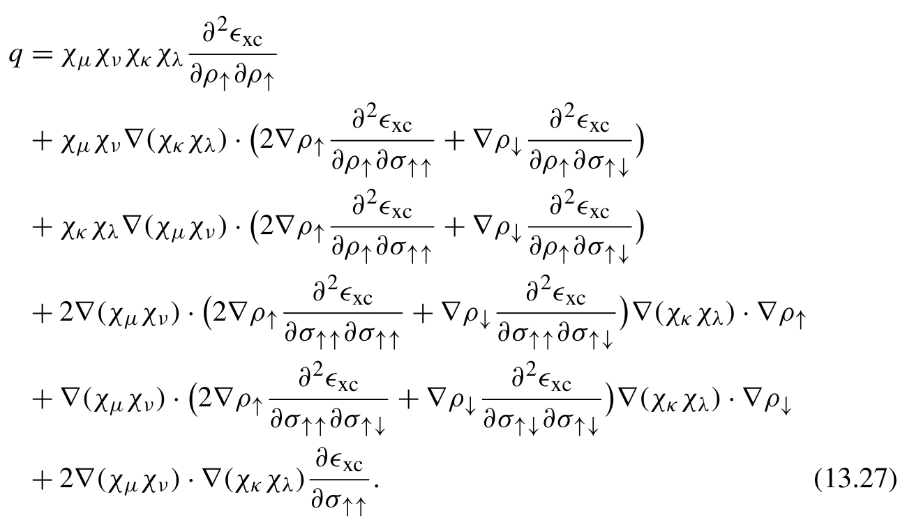{width=63%}

**公式 (13.27)**[]{#eq-13-022}

若直接依据此式计算积分，就需要生成各种中间量。这会显著增加数值积分程序的实现复杂性，使其更容易出错。实际上，可以将该公式转换为张量收缩过程，从而简化 XC 泛函的数值积分。
我们把密度变量（ρ、∇ ρ 和 τ）统一视作一般变量 x

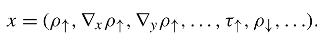{width=32%}

[]{#eq-13-023}

ϵxc 对这些变量的偏导数可以写成 n 维张量 v

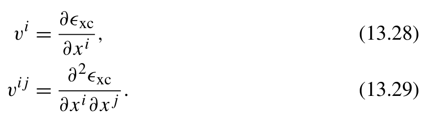{width=41%}

**公式 (13.28)(13.29)**[]{#eq-13-024}

利用这些导数张量，交换关联（exchange-correlation，XC）矩阵的计算可以简化为张量收缩（tensor contraction）：

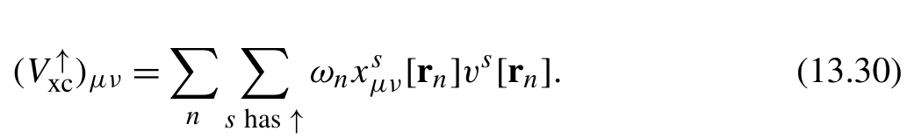{width=51%}

[]{#eq-13-025}

(V ↑)μν = ωnxs [rn]v [rn].) 这里，对 s 的求和仅限于与 ↑ 相关的变量
类似地，fxc 积分可以通过张量收缩计算

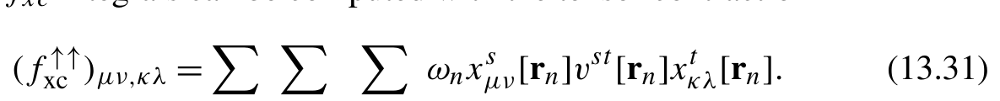{width=58%}

[]{#eq-13-026}

利用成熟的数值积分网格（integration grids），如 Becke 网格 [15] 或均匀网格，便可借助 XC 导数张量与 einsum 缩并函数计算 XC 矩阵：

```python
def get_vxc(gtos,d m, xc_code, grids, weights):
ao = eval_gtos(gtos, grids) # (1)
    nao, ngrids = ao.shape[1:]
    rho_ij = np.zeros((5, nao, nao, ngrids))
xctype = xc_family(xc_code) # (2)
xc_tensor = xc_deriv_tensor1(density, xc_code) # (3)
    match xctype:
        case 'LDA':
            rho_ij[0] = einsum( 'xig,xjg->ijg', ao[:1], ao[:1])
        case 'GGA':
            rho_ij[0:4] = einsum( 'xig,jg->xijg', ao[:4], ao[0])
            rho_ij[1:4] += einsum( 'ig,xjg->xijg', ao[0], ao[1:4])
        case 'MGGA':
            rho_ij[0:4] = einsum( 'xig,jg->xijg', ao[:4], ao[0])
            rho_ij[1:4] += einsum( 'ig,xjg->xijg', ao[0], ao[1:4])
            rho_ij[4] = einsum( 'xig,xjg->ijg', ao[1:4], ao[1:4]) * .5
    density = einsum( 'xijg,sji->sxg', rho_ij, dm)
    vxc = einsum( 'g,xijg,axg->aij', weights, rho_ij, xc_tensor)
    return vxc
```
第 (1) 行的 ao 张量存储高斯型轨道（Gaussian-type orbital，GTO）函数及其导数在网格上的值。第 (2) 行的 xc_code 是 XC 泛函的缩写，例如 ’PBE’ 或 ’B3LYP’。XC 导数张量由第 (3) 行的 xc_deriv_tensor1 函数生成，我们将在后面讨论该函数。
ao 张量的第一维有四个分量，分别对应 GTO 值及其一阶导数的 x、y 和 z 分量。由于 GTO 函数形式简单，计算 ao 张量很直接。例如，笛卡尔 GTO 的导数可以按如下方式计算：

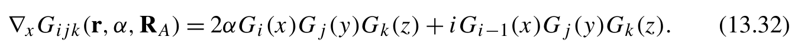{width=66%}

[]{#eq-13-027}

下面的实现计算 GTO 的值及其一阶导数，这些结果足以计算 XC 矩阵。

```python
def eval_gto(gto, grids):
    l = gto.angular_momentum
    dx,d y, dz = (grids - gto.coordinates).T
    r 2=d x * d x+d y * dy + dz * dz
    ao = np.zeros((4, n_cart(l), ngrids))
    for e,c in zip (gto.exponents, gto.coefficients):
        fac = c * np.exp(-e * r2)
        gtox = dx **np.arange(0, l+2)[:,np.newaxis]
        gtoy = dy **np.arange(0, l+2)[:,np.newaxis]
        gtoz = dz **np.arange(0, l+2)[:,np.newaxis]
        for n, (lx,l y, lz) in enumerate (iter_cart_xyz(l)):
            ao[0,n] += fac * gtox[lx] * gtoy[ly] * gtoz[lz]
            ao[1,n] -= 2 * e * fac * gtox[lx+1] * gtoy[ly] * gtoz[lz]
            if l x>0 :
                ao[1,n] += fac * lx * gtox[lx-1] * gtoy[ly] * gtoz[lz]
            ao[2,n] -= 2 * e * fac * gtox[lx] * gtoy[ly+1] * gtoz[lz]
            if l y>0 :
                ao[2,n] += fac * ly * gtox[lx] * gtoy[ly-1] * gtoz[lz]
            ao[3,n] -= 2 * e * fac * gtox[lx] * gtoy[ly] * gtoz[lz+1]
            if l z>0 :
                ao[3,n] += fac * lx * gtox[lx] * gtoy[ly] * gtoz[lz-1]
    return ao
def eval_gtos(gtos, grids):
    return np.concatenate([eval_gto(gto, grids) for gto in gtos], axis=1)
```
在上述张量收缩方案中，主要挑战是计算 XC 导数张量 v 和 v。通常，诸如
LibXC 或 XCFun 的 XC 库只提供关于 ρ、σ 和 τ 的偏导数，例如

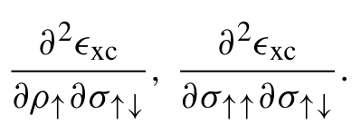{width=30%}

[]{#eq-13-028}

此外，由于偏导数的对称性，这些库省略了某些导数

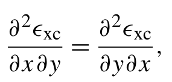{width=30%}

[]{#eq-13-029}

以及 σ↑↓ 和 σ↓↑ 之间的对称性

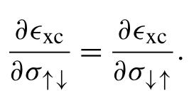{width=30%}

[]{#eq-13-030}

为构造式 (13.28) 和式 (13.29) 中的 XC 导数张量 v，我们需要恢复被省略的导数。这涉及两种转换：

- I 型转换恢复二阶偏导数的对称性

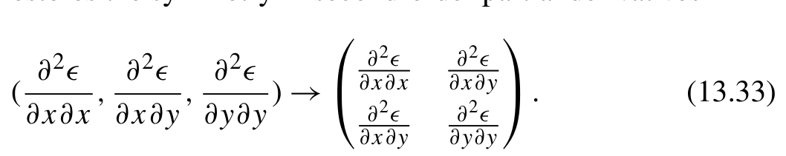{width=52%}

[]{#eq-13-031}

```python
   def conversion_1(v, axis=0):
       '''[u_u, u_d, d_d] -> [[u_u, u_d], [d_u, d_d]]'''
       assert v.shape[axis] == 3
       return v[(slice(None),) * axis + ([[0,1],[1,2]],)]
```

- II 型转换处理 σ 的不同自旋分量

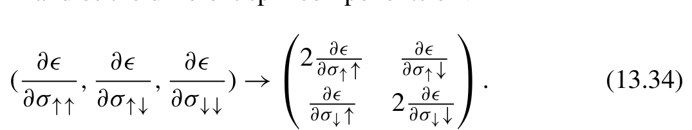{width=52%}

[]{#eq-13-032}

```python
   def conversion_2(v, axis=0):
       '''[uu,u d, dd] -> [[uu *2, ud], [du,d d *2]]'''
       assert v.shape[axis] == 3
       v = v[( slice(None),) * axis + ([[0,1],[1,2]],)]
v[(slice(None),)*axis + (0,0)] *=2 # (1)
       v[(slice(None),)*axis + (1,1)] *=2
       return v
```
在这两个转换函数中，使用 NumPy 的花式索引（fancy indexing）[[0,1],[1,2]]，将一个三元素向量重新排列为 2 × 2 数组。需要转换的索引不一定总是第一个索引。为此，我们对缺失的索引使用
slice(None) 表示法。例如，第 (1) 行中复杂的索引代码 v[(slice(None),)*axis + (0,0)] 等价于数组索引

```text
v[:,:,0,0]when axis=2.
```
如果考虑密度变量 ρ、∇ ρ 和 τ 的自旋索引，局域密度近似（local density approximation，LDA）泛函有 2 个独立变量，广义梯度近似（generalized gradient approximation，GGA）有 2 × 4 个，meta-GGA 有 2 × 5 个。这些变量决定一阶和二阶 XC 导数张量的形状。对于 LDA，其形状分别为 (2, 1) 和 (2, 1, 2, 1)。对于 GGA，其形状分别为 (2, 4) 和 (2, 4, 2, 4)。对于 meta-GGA，其形状分别为 (2, 5) 和 (2, 5, 2, 5)。
在程序中构造 XC 导数张量时，我们可以利用 I 型转换恢复 ρ 和 τ 的导数的对称性。对于 ∇ ρ 的导数，需要用 II 型转换将 σ 的导数变为对称形式。下面给出一阶和二阶 XC 导数张量的代码。

```python
def xc_deriv_tensor1(density, xc_code):
raw_xc = eval_xc(xc_code, density, spin=1, deriv=1) # (1)
    xctype = xc_family(xc_code)
    ngrids = density.shape[-1]
    if xctype == 'LDA':
        vp = raw_xc[ 'vrho'].reshape(2,1 , ngrids)
    else:
        if xctype == 'GGA':
            vp = np.empty((2,4 , ngrids))
        else:
            vp = np.empty((2,5 , ngrids))
        vp[:,0] = raw_xc[ 'vrho']
        vp[:,1:4] = einsum( 'abg,bxg->axg', conversion_2(raw_xc['vsigma']), density[:,1:4])
        if xctype == 'MGGA':
            vp[:,4] = raw_xc[ 'vtau']
    return vp
def xc_deriv_tensor2(density, xc_code):
    raw_xc = eval_xc(xc_code, density, spin=1, deriv=2)
    xctype = xc_family(xc_code)
    ngrids = density.shape[-1]
    if xctype == 'LDA':
        vp = conversion_1(raw_xc[ 'v2rho2']).reshape(2,1,2,1, ngrids)
    elif xctype == 'GGA':
        vp = np.empty((2,4 ,2 ,4 , ngrids))
        vp[:,0,:,0] = conversion_1(raw_xc[ 'v2rho2'])
        # First transforms to
        #[[uu_uu, ud_ud, ud_dd],
        # [ud_uu, ud_ud, ud_dd],
```

```python
        # [dd_uu, dd_ud, dd_dd]]
        qgg = raw_xc[ 'v2sigma2'][[[0,1 ,2 ], [1,3 ,4 ], [2,4 , 5]]]
        # Expands to
        #[[[uu_uu*2, ud_ud], [ud_ud, ud_dd *2]],
        # [[ud_uu *2, ud_ud], [ud_ud, ud_dd *2]],
        # [[dd_uu *2, dd_ud], [dd_ud, dd_dd *2]]]
        qgg = conversion_2(qgg, axis=1)
        # Expands to
        #[[[[uu_uu*2*2, ud_ud *2], [ud_ud *2, ud_dd *2*2]],
# [[ud_uu *2 , ud_ud ] , [ud_ud , ud_dd *2 ]]] ,
# [[[ud_uu *2 , ud_ud ] , [ud_ud , ud_dd *2] ] ,
# [[dd_uu *2*2, dd_ud *2], [dd_ud *2, dd_dd *2*2]]]]
        qgg = conversion_2(qgg, axis=0)
        vp[:,1:4,:,1:4] = einsum( 'abcdg,bxg,dyg->axcyg', qgg, density[:,1:4], density[:,1:4])
        qg = conversion_2(raw_xc[ 'vsigma'])
        for i in range (1,4 ) :
            vp[:,i,:,i] += qg
        qrg = conversion_2(raw_xc[ 'v2rhosigma'].reshape(2,3,ngrids), 1)
        qrg = einsum( 'rabg,bxg->raxg', qrg, density[:,1:4])
        vp[:,0,:,1:4] = qrg
        vp[:,1:4,:,0] = qrg.transpose(1,2,0,3)
    elif xctype == 'MGGA':
        ...
    return vp
```
第 (1) 行的辅助函数 eval_xc 用于计算 LibXC 库中的 XC 泛函。为简单起见，我们利用 PySCF 软件包提供的接口访问 LibXC 的功能。

```python
def eval_xc(density, xc_code, order=0):
    '''Returns the raw derivatives from XC libraries
    exc: the energy
    vrho: first partial derivative in terms of the density
    vsigma: first partial derivative in terms of sigma
    vtau: first partial derivative in terms of the kinetic energy density
    v2rho2, v2rhosigma, v2sigma2, v2rhotau, v2sigmatau, v2tau2:
        second order partial derivatives
    '''
    # Use pyscf libxc module to mimic the LibXC functionality
    from pyscf.dft import libxc
    assert density.ndim == 3
```

```python
    exc, vxc, fxc, kxc = libxc.eval_xc(density, xc_code, deriv=order)
    xctype = xc_family(xc_code)
    results = {}
    results['exc'] = exc * density[0]
    if order > 0:
        results['vrho'] = vxc[0].T
        if 'GGA' in xctype:
            results['vsigma'] = vxc[1].T
        if 'MGGA' in xctype:
            results['vtau'] = vxc[3].T
    if order > 1:
        results['v2rho2'] = fxc[0].T
        if 'GGA' in xctype:
            results['v2rhosigma'] = fxc[1].T
            results['v2sigma2'] = fxc[2].T
        if 'MGGA' in xctype:
            results['v2rhotau'] = fxc[6].T
            results['v2sigmatau'] = fxc[9].T
            results['v2tau2'] = fxc[4].T
    if order > 2:
        raise NotImplementedError
    return results
def xc_family(xc_code):
    '''Returns the family (LDA, GGA, MGGA) of a XC functional.
    '''
    from pyscf.dft import libxc
    return libxc.xc_type(xc_code)
```
构造高阶张量的方法类似，但更加复杂。遵循这一方法，PySCF 软件包提供了一个通用的变换函数，用于构造任意阶的导数张量。对实现细节感兴趣的读者可以参考 PySCF 源代码，我们在此不作深入讨论。

## 13.4 DIIS

DIIS（Direct Inversion in the Iterative Subspace，迭代子空间直接反演）外推法最初由 Peter Pulay 提出，用于加速并稳定 Hartree-Fock 自洽场（self-consistent field，SCF）计算的收敛。DIIS 外推常用于加速不动点迭代（fixed-point iteration）。其基本思路是利用迭代过程中
生成的一组试探向量来近似求解。给定一组试探向量 t 及其对应的误差向量 e，解向量可用带系数 c 的试探向量线性组合来近似表示：

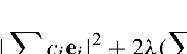{width=30%}

[]{#eq-13-033}

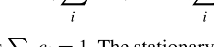{width=30%}

[]{#eq-13-034}

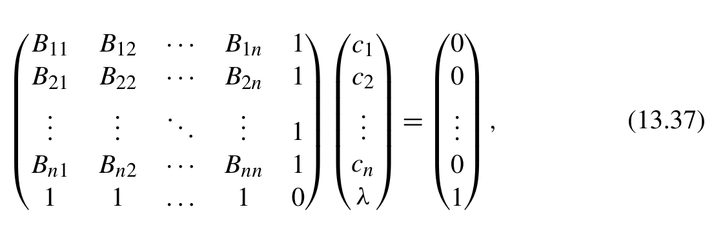{width=54%}

**公式 (13.37)**[]{#eq-13-035}

B21 B 22 ··· B 2n 1 ⎟⎟ c2 ⎟⎟
... ... .....
将这些方程转换为 Python 程序并不困难。给定误差向量和试探向量的列表作为输入，下面的 extrapolate 函数生成一个解向量。

```python
def extrapolate(errvecs, tvecs):
```
⎟ ⎟

```text
    space = len(tvecs)
```
⎛

```python
    B = np.zeros((space+1, space+1))
```

```text
    B[-1,:-1] = B[:-1,-1] = 1.
```
⎜⎜

```python
    g = np.zeros(space+1)
```

```text
    g[-1] = 1
```

```text
    for i,e 1 in enumerate (errvecs):
        for j,e 2 in enumerate (errvecs):
            if j<i :
```
⎜

```text
                continue
            B[i,j] = B[j,i] = e1.dot(e2)
    c = scipy.linalg.solve(B,g , assume_a= 'sym')[:-1]
    sol = tvecs[0] * c[0]
```
⎜

```text
    for v,x in zip (tvecs[1:], c[1:]):
```

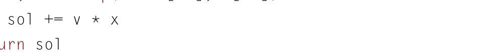{width=47%}

[]{#eq-13-036}

```python
    return sol
```
在不动点迭代过程中，每次迭代的误差向量和试探...向量都会加入 DIIS 程序，以扩展误差向量和试探向量的⎜⎝空间 ⎜⎝

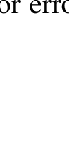{width=30%}

[]{#eq-13-037}

这些向量被传递给 extrapolate 函数，以构造一个新的解，随后在不动点问题的下一次迭代中使用该解。
如何在多次独立的函数调用之间记录这些状态？在 Python 中，通常有三种策略可以实现这一点：

- 使用类。DIIS 状态作为类的属性存储。可以执行类的特定方法，在 SCF 迭代程序中更新这些状态。
- 使用高阶函数（higher-order function）。DIIS 状态存储在高阶函数的局部变量中。这个高阶函数可以创建一个闭包（closure），保留对高阶函数局部变量的访问能力。SCF 迭代求解器可以调用该闭包，访问并更新这些状态。
- 使用协程（coroutine）。DIIS 状态保存在协程中。协程是一种可以暂停和恢复的特殊函数。当 SCF 迭代求解器恢复协程时，DIIS 可以利用先前创建的状态继续外推过程。

这里，我们将采用基于类的方法来开发 DIIS 程序。鉴于 DIIS 存在多种变体，这一选择便于扩展 DIIS 的功能。

```python
from collections import deque
class DIIS:
 def __init__(self, max_space=8):
     self.errvecs = deque(maxlen=max_space)
     self.tvecs = deque(maxlen=max_space)
 def update(self, errvec, tvec):
     self.errvecs.append(_HashableVector(errvec.ravel()))
     self.tvecs.append(_HashableVector(tvec))
     return extrapolate(self.errvecs, self.tvecs)
class _HashableVector:
 def __init__(self, vec):
     self.data = vec
 @lru_cache
 def dot(self, other):
     assert self.data.ndim == other.data.ndim == 1
     return self.data.dot(other.data)
 def __mul__(self, val):
     return self.data * val
```
在量子化学应用中，通常没有必要保留所有 DIIS 状态。DIIS 程序可以丢弃较旧的状态，并用最近的 n 个向量近似求解。Python 内置的数据结构 collections.deque 在这种情况下是一个
很好的选择，因为它提供了限制 DIIS 空间大小的功能。
你可能已经注意到，每次调用 extrapolate 函数时，B 矩阵的元素，也就是两个误差向量之间的点积，都会重新计算。如果每次只更新一个误差向量，B 矩阵中的大多数元素都不会改变。为了避免重复计算，我们可以缓存点积结果。然而，作为输入的 NumPy 数组对象不可哈希，这意味着无法使用 lru_cache 函数缓存 dot 函数。为了克服这一限制，我们创建一个临时类 _HashableVector 来包装 NumPy 数组对象，因为 Python 允许对普通类的实例进行哈希。添加新的误差向量和试探向量时，我们可以用 _HashableVector 类包装它们。请注意，较旧的状态可能被 lru_cache 递归引用，从而破坏 deque 对象提供的 DIIS 空间大小控制。为了避免对较旧状态的递归依赖，调用 dot 方法时应将新创建的向量赋给参数 other。
在 extrapolate 函数中，我们实现了显式的 for 循环来构造
在 DIIS 外推过程中管理大型向量时，我们可能会遇到与存储和序列化（serialization）有关的问题。由于内存容量有限，有必要将 DIIS 对象的状态（误差向量和试探向量）存储在磁盘上。此外，有时我们需要从 DIIS 状态恢复崩溃的计算。这些场景都涉及 DIIS 对象的序列化和反序列化（deserialization）。在这里，Python 内置的 pickle 模块并非完成这一任务的理想选择。这是因为对对象进行 pickle 序列化往往很慢，而且在序列化和反序列化过程中会消耗大量内存。
存储 DIIS 状态的可用选项包括 HDF5 存储和 NumPy memmap 对象。使用 NumPy memmap 的优点是简单。只需在 _HashableVector 类中将试探向量或误差向量转换为 NumPy memmap 对象，而无须修改 DIIS 代码本身。然而，如果还要考虑序列化 DIIS 对象及其所有属性的需求，HDF5 存储就是更合适的选择。它能够方便地在单个文件中处理各种类型的数组。为了集成 HDF5 存储，我们可以如下修改 DIIS 类和 _HashableVector 类。

```python
class DIIS:
    def __init__(self, filename, max_space=8):
        self.filename = filename
```

```python
        # keys records the active dataset names in HDF5 storage
        self.keys = deque(maxlen=max_space)
        # head points to the next available dataset Id
        self.head = 0
    @property
    def max_space(self):
        return self.keys.maxlen
    def update(self, errvec, tvec):
        with h5py.File(self.filename, mode= 'a') as f:
            head, self.head = self.head, (self.head + 1) % self.max_space
            self.keys.append(head)
            if f'e{head}' in f:
                # Reuse existing datasets
                f[f'e{head}'][:] = errvec.ravel()
                f[f't{head}'][:] = tvec
            else:
                f[f'e{head}'] = errvec.ravel()
                f[f't{head}'] = tvec
            if 'metadata' in f:
                del f['metadata']
            f['metadata'] = self.dumps()
            f.flush()
            errvecs = [_HashableVector(f[f 'e{key}']) for key in self.keys]
            tvecs = [_HashableVector(f[f 't{key}']) for key in self.keys]
            return extrapolate(errvecs, tvecs)
    def dumps(self):
        '''Only JSON-serializes a few necessary attributes'''
        return json.dumps({
            'max_space': self.max_space, 'keys': self.keys, 'head': self.head})
    @classmethod
    def restore(cls, filename):
        with h5py.File(filename, mode= 'r') as f:
            attrs = json.loads(f[ 'metadata'][()])
        obj = cls(filename, attrs[ 'max_space'])
        obj.keys = attrs[ 'keys']
        obj.head = attrs[ 'head']
        return obj
```

```python
class _HashableVector:
    def __init__(self, vec: Union[np.ndarray, h5py.Dataset]):
        self.data = vec
    @lru_cache
    def dot(self, other):
        assert self.data.ndim == other.data.ndim == 1
        return np.asarray(self.data).dot(np.asarray(other.data))
    def __mul__(self, val):
        return np.asarray(self.data) * val
```
方法只需要最近的几个向量，因此可以复用 HDF5 数据集，减小 HDF5 文件的大小。为此，引入 keys 属性来跟踪误差向量和试探向量实际引用的数据集。需要注意，传给 extrapolate 函数的 errvecs 和 tvec 列表只包含对 h5py Dataset 的引用。这些引用只在 HDF5 文件打开的上下文中有效。要访问这些向量中的数据，必须使用 np.asarray 函数将数据加载到内存中。
除了误差向量和试探向量，我们还需要存储一些必要的元数据，这些数据由 dumps 方法生成。元数据包括 DIIS 求解器的空间大小，以及 HDF5 文件中创建的数据集对应的键列表。从 HDF5 文件恢复 DIIS 对象需要这些信息。我们使用 JSON 序列化（JSON serialization）将这些内容转换为字符串，然后以 metadata 为键存储。有了这些元数据，重建 DIIS 对象就很简单，类方法演示了这一点。

## 13.5 均场方法的 Python 类设计

第 13.1 节简要介绍了 SCF 迭代程序的设计。该程序提供了一系列接口；把这些接口绑定到不同的函数，就能直接计算不同的均场模型。这种策略避免了使用繁琐的嵌套 if-else 分支来判断特定均场算法。
在这种设计中，使用 Python 类表示均场模型显得非常自然。我们可以通过编写具备特定属性和方法的类来定义新的均场模型。组织均场类存在多种设计路线。下面将探讨四种可能的类设计策略，它们各有优缺点。如果在实际应用中遇到类似的类设计问题，完全可以参考这里讨论的类管理方法。

### 13.5.1 通过类继承创建均场类

这种策略通过类继承和方法重载，从现有均场类创建新的均场类。不同均场模型中的许多函数密切相关，可以通过类继承复用，以尽量减少代码重复。例如，RKS DFT 类与 RHF 类的主要区别在于 get_veff 和 total_energy 方法。在 RKS 类中，我们只需重写这两个方法，其他方法可以从 RHF 类继承。
这种方法有明显的优点。从面向对象编程（Object-Oriented Programming，OOP）的角度看，使用类继承直观易懂。不同均场方法之间的层次关系可以自然地融入类层次结构。实现新的均场类时，只需找到合适的父类作为起点，并将相关方法加入新类。这个过程不需要复杂的设计。
然而，一次均场计算可能涉及多种特性的组合。例如，可以进行包含密度拟合近似、点群对称性、相对论修正和溶剂化效应的非限制性 KS-DFT 计算。如果把每种可能的组合都视为不同的均场模型，并分别创建类，最终可能得到数量过多的类。此外，由于某些特性组合之间可能没有明确的继承关系，我们可能不得不在这些类中重复实现非常相似的函数。要为均场方法引入新特性，就需要检查并可能扩展所有现有类，使其包含该特性。这种方法不具备可扩展性。

### 13.5.2 通过访问者模式创建均场类

前述类继承方法需要重写 get_hcore_s、get_veff 和 total_energy 等接口函数的功能。提供这些功能的另一种策略是让独立的客户端为这些接口提供服务。调用接口函数时，请求被转发给底层客户端。每个接口关联多个可互换的客户端实例。通过组合不同的接口客户端，SCF 类可以容纳各种均场方法的功能。在某些面向对象设计分类中，这种策略称为访问者模式（visitor pattern）。
例如，假设我们已经实现了通用均场类以及必要的特性客户端。要实现密度拟合 RKS DFT 方法，只需一个工厂函数，根据具体配置组装密度拟合客户端和其他必要的客户端。

```python
class RHFVeffClient(VeffClient):
    def accept(self, mf):
        j, k = mf.get_jk()
        return j-. 5 * k
```

```python
class KSVeffClient(VeffClient):
 def accept(self, mf):
     ...
     return j + vxc
class DensityFittingClient(JKClient):
 def accept(self,m f,d m ) :
     ...
     return j,k
...
class MeanField
 hcore_client: HcoreClient = None
 jk_client: JKClient = None
 veff_client: VeffClient = None
 ...
 def get_hcore_s(self):
     return self.hcore_client.accept(self)
 def get_veff(self):
     return self.veff_client.accept(self)
 ...
def mean_field_factory(**configuration):
 model = MeanField()
 model.set_basic_clients()
 if 'KS' in configuration and configuration['KS']:
     model.set_veff_client(KSVeffClient())
     model.set_total_energy_client(KSEnergyClient())
 if 'DF' in configuration and configuration['DF']:
     model.set_jk_client(DensityFittingClient())
 ...
 return model
# Perform a density-fitting RKS-DFT calculation
df_rks_model = mean_field_factory(KS=True, DF=True)
scf_iter(df_rks_model)
```
这种访问者模式方法有几个优点：

- 将操作与均场类解耦，可以灵活地通过组合客户端创建新的均场方法。
- 消除程序执行流程中的歧义。容易跟踪客户端的功能并理解它们在均场计算中的作用。

另一方面，应用这种方法也存在一些挑战。其中之一是不同客户端之间的协调，因为客户端之间交换信息不像在面向对象类中那样直接。DIIS 算法与收敛状态之间的协调就是一个例子，DIIS 可能需要根据收敛条件进行调整。另一项挑战出现在计算需要将多个特性客户端绑定到同一接口时。例如，QM/MM（Quantum Mechanical/Molecular Mechanics，量子力学/分子力学）和标量相对论修正的 hcore_client 可能发生冲突，因为两者都修改核心哈密顿量。如果在客户端中引入 if-else 链来处理多种均场特性，客户端类中的代码就会变得复杂。

### 13.5.3 对均场对象打补丁

在访问者模式方法中，引入客户端属性来定制均场功能。实际上，Python 允许我们直接覆盖均场对象的方法，而无需使用客户端属性。用具有相同签名的函数覆盖均场对象的方法，可以达到与访问者模式类似的效果。调用该方法时，Python 会转而调用覆盖后的函数。
例如，QM/MM 方法可以与各种 HF 或 KS DFT 模型结合。要加入 QM/MM 贡献，可以实现函数来覆盖均场对象的 get_hcore 和 total_energy 函数。下面的代码示例展示了这一点：

```python
def apply_qmmm(mf, MM_charges, MM_coordinates):
    original_hcore_s = mf.get_hcore_s
    original_total_energy = mf.total_energy
    def custom_hcore_s():
        hcore, s = original_hcore_s()
        # integrals to compute <i|M M -electrostatic potential | j >
        v_mm = sum(-z * coulomb_1e_MD.get_matrix(self.gtos, Rc)
                   for z,R c in zip (MM_charges, MM_coordinates))
        return hcore + v_mm,s
    def custom_total_energy():
        e_qm = original_total_energy()
e_mm = ... # 1/2 sum_{ij} Qi * Qj / |Ri -Rj|
        return e_qm + e_mm
mf.get_hcore_s = custom_hcore_s # (1)
mf.total_energy = custom_total_energy # (2)
```
在这段代码中，我们创建了两个函数来模拟对 mf.get_hcore() 和 mf.total_energy() 的调用。然后用这些自定义
函数在第 (1) 行和第 (2) 行动态地修补 mf 对象。这两个自定义函数需要调用原函数来计算 QM 区域的贡献。必须避免在自定义函数中调用 mf.get_hcore_s() 和 mf.total_energy()。这些调用会导致函数递归调用自身，造成无限调用循环。为避免递归调用，我们引入了两个临时变量 original_hcore 和 original_total_energy，保存对原方法的引用。在自定义函数中，我们使用这些变量调用原方法。
对于其他均场特性，可以用类似的方式应用更多补丁函数。然而，这种方法只适合对现有对象作临时修改。对于经常使用的均场方法，建议采用更有结构、更明确的方法，例如创建子类，来扩展功能。虽然动态打补丁很容易，但我们应当了解它的缺点：

- 给对象打补丁可能导致阅读或调试程序时产生困惑。使用 Python 调试器或代码编辑器（如 PyCharm、Vscode）分析程序时，应用于对象的动态补丁在运行之前不可见。
- 动态打补丁可能创建对对象自身的引用，从而形成循环引用。循环引用是 Python 中内存泄漏的主要原因。Python 垃圾回收器无法自动释放循环引用中涉及的对象所占用的内存。在前面的 QM/MM 示例中，变量 original_hcore_s 绑定到 mf 对象。当 custom_hcore_s 函数调用它时，自定义函数间接引用了 mf 对象。将 custom_hcore_s 函数赋给 mf.get_hcore 会创建循环引用，如图 13.1 所示。由于这些循环引用，mf 对象的所有属性都会留在内存中，直到程序终止才释放。

你可能想知道，为什么我们只动态修补实例的方法属性。能否直接覆盖类的方法？从语法上说，Python 确实允许这样做。这实际上是一种称为猴子补丁（monkey patching）的技术。例如，如下定制 MeanField 类，就能得到具有类似 QM/MM 特性的均场方法：

```python
original_hcore_s = mf.__class__.get_hcore_s
def custom_hcore_s(self):
    hcore = original_hcore_s(self)
    ...
    return hcore + v_mm,s
mf.__class__.get_hcore_s = custom_hcore_s
```
然而，这种补丁不仅会永久改变 mf.__class__ 引用的类的功能，还会影响从该基类派生的所有类的行为。这可能导致意料之外的后果。

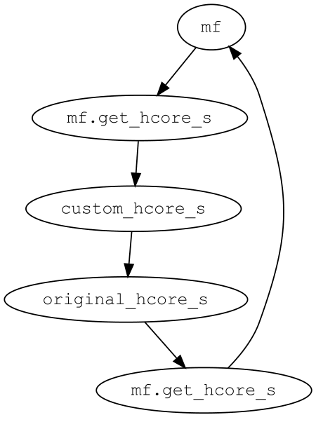

**图 13.1** 动态补丁方法中的循环引用

### 13.5.4 均场类

相较于给对象动态打补丁，使用 Python 类表示均场方法是一种直观的方式。如第 13.5.1 节所述，这种策略的主要问题在于需要定义大量的类来管理各种特性组合。好在由于 Python 类具有动态特性，我们不必事先为每种可能的均场方法显式实现一个类，完全可以在运行时针对不同的均场特性动态组合派生均场类。
继续使用 QM/MM 示例说明动态类方法。在动态定义的 QMMM_MeanField 类中，我们可以使用标准的子类语法覆盖 get_hcore 和 total_energy 方法。

```python
def apply_qmmm(mf, MM_charges, MM_coordinates):
    class QMMM_MeanField(mf.__class__):
        def get_hcore_s(self):
            hcore,s= super().get_hcore_s()
            ...
            return hcore + v_mm,s
        def total_energy(self):
            e_qm = super().get_energy()
            ...
            return e_qm + e_mm
```

```python
    return QMMM_MeanField()
```
假设我们有一个理论模型，它是 QM/MM 方法的变体，希望复用 QM/MM 类中的方法。如果 QM/MM 动态类定义在函数内部，继承或复用其功能就不方便。为解决这一问题，我们可以将 QM/MM 类的核心功能归入模块命名空间中的独立类 QMMMM。这个类可以视为混入类（Mixin）。通过继承 QMMM 混入类，我们可以开发引入额外特性的新混入类。在生成动态类的代码中，我们可以通过多重继承创建一个结合 QMMM 混入类和均场类的子类，如下例所示。

```python
class QMMM:
    def __init__(self, MM_charges, MM_coordinates):
        self.MM_charges = MM_charges
        self.MM_coordinates = MM_coordinates
    def get_hcore_s(self):
hcore,s= super().get_hcore_s() # (1)
        ...
        return hcore + v,s
    def total_energy(self):
        e_qm = super().get_energy()
        ...
        return e_qm + e_mm
def apply_qmmm(mf, MM_charges, MM_coordinates):
class QMMM_MeanField(QMMM, mf.__class__): # (2)
        def __init__(self):
super().__init__(MM_charges, MM_coordinates) # (3)
            self.__dict__.update(mf.__dict__)
    return QMMM_MeanField()
```
请注意 super() 函数在此处的作用。QMMM_MeanField 类中第 (3) 行对 super() 的调用，与普通子类中的 super() 行为类似。这个 super() 调用等价于 super(QMMM_MeanField, self)。它从 QMMM_MeanField 类开始，在方法解析顺序（Method Resolution Order，MRO）中查找第一个包含 __init__ 方法的类。QMMM_MeanField 类的 MRO 类似于

```text
(QMMM_MeanField, QMMM, mf.__class__, ...)
```
后面跟着 mf.__class__ 继承的基类。第 (3) 行的 super() 最终解析到 QMMM 类，因为该类定义了 __init__ 方法。
在 QMMM 类的 get_hcore_s 方法中，第 (1) 行的 super() 解析为 super(QMMM, self).get_hcore_s。这个 super() 的起点是 QMMM 类，取决于 QMMM 类的继承方式，它可能位于 MRO 列表的中间。多重继承的顺序在此至关重要。为确保第 (1) 行的 super() 解析到均场方法，创建子类时必须将混入类 QMMM 放在均场类之前，如第 (2) 行所示。如果 mf.__class__ 位于 QMMM 类之前，QMMM 类中的 super() 函数可能找不到提供 get_hcore_s 方法的合适候选类，导致 AttributeError。即使这条语句没有引发错误，解析结果也可能不正确。使用混入类设计动态创建类时，这一点必须特别注意。
可以使用通用的类组合函数改进动态类的代码：

```python
@lru_cache(None)
def composed_class(name, bases):
    return type (name, bases, {})
def compose(features, name):
    bases = tuple(feature.__class__ for feature in features)
    new_cls = composed_class(name, bases)
    new_obj = new_cls.__new__(new_cls)
    for feature in reversed (features):
        new_obj.__dict__.update(feature.__dict__)
    return new_obj
def apply_qmmm(mf, MM_charges, MM_coordinates):
    qmmm = QMMM(MM_charges, MM_charges)
    return compose((qmmm,m f ) ,f 'QMMM_{mf.__class__.__name__}')
```
compose 函数以对象列表为模板，使用 type 函数动态创建新类。如第 5 章第 5.1.3 节所述，type 函数需要类名、基类和类属性来组合新类。随后缓存新组合的类，以确保对同一均场模型只定义一个类。
请注意，组合类中没有显式定义 __init__ 方法。新组合类的实例只需收集各个特性对象的属性。本例采用了不同的实例创建方法。我们使用 __new__ 方法创建新组合类的空实例 new_obj。然后调用 new_obj.__dict__.update()，将输入对象的属性转移到新实例。
如何使用这种方法在均场计算中整合各种特性？我们可以为不同特性创建独立的混入类。每个特性类只关注有限范围的功能。无须为不相关的特性设置嵌套 if-else 条件。构建包含
多种特性组合的均场类时，可以使用 compose 函数按特定顺序添加特性。这种方法使我们能够以编程方式管理大量均场类。例如，PySCF 软件包使用这种设计来处理各种派生均场类。
这种类组合方法也有自身的技术挑战，包括：

- 代码难以阅读、调试和测试。只有执行 compose 函数之后，新类才可用。许多类型错误和变量初始化问题只能在运行时发现，编辑器或测试难以提前捕获。
- 多重继承的复杂性。与多重继承的缺点类似，这种方法使用多重继承会给方法解析顺序带来歧义。很难直观地确定程序的执行流程。
- 不同混入类的应用顺序。组合类的行为可能随添加特性的顺序而变化。例如，假设我们希望组合两个混入类：QM/MM 类和双分量相对论方法（如 X2C [5]）。QM/MM 混入类只是在 QM 分子的 hcore 上添加外部 MM 势。X2C 方法涉及一种变换（例如 Foldy-Wouthuysen [16] 变换）来修改哈密顿量。如果先应用 X2C 方法，再应用 QM/MM 混入类，得到的模型会将非相对论 MM 静电势加到 X2C 相对论哈密顿量上。反之，如果先应用 QM/MM 混入类，再应用 X2C 方法，相对论修正也可能应用于 MM 势。不同的应用顺序产生两个不同的均场模型。
- 类序列化的挑战。无法对组合类的实例进行 pickle 序列化。这在多进程并行化中构成挑战。为解决这一问题，可能需要使用 cloudpickle 或定制序列化协议，如第 6 章所述。

## 13.6 加速均场计算

本节探讨三种加速均场计算的方法：

- 优化 ERI 计算和 J/K 矩阵构建的计算效率。这些通常是均场方法中最耗时的部分。
- 改善 SCF 迭代的收敛性。有几种策略可以改善 SCF 迭代的收敛性能，例如使用 DIIS、能级平移和二阶 SCF 方法。
- 改善 SCF 初始猜测。这有可能减少达到收敛所需的迭代次数。

### 13.6.1 Cholesky 分解与恒等分辨方法

除了优化积分算法，还可以采用 Cholesky 分解（Cholesky decomposition，CD）或恒等分辨（resolution of identity，RI）方法加速 ERI 运算。这些方法将 ERI 计算转换为张量收缩问题，通常计算效率更高。
Cholesky 分解使我们能够把四阶 ERI 张量分解为两个三阶张量的缩并乘积：

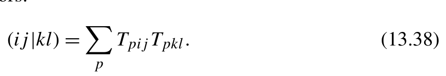{width=45%}

[]{#eq-13-038}

(ij|kl) = Tpij Tpkl.) 在实践中，RI 方法也称为密度拟合（density fitting，DF）近似，经常用于分解 ERI 张量。在这种近似中，引入一组辅助基函数（auxiliary basis functions，ABF）φp 来展开张量：

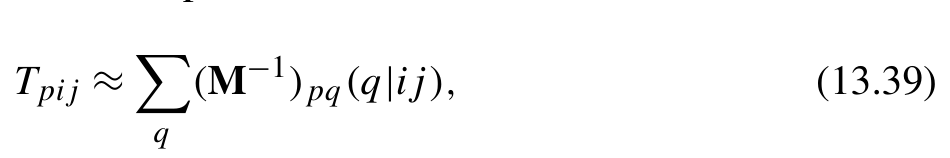{width=46%}

[]{#eq-13-039}

Tpij ≈ (M)pq(q|ij),) 其中，(q|ij) 表示三中心双电子（3c2e）排斥积分，矩阵 M 是双中心双电子（2c2e）积分张量的 CD：

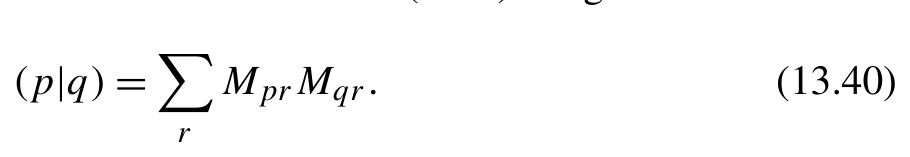{width=44%}

[]{#eq-13-040}

为计算 2c2e 和 3c2e 积分，可以直接改造第 12 章编写的四中心积分程序。方法是在壳层四元组中引入虚拟 s 型 GTO，替代其中某些 GTO 函数。该虚拟 s 型 GTO 函数的指数设为 0，位置与壳层四元组中某一 GTO 相同。下面给出了构建 3c2e 积分张量的示例代码；2c2e 积分张量亦可用类似方法构建。

```python
def eval_int3c2e(aux_gtos, gtos):
    ...
    for i,k ,l in itertools.product( range(len(aux_gtos)), range(len(gtos)), range(len(gtos))):
        i0,i 1,k 0,k 1,l 0, l1 = dispatch_offsets(i,k ,l )
        li, Ra = aux_gtos[i].angular_momentum, aux_gtos[i].coordinates
        lk, Rc = gtos[k].angular_momentum, gtos[k].coordinates
        ll, Rd = gtos[l].angular_momentum, gtos[l].coordinates
        # A fictitious s-type GTO on the second index
        lj, exps_j, norm_cj,R b=0 , np.zeros(1), np.ones(1), Ra
        eri[i0:i1,k0:k1,l0:l1] = contracted_ERI(...)[:,0]
```
得到式 (13.39) 所示的 Cholesky 分解 ERI（CDERI）张量后，我们就可以构建 J 和 K 矩阵。这些矩阵
使用 einsum 函数计算：

```python
jmat = np.einsum( 'pij,pkl,ji->kl', cderi, cderi,d m, optimize=True)
kmat = np.einsum( 'pij,pkl,jk->il', cderi, cderi,d m, optimize=True)
```
einsum 的 optimize=True 选项会优化张量收缩顺序。如果按输入中指定的顺序进行收缩，两个 cderi 张量之间的收缩规模将为 N。使用这一优化后，首先对 cderi 张量和密度矩阵 dm 进行张量收缩，生成一个中间张量。然后将这个中间张量与另一个 cderi 张量收缩。因此，J 和 K 矩阵的计算复杂度分别按 N NABF 和 N NABF 缩放，其中 NAO 表示轨道基函数的数量，NABF 表示辅助基函数的数量。
构建 K 矩阵时，optimize=True 选项会引入两个大小为 N 的中间张量的内存开销。第一个中间张量来自收缩

```text
tmp = einsum('pij,jk->pik', cderi, dm)
```
如果 cderi 和 tmp 张量按 C 顺序存储，为满足 BLAS 库中矩阵乘法对内存连续性的要求，后续收缩

```text
einsum('pik,pkl->il', tmp, cderi) requirestheindicesof thetmp tensortobe
```
需要将 tmp 张量的索引从 pik 转置为 ipk。这次转置会创建另一个中间张量。
为尽量减小内存占用并降低张量转置操作的开销，可以采用另一种张量排列方式。例如，构建 cderi 张量时，可以将辅助函数的索引放在两个 AO 索引之间。利用两个 AO 基之间的对称性，K 矩阵的收缩

```text
einsum('ipj,jk,lpk->il', cderi, dm, cderi)
```
只产生一个中间张量，从而不再需要张量转置。

```text
tmp = einsum('ipj,jk->ipk', cderi, dm)
kamt = einsum('ipk,lpk->il', tmp, cderi)
```
然而，这些优化超出了 optimize=True 设置的能力。
在均场方法中，密度矩阵通常通过占据分子轨道的乘积计算。计算 K 矩阵时，可以先将 cderi 张量与占据轨道收缩，再使用所得张量构成 K 矩阵。例如，对于 RHF 密度矩阵

```text
mo_occupied = mo[:,:nocc]
dm = einsum('it,jt->ij', mo_occupied, mo_occupied) * 2
```
交换矩阵可以计算为

```text
tmp = einsum('jt,pij->tpi', mo_occupied, cderi)
kmat = einsum('tpi,tpj->ij', tmp, tmp) * 2
```
基于分子轨道（MO）的收缩算法可以将计算成本从 N NABF 显著降低至 N Nocc NABF，其中 Nocc 表示占据轨道的数量。鉴于轨道基函数的数量通常是占据轨道数量的 5 到 10 倍，这种优化可以带来 5 到 10 倍的速度提升。
均场方法中的 K 矩阵是对称的。理论上，这种对称性使我们只需计算矩阵的下三角或上三角部分。然而，einsum 和 tensordot 不能直接利用这种对称性。只有 NumPy 的 dot 函数能够识别这种对称性，并利用 BLAS *syrk 函数计算两个相同数组的内积或外积。由于 tensordot 函数最终会调用 NumPy 的 dot 函数，如果张量收缩可以表示为两个相同数组的内积或外积，它就可以利用这种对称性。具体来说，einsum 中涉及的两个张量操作数必须相同，且收缩不能要求通过转置重新排列索引。收缩

```python
np.einsum('tpi,tpj->ij', tmp, tmp, optimize=True)
```
在张量 tmp 采用 C 连续存储的情况下，基于 MO 的收缩算法中的这一收缩可以满足上述要求。这是基于 MO 的收缩算法的额外计算优势。此外，即使是一般的正定 dm 矩阵，而非占据轨道的乘积，也可以通过对 dm 进行 Cholesky 分解，将 K 矩阵计算改造为基于 MO 的收缩算法。虽然额外的 Cholesky 分解步骤增加了计算量，但它有可能提高整体性能。
除非 ERI 张量具有显著的稀疏性，否则使用 CDERI 张量计算 J/K 矩阵比第 13.2 节所述的解析四中心积分构建方法具有明显优势。然而，CDERI 张量的存储和数据访问效率是 Cholesky 分解方法面临的挑战。CDERI 张量的大小相对于系统大小 N 按 N 缩放。随着系统大小增加，张量大小迅速增长，很容易超过可用内存容量。虽然有技术可以将大型张量分布到不同节点，但使用磁盘存储的集中式方案仍然最常见。如果 CDERI 张量存储在磁盘上，加载张量可能成为限制 J/K 矩阵计算性能的主要瓶颈。在这方面，可以应用第 9 章第 9.6 节中的 I/O 优化技术来优化性能。下面是一些技术方面的考虑。

#### 数据布局

CDERI 张量往往过大，无法完整载入内存。分批加载并处理 CDERI 张量更加现实。批处理最自然的划分维度是辅助基指标。分块切分辅助维度具有多项显著优势：

- 计算 J/K 矩阵时，每个片段只需加载一次，从而最大限度地减少所需的 I/O 传输。
- 原子轨道（AO）对固有地具有对称性和稀疏性。我们可以利用这些性质减少存储量。

为确保高效的 I/O 访问，CDERI 张量应以 C 顺序格式存储，辅助指标应放在首维。

#### 存储格式

加载 CDERI 张量的数据块需要从临时文件中顺序读取大量数据。NumPy memmap 恰好是这种情况下的合适工具。计算收敛后，CDERI 临时文件可安全删除。我们可以调用 tempfile.NamedTemporaryFile 函数自动清除临时文件。

#### 分块存储

如果只考虑从磁盘读取 CDERI 张量的情况，由于无需访问张量的子块，分块存储并不是必需的。然而，生成这个三指标张量时，无法同时在内存中处理整个张量。我们需要将 AO 指标划分为多个块，分别生成各块的 CDERI 张量。下面的 partition_gtos 函数可以将高斯型轨道（GTO）基函数分组，使每组包含适当数量的 GTO 壳层。

```python
def partition_gtos(gtos, block_size):
    '''Partition GTOs and return the shell offsets of each block
    '''
    def get_block_dims(dims):
        if not dims:
            return []
        s=0
        for i,d in enumerate (dims):
            s+ =d
            if s >= block_size:
                break
        sub_blocks = get_block_dims(dims[i+1:])
        sub_blocks.append(i+1)
        return sub_blocks
```

```python
    dims = [n_cart(b.angular_momentum) for b in gtos]
    block_dims = np.array(get_block_dims(dims))[::-1]
    return np.append(0, np.cumsum(block_dims))
```
由于 np.memmap 不支持分块存储，我们必须将不同的块存储在独立的 mmap 文件中。加载 CDERI 张量时，需要从每个 mmap 文件读取特定的数据块，并将它们拼接成完整的 CDERI 张量。

#### 数据压缩

AO 指标之间的置换对称性 Tpij = Tp ji 和 CDERI 张量中的稀疏性可用于压缩 CDERI 张量。压缩只应用于 AO 指标 i 和 j，而辅助指标 p 不作压缩。
Schwarz 不等式是识别 AO 对之间稀疏性的有效方法。使用我们在第 13.2.1 节开发的 schwarz_halfcond 函数，可以生成掩码数组，过滤掉可忽略的 AO 对。

```python
mask = np.tril(schwarz_halfcond(gtos) > 1e-15)
idx = np.where(mask)
```
idx 数组记录 AO 维度中不可忽略的元素。
压缩 CDERI 张量所用的对称性和稀疏性也可以应用于 3c2e 积分。下面的 eval_compress_int3c2e 函数压缩的是 3c2e 积分，而不是 CDERI 张量。

```python
def eval_compress_int3c2e(gtos, aux_gtos, gto_pair, mask):
    offsets = gto_offsets(gtos)
    gto0, gto1 = gto_pair
    j 3 c=[ ]
    for shell0, shell1 in pairwise(gto0, gto1, 10):
        i0, i1 = offsets[shell0], offsets[shell1]
        dat = eval_int3c2e_block(aux_gtos, gtos[shell0:shell1], gtos)
        j3c.append(dat[:,mask[i0:i1]])
    return np.hstack(j3c)
```
为了提高可读性，我们先计算所有积分，再筛选出不可忽略的积分。然而，为提高效率，应跳过可忽略积分的计算。
为重建三指标 CDERI 张量，我们可以使用下面的函数加载压缩数据块，并将其写入输出张量。

```python
def decompress(cderi_blocks, idx, out):
    naux = cderi_blocks[0].shape[0]
    p 0=p 1=0
```

```python
    for d in cderi_blocks:
        p0,p 1=p 1 , p1 + d.shape[1]
        idx0 = idx[0][p0:p1]
        idx1 = idx[1][p0:p1]
        out[:naux,idx0,idx1] = out[:naux,idx1,idx0] = d
    return out[:naux]
```

#### 预取

处理每个 CDERI 张量片段的张量收缩时，我们可以利用第 9 章的 iterate_with_prefetch 函数预取下一个片段，使张量收缩与 I/O 操作重叠。

#### 针对文件系统缓存进行优化

在自洽场（SCF）迭代收敛前，程序需要反复通读 CDERI 张量。调整遍历方向能显著提升文件系统的页面缓存命中率。操作系统通常采用最近最少使用（Least Recently Used，LRU）策略决定缓存哪些数据。若每次都沿相同方向遍历 CDERI 张量，每次遍历都会刷新缓存；若每次遍历 CDERI 后反转遍历方向，缓存数据便极易得到重用。可借助全局布尔标志在每次遍历 CDERI 时交替切换遍历方向。
综合上述工程要素，我们便能封装一个专门求算并管理 CDERI 张量的底层类。

```python
class CDERI:
    segment_max_size = 500_000_000 #4G B
    forward = True
    def __init__(self, gtos, aux_gtos):
        self.gtos = gtos
        self.aux_gtos = aux_gtos
        self.nao = num_functions(gtos)
        self.naux = num_functions(aux_gtos)
        self.blocksize = 200
        self.mask = np.tril(schwarz_halfcond(gtos) > 1e-15)
        c = scipy.linalg.cholesky(eval_int2c2e(aux_gtos))
        self.datafile = []
        block_size = CDERI.segment_max_size // self.nao
        for gto_pair in itertools.pairwise( partition_gtos(gtos, block_size)):
            int3c2e = eval_compress_int3c2e(gtos, aux_gtos, gto_pair, mask)
```

```python
            # Using NamedTemporaryFile for automatic deletion
            chunk = np.memmap(NamedTemporaryFile(), mode= 'w+', shape=int3c2e.shape, dtype= float)
            chunk[:] = scipy.linalg.solve_triangular(c, int3c2e, lower=True)
            self.datafile.append(chunk)
def __iter__(self): # (1)
        blocks = pairwise(0, self.naux, self.blocksize)
        if not CDERI.forward:
            blocks = reversed(list(blocks))
        # Flip the iteration direction to maximize FS cache utilization
        CDERI.forward = not CDERI.forward
        # buf0 and buf1 are reused to reduce memory allocation overhead
        buf0, buf1 = np.zeros((2, self.blocksize, self.nao, self.nao))
        def unpack(block):
            start, end = block
            dat = [d[start:end] for d in self.datafile]
            return decompress(dat, self.mask, buf0)
        for _, data in iterate_with_prefetch(blocks):
            buf0, buf1 = buf1, buf0
            yield data
def pairwise(start, stop, step):
    return itertools.pairwise(np.append(range(start, stop, step), stop))
```
第 (1) 行的 __iter__ 方法为这个 CDERI 类定义了一个迭代器。该迭代器使我们能够用简单的张量收缩代码计算 J/K 矩阵。

```python
cderi = CDERI(gtos, aux_gtos)
nao = num_functions(gtos)
jmat, kmat = np.zeros((nao,nao)), np.zeros((nao,nao))
for sub_cderi in iter (cderi):
    tmp = einsum( 'jt,pij->tpi', mo_occupied, sub_cderi)
    kmat += einsum( 'tpi,tpj->ij', tmp, tmp) * 2
    jmat += einsum( 'pij,ji,pkl->pkl', sub_cderi,d m, sub_cderi)
```

### 13.6.2 使用 DIIS 改善收敛

利用一组误差向量来稳定解向量。DIIS 有几种变体，例如 Pulay 的经典 DIIS [17]、ADIIS（增广 Roothaan-
Hall DIIS）[18] 和 EDIIS（能量 DIIS）[19]。误差向量与解向量存在多种具体构造方式。误差向量可以是轨道梯度、迭代之间 Fock 矩阵的变化量或密度矩阵的变化量等；解向量则涵盖密度矩阵与 Fock 矩阵。这里我们重点遵循 Pulay 的原始工作，选用误差项 FDS − SDF（对应轨道梯度）稳定 Fock 矩阵。工程实现该 DIIS 变体时，须兼顾以下技术考量：

- 外推可以应用于 SCF 迭代的不同阶段，具体取决于所选的误差向量和解向量。为了稳定 Fock 矩阵，适合在 get_fock 函数中加入 DIIS 外推。此外，创建平均场实例时，可以将 DIIS 实例初始化为平均场对象的属性。
- 误差向量 FDS − SDF 应在正交归一基中表示。正交归一基可以由重叠矩阵的特征向量或第一次 SCF 迭代得到的特征向量构成。如果不使用正交归一基，可能遇到数值稳定性问题，特别是在轨道基接近线性相关时。
- 当 SCF 计算接近收敛时，误差向量可能趋近于零。这可能导致求解 DIIS 外推函数中的线性方程时出现奇异性问题。为解决这一问题，可以采用多种策略，例如丢弃先前迭代生成的状态、阻尼对角元素 [20]，或采用不同的误差最小化方案 [21]。

为实现用于平均场的 CDIIS 类，可直接继承第 13.4 节编写的 DIIS 类。除原有属性外，还需将正交归一基作为额外属性妥善管理。该正交归一基应存储在 DIIS 序列化数据中，并在反序列化时精准恢复。为解决 DIIS 外推求解线性方程时的病态问题，代码逐步收缩 DIIS 空间，直到条件数降至所需阈值 1012 以下。

```python
class CDIIS(DIIS):
 def __init__(self, filename, max_space=8):
     super().__init__(filename, max_space)
     self.c = None # The orthonormal basis for error vectors
 def update(self,f ,d , s):
     with h5py.File(self.filename, mode= 'a') as h5f:
         if self.c is None:
             _, self.c = scipy.linalg.eigh(s)
             h5f['c'] = self.c
         errvec = f.dot(d).dot(s)
         errvec = errvec - errvec.T # FDS - SDF
         # Transforms error vector to orthonormal basis
```

```python
            errvec = self.c.T.dot(errvec).dot(self.c).ravel()
            head, self.head = self.head, (self.head + 1) % self.max_space
            self.keys.append(head)
            if f'e{head}' in h5f:
                # Reuse existing datasets
                h5f[f'e{head}'][:] = errvec
                h5f[f't{head}'][:] = f
            else:
                h5f[f'e{head}'] = errvec
                h5f[f't{head}']=f
            if 'metadata' in h5f:
                del h5f['metadata']
            h5f['metadata'] = self.dumps()
            h5f.flush()
            errvecs = [_HashableVector(h5f[f 'e{k}']) for k in self.keys]
            space = len(self.keys)
            B = np.zeros((space+1, space+1))
            B[-1,:-1] = B[:-1,-1] = 1.
            for i,e 1 in enumerate (errvecs):
                for j,e 2 in enumerate (errvecs):
                    if j<i :
                        continue
                    B[i,j] = B[j,i] = e1.dot(e2)
            while np.linalg.cond(B) > 1e12:
                B = B[1:,1:]
                self.keys.pop(0)
            g = np.zeros( len(self.keys)+1)
            g[- 1 ]=1
            c = scipy.linalg.solve(B,g , assume_a= 'sym')[:-1]
            sol = np.zeros_like(f)
            for key,x in zip (self.keys,c ) :
                sol += h5f[f 't{key}'][()] * x
            return sol
    @classmethod
    def restore(cls, filename):
        with h5py.File(filename, mode= 'r') as f:
            attrs = json.loads(f[ 'metadata'][()])
            obj = cls(filename)
            obj.keys = deque(attrs[ 'keys'], maxlen=attrs[ 'max_space'])
```

```python
            obj.head = attrs[ 'head']
            obj.c = f[ 'c'][()]
        return obj
```

### 13.6.3 初始猜测

初始猜测对自洽场（SCF）程序的收敛性和效率有很大影响。选取得当的初猜可以显著加快收敛。在上文简易的 SCF 示例中，初猜通过直接求解芯哈密顿量得到。然而，这种忽略电子互斥的单电子解并不理想。优质的初始猜测应当尽可能接近自洽迭代最终收敛的真实解。

#### 原子结果的叠加

工程上常用原子密度叠加形成的分块对角矩阵作为 SCF 初猜。这些原子密度既能从使用同种基组的原子单点计算获得，也可直接查阅现成的原子数据库。例如，ANO-RCC 基组库就是一种选择，其中收录了原子自由态计算给出的自然轨道。通过指定 ANO-RCC 基函数的基态原子占据数，便能近似构建原子密度矩阵 γA,γB,...。随后算出目标基组（T）与参考基组（A）之间的重叠矩阵 STA，即可对分块对角密度矩阵实施变换。

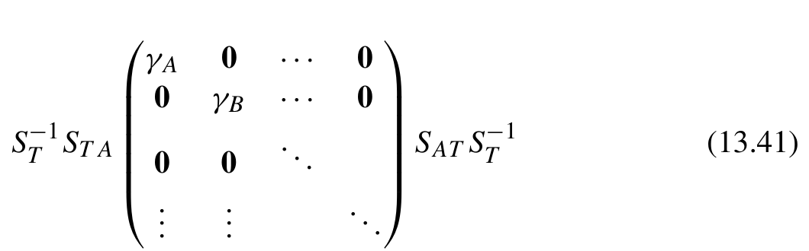{width=52%}

**公式 (13.41)**[]{#eq-13-041}

经验模型，例如 Hückel 模型和 SAP（

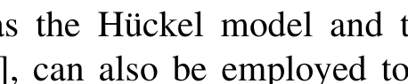{width=30%}

[]{#eq-13-042}

原子势叠加）模型 []，也可以通过叠加原子数据来生成初始猜测。

#### 根据类似计算得到初始猜测

在势能面扫描或几何优化等连贯任务中，前一步的波函数通常与当前步骤非常接近。我们可以直接利用前一步的密度矩阵作为当前步骤的初始猜测。另一种常用方法是使用较小的基组先进行平均场计算，然后将得到的密度矩阵投影到较大的基组上。
如果前一次计算的分子几何结构与当前计算的几何结构不同，是否需要根据几何结构的变化调整初始猜测？在大多数情况下没有必要。只要基组相同，前一次计算的密度矩阵就是一个极佳的初始猜测，即使
它在新几何结构下可能不严格对应正确的电子数。如果两次计算使用不同的基组，应在相同的几何结构下进行两个基组之间的投影。随后得到的密度矩阵可以直接用于新的几何结构。
在某些初始猜测方法中，我们可能只能得到密度矩阵，而得不到轨道。为了将密度矩阵初始猜测适配到 SCF 程序所需的波函数对象，我们可以专门创建一个只提供密度矩阵的伪 SCFWavefunction 类。

```python
class InitialGuess(SCFWavefunction):
    def __init__(self, dm):
        self.density_matrices = dm
    @property
    def orbitals(self):
        raise RuntimeError('Orbitals not available in initial guess' )
```
为确保不会意外使用轨道信息，我们重写了这个伪 SCFWavefunction 对象的 orbitals 属性。
接下来考虑重新启动计算的过程，这是与初始猜测的处理密切相关的一个重要方面。计算可能提前终止或未能成功收敛。在这种情况下，我们可以使用这些未完成计算的结果作为初始猜测，继续计算。
为实现这一功能，有必要在 SCF 过程中保存波函数的状态。我们可以在 make_wfn 函数中将波函数对象序列化，并保存在检查点文件（checkpoint file）中。要继续已终止的计算，可以反序列化检查点文件，并将其作为初始猜测传给 scf_iter 函数。
使用检查点文件，可以完全恢复尚未完成的计算。由于 SCF 迭代依赖 DIIS，完全恢复 SCF 计算还需要恢复 DIIS 的状态。第 13.4 节讨论了 DIIS 对象的恢复。以 RHF 方法为例，restore 方法可以如下实现：

```python
class RHF:
    def __init__(self, mol, gtos):
        self.mol = mol
        self.gtos = gtos
        self.threshold = 1e-6
        self.chkfile = tempfile.mktemp()
        diisfile = tempfile.mktemp()
        print(f'Checkpoint file is {self.chkfile}.' )
        print(f'DIIS is saved in {diisfile}' )
        self.diis = CDIIS(diisfile)
    ...
```
总结

```python
    def make_wfn(self, orbitals, energies):
        wfn = RestrictedCloseShell(self, orbitals, energies)
        with open (self.chkfile, 'wb') as f:
            pickle.dump({
                'wfn': wfn, 'mol': self.mol, 'gtos': self.gtos
            },f )
        return wfn
    @classmethod
    def restore(cls, chkfile, diisfile=None):
        with open (chkfile, 'rb') as f:
            attrs = pickle.load(f)
        obj = cls(attrs[ 'mol'], attrs[ 'gtos'])
        obj.wfn = attrs[ 'wfn']
        if diisfile is not None:
            obj.diis = CDIIS.restore(diisfile)
        return obj
# A fully restart from a previous calculation.
model = RHF.restore(chkfile= '/tmp/tmpw5t7yfgo', diisfile='/tmp/tmpc7_dzxad')
scf_iter(model, model.wfn)
```

## 小结

实现一个基础的自洽场程序，例如限制性 Hartree-Fock 程序，相对直截了当。然而，开发一个高效、易于维护且便于扩展的 SCF 程序，涉及各种工程技术挑战。
高效的 SCF 程序必须采用高效的方法计算库仑矩阵和交换矩阵。我们研究了利用电子排斥积分的八重置换对称性和稀疏性来加速求值的算法。通过应用 Cholesky 分解对电子排斥积分进行因式分解，我们将库仑矩阵和交换矩阵的计算转化为张量收缩问题。Cholesky 分解可以用密度拟合方法近似。我们介绍了密度拟合近似的几条优化技巧，重点是提高存储效率、压缩张量，以及优化张量操作相关的内存使用和计算开销。在密度泛函理论中，SCF 程序需要计算交换-相关（XC）矩阵。该矩阵
通常通过数值积分求得。我们探讨了一种简化方法，将数值积分过程转化为张量收缩程序。
除了积分计算的效率，SCF 程序的收敛性也对性能有关键影响。我们讨论了使用 DIIS 外推加速收敛、利用原子计算构建初始猜测，以及重新启动失败 SCF 计算的实用策略。
考虑到平均场方法有许多彼此只有细微差异的变体，我们探讨了四种有效组织平均场模型的设计策略。这些策略是：简单的类继承、访问者模式、对平均场对象的动态补丁，以及使用动态类。

## 参考文献

::: {.ref-list}

[1] A. Szabo, N.S. Ostlund, Modern Quantum Chemistry: Introduction to Advanced Electronic Structure Theory, 1st edition, Dover Publications, Inc., Mineola, 1996.

[2] R.G. Parr, Y. Weitao, Density-Functional Theory of Atoms and Molecules, Oxford University Press, USA, 1994, [amazon.com](http://www.amazon.com/Density-Functional-Molecules-International-Monographs-Chemistry/dp/0195092767/).

[3] T. Saue, Relativistic Hamiltonians for chemistry: a primer, ChemPhysChem 12 (17) (2011) 3077–3094, [DOI](https://doi.org/10.1002/cphc.201100682), [wiley.com](https://chemistry-europe.onlinelibrary.wiley.com/doi/pdf/10.1002/cphc.201100682), [wiley.com](https://chemistry-europe.onlinelibrary.wiley.com/doi/abs/10.1002/cphc.201100682).

[4] Z. Li, Y. Xiao, W. Liu, On the spin separation of algebraic two-component relativistic Hamiltonians, Journal of Chemical Physics 137 (15) (2012) 154114, [DOI](https://doi.org/10.1063/1.4758987), [aip.org](https://pubs.aip.org/aip/jcp/article-pdf/doi/10.1063/1.4758987/13274957/154114_1_online.pdf).

[5] W. Liu, D. Peng, Exact two-component Hamiltonians revisited, Journal of Chemical Physics 131 (3) (2009) 031104, [DOI](https://doi.org/10.1063/1.3159445), [aip.org](https://pubs.aip.org/aip/jcp/article-pdf/doi/10.1063/1.3159445/15671680/031104_1_online.pdf).

[6] M. Reiher, Relativistic Douglas–Kroll–Hess theory, WIREs Computational Molecular Science 2 (1) (2012) 139–149, [DOI](https://doi.org/10.1002/wcms.67), [wiley.com](https://wires.onlinelibrary.wiley.com/doi/pdf/10.1002/wcms.67), [wiley.com](https://wires.onlinelibrary.wiley.com/doi/abs/10.1002/wcms.67).

[7] B.I. Dunlap, Robust and variational fitting, Physical Chemistry Chemical Physics 2 (2000) 2113–2116, [DOI](https://doi.org/10.1039/B000027M).

[8] F. Weigend, A fully direct RI-HF algorithm: implementation, optimised auxiliary basis sets, demonstration of accuracy and efficiency, Physical Chemistry Chemical Physics 4 (2002) 4285–4291, [DOI](https://doi.org/10.1039/B204199P).

[9] F. Neese, F. Wennmohs, A. Hansen, U. Becker, Efficient, approximate and parallel Hartree–Fock and hybrid DFT calculations. A ‘chain-of-spheres’ algorithm for the Hartree–Fock exchange, in: Moving Frontiers in Quantum Chemistry, Chemical Physics 356 (1) (2009) 98–109, [DOI](https://doi.org/10.1016/j.chemphys.2008.10.036), [sciencedirect.com](https://www.sciencedirect.com/science/article/pii/S0301010408005089).

[10] H. Lin, D.G. Truhlar, QM/MM: what have we learned, where are we, and where do we go from here?, Theoretical Chemistry Accounts 117 (2) (2007) 185–199, [DOI](https://doi.org/10.1007/s00214-006-0143-z).

[11] E. Brunk, U. Rothlisberger, Mixed quantum mechanical/molecular mechanical molecular dynamics simulations of biological systems in ground and electronically excited states, [DOI](https://doi.org/10.1021/cr500628b), [epfl.ch](https://infoscience.epfl.ch/handle/20.500.14299/113676), 2015.

[12] C.A. White, M. Head-Gordon, AJ matrix engine for density functional theory calculations, Journal of Chemical Physics 104 (7) (1996) 2620–2629, [DOI](https://doi.org/10.1063/1.470986), [aip.org](https://pubs.aip.org/aip/jcp/article-pdf/104/7/2620/19069983/2620_1_online.pdf).

[13] S. Lehtola, C. Steigemann, M.J. Oliveira, M.A. Marques, Recent developments in LIBXC — a comprehensive library of functionals for density functional theory, SoftwareX 7 (2018) 1–5, [DOI](https://doi.org/10.1016/j.softx.2017.11.002), [sciencedirect.com](https://www.sciencedirect.com/science/article/pii/S2352711017300602).

[14] U. Ekström, L. Visscher, R. Bast, A.J. Thorvaldsen, K. Ruud, Arbitrary-order density functional response theory from automatic differentiation, Journal of Chemical Theory and Computation 6 (7) (2010) 1971–1980, [DOI](https://doi.org/10.1021/ct100117s), [acs.org](http://pubs.acs.org/doi/pdf/10.1021/ct100117s), [acs.org](http://pubs.acs.org/doi/abs/10.1021/ct100117s).

[15] A.D. Becke, A multicenter numerical integration scheme for polyatomic molecules, Journal of Chemical Physics 88 (4) (1988) 2547–2553, [DOI](https://doi.org/10.1063/1.454033), [aip.org](https://pubs.aip.org/aip/jcp/article-pdf/88/4/2547/18968948/2547_1_online.pdf).

[16] A.J. Silenko, General properties of the Foldy-Wouthuysen transformation and applicability of the corrected original Foldy-Wouthuysen method, Physical Review A 93 (2016) 022108, [DOI](https://doi.org/10.1103/PhysRevA.93.022108), [aps.org](https://link.aps.org/doi/10.1103/PhysRevA.93.022108).

[17] P. Pulay, Improved SCF convergence acceleration, Journal of Computational Chemistry 3 (4) (1982) 556–560, [DOI](https://doi.org/10.1002/jcc.540030413), [wiley.com](https://onlinelibrary.wiley.com/doi/pdf/10.1002/jcc.540030413), [wiley.com](https://onlinelibrary.wiley.com/doi/abs/10.1002/jcc.540030413).

[18] X. Hu, W. Yang, Accelerating self-consistent field convergence with the augmented Roothaan–Hall energy function, Journal of Chemical Physics 132 (5) (2010) 054109, [DOI](https://doi.org/10.1063/1.3304922), [aip.org](http://scitation.aip.org/content/aip/journal/jcp/132/5/10.1063/1.3304922).

[19] K.N. Kudin, G.E. Scuseria, E. Cancès, A black-box self-consistent field convergence algorithm: one step closer, Journal of Chemical Physics 116 (19) (2002) 8255–8261, [DOI](https://doi.org/10.1063/1.1470195), [aip.org](http://scitation.aip.org/content/aip/journal/jcp/116/19/10.1063/1.1470195).

[20] T.P. Hamilton, P. Pulay, Direct inversion in the iterative subspace (DIIS) optimization of open-shell, excited-state, and small multiconfiguration SCF wave functions, Journal of Chemical Physics 84 (10) (1986) 5728–5734, [DOI](https://doi.org/10.1063/1.449880), [aip.org](https://pubs.aip.org/aip/jcp/article-pdf/84/10/5728/18959418/5728_1_online.pdf).

[21] H. Sellers, The C2-DIIS convergence acceleration algorithm, International Journal of Quantum Chemistry 45 (1) (1993) 31–41, [DOI](https://doi.org/10.1002/qua.560450106), [wiley.com](https://onlinelibrary.wiley.com/doi/pdf/10.1002/qua.560450106), [wiley.com](https://onlinelibrary.wiley.com/doi/abs/10.1002/qua.560450106).

[22] S. Lehtola, L. Visscher, E. Engel, Efficient implementation of the superposition of atomic potentials initial guess for electronic structure calculations in Gaussian basis sets, Journal of Chemical Physics 152 (14) (2020) 144105, [DOI](https://doi.org/10.1063/5.0004046), [aip.org](https://pubs.aip.org/aip/jcp/article-pdf/doi/10.1063/5.0004046/13478079/144105_1_online.pdf).

:::

