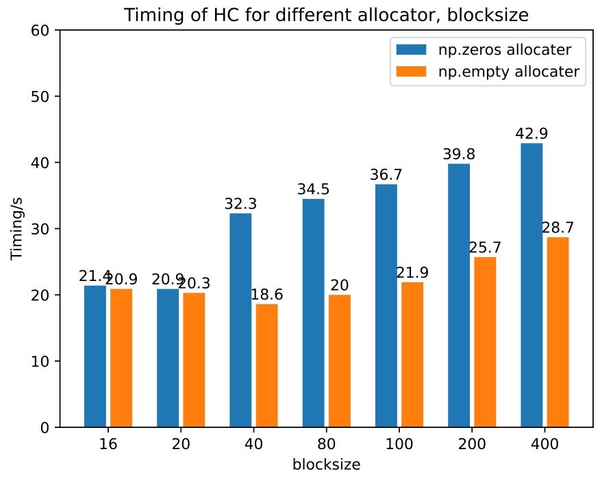
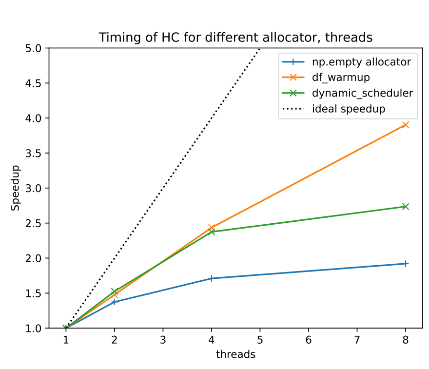
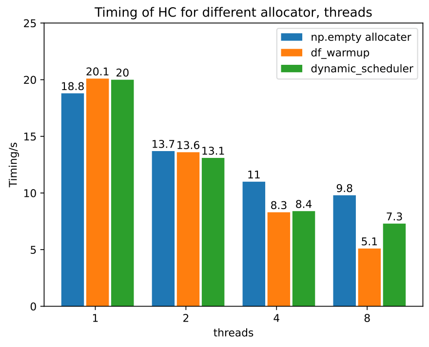

# 后 Hartree-Fock 方法 I：完全组态相互作用 {#ch14 .unnumbered}

尽管 Hartree-Fock 方法能够计入分子能量的大部分，但不足以研究化学性质与化学反应特征。化学体系由电子关联（electron correlation）效应驱动，而电子关联正是量子化学的核心。为此，人们开发出多种后 Hartree-Fock（post-HF）方法来准确描述电子关联效应。
开发后 Hartree-Fock 方法程序面临多种技术挑战。后 Hartree-Fock 方法引入了多体波函数，通常包含海量参数。处理波函数往往需要密集的高性能浮点运算。计算过程中产生的中间变量常常占用大量内存空间，有时还需要大量磁盘空间暂存。这会导致 CPU 核心、内存与磁盘之间频繁发生数据传输。数据存储结构与内存管理策略深刻影响着后 Hartree-Fock 方法程序的运行效率。如何高效利用计算机的浮点算力？如何合理设计数据结构以尽量减少数据传输开销？这些都是开发后 Hartree-Fock 方法程序时的核心关键问题。
组态相互作用（Configuration Interaction，CI）是描述电子关联效应的有效后 Hartree-Fock 方法。在其各种形式中，完全组态相互作用（Full Configuration Interaction，FCI）最为完备：波函数中考虑由给定轨道集合生成的所有可能电子组态（或行列式）。这种方法对电子关联的描述最为严谨精确。然而，由于波函数参数规模随系统规模呈指数增长，其计算开销极其高昂。
从编程角度看，FCI 呈现了后 Hartree-Fock 方法中的诸多典型技术挑战，是展示如何运用各种技术优化程序的经典范式。

- FCI 波函数中的参数量极其庞大。只有借助稀疏矩阵算法，才有可能求解 FCI 波函数。
- 将哈密顿量作用于 FCI 波函数需要海量浮点运算。
- 引入并行计算加速 FCI 程序大有裨益。并行计算的效率高度依赖于程序的设计和实现。
- FCI 方法产生极大的中间变量，对内存管理效率构成了严峻挑战。

本章将运用第 9 章讨论的性能分析和代码优化技术。此外，我们还将展示如何使用第 10 章开发的流水线执行器，高效并行化存在依赖关系的计算任务。

## 14.1 完全组态相互作用

在组态相互作用（CI）方法中，电子波函数表示为 Slater 行列式的线性组合，这些行列式也称为组态：

$$
|\Psi\rangle=\sum_{I}C_{I}|\Phi_{I}\rangle.
\qquad (14.1)
$$

[]{#eq-14-001}

Slater 行列式 |Φ ⟩表示电子在特定轨道中的占据情况。展开系数 C 通过变分极小化 CI 能量求得，满足如下述本征值方程：

$$
\mathbf{H}\mathbf{C}=\mathbf{C}E,
\qquad (14.2)
$$

[]{#eq-14-002}

其中哈密顿矩阵的元素为

$$
H_{IJ}=\langle\Phi_{I}|\hat{H}|\Phi_{J}\rangle.
\qquad (14.3)
$$

[]{#eq-14-003}

FCI 方法要求在波函数展开中计入全部行列式。在非相对论计算中，α 自旋与 β 自旋电子数分别守恒。对于具有 n 个轨道和 kα + kβ 个电子的系统，FCI
波函数包含这些行列式。每个行列式均可表示为 α 与 β 自旋电子组态的乘积： Iα 和 Iβ 分别表示 α 和 β 电子的产生算符组态：

$$
\begin{aligned}
I_{\alpha} &= \hat{a}_{i_{1}\alpha}^{\dagger}\hat{a}_{i_{2}\alpha}^{\dagger}\cdots, \qquad (14.5)\\
I_{\beta} &= \hat{a}_{i_{1}\beta}^{\dagger}\hat{a}_{i_{2}\beta}^{\dagger}\cdots. \qquad (14.6)
\end{aligned}
$$

[]{#eq-14-004}

在许多场合，Iα 和 Iβ 分别称为 α 串和 β 串。
由于行列式数量呈指数增长，FCI 方法仅适用于相对较小的系统。考虑一个包含 20 个空间轨道的半填充波函数体系，其中有 10 个 α 电子与 10 个 β 电子。FCI
展开将包含约 ≈ 34 个行列式。以双精度存储该波函数约需 250 GB 空间。这一需求逼近了 FCI 方法的实用上限。
尽管如此，FCI 程序的实现仍是展示如何应用 Python 编程技术处理实际量子化学问题的好例子。FCI 程序的开发涉及若干实用技术，例如：

- 如何在无需完整构建整个大矩阵的情况下，计算其部分本征值。
- 如何通过将问题重新表述为张量收缩问题，最大限度发挥浮点计算能力。
- 如何优化内存效率和性能。
- 如何利用并行化加速计算。

## 14.2 串的表示

为了表示行列式的 α 串和 β 串，我们使用 String 类保存产生算符的索引。String 类与第 9 章第 9.7.3 节的 Determinant 类类似。此外，我们在 String 类中实现了 __hash__ 和 __eq__ 方法。这些方法使 String 对象能直接用作字典键。本章后续将利用这一功能简化行列式地址计算。

```python
class String:
    def __init__(self, occupied_orbitals: List):
        self.occupied_orbitals = set(occupied_orbitals)
    def __repr__(self):
        return f'Det{self.occupied_orbitals}'
    @classmethod
    def vacuum(cls):
        return cls(set())
    @classmethod
    def fully_occupied(cls, n):
        return cls(set(range(n)))
    def add_occupancy(self, orbital_id):
        assert orbital_id not in self.occupied_orbitals
        return String(self.occupied_orbitals.union([orbital_id]))
    def __hash__(self):
        return hash (tuple(self.occupied_orbitals))
    def __eq__(self, other):
        return self.occupied_orbitals == other.occupied_orbitals
    def annihilate(self, orbital_id):
        '''Apply an annihilation operator. Returns the sign and a new
    string.'''
        if orbital_id not in self.occupied_orbitals:
            return 0, String.vacuum()
        sign = (-1) ** sum(i > orbital_id for i in self.occupied_orbitals)
        return sign, String(self.occupied_orbitals.difference([orbital_id])
    )
    def create(self, orbital_id):
        '''Apply a creation operator. Returns the sign and a new string.'''
        if orbital_id in self.occupied_orbitals:
            return 0., String.vacuum()
        sign = (-1) ** sum(i > orbital_id for i in self.occupied_orbitals)
        return sign, String(self.occupied_orbitals.union([orbital_id]))
```
将二次量子化算符作用于 String 对象时，可能产生正号或负号。在 String 表示中，我们约定算符按轨道索引从低到高的顺序依次作用，例如
为确定符号正负，我们只需统计索引大于目标轨道索引的算符数量。该数量表示重排二次量子化算符所需的置换次数，亦即符号翻转次数。所需的符号调整逻辑均由 annihilate 和 create 方法负责处理。
给定轨道数和占据数后，可以通过程序生成所有可能的 CI 串。这就是下面的 make_strings 函数的功能，它与第 9 章介绍的 dets 函数基本相同。

```python
@lru_cache(200)
def make_strings(norb: int, noccupied: int):
    assert norb >= noccupied
    if norb == 0:
        return [String.vacuum()]
    elif noccupied == 0:
        return [String.vacuum()]
    elif norb == noccupied:
        return [String.fully_occupied(norb)]
```

```python
    return (make_strings(norb-1, noccupied) +
            [s.add_occupancy(norb-1)
             for s in make_strings(norb-1, noccupied-1)])
```

## 14.3 Davidson 对角化

通常，FCI 方法仅需计算哈密顿量最低的几个本征态，分别对应基态波函数与低能激发态。在量子化学中，Davidson 对角化算法 [1,2] 常用于计算最低本征值和本征向量。
给定一组基向量 {v0, v1, …, vn−1}，可将矩阵 A 及其本征向量 x 表示如下：

$$
\begin{aligned}
Ax &= \lambda x, \qquad (14.7)\\
h_{ij} &= v_{i}^{\dagger}Av_{j}, \qquad (14.8)\\
x &= \sum_{i}c_{i}v_{i}. \qquad (14.9)
\end{aligned}
$$

[]{#eq-14-005}

本征值问题由此化简为一个可以高效求解的较小问题：

$$
\mathbf{h}\mathbf{c}=e\mathbf{c}.
\qquad (14.10)
$$

[]{#eq-14-006}

对于近似本征向量 x，可以针对最低本征值 e0 构造残差：

$$
\sigma=Ax-e_{0}x=\sum_{i}(Av_{i}-e_{0}v_{i})c_{i0}.
\qquad (14.11)
$$

[]{#eq-14-007}

为尽量降低矩阵与向量乘法的计算开销，使用预先计算的乘积 Avi 构造残差，再利用该残差生成新的基向量：

$$
v_{n}=\frac{\sigma}{\theta-\mathrm{diag}(A)},
\qquad (14.12)
$$

[]{#eq-14-008}

其中 diag(A) 表示矩阵 A 的对角元素。
Davidson 迭代从初始猜测 v0 开始，采用上述步骤改进子空间基向量，直到式 (14.11) 定义的残差小于预设收敛阈值。下面是针对实对称矩阵最低本征值的简化实现：

```python
def davidson(A, A_diag, x0=None, tol=1e-5, maxiter=50, space=15):
    def precond(r, e):
        return r / (A_diag - e)
```

```python
    # The initial guess
    if x0 is None:
        x0 = 1. / (A_diag - A_diag.argmin() + 1e-2)
    x0 = x0 / np.linalg.norm(x0)
    v s=[ ]
    h v=[ ]
    h = np.empty((space, space))
    for cycle in range (maxiter):
        vs.append(x0)
        hv.append(A(x0))
        n= len(vs)
        for i in range (n):
            h[i,n-1] = np.dot(vs[i], hv[n-1])
            h[n-1,i] = h[i,n-1].conj()
        e, c = np.linalg.eigh(h[:n,:n])
        e0 = e[0]
        c0 = c[:,0]
        x = np.zeros_like(x0)
        for i,c i in enumerate (c0):
            x += vs[i] * ci
        residual = -e0 * x
        for i,c i in enumerate (c0):
            residual += hv[i] * ci
        norm = np.linalg.norm(residual)
        print(f'davidson {cycle=} {e0=} residual={norm:.5g}' )
        if norm < tol:
            break
        if len (vs) >= space:
            # Restart the calculation, the last x is used as initial guess
            x0,v s,h v=x ,[ ],[ ]
            continue
        x0 = precond(residual, e0)
        # orthogonalize the basis
        for v in vs:
            x0 -= v * np.dot(v, x0)
        norm = np.linalg.norm(x0)
        assert norm < 1e-10, 'Linearly dependent basis vectors'
```

```python
        x0 /= norm
    else:
        raise RuntimeError('davidson not converged' )
    return e0,x
```
在迭代过程中，新的基向量加入子空间前，必须相对于现有基向量完成正交化。若缺少该步骤，子空间本征值问题将退化为广义本征值问题：

$$
Hc=Sce.
\qquad (14.13)
$$

[]{#eq-14-009}

尽管使用非正交基向量的广义本征值问题在理论上应得到与原问题相同的本征值，但数值经验表明，非正交基向量往往会引入更多舍入误差与数值病态问题。
请注意参数 space，它限制了子空间的大小。当子空间维度达到此上限时，本征值求解器会清空子空间并重启对角化迭代。这一策略不仅降低了基向量和 A(x) 向量的存储开销，更有助于有效控制累积数值误差。
残差向量是两个数值很大的向量之差。在对角化迭代过程中，残差的范数通常逐渐减小。因此，整个迭代过程极易积累明显的数值截断误差。每迭代 10 到 15 次重新启动一次，程序就能有效消除这些数值误差 [3]。这种周期性重启机制对维持量子化学计算的高精度至关重要。scipy.sparse.linalg 模块提供的本征值求解器不具备重启功能。这也是量子化学软件需要使用自定义对角化程序的原因之一。
为对 FCI 哈密顿量执行 Davidson 对角化，我们需要编写一个函数来计算哈密顿量与 CI 系数矩阵向量乘积 σ = HC：

```python
def matvec(x)
    return compute_hc(h1, eri,x , norb, nelec_a, nelec_b)
```
参数 h1 是单电子积分矩阵，eri 是双电子积分张量。其他参数包括轨道数 norb、α 串算符数（nelec_a）和 β 串算符数（nelec_b）。compute_hc 是 FCI 方法中计算最密集的耗时部分。它可以使用高效的高维张量收缩算法求值，第 14.4 节将对此作深入讨论。
Davidson 算法需要的另一个参数是哈密顿量的对角元素。这些元素可以使用 Slater-Condon 规则 [4] 计算。

$$
\begin{aligned}
\langle I_{\alpha}I_{\beta}|H|I_{\alpha}I_{\beta}\rangle
&=\sum_{i\in\{I_{\alpha},I_{\beta}\}}h_{ii}+\frac{1}{2}\sum_{ij\in\{I_{\alpha},I_{\beta}\}}(ii|jj)\\
&\quad-\frac{1}{2}\sum_{ij\in I_{\alpha}}(ij|ji)-\frac{1}{2}\sum_{ij\in I_{\beta}}(ij|ji).
\end{aligned}
\qquad (14.14)
$$

[]{#eq-14-010}

得益于 NumPy 的花式索引（fancy indexing）功能，计算对角元素的程序实现相当简捷。

```python
def make_hdiag(h1, eri, norb, nelec_a, nelec_b):
    occs_a = make_strings(norb, nelec_a).occupied_orbitals
    occs_b = make_strings(norb, nelec_b).occupied_orbitals
    eri = ao2mo.restore(1, eri, norb)
    diagj = np.einsum( 'iijj->ij', eri)
    diagk = np.einsum( 'ijji->ij', eri)
    hdiag = []
    for aocc in occs_a:
        for bocc in occs_b:
            e1 = h1[aocc,aocc].sum() + h1[bocc,bocc].sum()
            e2 =(diagj[aocc][:,aocc].sum() + diagj[aocc][:,bocc].sum() +
                 diagj[bocc][:,aocc].sum() + diagj[bocc][:,bocc].sum() -
                 diagk[aocc][:,aocc].sum() - diagk[bocc][:,bocc].sum())
            hdiag.append(e1 + e2 *.5)
    return np.array(hdiag)
```
求解基态 FCI 波函数的 FCI_solve 函数可以如下实现：

```python
def FCI_solve(h1, eri, norb, nelec_a, nelec_b, x0=None):
    # matrix-vector product
    def matvec(x):
        hc = compute_hc(h1, eri,x , norb, nelec_a, nelec_b)
        return hc.ravel()
    # Diagonal elements
    h_diag = make_hdiag(h1, eri, norb, nelec_a, nelec_b)
    e, wfn = davidson(matvec, h_diag, x0=x0)
    return e, wfn
```
实际上，Davidson 对角化程序往往比上面的示例复杂得多。还有诸多技术细节必须
考虑。本书不会为这些技术方面逐一实现代码示例。下面简要讨论其中一些关键技术要点。

#### 初始猜测的对称性

Davidson 对角化并不总能保证收敛到最低本征态，尤其在具有自旋对称性或高阶点群对称性的系统中。对角化过程只能产生特定对称性子空间内的最低本征态，该子空间与初始猜测的对称性直接相关。哈密顿矩阵通常是全对称算符。若初始猜测局限于某一特定对称子空间，基生成代码便只能产生局限于该子空间的基向量。这是 Davidson 对角化在量子化学应用中最常见的问题之一。
因此，在 Davidson 迭代求解器中，构造具有所需对称性的合理初始猜测至关重要。若最低本征态的对称性未知，一种实用策略是同时求解问题的多个本征值。这种做法增加了捕获正确对称性子空间的可能性，从而显著提高寻找真实最低本征态的成功率。

#### 预条件器中的奇异性

式 (14.12) 中预条件器的分母由矩阵 A 的对角元素与近似本征值之差构成。这个差可能变得非常小（小于 10），从而可能导致预条件器出现奇异性或数值误差。
确保预条件器生成的基向量得到恰当缩放非常重要。基向量中的过大数值极易悄然引入数值不稳定性。为避免数值病态，必须主动过滤掉预条件器中奇异或过大的元素。

#### 多个本征态

Davidson 对角化可用于计算本征谱低端的多个本征态。在 Davidson 迭代过程中，程序使用多个候选本征向量共同生成新的基向量。然而，这些本征向量的收敛速度往往各不相同，部分本征态已然收敛而另一些尚未收敛的情况非常普遍。若程序继续使用已收敛的本征向量参与基生成，就可能向基空间引入多余噪声，进而导致求解器数值不稳定。遇到这种情况，我们需要对已收敛的本征态施加特殊处理，例如：

- 将已收敛的本征态排除在基生成过程之外。可以使新生成的基向量与已收敛的本征态正交。这样，所得基向量就只能改进未收敛的本征态。
- 对已收敛的本征态添加惩罚项。在进行矩阵向量积 A(x) 计算时，为已收敛的本征向量 t 引入惩罚项 s

$$
Ax+\sum_{i}s t_{i}(t_{i}\cdot x).
\qquad (14.15)
$$

[]{#eq-14-011}

此时处于低能态的未收敛本征向量将在后续迭代中逐步
获得改善。
求解多个本征态的过程可能遇到各种其他问题，例如：

- 本征态的能级次序可能在迭代中发生交替，给精准识别已收敛态带来困难。
- 某些态可能在迭代中在收敛阈值附近反复波动，难以判定其收敛状态。
- 较高本征态不满足变分原理，其收敛高度依赖于较低本征态的精度。

在上述情况下，单靠微调程序实现往往难以化解所有难题。我们必须借助各种计算策略有效应对本征值问题：例如可以同时计算更多本征态，但最终仅选取其中最低的几个；另一种办法是适当放宽那些极难收敛本征态的收敛门槛。

#### 非厄米矩阵

尽管 Davidson 对角化算法最初是为对称矩阵开发的，但稍作修改即可用于非厄米矩阵的对角化。然而，对于非厄米矩阵，对角化过程往往收敛得更慢。
非厄米矩阵的左本征向量与右本征向量互不相同，与它们关联的残差也各具特征。因此，由左右残差生成的基向量必须统一纳入同一个子空间中。换言之，决不能为左、右本征态分别维护独立的投影子空间，强行使用独立子空间极易诱发严重的收敛阻碍。
此外，对非厄米矩阵对角化求解可能得到复数本征值。在某些情形下，即使预期求解得到的本征值为实数，迭代过程中的中间本征值也可能由于基子空间不完备而出现虚部。如果某些本征向量对应的本征值虚部足够小，就可以将这些本征向量继续保留在子空间中。

## 14.4 直接 CI 算法

二次量子化的无自旋哈密顿量可表示为 [5]

$$
\hat{H}=\sum_{pq}h_{pq}\hat{E}_{pq}+\frac{1}{2}\sum_{pqrs}(pq|rs)(\hat{E}_{pq}\hat{E}_{rs}-\delta_{rq}\hat{E}_{ps}),
\qquad (14.16)
$$

[]{#eq-14-012}

其中

$$
\hat{E}_{pq}=\hat{a}_{p\alpha}^{\dagger}\hat{a}_{q\alpha}+\hat{a}_{p\beta}^{\dagger}\hat{a}_{q\beta}.
\qquad (14.17)
$$

[]{#eq-14-013}

矩阵元素为

$$
\begin{aligned}
H_{I_{\alpha}I_{\beta},J_{\alpha}J_{\beta}}
&=\sum_{pq}\tilde{h}_{pq}\langle I_{\alpha}I_{\beta}|\hat{E}_{pq}|J_{\alpha}J_{\beta}\rangle\\
&\quad+\frac{1}{2}\sum_{pqrs}(pq|rs)\langle I_{\alpha}I_{\beta}|\hat{E}_{pq}\hat{E}_{rs}|J_{\alpha}J_{\beta}\rangle,
\end{aligned}
\qquad (14.18)
$$

[]{#eq-14-014}

其中 h˜ 是修饰后的单电子算符

$$
\tilde{h}_{pq}=h_{pq}-\frac{1}{2}\sum_{r}(pr|rq).
\qquad (14.19)
$$

[]{#eq-14-015}

请注意，这个单电子算符与 Fock 算符无关。对指标 r 的求和涉及所有轨道。
给定粒子数算符

$$
\hat{N}=\sum_{p}\hat{E}_{pp}=\sum_{pq}\hat{E}_{pq}\delta_{pq},
\qquad (14.20)
$$

[]{#eq-14-016}

我们可以在行列式基底中构造一个对角矩阵

$$
\sum_{pq}\langle I_{\alpha}I_{\beta}|\hat{E}_{pq}\delta_{pq}|J_{\alpha}J_{\beta}\rangle=N_{elec}\delta_{I_{\alpha}J_{\alpha}}\delta_{I_{\beta}J_{\beta}}.
\qquad (14.21)
$$

[]{#eq-14-017}

利用这个对角矩阵，我们将哈密顿量的单电子部分并入双电子积分，从而简化哈密顿矩阵：

$$
H_{I_{\alpha}I_{\beta},J_{\alpha}J_{\beta}}=\sum_{pqrs}V_{pqrs}\langle I_{\alpha}I_{\beta}|\hat{E}_{pq}\hat{E}_{rs}|J_{\alpha}J_{\beta}\rangle,
\qquad (14.22)
$$

[]{#eq-14-018}

$$
V_{pqrs}=\frac{1}{2}(pq|rs)+\frac{1}{2N_{elec}}(\delta_{rs}\tilde{h}_{pq}+\delta_{pq}\tilde{h}_{rs}).
\qquad (14.23)
$$

[]{#eq-14-019}

在 Epˆ 和 Erˆ 之间插入单位算符分解后，哈密顿矩阵被自然分解为张量收缩
E 张量定义为

$$
\begin{aligned}
E_{pq,I_{\alpha}I_{\beta}J_{\alpha}J_{\beta}}
&=\langle I_{\alpha}I_{\beta}|\hat{E}_{pq}|J_{\alpha}J_{\beta}\rangle
=E_{pq,I_{\alpha}J_{\alpha}}^{\alpha}\delta_{I_{\beta}J_{\beta}}+E_{pq,I_{\beta}J_{\beta}}^{\beta}\delta_{I_{\alpha}J_{\alpha}}, \qquad (14.25)\\
E_{pq,I_{\alpha}J_{\alpha}}^{\alpha} &= \langle I_{\alpha}|\hat{a}_{p\alpha}^{\dagger}\hat{a}_{q\alpha}|J_{\alpha}\rangle. \qquad (14.26)
\end{aligned}
$$

[]{#eq-14-020}

E 张量的元素仅有三个可能的取值：0、+1 和 − 1。我们可以使用二次量子化代数精确确定其数值，代码示例如下：

```python
def Etensor_value(create_p: int, annihilate_q: int, strI: String, strJ: String):
    '''The value of <stringI|p^\dagger q|stringJ>'''
    sign1, strK1 = strJ.annihilate(annihilate_q)
    sign2, strK2 = strK1.create(create_p)
    if strK2 == strI:
        return sign1 * sign2
    else:
        return 0
def make_Etensor(norb, nelec):
    strings = make_strings(norb, nelec)
    na = len(strings)
    Et = np.zeros((norb,norb,na,na))
    for p in range (norb):
        for q in range (norb):
            for i, strI in enumerate (strings):
                for j, strJ in enumerate (strings):
                    Et[p,q,i,j] = Etensor_value(p,q , strI, strJ)
    return Et
```
根据式 (14.4) 中行列式的结构，我们可将 FCI 波函数展开系数组织为矩阵 CJαJβ。该矩阵的行和列分别对应 α 串与 β 串。矩阵向量乘积 HC 由此可分解为三步张量收缩：

$$
\begin{aligned}
D_{rs,K_{\alpha}K_{\beta}} &= \sum_{J_{\alpha}}E_{rs,K_{\alpha}J_{\alpha}}^{\alpha}C_{J_{\alpha}K_{\beta}}+\sum_{J_{\beta}}E_{rs,K_{\beta}J_{\beta}}^{\beta}C_{K_{\alpha}J_{\beta}}, \qquad (14.27)\\
G_{pq,K_{\alpha}K_{\beta}} &= \sum_{pqrs}V_{pqrs}D_{rs,K_{\alpha}K_{\beta}}, \qquad (14.28)
\end{aligned}
$$

[]{#eq-14-021}

$$
\begin{aligned}
(\mathbf{H}\mathbf{C})_{I_{\alpha}I_{\beta}}=\sigma_{I_{\alpha}I_{\beta}}
&=\sum_{pq,K_{\alpha}}E_{pq,I_{\alpha}K_{\alpha}}^{\alpha}G_{pq,K_{\alpha}I_{\beta}}\\
&\quad+\sum_{pq,K_{\beta}}E_{pq,I_{\beta}K_{\beta}}^{\beta}G_{pq,I_{\alpha}K_{\beta}}.
\end{aligned}
\qquad (14.29)
$$

[]{#eq-14-022}

这些张量收缩可以使用 einsum 函数快速实现。

```python
def compute_hc(h1, eri, fciwfn, norb, nelec_a, nelec_b):
    Etensor_a = make_Etensor(norb, nelec_a)
    Etensor_b = make_Etensor(norb, nelec_b)
    d = einsum( 'pqKI,IJ->pqKJ', Etensor_a, fciwfn, optimize=True)
    d += einsum( 'pqKJ,IJ->pqIK', Etensor_b, fciwfn, optimize=True)
    v = merge_h1_eri(h1, eri, nelec_a + nelec_b)
    g = einsum( 'pqrs,rsIJ->pqIJ',v ,d )
    sigma = einsum( 'pqKI,pqIJ->KJ', Etensor_a,g , optimize=True)
    sigma += einsum( 'pqKJ,pqIJ->IK', Etensor_b,g , optimize=True)
    return sigma
```

## 14.5 优化张量收缩

式 (14.27) 和式 (14.29) 涉及计算密集的张量收缩。然而，这些方程中的 E 张量非常稀疏。可以利用这种稀疏性降低计算成本。
E 张量的非零元素可以高效地存储在查找表中：

- 每个串对应查找表中的一个条目。
- 表中的每个条目存储若干四元素元组 (p, q, address, value)。

给定表条目 Jα，该元组表示轨道索引 p、q，串 Iα 的地址，以及 Eα 中张量元素的值。
下面的代码展示了如何构造查找表：

```python
def make_Elt(norb, nelec):
    '''The lookup table for non-zero elements of E tensor'''
    strings = make_strings(norb, nelec)
    # To setup the map from string to address,
    # __hash__ and __eq__ methods must be created for String object.
    strings_address = {s: i for i,s in enumerate (strings)}
    E l t=[ ]
    for k, strI in enumerate (strings):
        table_k = []
        occs = strI.occupied_orbitals
        uoccs = [p for p in range (norb) if p not in occs]
        for q in occs:
            sign1, strK1 = strI.annihilate(q)
            for p in uoccs:
                sign2, strJ = strK1.create(p)
```

```python
# Applying a^\dagger_p a_q on address of strI leads to to address of the output string (strJ)
                table_k.append([p,q , strings_address[strJ], sign1 *sign2])
        for p in occs:
            table_k.append([p,p ,k , 1])
        Elt.append(table_k)
    return Elt
```
为简化 String 对象与其在 CI 系数矩阵中对应地址的转换，我们使用哈希字典为串建立索引并计算其偏移地址。
通过使用查找表，我们消除了 E 张量及与 E 张量相关的所有张量收缩。因此，我们得到了 HC 的优化实现：

```python
def compute_hc(h1, eri, fciwfn, norb, nelec_a, nelec_b):
    Elt_a = make_Elt(norb, nelec_a)
    Elt_b = make_Elt(norb, nelec_b)
    na = len(Elt_a)
    nb = len(Elt_b)
    d = np.zeros((norb,norb,na,nb))
    for I, tab in enumerate (Elt_a):
        for a,i ,J , sign in tab:
            d[a,i,J] += sign * fciwfn[I]
    for I, tab in enumerate (Elt_b):
        for a,i ,J , sign in tab:
            d[a,i,:,J] += sign * fciwfn[:,I]
    v = absorb_h1(h1, eri, nelec_a + nelec_b)
    g = einsum( 'pqrs,rsIJ->pqIJ',v ,d )
    sigma = np.zeros_like(fciwfn)
    for I, tab in enumerate (Elt_a):
        for a,i ,J , sign in tab:
            sigma[J] += sign * g[a,i,I]
    for I, tab in enumerate (Elt_b):
        for a,i ,J , sign in tab:
            sigma[:,J] += sign * g[a,i,:,I]
    return sigma
```
在这个函数中，调用 make_Elt 是一个主要瓶颈。make_Elt 中最耗时的操作包括确定 aˆpaqˆ 的符号，以及查找所得串的地址。为提高该函数的效率，我们采用以下优化：

- 将 String 对象转化为二进制整数表示。该优化能大幅加快字典查找速度。
- 预先缓存每个二次量子化算符的符号。这样便可利用缓存符号快速计算算符对 aˆpaqˆ 的相位：当 p >q 时，算符所需的轨道置换数与缓存一致；当 p <q 时，由于作用 aqˆ 移除了一个轨道，从而影响 aˆp，因而需要补乘一个额外的负号。

优化后的 make_Elt 函数实现如下：

```python
def as_bin(occupied_orbitals):
 binstr = 0
 for i in occupied_orbitals:
     binstr |= (1 <<i )
 return binstr
def make_Elt(norb, nelec):
 '''The lookup table for non-zero elements of E tensor'''
 strings = make_strings(norb, nelec)
 strings_address = {as_bin(s): i for i,s in enumerate (strings)}
 E l t=[ ]
 for k, binI in enumerate (bin_strings):
     table_k = []
     occs = []
     uoccs = []
     sign_cache = []
     sign = 1
     for i in reversed (range(norb)):
         sign_cache.append(sign)
         if (1 << i) & binI:
             occs.append(i)
             sign = -sign
         else:
             uoccs.append(i)
     sign_cache = sign_cache[::-1]
     occs = occs[::-1]
     uoccs = uoccs[::-1]
     for p in occs:
         table_k.append([p,p ,k , 1])
     for q,p in product(occs , uoccs):
         binJ = binI ^ (1 <<q )^( 1< <p )
         if p>q :
                sign = sign_cache[p] * sign_cache[q]
            else:
                sign = -sign_cache[p] * sign_cache[q]
            table_k.append([p,q , strings_address[binJ], sign])
        Elt.append(table_k)
    return np.array(Elt, dtype= int)
```

## 14.6 优化内存效率

第 14.5 节的 compute_hc 函数分配了两个临时四指标张量 d 和 g。这些临时变量占用大量内存。例如，对一个包含 14 个轨道和 7α + 7 β 个电子的体系，FCI 波函
数包含 $\inom{14}{7}^{2} = 11778624$ 个 float64 系数，占用约 100 MB 内存。程序执行期间观察到的实际内存占用接近 40 GB。主要来源是 d 张量和 g 张量，二者的规模均为 $\inom{14}{7}^{2} 	imes 142 = 2.31 	imes 10^{9}$。
为降低内存使用，我们必须分块切片处理 d 和 g 张量。在此算法中，必须审慎处理 Elt 查找表给出的地址，因其可能越界超出当前分块边界。例如，在语句

```text
d[a,i,J] += sign * fciwfn[I]
```
中，任意索引 J 很可能不位于 d 张量当前的子块内。
由于 E 张量具有置换对称性：

$$
E_{pq,I_{\alpha}J_{\alpha}}^{\alpha}=E_{qp,J_{\alpha}I_{\alpha}}^{\alpha},
\qquad (14.30)
$$

[]{#eq-14-023}

语句

```text
d[a,i,J] += sign * fciwfn[I]
```
与语句

```text
d[i,a,I] += sign * fciwfn[J]
```
将产生完全相同的中间张量 d。因此，可将 compute_hc 函数改成分块式实现：

```python
@numba.njit
def _compute_hc(v, fciwfn, norb, Elt, blocksize=60):
    Elt_a, Elt_b = Elt
    na, nb = fciwfn.shape
```

```python
    sigma = np.zeros_like(fciwfn)
    for Ka0 in range (0,n a, blocksize):
        ma = min(na - Ka0, blocksize)
        Ka1 = Ka0 + ma
        for Kb0 in range (0,n b, blocksize):
            mb = min(nb - Kb0, blocksize)
            K b 1=K b 0+m b
            d = np.zeros((norb,norb,ma,mb))
            for I, tab in enumerate (Elt_a[Ka0:Ka1]):
                for a,i ,J , sign in tab:
                    for K in range (mb):
                        d[i,a,I,K] += sign * fciwfn[J,Kb0+K]
            for I, tab in enumerate (Elt_b[Kb0:Kb1]):
                for a,i ,J , sign in tab:
                    for K in range (ma):
                        d[i,a,K,I] += sign * fciwfn[Ka0+K,J]
            g = v.dot(d.reshape(norb **2,-1)).reshape(norb,norb,ma,mb)
            for I, tab in enumerate (Elt_a[Ka0:Ka1]):
                for a,i ,J , sign in tab:
                    for K in range (mb):
                        sigma[J,Kb0+K] += sign * g[a,i,I,K]
            for I, tab in enumerate (Elt_b[Kb0:Kb1]):
                for a,i ,J , sign in tab:
                    for K in range (ma):
                        sigma[Ka0+K,J] += sign * g[a,i,K,I]
    return sigma
def compute_hc(h1, eri, fciwfn, norb, nelec_a, nelec_b, blocksize=60):
    Elt_a = make_Elt(norb, nelec_a)
    Elt_b = make_Elt(norb, nelec_b)
    v = absorb_h1(h1, eri, nelec_a + nelec_b).reshape(norb **2,-1)
    return _compute_hc(v, fciwfn, norb, (Elt_a, Elt_b), blocksize)
```
对于分块计算算法，这里出现了一个新问题：应当如何选择块大小？不同的块大小各有优势：

- 较大的块能减少 Python 代码中各种调度带来的开销，并显著提高矩阵乘法的效率

```text
   g = v.dot(d.reshape(norb**2,-1))
```

- 较小的块有利于内存管理。频繁访问较小数组发生缺页概率更低。
- 考虑到 CPU 缓存的利用情况，可能需要根据缓存大小调整块大小。如果中间变量能够完全装入 CPU 缓存，就可以显著提高计算效率。

compute_hc 函数的另一个问题是在循环内部使用 np.zeros 函数创建 d 张量的缓冲区。这种操作的内存效率不高，因为它增加了内存分配的开销。此外，新分配的内存很可能对应尚未映射的虚拟内存，这可能导致更多缺页，增大缓存未命中的可能性。
为解决这个问题，可将内存分配操作移到循环外，让 d 张量复用同一块内存作为缓冲区。此外，我们可以向 np.dot 函数传入一个输出缓冲区，复用内存来存放矩阵乘法的输出。调用 np.dot 函数后，我们交换 d 张量和 g 张量的缓冲区。这样程序就可以使用 g 缓冲区存放下一个 d 张量。由于 g 张量的内存仍处于热状态，这可以显著提高处理后续块时的缓存命中率。

```python
@numba.njit
def _compute_hc(v, fciwfn, norb, Elt, blocksize=60):
    Elt_a, Elt_b = Elt
    na, nb = fciwfn.shape
    sigma = np.zeros_like(fciwfn)
    d_buf = np.empty(norb **2*blocksize**2)
    g_buf = np.empty(norb **2*blocksize**2)
    for Ka0 in range (0,n a, blocksize):
        ma = min(na - Ka0, blocksize)
        Ka1 = Ka0 + ma
        for Kb0 in range (0,n b, blocksize):
            mb = min(nb - Kb0, blocksize)
            K b 1=K b 0+m b
            d = d_buf[:norb *norb*ma*mb].reshape(norb,norb,ma,mb)
            d[:] = 0.
            ...
            g = g_buf[:norb *norb*ma*mb].reshape(norb*norb,ma*mb)
            g = np.dot(v, d.reshape(norb **2,-1), out=g)
            g = g.reshape(norb,norb,ma,mb)
            d_buf, g_buf = g_buf, d_buf
            ...
```



**图 14.1** 14 个轨道和 7α + 7 β 个电子的 FCI compute_hc 性能

我们使用不同的块大小，测试了 compute_hc 函数在具有 14 个轨道和 7α + 7 β 个电子的体系上的性能。测试比较了使用 np.zeros 分配器的直接实现与经过内存访问优化的版本（标记为 np.empty）。结果如图 14.1 所示。
这个测试清楚地展示了不同块大小对性能的影响。通常，较小的块比较大的块性能更好，这表明内存管理对性能的影响比 Python 解释执行的开销更大。对于 np.empty 分配器，块大小约为 40 时性能最佳。
测试平台的每个 CPU 核心都有 1 MB 的 L2 缓存，所有 CPU 核心共享 20 MB 的 L3 缓存。对于这个 14 轨道体系，为了同时将 d 张量和 g 张量装入 L2 缓存，块大小不应超过 18，因为

$$
14^{2}\times18^{2}\times2\times8\;\mathrm{B}\approx0.97\;\mathrm{MB}.
$$

[]{#eq-14-024}

对于 L3 缓存，最大块大小可以大致选择为

$$
14^{2}\times80^{2}\times2\times8\;\mathrm{B}\approx19.14\;\mathrm{MB}.
$$

[]{#eq-14-025}

然而，将块大小设为 16 以适应 L2 缓存可能导致性能变差。这是因为在该大小下问题被分解成 46000 个块，导致 Python 字节码解释产生了大量开销。
对于较大的块，np.empty 分配器的性能明显优于 np.zeros 版本。当块大小为 20 时，两种实现的差异很小。然而，当块大小增加到 40 时，内存优化版本的速度几乎是 np.zeros 版本的两倍。为什么优化内存管理会带来如此显著的差异？为了理解这一点，我们使用 perf 性能分析器，考察块大小设为 40 时内存效率优化的效果。
np.zeros 版本的性能分析输出如下：

```bash
$ perf python fci_zeros_allocator.py
...
8,681,115 page -faults # 0.245 M/sec
109,270,271,406 cycles # 3.083 GHz
187,988,136,856 instructions # 1.72 insn per cycle
11,589,167,229 branches # 326.946 M/sec
97,273,047 branch -misses # 0.84% of all
                        branches
      35.466817095 seconds time elapsed
      25.798432000 seconds user
       9.648909000 seconds sys
```
优化内存效率后，性能分析输出如下：

```bash
$ perf python fci_empty_allocator.py
...
62,376 page -faults # 0.003 M/sec
65,411,436,911 cycles # 3.065 GHz
153,148,554,394 instructions # 2.34 insn per cycle
5,683,433,297 branches # 266.341 M/sec
69,155,915 branch -misses # 1.22% of all
    branches
      21.360130211 seconds time elapsed
      21.199824000 seconds user
       0.139998000 seconds sys
```
两个版本最显著的差异是缺页次数。在使用 np.zeros 积极分配新数组的版本中，发生了 870 万次次缺页。每次次缺页在内核空间中大约需要一微秒处理。因此，超过 9 秒（sys 时间）花在内核
空间中管理与内存页相关的操作。此外，两个版本的用户时间相差近 4.5 秒。这一差异主要反映了新分配的内存导致 CPU 缓存未命中的影响。
根据体系大小进行快速估算，可以确定缺页的具体来源。新分配的 d 张量与 g 张量总数为

$$
2\times\left(\binom{14}{7}/40\right)^{2}\approx14792.
$$

[]{#eq-14-026}

每个 d 张量或 g 张量占用

$$
14^{2}\times40^{2}\times8\;\mathrm{B}=2450\;\mathrm{KB}.
$$

[]{#eq-14-027}

对于此大小的数组，内存分配器使用 4 KB 的内存页。计算期间请求的 4 KB 内存页总数为 14792 × 2450/4 ≈ 900 万。这一计算结果与 870 万次缺页完全吻合。

## 14.7 并行计算

如图 14.2 所示，compute_hc 函数的并行效率较低。使用 8 个线程时，加速比甚至小于 2。不难找出并行效率低的原因。在 compute_hc 函数中，np.dot 函数是唯一使用并行化的操作（通过底层 BLAS 库），其余操作均未并行化。串行代码很快成为计算时间的主要部分，抵消了并行化的收益。
为了提高并行效率，一种方法是使用自动线程并行化技术并行执行串行代码中的 for 循环迭代，例如 Cython prange 函数提供的 OpenMP 线程或 Numba prange 函数提供的 Numba 线程。在应用自动线程并行化之前，我们先进一步分析 compute_hc 函数，以确定合适的并行方案。
第 14.6 节实现的代码中，外层循环很难并行化，例如循环

```text
for Kb0 in range(0, nb, blocksize)
```
或者

```text
for Ka0 in range(0, na, blocksize)
```
这是因为在这些循环内部调用的 np.dot 函数也可能创建线程，从而导致嵌套线程。嵌套线程可能使 CPU 资源超额使用，并大幅增加上下文切换的开销。



**图 14.2** 各种 FCI 实现中矩阵向量乘法的加速比

为了对外层循环实现线程并行化，一种方案是使用不同线程控制器分别管理不同代码块。例如，np.dot 函数通常依赖 BLAS 库提供的特定线程控制器。可以使用 OPENBLAS_NUM_THREADS、MKL_NUM_THREADS 等环境变量控制 BLAS 库的线程数。对于 OpenMP 和 Numba 线程，可以配置环境变量 OMP_NUM_THREADS 和 NUMBA_NUM_THREADS 来管理线程。请注意，除非明确设置了特定环境变量，否则大多数线程控制器默认使用所有可用 CPU 核心进行并行化。为了应对线程管理的挑战，可以使用 threadpoolctl 库在代码中显式管理各种线程控制器的并发线程。
对构造 d 张量与分配 g 张量的操作实施自动线程并行化面临不同挑战。困难在于不同线程在某些操作中可能访问相同的内存地址。例如在以下构造 d 张量的代码中，将索引 I 并行化可能导致多个线程同时访问 d 张量的最后一个索引位置。

```text
for I, tab in enumerate (Elt_b[Kb0:Kb1]):
    for a,i ,J , sign in tab:
        for K in range (ma):
            d[i,a,K,I] += sign * fciwfn[Ka0+K,J]
```
即使没有竞争条件，通过不同处理器访问连续的内存地址也可能导致不同 CPU 核心之间发生缓存伪共享争用。如第 9 章所述，这会导致很高的缓存一致性开销。
为了并行化 d 和 g 张量的代码，我们可以重构这两个张量，以避免低效的内存访问模式。例如，通过交换轨道索引和 String 索引（将布局从 d[i,a,K,I] 改为 d[K,I,i,a]），可按如下方式构造 d 张量：

```text
for I, tab in enumerate (Elt_b[Kb0:Kb1]):
    for a,i ,J , sign in tab:
        for K in range (ma):
d[K,I,i,a] += sign * fciwfn[Ka0+K,J] # (1)
```
这一修改将减少不同线程之间出现内存一致性问题的情况。然而，这一改变可能略微降低 CPU 缓存的效用，因为第 (1) 行的赋值涉及非连续的数据访问。
可以通过自动线程并行化进一步优化 compute_hc 函数的效率。利用 OpenMP 提供的临界区和线程同步等功能，可以解决竞争条件并并行化更多循环。这减少了程序中串行执行的部分，从而提高并行性能。然而，这些功能需要通过 OpenMP 的 C/C++ 层 API 使用。FCI 代码必须用 C/C++ 编写，然后使用第 8 章介绍的 Python/C 接口方法导入 Python。这里省略用 C/C++ 编写的代码细节。
与自动线程并行化不同，我们可以使用流水线执行器（第 10 章第 10.4 节）实现并行计算。为了将流水线执行器集成到 compute_hc 函数中，需要将 compute_hc 函数划分为三个不同的操作：build_d、dot_v 和 assemble_g。每个操作分别对应式 (14.27) 到式 (14.29) 中列出的一个步骤。

```python
@numba.njit(nogil=True)
def build_d(task, fciwfn, norb, Elt):
    Ka0, Ka1, Kb0, Kb1 = task
    ma = Ka1 - Ka0
    mb = Kb1 - Kb0
    Elt_a, Elt_b = Elt
    d = np.zeros((norb, norb,m a, mb))
    for I, tab in enumerate (Elt_a[Ka0:Ka1]):
        for a,i ,J , sign in tab:
            for K in range (mb):
                d[i,a,I,K] += sign * fciwfn[J,Kb0+K]
    for I, tab in enumerate (Elt_b[Kb0:Kb1]):
        for a,i ,J , sign in tab:
            for K in range (ma):
                d[i,a,K,I] += sign * fciwfn[Ka0+K,J]
```

```python
return d, task # (1)
@numba.njit(nogil=True)
def dot_v(d_task, v):
    d, task = d_task
    norb,m a, mb = d.shape[1:]
    g = v.reshape(norb **2,-1).dot(d.reshape(norb**2,ma*mb))
return g.reshape(norb,norb,ma,mb), task # (2)
def assemble_g(g_task, norb, Elt, sigma_pool):
    thread_id = threading.get_ident()
    if thread_id in sigma_pool:
        sigma = sigma_pool[thread_id]
    else:
        Elt_a, Elt_b = Elt
        na = len(Elt_a)
        nb = len(Elt_b)
        sigma = np.zeros((na, nb))
sigma_pool[thread_id] = sigma # (3)
    _assemble_g(g_task, norb, Elt, sigma)
@numba.njit(nogil=True)
def _assemble_g(g_task, norb, Elt, sigma):
    g, task = g_task
    Ka0, Ka1, Kb0, Kb1 = task
    ma = Ka1 - Ka0
    mb = Kb1 - Kb0
    Elt_a, Elt_b = Elt
    for I, tab in enumerate (Elt_a[Ka0:Ka1]):
        for a,i ,J , sign in tab:
            for K in range (mb):
                sigma[J,Kb0+K] += sign * g[a,i,I,K]
    for I, tab in enumerate (Elt_b[Kb0:Kb1]):
        for a,i ,J , sign in tab:
            for K in range (ma):
                sigma[Ka0+K,J] += sign * g[a,i,K,I]
```
build_d、dot_v 和 assemble_g 操作需要在流水线中按顺序执行。每个操作的输出作为下一个操作的输入。因此，除了将必要的张量作为每个操作的结果返回之外，我们还输出当前作业的任务 ID，如第 (1) 行和第 (2) 行所示。该任务 ID 用于确定后续操作要处理哪个任务。
assemble_g 函数需要访问输出变量 sigma。为了避免线程之间的竞争条件，给每个工作线程分配一个私有的 sigma 对象
。这些对象缓存在 sigma_pool 字典中，如第 (3) 行所示。流水线处理完成后，我们可以汇总各线程的私有 sigma 对象，进而得到最终结果。
为了尽量减少数据传输的开销，我们在 pipeline 函数中使用 ThreadPoolExecutor，使每个操作的输出能够在同一内存空间中共享。然而，Python 全局解释器锁（Global Interpreter Lock，GIL）可能严重影响线程并行化的效率。为了缓解这个问题，在 Numba JIT 编译器中启用 nogil=True 选项，以便为每个编译后的函数解除 GIL。
优化后的 compute_hc 函数采用完全不同的方式实现，如下所示：

```python
def create_tasks(na,n b, blocksize):
    for Ka0 in range (0,n a, blocksize):
        Ka1 = min(na, Ka0 + blocksize)
        for Kb0 in range (0,n b, blocksize):
            Kb1 = min(nb, Kb0 + blocksize)
            yield Ka0, Ka1, Kb0, Kb1
def compute_hc(h1, eri, fciwfn, norb, nelec_a, nelec_b, blocksize=40, threads=2):
    from threadpoolctl import ThreadpoolController
    Elt_a = make_Elt(norb, nelec_a)
    Elt_b = make_Elt(norb, nelec_b)
    Elt = (Elt_a, Elt_b)
    v = merge_h1_eri(h1, eri, nelec_a + nelec_b).reshape(norb **2,-1)
    na = len(Elt_a)
    nb = len(Elt_b)
    tasks = create_tasks(na,n b, blocksize)
    sigma_pool = {}
blas_cpus = (threads+1)//2 # (1)
    remaining_cores = threads - blas_cores
    with ThreadpoolController().limit(limits=blas_cpus, user_api= 'blas'):
with ThreadPoolExecutor(max_workers=remaining_cpus) as q1: # (2)
with ThreadPoolExecutor(max_workers=1) as q2: # (3)
                sigmas = pipeline([
(q1, build_d, (fciwfn, norb, Elt)), # (4)
(q2, dot_v,( v,)), # (5)
(q1, assemble_g, (norb, Elt, sigma_pool)), # (6)
                ], tasks, dynamic_scheduler)
    return sum (sigma_pool.values())
```
执行 build_d、dot_v 和 assemble_g 操作的计算成本各不相同。如何为每个操作合理分配资源，并在各个操作和任务之间实现
平衡？经过一些实验和性能分析，我们观察到 build_d 和 assemble_g 消耗的总时间大致相当于 dot_v 的时间。因此，我们将一半可用线程分配给 dot_v，如第 (1) 行所示。dot_v 中的 np.dot 函数可以通过底层 BLAS 库并行执行。我们使用 threadpoolctl 库限制 np.dot 可以使用的线程数。为了避免嵌套多线程问题，我们限制 dot_v 函数只使用一个线程，如第 (3) 行所示。dot_v 操作在这个专用队列 q2 中执行，如第 (5) 行所示。其余线程分配给 build_d 和 assemble_g，如第 (2) 行所示。为了更有效地利用资源，build_d 和 assemble_g 共享同一个队列 q1，如第 (4) 行和第 (6) 行所示。



**图 14.3** 各种 FCI compute_hc 实现的并行效率

这个版本为流水线执行器调用了 dynamic_scheduler（见第 10 章）。其他作业调度器，例如 df_warmup_scheduler，也可以与流水线执行器配合使用。图 14.3 展示了这些调度器在不同线程数下的性能。
compute_hc 函数的流水线执行使用 8 个线程时实现了约 4 倍的加速，相当于约 50% 的并行效率。虽然这个加速比仍远未达到理想的并行效率，但与第 14.6 节的常规实现相比，已经有了显著改善。
总结
这些测试中一个有趣的观察是，随着使用的线程增多，df_warmup_scheduler 比 dynamic_scheduler 更快。这是因为在 dynamic_scheduler 中，build_d 函数自由地处理任务，在任务队列中产生了过多的 d_tensor 对象。下游消费者 dot_v 函数未能及时消费这些 d_tensor 对象。在 dot_v 触发后续消费者 assemble_g 之前，build_d 生成的待处理任务已经占用了大量内存，影响了内存管理效率。
对于 df_warmup_scheduler，build_d 操作创建若干初始任务后，任务生产者会被阻塞。一旦 dot_v 函数消费了 build_d 的一个输出，就可以向任务队列添加一个新的 build_d 任务。dot_v 任务为 assemble_g 操作生成初始任务后也会类似地被阻塞。build_d 生成的任务队列大小被限制为一定数量的待处理任务。在待处理任务被 dot_v 操作消费之前，不会产生额外任务。该操作本身会生成任务，然后被阻塞，直到任务被 assemble_g 函数消费。因此，内存消耗受到限制，内存管理的开销也降至最低。

## 小结

求解完全组态相互作用（Full Configuration Interaction，FCI）波函数依赖 Davidson 对角化算法。Davidson 求解器需要对哈密顿量和 FCI 波函数执行矩阵-向量运算。我们展示了如何实现与优化矩阵-向量函数。
矩阵-向量运算是 FCI 程序中要求最高的任务。该运算可以用张量收缩来表述。一些张量是稀疏的，可以利用这一性质降低张量收缩的计算成本。我们使用了动态规划、LRU 缓存和查找表等技术来存储稀疏张量的非零值并为其建立索引。
FCI 程序不仅计算密集，内存效率也是关键因素。为了提高内存效率，矩阵-向量函数中的张量收缩被重构为基于分块的算法，从而产生多个较小块的张量运算。这一优化减少了内存占用和缺页次数，并提高了 CPU 缓存利用率。
我们讨论的另一个挑战是 FCI 程序的并行执行。除了在 BLAS 库中并行执行张量收缩外，我们还可以利用 Numba 和 Cython 编译，为某些 for 循环自动实现线程并行化。然而，有些计算问题没有适合自动线程并行化的循环。在这种情况下，可以使用我们在第 10 章开发的流水线执行器并行计算程序的不同部分。以 FCI 矩阵-向量运算为例，我们将矩阵-向量函数分解为三个独立操作。这些操作对内存和 CPU 有不同的需求。随后，我们测试了几种作业
调度器，与流水线执行器配合使用，以优化负载均衡、CPU 利用率和内存占用。

## 参考文献

::: {.ref-list}

[1] E.R. Davidson, The iterative calculation of a few of the lowest eigenvalues and corresponding eigenvectors of large real-symmetric matrices, Journal of Computational Physics 17 (1) (1975) 87–94, [DOI](https://doi.org/10.1016/0021-9991(75)90065-0), [sciencedirect.com](https://www.sciencedirect.com/science/article/pii/0021999175900650).

[2] Y. Saad, 8. Preconditioning Techniques, pp. 193–218, [siam.org](https://epubs.siam.org/doi/pdf/10.1137/1.9781611970739.ch8), [DOI](https://doi.org/10.1137/1.9781611970739.ch8), [siam.org](https://epubs.siam.org/doi/abs/10.1137/1.9781611970739.ch8).

[3] Y. Saad, 7. Filtering and Restarting Techniques, pp. 163–191, [siam.org](https://epubs.siam.org/doi/pdf/10.1137/1.9781611970739.ch7), [DOI](https://doi.org/10.1137/1.9781611970739.ch7), [siam.org](https://epubs.siam.org/doi/abs/10.1137/1.9781611970739.ch7).

[4] A. Szabo, N.S. Ostlund, Modern Quantum Chemistry: Introduction to Advanced Electronic Structure Theory, 1st edition, Dover Publications, Inc., Mineola, 1996.

[5] T. Helgaker, P. Jørgensen, J. Olsen, Configuration-Interaction Theory, John Wiley & Sons, Ltd, 2000, Ch. 11, pp. 523–597, [wiley.com](https://onlinelibrary.wiley.com/doi/pdf/10.1002/9781119019572.ch11), [DOI](https://doi.org/10.1002/9781119019572.ch11), [wiley.com](https://onlinelibrary.wiley.com/doi/abs/10.1002/9781119019572.ch11).

:::

