# 分子性质 {#ch16 .unnumbered}

预测分子性质是量子化学计算的核心任务之一。通常，计算分子性质主要有两类方法：基于波函数计算特定算符的期望值，以及计算分子能量对参数的导数。
给定某一算符（例如自旋平方算符或动量算符），计算该算符的期望值可分解为计算算符的积分与波函数的密度矩阵。
分子能量的导数这一类包括分子力（核梯度）、电子自旋共振（Electron Spin Resonance，ESR）与核磁共振（Nuclear Magnetic Resonance，NMR）等性质。分子力又称核梯度（nuclear gradients），是能量对分子中原子坐标的一阶导数。这一性质极为有用，常用于几何构型优化与分子动力学模拟。
计算解析核梯度有几种方法。一种方法是使用解析梯度程序，利用微扰理论计算能量导数。另一种方法是采用自动微分（automatic differentiation，AD）技术计算导数。本章将使用微扰理论计算 Hartree-Fock（HF）方法的核梯度。随后，我们将使用 JAX 的 AD 技术计算 CCD（双激发耦合簇，Coupled Cluster with double excitation）方法的核梯度。
为什么我们要结合使用解析梯度程序和 AD 技术，而不是在所有地方都使用 AD？虽然可以从头开发 AD 并用它计算 HF 导数，但我们选择混合方法，以展示如何定制 AD 技术并将其集成到现有的 Python 项目中。这种 AD 定制涉及 JAX 库的几个高级特性，是对第 5 章中 JAX 软件包介绍的扩展。

## 16.1 单粒子算符的性质

计算与单电子算符（single-electron operators）期望值相关的分子性质十分直接。这些性质均可表示为原子轨道（atomic orbital，AO）积分与单粒子约化密度矩阵的乘积。例如，偶极矩、实空间中的电子密度和分子静电势（Molecular Electrostatic Potential，MEP）等性质都属于此类。
MEP 是研究分子反应性的实用工具。我们用 MEP 来展示如何根据积分和密度矩阵计算这些性质。特定位置处的 MEP 可以通过张量收缩计算：

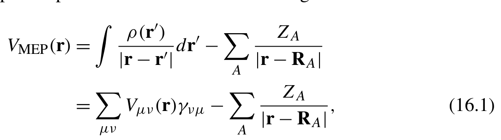{width=53%}

[]{#eq-16-001}

其中

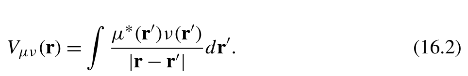{width=47%}

[]{#eq-16-002}

该积分可直接利用第 12 章介绍的单电子库仑积分函数 coulomb_1e_MD 计算。MEP 的求值代码可编写如下。

```python
from pychem_book.chap12.analytical_integrals.v5.basis import Molecule, CGTO
from pychem_book.chap12.analytical_integrals.v5 import coulomb_1e_MD
from pychem_book.chap13.simple_scf import SCFWavefunction
def eval_mep(mol: Molecule, gtos: List[CGTO], wfn: SCFWavefunction, grids):
    dist = np.linalg.norm(grids[:,None,:] - mol.coordinates, axis=2)
    mep = -np.einsum( 'z,gz->g', np.array(mol.nuclear_charges), 1./dist)
    dm = wfn.density_matrices
    for i,r in enumerate (grids):
        v = coulomb_1e_MD.get_matrix(gtos,r )
        mep[i] += np.einsum( 'ij,ji->',v , dm)
    return mep
```
借助这个函数，我们可以在均匀网格上计算 MEP，随后使用第 3 章介绍的可视化工具显示 MEP。例如，以下脚本生成一个 cube 文件，之后便可使用 JMol、VMD 或其他可视化软件查看。

```python
from pychem_book.chap03.render_cube import render_cube
from pychem_book.chap13.simple_scf import RHF, simple_scf
xyz = '''
N- . 7 500
N0 . 7 500 '''
mol = Molecule.from_xyz(xyz)
gtos = mol.assign_basis({ 'N': '6-31g'})
model = RHF(mol, gtos)
wfn = scf_iter(model)
```

```python
boundary = [[-5., 5.], [-5., 5.], [-5., 5.]]
mesh = [20,2 0, 20]
mgrids = np.mgrid[[ slice(r[0], r[1],m *1j) for r,m in zip (boundary, mesh)
    ]]
grids = mgrids.reshape(3, -1).T
rho = eval_density(mol, gtos, wfn, grids).reshape(mesh)
mep = eval_mep(mol, gtos, wfn, grids).reshape(mesh)
origin = mgrids[:,0,0,0]
voxel = np.array([mgrids[:,1,0,0] - origin, mgrids[:,0,1,0] - origin, mgrids[:,0,0,1] - origin])
with open ('mep.cub', 'w') as f:
    render_cube(mol.elements, mol.coordinates, voxel, origin, mep)
```

## 16.2 核梯度

### 16.2.1 Hartree-Fock 导数的基本方程

可以使用微扰理论解析计算 Hartree-Fock 方法的核梯度。限制性 HF（restricted HF，RHF）能量可用占据的 HF 轨道表示：其中 HF 轨道满足正交归一性约束

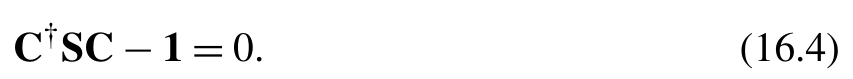{width=42%}

[]{#eq-16-003}

为了优化 HF 轨道，可以构造拉格朗日函数（Lagrangian）以引入归一性约束

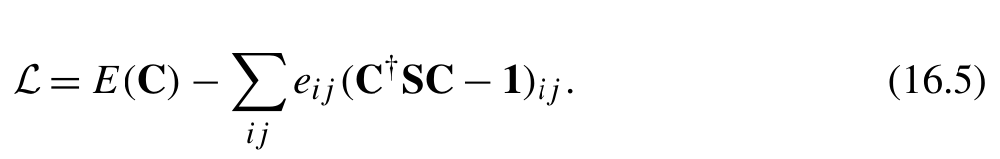{width=49%}

[]{#eq-16-004}

分子轨道的驻定条件为

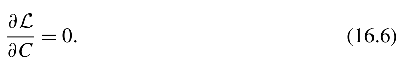{width=39%}

[]{#eq-16-005}

由此得到 Hartree-Fock-Roothaan 方程

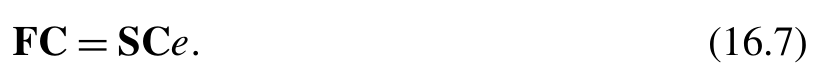{width=40%}

[]{#eq-16-006}

对于正则 HF 轨道，拉格朗日乘子 e 是一个对角矩阵。
计算能量对核坐标的导数时，我们可以用拉格朗日函数代替能量 E。这得到以下能量导数方程：

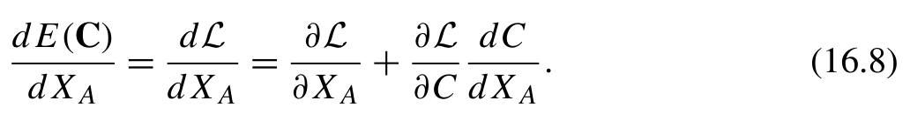{width=50%}

[]{#eq-16-007}

应用驻定条件 (16.6) 和 RHF 能量 (16.3)，可以按如下方式计算能量导数：

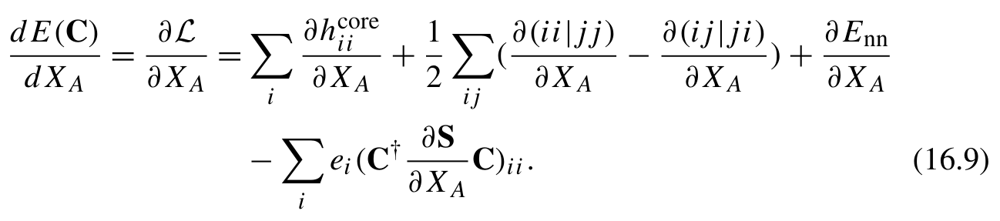{width=63%}

**公式 (16.9)**[]{#eq-16-008}

然后我们利用密度矩阵 D

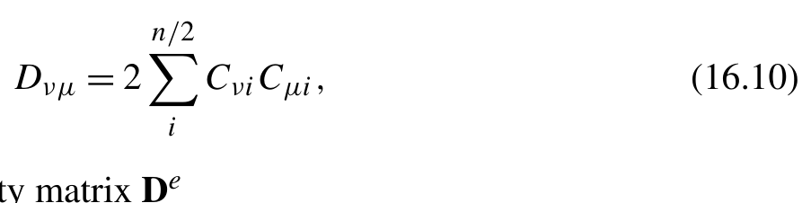{width=44%}

[]{#eq-16-009}

以及能量加权密度矩阵（energy-weighted density matrix）D

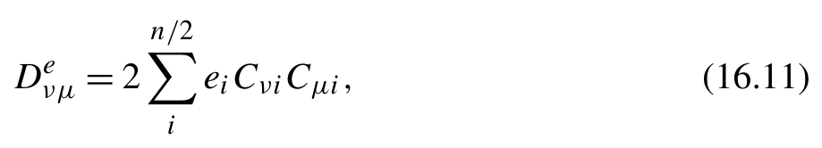{width=45%}

[]{#eq-16-010}

将能量导数的表达式改写为式 (16.9) 所示的形式：

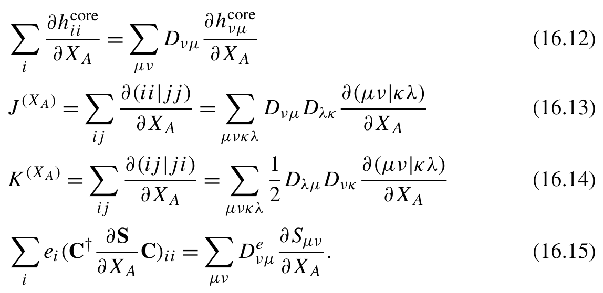{width=56%}

**公式 (16.12)(16.13)(16.14)(16.15)**[]{#eq-16-011}

有关 Hartree-Fock 方法核梯度的详细推导，请参阅 Szabo 所著 *Modern Quantum Chemistry* 的附录 C。

### 16.2.2 积分的导数

积分的导数取决于基函数对电子坐标的导数。考虑一个以原子 A 为中心的笛卡尔高斯函数：该基函数对核坐标的导数可直接转换为对电子坐标的导数

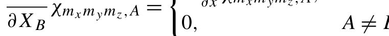{width=37%}

[]{#eq-16-012}

这些导数可以表示为两个笛卡尔高斯函数的组合（s 型函数除外）：

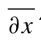{width=30%}

[]{#eq-16-013}

借助该方程，我们便可根据两组标准积分来计算积分的导数。
基于第 12 章开发的积分程序，编写积分导数代码并不困难。为简明起见，本章不再重复积分程序，而是使用 PySCF 软件包计算这些积分导数。
PySCF 软件包在其 Mole 类中提供了通用积分求值方法 intor()。通过指定积分函数名称，Mole.intor 可生成一个张量，表示分子中所有基函数的积分。例如，命令 mol.intor(’int1e_ipovlp’) 计算左矢上对电子坐标求导的重叠型积分
这里，记号 ip 表示算符 ipˆ，它等于算符 ∇。PySCF 可同时处理三个笛卡尔方向的导数，生成形状为 (3, N, N) 的数组。除重叠积分导数外，表 16.1 还列出了核梯度计算所需的其他积分。有关支持积分的完整列表，请参阅 PySCF 文档 [1]。
请注意，表 16.1 中列出的所有积分都是对左矢函数的电子坐标求导得到的。要利用变换式 (16.17) 计算对核坐标的导数，我们必须确定与每个基函数关联的原子中心。在 PySCF 中，与同一原子关联的基函数被归为一组。该软件包提供了一个方法

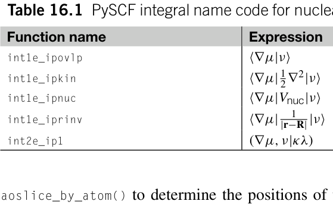

**表 16.1** 核梯度积分的 PySCF 积分名称代码。

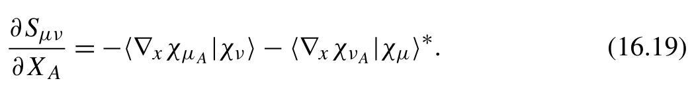{width=51%}

[]{#eq-16-014}

对应的 Python 代码为：

```python
def grad_overlap(mol, atom_id):
    s1 = mol.intor( 'int1e_ipovlp')
    p0, p1 = mol.aoslice_by_atom()[atom_id,2:4]
    s_A = np.zeros((3, nao, nao))
    s_A[:,p0:p1] = -s1[:,p0:p1]
    return s_A + s_A.transpose(0,2 ,1 )
```
四指标电子排斥积分（electron repulsion integrals）的导数计算与重叠积分（overlap integrals）类似。相关的函数名称是 int2e_ip1。该函数给出四指标张量中第一个指标处基函数的导数。四个指标按照化学家记号（chemist’s notation）排列。为了使积分张量对称化，需要转置两次，将导数分配到其余三个指标上。

```python
eri1 = mol.intor( 'int2e_ip1')
p0, p1 = mol.aoslice_by_atom()[atom_id,2:4]
eri_A = np.zeros((3, nao, nao, nao, nao))
eri_A[:,p0:p1] = -eri1[:,p0:p1]
eri_A = eri_A + eri_A.transpose(0,2,1,3,4)
eri_A = eri_A + eri_A.transpose(0,3,4,1,2)
```
h 由动能算符（kinetic operator）和核吸引算符（nuclear attraction operator）组成。动能积分导数与重叠积分导数类似。对于核吸引算符 Vnuc，计算既需要作用于基函数的导数，也需要算符自身的导数：

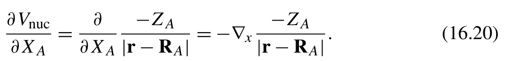{width=52%}

[]{#eq-16-015}

然后利用分部积分公式（integration-by-parts formula）将式 (16.20) 转换为基函数的导数：

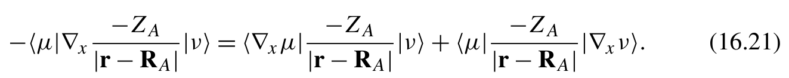{width=65%}

[]{#eq-16-016}

h 的积分程序可以编写为：

```python
def grad_hcore(mol, atom_id):
    # derivatives o fT+Vo nb r a
    hcore_partial = mol.intor( 'int1e_ipkin') + mol.intor( 'int1e_ipnuc')
    with mol.with_rinv_at_nucleus(atom_id):
        v = mol.intor( 'int1e_iprinv') * -mol.atom_charge(atom_id)
    p0, p1 = mol.aoslice_by_atom()[atom_id,2:4]
    v[:,p0:p1] -= hcore_partial[:,p0:p1]
    return v + v.transpose(0,2 ,1 )
```

### 16.2.3 RHF 能量的核梯度

计算式 (16.9) 中的 HF 核梯度（nuclear gradients）时，可利用积分中的置换对称性（permutation symmetry）简化计算。例如，K 项可简化为：

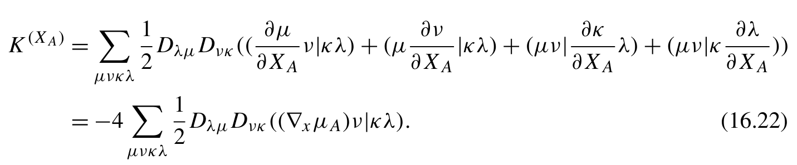{width=70%}

**公式 (16.22)**[]{#eq-16-017}

类似的变换也可用于 J 项和重叠项。将这些简化与前面介绍的积分函数结合起来，就可以得到计算 RHF 核梯度的程序。

```python
def grad_hf_energy(mol, mo_energy, mo_coeff, nocc):
    mo_o = mo_coeff[:,:nocc]
    dm = einsum( 'pi,qi->pq', mo_o, mo_o) * 2
    dme = einsum( 'pi,i,qi->pq', mo_o, mo_energy[:nocc], mo_o) * 2
    eri1 = mol.intor( 'int2e_ip1')
    j = einsum( 'xpqrs,sr->xpq', eri1, dm)
    k = einsum( 'xpqrs,qr->xps', eri1, dm)
    v h f=j-k * .5
    s1 = mol.intor( 'int1e_ipovlp')
    aoslices = mol.aoslice_by_atom()
    de = np.zeros((mol.natm, 3))
```

```python
    for k in range (mol.natm):
        p0, p1 = aoslices[k,2:]
        h1 = grad_hcore(mol,k )
        de[k] += np.einsum( 'xij,ji->x',h 1, dm)
        de[k] += np.einsum( 'xij,ji->x', -vhf[:,p0:p1],d m [ :,p0:p1]) * 2
        de[k] -= np.einsum( 'xij,ji->x', -s1[:,p0:p1], dme[:,p0:p1]) * 2
    coords = mol.atom_coords()
    Z = mol.atom_charges()
de_nuc = jax.grad(nuclear_repulsion_energy)(coords,Z ) # (1)
    return de + de_nuc
def nuclear_repulsion_energy(coords, z):
    rr = coords[:,None,:] - coords
    zz = z[:,None] * z
    tril = np.tril_indices( len(z), -1)
    d = jnp.linalg.norm(rr[tril], axis=1)
    return (zz[tril] / d). sum()
```
在第 (1) 行，我们利用 JAX 库的自动微分（automatic differentiation，autodiff）功能计算核排斥能的梯度。第 5 章第 5.3 节已经讨论过这一功能。
给定零阶 HF 结果，我们可以使用 grad_hf_energy 函数计算 RHF 能量的核梯度。

```python
import pyscf
mol = pyscf.M(atom= 'N 0. 0 0; N 1.5 0 0' , basis= 'ccpvdz')
mf = mol.RHF().run()
nocc = mol.nelectron // 2
de = grad_hf_energy(mol, mf.mo_energy, mf.mo_coeff, nocc)
```
可以使用有限差分法（finite difference method）验证结果。

```python
def finite_diff(mol, i_j, delta=1e-2):
    mol = mol.copy()
    coords = mol.atom_coords()
    coords[i_j] += .5 * delta
    mol.set_geom_(coords, unit= 'Bohr')
    mf = mol.RHF(verbose=0).run()
    ehf0 = mf.e_tot
    coords[i_j] -= delta
    mol.set_geom_(coords, unit= 'Bohr')
    mf = mol.RHF(verbose=0).run()
    ehf1 = mf.e_tot
```

```python
    return (ehf0 - ehf1) / delta
for i in range (mol.natm):
    for j in range (3):
        diff1 = de[i,j] - finite_diff(mol,( i, j))
        diff2 = de[i,j] - finite_diff(mol,( i, j), 0.5e-2)
        print(i,j , diff1, diff2)
```

### 16.2.4 用有限差分计算核梯度

在量子化学中，用于计算解析核梯度（analytical nuclear gradients）的程序通常很复杂。通过与有限差分法所得结果比对，验证这些程序的正确性至关重要。有限差分梯度应使用两点差分格式（two-point stencil）计算，因为该公式只引入二次误差：

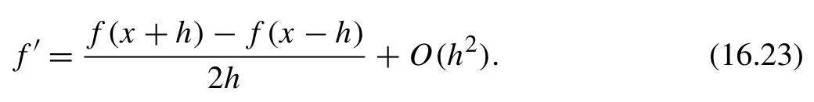{width=51%}

[]{#eq-16-018}

应为两点差分格式选取合适的步长 h。虽然较小的步长有助于减小高阶项的影响，但步长过小又可能放大式 (16.23) 中相减造成的误差，从而导致数值误差增大。
有限差分梯度与解析梯度的结果十分接近，但仍存细微差异。面对这种情况，我们该如何确保解析梯度的正确性？
由于两点差分公式中的误差项是二次项，有限差分结果与解析结果之差应随步长呈二次方变化。这种二次变化是判断解析梯度正确性的可靠依据。如果差值不遵循二次变化趋势，通常表明可能存在以下几个问题：

- 解析梯度程序可能不正确。
- 步长可能过小，导致单点计算（single-point calculation）的精度成为主导因素。当单点计算的收敛阈值或其他阈值设置得不够严格时，这种情况经常发生。
- 解析梯度程序可能遗漏了某些隐式依赖于分子几何构型的量。
- 某些量可能没有随分子几何构型连续、平滑地变化。

如果使用数值求积公式计算积分，就可能遇到后两个问题。例如，密度泛函理论（density functional theory）中的交换关联泛函（exchange-correlation functional）是在网格上进行数值计算的。这些网格的坐标和
权重都受到核坐标的影响。此外，为降低计算成本，通常会舍弃权重较小的网格，这可能导致相对于分子几何构型的不连续性。这些误差在平衡几何构型附近可能变得显著，尤其是与这些区域中接近零的核梯度相比时。为确保解析核梯度具有高精度，必须明确考虑所有变量的导数，并避免舍弃网格。

### 16.2.5 一阶分子轨道

这里我们借用微扰理论（perturbation theory）的术语，将分子轨道的导数称作一阶轨道（first-order orbitals）。尽管计算核梯度不需要一阶轨道，但诸如核 Hessian 矩阵和核磁共振（nuclear magnetic resonance，NMR）等二阶性质（second-order properties）经常涉及一阶轨道。若对二阶性质计算感兴趣，可以在量子化学教材中查阅有关这些方法的深入细节 [2]。下面我们将重点讨论求解一阶轨道的数值程序。
一阶轨道的系数可以由 Hartree-Fock-Roothaan 方程的一阶展开导出：
求解该方程的一种标准方法，是将零阶分子轨道（molecular orbitals，MO）作为基函数来变换方程。这会得到一阶轨道虚轨道-占据轨道块的方程：占据轨道-占据轨道块和虚轨道-虚轨道块则可由正交归一约束导出的一阶方程确定：

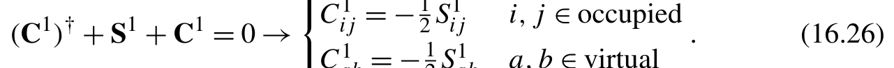{width=62%}

[]{#eq-16-019}

将式 (16.25) 和式 (16.26) 结合，可以导出闭壳层 RHF 模型的耦合微扰 Hartree-Fock（coupled perturbed Hartree-Fock，CPHF）方程：

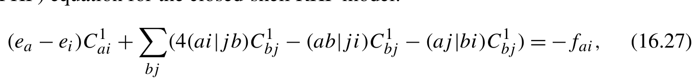{width=67%}

[]{#eq-16-020}

其中

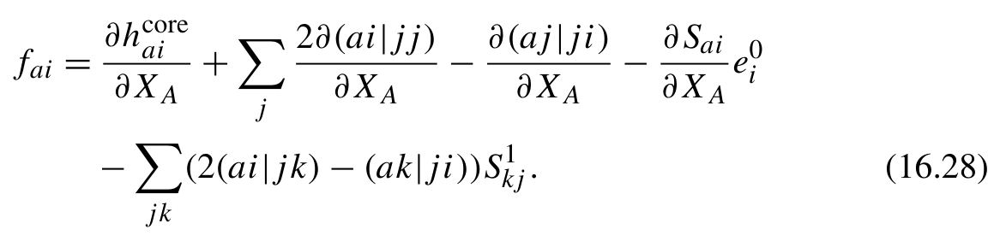{width=57%}

**公式 (16.28)**[]{#eq-16-021}

尽管式 (16.28) 中的四指标积分以分子轨道（MO）基表示，但并无必要显式构造这些分子轨道积分。可以采用更高效的计算流程：

1. 计算原子轨道（AO）基中的积分；
2. 对积分张量与密度

矩阵在原子轨道基中执行张量收缩；

3. 将积分从原子轨道基变换到分子轨道基。

在此过程中，我们可以利用积分和密度矩阵中的置换对称性（permutation symmetry）进一步降低计算成本。例如，式 (16.28) 中的项
可以改写为：

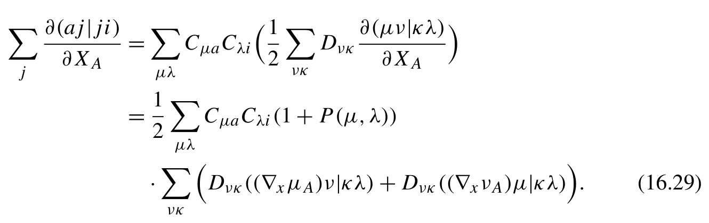{width=65%}

**公式 (16.29)**[]{#eq-16-022}

以类似方式改写式 (16.28) 的其他项之后，我们就可以着手编写式 (16.28) 的计算程序。

```python
def _fock_partial_deriv(mol, mo_coeff, nocc):
    nao, nmo = mo_coeff.shape
    mo_o = mo_coeff[:,:nocc]
    eri1 = mol.intor( 'int2e_ip1')
    eri = mol.intor( 'int2e')
    dm = einsum( 'pi,qi->pq', mo_o, mo_o) * 2
    j = einsum( 'xpqrs,sr->xpq', eri1, dm)
    k = einsum( 'xpqrs,qr->xps', eri1, dm)
    v h f 1=j-k * .5
    s1 = mol.intor( 'int1e_ipovlp')
    aoslices = mol.aoslice_by_atom()
    s1_buf = []
    f1_buf = []
    for ia in range (mol.natm):
        shl0, shl1,p 0, p1 = aoslices[ia]
        s1ao = np.zeros((3, nao, nao))
        s1ao[:,p0:p1] -= s1[:,p0:p1]
        s1ao[:,:,p0:p1] -= s1[:,p0:p1].transpose(0,2,1)
        s1_buf.append(s1ao)
```

```python
        j = einsum( 'xpqrs,qp->xrs', eri1[:,p0:p1], dm[:,p0:p1])
        k = einsum( 'xpqrs,sp->xrq', eri1[:,p0:p1], dm[:,p0:p1])
        v1 = -(j - k * .5)
        v1[:,p0:p1] -= vhf1[:,p0:p1]
        v1 = v1 + v1.transpose(0,2,1)
        s1_oo = einsum( 'pi,xpq,qj->xij', mo_o, s1ao, mo_o)
        s1_oo = einsum( 'pi,xij,qj->xpq', mo_o, s1_oo, mo_o) * 2
        fock1 = grad_hcore(mol, ia) + v1 - get_vhf(eri, s1_oo)
        f1_buf.append(fock1)
    return np.vstack(f1_buf), np.vstack(s1_buf)
def get_vhf(eri, dm):
    j = einsum( 'pqrs,xqp->xrs', eri, dm)
    k = einsum( 'pqrs,xqr->xps', eri, dm)
    return j-k * .5
```
耦合微扰 Hartree–Fock（CPHF）方程 (16.27) 本质上是一个线性方程

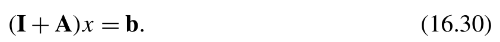{width=41%}

[]{#eq-16-023}

这个方程可以用 Krylov 线性方程求解器求解，我们将在第 16.3 节讨论该求解器。为了求解 CPHF 方程，我们编写一个自定义矩阵-向量函数，其中包含式 (16.27) 中的因子 (ea − ei)。计算一阶分子轨道的程序如下所示。

```python
from .krylov import solve_krylov
def solve_mo1(mol, mo_energy, mo_coeff, nocc):
    nao, nmo = mo_coeff.shape
    nvir = nmo - nocc
    mo_o = mo_coeff[:,:nocc]
    mo_v = mo_coeff[:,nocc:]
    e_o = mo_energy[:nocc]
    e_v = mo_energy[nocc:]
    eri = mol.intor( 'int2e')
    def matvec(x):
        x = x.reshape(-1,nvir,nocc)
        dm = einsum( 'pi,xij,qj->xpq', mo_v,x , mo_o) * 2
        dm = dm + dm.transpose(0,2 ,1 )
        vhf = einsum( 'pi,xpq,qj->xij', mo_v, get_vhf(eri, dm), mo_o)
        vhf /= e_v[:,None] - e_o
        return vhf.ravel()
```

```python
    f1, s1 = _fock_partial_deriv(mol, mo_coeff, nocc)
    s1 = einsum( 'pi,xpq,qj->xij', mo_coeff,s 1, mo_coeff)
    f1 = einsum( 'pi,xpq,qj->xij', mo_v,f 1, mo_o)
    b = (f1 - s1[:,nocc:,:nocc] * e_o) / (e_o - e_v[:,None])
    mo1_vo = solve_krylov(matvec, b.ravel()).reshape(-1,nvir,nocc)
mo1 = -.5 * s1 # The occupied -occupied and virtual-virtual blocks
    mo1[:,nocc:,:nocc] = mo1_vo
    # mo1.T + s1 + mo1 = 0
    mo1[:,:nocc,nocc:] = -s1[:,:nocc,nocc:] - mo1_vo.transpose(0,2 ,1 )
    mo1 = einsum( 'pq,xqi->xpi', mo_coeff, mo1)
    return mo1.reshape(mol.natm,3 , nao, nmo)
```
为便于后续章节的讨论，在这个程序中，我们将所得的一阶轨道转换回原子轨道基表示。
如何验证一阶轨道计算是否正确？在这种情况下，不适合使用有限差分法（finite difference method）验证一阶轨道。这是因为由式 (16.26) 约束条件确定的一阶轨道占据-占据块，与正则 HF 轨道的正交归一性并不一致。另一种方法是使用有限差分法检验一阶密度矩阵。可以使用以下代码来获取一阶密度矩阵：

```text
mo1 = solve_mo1(mol, mf.mo_energy, mf.mo_coeff, nocc)
nao, nmo = mf.mo_coeff.shape
mo1 = mo1.reshape(mol.natm,3 , nao, nmo)
dm = einsum( 'pi,qi->pq', mo1[0,0], mf.mo_coeff) * 2
d m=d m+d m . T
```

## 16.3 子空间线性方程求解器

许多量子化学问题可以表述为涉及方阵 A 和向量 b 的线性方程，

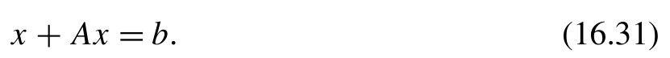{width=41%}

[]{#eq-16-024}

矩阵 A 往往计算成本过高，或者尺寸太大而无法完整存入内存中。在这种情况下，直接构造矩阵 A 然后使用稠密矩阵的常规线性代数技术求解线性方程，并不现实。取而代之的是，编写一个计算 A 与 x 乘积的函数来表示矩阵 A。为了求解线性方程 (16.31)，我们必须依靠迭代求解方法。
一种方法是将问题改写为不动点迭代（fixed-point iteration）问题：

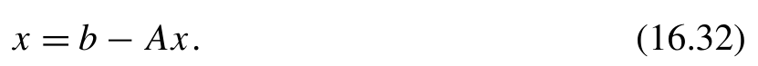{width=41%}

[]{#eq-16-025}

不动点迭代可以使用 DIIS 方法加速。另一种选择是采用 Krylov 子空间（Krylov subspace）方法迭代求解方程 [3,4]。
矩阵 A 和向量 b 的 Krylov 空间 {v0,v 1,..,v n− 1} 通过递归的矩阵-向量乘法生成

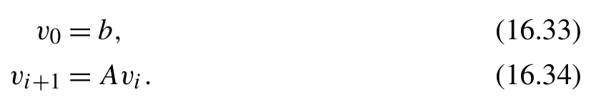{width=40%}

**公式 (16.33)(16.34)**[]{#eq-16-026}

解 x 可以用基向量表示
用基向量 v 表示 A 和 b，可以推导出系数 c 的线性方程：

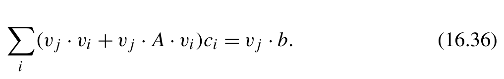{width=50%}

[]{#eq-16-027}

可以高效地求解这个线性方程，从而确定解 x。
从数学上看，这个方法相当直接。然而，在实际应用中必须考虑几个技术问题：

- 反复进行矩阵-向量乘法的过程可能导致基向量中出现极大数值。此外，生成的基向量可能接近线性相关，从而引起后续线性代数计算的数值问题。为解决这一问题，每次生成新向量时，都需要检查已有基向量之间是否存在线性相关性。一旦检测到线性相关，就应停止生成 Krylov 空间。
- 在求解子空间线性方程 (16.36) 之前，没有必要生成所有线性无关的基向量 v。通常，较小的 Krylov 子空间就足以达到所需精度。为了高效截断 Krylov 子空间，我们可以求解子空间方程 (16.36) 并计算残差（residual）

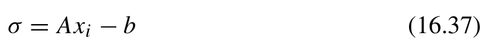{width=39%}

**公式 (16.37)**[]{#eq-16-028}

每次生成新基向量时都执行上述计算。如果残差的大小低于收敛阈值，就可以停止生成基向量的迭代。函数 solve_krylov 的实现代码如下：

```python
def solve_krylov(A,b , tol=1e-5, maxiter=50):
vs = [b]
h v=[ ]
h = np.empty((maxiter, maxiter))
g = np.empty(maxiter)
c=[ ]
for cycle in range (maxiter):
# Generate new vector in Krylov subspace and orthogonalize it
v1 = A(vs[-1])
hv.append(v1 + vs[cycle]) # (I+A) *v
for v in vs:
    v1 -= v * np.dot(v, v1)
# Add to subspace if it linearly independent to others
v_norm = np.linalg.norm(v1)
if v_norm < 1e-10:
    break
v1 /= v_norm
vs.append(v1)
for i in range (cycle+1):
    h[i,cycle] = np.dot(vs[i], hv[cycle])
    h[cycle,i] = np.dot(vs[cycle], hv[i])
g[cycle] = np.dot(vs[cycle],b )
c = np.linalg.solve(h[:cycle+1,:cycle+1], g[:cycle+1])
residual = -b
for i,c i in enumerate (c):
    # Reuse hv vectors to reduce the matvec A(x)
    residual += hv[i] * ci
norm = np.linalg.norm(residual)
print(f'krylov {cycle=} residual={norm:.5g}' )
if norm < tol:
    break
else:
raise RuntimeError('solve_krylov not converged' )
x = np.zeros_like(b)
for i,c i in enumerate (c):
x += vs[i] * ci
return x
```
我们来考虑如何将初始猜测（initial guess）纳入线性方程求解器。给定初始猜测 x0，原线性方程的解可以写为 x = x 0 + x。然后我们可以将线性方程 (16.31) 改写为

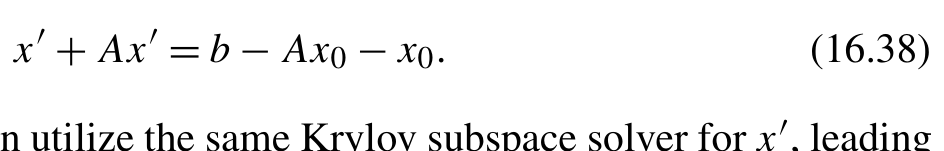{width=46%}

[]{#eq-16-029}

通过调整向量 b，我们可以对 x 使用同一个 Krylov 子空间求解器，得到修订后的函数：

```python
def solve_krylov(A,b , x0=None, tol=1e-5, maxiter=50):
    if x0 is not None:
        x = solve_krylov(A,b -A(x0)-x0, tol=tol, maxiter=maxiter)
        return x+x 0
    ...
```
Krylov 子空间迭代方法可能遇到收敛问题。在有限的迭代步数内，生成的 Krylov 空间可能无法充分表示线性方程的解。为解决收敛困难，一种方法是将未收敛的结果作为初始猜测，然后再次调用求解器。另一种方法是将未收敛的结果作为不动点迭代方程 (16.32) 的初始猜测，并配合 DIIS 求解。
式 (16.31) 的基本假设是矩阵 A 相对于单位矩阵较「小」，本质上充当单位矩阵的扰动。然而，这一假设在实践中未必总是成立，Krylov 求解器也未必总能得到收敛解。为调整微扰矩阵 A 的强度，我们可以引入对角矩阵 d 并改写线性方程

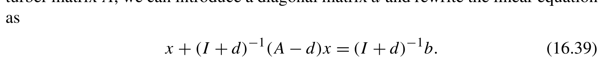{width=70%}

[]{#eq-16-030}

通过选择合适的对角矩阵 d，可以加快 Krylov 子空间迭代的收敛。
对于难以求解的线性方程，可能需要结合前述技术以及第 4 章讨论的其他稀疏矩阵求解器，才能达到收敛。

## 16.4 使用自动微分计算梯度

计算核梯度的一种新兴方法是自动微分（automatic differentiation，AD）。一般来说，在 Python 程序中应用自动微分有两种方法：

- 完全基于 JAX 或 PyTorch 等自动微分库开发软件包。
- 将自动微分功能集成到已有解析梯度的程序中。

第一种方法使自动微分能够应用于几乎所有参数。然而，它需要编写大量代码来建立基础
16.4 使用自动微分框架计算核梯度。在实践中，新研究往往建立在现有代码库之上，而其中许多代码库并非使用自动微分（AD）库开发。为了有效利用自动微分，通常需要将硬编码的微分程序集成到自动微分工具包中。混合自动微分（hybrid AD）方法在量子化学应用中特别有用[5–8]。
PyTorch、JAX 和 TensorFlow 等常用自动微分库都提供自定义自动微分的功能。我们应该选择哪种工具来编写混合自动微分代码？
与遵循 Python 面向对象编程风格的 PyTorch 不同，JAX 采用函数式编程（functional programming，FP）方法。如果你不熟悉函数式编程的代码风格，起初可能会觉得使用 JAX 很有挑战。在这种情况下，函数式编程教材*SICP in Python*[9]可以帮助你学习 Python 中的函数式编程。
使用自动微分计算导数有两种模式：前向模式（forward-mode）和反向模式（reverse-mode）。给定一个向量作为输入，前向模式自动微分计算雅可比矩阵-向量积（Jacobian-vector product，JVP），而反向模式自动微分计算向量-雅可比矩阵积（vector-Jacobian product，VJP）。这两种自动微分模式采用不同的策略来自定义函数的导数。正如后文所示，前向模式自动微分的自定义规则通常更直接。与反向模式自动微分相比，使用前向模式自动微分编写的函数往往能保持更接近原始程序的结构。
PyTorch 只支持使用反向模式自定义自动微分。另一方面，JAX 同时支持前向模式和反向模式自动微分。它能够自动将前向模式的导数规则转换为反向模式。这一功能为开发 JAX 自动微分程序提供了更灵活的方法。在接下来的示例中，我们将演示如何使用 JAX 库自定义导数规则。
自定义 JAX 自动微分的一项重要任务，是将不能被 JAX 转换的函数改写为可被 JAX 转换的函数。「可被 JAX 转换」指 JAX 能够操作这些函数或运算，从而生成反向模式微分代码。一般来说，在 JAX 中编写自定义导数规则可以通过以下步骤完成：

1. 清理并重构程序，确保其遵循 JAX 函数式编程风格。这

包括将所有 NumPy 和 SciPy 函数替换为对应的 JAX 函数。2.确定需要自定义的变量和函数。

3. 利用 custom_jvp 与 custom_vjp API 编写这些自定义导数

规则。

4. 优化反向传播过程。

我们以第 15 章开发的 CCD 程序为例。CCD 能量的核梯度取决于积分的导数和 Hartree-Fock 能量的梯度。考虑到量子化学积分的复杂性和计算成本，使用现有积分库计算积分及其导数，比从头使用 JAX 库开发积分程序更实际。虽然 Hartree-Fock 部分的核梯度可以使用自动微分生成，但为了演示自定义自动微分的功能，我们使用第 16.2.1 节开发的 Hartree-Fock 解析梯度程序计算 Hartree-Fock 部分的梯度。

#### 步骤 1：按照 JAX 函数式编程风格重构程序

这一步涉及以下检查和修改：

- 为每个函数创建明确的输入参数列表和明确定义的输出。JAX 追踪输入和输出，以建立函数的导数规则。例如，第 15 章第 15.2 节中 CCD 程序的主函数 CCD_solve 最初定义如下：

```python
def CCD_solve(mf, conv_tol=1e-5, max_cycle=100):
    ...
    return e_ccd,t 2
```
为了明确指定计算关于原子坐标的 CCD 总能量的函数，应将 coords 变量加入参数列表。因此，CCD_solve 的函数签名更新为：

```python
def CCD_solve(coords,m f, conv_tol=1e-5, max_cycle=100):
    ...
    return e_ccd
```
第二个参数 mf 和其余关键字参数可以保留在函数的参数列表中。执行 JAX 雅可比矩阵计算时，这些参数不参与计算。同样，mo_integrals 的函数签名也需要改写，以反映其对 coords 的依赖：

```python
def mo_integrals(coords, mf: pyscf.scf.hf.RHF):
    ...
    return H
```

- 消除每个函数中的任何副作用（side-effects）。这意味着函数不应修改导数计算所依赖的输入参数或全局变量。理想情况下，为了采用函数式编程风格，最好还要消除任何副作用，包括对不可微输入参数的修改。在当前的 CCD 程序中，这些函数已经没有副作用，无需进一步操作。
- 避免任何原位修改（in-place modifications）。虽然对局部变量的原位修改不被视为函数的副作用，但它们可能干扰 JAX 追踪中间变量状态的能力。在 update_CCD_amplitudes 函数中，有几条语句涉及原位操作。应将它们改写，以确保与 JAX 的追踪功能兼容。例如，以下语句涉及对局部变量的原位修改：

```text
Fvv[np.diag_indices(nvir)] -= e_v
t2out += .5 * einsum('ijkl,abkl->abij', oooo, t2)
```
应将其改为：

```text
Fvv = Fvv - jnp.diag(e_v)
t2out = t2out + .5 * einsum('ijkl,abkl->abij', oooo, t2)
```

- 将 NumPy 和 SciPy 函数替换为对应的 JAX 函数。为了确保与 JAX 自动微分兼容，必须将所有 NumPy 和 SciPy 函数替换为对应的 JAX 函数。例如，所有 np.einsum 都应替换为 jax.numpy.einsum。

完成这些修改后，我们得到一个适应 JAX 函数式编程风格的重构 CCD 程序。

```python
einsum = jnp.einsum
def update_CCD_amplitudes(H,t 2, level_shift=0):
 nvir, nocc = t2.shape[1:3]
 fock = H[ 'fock']
 foo = fock[:nocc,:nocc]
 fvv = fock[nocc:,nocc:]
 e_o = foo.diagonal()
 e_v = fvv.diagonal() + level_shift
 Fvv = fvv - .5 * einsum('klcd,bdkl->bc',H [ 'oovv'],t 2 )
 Foo = foo + .5 * einsum('klcd,cdjl->kj',H [ 'oovv'],t 2 )
 Fvv = Fvv - jnp.diag(e_v)
 Foo = Foo - jnp.diag(e_o)
 t2out = .25 * H['vvoo']
 t2out = t2out - einsum( 'bkcj,acik->abij',H [ 'vovo'], t2)
 t2out = t2out + .5 * einsum('bc,acij->abij', Fvv, t2)
 t2out = t2out - .5 * einsum('kj,abik->abij', Foo, t2)
 t2out = t2out + .5 * einsum('klcd,acik,bdjl->abij',H [ 'oovv'],t 2,t 2 )
 t2out = t2out - t2out.transpose(0,1,3,2)
 t2out = t2out - t2out.transpose(1,0,2,3)
 oooo = .5 * einsum('klcd,cdij->ijkl',H [ 'oovv'], t2)
 oooo = oooo + H[ 'oooo']
 t2out = t2out + .5 * einsum('ijkl,abkl->abij', oooo, t2)
 t2out = t2out + .5 * einsum('abcd,cdij->abij',H [ 'vvvv'], t2)
 eijab = e_o + e_o[:,None] - e_v[:,None,None] - e_v[:,None,None,None]
 t2out = t2out / eijab
 return t2out
```

```python
def get_CCD_corr_energy(H, t2):
    return .25 * einsum('ijab,abij->',H [ 'oovv'], t2)
def mp2(H):
    nocc = H[ 'oooo'].shape[0]
    e _ o=H [ 'fock'].diagonal()[:nocc]
    e _ v=H [ 'fock'].diagonal()[nocc:]
    eijab = e_o + e_o[:,None] - e_v[:,None,None] - e_v[:,None,None,None]
    t 2=H [ 'vvoo'] / eijab
    e = get_CCD_corr_energy(H, t2)
    return H['e_hf']+e ,t 2
def CCD_solve(coords: np.ndarray, mf: pyscf.scf.hf.RHF):
    H = mo_integrals(coords, mf)
    e_ccd, t2 = mp2(H) # initial guess
    print(f'E(MP2)={e_ccd}')
    e_hf = H[ 'e_hf']
    for cycle in range (max_cycle):
        t2, t2_prev = update_CCD_amplitudes(H, t2), t2
        e_ccd, e_prev = get_CCD_corr_energy(H, t2) + e_hf, e_ccd
        print(f'{cycle=}, E(CCD)={e_ccd}, dE={e_ccd-e_prev}')
        if jnp.abs(t2 - t2_prev). max() < conv_tol:
            break
    return e_ccd
def mo_integrals(coords, mf: pyscf.scf.hf.RHF): # (1)
    '''MO integrals in physists notation <pq||rs>'''
    mol = mf.mol
    assert jnp.allclose(mol.atom_coords(), coords)
    orb = mf.mo_coeff
    nmo = orb.shape[1]
    eri = mol.intor( 'int2e', aosym= 's1')
    eri = einsum( 'pqrs,pi,qj,rk,sl->ijkl', eri, orb, orb, orb, orb)
i2 = jnp.eye(2) # (2)
    eri = einsum( 'pqrs,ab,cd->parcqbsd', eri,i 2, i2).reshape([nmo *2]*4)
    eri = eri - eri.transpose(1,0,2,3)
    no = mol.nelectron
    H={ }
    H['vvoo'] = vvoo = eri[no:,no:,:no,:no]
    H['oovv'] = vvoo.transpose(2,3,0,1)
    H['vovo'] = eri[no:,:no,no:,:no]
    H['oooo'] = eri[:no,:no,:no,:no]
```

```python
    H['vvvv'] = eri[no:,no:,no:,no:]
    hcore = mol.intor( 'int1e_kin') + mol.intor( 'int1e_nuc')
    hcore = einsum( 'pq,pi,qj->ij', hcore, orb, orb)
    hcore = einsum( 'pq,ab->paqb', hcore, i2).reshape([nmo *2]*2)
    H['fock'] = hcore + einsum( 'ipiq->pq', eri[:no,:,:no,:])
    H['e_hf'] = mf.e_tot
    return H
```
第(1)行中的参数 coords 没有被 mo_integrals 函数显式使用。你可能会问：我们能否像处理普通 Python 函数那样删除这个参数？答案是否定的。如果删除 coords 参数，JAX 就无法检测到 mo_integrals 对 coords 的依赖，并会在自动微分（automatic differentiation，AD）过程中错误地排除对 mo_integrals 的微分。mo_integrals 函数隐式依赖于原子核坐标。由于我们需要 mf 对象提供积分计算，coords 必须与 mf 中存储的分子结构一致。
在第 15 章介绍的 mo_integrals 中，我们使用切片表示法 ::2 和 1::2 为 α 和 β 轨道赋值分子轨道（molecular orbital，MO）积分。这些赋值在第 (2) 行中被使用 2 × 2 矩阵 i2 的 einsum 操作取代。如果希望使用花式索引（fancy indexing）编写赋值代码，可以使用 JAX 的 .at 和 .set 方法，如以下代码所示。

```text
output = output.at[::2,::2,::2,::2].set(eri)
```
请注意，这段代码会创建 output 数组的新副本，而不是原地更新它。使用.at 方法时应当谨慎。建议查阅 JAX 的.at 方法文档[10]，了解更多细节。
为简单起见，我们从 CCD 迭代函数中移除了 DIIS 加速。从数学上讲，这只会降低 CCD 程序的运行速度，而不影响结果。
DIIS 模块是面向对象编程（object-oriented programming，OOP）范式的典型例子。它跟踪各种中间状态并隐式修改它们。理论上，这个 OOP 函数也可改写为函数式编程（functional programming，FP）风格。为此，可以在 CCD_solve 函数中暴露 DIIS 中间状态，并将它们与其他参数一起传递给 DIIS 外推函数。这样，DIIS 方法的前向和反向传播就可由 JAX 的 AD 跟踪和管理。然而，正如第 16.4.2 节将要介绍的，我们无须重构 DIIS 实现。现有的 DIIS 模块可直接用于加速可由 JAX 变换的 CCD 程序，而不会产生任何冲突。

#### 步骤 2：确定需要自定义的变量和函数

如果函数中的所有量都由可经 JAX 变换的操作产生，包括简单的算术操作和 JAX 内置函数，JAX 就能够自动处理该函数的导数。这使我们能够轻松地
确定哪些函数与 JAX 变换兼容。在 CCD 程序中，update_CCD_amplitudes 和 get_CCD_corr_energy 都是这类函数的例子。
如果一个函数依赖于 JAX 软件包未提供的函数，我们就需要进一步分析它的依赖关系。如果一个函数递归地依赖于其他可经 JAX 变换的函数，那么它也可经 JAX 变换。例如，函数 mp2 可经 JAX 变换，因为它唯一的依赖项 get_CCD_corr_energy 也可经 JAX 变换。相比之下，原始函数（primal function）mo_integrals 无法由 JAX 变换，因为它使用了 PySCF 软件包中的几个积分求值函数，而这些函数无法由 JAX 变换。这里，原始函数一词指函数原本未经变换的形式。为了使 mo_integrals 可经 JAX 变换，需要为这个函数增补自定义导数规则。
如果 CCD_solve 这样的函数依赖于已增补自定义规则的函数，例如 mo_integrals，那么假设 CCD_solve 函数中的其余语句已经可经 JAX 变换，就不需要为 CCD_solve 增补额外的自定义规则。增补 mo_integrals 之后，CCD_solve 会自动变得可经 JAX 变换。

#### 步骤 3：为前向模式（或反向模式）AD 实现自定义规则

普通计算（通过原始函数）沿前向执行。只需对原始函数的代码稍作修改，就可以支持雅可比矩阵-向量积（Jacobian-vector product，JVP）导数规则[11]。计算梯度时，JAX 可以自动将 JVP 规则转换为向量-雅可比矩阵积（vector-Jacobian product，VJP）规则，但反过来不行。因此，如果 AD 的性能不是主要考虑因素，通常最好自定义 JVP 函数。
要自定义 JVP 导数规则，可以使用 jax.custom_jvp 函数。对于 CCD 程序中的 mo_integrals 函数，JVP 规则可以如下编写：

```python
@partial(jax.custom_jvp, nondiff_argnums=(1,))
def mo_integrals(coords, mf: pyscf.scf.hf.RHF):
    '''MO integrals in physists notation <pq||rs>'''
    mol = mf.mol
    assert jnp.allclose(mol.atom_coords(), coords)
    orb = mf.mo_coeff
    eri = mol.intor( 'int2e', aosym= 's1')
    eri = einsum( 'pqrs,pi,qj,rk,sl->ijkl', eri, orb, orb, orb, orb)
    hcore = mol.intor( 'int1e_kin') + mol.intor( 'int1e_nuc')
    hcore = einsum( 'pq,pi,qj->ij', hcore, orb, orb)
    return _mo_integrals_common(mol, hcore, eri, mf.e_tot)
@mo_integrals.defjvp # (1)
def mo_integrals_jvp(mf, primals, tangents):
    coords, = primals
    primals_out = mo_integrals(coords, mf)
```

```python
mol = mf.mol
disp, = tangents
assert disp.shape == (mol.natm,3 )
nocc = mol.nelectron // 2
mo1 = solve_mo1(mol, mf.mo_energy, mf.mo_coeff, nocc)
mo1 = einsum( 'ixpq,ix->pq', mo1, disp)
eri = _eri_deriv(mol, mf.mo_coeff, mo1, disp)
hcore = _hcore_deriv(mol, mf.mo_coeff, mo1, disp)
e_hf1 = grad_hf_energy(mol, mf.mo_energy, mf.mo_coeff, nocc)
e_hf = einsum( 'ix,ix->', e_hf1, disp)
return primals_out, _mo_integrals_common(mol, hcore, eri, e_hf)
def _mo_integrals_common(mol, hcore, eri, e_hf):
nmo = hcore.shape[0]
no = mol.nelectron
    i2 = jnp.eye(2)
eri = einsum( 'pqrs,ab,cd->parcqbsd', eri,i 2, i2).reshape([nmo *2]*4)
eri = eri - eri.transpose(1,0,2,3)
H={ }
H['vvoo'] = vvoo = eri[no:,no:,:no,:no]
H['oovv'] = vvoo.transpose(2,3,0,1)
H['vovo'] = eri[no:,:no,no:,:no]
H['oooo'] = eri[:no,:no,:no,:no]
H['vvvv'] = eri[no:,no:,no:,no:]
hcore = einsum( 'pq,ab->paqb', hcore, i2).reshape([nmo *2]*2)
H['fock'] = hcore + einsum( 'ipiq->pq', eri[:no,:,:no,:])
H['e_hf'] = e_hf
return H
def _hcore_deriv(mol, mo0, mo1, disp):
hcore = mol.intor( 'int1e_kin') + mol.intor( 'int1e_nuc')
hcore = einsum( 'pq,pi,qj->ij', hcore, mo1, mo0)
hcore = hcore + hcore.T
for i in range (mol.natm):
h1 = grad_hcore(mol,i )
hcore = hcore + einsum( 'x,xpq,pi,qj->ij', disp[i],h 1, mo0, mo0)
return hcore
def _eri_deriv(mol, mo0, mo1, disp):
eri1 = mol.intor( 'int2e_ip1', aosym= 's1')
eri1_partial = einsum( 'xpqrs,qj,rk,sl->xpjkl', eri1, mo0, mo0, mo0)
eri = mol.intor( 'int2e', aosym= 's1')
eri = einsum( 'pqrs,pi,qj,rk,sl->ijkl', eri, mo1, mo0, mo0, mo0)
```

```python
    aoslices = mol.aoslice_by_atom()[:,2:4]
    for i in range (mol.natm):
        p0, p1 = aoslices[i]
        eri = eri + einsum( 'x,xpjkl,pi->ijkl', disp[i], -eri1_partial[:,p0:p1], mo0[p0:p1])
    # symmetrize eri
    eri = eri + eri.transpose(1,0,2,3)
    eri = eri + eri.transpose(2,3,0,1)
    return eri
```
custom_jvp 函数用于装饰原始函数 mo_integrals。第(1)行所示的.defjvp 方法添加了一个表示自定义 JVP 规则的函数。在后续讨论中，我们将这个被添加的函数称为 JVP 增补函数。增补函数必须遵循特定的输入和输出格式[12]。

```python
@custom_jvp
def f(x):
    ...
@f.defjvp
def f_jvp(primals, tangents):
    ...
    return primals_out, jvp_product
```
默认情况下，原始函数中的所有参数都被视为可以求导的变量。可微变量通过输入参数 primals 传递给 JVP 增补函数。另一个参数 tangents 表示与 primals 对应的切向量。JVP 增补函数的返回值由两个元素组成。第一个元素是原始函数的输出，在代码示例中记为 primals_out。它通过使用参数 primals 调用原始函数来计算。第二个元素 jvp_product 表示雅可比矩阵-向量积的结果。
原始函数中的某些参数可能不可微。它们由 custom_jvp 中的 nondiff_argnums 参数指定。处理不可微参数时，例如 mo_integrals 函数中的 mf 对象，无论这些参数在原始函数中有多少个以及定义在什么位置，它们都放在增补函数签名的开头[13]。custom_jvp 函数的代码签名如下：

```python
@partial(custom_jvp, nondiff_argnums=(0,2))
def f(a,x , b):
    ...
@f.defjvp
```

```python
def f_jvp(a,b , primals, tangents):
    ...
    return primals_out, jvp_product
```
JVP 增广函数 mo_integrals_jvp 计算雅可比矩阵（Jacobian）与原始输入变量所关联的残差的乘积。执行乘法之前不必完整构造雅可比矩阵。相反，我们可以提前使用残差向量，简化 JVP 规则。例如，通过定义 _hcore_deriv 和 eri_deriv 函数，我们计算一阶积分与核坐标位移的乘积。得到的 hcore 和 eri 张量与原始函数中的张量保持相同的形状。因此，原始函数代码的某些部分可以在 JVP 操作中复用，这些部分被集中放在 _mo_integrals_common 函数中。
在 JVP 增广函数中，作用于切空间（tangent space）的操作必须是线性变换。对切向量参数执行的非线性操作，如 jnp.sqrt(tangent) 或 jnp.sin(tangent)，虽然可以由 JAX 变换，但不允许出现在 JVP 增广函数中。这意味着不能使用有限差分法（finite difference method）近似雅可比矩阵与向量的乘积，即使在某些情况下应用有限差分法可能很简单。后文将探讨要求使用线性变换的原因。
为 mo_integrals 定义 JVP 规则后，我们可以使用 jax.grad 函数计算 CCD 核梯度，如下所示：

```python
In [1]: mol = pyscf.M(atom= ' N0 .00 ;N3 .00 ' , unit= 'Bohr', basis='cc-pvdz')
        mf = mol.RHF().run()
        grad = jax.grad(CCD_solve, argnums=0)
        print(grad(mol.atom_coords(), mf))
Out[1]:
E(MP2)=Traced<ConcreteArray(-109.13850360728081, dtype=float64)> with<
    JVPTrace(level=2/0)> with
  primal = Array(-109.13850361, dtype=float64)
  tangent = Traced<ShapedArray(float64[])>with<JaxprTrace(level=1/0)> with
    pval = (ShapedArray(float64[]), None)
    recipe = JaxprEqnRecipe(eqn_id=<object object at 0x7f50e45c4e30>, in_tracers=(Traced<ShapedArray(...
...
cycle=19, E(CCD)=Traced<ConcreteArray(-109.03387828514111, dtype=float64)>
    with<JVPTrace(level=2/0)> with
  primal = Array(-109.03387829, dtype=float64)
  tangent = Traced<ShapedArray(float64[])>with<JaxprTrace(level=1/0)> with
    pval = (ShapedArray(float64[]), None)
    recipe = JaxprEqnRecipe(eqn_id=<object object at 0x7f50e407bc40>, in_tracers=(Traced<ShapedArray(...
  primal = Array(-2.76017473e-05, dtype=float64)
```

```text
  tangent = Traced<ShapedArray(float64[])>with<JaxprTrace(level=1/0)> with
    pval = (ShapedArray(float64[]), None)
    recipe = JaxprEqnRecipe(eqn_id=<object object at 0x7f50e407bda0>, in_tracers=(Traced<ShapedArray(...
[[-2.78494891e-01 1.80279569e -16 7.12077149e -17]
 [ 2.78494891e-01 -1.80279569e-16 -7.12077149e-17]]
```

#### 步骤 4，优化反向传播

如上述输出所示，JAX 为每次迭代创建反向传播（back-propagation）跟踪器，它们会保存额外的状态信息。为了确保有足够的信息开展反向传播，JAX 会跟踪函数正常执行期间产生的状态。为了优化反向传播，我们可以使用隐式微分（implicit differentiation）；第 16.4.2 节将在后文更详细地探讨这项技术。
到目前为止，我们已经展示了如何将非 JAX 函数与 JAX 自动微分（AD）功能结合起来。在实践中，为了加强 JAX 自动微分代码与其余 Python 代码之间的交互，当微分涉及 Python 类的属性时，可能需要针对这些类专门定制。

### 16.4.1 Python 类

在前面的 CCD-AD 程序中，我们直接将可微分变量传给需要求导的函数。这种做法意味着，如果需要将更多参数纳入微分过程，就必须不断更新 CCD_solve 函数的签名。新参数必须加入 CCD_solve 的参数列表，也必须加入它随后调用的函数。然而，在许多面向对象编程（OOP）的 Python 项目中，参数通常通过类来管理。为微分引入显式参数可能与底层 Python 程序的现有 API 不一致。
好在 JAX 提供了可定制的 PyTree 节点，用于为 JAX 自动微分函数管理类属性。借助这一功能，我们可以使用类作为原始值，在 JAX 函数之间传递各种可微分属性，从而大大简化函数签名。
什么是 PyTree？在 JAX 中，PyTree 表示以树状结构组织的数据集合。当可微分参数由嵌套的 Python 内置数据容器组成时，例如列表、元组和字典，JAX 会将其识别为 PyTree。JAX 可以将 PyTree 的叶节点（leaves）展平为列表，供内部处理。对于导数的输出，则应用逆操作 unflatten，将叶节点重新组装成原来的树状结构。可以通过以下 JAX 函数获取叶节点和 PyTree 定义：

```text
jax.tree_util.tree_flatten()
```
可以使用以下函数从叶节点重建 PyTree：

```text
jax.tree_util.tree_unflatten()
```
下面的例子取自 JAX 文档，展示了叶节点、树定义以及这两个函数的用法：

```python
In [2]: from jax.tree_util import tree_flatten, tree_unflatten
     # The leaves in value_flat correspond to the ' *' markers in
  value_tree
     value_flat, value_tree = tree_flatten([1., (2., 3.)])
     print(f"{value_flat=}\n{value_tree=}")
     # Transform the flat value list using an element-wise numeric
  transformer
     transformed_flat = list(map(lambda v: v * 2., value_flat))
     print(f"{transformed_flat=}")
     # Reconstruct the structured output, using the original
     transformed_structured = tree_unflatten(value_tree, transformed_flat)
     print(f"{transformed_structured=}")
Out[2]: value_flat=[1.0, 2.0, 3.0]
     value_tree=PyTreeDef([*,( *, *)])
     transformed_flat=[2.0, 4.0, 6.0]
     transformed_structured=[2.0, (4.0, 6.0)]
```
遵循以下准则，JAX 允许我们将自定义类注册为 PyTree 节点 [14]：

- 必须提供 flatten 和 unflatten 函数，定义如何将实例的属性转换为一对 (children, metadata)，以及如何执行逆向转换，得到实例。children 变量表示需要求导的对象，而 metadata 用于存储不可微分属性或其他必要信息。
- 要将自定义 PyTree 节点加入 JAX 的内部类型，必须使用 jax.tree_util.register_pytree_node 函数，并连同提供的 flatten 和 unflatten 函数一起注册该类。
- 要计算属性（如 a）的导数，可以通过 instance.a 访问它。这表示 jax.grad 或 jax.jacobian 的输出。处理高阶导数（如 jax.hessian）时，可以两次访问该属性，例如 instance.a.a。

以 CCD 程序为例，我们希望对其求导的核坐标由 mol 对象提供，该对象是 pyscf.gto.mole.Mole 类的实例。此外，mol 对象是 mf 对象的属性，而后者是 pyscf.scf.hf.RHF 类的实例。因此，有必要将 RHF 和 Mole 类都注册为 JAX PyTree 类型。
下面介绍 _RHF_flatten 函数和 _tree_unflatten 函数，用以注册 RHF 类。

```python
def _RHF_flatten(mf):
    children = (mf.mol,)
metadata = (mf,[ 'mol']) # (1)
    return children, metadata
def _tree_unflatten(metadata, children):
    obj, keys = metadata
    # Create a copy of the original object
    out = object.__new__(obj.__class__)
    out.__dict__.update(obj.__dict__)
    for k,a in zip (keys, children):
        setattr(out,k ,a )
    return out
jax.tree_util.register_pytree_node( pyscf.scf.hf.RHF, _RHF_flatten, _tree_unflatten)
```
在 _RHF_flatten 函数中，mol 对象被包含在 children 元组中，因为它含有可微分属性 coords。要在 unflatten 函数中重建 RHF 实例，必须指定 mf 对象的可微分属性名称以及其余不可微分属性。为简单起见，我们将 mf 对象放入 metadata 变量，如第 (1) 行所示，以传递所有必要信息。请注意，用这种方法创建的 PyTree 节点在处理高阶导数时可能遇到类型兼容性问题。这里不深入探讨这一问题。建议读者查阅 JAX PyTree 文档，了解更多细节。
使用类似的方法，我们也可以注册 Mole 类。由于 coords 变量不是 PySCF Mole 实例的属性，我们在首次引用该属性时检查它是否存在，并转而使用 Mole.atom_coords 方法生成默认值。当求导函数返回时，表示核坐标导数的 coords 属性便可访问。该属性在 _tree_unflatten 函数中创建。

```python
def _Mole_flatten(mol):
    if hasattr (mol, 'coords'):
        coords = mol.coords
    else:
        coords = mol.atom_coords()
    children = (coords,)
    metadata = (mol,[ 'coords'])
    return children, metadata
```

```text
jax.tree_util.register_pytree_node( pyscf.gto.mole.Mole, _Mole_flatten, _tree_unflatten)
```
由于这两个类已注册为 JAX PyTree 节点，因此不再需要将 coords 变量显式传递给 CCD 程序。我们只需将 mf 对象传递给 CCD 程序，因为它通过 mol 对象携带可微属性 coords。CCD_solve 和 mo_integrals 的函数签名已更新，以反映这一变化。

```python
def CCD_solve(mf: pyscf.scf.hf.RHF, max_cycle=20, conv_tol=1e-5):
    H = mo_integrals(mf)
    ...
@jax.custom_jvp
def mo_integrals(mf: pyscf.scf.hf.RHF):
    ...
@mo_integrals.defjvp
def mo_integrals_jvp(primals, tangents):
    mf, = tangents
    disp = mf.mol.coords
    ...
```
注册这些 Python 类并做必要的调整后，这些类便可以在 JAX 自动微分（AD）代码和原始 Python 程序中无缝使用。例如，CCD 核梯度的计算可以简化为：

```python
mol = pyscf.M(atom= ' N0 .00 ;N3 .00 ' , unit= 'Bohr', basis= 'cc-pvdz')
mf = mol.RHF().run()
grad = jax.grad(CCD_solve, argnums=0)
dmf = grad(mf)
print(dmf.mol.coords)
```

### 16.4.2 微分

我们前面开发的 CCD_solve 函数使用不动点迭代（fixed-point iteration）求解 t2 张量。在这一迭代过程中，JAX AD 为每次迭代生成追踪器（tracer）。每个追踪器负责存储该次迭代的 t2 中间状态，导致内存占用显著增加。可以使用隐式微分（implicit differentiation）技术优化这段 AD 代码 [15,16]。
考虑一个关于可微变量 a（例如核坐标）和某些自由变量 x（例如 CCD 程序中的 t2 张量）的方程：

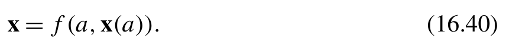{width=42%}

[]{#eq-16-031}

利用不动点迭代可以得到该方程的解 x，CCD_solve 函数中采用的就是这种方法。所得的 x 随后用于计算另一个量，例如 CCD 能量。可以用拉格朗日乘子（Lagrange multiplier）Λ 构造 CCD 能量的拉格朗日函数（Lagrangian），以纳入约束条件 (16.40)：

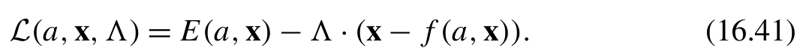{width=52%}

[]{#eq-16-032}

随后，我们可以继续寻找拉格朗日函数的极大值或极小值。拉格朗日函数的驻定条件给出两个方程：

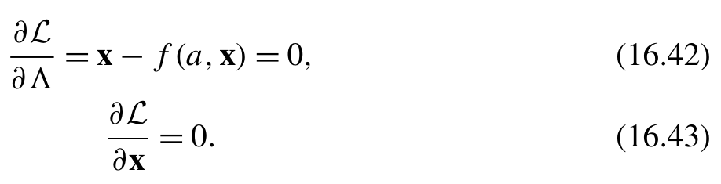{width=45%}

**公式 (16.42)(16.43)**[]{#eq-16-033}

第一个方程对应于约束条件 (16.40)。第二个方程定义了 Λ。简化后，它可以写成以下形式：

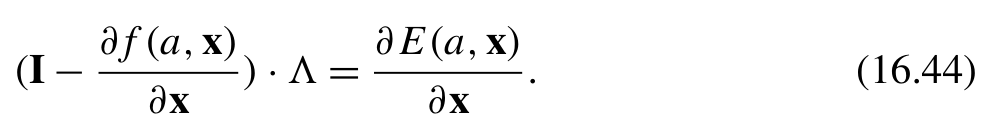{width=48%}

[]{#eq-16-034}

利用式 (16.41) 中定义的拉格朗日函数，就可以计算能量导数：

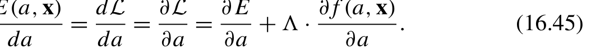{width=51%}

[]{#eq-16-035}

线性方程 (16.44) 可以使用 Krylov 子空间求解器（Krylov subspace solver）高效求解。在 CCD 不动点迭代的背景下，这个线性方程的函数可以编写如下：

```python
from .krylov import solve_krylov
def solve_lambda(H, t2_star, v):
    _, vjp_Ht = jax.vjp( lambda t2: update_CCD_amplitudes(H, t2), t2_star)
    def matvec(x):
        return -np.asarray(vjp_Ht(x.reshape(v.shape))[0]).ravel()
    l = solve_krylov(matvec, np.asarray(v).ravel())
    return l.reshape(v.shape)
```
jax.vjp 函数生成操作 vjp_Ht，借此计算向量 Λ 与雅可比矩阵（Jacobian）的乘积。式 (16.44) 右侧的项充当 CPHF 方程中的「力」，它通过 JAX AD 求得：

```text
jax.jacrev(lambda t2: get_CCD_corr_energy(H, t2))(t2_star)
```
solve_lambda 函数的输出对应于耦合簇能量泛函理论中的退激发算符 Λ [17]。在耦合簇能量泛函的框架下，Λ 的方程通过复杂的图解
方法推导得到。相比之下，在 JAX AD 方法中，无需做任何复杂的代数推导。只需几条 JAX AD 语句即可得到 Λ 算符！
让我们进一步探讨线性方程 (16.44) 的求解器。除了 Krylov 子空间求解器，式 (16.44) 还可以使用其他方法求解，例如 DIIS 加速或 GMRES（Generalized Minimal Residual Method，广义最小残差法）求解器。在需要 JAX 计算高阶导数的情况下，线性方程求解器也必须能被 JAX 变换。此时，JAX.scipy.linalg.sparse 模块提供的求解器是合适的选择。

```python
def solve_lambda(H, t2_star, v):
    _, vjp_Ht = jax.vjp( lambda t2: update_CCD_amplitudes(H, t2), t2_star)
    def matvec(x):
        return x - vjp_Ht(x)[0]
    return jax.scipy.sparse.linalg.gmres(matvec,v , tol=1e-5)[0]
```
将 Λ 求解器整合到 CCD 程序中，需要对 CCD_solve 函数做一些修改。

```python
def CCD_solve(mf):
    H = mo_integrals(mf)
    t2 = fixed_point(H)
    e=H [ 'e_hf'] + get_CCD_corr_energy(H, t2)
    return e
# The fixed point iteration
@partial(jax.custom_vjp, nondiff_argnums=(1, 2))
def fixed_point(H, conv_tol=1e-5, max_cycle=100):
    '''A fixed-point iteration solver for spin-orbital CCD'''
    e_ccd, t2 = mp2(H) # initial guess
    print(f'E(MP2)={e_ccd}')
    e_hf = H[ 'e_hf']
    with tempfile.TemporaryDirectory() as tmpdir:
        diis = DIIS(f '{tmpdir}/diis')
        for cycle in range (max_cycle):
            t2, t2_prev = update_CCD_amplitudes(H, t2), t2
            e_ccd, e_prev = get_CCD_corr_energy(H, t2) + e_hf, e_ccd
            print(f'{cycle=}, E(CCD)={e_ccd}, dE={e_ccd-e_prev}')
            if jnp.abs(t2 - t2_prev). max() < conv_tol:
                break
            t2 = diis.update(t2 - t2_prev, t2)
    return t2
def fp_fwd(H, conv_tol=1e-4, max_cycle=100): # (1)
    t2 = fixed_point(H, conv_tol, max_cycle)
    return t2,( H, t2)
```

```python
def fp_bwd(conv_tol, max_cycle, res, cotangent): # (2)
    H, t2_star = res
    L = solve_lambda(H, t2_star, cotangent)
    _, vjp_R = jax.vjp( lambda H: update_CCD_amplitudes(H, t2_star), H)
    # vjp_R computes the prodcut of L and the Jacobian of update_t2
    return vjp_R(L)
fixed_point.defvjp(fp_fwd, fp_bwd) # (3)
```
t2 的迭代被集中到一个专门的 fixed_point 函数中。随后，CCD 能量单独计算，并使用 fixed_point 函数的输出。这里使用 custom_vjp 为 fixed_point 函数定义反向模式规则。
在第 (3) 行，custom_vjp.defvjp 方法以两个增强函数为参数调用：第 (1) 行的 fp_fwd 用于前向传播，第 (2) 行的 fp_bwd 用于反向传播。前向传播函数 fp_fwd 的签名与原始函数的签名相同。fp_fwd 的输出应包含原始结果以及一个残余值（residual），后者将传递给 fp_bwd 函数。这一设计约定使前向和反向传播过程能够共享某些中间量，从而在一定程度上减少计算开销。反向函数 fp_bwd 至少需要两个输入参数：来自 fp_fwd 的残余数据，以及与原始函数输出关联的余切量（cotangent）。如果原始函数包含不可微参数，如本例所示，无论这些参数在原始函数签名中处于什么位置，都应将它们作为 fp_bwd 的前置参数传入。
在原始函数 fixed_point 中，已经应用了 DIIS 加速。与最初的 CCD-AD 程序不同，这个版本不要求 DIIS 函数能被 JAX 变换。DIIS 迭代仅由 JAX 前向传播执行。在反向传播期间，JAX 调用自定义的 fp_bwd 函数，从而跳过 DIIS 过程。
请注意 fp_bwd 和 solve_lambda 中的匿名 lambda 函数。它们针对同一个 update_CCD_amplitudes 函数的可微变量定义。在 solve_lambda 中，可微变量是 t2，对应的 VJP 操作为：

```text
jax.vjp(lambda t2: update_CCD_amplitudes(H, t2), t2_star)
```
在 fp_bwd 中，可微变量是 H。VJP 操作通过以下代码编写：

```text
jax.vjp(lambda H: update_CCD_amplitudes(H, t2_star), H)
```
与原始 CCD-AD 程序相比，本节介绍的隐式微分方法计算成本更低，内存占用也更少。这些优势归功于 CCD_solve 中的 DIIS 加速，
以及反向传播生成的追踪器更少。在隐式微分方法中，只创建一个部分求值的 update_CCD_amplitudes 追踪器，而在早期版本的 CCD-AD 程序中，每次迭代都会生成多个追踪器。
不动点迭代广泛应用于量子化学程序。除了耦合簇程序，还可以在自洽场迭代、CPHF 方程以及其他领域中见到它。隐式微分方法是计算所有这些方法的导数的理想工具。PySCFAD 库 [8] 已将这种方法用作默认求解器。如果你有兴趣进一步探索 JAX AD 在量子化学中的应用，可以在 PySCFAD 库中找到本节讨论技术的更多实际示例。
不动点迭代是科学计算应用中的一项基本技术。因此，jaxopt 库提供了求解隐式微分的专用工具。这个工具是 custom_fixed_point 函数，可通过 jaxopt.implicit_diff 模块访问 [16]。因此，无需为不动点函数编写 custom_vjp 规则。我们只需为 custom_fixed_point 装饰器指定更新函数和相应的不动点求解器，如下所示：

```python
@custom_fixed_point( lambda t2,H , *args, **kwargs: update_CCD_amplitudes(H, t2), solve=partial(jaxopt.linear_solve.solve_gmres, tol=1e-5))
def fixed_point(t2,H , conv_tol=1e-5, max_cycle=100):
    '''A fixed-point iteration solver for spin-orbital CCD'''
    e_ccd, t2 = mp2(H) # initial guess
    print(f'E(MP2)={e_ccd}')
    e_hf = H[ 'e_hf']
    with tempfile.TemporaryDirectory() as tmpdir:
        diis = DIIS(f '{tmpdir}/diis')
        for cycle in range (max_cycle):
            t2, t2_prev = update_CCD_amplitudes(H, t2), t2
            e_ccd, e_prev = get_CCD_corr_energy(H, t2) + e_hf, e_ccd
            print(f'{cycle=}, E(CCD)={e_ccd}, dE={e_ccd-e_prev}')
            if jnp.abs(t2 - t2_prev). max() < conv_tol:
                break
            t2 = diis.update(t2 - t2_prev, t2)
    return t2
```

### 16.4.3 导数

JAX 支持对普通的、能被 JAX 变换的函数计算高阶导数。这一能力是否也适用于使用自定义导数规则定义的函数？
如果 JVP 或 VJP 增强函数以及所有后续函数都由可经 JAX 变换的函数定义，JAX 自动微分（AD）就能顺利处理高阶导数。让我们考察 CCD 程序中的 custom_jvp 情况。类似的方法也适用于 custom_vjp 的情况。
在最初的 CCD-AD 程序中，mo_integrals 的 custom_jvp 编写如下：

```python
@partial(jax.custom_jvp, nondiff_argnums=(1,))
def mo_integrals(coords, mf: pyscf.scf.hf.RHF):
    ...
@mo_integrals.defjvp
def mo_integrals_jvp(mf, primals, tangents):
    coords, = primals
    ...
    primals_out = mo_integrals(coords, mf)
    return primals_out, jvp_product
```
在 mo_integrals_jvp 函数内部，primals_out 由可经 JAX 变换的函数 mo_integrals 生成。在这个 CCD 程序中调用核 Hessian 时，JAX 自动微分能够执行而不会报错。然而，结果必然不正确，因为我们并未提供任何高阶导数积分。
为了防止 JAX 错误地尝试计算高阶导数，一种有效方法是使用不能经 JAX 变换的函数生成 primals_out。例如，将 mo_integrals 的功能分离到一个不能经 JAX 变换的独立函数 _mo_integrals_no_ad 中，就能将 CCD-AD 代码的应用限制在一阶导数范围内。

```python
def _mo_integrals_no_ad(coords, mf: pyscf.scf.hf.RHF):
    ...
@partial(jax.custom_jvp, nondiff_argnums=(1,))
def mo_integrals(coords, mf: pyscf.scf.hf.RHF):
    return _mo_integrals_no_ad(coords, mf)
@mo_integrals.defjvp
def mo_integrals_jvp(mf, primals, tangents):
    coords, = primals
    ...
    primals_out = mo_integrals_no_ad(coords, mf)
    return primals_out, _mo_integrals_common(mol, hcore, eri, e_hf)
```
计算高阶导数时，primals 参数将包含嵌套的追踪器（tracer），而不是普通输入，其嵌套层级对应于所要计算的导数阶数。
将这些参数传给自定义 JVP 的原始函数可能会发起对 JVP 增强函数的递归调用，此时 primals 中追踪器的嵌套层级会降低。为高阶导数设计 JVP 增强函数时，必须仔细考虑这种递归调用模式。
为了自定义高阶导数，例如在增强函数中加入高斯型轨道（GTO）积分的高阶导数，我们可能需要在 JVP 增强函数中追踪当前的导数阶数。一种方法是检测 primals 参数中追踪器的层级。另一种方法是显式引入一个计数器来表示导数阶数。例如，在下面给出的 JVP 增强代码中，根据导数阶数应用不同的 JVP 规则。导数计数器通过不可微参数管理。

```python
@partial(jax.custom_jvp, nondiff_argnums=(1,))
def f(x, level): # level=0 indicates the second order
    return x
@f.defjvp
def f_jvp(level, primals, tangents):
    x, = primals
    primals_out = f(x, level-1)
    tangent_out = custom_jvp_rules(level, primals, tangents)
    return primals_out, tangent_out
jax.hessian(f)(3.14,2 )
```

### 16.4.4 JVP 与 VJP 之间的转换

前面提到，JAX 可以自动将标准的前向模式自动微分（JVP 操作）转换为反向模式自动微分（VJP 操作）。你可能会问：JAX 如何完成这种从 JVP 到 VJP 的奇妙转换？简而言之，JAX 使用线性化-转置（linearize-transpose）算法完成 JVP 到 VJP 的转换 [18]。
JVP 增广函数定义了雅可比矩阵-向量乘积（Jacobian-vector product），对切向量输入充当线性变换。JAX 使用特定的追踪器追踪 JVP 增广函数的切向量输入。通过分离与切向量输入无关的代码并执行部分求值，JVP 规则被转换为一个线性化函数。线性化函数通常更简单、速度更快。它主要涉及与切向量的张量收缩或对某些中间量的累加操作。
随后，JAX 执行转置，即将线性化操作绑定到与 VJP 操作相关的余切向量输入。这一过程产生的操作等价于转置后的雅可比矩阵与余切向量输入之间的 VJP 乘积。
由于线性化的要求，不能使用有限差分法近似 JVP 规则。JAX 无法将有限差分法转换为线性化操作。实际上，JAX 无法处理针对切向量输入的任何非线性操作。无论这些操作是否可经 JAX 变换，JAX 都会识别并拒绝对切向量输入执行非线性操作的任何尝试。
VJP 自定义规则可直接用于反向传播，而 JVP 自定义则涉及线性化-转置变换。这引出了一个有趣的问题：对于反向传播任务，custom_vjp 是否比 custom_jvp 更高效？
虽然反向模式自动微分和反向传播共用某些术语，但这并不意味着 jax.custom_vjp 天生比 jax.custom_jvp 更高效。JAX 提供这两个 API，使我们能够灵活地使用任一方法定义导数规则。当 JAX JIT 编译器处理微分时，它可以优化整个计算图。因此，这两种导数自定义方法最终可能产生计算复杂度相当的函数。
关于 custom_jvp 和 custom_vjp 的使用，还有两点值得了解：

- JAX 不支持为同一个原始函数同时定义 custom_jvp 和 custom_vjp。
- 定义 custom_vjp 后，JAX 无法自动将 VJP 规则转换为 JVP 规则。因此，jax.jacfwd 等前向模式自动微分函数将无法与 custom_vjp 配合使用。

因此，除了隐式微分等特殊优化方法外，在 JAX 中自定义导数时，建议重点使用 JVP 规则。

## 小结

本章探讨了计算分子性质的各种方法，尤其关注使用 JAX 自动微分计算核梯度。JAX 自动微分的一个独特特性是其混合模式，它将现有程序的解析梯度功能与自动微分能力结合起来。我们展示了开发混合代码以计算双激发耦合簇（CCD）方法的核梯度的过程。在这个核梯度程序中，积分和 Hartree-Fock 轨道等某些一阶量通过解析方法计算，其余部分则通过 JAX 自动微分得到。
开发 JAX 自动微分程序的挑战在于确保所有相关函数都可经 JAX 变换。为了在混合代码中达到这一目标，我们对现有 CCD 程序做了若干调整。这些调整包括采用函数式编程风格、重写某些代码块以
消除副作用，以及用 JAX 中对应的函数替换 NumPy 和 SciPy 函数。对于不能直接经 JAX 变换的函数，我们定义了 custom_jvp 接口，使它们与 JAX 变换兼容。此外，对于程序中的用户自定义类，我们使用 JAX PyTree 节点来扩展 JAX 能够处理的数据类型。由于求解 CCD 问题涉及不动点迭代过程，我们使用隐式微分技术来改进对这一不动点迭代的自动微分。隐式微分方法中使用了 custom_vjp 接口。然而，除了这一特殊情况，通常更适合自定义 JVP 接口，因为它更容易开发和维护。

## 参考文献

::: {.ref-list}

[1] The PySCF Developers, Quantum chemistry with Python, [pyscf.org](https://pyscf.org/), 2024.

[2] Y. Yamaguchi, H.F. Schaefer III, Analytic Derivative Methods in Molecular Electronic Structure Theory: A New Dimension to Quantum Chemistry and Its Applications to Spectroscopy, John Wiley & Sons, Ltd, 2011, [DOI](https://doi.org/10.1002/9780470749593.hrs006), [wiley.com](https://onlinelibrary.wiley.com/doi/pdf/10.1002/9780470749593.hrs006), [wiley.com](https://onlinelibrary.wiley.com/doi/abs/10.1002/9780470749593.hrs006).

[3] J.A. Pople, R. Krishnan, H.B. Schlegel, J.S. Binkley, Derivative studies in Hartree–Fock and Møller–Plesset theories, in: Proceedings of the International Symposium on Atomic, Molecular, and Solid-State Theory, Collision Phenomena, and Quantum Statistics, and Computational Methods, International Journal of Quantum Chemistry 16 (S13) (1979) 225–241, [DOI](https://doi.org/10.1002/qua.560160825).

[4] G.H. Golub, C.F. Van Loan, Matrix Computations, 4th edition, Johns Hopkins University Press, Philadelphia, PA, 2013, [DOI](https://doi.org/10.1137/1.9781421407944), [siam.org](https://epubs.siam.org/doi/pdf/10.1137/1.9781421407944), [siam.org](https://epubs.siam.org/doi/abs/10.1137/1.9781421407944).

[5] M.F. Kasim, S. Lehtola, S.M. Vinko, DQC: a Python program package for differentiable quantum chemistry, Journal of Chemical Physics 156 (8) (2022) 084801, [DOI](https://doi.org/10.1063/5.0076202), [aip.org](https://pubs.aip.org/aip/jcp/article-pdf/doi/10.1063/5.0076202/18277993/084801_1_5.0076202.pdf).

[6] A.S. Abbott, B.Z. Abbott, J.M. Turney, H.F.I. Schaefer, Arbitrary-order derivatives of quantum chemical methods via automatic differentiation, Journal of Physical Chemistry Letters 12 (12) (2021) 3232–3239, pMID: 33764068, [DOI](https://doi.org/10.1021/acs.jpclett.1c00607).

[7] G. Zhou, B. Nebgen, N. Lubbers, W. Malone, A.M.N. Niklasson, S. Tretiak, Graphics processing unit-accelerated semiempirical Born Oppenheimer Molecular Dynamics using PyTorch, Journal of Chemical Theory and Computation 16 (8) (2020) 4951–4962, pMID: 32609513, [DOI](https://doi.org/10.1021/acs.jctc.0c00243).

[8] X. Zhang, G.K.-L. Chan, Differentiable quantum chemistry with PySCF for molecules and materials at the mean-field level and beyond, Journal of Chemical Physics 157 (20) (2022) 204801, [DOI](https://doi.org/10.1063/5.0118200), [aip.org](https://pubs.aip.org/aip/jcp/articlepdf/doi/10.1063/5.0118200/18281172/204801_1_5.0118200.pdf).

[9] J. Denero, SICP in Python, [gitbooks.io](https://wizardforcel.gitbooks.io/sicp-in-python/content/), 2024.

[10] The JAX authors, JAX documentation - jax.numpy.ndarray.at, [readthedocs.io](https://jax.readthedocs.io/en/latest/_autosummary/jax.numpy.ndarray.at.html), 2024.

[11] The JAX authors, Custom derivative rules for JAX-transformable Python functions, [readthedocs.io](https://jax.readthedocs.io/en/latest/notebooks/Custom_derivative_rules_for_Python_code.html), 2024.

[12] The JAX authors, Use jax.custom_jvp to define forward-mode (and, indirectly, reverse-mode) rules, [readthedocs.io](https://jax.readthedocs.io/en/latest/notebooks/Custom_derivative_rules_) for_Python_code.html#use-jax-custom-jvp-to-define-forward-mode-and-indirectlyreverse-mode-rules, 2024.

[13] The JAX authors, jax.custom_jvp with nondiff_argnums, [readthedocs.io](https://jax.readthedocs.io/en/latest/notebooks/Custom_derivative_rules_for_Python_code.html#jax-custom-jvp-withnondiff-argnums), 2024.

[14] The JAX authors, Extending PyTrees, [readthedocs.io](https://jax.readthedocs.io/en/latest/pytrees.html#) extending-pytrees, 2024.

[15] The JAX authors, Implicit function differentiation of iterative implementations, [readthedocs.io](https://jax.readthedocs.io/en/latest/notebooks/Custom_derivative_rules_for_Python_code.html#implicit-function-differentiation-of-iterative-implementations), 2024.

[16] The JAXopt authors, JAXopt documentation - implicit differentiation, [github.io](https://jaxopt.github.io/stable/implicit_diff.html), 2024.

[17] P.G. Szalay, M. Nooijen, R.J. Bartlett, Alternative ansätze in single reference coupled-cluster theory. III. A critical analysis of different methods, Journal of Chemical Physics 103 (1) (1995) 281–298, [DOI](https://doi.org/10.1063/1.469641), [aip.org](https://pubs.aip.org/aip/jcp/article-pdf/103/1/281/19147216/281_1_online.pdf).

[18] A. Radul, A. Paszke, R. Frostig, M.J. Johnson, D. Maclaurin, You only linearize once: tangents transpose to gradients, Proc. ACM Program. Lang., 7 (POPL), [DOI](https://doi.org/10.1145/3571236).

:::

