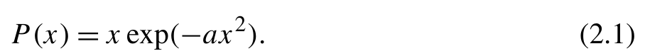
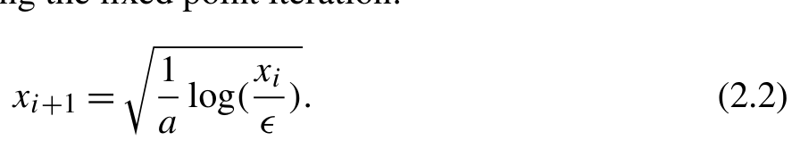
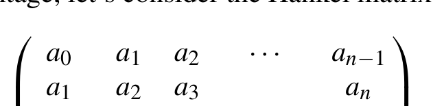
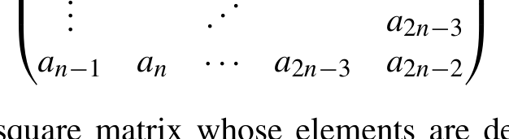
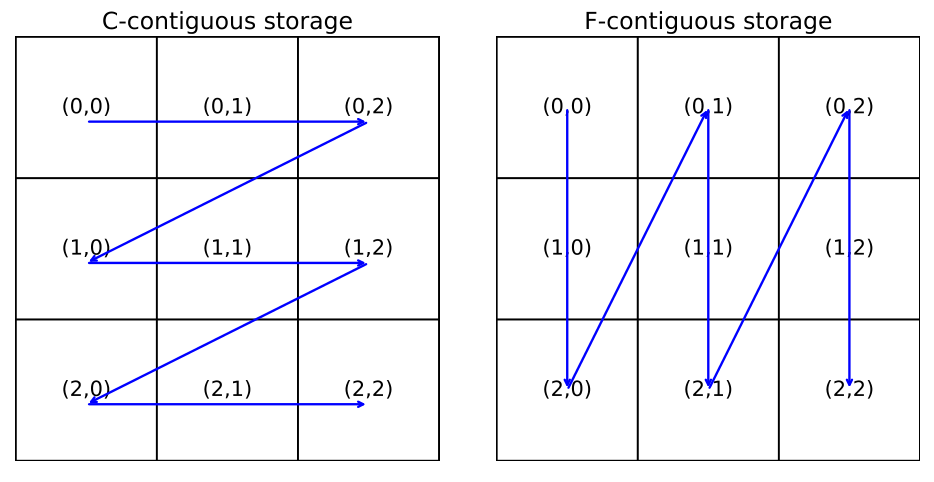
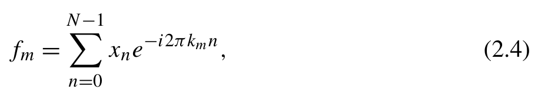
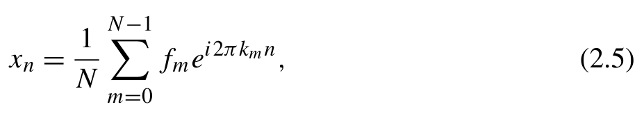
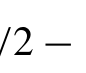
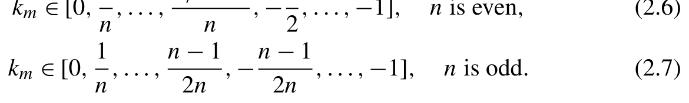
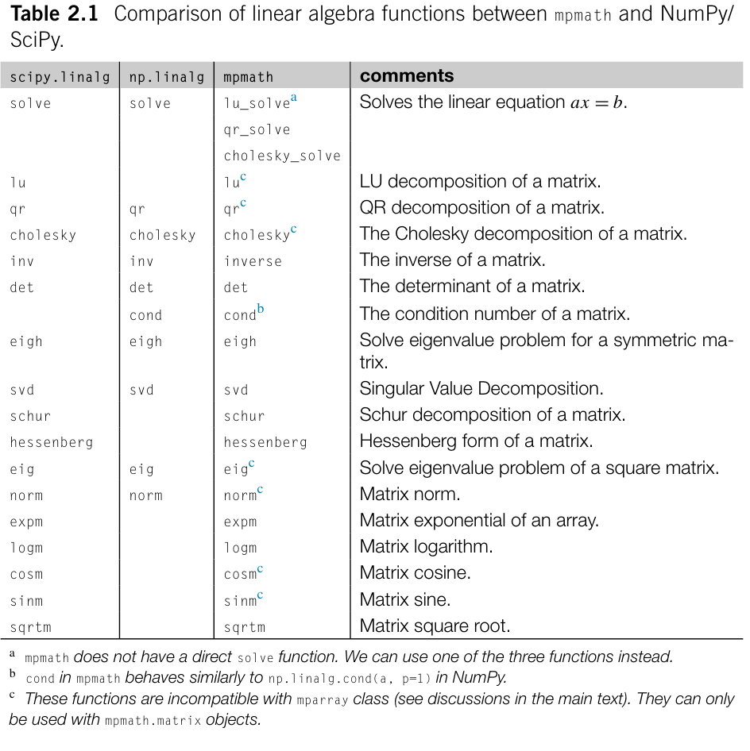

# 数据处理 {#ch02 .unnumbered}

NumPy 和 Pandas 是 Python 数据处理与科学计算生态系统的基石。使用 NumPy 和 Pandas 处理数据通常很直接。你可能已经在工作中使用它们很长时间了。然而，在应用中使用这些工具时，你可能遇到过各种问题，例如：

- 我修改了一个数组，为什么另一个数组的数据也发生了变化？
- 能否不使用循环来访问高维数组中的一个小块？
- 我知道 NumPy 的花式索引（fancy indexing）很强大，但我觉得它很难理解。

如何更有效地阅读和编写 NumPy 花式索引代码？

- 我的 NumPy 程序为什么使用了比预期更多的内存？这些内存都用到哪里去了？
- 我的程序偶尔会出现 nan。这些 nan 值从何而来，如何避免它们？
- 我可以使用类似 NumPy 数组索引的方法访问 Pandas 对象的元素，但有时这样做会失败或产生错误的行为。Pandas 和 NumPy 的索引方法之间有什么联系吗？

为了解答这些问题，我们需要更深入地理解 NumPy 和 Pandas 的工作原理。这种理解涉及两个关键方面：

1. NumPy 和 Pandas 对象中的数据是如何组织的？
2. 数据类型是如何管理的？

本章的讨论建立在这些考虑之上。
理解 NumPy 和 Pandas 中的数据结构和数据类型管理至关重要。这些知识不仅使我们能够更有效地使用这些工具，也是进一步利用编译技术进行优化的基础知识。第 8 章和第 9 章将更详细地讨论数值计算的编译优化技术。
本章中，我们偶尔会从硬件和操作系统的角度分析数值计算技术。理解这些技术背景有助于编写高效的程序。然而，如果你对底层系统的细节不感兴趣，可以跳过这些技术讨
论。这些见解旨在加深我们对数值计算工具设计的理解，但并非使用这些工具所必需。

## 2.1 使用 NumPy 进行矢量化数据处理

处理 Python 列表时，处理每个元素除了基本的算术计算外，还涉及多项操作。这些操作包括类型检查、访问底层方法以及管理对象的生命周期。在数值计算中，列表的元素通常具有相同的数据类型。以矢量化（vectorized）方式将它们作为 NumPy 数组处理更为高效。NumPy 的高效率可归因于几个关键方面：

- 消除了与类型检查相关的开销。
- 在编译后的代码中执行算术操作。
- 由于数据类型和大小固定，加快了元素访问。
- 由于内存使用更加高效，改善了缓存利用率。

NumPy 模块通常以别名 np 导入：

```python
import numpy as np
```
本书将始终遵循这一导入约定。

### 2.1.1 NumPy 基础

如果你是 NumPy 初学者，可以利用众多资源快速学习其基础知识。除了 https://numpy.org/doc/ stable/user/absolute beginners.html 上的 NumPy 官方教程外，还有几份有用的资料可供参考。

- Justin Johnson 的 Numpy Tutorial（使用 Jupyter 和 Colab），可通过 https://cs231n.github.io/python-numpy-tutorial/ 访问。这是一份交互式教程，可以让你在 Jupyter Notebook 中使用 NumPy 代码示例。
- fic Python Lectures 全面介绍了 NumPy 的基础和高级功能，并配有许多说明性图示。此书可通过 https://lectures.scientific-python.org/ 获取。
- https://numpy.org/learn/ 上的学习文档。该网站收集了适合不同水平的 NumPy（和 SciPy）用户的各种学习材料。

我们不打算重复现有的优秀 NumPy 学习资源中的内容。下面，我们简要分类 NumPy 的基本功能，并列出每个类别中最常用的一些函数：

- 创建数组以存储数据。创建数组最直接的方法是使用 np.array 函数，它可以将 Python 列表或元组转换为 NumPy 数组。此外，还有各种创建数组的函数，例如 -

-
-
-
-
-
-
-
-
-

- 重组数组。常用函数包括 -

-
-
-
-
-
-
-
-
-
-
-
-
-
-

- 访问数组的某些元素，例如

-
-
-

- 数组中某些元素的索引，例如 -

-
-
-
-
-
-
-
-
-

- 逐元素算术操作，例如

-
-
-
-
-

- 线性代数操作，例如

-
-
-
-
-

- 提供额外功能的子模块
- linalg 模块提供线性代数函数。
- polynomial 模块提供特殊多项式。
- random 模块用于生成随机数。
- ma 模块用于掩码数组，它支持对含有

缺失值或无效值的数组进行操作。

- ctypeslib 模块包含用于 Python ctypes 模块的实用函数。- fft 模块用于离散傅里叶变换。

### 2.1.2 通用函数（ufunc）

通用函数（universal function，ufunc）是 NumPy 数组的一种基本操作。Ufunc 可以对 NumPy 数组中的元素执行逐元素操作。基本算术运算符（+、-、*、/、**、//、<<、>>、| 和 ^）均以 ufunc 方式操作。大多数算术函数，如 np.sqrt、np.add、np.floor、np.log 和 np.cos，也都是 ufunc [1]。
Ufunc 使我们能够用一条命令操作整个数组对象，从而不需要缓慢的 Python 循环。NumPy ufunc 在内部对算术操作进行矢量化，因此在操作单个元素时比 Python 循环更高效。
为了提高 ufunc 的性能，可以考虑以下几种策略：

- 最好在具有类似连续数据布局的数组对象上使用 ufunc。在这种情况下，NumPy 可以制定一个最优迭代方案来遍历数组中的元素。对数据布局完全相反的数组应用 ufunc 会带来性能损失。例如，对于方阵 a，操作 a + a.T 比 a + a 慢得多。第 2.1.7 节将进一步探讨 NumPy 数组的数据布局及其对 ufunc 的影响。
- Ufunc 提供了关键字参数 out，允许指定一个输出数组来存储结果。这个关键字参数可以提高 ufunc 的性能，因为它不需要反复为输出分配内存。

下面通过一个例子说明使用 out 关键字存储输出的好处。考虑对于分布函数，寻找正 x 轴上满足 P (x) = ϵ 的点这一任务

{width=44%}

[]{#eq-02-001}

P (x) = x exp(− ax).) 这个问题可以用不动点迭代求解：

{width=44%}

[]{#eq-02-002}

xi+1 = log(xi).)
a ϵ
我们可以使用 ufunc 实现这一迭代：

```python
def search(a , eps=1e -9):
    x = np.full_like(a , 1e3)
    xlast = np.zeros_like(a)
    while np.any(abs(x - xlast) > eps):
        xlast = x
        x = np.sqrt(np.log(x/eps)/a)
    return x
```
每次迭代中，都会为中间步骤创建四个额外的临时数组，分别对应操作 x/eps、np.log、/a 和 np.sqrt。算上 x 和 xlast 数组后，这个函数需要超过 a 数组六倍的内存空间。分配和管理这些额外数组可能带来显著的开销，尤其是对于大型输入数组。为了应对这一开销，我们可以指定 out 关键字来存储输出，得到以下实现：

```python
def search(a , eps=1e -9):
    x = np.full_like(a , 1e3)
    xlast = np.zeros_like(a)
    while np.any(abs(x - xlast) > eps):
        xlast ,x=x  , np.sqrt(np.divide(np.log(np.divide( x , eps , out=xlast), out=xlast), a , out=xlast), out=xlast)
    return x
```
这个版本复用 xlast 数组的内存空间来存储中间结果。调用 np.sqrt 函数后，更新的结果存储在 xlast 中。然后我们交换 x 和 xlast 对象，以更新 x 的值。此实现只需要 x 和 xlast 的内存空间，有效减少了内存消耗和内存分配开销。
复用 ufunc 的输出存储与原位操作密切相关。

### 2.1.3 原位操作

使用标准 Python 运算符（+、-、*、/、**、//、<<、>>）应用 ufunc 时，会生成一个新对象来保存结果。这意味着原数组保持
不变。相比之下，原位操作（带有 = 符号的标准运算符，如 +=、>>=）直接在自身的内存空间中修改数据，而不是创建新对象来保存结果。
一般来说，原位操作由于内存效率更高，比普通操作更快：

- 不需要分配新内存，从而减少内存管理开销。
- 减少缺页 [2] 的频率，因为访问新分配的内存时经常发生缺页。
- 复用的内存空间更有可能已经映射到 CPU 缓存中，从而提高缓存命中率。

然而，使用原位操作需要更加谨慎，并更深入地理解程序中的数据关系。当普通操作被原位操作取代时，可能出现普通操作不会产生的错误。由于 NumPy 数组可能与其他数组共享数据，对一个数组执行原位操作可能无意中改变其他数组的内容。为了安全地实现原位操作，必须确认一个数组是否与其他数组共享内存。第 2.1.8 节将通过数组视图技术讨论数组间数据共享的更多技术细节。
原位操作无法自动处理结果的数据类型转换。当操作涉及不同数据类型的数组时，如果预期结果的数据类型与输出数组提供的类型不同，这一限制可能导致程序失败。例如，数据类型不兼容时可能收到以下错误：

```python
In [1]: a = np.arange(3)
        a/ =2
UFuncTypeError: Cannot cast ufunc 'divide' output from dtype('float64')t o
    dtype('int64') with casting rule 'same_kind'
```
幸好，NumPy 能够检测原位操作导致的大多数数据类型不兼容问题并报错。通常根据打印的错误消息就能轻松发现并修复这些错误。

### 2.1.4 广播

如果 ufunc 的输入数组具有不同形状，ufunc 会使用一种称为广播（broadcasting）的方法对输入数组应用操作。广播遵循两条规则：

- 维度。如果数组的维数不同，广播会自动扩展维度。维数较少的数组会在左侧自动补充新轴，每个轴的维度大小为 1，直到数组的维数相同。例如，语句

```python
   np.eye(3) * np.array(5)[np.newaxis , np.newaxis]
```
其中 np.array(5)[np.newaxis, np.newaxis] 将生成一个 1 × 1 的等价
于 array([[5]]) 的数组。

- 维度。如果对应维度的大小相同，或者其中一个等于 1，则这些维度兼容。当一个数组的某个维度大小为 1 时，广播会将该维度中的元素视为被复制，以匹配另一个数组对应维度的大小。例如，前面的语句 np.eye(3) * 5 等同于

```python
   np.eye(3) * np.array([[5 ,5 , 5]])
```
第二个数组还可以沿行进一步广播，如同执行

```python
   np.eye(3) * np.array([[5 ,5 ,5 ] ,[ 5 ,5 ,5 ] ,[ 5 ,5 , 5]])
```
在前面的例子中，我们提到了使用 np.newaxis 为数组添加新维度。通过在数组中的任何位置插入 np.newaxis，我们可以在该位置添加一个维度大小为 1 的新轴。Python 内置关键字 None 与 np.newaxis 同义，在许多程序中经常使用。例如，语句 np.array(5)[np.newaxis, np.newaxis] 和 np.array(5)[None, None] 会产生相同的结果。
应当注意，添加了 np.newaxis 的数组只是原数组的一个视图。这个操作等同于使用 reshape 函数，并在输出形状中增加一个大小为 1 的维度，例如 np.array(5).reshape((1, 1))。利用 np.newaxis 扩展维度比使用 reshape 更直接，因为不需要考虑数组的原始形状。
结合 np.newaxis、广播和 ufunc，我们可以用简洁的代码完成原本需要嵌套循环才能完成的任务。例如，假设我们有一组点的笛卡尔坐标，需要计算两两之间的距离。使用嵌套循环的传统方法需要以下代码：

```python
points = np.random.rand(10 ,3 )
dist = np.zeros((10 , 10))
for i ,r i in enumerate (points):
    for j ,r j in enumerate (points):
        r i j=r i-r j
        dist[i ,j] = sum(rij**2)**.5
```
使用广播，这段代码简化为一行：

```python
dist = np. sum((points[: ,None] - points) **2 , axis= -1)**.5
```
广播与 ufunc 结合，是极大提高 NumPy 代码效率和表达能力的基础工具。它们在 NumPy 的各种场景中得到广泛应用，尤其是在数组索引中。

### 2.1.5 索引

NumPy 中的花式索引允许我们通过一次索引操作访问多个元素。对于一维数组，花式索引的工作方式不难理解，如下面的例子所示：

```python
In [1]: a = np.arange(0 ,2 0 ,3 )
        idx = [4 ,1 ,3 ]
        print(a[idx])
Out[1]:
array([12 ,3 , 9])
```
使用高维数组时，一些程序员可能觉得花式索引代码难以理解。这里有一种理解花式索引的方法，可以分为三个步骤。

1. 使用索引构造地址数组。构造地址时应当

应用广播规则。

2. 确定输出数组的形状和数据类型。具体来说，地址数组（来自上一步）的形状决定输出数组的形状。

输出数组保留与输入数组相同的数据类型。

3. 展平地址数组，并用它从展平的输入

数组中选择元素。然后将选出的元素填入输出数组。
下面的函数展示了这一元素选择过程

```python
def fancy_index_decomposed(a , idxs):
    # Step 1 , construct the addresses
    addr = 0
    for i , idx in enumerate (idxs)
        stride = np.prod(a.shape[i+1:] , dtype= int)
        if isinstance (idx , slice):
            addr = addr + stride * np.arange(idx.start , idx.stop , idx.step)
        else:
            addr = addr + stride * np.array(idx)
    # Step 2 , get the data , as 1D array
    data = a.ravel()[addr.ravel()]
    # Step 3 , format the data
    output = data.reshape(addr.shape)
    return output
```
这种分解方法可以帮助我们理解复杂的花式索引代码。例如，考虑下面从矩阵中选择元素的嵌套循环：

```python
output = np.empty(( len(idx1), len(idx2)), dtype=a.dtype)
for i ,n in enumerate (idx1):
    for j ,m in enumerate (idx2):
        output[i ,j] = a[n ,m]
```
输出数组的形状是 (len(idx1), len(idx2))。为了得到这样的形状，应当通过 idx1[:,None] 与 idx2 之间的广播构造地址数组。输出数组的行来自 idx1，列来自 idx2。因此，idx1 应放在数组 a 的行维度上，idx2 放在列维度上。可以推导出一个高效的花式索引表达式来替代嵌套循环：

```text
output = a[idx1[: ,None] , idx2]
```
接下来，我们交换索引 idx1 和 idx2 的形状，考察以下花式索引表达式的效果：

```text
output = a[idx1 , idx2[: ,None]]
```
由于 idx1 和 idx2[:,None] 之间的广播，可以预期 idx2 选出的元素将构成输出数组的行，而 idx1 将构成列。idx1 中的元素选择数组 a 的行，并在 fancy_index_decomposed 函数中充当地址数组的列。当地址数组被展平时，它对应最内层循环。因此，花式索引代码的效果等同于以下嵌套循环：

```text
for j ,m in enumerate (idx2):
    for i ,n in enumerate (idx1):
        output[j ,i] = a[n ,m]
```
下面是另一个使用二维索引的复杂例子。

```python
a = np.zeros((n , m))
b = np.random.rand(n ,m )
lookup = np.random.rand(n , m).argsort(axis=1)
a[np.arange(n)[: ,None] , lookup] = b
```
尽管被索引的数组 a 是赋值操作的输出，我们仍然可以使用花式索引操作的规则来选择数组 a 中的元素。然后这些选出的元素被数组 b 中对应的元素替换。数组 a 的行使用连续的整数序列 np.arange(n)[:,None] 索引，这意味着输出中的行位置直接从原数组映射而来。输出数组中的列选择由二维数组 lookup 控制。lookup 是一个 n × m 矩阵，其中 n 行可以提供不同的列位置。当对数组应用地址数组

```python
np.arange(n)[: ,None] * m + lookup
```
到 a 时，第 i 行的地址与使用语句 a[i,lookup[i,:]] 索引 a 的元素具有相同效果。因此，花式索引赋值代码选择元素的方式等同于以下嵌套循环。

```text
for i in range (n):
    a[i ,lookup[i ,:]] = b[i ,:]
```
这段代码将数组 b 的每一行赋给数组 a 中对应的行，位置由 lookup 数组指定。
如果我们想获得一个数组 at，使得 at = a.T，换句话说，将 b 分配到 at.T 中，如

```text
b -> (at.T)[np.arange(n)[: ,None] , lookup]
```
以下哪些花式索引赋值能够满足这个要求？此外，其他语句可能有什么问题？我们将这个问题留给读者。你可以运用上面描述的相同过程，分析花式索引以及过程中可能出现的任何错误。

```python
# at = np.zeros((m , n))
at[np.arange(n), lookup] = b
at[np.arange(n), lookup.T] = b.T
at[lookup , np.arange(n)] = b
at[lookup.T , np.arange(n)] = b.T
at[lookup , np.arange(n)[: ,None]] = b
at[lookup.T , np.arange(n)[: ,None]] = b.T
```
在各种场景中，你可能遇到 np.ix_ 方法，它用于选择高维数组的一个子块，例如

```text
a[np.ix_(idx1 , idx2 , idx3)]
```
np.ix_ 方法可以为参数中的索引添加适当的 newaxis，将它们转换为花式索引语法。前面的 np.ix_ 索引代码等同于以下花式索引：

```text
a[idx1[: ,None ,None] , idx2[: ,None] , idx3]
```
花式索引和切片可以一起使用，但组合多个索引和切片可能导致更复杂的索引行为。考虑下面例子中的索引和切片组合：

```python
In [2]: a = np.ones((5 ,5 ,5 ,5))
        idx = np.arange(2)
        print(a[idx ,idx ,: ,:].shape)
        print(a[: ,idx ,idx ,:].shape)
```

```python
        print(a[: ,: ,idx ,idx].shape)
        print(a[: ,idx ,: ,idx].shape)
        print(a[idx ,: ,: ,idx].shape)
        print(a[idx ,: ,idx ,:].shape)
Out[2]:
(2 ,5 ,5 )
(5 ,2 ,5 )
(5 ,5 ,2 )
(2 ,5 ,5 )
(2 ,5 ,5 )
(2 ,5 ,5 )
```
如本例所示，多个索引的位置有两种不同情况，处理它们的方法也不同：

- 索引彼此相邻时，它们的作用类似切片操作。

与索引对应的维度会聚合起来，并插入
输出数组中与它们在原数组中所占位置相同的地方。
其他维度在输出数组中的位置保持不变。

- 索引被切片隔开时，会先处理这些索引并将其放在输出数组的前几个维度。然后，其余维度依次排列在输出数组后续的位置。

涉及多个索引和切片的代码往往容易造成误解，也难以维护。尤其是在第二种情况下，输出数组的维度可能与原数组的维度大不相同。为了简化涉及这种复杂索引的代码，一种策略是插入转置操作，将原数组转换为结构更有序的形式。这样，索引和切片就会在转置后的数组中分别聚集在一起，从而可以应用第一种情况的规则来选择元素。例如，为了清楚起见，语句

```text
a.transpose(0 ,3 ,1 ,2)[idx ,idx]
```

### 2.1.6 数组

花式索引（fancy indexing）允许按照特定模式选择元素。然而，当目的是选择满足某些条件的元素时，数据的分布可能不遵循任何特定模式。这时掩码数组（mask array）就派上了用场。
例如，掩码数组的一种常见用途是识别并过滤数组中的 nan 值。

```python
a = np.sqrt(np.random.rand(5 ,5) - .5)
a[np.isnan(a)] = 0.
```
在这个例子中，np.isnan(a) 生成一个掩码数组。该数组可用于选择所有 nan 元素并将其替换为零。
掩码数组本质上是由 True 和 False 值组成的二值数组。它可以跨多个维度选择元素。当使用掩码数组对另一个数组进行“索引”时，结果是一个扁平化数组，其中包含与掩码数组中 True 值对应的元素。使用掩码数组索引元素遵循两条规则：

- 掩码数组的形状必须与被索引数组的形状匹配。
- 对于被掩码的维度，输出始终是扁平化的（一维）对象。

第二条规则意味着掩码数组选择操作无法保留数据的原始维度，即使掩码数组中的 True 值以结构化模式排列也是如此。给掩码指定的元素赋值时，必须重塑数据源的形状，使其与扁平化目标数组的形状匹配。例如，

```python
In [3]: a = np.zeros((4 ,4 , 4))
        mask = np.ones((4 , 4), dtype= bool)
        print(a[mask].shape)
Out[3]:
(16 ,4 )
In [4]: a[mask] = np.arange(16.)[: ,np.newaxis]
```
掩码数组和花式索引的运作方式不同。在效率方面，两者在不同场景下各有优势。下面考虑四种情况。

#### 索引稠密数组

如果想要操作方阵的上三角部分，可以使用如下所示的花式索引：

```python
a = np.ones((n , n))
idx = np.triu_indices_from(a)
a[idx] += 1.5
```
np.triu_indices_from 函数生成矩阵上三角部分的索引。如果使用掩码数组，实现方式变为：

```python
a = np.ones((n , n))
idx = np.arange(n)
a[idx[: ,None] <= idx] += 1.5
```
语句 idx[:,None] <= idx 通过广播规则创建一个方阵。该语句比较两个索引的值。只有上三角部分满足第一个索引小于（或等于）第二个索引的条件，因此这些位置的掩码值为 True。
对于足够大的数组，本例展示的掩码数组方法可能比花式索引方法表现更好，速度甚至可能达到三倍。这是因为 True 值连续分布在掩码数组的上三角部分。这种有序分布可以使 CPU 的分支预测获得较高的成功率。唯一的开销是创建作为中间变量的 n × n 数组。另一方面，使用 triu_indices 函数的花式索引方法会产生两个整数向量，每个向量的大小均为 n(n + 1)。这两个索引向量消耗更多临时内存，导致 CPU 与内存之间的数据传输开销更高。此外，索引代码采用间接寻址模式（indirect addressing mode）[3]。这种寻址模式本身效率较低，因为它阻碍 CPU 有效预测数据访问模式。

#### 索引稀疏数组

如果要选择的数据相对稀疏，掩码数组方法的效率可能不如花式索引。例如，对数组的对角线元素进行操作时，

```python
a = np.ones((n , n))
mask = np.eye(n , dtype= bool)
a[mask] *=. 5
```
以下使用花式索引的代码效率更高。

```python
a = np.ones((n , n))
idx = np.diag_indices_from(a)
a[idx] *=. 5
```
在本例中，掩码数组性能较慢是因为必须遍历整个二值数组，其复杂度为 O(n)。相比之下，花式索引方法使用大小为 n 的整数向量进行索引，对应的复杂度为 O (n)。

#### 随机分布的掩码数组

当掩码数组中的 True 值随机分布时，掩码数组方法效率较低。假设我们可以选择使用随机分布的掩码数组或其对应的索引来选择元素，那么使用花式索引选择数据

```text
a[indices] *=. 5
```
比使用掩码数组更高效

```text
a[mask] *=. 5
```
即使所需操作数量与选择上三角数组的例子接近，掩码数组方法的执行时间也可能增加十倍，而花式索引方法所需的时间基本不变。掩码数组方法性能大幅下降可归因于 if-else 分支的高额开销。CPU 无法对随机掩码数组进行有效的分支预测，预测错误的分支会带来显著的执行惩罚。

#### 索引高维数组

计算高维数组中元素的地址需要较高的计算开销，例如量子化学应用中的四维电子排斥积分张量。地址计算过程需要一系列整数乘法和加法，这可能是一项繁重的任务。这种计算成本会大大影响花式索引方法的性能。尽管分支预测错误可能带来不利影响，掩码数组方法有时仍能提供更好的性能。

### 2.1.7 NumPy ndarray 的结构

NumPy 库的设计使底层数据在内存中的布局对使用者透明。然而，理解 NumPy 数组的数据结构有助于理解某些复杂的 NumPy 代码。了解 NumPy 数组的结构可以影响代码优化实践、程序稳定性，甚至算法设计。此外，当目标是通过 C/C++ 扩展优化 NumPy 代码时，熟悉 NumPy 数组的结构就成为必要条件。
计算机中的内存空间是线性空间。对于向量等一维数据，每个元素都可以轻松映射到内存空间中的特定位置。然而，处理多维数组时，NumPy 如何使用线性内存存储来组织和表示数组对象呢？
NumPy 中的数组是一块内存加上一些描述数据布局的元数据。NumPy 引入了以下属性来表示数组：

- dtype 属性表示数组元素的数据类型。它决定了每个元素占用的内存大小（可通过 itemsize 属性访问）。
- ndim 属性是一个表示维度数量的整数。
- shape 属性是一个表示各维度大小的元组。shape 的长度与 ndim 相同。
- data 属性表示存储原始数据的缓冲区。缓冲区的内存地址可通过 ctypes.data 属性或以下属性获得
- strides 属性是一个元组，表示沿数组各维度从一个元素移动到下一个元素时，内存中应跳过的字节数。

这些属性可以直接访问，例如：

```python
In [1]: import numpy as np
        a = np.random.rand(3 ,5 ,2)
        print(a.dtype , a.itemsize)
        print(a.ndim)
        print(a.shape)
        print(a.strides)
        print(a.ctypes.data)
Out[1]:
dtype('float64'), 8
3
(3 ,5 ,2 )
(80 ,1 6 ,8 )
20823872
```
NumPy 核心库使用 strides 属性计算数组中各个元素的内存地址。在这个例子中，数组元素 a[i,j,k] 的地址可计算为

```text
20823872 + i * 80 + j * 16 + 8
```
其中，20823872 是数组 a 的数据缓冲区地址。(80, 16, 8) 这些步长是如何得到的？步长等于

```text
(8 * 5 * 2 , 8 * 2 , 8)
```
其中数字 8 来自数组的 itemsize，数字 5 和 2 来自数组的 shape。该计算可以用一个 Python 表达式表示：

```python
[a.itemsize * np.prod(a.shape[i+1:] , dtype= int) for i in range (a.ndim)]
```

#### 2.1.7.1 用于灵活数组结构的 strides 属性

在上述例子中，strides 属性的值由数组的其他属性推导而来。乍看之下，strides 属性似乎是多余的。实际上，这是 NumPy 的一种精妙设计，为表示多维数组提供了灵活而高效的方式。strides 属性允许我们复用内存并在不同数组之间共享数据，从而有效减少内存消耗和数组间复制数据的成本。
为了说明这一优势，我们来考虑 Hankel 矩阵（Hankel matrix）

{width=32%}

[]{#eq-02-003}

⎟⎟

{width=31%}

[]{#eq-02-004}

⎟
Hankel 矩阵是一个方阵，其元素由向量得出。每个元素由公式 Hij = ai +j 定义。要构造 Hankel 矩阵，可以用嵌套循环实现代码

```python
def hankel_matrix(a):
```
⎟

```python
    n = (a.size + 1) // 2
    out = np.empty((n , n), dtype=a.dtype)
    for i in range (n):
        for j in range (n):
            out[i ,j] = a[i+j]
```
⎟

```python
    return out
```
可以使用 NumPy ufunc 风格的赋值对这段代码稍作优化。

```python
def hankel_matrix(a):
    n = (a.size + 1) // 2
```
⎟

```python
    out = np.empty((n , n), dtype=a.dtype)
```

```python
    for i in range (n):
        out[i] = a[i:n]
    return out
```
通过使用 strides 属性改变向量的布局，我们可以构造 Hankel 矩阵，而无须分配新内存或复制数据。这种方法比上述任何一种实现都快得多。

```python
def hankel_matrix(a):
    n = (a.size + 1) // 2
    return np.ndarray(shape=(n ,n), dtype=a.dtype , strides=(a.itemsize , a.itemsize), buffer=a)
```
这里，我们调用类实例化方法 np.ndarray，并传入数据缓冲区来初始化一个数组实例。ndarray 可以接受 shape、dtype、buffer 和 strides 等关键字来定义新数组。这些关键字与前面讨论的数组元数据相对应。由于使用了 buffer 参数，程序生成了原数组对象的视图（view）。
我们来看看视图如何根据原始向量表示 Hankel 矩阵。输出数组的步长为 (a.itemsize, a.itemsize)。因此，矩阵元素 H[i,j] 对应于存储在以下地址的数据

```text
a.ctypes.data + a.itemsize * i + a.itemsize * j
```
简化后得到

```text
a.ctypes.data + a.itemsize * (i + j)
```
这正是 a[i+j] 的地址。新数组复用了向量 a 的内存缓冲区，因此对于 n 只占用 2n 的内存

#### 2.1.7.2 C 连续和 F 连续存储

strides 属性与数组的存储布局密切相关。高维数组通常采用两种存储布局：C 连续（C-contiguous）和 F 连续（F-contiguous）。以二维数组为例，C 顺序和 Fortran 顺序的存储布局如图 2.1 所示。



**图 2.1** C 连续和 F 连续存储格式

C 连续存储采用 C 编程语言存储多维数组的方法。它将最后一个维度中的元素相邻放置在内存中。在这种布局中，strides 的最后一项等于 itemsize。strides 属性中的元素按降序排列。
Fortran 编程语言中的多维数组采用不同的布局，将第一个维度中的元素连续排列在内存中。在 F 连续布局中，strides 元组的第一项等于 itemsize。strides 属性中的元素按升序排列。
初始化新数组时，NumPy 默认采用 C 连续布局作为存储方式。然而，由于数组视图的存在，数组也可能既不是 C 连续的，也不是 F 连续的。例如，前面展示的 Hankel 矩阵就属于这种情况。要确定数组的存储布局，我们可以检查它的 flags 属性：

```text
a.flags['C_CONTIGUOUS']
a.flags['F_CONTIGUOUS']
```
这两个标志分别表明数组是否以 C 风格或 Fortran 风格的连续模式存储。
理解数据集的存储布局对优化 NumPy 代码的性能至关重要。遍历数组中的数据时，最好先沿最小步长遍历，因为这有利于遍历连续的内存位置。访问连续内存位置具有几方面的性能优势：

- 数据读入 CPU 时，以称为缓存行（cache line）的单位加载 [5]。

即使只访问缓存行中的一个字节，也必须加载整个缓存行。
沿小步长遍历时，下一个数据元素很可能
已经在同一个缓存行中被取出。CPU 不需要再次从内存中
加载数据。相比之下，沿大步长遍历可能导致
内存带宽浪费。

- CPU 可以为顺序内存访问预取数据。它可以在当前缓存行处理完毕之前加载下一个缓存行。
- 沿小步长访问的数据很可能位于同一个内存页中。步长较大时，访问不同页面中数据的概率更高，这可能导致缺页。缺页会显著降低数据访问性能。我们将在第 9 章探讨这个问题。

存储布局会极大影响 ufunc 操作的性能。当 ufunc 应用于两个布局相同的数组对象时，NumPy 能够检测操作数的数据布局，并选择最佳迭代方案来遍历数组。
例如，我们来考虑两个采用 C 连续存储的数组：

```python
a = np.ones((100 ,100 ,100 ,100))
b = np.ones((100 ,100 ,100 ,100))
```
以下两个操作所花费的时间几乎相同。

```text
c=a+b
c = a.transpose(2 ,0 ,3 ,1) + b.transpose(2 ,0 ,3 ,1)
```
如果两个数组的最小步长位于对应维度上，无论它是第一个、最后一个还是任何中间维度，NumPy 都可以识别最小步长并将其放在最内层迭代中，从而实现高效的内存访问。请注意，ufunc 的输出不保证采用 C 连续布局。为了优化内存访问效率，NumPy 可能为输出选择接近操作数布局的布局。例如，下面代码片段中的输出数组 c 的布局与以下布局相同：

```text
c = a.transpose(2 ,0 ,3 ,1) + b.transpose(2 ,1 ,3 ,0)
```
如果 ufunc 的操作数具有不同的数据布局，更具体地说，如果它们的最小步长不位于对应维度上，NumPy 就无法优化内存访问模式。在这种情况下，NumPy 将对输出使用默认的 C 连续存储布局。处理 ufunc 操作时，NumPy 按照 C 连续内存访问模式遍历所有维度。这仅对输出数据的布局是最优的。如果遇到最小步长不位于对应维度上的数组，我们至少应尝试优化一个操作数的访问模式。这可以通过将该操作数的最小步长与输出的最小步长对齐来实现，即将其放在最后一个维度。这种方法确保只有一个操作数的访问效率较低。例如，在下面两种转置求和中，第一种比第二种效率更高。

```text
c = a.transpose(0 ,3 ,2 ,1) + b
c = a.transpose(3 ,1 ,0 ,2) + b.transpose(1 ,3 ,0 ,2)
```

### 2.1.8 视图

数组视图是一种以不同方式解释数组数据的机制。它复用原数组的数据缓冲区，但拥有不同的数组属性，如 strides、shape 和 dtype。这种机制使数据能够在 NumPy 数组之间共享，让 NumPy 代码更高效地使用内存。对数组视图所做的任何修改也会反映在原数组中。
处理高维数组时，我们经常需要修改数组中一个小块内的元素。在这种情况下，可以创建一个低维数组，作为特定子块的视图。我们可以修改低维数组视图，而不是操作原来的高维数组。这是简化 NumPy 代码的有效方法。例如，考虑下面的代码，它修改了一个形状为

```text
(2 ,n ,2 ,n ,2 ,n ,2 ,n) :
for s in range (2):
    for ip ,i in enumerate (idx1):
        for jp ,j in enumerate (idx2):
            a[s ,i ,s ,j ,s ,j ,s ,i] += b[ip ,jp]
```
的八维数组。在量子化学中，这个八维数组可以用来表示电子排斥积分。此代码片段可以看作对 Hartree-Fock 交换元素的调整（矩阵 b）。通过引入该八维数组的四维数组视图，我们可以将代码片段改写为更易读的形式。

```text
for s in range (2):
    # Extract a spin component of array a
    a_view = a[s ,: ,s ,: ,s ,: ,s ,:]
    a_view[idx1[: ,None] ,idx2 ,idx2 ,idx1[: ,None]] += b
```
数组视图也可以用来简化花式索引代码，提高其可读性。例如，前一个例子中的任务可以通过下面使用花式索引的单行代码完成。

```python
diag = np.arange(2)[: ,None ,None]
a[diag ,idx1[: ,None] ,diag ,idx2 ,diag ,idx2 ,diag ,idx1[: ,None]] += b
```
通过使用数组视图重构数组并降低其维度，花式索引部分可以更容易理解。

```python
a_view = np.einsum( 'sisjsjsi ->sij',a )
a_view[: ,idx1[: ,None] ,idx2] += b
```
这里，我们使用 einsum 函数创建了数组视图，np.einsum 文档中描述了这一特性：当只有一个操作数、没有对任何轴求和，且没有提供输出参数
时，将返回操作数的视图而不是新数组。因此，使用“np.einsum(’ii->i’,a)”取对角线会产生视图（在版本
1.10.0 中更改）。
使用低维数组表示高维数组的子块，除了提高可读性外还有另一项好处。访问低维数组中的元素比访问高维数组中的元素开销更低。这种由索引效率带来的性能优势在量子化学积分计算程序中十分明显，我们将在第 12 章讨论该程序。
数组视图并不总能提高计算性能或内存效率。
数组视图会影响基础数组的生命周期。基础数组及其所有视图共享同一个生命周期。即使任何视图只引用基础数组的一个元素，也无法释放整个基础数组，这可能导致内存消耗增加。这个问题的解决方法很简单。通过显式复制数组视图，我们可以消除对基础数组的引用。这样一来，在退出创建基础数组的作用域时，就可以立即释放它。
数组视图可能导致不连续的内存访问。例如，np.real 函数可以返回复数数组的实部，它只是复数数组的一个视图，具有不同的 dtype 和 strides 属性。实数数组中的元素并非连续存储。因此，访问该数组无法实现连续的内存读写操作，这可能降低 CPU 缓存利用率和内存带宽。
数组视图在某些 NumPy 代码中可能引入潜在的错误，更具体地说，是在原地操作以及对 ufunc 使用 out 关键字的情况下。这些操作可能意外改变另一个数组的内容。因此，确认这些操作是否作用于数组视图十分重要。
如何判断一个数组是否为视图？我们可以使用数组的 base 属性来确定这一性质。如果 base 为 None，数组拥有数据，它不是另一个数组的视图。否则，当前数组是另一个数组对象的视图，base 属性指向原始数组或数据缓冲区。例如：

```python
In [1]: a = np.random.rand(3 ,5 ,2)
        b = a[:2]
        c = a[[0 ,1]]
print(b.base is None) # b is an array view
print(c.base is None) # c is not an array view
Out[1]:
False
   True
```
为了避免数组视图导致的潜在错误，必须了解哪些 NumPy 操作会产生数组视图。通常，数组视图会在以下情况下创建。

#### 数组切片

使用切片选择子数组时，输出是原始数组的一个视图，其形状和步长经过调整。子数组的数据缓冲区（可通过属性 .ctypes.data 访问）指向与原始数组相同的数据缓冲区，但地址有偏移。例如：

```python
In [2]: a = np.random.rand(3 ,5 ,2)
        print(a.strides , a.shape , a.ctypes.data)
Out[2]:
(80 ,1 6 ,8 )( 3 ,5 , 2) 61128864
In [3]: b = a[: ,1:5:2]
        print(b.strides , b.shape , b.ctypes.data)
Out[3]:
(80 ,3 2 ,8 )( 3 ,2 , 2) 61128880
In [4]: c = a[: ,:: -1]
        print(c.strides , c.shape , c.ctypes.data)
Out[4]:
(80 , -16 ,8 )( 3 ,5 , 2) 61128928
```
我们来查看原始数组和子数组的数据缓冲区地址：

- 数组 b 的第一个元素的地址为 61128880 = 61128864 + 16，与 a[0,1,0] 的地址相同。
- 数组 c 的第一个元素的地址为 61128928 = 61128864 + 64，与 a[0,4,0] 的地址相同。

#### 返回输入数组视图的 NumPy 函数

np.transpose 和 np.diagonal 函数是这一类函数的两个例子。np.transpose 函数的输出仅交换输入数组的步长。np.diagonal 函数生成一个步长为 (itemsize * (n+1),) 的视图，表示 n × n 矩阵的对角元素。此外，在适用的情况下，np.reshape、np.ravel 和 np.einsum 等函数也会生成数组视图。

#### 使用关键字参数 buffer 调用 np.ndarray()

我们在 Hankel 矩阵的例子中使用过这种技术。它使我们能够为数组使用预先分配的数据缓冲区。请注意，数据缓冲区不限于 NumPy 对象。数据缓冲区有多种选择，包括 bytearray、共享内存（shared memory）[6] 和内存映射（memory maps）。

### 2.1.9 reshape 函数

大多数 NumPy 函数以确定的方式运行，返回数组视图或数据的新副本。np.reshape 和 np.ravel 是例外。它们可能返回视图，也可能返回新数组，具体取决于输入数组的布局。ravel 函数可以看作 reshape 函数的一种特殊情况，它实质上执行 np.reshape(a, -1) 来展平输入数组。下面我们将重点讨论 reshape 函数的功能。
reshape 函数在可能的情况下返回输入数组的视图，如下面的例子所示。

```python
In [1]: a = np.zeros((3 ,4 ,3))
        print(a.reshape((3 ,1 ,2 ,2 ,3)).base is a)
        print(a.reshape((6 ,6)).base is a)
        print(a.transpose(2 ,1 ,0).reshape((6 ,6)).base is a)
        print(a.transpose(2 ,1 ,0).reshape((3 ,1 ,2 ,2 ,3)).base is a)
Out[1]:
                               True
                    True
False
                  True
```
如果使用 reshape 函数将现有维度拆分成较小的维度，它总是返回数组的视图。然而，合并维度的任务更为复杂。如果要合并的维度按 C 连续顺序排列，reshape 函数可以高效地返回数组视图。否则，如果维度不是按 C 连续顺序排列，reshape 函数将生成
数组的一个副本。第二种情况经常发生在 reshape 与 transpose 函数一起使用时。例如，操作 a.transpose(2,1,0) 将数组布局改为 F 连续存储。在这种情况下，不重新排列数据就无法合并维度。

## 2.2 NumPy 中的类型

NumPy 和基于 NumPy 的库，如 Pandas、CuPy、JAX 和 PyTorch，按照各种隐式规则处理数据类型。这种隐式管理有时会影响程序的性能，甚至影响其正确性。本节将探讨 Python 数值计算中与数据类型有关的问题。

### 2.2.1 类型转换

NumPy 提供多种数据类型，涵盖整数、浮点数、复数、字符串、日期时间、字节和匿名 Python 对象类型。NumPy 内置数据类型的完整列表可在字典 np.sctypeDict 中找到。从 Python 列表（或元组）创建 NumPy 数组对象时，Python 内置类型会映射到相应的 NumPy 类型：

- (bool)：映射到 np.bool_，它与单字节整数类型 np.int8 兼容。请注意，在 NumPy 2.* 中，np.bool_ 被 np.bool 取代。
- (int)：映射到 np.int_，它是 np.int64 类型的别名。然而，任何 NumPy 整数类型都不支持 Python 长整数（大于 263 的整数），它们会被转换为 np.object_ 类型。
- 数值 (float)：映射到 np.float64。
- 数值 (complex)：映射到 np.complex128。
- (str)：映射到 np.str_ 类型。
- (object)：如果数组包含不属于上述类别的 Python 对象，或者包含涉及字符串的混合对象，则数据类型映射为 np.object_。处理通用类型 (np.object_) 时，NumPy 相比标准 Python 列表没有明显的性能优势。

在两个 NumPy 数组之间，或在 NumPy 数组与 Python 对象之间执行算术运算时，可能隐式发生类型转换（type casting）。对不同数据类型的数组进行运算时，会执行类型向上转换（type upcasting），以确保结果类型具有更高的精度或更多的位数。结果类型可使用 np.result_type 函数确定：

```python
In [1]: print(np.result_type(np.int32([2]), np.float32([3])))
        print(np.result_type(np.float32([2]), np.array([3.5])))
        print(np.result_type(np.int32([2]), np.zeros(3)))
Out[1]:
float64
```

```text
float64
float64
```
请注意，当其中一个操作数是标量时，类型转换不一定总会产生位数更多或精度更高的类型。此外，NumPy 2.* 和 NumPy 1.* 版本的类型转换行为有所不同。例如，在 NumPy 1.* 中，浮点数之间的类型转换结果为：

```python
In [2]: print(np.result_type(np.float32([2]), 3))
        print(np.result_type(np.float32([2]), np.float64(3)))
        print(np.result_type(np.float32(2), 3))
        print(np.result_type(np.float32(2), np.float64(3)))
Out[2]:
float32
float32
float64
float64
```
float32 数组与 float64 标量之间的运算会向下转换为 float32 类型。在这种转换中，我们可能意外损失计算精度。在 NumPy 2.* 中，这些类型转换产生的输出有所不同，如下所示：

```python
In [3]: print(np.result_type(np.float32([2]), 3))
        print(np.result_type(np.float32([2]), np.float64(3)))
        print(np.result_type(np.float32(2), 3))
        print(np.result_type(np.float32(2), np.float64(3)))
Out[3]:
float32
float64
float32
float64
```
float32 标量与 Python 内置浮点数之间的运算会向下转换为 float32 类型。在 int32、int64 和 Python 内置整数之间的类型转换中，也可以观察到类似的不一致和模糊之处。
产生标量的情况有很多，例如索引数组中的一个元素，或者调用计算单个结果的归约函数（reduction function）。当 NumPy 操作返回一个标量，并且该标量需要与其他数组或 Python 标量进行后续运算时，必须谨慎处理类型，以防止精度损失或整数溢出。
请注意，这些类型转换规则是 NumPy 特有的。基于 NumPy 的库（如 CuPy、PyTorch、JAX）可能采用不同的类型转换约定。在同一个程序中使用 NumPy 和这些库时，为了保证数据类型适当，通常需要在所有数组创建函数中显式指定 dtype 参数。

### 2.2.2 标量类型和零维数组

可以使用标量变量调用 np.array 来创建零维数组。

```text
In [1]: type(np.array(3))
Out[1]:
numpy.ndarray
```
然而，在基于 NumPy 的程序中，你可能会注意到零维数组很少出现。遇到零维数组时，例如归约函数（np.sum、np.mean、np.prod）的输出，NumPy 的 ndarray 类会自动将零维数组转换为标量变量。

```python
In [2]: print(isinstance(np.zeros(3).sum(), np.ndarray))
        print(isinstance(np.array(3) + 5 , np.ndarray))
        print(isinstance(np.max(np.zeros(3)), np.ndarray))
Out[2]:
False
False
False
```
使用 NumPy ndarray 的子类时，NumPy 归约函数和 ufunc 会产生零维数组。

```python
In [3]: class Array(np.ndarray):
            pass
        print(isinstance(Array(3).sum(), np.ndarray))
        print(isinstance(Array(3) + 5 , np.ndarray))
        print(isinstance(np.max(Array(3)), np.ndarray))
Out[3]:
                                        True
True
True
```
这一现象也存在于一些基于 NumPy 的库中，它们对归约函数和 ufunc 可能一律返回类数组对象，而不是标量变量。

```python
In [4]: print(type(jax.numpy.arange(3).sum()))
        print(type(jax.numpy.array(3) + 5))
        print(type(jax.numpy.count_nonzero(np.zeros(3))))
Out[4]:
<class 'jaxlib.xla_extension.ArrayImpl'>
<class 'jaxlib.xla_extension.ArrayImpl'>
<class 'jaxlib.xla_extension.ArrayImpl'>
```
在许多情况下，标量和零维数组的行为相似，似乎可以互换。例如，它们遵循相同的广播规则，在 ufunc 中。此外，将它们作为参数传给 NumPy 函数时，两者都可以用作普通整数。

```python
In [5]: i3 = np.int64(3)
        a = np.zeros((i3 ,i 3 ) )
        a+ =i 3
        a.max(axis=np.int64(1))
Out[5]:
array([3. ,3 . , 3.])
In [6]: a3 = np.array(3)
        a = np.zeros((a3 ,a 3 ) )
        a+ =a 3
        a.max(axis=np.array(1))
Out[6]:
array([3. ,3 . , 3.])
```
你可能会问：零维数组与标量变量是否相同？从数学上说，它们是等价的。然而，在编程中它们的作用方式有所不同。NumPy 标量变量的行为与普通 Python 内置标量相似，而零维数组更接近 NumPy 数组。它们的区别可以在以下情况中观察到。

- `Views`：对于零维数组，变量可以通过数组视图与其他对象共享。对零维数组执行原地操作时，关联对象的内容也会改变。相反，对于标量变量，赋值会创建新对象，内存不会共享。

例如：

```python
   I n[ 7 ] :a=n p .array(3)
           x=a
           a *=2
           print(a ,x )
   Out[7]:
   (6 ,6 )
   I n[ 8 ] :a=n p .int64(3)
           x=a
           a *=2
           print(a ,x )
   Out[8]:
   (6 ,3 )
```

- `Hashability`：零维数组与任何 NumPy 数组对象一样不可哈希（hashable）。这意味着它们不能用作字典中的键，也不能使用 set

函数去除重复项。相反，标量变量可以
用于字典和集合。
在某些情况下，有必要确保我们使用的是标量变量，而非零维数组。有两种方法可以确保标量类型：

- 通过索引语法 a[()] 获取标量值。
- 将数组转换为特定的数据类型。

```python
In [9]: print(type(np.array(2)[()])) # Accessing the scalar value
print(type(int(np.array(2)))) # Explicit type conversion to int
     print(type(float(np.array(2)))) # Explicit type conversion to float
Out[9]:
<class 'numpy.int64'>
<class 'int'>
<class 'float'>
```

### 2.2.3 无穷大（inf）和非数（nan）

在数值计算中，我们有时会遇到 nan（非数）和 inf（无穷大）。什么情况可能导致这些值出现在程序中？除了有意赋值为 nan 或 inf 之外，这些数值还可能在以下情况下出现：

- 除以零可能产生 inf 或 -inf，具体取决于分子的符号。

例如

```python
In [1]: np.ones(3) / np.zeros(3)
RuntimeWarning: divide by zero encountered in divide
Out[1]:
array([inf , inf , inf])
```

- 运算，例如对负数求平方根或对负数求对数，可能产生 nan。

```text
In [2]: sqrt( -np.ones(3))
RuntimeWarning: invalid value encountered in sqrt
Out[2]:
array([nan , nan , nan])
```

- 浮点运算溢出，如 np.exp(1e3) 和 np.log(0)，可能导致 inf。
- 不定式（indeterminate forms）[7] 的结果为 nan，例如

```python
In [3]: np.zeros(3) / np.zeros(3)
```

```python
RuntimeWarning: invalid value encountered in divide
Out[3]:
array([nan , nan , nan])
In [4]: np.inf * 0
Out[4]:
                                        nan
```
由于不定式，应避免使用语句 a *= 0，因为它可能
导致意外结果。应使用 a[:] = 0 或 a.fill(0) 将
数组清零。

- Pandas 中的缺失数据：使用 Pandas 读取数据时，缺失项可能用 nan 填充。当 Pandas 对象转换为 NumPy 数组时，nan 值会被引入结果数组。

使用 Python 内置浮点数时，这些有问题的算术运算可能触发 ZeroDivisionError、OverflowError 或 ValueError 等异常。这些异常可以帮助我们识别错误并解决问题。然而，默认情况下，NumPy 只发出 RuntimeWarning 消息，而不中断计算。计算继续进行，inf 或 nan 保留在数组中。这类警告消息很容易被忽视。
为避免 inf 和 nan 值导致数值问题，可以使用错误处理器将 NumPy 配置为在出现浮点问题时引发错误：

```python
np.seterr(all='raise')
```
这一配置确保每当出现浮点问题时都会引发错误，而不只是打印一条警告消息。
程序中可能不可避免地遇到 inf 和 nan，尤其是在处理外部来源的数据输入时。这些值需要仔细考虑和特殊处理，以确保程序的正确性。下面是一些实用建议：

- 与 nan 的比较总是返回 false，即使 nan 与自身比较也是如此。

```python
In [5]: np.nan == np.nan
Out[5]:
False
```
要判断一个值是否为 nan，我们应使用 NumPy 提供的
np.isnan 函数。

- 要将 inf 和 nan 替换为有限值，np.nan_to_num 函数是合适的工具。该函数可以将 nan 替换为零，将 inf 替换为较大的有限数，或替换为用户指定的任意数值。
- 当数组包含 nan 值时，归约函数返回 nan 作为结果。

为处理这种情况，我们可以使用这些函数相应的 nan 版本
（函数名中带有 nan 前缀），例如 np.nansum 和 np.nanmean，它们在执行计算时会舍弃 nan 值。

- 类型转换问题。将浮点数转换为整数时，无法保留 inf 和 nan 值。使用 ndarray.astype() 方法执行这类类型转换时，inf 和 nan 都会变成整数 − 9223372036854775808 (=− 263)，转换过程还会发出警告，表明存在这些无效值。

```python
   In [6]: np.array([np.inf , np.nan]).astype( int)
   RuntimeWarning: invalid value encountered in cast
     np.array([np.inf , np.nan]).astype( int)
   Out[6]:
   array([ -9223372036854775808 , -9223372036854775808])
```
为避免这些问题，应在类型转换前过滤掉 inf 和 nan 值，例如使用 np.nan_to_num 函数。此外，可以配置 np.seterr
（或 np.errstate）函数来防止这些不适当的类型
转换。

### 2.2.4 高精度数据

NumPy 可以通过将数据类型指定为 np.float128 来支持四倍精度（128 位浮点数）数组。如果 128 位浮点数不能满足精度要求，可以使用 mpmath 库 [8] 进行高精度计算。mpmath 可以用以下命令安装：

```bash
pip install mpmath[gmpy]
```
可选依赖 gmpy 可以提高 mpmath 进行高精度算术计算的效率。
mpmath 库实现了大量用于基本函数、特殊函数的计算例程，并提供一些线性代数功能。初始化 mpmath 模块时，我们可以设置计算精度和打印格式。

```python
import mpmath as mp
mp.mp.dps = 25
mp.mp.pretty = True
```
在下面的代码示例中，我们将使用别名 mp 指代 mpmath。为避免舍入误差，传递给 mpmath 函数的浮点常量应加引号写成字符串字面量。

```python
In [1]: print(mp.mpf('0.0'))
        print(mp.mpf('0.1'))
        print(mp.mpf(0.1))
Out[1]:
```

```text
0.0
0.1
0.1000000000000000055511151231
```
mpmath.mpf 对象可以放入 NumPy 数组 [9]，使 NumPy 能够执行任意精度的算术运算。要启用这一功能，我们可以将 mpf 数值列表转换为 NumPy 数组，并利用 NumPy 代码管理 mpf 对象。例如，使用运算符 * 在两个 mpf 对象数组之间进行广播时，NumPy 对每一对对应的 mpf 元素执行 mpmath 乘法。

```python
In [2]: def mparange(n):
            return np.array(mp.arange(n))
In [3]: idx = mparange(3)
        idx[: ,None] * idx
Out[3]:
array([[mpf('0.0'), mpf( '0.0'), mpf( '0.0')] , [mpf('0.0'), mpf( '1.0'), mpf( '2.0')] , [mpf('0.0'), mpf( '2.0'), mpf( '4.0')]] , dtype= object)
```
在这种情况下，NumPy 数组的 dtype 显示为 object。这表明元素不是 NumPy 内置数据类型，而是被当作普通 Python 对象处理。
请注意，大多数 NumPy ufunc 与 mpf 对象不兼容。为了将 mpmath 函数整合到 ufunc 中，我们可以使用 np.vectorize 扩展 mpmath 函数，使其能够处理 mpf 对象数组。np.vectorize 函数使标量函数能够广播，生成行为类似于 NumPy 原生函数的 ufunc。借助这种矢量化增强，现在可以像操作普通 NumPy 数组一样对 mpf 数组执行算术运算。

```python
In [4:] mpexp = np.vectorize(mp.exp)
        mpsqrt = np.vectorize(mp.sqrt)
In [5]: print(mpxp(mparange(3)))
        print(mpsqrt(mparange(3)))
Out[5]:
array([mpf('1.0'), mpf( '2.718281828459045235360287496'), mpf('7.389056098930650227230427434')] , dtype= object)
array([mpf('0.0'), mpf( '1.0'), mpf( '1.414213562373095048801688713')] , dtype
    =object)
```
结合 mpf 数组和 np.vectorize 生成的 ufunc，我们可以使用更复杂的 NumPy 功能。例如，NumPy 有一个用于执行离散傅里叶变换（discrete Fourier transform，DFT）操作的模块 np.fft。其核心函数包括
np.fft.fft，用于 DFT 公式

{width=45%}

[]{#eq-02-005}

{width=45%}

[]{#eq-02-006}

其中，由 np.fft.fftfreq 函数生成的采样频率 km 在一个周期内居中。

{width=30%}

[]{#eq-02-007}

{width=57%}

**公式 (2.7)**[]{#eq-02-008}

任意精度的 DFT 及其逆变换可以实现如下：

```python
import numpy as np , mpmath as mp
mp.mp.dps = 30
def mpfftfreq(n):
if n%2= =0 :
p1 = mp.arange(0 , n//2)
p2 = mp.arange( -n//2 ,0 )
else:
p1 = mp.arange(0 , (n+1)//2)
p2 = mp.arange( -(n -1)//2 ,0 )
return np.append(p1 ,p 2 )/n
mpexp = np.vectorize(mp.exp)
def mpfft(a):
n = a.shape[ -1]
k x=2 j *mp.pi * mpfftfreq(n)
fac = mpexp( -np.arange(n)[: ,None] * kx)
return a.dot(fac)
def mpifft(a):
n = a.shape[ -1]
k x=2 j *mp.pi * mpfftfreq(n)
fac = mpexp(np.arange(n)[: ,None] * kx)
return a.dot(fac) / n
```



**表 2.1** mpmath 与 NumPy/SciPy 的线性代数函数比较。

```python
scipy.linalg  np.linalg  mpmath           comments
```

```text
                       qr_solve
                       cholesky_solve
```

```text
norm          norm       norm                   norm.
```

```text
cosm                     cosm                   cosine.
```

```text
sinm                     sinm                   sine.
```

```python
class mparray(np.ndarray):
    @property
```

```python
    def rows(self):
        return self.shape[0]
    @property
    def cols(self):
        return self.shape[1]
    def __array_wrap__(self , out , context=None):
        if out.ndim == 0:
            out = out[()]
        return out
```
请注意，在这个自定义数组类中，我们重写了下划线方法 __array_wrap__。这一修改使归约函数（reduction functions）将零维数组转换为标量变量。如第 2.2 节所述，NumPy 归约函数在处理 ndarray 的子类时不会自动进行这种转换。为了确保我们的 mparray 尽可能接近标准 NumPy 数组的行为，我们在 __array_wrap__ 方法中手动进行转换。有关 NumPy 子类化规则的更详细说明，建议读者查阅 NumPy 文档 [11]。
现在，mparray 对象可以用于若干 mpmath 线性代数函数，例如 expm、svd 和 eigh。

```python
In [4]: idx = mparange(3).view(mparray)
        a = idx[: ,None] * idx
        array([[0.0 , 0.0 , 0.0] , [0.0 , 1.0 , 2.0] , [0.0 , 2.0 , 4.0]] , dtype= object)
        print(mp.eigh(a))
Out[4]:
(matrix( [['0.0'] , ['0.0'] , ['5.0']]), mparray([[mpf('1.0'), mpf( '0.0'), mpf( '0.0')] , [mpf('0.0'), mpf( '-0.8944271909999158785636694691'), mpf( '
    0.4472135954999579392818347346')] , [0 , mpf( '0.4472135954999579392818347346'), mpf( '
    0.8944271909999158785636694691')]] , dtype= object))
```
然而，将 mparray 对象用于 lu、qr、cholesky、norm 等函数会导致错误。这些函数包含专为 mpmath.matrix 类设计的类型检查和操作。因此，在调用这些函数之前，有必要显式地将 NumPy 数组转换为 mpmath 矩阵。在这种情况下，我们可以编写一个包装器（wrapper）来简化这一过程。

```python
from functools import wraps
def adapt_to_numpy(f):
    @wraps(f)
    def np_wrapper(a):
        if isinstance (a , np.ndarray):
            a = mp.matrix(a)
        return f(a)
    return np_wrapper
mplu = adapt_to_numpy(mp.lu)
mpcholesky = adapt_to_numpy(mp.cholesky)
mpnorm = adapt_to_numpy(mp.norm)
```
此外，为了简化 mpmath 数组与 NumPy 代码的集成，我们可以实现一些适用于 mparray 类的 NumPy 风格函数，例如：

```python
def mpzeros(shape):
    return np.full(shape , mp.mpf(0)).view(mparray)
def mpempty(shape):
    return np.empty(shape , dtype= object).view(mparray)
def mpeye(n)
    out = mpzeros((n , n))
    idx = np.arange(n)
    out[idx , idx] = mp.mpf(1)
    return out.view(mparray)
```
第 12 章将介绍更多使用 NumPy 与 mpmath 库计算积分求积的实际示例。

### 2.2.5 数组

除了标准数值数据类型之外，NumPy 还支持使用自定义类型表示带标签数据的结构化数组（structured array）。例如，下面的结构化数组使用 atom_type 表示分子中的原子信息：

```python
In [1]: atom_type = np.dtype([
            ('symbol', 'U2'), ('x', float), ('y', float), ('z', float)
        ])
        mole = np.array([( 'H', 0.5 , 0.5 , 0.5), ( 'H',0 ,0 , 0)] ,
```

```text
                     dtype=atom_type)
```

- 结构化数组的 dtype 类似于 C/C++ 结构体的类型定义。这种相似性在实现与 C/C++ 程序的接口时很有用。因此，结构化数组可以表示 C/C++ 结构体数组。

有关这一主题的更多细节可参见第 8 章。

- 数组的工作方式类似于 Pandas 库提供的 DataFrame 类。与 DataFrame 相比，结构化数组提供的功能较少。在日常使用中，Pandas 通常是处理带标签数据更合适的选择。
- 功能在结构化数组和 Pandas DataFrame 中都可用时，由于数据对齐更好、数据索引方法更简单，结构化数组的性能可能更高。当性能是一个需要考虑的问题时，可以使用结构化数组来优化 Pandas DataFrame 代码。

对结构化数组进行索引有两种方法。第一种方法将其视为普通数组，允许使用整数和切片索引来访问结构化数组的单个元素或子块。我们先前讨论过的所有索引方法，例如花式索引（fancy indexing）和掩码数组（mask arrays），都可用于索引结构化数组。得到的元素是数组，或复合数据类型的一个元素。

```text
In [2]: mole[0]
Out[2]:
('H', 0.5 , 0.5 , 0.5)
In [3]: mole[0].dtype
Out[3]:
dtype([('symbol', '<U2'), ( 'x', '<f8'), ( 'y', '<f8'), ( 'z', '<f8')])
```
访问结构化数组元素的第二种方法是通过复合类型的字段，例如：

```text
In [4]: m[ 'x']
Out[4]:
array([0.5 ,0 .] )
```

## 2.3 带标签的数据：Pandas

在数据分析任务中，我们可能经常遇到带标签的数据。尽管 NumPy 结构化数组提供了某些处理带标签数据的功能，Pandas 被认为是执行这类任务的首选工具。如果我们将 NumPy 视为对列表进行
矢量化操作的工具，那么 Pandas 可以视为专为字典设计的矢量化工具包。
在本节中，我们将探讨 Pandas 的基本用法。鉴于化学中的数据分析任务通常并不复杂，我们不会深入讨论高级或特殊的 Pandas 技巧。对于有兴趣深入学习的读者，Pandas 官方文档是极好的资源。此外，还有几本高质量的书提供了全面、详细的示例，帮助读者掌握 Pandas 库的基础知识，例如 Jake Vanderplas 的 Python Data Science Handbook: Essential Tools for Working with Data, 2Ed [12] 和 William McKinney 的 Python for Data Analysis, 3Ed [13]。
在许多数据分析程序中，为方便起见，使用缩写 pd 代替 pandas。本节将始终使用这一缩写。

### 2.3.1 数据对象

#### 2.3.1.1 Series

Pandas Series 本质上是一维数组，其元素带有标签。它可以由字典、列表或 NumPy 数组构造。例如，我们可以创建一个 Series 对象来表示分子中的一个原子：

```python
In [1]: an_atom = pd.Series({ 'symbol': 'O', 'x': 0.5009 , 'y': 2.7238 , 'z':
    0.8464})
```
在这个例子中，字典的键充当 Series 对象中元素的标签。可以通过 Series 对象的 index 属性访问标签（有点像字典的 .keys() 方法）。

```text
In [2]: an_atom.index
Out[2]:
Index(['symbol', 'x', 'y', 'z', 'Znuc'] , dtype= 'object')
```
可以从列表或 NumPy 数组构造 Series 对象：

```python
In [3]: coordinates = pd.Series(np.random.rand(2 , 3))
In [4]: an_atom = pd.Series([ 'O', 0.5009 , 2.7238 , 0.8464] , index=['symbol', 'x', 'y', 'z'])
```
标签在列表中指定，并通过关键字参数 index 传递给 Series 构造函数。索引标签的数量必须与列表的大小相匹配。如果未指定关键字 index，Series 对象会自动生成连续的 RangeIndex，其作用类似于 range(n) 索引，其中 n 是 Series 的大小。
将 Series 对象作为单个实体看待时，它的作用类似于 NumPy 数组。它支持使用整数、切片、整数列表、NumPy 数组或 Pandas Index 对象进行索引。此外，Series 对象可以与
NumPy 无缝集成。Series 对象可以作为参数传递给大多数 NumPy 通用函数（universal functions，ufuncs），这些函数随后逐元素执行操作并返回新的 Series 对象。例如：

```python
In [5]: np.sqrt(pd.Series([0 ,1 , 4]))
Out[5]:
0 0.0
1 1.0
2 2.0
dtype: float64
```
对象可以视为固定大小的字典。我们可以使用字符串或字符串列表对 Series 对象进行索引：

```text
In [6]: an_atom[[ 'z', 'y', 'x']]
Out[6]:
z 0.8464
y 2.7238
x 0.5009
dtype: object
In [7]: an_atom[ 'x']+ =0 . 5
```
我们可以使用一个 Series 对象更新另一个 Series 对象的值，这类似于字典的 .update() 方法：

```yaml
In [8]: an_atom.update({ 'x': 1.5 , 'z': 2.5})
```
此外，字典推导式语法也适用于 Series 对象：

```yaml
In [9]: { **an_atom}
Out[9]:
{'symbol': 'O', 'x': 1.5 , 'y': 2.7238 , 'z': 2.5}
```

#### 2.3.1.2 DataFrame

Pandas DataFrame 是另一种用于存储表格数据的基本数据结构，其作用类似于二维数组。DataFrame 本质上是沿列堆叠的 Series 对象集合。例如，分子的几何结构可以存储在一个 DataFrame 表中：

```python
In [1]: mole = pd.DataFrame({
            'symbol':[ 'O', 'H', 'H'] , 'x': [0.5009 , 1.4049 , -0.0934] , 'y': [2.7238 , 2.4390 , 1.9786] , 'z': [0.8464 , 0.6938 , 0.7321] , })
```

```python
        print(mole)
Out[1]:
symbol x y z
0 O 0.5009 2.7238 0.8464
1 H 1.4049 2.4390 0.6938
2 H -0.0934 1.9786 0.7321
```
有两组标签（label）用于索引其元素。这些标签可以通过 index 属性（对应表格的行）和 columns 属性访问。由于采用双重标签系统，DataFrame 可以看作嵌套字典（nested dictionary），其中行和列都可以使用标签索引。可以通过两个标签访问 DataFrame 中的元素，先按列，再按行：

```text
In [2]: mole.index
Out[2]:
RangeIndex(start=0 , stop=3 , step=1)
In [3]: mole.columns
Out[3]:
Index(['symbol', 'x', 'y', 'z'] , dtype= 'object')
In [4]: mole[ 'symbol'][0]
Out[4]:
'O'
```
Pandas 提供了多种访问 DataFrame 中元素的方法。我们将在第 2.3.3 节进一步探讨 Pandas 索引方法的细节。
对象可以由字典、Series 列表、NumPy 数组等可迭代对象（iterable object）构造。由字典构造 DataFrame 时，如前面的例子所示，字典的键成为 DataFrame 的列标签。字典中的每一项都按照前述 Series 对象的构造规则处理，就像在构造一个 Series 对象一样。Series 的标签被用作 DataFrame 的行标签，可以通过 DataFrame.index 属性访问。
由字典列表构造 DataFrame 时，列表中的每个字典都转换为一个 Series 对象。随后，这些 Series 对象的标签被用作 DataFrame 的列标签。DataFrame 的行标签构成一个 RangeIndex，对应各字典在列表中的位置。

```python
In [5]: mole = pd.DataFrame([
{'symbol': 'O', 'x': 0.5009 , 'y': 2.7238 , 'z': 0.8464} , {'symbol': 'H', 'x': 1.4049 , 'y': 2.4390 , 'z': 0.6938} , {'symbol': 'H', 'x': -0.0934 , 'y': 1.9786 , 'z': 0.7321} , ])
```

```python
        print(mole)
Out[5]:
symbol x y z
0 O 0.5009 2.7238 0.8464
1 H 1.4049 2.4390 0.6938
2 H -0.0934 1.9786 0.7321
```
这种方法与由字典构造 DataFrame 有显著不同，后者的行标签来自 Series.index。为了消除关于索引和列标签的歧义，我们可以在构造 DataFrame 时显式指定 index 和 columns。

```python
In [6]: mole = pd.DataFrame( [('O', 0.5009 , 2.7238 , 0.8464), ('H', 1.4049 , 2.4390 , 0.6938), ('H', -0.0934 , 1.9786 , 0.7321)] , index=range(3), columns=[ 'symbol', 'x', 'y', 'z']
        )
```
由其他可迭代对象构造 DataFrame 时，从概念上可以将过程分为两步。首先，可迭代对象的每个元素都转换为一个 Series。接下来，根据可迭代对象是映射（mapping）还是类似列表的容器，构造过程归入前述两种情况之一。例如，可以由结构化数组（structured array）构造 DataFrame：

```python
In [7]: atom_type = np.dtype([
            ('symbol', 'U2'), ('x', float), ('y', float), ('z', float)])
        mole_array = np.array([
('O', 0.5009 , 2.7238 , 0.8464), ('H', 1.4049 , 2.4390 , 0.6938), ('H', -0.0934 , 1.9786 , 0.7321)] , dtype=atom_type)
        pd.DataFrame(mole_array)
Out[7]:
symbol x y z
0 O 0.5009 2.7238 0.8464
1 H 1.4049 2.4390 0.6938
2 H -0.0934 1.9786 0.7321
```
的列标签来自结构化数组的 dtype，因为结构化数组的每个元素都可以像字典一样操作。
也可以由多种文件类型和字符串创建，例如 CSV、JSON 和数据库。例如，我们可以如下所示从 CSV 字符串初始化一个 DataFrame：

```python
In [8]: !cat water.csv
Out[8]:
symbol ,x ,y ,z
O ,0.5009 ,2.7238 ,0.8464
H ,1.4049 ,2.4390 ,0.6938
H , -0.0934 ,1.9786 ,0.7321
In [9]: mole = pd.read_csv( 'water.csv')
```
结构适合存储二维数据。在某些场景中，我们可能希望使用更多维度来存储数据。例如，假设我们有分子运动轨迹的一系列几何构型。增加一个表示时间刻度的维度，可能更便于管理这些数据。为了将额外信息纳入 DataFrame，可以使用 MultiIndex [14] 的嵌套索引（nested indexing）方法沿一个维度进行「分组」。

```python
In [10]: pd.concat({0: mole , 1: mole} , names=[ 'tick', 'Id'])
Out[10]:
symbol x y z
tick Id
0 0 O 0.5009 2.7238 0.8464
1 H 1.4049 2.4390 0.6938
2 H -0.0934 1.9786 0.7321
1 0 O 0.5009 2.7238 0.8464
1 H 1.4049 2.4390 0.6938
2 H -0.0934 1.9786 0.7321
```
然而，MultiIndex 的理解和操作都比较复杂。对于涉及更高维带标签数据的场景，xarray 库 [15] 是更合适的替代方案，提供了更直接的方法。

### 2.3.2 广播

虽然 Pandas 数据对象与 NumPy 数组有许多相似之处，但广播（broadcasting）规则略有不同。Pandas 支持在其数据对象、NumPy 数组和标量变量之间进行广播。对 Series 或 DataFrame 应用常规算术运算或 NumPy ufunc 运算时，广播机制遵循与 NumPy 相同的原则。在这种情况下，Pandas 对象被视为数组，另一个操作数的形状必须与 Pandas 对象的形状兼容。
在两个 Pandas Series 对象之间进行运算时，Pandas 会对齐它们的标签。这意味着两个 Series 对象的大小可以不同。对于两个 Series 中不匹配的标签，Pandas 会将相应字段设为 NaN（not a number，非数字）。因此，即使 Series 对象的标签不完全相同，也可以进行运算。
例如，将带有标签数据的 Series 与另一个具有 RangeIndex 标签的 Series 相加，结果如下：

```python
In [11]: s1 = pd.Series([0.1 , 0.2 , 0.3])
         s2 = an_atom
         s1 + s2
Out[11]:
0 NaN
1 NaN
2 NaN
symbol NaN
x NaN
y NaN
z NaN
dtype: object
```
这个过程可以通过两个字典的迭代代码来理解：

```python
o u t={ }
for key in {*s1.keys(), *s2.keys()}:
    if key in s1 and key in s2:
        out[key] = s1[key] + s2[key]
    else:
        out[key] = np.nan
```
这里，表达式 {*s1.keys(), *s2.keys()} 得到两个 Series 对象的键的并集。
在两个 DataFrame 表之间执行 ufunc 时，Pandas 会同时对齐索引和列标签。如果 DataFrame 表中有不匹配的标签，与处理 Series 类似，Pandas 会在结果中包含相应的行或列，并将这些字段设为 NaN。

```python
In [12]: mole = pd.read_csv( 'water.csv')
         mole1 = pd.DataFrame([
{'x': 1.0} , {'x': -1.0} ,])
         mole - mole1
Out[12]:
symbol x y z
0 NaN -0.4991 NaN NaN
1 NaN 2.4049 NaN NaN
2 NaN NaN NaN NaN
```
对 DataFrame 和 Series 进行运算时，默认沿列应用 Series。DataFrame 的列标签与 Series 的索引会对齐。如果希望沿行应用 Series，有几种可用方法。
一种方法是使用 to_numpy() 方法将 Series 对象转换为 NumPy 数组。然后可以调整 NumPy 数组的形状（增加一个轴作为列），以便与 DataFrame 进行广播。另一种方法是直接使用 ufunc 方法，通过 axis 参数指定应用方向。沿行运算时，方向可以设为 axis=’index’（或等价的 axis=0）；沿列运算时，可以设为 axis=’columns’（axis=1）。下面的例子以计算分子的质心为任务，展示了这两种方法。

```python
mass = pd.Series([15.999 , 1.008 , 1.008])
# option 1
charge_center = np. sum(mole[['x', 'y', 'z']] * mass.to_numpy()[: ,None] , axis=0)
# option 2
charge_center = np. sum(mole[['x', 'y', 'z']].mul(mass , axis=0), axis=0)
```
在 Pandas 对象之间进行广播时，需要谨慎对待标签对齐功能。有时，这项功能可能产生与直觉相反的结果。Pandas 对象中的数据不一定按显示顺序处理。即使两个 Pandas 对象的标签是整数索引，Pandas 仍将它们视为广播的键。例如，使用索引 [::-1] 反转 Series 中的数据时，也会改变 Series 的标签。因此，如下所示执行 ser + ser[::-1]，得到的输出与 ser * 2 相同。

```python
In [13]: ser = pd.Series([2 ,3 , 4])
         ser + ser[:: -1]
Out[13]:
04
16
28
dtype: int64
```
如果希望按照 Pandas 对象的显示顺序进行广播，一种有效的方法是使用 to_numpy() 去除两个对象中其中一个的标签。这样，Pandas 广播就转换成了 Pandas 对象与 NumPy 数组之间的运算，进而遵循 NumPy 数组的广播规则。

```text
In [14]: ser + ser[:: -1].to_numpy()
Out[14]:
06
16
26
dtype: int64
```

### 2.3.3 索引

对 Pandas 对象中的元素进行索引，与对 NumPy 数组中的元素进行索引类似。索引经常用于选择元素和修改 Pandas 数据对象的特定内容。Pandas 索引比 NumPy 数组的索引方法更复杂。Pandas 为 Series 和 DataFrame 对象中的元素索引制定了几种约定，包括：

- 索引方法。
- 索引方法。
- 索引方法。

#### 2.3.3.1 基于位置的索引

在基于位置的索引（location-based indexing）方法中，Series 被视为一维数组，而 DataFrame 则类似二维数组。可以根据元素的位置进行索引，类似于 NumPy 数组中元素的索引方式。Pandas 允许直接在 [] 内使用切片（例如 [2:4]）对数据对象进行索引。输出是 Series 的一个子集或 DataFrame 的一段行。
使用单个整数作为索引器（indexer）时，Series 和 DataFrame 对象的行为不同。对于 Series 对象，它会获取指定位置的元素。对于 DataFrame，整数索引器不会像在二维数组中那样选择一行，而是被解释为列标签。要选择所需位置的行，可以使用 DataFrame 的 .iloc 属性。.iloc 索引方式支持 NumPy 花式索引（fancy indexing）的多种选项，包括整数、索引列表、切片和掩码数组（mask array）。

```text
mole.iloc[:2]
mole.iloc[2 ,2]
mole.iloc[1: ,1:]
mole.iloc[[0 ,2 ,1]]
mole.iloc[1: ,[False , True , False , True]]
```
.iloc 属性不支持索引中的广播规则（broadcasting rules），例如使用二维索引 np.arange(3)[:,None]。因此，NumPy 花式索引中的许多技巧不能直接应用于 Pandas 数据结构。也不需要像在 NumPy 中那样考虑索引如何通过广播规则进行协调。要从 Pandas DataFrame 中选择一个子表，只需将子表的行索引和列索引放在 .iloc 属性中。例如，

```text
In [15]: mole.iloc[[1 ,2] , [False ,True ,False ,True]]
Out[15]:
xz
1 1.4049 0.6938
2 -0.0934 0.7321
```

#### 2.3.3.2 基于标签的索引

基于标签的索引（label-based indexing）通过 Pandas 数据对象的 .loc 属性实现。在基于标签的索引方法中，索引器无论是整数、字符串还是字符串列表，都被当作键。访问索引器就像在普通字典中使用键获取值一样。可以使用一对键来索引 DataFrame 表中的特定元素。我们可以将索引器组成的元组与 .loc 属性一起使用，以访问元素。

```text
mole.loc[: , 'x']
mole.loc[[0 ,2 ] ,[ 'x','z']]
mole.loc[:2 , 'x':'z']
```
请注意，在 .loc 标签索引模式下，整数被当作标签，而不是数值。Pandas 对象中的整数标签可能不按升序排列。例如，考虑以下索引顺序反转的代码片段。索引表达式 .loc[2] 的输出将不同于索引表达式 .iloc[2] 的输出。

```text
In [16]: mole_inv = mole.iloc[:: -1]
         mole_inv.loc[2]
Out[16]:
symbol H
x -0.0934
y 1.9786
z 0.7321
Name: 2 , dtype: object
In [17]: mole_inv.iloc[2]
Out[17]:
symbol O
x 0.5009
y 2.7238
z 0.8464
Name: 0 , dtype: object
```
标签索引方法允许我们使用标签作为切片的边界，例如 mole.loc[:,’x’:’z’]。与基于位置的索引切片不包含结束位置不同，使用标签切片方法时，结束位置包含在内。请注意，在为 .loc 属性指定切片中的整数时，这些整数也被解释为标签，而不是位置指示。因此，结束整数包含在输出中。这与 .iloc 索引模式使用的约定有很大不同。例如，以下整数切片虽然看起来相似，但对 .loc 和 .iloc 会产生不同的输出。

```text
In [18]: mole.loc[:2 , 'x':'z']
Out[18]:
```

```text
xyz
0 0.5009 2.7238 0.8464
1 1.4049 2.4390 0.6938
2 -0.0934 1.9786 0.7321
In [19]: mole.iloc[:2]
Out[19]:
symbol x y z
0 O 0.5009 2.7238 0.8464
1 H 1.4049 2.4390 0.6938
In [20]: mole_inv.loc[2:1]
Out[20]:
symbol x y z
2 H -0.0934 1.9786 0.7321
1 H 1.4049 2.4390 0.6938
In [21]: mole_inv.iloc[2:1]
Out[21]:
Empty DataFrame
Columns: [symbol ,x ,y ,z ]
Index: []
```
如果切片指定的整数不存在于轴标签中，输出将是一个空的数据对象。因此，Python 索引中常用的回绕记法（wraparound notation）:-1 不适用于 .loc 索引方法。

```text
In [22]: mole.loc[0: -1]
Out[22]:
Empty DataFrame
Columns: [symbol ,x ,y ,z ,Z ]
Index: []
```

#### 2.3.3.3 基于属性的索引

在属性索引方法中，访问 Series 或 DataFrame 的属性会转换为标签索引。如果 Series 或 DataFrame 的标签是字符串，就可以将其视为对象的一个属性。例如，

```python
In [23]: print(mole.symbol)
Out[23]:
0O
1H
2H
Name: symbol , dtype: object
```
虽然这种索引方式不像前两种方法那样灵活，但由于其简单，它也经常用于 Pandas 代码中。

#### 2.3.3.4 索引 DataFrame 中的元素

的索引记法 []（即 __getitem__ 方法）同时支持基于位置和基于标签的索引约定。Pandas 需要根据索引器的类型或结构来确定使用哪种索引模式。结果可能是表中的若干行（由基于位置的索引返回），也可能是某些列（由基于标签的索引返回）。这种灵活性可能使程序难以理解。为清晰易懂起见，通常建议使用 .loc 和 .iloc 属性来选择 DataFrame 中的元素。
要从 DataFrame 中选择元素，需要两个索引器，一个用于行，另一个用于列。虽然从技术上讲，可以使用链式索引（chained indexing），例如 df[lvl1][lvl2]，从 DataFrame 中选择元素，但出于以下几个原因，不建议采用这种方法：

- 它具有歧义，因为索引语法 [] 可能访问行或列，具体取决于索引器的类型。
- 第一个索引器会创建一个中间对象，效率较低。
- 使用链式索引时禁止修改 DataFrame 的元素 [16]。

.iloc 和 .loc 方法分别专为基于位置和基于标签的索引方法而设计。两种模式都不支持混用这两类索引方法。这样做可能导致输出不正确。如果我们想对 DataFrame 的行和列使用不同的索引方法，可以采取什么方式？
一种解决方案是在使用 .loc 或 .iloc 选择元素之前，将一种类型的索引器转换为另一种类型。将位置索引转换为标签索引很直接。通过使用位置索引从 Index 对象中选择标签，我们可以得到一个标签列表。然后可以在 .loc 索引模式中使用这些标签。反向转换，即将标签索引映射到位置索引，需要使用 Index 类的 get_indexer 方法。此方法可以给出标签在 Index 中的位置，例如

```python
In [24]: num_idx = np.array([0 , 2])
         key_idx = [ 'x', 'y', 'z']
         mole.loc[mole.index[num_idx] , key_idx]
Out[24]:
xyz
0 0.5009 2.7238 0.8464
2 -0.0934 1.9786 0.7321
In [25]: mole.iloc[num_idx , mole.columns.get_indexer(key_idx)]
```

```text
Out[25]:
xyz
0 0.5009 2.7238 0.8464
2 -0.0934 1.9786 0.7321
```
另一个可行的选择是使用掩码数组，它可以自由地与位置索引和标签索引组合使用。Pandas 中的 .loc 和 .iloc 索引模式都支持这种方法。例如，我们可以使用掩码数组，通过三种不同的索引语法选择分子中的氢原子：

```text
In [26]: h_mask = (mole.symbol == 'H').to_numpy()
         mole[h_mask]
Out[26]:
symbol x y z
1 H 1.4049 2.4390 0.6938
2 H -0.0934 1.9786 0.7321
In [27]: mole.loc[h_mask]
Out[27]:
symbol x y z
1 H 1.4049 2.4390 0.6938
2 H -0.0934 1.9786 0.7321
In [28]: mole.iloc[h_mask]
Out[28]:
symbol x y z
1 H 1.4049 2.4390 0.6938
2 H -0.0934 1.9786 0.7321
```
在这个例子中，显式调用了 to_numpy 方法，将布尔类型的 Series 对象 mole.symbol ==’H’ 转换为 NumPy 掩码数组。请注意，虽然布尔类型的 Series 看起来与 NumPy 布尔数组类似，但二者用作掩码数组索引器时有所不同。我们应将布尔类型的 Series 索引器视为基于标签的索引器，它不能用于 .iloc 方法。

```text
In [29]: out = mole[mole.symbol == 'H']
In [30]: out = mole.loc[mole.symbol == 'H']
In [31]: out = mole.iloc[mole.symbol == 'H']
...
NotImplementedError: iLocation based boolean indexing on an integer type is
     not available
```
换言之，布尔类型 Series 的 index 属性必须与目标对象的标签匹配。这个匹配过程与使用字典的循环代码完全相同

```yaml
# out = mole.loc[mole.symbol == 'H']
bool_series = {0: False , 1: True , 2: True}
for key in df.index:
    if key in bool_series and bool_series[key]:
        out.loc[key] = mole.loc[key]
```

### 2.3.4 和 eval 方法

从 DataFrame 中选择行时，根据特定列筛选行是一项常见任务。例如，要选择位于一个小立方体盒子内的氢原子，可以使用以下代码：

```text
In [32]: mole[(mole[ 'symbol']= = 'H')&
              (mole['x'] > 0 & mole[ 'x'] < 3.0) &
              (mole['y'] > 0 & mole[ 'y'] < 3.0) &
              (mole['z'] > 0 & mole[ 'z'] < 3.0)]
Out[32]:
symbol x y z
1 H 1.4049 2.439 0.6938
```
虽然这段选择代码并没有错误，但显得相当繁琐。DataFrame 类提供了 query() 方法，可以通过字符串表达式进行选择。使用 query() 可以将上述选择代码简化为：

```text
mole.query('symbol == "H" & x>0&x<3 . 0&y>0&y<3 . 0&z>0&z<
     3.0')
```
或者以更符合 Python 风格的方式编写：

```text
mole.query('symbol == "H" & 0<x<3 . 0&0<y<3 . 0&0<z< 3.0')
```
实际上，字符串表达式不限于选择元素。使用 DataFrame 类的 eval 方法，字符串表达式也可以用于简单的数值计算。例如，使用 eval 方法求值前面的字符串过滤条件，可以创建一个掩码数组。使用这个掩码数组选择元素，得到的输出与使用 query 方法相同：

```python
In [33]: mask = mole. eval('symbol == "H" & 0<x<3 . 0&0<y<3 . 0&0<
    z < 3.0' )
         print(mole[mask])
Out[33]:
symbol x y z
1 H 1.4049 2.439 0.6938
```
eval 方法可用于更一般的计算。例如，下面的代码片段演示了如何计算
分子中的原子到参考点 R 的距离：

```python
In [34]: R = np.array([ -1. , -1. , -1.])
         expr = '(x - @R[0]) **2 + (y - @R[1]) **2 + (z - @R[2]) **2'
         dist = mole. eval(expr)**.5
```
记号 @R 指的是预先定义的变量。Pandas 支持多种字符串表达式求值语法，详见 Pandas 官方文档 [17]。
使用 Pandas 中的 query 和 eval 方法有什么优点？除了简洁和可读性之外，这些方法通常比传统代码运行得更快。在这些方法中，numexpr 引擎 [18] 被用于提升性能。在传统代码中，Python 需要不断为中间步骤创建临时数组或 Series 对象。这种开销会变得十分显著，对于大型 DataFrame 表尤其如此。通过将多个操作融合到一个循环中，numexpr 避免了创建中间数组，从而显著提高表达式的求值速度。

### 2.3.5 DataFrame 的结构

有几种涉及改变 DataFrame 对象结构的典型场景，例如：

- 轴标签；
- 或删除行或列；
- 行或列。

#### 2.3.5.1 更改轴标签

要修改 DataFrame 的行或列标签，set_axis() 和 rename() 是两种常用方法。set_axis 方法可以接受列表或 Pandas Index 来替换行或列标签。

```python
In [35]: mole = pd.read_csv( 'water.csv')
         mole = mole.set_axis([ 'O0', 'H1', 'H2'] , axis=0)
         print(mole)
Out[35]:
symbol x y z
O0 O 0.5009 2.7238 0.8464
H1 H 1.4049 2.4390 0.6938
H2 H -0.0934 1.9786 0.7321
```
如果任务是只修改轴上的少数标签，rename 方法是更合适的选择。该方法需要用字典指定替换规则。

```python
In [36]: mole = mole.rename({ 'O0': 'O', 'H1': 'H0', 'H2': 'H1'} , axis=0)
         mole = mole.rename({ 'symbol': 'name'} , axis=1)
         print(mole)
Out[36]:
name x y z
O O 0.5009 2.7238 0.8464
H0 H 1.4049 2.4390 0.6938
H1 H -0.0934 1.9786 0.7321
```

#### 2.3.5.2 插入或删除行和列

要向 DataFrame 插入少量行或列，可以向新标签赋值数据：

```python
mole = pd.read_csv( 'water.csv')
In [37]: mole.loc[: ,[ 'mass','Znuc'] ]=\
                 np.array([[15.999 , 1.008 , 1.008] ,[ 8 ,1 , 1]).T
         mole.loc['O1'] = mole.iloc[0]
         print(mole)
Out[37]:
name x y z mass Znuc
O O 0.5009 2.7238 0.8464 15.999 8
H0 H 1.4049 2.4390 0.6938 1.008 1
H1 H -0.0934 1.9786 0.7321 1.008 1
O1 O 0.5009 2.7238 0.8464 15.999 8
```
另一种方法是将新数据放在单独的表中，然后使用 pd.concat 函数将新表与原表合并。

```python
In [38]: mole = pd.read_csv( 'water.csv')
         info = pd.DataFrame([[15.999 ,8 ] , [ 1.008 ,1 ] , [ 1.008 , 1]] , columns=[ 'mass', 'Znuc'])
         pd.concat([mole , info] , axis=1)
Out[38]:
symbol x y z mass Znuc
0 O 0.5009 2.7238 0.8464 15.999 8
1 H 1.4049 2.4390 0.6938 1.008 1
2 H -0.0934 1.9786 0.7321 1.008 1
```
pd.concat 函数会自动对齐标签。如果两个 DataFrame 的标签不完全相同，多出的标签将放在新列（或行）中。

```python
In [39]: mole1 = pd.DataFrame([{
             'symbol': 'H', 'z': 0.5843 , 'x': 0.2245 , 'y': 3.6050 , 'Zeff': 0.5}])
```

```python
         pd.concat([mole , mole1] , axis=1)
Out[39]:
symbol x y z Zeff
0 O 0.5009 2.7238 0.8464 NaN
1 H 1.4049 2.439 0.6938 NaN
2 H -0.0934 1.9786 0.7321 NaN
0 H 0.2245 3.605 0.5843 0.5
```
向表中添加新列时，我们可能希望根据另一列中的类别信息合并数据。这个过程类似于关系数据库中的连接（join）操作。DataFrame 中的 join 方法提供了将一个表合并到另一个表中的功能。例如，假设有一张表存储了各种原子的常数，如原子质量和核电荷。我们可以根据原子的类型将这些信息插入 mole 表的新列中。无需遍历 mole 中的每个原子并逐一赋予额外属性，join 方法可以用一条命令高效地从第二张表中提取属性。

```python
In [40]: mole = pd.read_csv( 'water.csv')
         atom_prop = pd.DataFrame({
                 'mass':{ 'H': 1.008 , 'C': 12.01 , 'O': 15.999} , 'Znuc':{ 'H':8 , 'C':1 , 'O':1 } ,})
         mole.join(atom_prop , on= 'symbol', how= 'left')
Out[40]:
symbol x y z mass Znuc
0 O 0.5009 2.7238 0.8464 15.999 1
1 H 1.4049 2.4390 0.6938 1.008 8
2 H -0.0934 1.9786 0.7321 1.008 8
```
在这个例子中，关键字 on=’symbol’ 指定使用 ’symbol’ 列中的元素作为键，从第二张表中选择对应元素。这个命令可以看作以下一系列操作的结果。

```python
In [41]: on = mole.loc[: ,'symbol']
         df1 = atom_prop.loc[on]
         df2 = df1.reset_index(drop=True)
         pd.concat([mole , df2] , axis=1)
```
除了 join 方法，也可以使用 pd.merge 连接两个 DataFrame。pd.merge 函数支持用更广泛的数据合并控制选项连接两张表。不过，它的基本概念与 join 方法没有显著区别。设置合并选项时，pd.merge 函数要求为每张表指定选项，而对于 DataFrame.join，只需要设置一张表。例如，我们可以使用 pd.merge 得到与前例中的 join 命令相同的结果。

```python
In [42]: pd.merge(mole , atom_prop , left_on='symbol', right_index=True , how= 'left')
Out[42]:
symbol x y z mass Znuc
0 O 0.5009 2.7238 0.8464 15.999 1
1 H 1.4049 2.4390 0.6938 1.008 8
2 H -0.0934 1.9786 0.7321 1.008 8
```
第一张表的合并键由关键字 left_on 和 left_index 指定，而第二张表的键由 right_on 和 right_index 确定。left_on 关键字指定第一张表中用作连接键的列。如果设置 left_index=True，第一张表的索引应作为连接键。同样，关键字 right_on 和 right_index 对第二张表应用相同的逻辑。大致而言，pd.merge 函数的输出可以看作以下四个步骤的结果。

1. 两张表中的键。
2. 这些键，创建一组用于索引的并集键。
3. 并集键，索引两张表中的元素。
4. 输出，类似于前面演示的过程。通过为关键字 how 设置不同的值，DataFrame.join 方法和 pd.merge 函数可以以多种方式合并表并扩展表的行或列。指定 how=’left’ 意味着输出表将只使用第一张表的键。换言之，输出表不会额外扩展行。

JOIN 是关系数据库（SQL DB）中的基本操作。Pandas 中的 join 和 merge 方法与 SQL 中 JOIN 操作的设计密切相关。因此，除了 Pandas 文档，也可以查阅 SQL 文档中表连接的规则和示例。Pandas 官方文档 [19] 对 SQL 和 Pandas 中的 JOIN 操作进行了全面比较。

#### 2.3.5.3 重新组织行和列

在许多情况下，重新排列行和列只需进行索引操作。例如，要更改 DataFrame 的列顺序，可以用按新顺序排列的标签列表索引列：

```text
In [43]: mole.loc[: ,[ 'x', 'y', 'z', 'symbol']]
Out[43]:
x y z symbol
0 0.5009 2.7238 0.8464 O
1 1.4049 2.4390 0.6938 H
2 -0.0934 1.9786 0.7321 H
```
其他方法，如 pd.reindex 和 pd.sort_index，也提供了重新排列行或列的功能。pd.reindex 与 .loc 索引方法非常相似。这个函数的增强之处在于能够处理不存在的标签。pd.reindex 可以为不存在的标签创建新行或列，从而避免 .loc 索引方法本来会引发的 KeyError。

```text
In [44]: mole.reindex([2 ,3 ,1 ,3 ,0 ] , axis=0)
Out[44]:
symbol x y z
2 H -0.0934 1.9786 0.7321
3 NaN NaN NaN NaN
1 H 1.4049 2.4390 0.6938
3 NaN NaN NaN NaN
0 O 0.5009 2.7238 0.8464
In [45]: mole.reindex([2 ,3 ,1 ,3 ,0 ] , axis=0).sort_index(axis=0)
Out[45]:
symbol x y z
0 O 0.5009 2.7238 0.8464
1 H 1.4049 2.4390 0.6938
2 H -0.0934 1.9786 0.7321
3 NaN NaN NaN NaN
3 NaN NaN NaN NaN
```
在某些场景中，我们可能希望将特定列的内容用作行和列的新标签，并根据这些新行和列重新组织表。函数 pd.pivot 和 pd.pivot_table 专门为这类重新排列而设计。例如，考虑一个水分子团簇。

```python
In [46]: import io
         cluster = pd.read_csv(io.StringIO( ' ' '
         symbol ,x ,y ,z ,monomer ,Q
O0 , 2.8340 , 0.1692 , -1.5178 ,1 , -0.65
H1 , 3.0891 , -0.0804 , -2.4090 ,1 , 0.33
H2 , 2.5136 , 1.0741 , -1.5178 ,1 , 0.33
O0 , 0.5009 , 2.7238 , 0.8464 ,2 , -0.64
H1 , 1.4049 , 2.4390 , 0.6938 ,2 , 0.31
         H2 , -0.0934 , 1.9786 , 0.7321 ,2 , 0.32
         ' ' '))
```
在这张表中，不同的水分子在 monomer 标签下被赋予唯一标识符。Q 列记录团簇中原子的有效电荷。为了研究团簇中原子的有效电荷，我们可以使用 pd.pivot 函数将其提取到单独的表中：

```text
In [47]: cluster.pivot(columns= 'symbol', index= 'monomer', values= 'Q')
Out[47]:
symbol H1 H2 O0
monomer
1 0.33 0.33 -0.65
2 0.31 0.32 -0.64
```
在输出表中，原表的 monomer 和 symbol 列被重新组织为行和列，各自具有唯一标签。Q 列的数据相应地放置在新表中。
使用 pd.pivot 函数重新组织表时，DataFrame 的内容受到某些约束。例如，它要求 columns 和 index 的组合不能包含重复的标签对。更强大的工具 pd.pivot_table [20] 可以克服这一限制。pd.pivot_table 的原理与 pd.pivot 函数类似。然而，pd.pivot_table 增加了对具有重复标签的数据应用聚合方法的能力。

### 2.3.6 类型

Pandas Series 对象的所有字段只能采用一种数据类型。要检查 Series 的数据类型，可以查看其 .dtype 属性。对于 DataFrame，一个 DataFrame 对象可以包含多个 Series 作为其列，从而允许不同列采用不同的数据类型。可以使用 .dtypes 属性检查每一列的数据类型。
创建 DataFrame 时，如果没有显式定义数据类型，Pandas 将自动推断每列的数据类型。这种自动推断通常是准确的。不过，当某些字段存在缺失数据时，推断可能不准确。Pandas 根据可用数据推断数据类型，而推断结果可能并不总是与预期的数据类型一致。
考虑以下例子。Znuc 列设计为使用整数类型记录每个原子的质子数。有两行缺少这一信息。这些缺失条目在 Pandas 中标记为 NaN。由于整数类型无法表示 NaN，Pandas 自动将该列的 dtype 推断为浮点类型，以容纳 NaN 值。

```python
In [48]: mole = pd.DataFrame([
{'symbol': 'O', 'x': 0.5009 , 'y': 2.7238 , 'z': 0.8464 , 'Znuc'
    :8 } , {'symbol': 'H', 'x': 1.4049 , 'y': 2.4390 , 'z': 0.6938 ,} , {'symbol': 'H', 'x': -0.0934 , 'y': 1.9786 , 'z': 0.7321 ,} ,])
         print(mole.dtypes)
Out[48]:
symbol object
```

```text
x float64
y float64
z float64
Znuc float64
dtype: object
```
构造 DataFrame 时，我们能否强制 Pandas 对这一列使用指定的数据类型？遗憾的是，截至 2.2 版本，Pandas 在实例化 DataFrame 时不支持为特定列指定数据类型。
某些函数，如 pd.read_csv，提供了在创建 DataFrame 时指定列数据类型的功能。如果 DataFrame 从 CSV 文件创建，如以下例子所示，我们可以使用字典强制指定每列的数据类型。对于未显式指定数据类型的列，Pandas 会自动推断其数据类型。

```python
In [49]: pd.read_csv(io.StringIO( ' ' '
         symbol ,x ,y ,z ,Znuc
         O , 0.5009 ,2.7238 ,0.8464 ,8
         H , 1.4049 ,2.4390 ,0.6938 , H , -0.0934 ,1.9786 ,0.7321 , ' ' '), dtype={ 'Znuc': pd.Int64Dtype()})
Out[49]:
symbol x y z Znuc
0 O 0.5009 2.7238 0.8464 8
1 H 1.4049 2.4390 0.6938 <NA         >
2 H -0.0934 1.9786 0.7321 <NA        >
```
你可能注意到，在这个例子中，Znuc 列的数据类型被定义为 pd.Int64Dtype()，而不是 Python 的 int 或 NumPy 的 np.integer 类型。pd.Int64Dtype 是 Pandas 引入的扩展整数类型，用于克服传统整数类型无法表示缺失值或 NaN 数据的限制。扩展整数类型使用 pd.NA 表示缺失值。类似地，为了解决其他 Python 和 NumPy 内置数据类型的缺失值表示问题，Pandas 还引入了扩展类型，如 ’Int32’、’Int16’、’boolean’、’Float64’、’Float32’ 等。常量变量 pd.NA 用于表示这些扩展类型的缺失值 [21]。

### 2.3.7 数据

与使用 NumPy 的计算代码不同，缺失值（或 NaN）在 Pandas 数据对象和操作中十分常见。下面列出一些可能引入缺失值的典型场景：

- 相加两个 Series（或 DataFrame）对象时，只存在于其中一个对象的字段会产生 NaN 值。
- 合并或连接两个 DataFrame 对象时，如果存在不匹配的标签，可能出现值。
- 从外部来源（如 CSV 文件）读取数据时，经常遇到值。

与 NumPy 一样，在 Pandas 应用中谨慎处理 NaN 值至关重要。以下函数（以及 DataFrame 和 Series 的方法）常用于筛选或处理 NaN 值：

- 生成布尔掩码，指示是否存在缺失值。
- 识别非缺失值，与 isna 相反。
- 删除包含 NaN 值的所有行或列。
- 用指定数据替换 NaN 值。

### 2.3.8 和聚合

groupby 方法将拆分、应用、合并操作封装到一个过程中。例如，考虑我们用于 pd.pivot 函数的例子。可以使用拆分、应用、合并方法实现 pd.pivot 的功能，如下所示：

```python
In [50]: out = []
         index = []
         for monomer in set (cluster['monomer']):
             # split
             df = cluster[cluster[ 'monomer'] == monomer]
             # apply
             data = df.set_index( 'symbol').Q
             index.append(monomer)
             out.append(df)
         # combine
         out = pd.DataFrame(out , index=index)
         print(out)
Out[50]:
symbol H1 H2 O0
1 0.33 0.33 -0.65
2 0.31 0.32 -0.64
```
使用 groupby 可以通过一行代码实现相同的功能。

```text
out = cluster.groupby( 'monomer').apply(lambda df: df.set_index( 'symbol').Q)
```
在拆分步骤中，groupby 根据指定列的值对表分类。它为每个类别生成一个 DataFrame，然后将其作为参数传递给 apply 方法指定的函数。

```python
In [51]: for monomer ,d f in cluster.groupby('monomer'):
             print(monomer)
             print(df)
Out[51]:
1
symbol x y z monomer Q
0 O0 2.8340 0.1692 -1.5178 1 -0.65
1 H1 3.0891 -0.0804 -2.4090 1 0.33
2 H2 2.5136 1.0741 -1.5178 1 0.33
2
symbol x y z monomer Q
3 O0 0.5009 2.7238 0.8464 2 -0.64
4 H1 1.4049 2.4390 0.6938 2 0.31
5 H2 -0.0934 1.9786 0.7321 2 0.32
```
为提高效率，Pandas 不会生成实际的中间 DataFrame。相反，groupby 方法返回一个 GroupBy 对象，代表拆分过程的结果。
除了使用 DataFrame 中的列，groupby 方法还可以根据自定义标签或任何能够对 Pandas 对象索引进行分类的函数来拆分 DataFrame（或 Series）。例如，以下代码为 groupby 使用了自定义标签：

```text
In [52]: cluster[ 'Q'].groupby(['A', 'B', 'A', 'B', 'A', 'B']).max()
Out[52]:
A 0.33
B 0.33
Name: Q , dtype: float64
```
groupby 也支持使用函数生成标签：

```text
In [53]: cluster[ 'Q'].groupby(lambda index: index % 2). max()
Out[53]:
0 0.33
1 0.33
Name: Q , dtype: float64
```
在应用步骤中，我们可以自定义一个 Python 函数并将其传递给 GroupBy.apply 方法。自定义函数对每个组的输出随后会聚合为一个 Pandas 对象。聚合可能产生不同类型的 Pandas 对象，具体取决于自定义函数输出的数据类型。如果输出不是 Pandas 数据对象，例如标量变量，它会被聚合为 Series。如果输出是 DataFrame 对象，它们会被合并成一个 DataFrame。如果自定义函数返回 Series，GroupBy.apply 方法会尝试推断聚合结果的格式。这种推断基于 Series 的索引。如果
所有输出都有一致的索引，apply 方法就会返回一个 DataFrame。这就是为什么我们在前一个例子的自定义函数中调用 set_index(’symbol’) 方法，以得到一致的索引。
虽然 apply 方法为 GroupBy 对象提供了一种通用解决方案，但 Pandas 为常见用例专门实现了几种 groupby-apply 模式 [22]。这些功能包括：

- 。GroupBy.agg 方法用于对每个组中的每一列应用聚合函数。聚合函数可以将一列归约为一个标量。例如，

```text
   cluster.groupby(cluster['monomer']).apply(lambda x: x. sum(axis=0))
```
可以使用按列操作的 agg 方法改写为

```text
   cluster.groupby(cluster['monomer']).agg(lambda x: x. sum())
```
或者更简洁地写为

```text
   cluster.groupby(cluster['monomer']).sum()
```
某些聚合函数，如 max、sum、mean 和 std，经过了高度优化，并实现为 GroupBy 类的方法。

- 。GroupBy.transform 方法可以用采用相同索引的 DataFrame 替换每个组的 DataFrame。
- 。GroupBy.filter 方法可以根据指定的筛选规则排除某些组。

### 2.3.9 和副本

Pandas 在其数据对象之间采用内存共享设计，这与 NumPy 数组中的视图（view）和副本（copy）概念密切相关。这一特性提出了一个重要问题：如何确定一个 Pandas 对象独占其数据还是与其他对象共享数据？遗憾的是，Pandas 中的数据共享规则不像 NumPy 中的规则那样清晰。Pandas 对不同的数据对象采用不同的数据共享机制。
对象的内存管理与普通 NumPy 数组类似。从 Series 对象中选择元素时，只要有可能，Series 对象之间就会共享数据。换言之，Series 对象的切片与原始 Series 共享内存。其他索引方法，如位置索引或标签索引，会导致数据被复制到新的 Series 中。

```python
In [54]: an_atom = pd.Series({ 'symbol': 'O', 'x': 0.5009 , 'y': 2.7238 , 'z':
     0.8464})
         ser = an_atom[3:: -1]
         ser[1] = 2.5
         print(an_atom)
```

```python
Out[54]:
symbol O
x 0.5009
y 2.5
z 0.8464
dtype: object
In [55]: an_atom = pd.Series({ 'symbol': 'O', 'x': 0.5009 , 'y': 2.7238 , 'z':
     0.8464})
         ser = an_atom[[3 ,2 ,1]]
         ser[1] = 2.5
         print(an_atom)
Out[55]:
symbol O
x 0.5009
y 2.7238
z 0.8464
dtype: object
```
如果使用 to_numpy() 方法将 Series 转换为 NumPy 数组，得到的 NumPy 数组与原始 Series 对象共享同一个数据缓冲区。

```python
In [56]: atom_array = an_atom.to_numpy()
         atom_array[1:] = 0.
         print(an_atom)
Out[56]:
symbol O
x 0.0
y 0.0
z 0.0
dtype: object
```
Pandas DataFrame 是 Series 对象的集合。如果从 DataFrame 中选择一列，本质上是在访问对相应 Series 对象的引用。这个引用充当原始 DataFrame 的视图。对这些 Series 对象所做的修改会反映在关联的 DataFrame 中。

```python
In [57]: mole = pd.read_csv( 'water.csv')
         coord_y = mole.loc[: ,'y']
         mole.loc[mole.symbol=='O', 'x':'z'] = 1.0
         print(coord_y)
Out[57]:
0 1.0000
1 2.4390
2 1.9786
```

```text
Name: y , dtype: float64
```
这是 DataFrame 中唯一能够确保数据共享行为的场景。任何其他操作，如选择单行、切取多行或多列，或转置 DataFrame，都可能得到原始表的视图或副本。结果受到多种因素影响，包括数据类型、表的结构、对表执行的操作等。因此，很难保证对 DataFrame 的修改是否会影响其子表的内容。事实上，通常不建议在创建 Pandas 数据对象后修改它们。如果必须修改，在有疑问时，建议显式调用 .copy() 方法创建数据的独立副本。
NumPy 积极返回数组视图，以提高内存效率。与 NumPy 不同，Pandas 在处理数据视图和副本时，并不以同样的方式优先考虑性能。即使可以在输出中复用数据，Pandas 中的函数和方法，如 set_axis 和 fillna，仍会返回数据对象的新副本。这样的设计选择可能导致性能损失，尤其是在处理较大数据集时。为了解决这个问题，许多 Pandas 函数提供 inplace=True 关键字参数。设置该参数后，函数会直接修改输入的 DataFrame，而不是创建新副本。默认情况下，inplace 选项始终关闭。

## 小结

本章介绍了 NumPy 和 Pandas 的一些基本用法，包括两个库中的 ufunc、广播、索引和其他功能。我们详细讨论了 NumPy 数组的数据结构和数组视图的特性。基于这些知识，我们提出了许多 NumPy 和 Pandas 的使用技巧。然而，这些仅代表 NumPy 和 Pandas 所能实现功能的一小部分。这些库是特别重要的工具，因为它们广泛用于数据分析工作。仔细阅读它们的文档总是有益的。
下一章，我们将把重点转向数据可视化，这是数据处理和分析的另一个关键方面。

## 参考文献

[1] Developers, Numpy documentation - universal functions (ufuncs), https://numpy. org/doc/stable/reference/ufuncs.html#available-ufuncs, 2024.
[2] Contributors, Page fault, https://en.wikipedia.org/wiki/Page_fault, 2024.
[3] Contributors, Addressing mode, https://en.wikipedia.org/wiki/Addressing_ mode, 2024.
[4] Developers, Numpy documentation -t h earray interface protocol, https://numpy. org/doc/stable/reference/arrays.interface.html#object.__array_interface__, 2024. CHAPTER NumPy Wikipedia Wikipedia NumPy
[5] Contributors, Cpu cache, https://en.wikipedia.org/wiki/CPU_cache, 2024.
[6] Software Foundation, multiprocessing.shared_memory – memory for di- rect access across processes, https://docs.python.org/3/library/multiprocessing.shared_ memory.html, 2024.
[7] Contributors, Indeterminate form, https://en.wikipedia.org/wiki/ Indeterminate_form, 2024.
[8] mpmath development team, mpmath: a Python library for arbitrary-precision floating-point arithmetic (version 1.3.0), http://mpmath.org/, 2023.
[9] Berg, Nep 41 — rst step towards a new datatype system, https://numpy.org/neps/nep- 0041-improved-dtype-support.html, 2024.
[10] Ramos, Duck typing in python: writing flexible and decoupled code, https:// realpython.com/duck-typing-python/, 2024.
[11] Developers, Numpy documentation - subclassing ndarray, https://numpy.org/ doc/stable/user/basics.subclassing.html, 2024.
[12] VanderPlas, Python Data Science Handbook: Essential Tools for Working with Data, O’Reilly Media, Inc, Sebastopol, CA, 2016.
[13] Ramalho, Fluent Python: Clear, Concise, and Effective Programming, O’Reilly Media, 2015, https://books.google.co.in/books?id=bIZHCgAAQBAJ.
[14] Development Team, Pandas user guide - multiindex / advanced indexing, https:// pandas.pydata.org/docs/user_guide/advanced.html, 2024.
[15] Hoyer, J. Hamman, xarray: N-D labeled arrays and datasets in Python, Journal of Open Research Software 5 (1) (2017), https://doi.org/10.5334/jors.148.
[16] Development Team, Pandas user guide -w h y does assignment fail when using chained indexing?, https://pandas.pydata.org/pandas-docs/stable/user_guide/indexing. html#why-does-assignment-fail-when-using-chained-indexing, 2024.
[17] Development Team, Pandas user guide - expression evaluation via eval(), https:// pandas.pydata.org/pandas-docs/stable/user_guide/enhancingperf.html#expression- evaluation-via-eval, 2024.
[18] Cooke, F. Alted, et al., Numexpr: fast numerical expression evaluation, https:// numexpr.readthedocs.io/en/latest/, 2024.
[19] Development Team, Pandas user guide - comparison with sql, https:// pandas.pydata.org/pandas-docs/stable/getting_started/comparison/comparison_with_ sql.html#compare-with-sql-join, 2024.
[20] Development Team, Pandas user guide - reshaping and pivot tables, https:// pandas.pydata.org/pandas-docs/stable/user_guide/reshaping.html, 2024.
[21] Development Team, Pandas user guide - working with missing data, https:// pandas.pydata.org/pandas-docs/stable/user_guide/missing_data.html, 2024.
[22] Development Team, Pandas user guide - group by: split-apply-combine, https:// pandas.pydata.org/pandas-docs/stable/user_guide/groupby.html, 2024. 117 Wikipedia Python shared Wikipedia The S. fi L.P. NumPy J. L. Pandas S. Pandas Pandas D.M. Pandas Pandas Pandas Pandas
