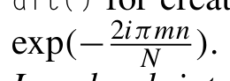
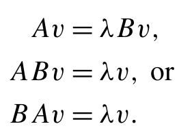
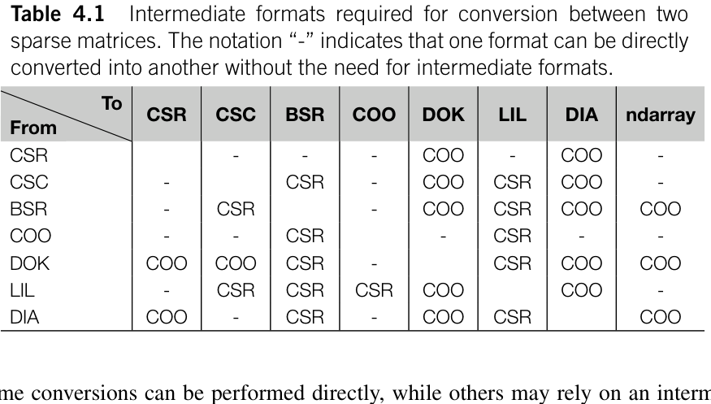
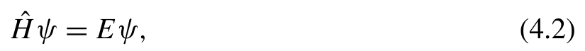
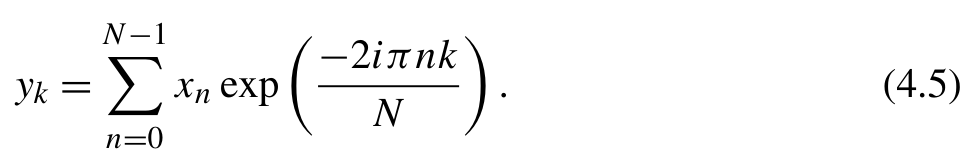
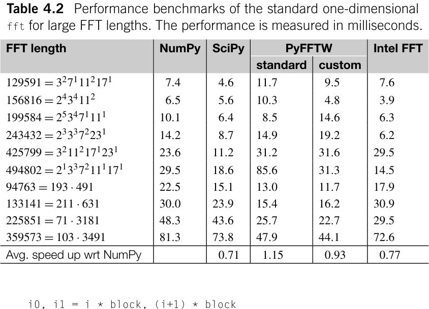
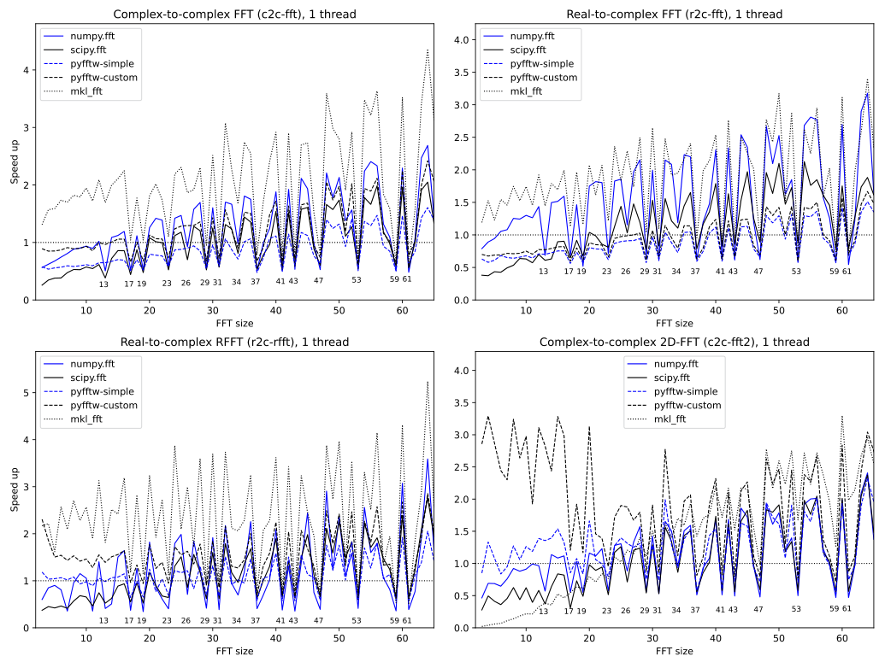
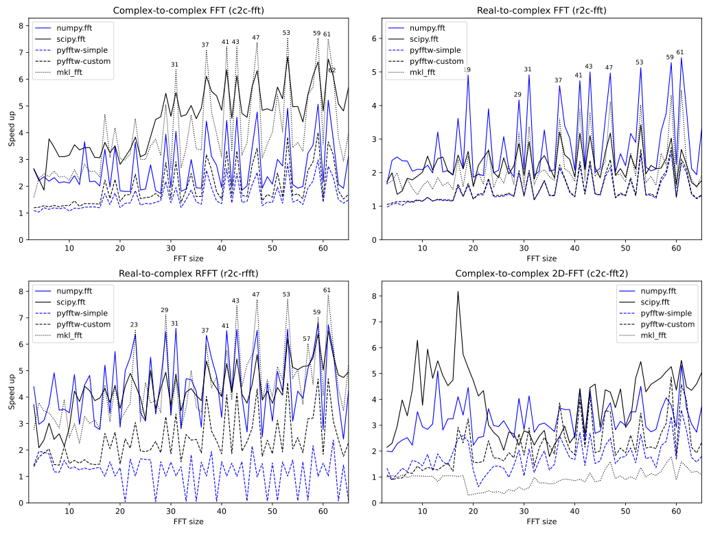
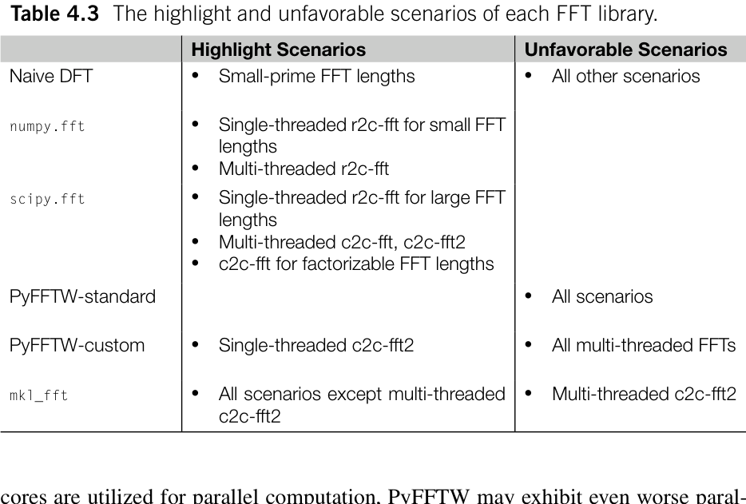

# 科学计算工具 {#ch04 .unnumbered}

科学计算是一个广阔的领域，不同领域使用着各种各样的工具。即使使用相同的工具，其应用和关注重点在不同领域也可能大相径庭。我们无意讨论 SciPy 等通用科学计算工具的基础知识。各种文献已经充分介绍了科学计算工具的基础知识，例如 Robert Johansson 的《Numerical Python - Scientific Computing and Data Science Applications with NumPy, SciPy and Matplotlib》。
本章将探讨专门用于量子化学程序和应用的科学计算工具，涵盖以下主题：

- 代数工具。
- 用于稀疏矩阵的工具，因为量子化学中的哈密顿量本质上是大型稀疏矩阵。
- 缩并。这是多体方法中最常用的工具。

它对量子化学应用的性能有很大影响。

- 变换。处理涉及周期性边界条件的问题时，傅里叶变换是一种必要的计算工具。

计算性能始终是科学计算中的关键问题。评估这些工具时，我们将从多个角度考虑性能，包括：

- 哪些因素会影响它们的效率？
- 如何正确使用它们以最大限度地提高性能？
- 有多个选项时应选择哪一个？

## 4.1 代数

科学计算应用需要线性代数运算时，可以考虑 numpy.linalg 和 scipy.linalg 两个模块。这两个模块有什么区别？何时应该选择其中一个而不是另一个？本节将探讨这些问题。
numpy.linalg 模块提供基本的线性代数运算，包括线性方程求解器（solve、lstsq）、矩阵分解（qr、cholesky、eig、eigh、svd）、矩阵求逆（inv、pinv）、矩阵行列式函数（det）、矩阵或
向量范数（norm）、矩阵条件数（cond）、方阵的整数次幂（matrix_power）等。SciPy 的线性代数模块 scipy.linalg 包含 numpy.linalg 的大部分功能。此外，它还提供额外功能和改进的性能优化。
开发科学计算程序时，可以从 numpy.linalg 入手，实现基本功能。如果需要更好的性能和高级功能，可以将 numpy.linalg 函数替换为相应的函数。
scipy.linalg 的增强功能涉及以下几类：

- 线性方程求解器。与 NumPy 只为各种矩阵提供通用求解器 np.linalg.solve 不同，scipy.linalg 允许我们根据矩阵的特征选择不同的求解器，以提高性能或数值稳定性。例如，scipy.linalg 提供使用 Cholesky 分解求解线性方程的 cho_solve()、使用 LU 分解的 lu_solve 求解器、专用于三角矩阵的 solve_triangular()、用于方程 AX +XB = Q 的 solve_sylvester()、用于非方阵的 solve_banded()。这些专用求解器以 solve_ 为前缀，因此容易识别。
- 矩阵因式分解和分解函数。例如用于 LU 分解的 lu()、用于 A = R Q 的 rq()

用于 Hessenberg 分解的 hessenberg() 和用于 Schur 分解的 schur()。某些分解函数可以利用矩阵的特殊性质，例如用于带状矩阵 Cholesky 分解的 cholesky_banded()、用于带状矩阵特征值分解的 eig_banded()，以及用于实对称三对角矩阵特征值问题的 eigh_tridiagonal()。

- 矩阵函数，例如 expm()、logm()、sqrtm()、cosm()、
- 矩阵和更多数组构造器，例如用于创建分块对角矩阵的 block_diag()、用于创建伴随矩阵的 companion()、用于创建离散傅里叶变换（discrete Fourier transform，DFT）矩阵的 dft()，其定义为 Amn =

{width=30%}

[]{#eq-04-001}

- BLAS 和 LAPACK 库的接口。dsyrk() 和 dsyev() 等 BLAS 和 LAPACK 函数可以与 NumPy 数组一起访问和使用。这些接口可通过 scipy.linalg.blas 和

每一类中，我们只列出了一些代表性函数。有关各类函数的完整列表，请参阅 SciPy 文档 [1]。
对于 numpy.linalg 中已有的函数，SciPy 继承了它们的 API，并引入额外参数以提供更多功能。这些额外参数主要与内存管理策略有关。例如，大多数函数都有的 overwrite_a 选项允许覆盖输入的
矩阵以减少内存占用。此外，还有一些旨在提高性能的参数。例如，check_finite 选项允许跳过对输入矩阵的数值有效性检查。除了这些常见参数，下面简要总结 SciPy 对 numpy.linalg 函数所做的其他专门改进：

- 对于线性方程 Ax = b，scipy.linalg.solve 函数引入了 assume_a 选项，用于指定矩阵是对称、厄米还是正定的。根据矩阵类型，将调用不同的 LAPACK 例程。
- SciPy 中的 qr 函数提供 pivoting=True 选项，以启用具有秩揭示功能的主元 QR 分解 [2]。该选项允许库使用数值上更稳定的例程处理病态矩阵。请注意，SciPy 和 NumPy 中 qr 的默认模式不同。在 SciPy 中，Q 矩阵是维度扩展后的方阵，而在 NumPy 中，Q 是列数缩减的矩阵。
- SciPy 的 cholesky 函数默认执行上三角 Cholesky 分解。为了与 NumPy 中的行为一致，应指定关键字参数 lower=False。
- SciPy 中的 eigh 函数可以求解广义特征值问题，包括

{width=30%}

[]{#eq-04-002}

此外，它提供 subset_by_value 和 subset_by_index 选项，以便只计算
选定的特征值子集。

- 对于一般矩阵的特征值问题，SciPy 中的 eig 函数既能计算左特征向量，也能计算右特征向量，而 NumPy 版本只能计算右特征向量。此外，SciPy 版本支持广义特征值问题 Av = λB v。

## 4.2 矩阵

稀疏矩阵（sparse matrices），即以零元素为主的矩阵，在量子化学程序和许多科学计算应用中很常见。为了减少稀疏矩阵的内存使用量，可以只存储非零值以及有关其位置的必要信息。然而，稀疏矩阵的不连续存储使其比稠密矩阵更难处理。
稀疏矩阵的主要挑战在于存储格式以及操作它们所需的运算。为应对这些挑战，scipy.sparse 模块提供了一套全面的稀疏矩阵管理功能。在线性代数算法方面，numpy.linalg 和
scipy.linalg 是为稠密矩阵设计的，不适用于稀疏矩阵。可以使用 scipy.sparse.linalg 中的函数对稀疏矩阵执行线性代数运算。

### 4.2.1 格式

SciPy 支持多种稀疏矩阵存储格式，每种格式都有适用的场景。CSR、CSC 和 BSR 等格式针对高效访问矩阵元素和执行矩阵向量运算进行了优化。其他格式更适合构造矩阵。

- 压缩稀疏行（Compressed Sparse Row，CSR）格式存储每行非零元素的索引。这种格式使用一个 NumPy 数组（通过 .data 属性访问）存储非零元素，另一个数组（与 .indices 属性关联）存储索引，第三个数组（通过 .indptr 属性访问）存储索引的行指针。具体来说，第 i 行的列索引存储在 indices[indptr[i]:indptr[i+1]] 中，相应的值存储在 data[indptr[i]:indptr[i+1]] 中。这种格式便于按行访问元素，矩阵向量乘法也很高效。然而，向矩阵插入新元素的效率很低。每次添加新元素时，都会重建索引和数据数组，通常通过 COO 格式作为中间格式。
- 压缩稀疏列（Compressed Sparse Column，CSC）格式与 CSR 类似，但按列存储。
- 块稀疏行（Block Sparse Row，BSR）格式与 CSR 类似，但存储的是数组块而不是标量变量。这种格式对数组块施加了若干限制：BSR 存储中的所有数组块具有相同的块大小。数组每个维度的大小都应是块大小的整数倍。这些限制约束了 BSR 的适用范围。然而，当稀疏矩阵与这种格式兼容时，BSR 在算术运算和矩阵向量乘法方面被认为比其他格式更高效。
- 坐标（Coordinate，COO）格式将每个非零元素的行索引、列索引和值分别存储在列表中。这种格式不支持使用数组索引语法（如 a[i,j]）直接访问矩阵元素。在 scipy.sparse 中，这种格式通常用作稀疏存储格式之间转换的中间格式。
- 键字典（Dictionary of Keys，DOK）格式将非零元素存储在字典中，使用（行、列）元组作为键。这种格式与 COO 格式类似，但支持访问单个矩阵元素。如果需要逐步构造稀疏矩阵，这种格式是合适的选择。
- 列表的列表（List of Lists，LIL）格式为每行分别在列表中存储数据和列索引。这种格式与 CSR 格式密切相关。LIL 和 CSR 格式之间的转换很高效。LIL 格式支持访问单个元素。向稀疏矩阵插入新元素时，只需要更新相关行的数据和索引列表。
- （对角线，Diagonal）格式存储对角线元素及其相对于主对角线的偏移量。它不支持访问或修改单个元素。该格式不适合表示一般稀疏矩阵，主要用于特殊场景，例如存储带状矩阵。

scipy.sparse为每种存储格式提供专用类，它们都继承自scipy.sparse.spmatrix类。每种格式都可以通过其类实例化，使用scipy.sparse.{format}_array或scipy.sparse.{format}_matrix，其中占位符{format}可以替换为上述任何格式。例如，要实例化CSR矩阵，我们可以从稠密矩阵构造它，

```text
scipy.sparse.csr_array(np.eye(4))
```
或从另一个稀疏矩阵构造，

```text
scipy.sparse.csr_array(scipy.sparse.eye(4 , format='coo'))
```
给定数据列表及其行索引和列索引，我们可以如下创建稀疏矩阵：

```python
row_indices = np.arange(4)
col_indices = np.arange(4)
scipy.sparse.csr_array(np.ones(4), (row_indices , col_indices))
```
另一种方法是直接指定CSR的indices和indptr以及data数组，从而直接创建CSR稀疏数组：

```python
data = np.ones(4)
indices = np.array([0 ,1 ,2 ,3])
indptr = np.array([0 ,1 ,2 ,3 ,4])
scipy.sparse.csr_array((data , indices , indptr), shape=(4 , 4))
```
不同存储格式之间的转换可以通过两种方法完成。一种是使用每个稀疏矩阵类的.to{format}()方法。另一种是使用前面讨论过的类实例化函数{format}_array或{format}_matrix。例如，下面的代码片段展示了从COO格式到其他格式的转换。

```text
a_coo = scipy.sparse.coo_array(np.eye(4))
# convert to dense numpy array
a_coo.toarray()
# convert to CSC format
a_coo.tocsc()
# convert to BSR format
a_coo.tobsr(blocksize=(2 ,2))
```



**表 4.1** 两种稀疏矩阵之间转换所需的中间格式。

其他格式在执行实际的点积运算之前会转换为CSR格式。这种格式转换有时会影响性能。如果需要多次执行.dot()方法，为了避免重复转换格式，建议手动转换一次为CSR格式。
稀疏数组需要一些额外属性来有效管理其非零元素。这些额外属性的名称和含义可以在每个{format}_array类的文档字符串中找到。利用这些属性，我们可以高效地遍历稀疏数组的非零元素。例如，可以通过COO数组的.data、.row和.col属性访问其非零元素：

```python
a = scipy.sparse.coo_array(np.eye(3))
for row , col , value in zip (a.row , a.col , a.data):
    print(f'({row} , {col}): {value}' )
```
CSR的非零元素可以通过.indptr、.indices和.data属性访问：

```python
for row in range (csr_matrix.shape[0]):
    for ptr in range (csr_matrix.indptr[row] , csr_matrix.indptr[row+1]):
        col = csr_matrix.indices[ptr]
        value = csr_matrix.data[ptr]
        print(f'({row} , {col}): {value}' )
```
对于CSC，可以使用类似的代码：

```python
for col in range (csc_matrix.shape[1]):
    for ptr in range (csc_matrix.indptr[col] , csc_matrix.indptr[col + 1]):
        row = csc_matrix.indices[ptr]
        value = csc_matrix.data[ptr]
        print(f'({row} , {col}): {value}' )
```
LIL的非零元素由.rows和.data属性管理，可以这样访问：

```python
for row in range (lil_matrix.shape[0]):
    for col , value in zip (lil_matrix.rows[row] , lil_matrix.data[row]):
        print(f'({row} , {col}): {value}' )
```
对于DOK，遍历非零元素类似于遍历字典：

```python
for (row , col), value in dok_matrix.items():
    print(f'({row} , {col}): {value}' )
```

### 4.2.2 稀疏矩阵的代数

稀疏矩阵的一个主要用途是对大型矩阵执行线性代数运算，使用稠密矩阵表示这些矩阵既不切实际，也缺乏效率。线性代数模块scipy.linalg是为稠密矩阵设计的，因此不适合稀疏矩阵。这里可以使用scipy.sparse.linalg模块中的线性代数函数。然而，scipy.sparse.linalg提供的功能不如scipy.linalg多。在scipy.sparse.linalg中，我们可以找到基本的线性代数函数，包括：

- 方程求解器，例如spsolve和gmres（广义最小残差，Generalized Minimal RESidual）函数。
- 函数，例如用于一般特征值问题的eigs和eigsh，以及用于奇异值分解（SVD）的svds。
- 分解函数splu，用于计算稀疏方阵的LU分解。
- 一些基本矩阵运算，包括用于矩阵指数运算的expm、用于矩阵求逆的inv和用于计算矩阵范数的norm。

scipy.sparse.linalg函数的基本用法非常直观。我们不会在此详细介绍其用法，因为SciPy官方文档已经提供了很好的参考资料[3,4]。
使用scipy.sparse.linalg函数时，我们不能像处理稠密矩阵时那样完全将它们视为黑箱。理解这些函数使用的算法及其局限性，对解决涉及稀疏矩阵的线性代数问题很有帮助。
特征值函数eigsh使用迭代方法（Arnoldi迭代）计算特征值。鉴于稀疏矩阵的应用通常涉及大型矩阵，像稠密矩阵那样计算全部特征值谱往往既不现实也没有必要。迭代方法可以只针对一部分特征值和特征向量。为了计算量子体系的基态，我们可以将参数设置为which=’SA’，以获得最低特征值。另一种选择是lobpcg函数（局部最优块预条件共轭梯度，Locally Optimal Block Preconditioned Conjugate Gradient），它允许我们指定预条件器，以加速基态特征值问题的收敛。确定量子体系基态的另一种选择是Davidson对角化算法，我们将在第 14 章探讨。
对于线性方程，scipy.sparse.linalg提供多种求解器。这些求解器可分为直接求解器和迭代求解器。例如，spsolve函数是直接求解器，而gmres是迭代求解器。除了gmres，scipy.sparse.linalg模块中还有若干迭代求解器，包括仅适用于对称正定矩阵的cg（共轭梯度，Conjugate Gradient）、bicg（双共轭梯度，BIConjugate Gradient）、minres（最小残差，MINimum RESidual）和qmr（拟最小残差，Quasi-Minimal Residual）。对于非方阵，可以使用lsqr求解器在线性最小二乘意义下迭代求解线性方程。
直接求解器（如lpsolve）必须先对稀疏矩阵A进行分解，才能求解方程Ax = b。这个分解过程的开销相当大。然而，直接求解器可以精确计算解，并保证精度。此外，当b数组包含多个向量时，直接求解器只需很少的额外计算开销，就能高效求解多个b向量。
另一方面，gmres等迭代求解器使用矩阵向量乘积Ax构造Krylov子空间。然后将线性方程变换并表示在这个子空间中，随后在其中求解。这种方法在求解一个或少数几个b向量时尤其高效。然而，作为一种迭代方法，它可能遇到收敛和精度问题。
稀疏矩阵线性代数函数的一个重要考虑因素是其内存消耗。虽然输入矩阵是稀疏的，但线性代数运算的输出未必保持这种稀疏性。例如，稀疏矩阵的逆通常是稠密矩阵（即使inv函数的输出以稀疏矩阵格式存储）。因此，inv函数会破坏稀疏性，应尽可能避免使用。类似地，splu分解也会破坏稀疏性，因为LU分解的输出通常是稠密数组。请注意，直接线性方程求解器spsolve需要对矩阵进行LU分解，而LU中间结果可能消耗大量内存。因此，spsolve不适合更大的稀疏矩阵，因为它可能耗尽可用内存。

### 4.2.3 算符

在某些情况下，以稀疏格式存储矩阵可能不切实际，甚至不可能。这些矩阵通常通过它们与另一个向量的乘积来定义。第 14 章讨论的量子化学中的全组态相互作用（FCI）问题就是一个典型例子。
我们可以利用scipy.sparse.linalg.LinearOperator类表示通过矩阵向量乘积定义的稀疏矩阵。事实上，scipy.sparse.linalg模块中的所有迭代方法都依赖LinearOperator类提供的matvec接口，无论底层矩阵是稠密矩阵、稀疏矩阵还是线性算符。
为了展示LinearOperator类的用法，我们考虑一个简单例子：一维谐振子的哈密顿量：

{width=45%}

[]{#eq-04-003}

H =− 1 k x,)
2m dx 2
其中m表示粒子质量，k是力常数。为了求解含时无关薛定谔方程

{width=40%}

[]{#eq-04-004}

我们将哈密顿量和波函数都离散化到间距为a的一维网格上。动能项可以使用有限差分公式计算
（采用开放边界条件）：

{width=56%}

[]{#eq-04-005}

≈ 1 − 1) − 2 ψ(xn) + ψ(xn +1)).)
dx a
使用这个公式，可以直接推导出计算乘积H ψ的matvec函数。然后我们利用LinearOperator类注册matvec函数，得到一个与scipy.sparse.linalg函数兼容的对象。随后可以使用迭代稀疏矩阵特征值求解器计算量子体系的能量及其对应的状态。

```python
def harmonic_oscillator(m ,k , ngrids , box_size):
    ' ' 'H = 1/2m p^2 + 1/2 k x^2' ' '
    x = np.linspace( -box_size , box_size , ngrids)
    dx = x[1] - x[0]
    def matvec(psi):
        d2 = psi * -2
        d2[: -1] += psi[1:]
        d2[1:] += psi[: -1]
        return -1/(2*m*dx**2) * d2 + k/2 * x**2 * psi
    return scipy.sparse.linalg.LinearOperator((ngrids , ngrids), matvec=
    matvec)
if __name__ == '__main__':
    m = 0.5
    k = 0.5
    ngrids = 1000
    box_size = 10.
    A = harmonic_oscillator(m ,k , ngrids , box_size)
    e , psi = scipy.sparse.linalg.eigsh(A , which= 'SM')
    print(e)
```

## 4.3 缩并

许多科学计算任务涉及对多个张量乘积的特定索引求和。这些任务通常可以转换为张量缩并运算。例如，要计算一组向量的协方差矩阵

{width=55%}

[]{#eq-04-006}

∑
cov (Xi,Xj) = 1 (Xik − ¯Xi)(Xjk − ¯Xj),)
n − 1
我们可以使用for循环实现程序：

```python
def cov(x):
    m , n = x.shape
    c = np.zeros((m , m))
    for i ,x i in enumerate (x):
        for j ,x j in enumerate (x):
            c[i ,j] = np.dot(xi - xi.mean(), xj - xj.mean()) / (n - 1)
    return c
```
或者，可以使用张量缩并代码实现相同功能：

```python
def cov(x):
    m , n = x.shape
    dx = x - x.mean(axis=1)[: ,None]
    return np.einsum('ik ,jk ->ij',d x ,d x )/( n-1 )
```
在这个例子中，我们使用NumPy的np.einsum函数执行张量缩并。在np.einsum中，输入操作数和输出张量的索引用字母标记。缩并模式由这些字母组成的字符串描述。在这个描述字符串中，输入和输出由符号’->’分隔。出现在输入中但不出现在输出中的重复字母表示按照爱因斯坦求和约定对这些索引求和。当有多个输入操作数时，它们的索引用逗号分隔。
为什么我们更喜欢在科学计算问题中使用张量缩并？除了代码可读性方面的优势，张量缩并还提供更好的性能，因为它可以利用专门针对张量缩并运算优化的库。协方差矩阵计算就是一个例子。einsum版本比使用for循环的版本快一个数量级。
请注意，np.einsum的默认实现并非性能最优。例如，执行矩阵乘法

```python
c = np.einsum( 'ij ,jk ->ik ' , a , b)
```
时，np.einsum明显慢于np.dot函数。后者利用底层BLAS库提供的矩阵乘法例程实现更快的性能。
可以通过指定关键字参数optimize=True来改善np.einsum的性能。使用这个选项时，einsum利用tensordot函数将einsum模式转换为矩阵乘法。此外，当缩并涉及多个张量时，这个选项会启用对最高效缩并路径的搜索。例如，考虑下面的张量缩并，其中数组a和数组b的形状均为(n,n)，数组c的形状为(n, n)。

```python
d = np.einsum( 'ij ,jk ,kl ->il',a ,b ,c )
```
np.einsum默认在单次运算中执行三个张量的缩并，其复杂度为O(n)。这无疑是不利的。如果我们将缩并过程分解为

```python
d = np.einsum( 'ik ,kl ->il', np.einsum('ij ,jk ->ik',a , b), c)
```
这两步张量缩并需要2n n次浮点运算。如果将缩并顺序改为

```python
d = np.einsum( 'ij ,jl ->il',a , np.einsum('jk ,kl ->jl',b , c))
```
浮点运算总次数变为n n。显然，交换后的缩并顺序更高效。启用optimize=True选项时，缩并顺序由np.einsum_path函数优化。np.einsum_path可以分析张量缩并中的浮点运算，并建议使浮点运算次数最少的最优缩并路径。
使用np.einsum时，是否建议始终启用optimize选项？
启用optimize选项通常可以使einsum更快。然而，在某些情况下，使用optimize可能没有好处，甚至可能降低性能。对于这个问题，我们可以考虑三个因素：

- einsum模式能否转换为矩阵乘法形式。

当einsum模式可以映射为
矩阵乘法时，optimize选项是有益的。只有当任何重复索引都恰好出现
两次时，转换才有可能。如果无法转换为矩阵乘法，为np.einsum设置
optimize=True只会调用标准的np.einsum实
现，因此性能不会提高。值得注意的是，在这些情况
下，简单的NumPy广播有时可以比np.einsum表现得更好。
例如：

```python
   I n[ 1 ] :a=n p .random.rand(100 , 100 , 100)
           b = np.random.rand(100 , 100 , 100)
   In [2]: %time c = np.einsum( 'kij ,ijp ->ijkp',a ,b )
   CPU times: user 175 ms , sys: 128 ms , total: 303 ms
   Wall time: 302 ms
   In [3]: %time c = np.einsum( 'kij ,ijp ->ijkp',a ,b , optimize=True)
   CPU times: user 175 ms , sys: 113 ms , total: 288 ms
   Wall time: 287 ms
   In [4]: %time c = a.transpose(1 ,2 ,0)[: ,: ,: ,None] * b[: ,None ,: ,:]
   CPU times: user 101 ms , sys: 133 ms , total: 234 ms
   Wall time: 233 ms
```

- 问题规模。通常，np.einsum_path可能引入约100毫秒的开销。当问题规模相对较小时，这种开销就不能再忽略。另一方面，对于大型张量缩并问题，确定运算受CPU限制还是受内存限制至关重要（这些概念的细节将在第 9 章探讨）。当张量缩并是内存受限问题时，即使可以将其转换为矩阵乘法，不使用optimize=True的原始np.einsum也可能达到更高效率。例如，

```python
I n[ 5 ] :a=n p .random.rand(100 , 100)
        b = np.random.rand(100 , 100)
In [6]: %time c=np.einsum( 'ij ,kl ->ijkl',a ,b )
CPU times: user 104 ms , sys: 125 ms , total: 229 ms
Wall time: 228 ms
In [7]: %time c=np.einsum( 'ij ,kl ->ijkl',a ,b , optimize=True)
CPU times: user 132 ms , sys: 100 ms , total: 232 ms
Wall time: 231 ms
```

- 生成中间结果的开销。为了将einsum模式映射为矩阵乘法，tensordot执行一系列张量转置和形状调整运算。如第 2 章所述，这些转置和形状调整运算可能导致创建NumPy数组的副本。涉及大型张量时，创建张量副本可能引入显著开销，有时甚至可能占据计算成本的主要部分。例如，

```python
I n[ 8 ] :a=n p .random.rand(500 , 500 , 500)
        b = np.random.rand(500 ,3 , 500)
In [9]: %time c=np.einsum( 'jki ,ipj ->kp',a ,b )
CPU times: user 529 ms , sys: 0 ns , total: 529 ms
Wall time: 528 ms
In [10]: %time c=np.einsum( 'jki ,ipj ->kp',a ,b , optimize=True)
CPU times: user 969 ms , sys: 115 ms , total: 1.08 s
Wall time: 1.08 s
```

## 4.4 傅里叶变换

傅里叶变换用于科学计算的许多领域。在量子化学应用中，它用于计算库仑相互作用、计算积分、求解微分方程和其他数值处理。在
计算程序中，离散傅里叶变换（DFT）常用于对空间中均匀分布的采样数据xn进行傅里叶变换（FT）。这个过程输出一系列在均匀分布的频率k上表示的数据点yk。

{width=48%}

[]{#eq-04-007}

∑ − 2iπ nk
yk = xn exp.)
N
逆DFT由下式给出

{width=48%}

[]{#eq-04-008}

∑ 2iπ nk
xn = 1 yk exp.)
N N
使用快速傅里叶变换（Fast Fourier Transform，FFT）算法可以非常高效地计算DFT。尽管DFT看起来具有O(n)，但由于简单而高效的Cooley-Tukey算法[5]，FFT算法可以将复杂度降低到O(n log (n))。对于可以分解为小素数乘积（例如2 3 5）的FFT长度，Cooley-Tukey算法很有效。对于大素数，其他算法[6,7]可以对任意长度的DFT达到O(n log n)。然而，与DFT大小可以分解为小素数乘积的情况相比，其性能通常要差得多。

### 4.4.1 FFT

scipy.fft模块提供多种FFT函数，用于计算DFT及其逆变换，包括：

- 一般一维FFT及其逆变换函数fft和ifft。
- 二维和多维FFT函数fft2、fftn及其逆变换ifft2、ifftn。
- rfft函数。该函数专用于实数输入数据，计算成本大约可以降低一半。irfft函数计算rfft的逆变换并返回实数数组。
- fftfreq和rfftfreq函数。这些函数可用于生成DFT采样频率。

例如，给定一个采样数据向量，我们可以执行以下DFT和逆DFT运算，

```python
In [1]: x = np.random.rand(10)
        y = scipy.fft.fft(x)
        x = scipy.fft.ifft(y)
        print(y.shape)
Out[1]:
(10 ,)
```

```python
In [2]: x = np.random.rand(10)
        y = scipy.fft.rfft(x)
        x = scipy.fft.irfft(y)
        print(y.shape)
Out[2]:
(6 ,)
In [3]: print(scipy.fft.rfftfreq(10))
Out[3]:
[0. 0.1 0.2 0.3 0.4 0.5]
```
请注意，fft函数输出复数数组，其形状与输入数组相同。相比之下，rfft函数可以利用正负频率之间的对称性，只计算正频率的DFT。因此，rfft函数的输出大小实际上是标准FFT的一半。
scipy.fft模块的一个重要特性是能够使用多线程并行地对多个向量执行FFT。通过设置参数workers，我们可以分配多个线程执行SciPy FFT函数。

```python
x = np.random.rand(2000 , 10)
y = scipy.fft.fft(x , workers=4) # using 4 threads
y = scipy.fft.fft(x , workers= -1) # using all available CPU cores
```
由于并行化是在向量之间而不是在FFT维度内执行的，如果没有足够多的向量需要变换，使用多个worker就不会带来好处。
你可能已经注意到，NumPy库也在numpy.fft模块中提供了FFT实现。scipy.fft和numpy.fft的功能几乎相同。然而，总体而言，scipy.fft模块比numpy.fft更有优势，原因如下：

- 使用FFT PACK库[8]，该库比NumPy内置的FFT库具有更全面的优化和更高的效率。
- 允许我们覆盖输入数据（使用关键字参数overwrite_x），这可以减少内存使用量和数据传输开销。

相比之下，numpy.fft总是为其输出创建新数组。

- 可以利用多核CPU的并行能力，而numpy.fft不提供多线程执行。
- 不仅rfft，scipy.fft.fft函数也可以识别实数输入数据，并利用变换中的对称性提高性能。

除了NumPy和SciPy提供的FFT模块，FFTW和Intel FFT等其他流行的FFT库也提供Python接口。

### 4.4.2 FFT

Intel FFT是适用于X86硬件的高性能库。它利用矢量化和多核并行来提高FFT性能。
Intel FFT是Intel Math Kernel Library（MKL）的一个组件。在Python程序中，可以通过Python包mkl_fft访问Intel FFT函数。请注意，mkl_fft包只是MKL库的接口。它不包含MKL库本身，后者必须单独安装。在大多数X86平台上，可以使用pip命令在Python环境中安装Intel MKL核心库和FFT包装器

```bash
$  pip install mkl_fft mkl mkl -service
```
Intel FFT库使用起来很直接。它不像FFTW那样需要复杂配置，例如创建或缓存计划（参见第 4.4.3 节）。此外，内存对齐并非强制要求，尽管对齐内存可以提高性能。mkl_fft.interfaces.scipy_fft模块遵循scipy.fft和numpy.fft的API。下面的代码示例说明如何使用兼容接口从SciPy和NumPy无缝过渡到mkl_fft。

```text
y = scipy.fft.rfft(x , workers=4)
y = mkl_fft.interfaces.scipy_fft.rfft(x , workers=4)
y = numpy.fft.rfft(x)
y = mkl_fft.interfaces.numpy_fft.rfft(x)
```
我们可以使用mkl_fft库直接替代scipy.fft。例如，可以将mkl_fft配置为scipy.fft的后端。

```text
In [4]: with scipy.fft.set_backend(mkl_fft.interfaces.scipy_fft):
            y = scipy.fft.fft(x , workers=8)
```
在这个上下文中，调用scipy.fft模块中的函数时，实际上执行的是mkl_fft库中的FFT函数。

### 4.4.3 PyFFTW

[9]为FFTW [10]项目提供Python绑定。FFTW以对FFT进行全面而深入的优化著称，是现有最高效的FFT库之一。
为了提高FFT性能，FFTW在库中采用了广泛的优化。它使用不大于13的素数基数分解FFT长度。它还为较大的素数纳入了多种O(n log (n))。它同时考虑了针对硬件和特定数据类型的优化。此外，FFTW为不同类型的变换提供专门实现，例如实数到实数、实数到复数以及复数到实数的变换等。由于各种
算法和优化使选择最优FFT方案变得复杂，FFTW引入了自适应规划器。规划器在执行实际变换之前，评估各种FFT算法在用户硬件上的性能，以确定最高效的算法。
PyFFTW包提供两个主要接口，以简化在Python中使用FFTW：与scipy.fft和numpy.fft的API兼容的标准接口，以及提供额外配置选项以提高性能的高级接口。
标准接口与mkl_fft的接口类似，与SciPy和NumPy的FFT模块兼容。PyFFTW也可以用作scipy.fft的后端。

```text
In [5]: with scipy.fft.set_backend(pyfftw.interfaces.scipy_fft):
         y = scipy.fft.fft(x , workers=8)
```
然而，正如我们将在下一节的性能基准测试中看到的那样，通过标准接口不太可能获得性能优势。如果打算在应用中使用PyFFTW，建议使用PyFFTW的高级接口，以充分发挥FFTW的性能潜力。
高级接口为FFTW运算提供更详细的定制，包括：

- 对齐。PyFFTW在调用底层FFTW函数之前确保内存对齐。如果输入数组不满足内存对齐要求（这是一个与系统相关的设置），PyFFTW会分配适当对齐的新内存，并将输入数组复制到这个新分配的数组中，从而引入一定开销。为了解决这个问题，建议在可行时为FFT数据存储分配内存对齐的NumPy数组。PyFFTW提供empty_aligned函数，以创建具有所需内存对齐的空NumPy数组。

```python
# Preallocate array with aligned memory
x = pyfftw.empty_aligned(shape , dtype=np.complex128)
x[:] = np.random.random(shape)
```
或者，可以使用

```text
x = pyfftw.byte_align(x)
```
来确保数组的内存对齐。只有输入数组中的数据没有正确对齐时，这条语句才会创建新数组。

- 配置FFT规划器。PyFFTW中的默认规划器是FFTW_ESTIMATE，它创建的计划可能不是最优的。最优FFTW运行时计划取决于多种因素，例如问题规模、FFT长度、数据类型、变换类型、内存对齐和内存访问模式。其他规划器，例如FFTW_MEASURE和FFTW_PATIENT [10,11]，可以引导FFTW投入更多精力来确定尽可能快的方法。要配置规划器，我们可以将全局配置更改为：

```text
   pyfftw.config.PLANNER_EFFORT = 'FFTW_MEASURE'
```
或设置FFT函数的关键字参数planner_effort：

```text
   pyfftw.interfaces.scipy_fft.fft(x , planner_effort= 'FFTW_MEASURE')
```

- 执行计划。FFTW规划器FFTW_MEASURE和FFTW_PATIENT在设置期间可能引入显著开销。如果FFT长度很大，这种开销可能远远超过FFT执行时间。因此，这些规划器适合反复执行同一类型FFT的程序。为确保规划器只初始化一次，应缓存生成的计划。在PyFFTW中可以通过执行以下命令启用此缓存：

```text
   pyfftw.interfaces.cache.enable()
```
通过高级接口配置FFTW时，建议使用辅助函数pyfftw.builders.fft创建pyfftw.FFTW类的实例。这个实例包含计算所需的全部FFTW参数。我们可以调用这个实例来执行实际变换。

```text
In [6]: fft_obj = pyfftw.builders.fft(x , threads=nproc)
        out = fft_obj()
```

### 4.4.4 性能基准测试

到目前为止，我们介绍了四个FFT库：numpy.fft、scipy.fft、PyFFTW和mkl_fft。在实际应用中应该使用哪个FFT库？本节将通过性能基准测试探讨这个问题。
对于PyFFTW，基准测试包括其标准接口和高级定制。调用标准接口时，FFTW规划器是FFTW_ESTIMATE，这是PyFFTW的默认设置。定制旨在提高FFTW性能，包括显式内存对齐和使用FFTW_MEASURE规划器。此外，在对计算计时之前，每个测试用例都执行一次，以预热规划器缓存。这些配置代表了PyFFTW包在实际应用中最理想的使用场景。
基准测试的一个重点是各种FFT变换类型的效率，包括使用普通fft函数的复数到复数FFT（c2c-fft）、使用实数输入数据和fft函数的实数到复数FFT（r2c-fft）、使用rfft的实数到复数FFT（r2c-rfft），以及使用fft2的复数到复数二维FFT（c2c-fft2）。
FFT问题规模是影响FFT性能的关键因素。这里我们考察两种对比场景。一种涉及较大的FFT长度，反映各FFT库中O(n log (n))的效率。此外，鉴于晶体体系的量子化学计算通常在三维空间中使用FFT网格
的中等大小盒子内，因此每个轴上的FFT长度通常不大。因此，第二组测试用例侧重于FFT长度小于100的场景。这个测试主要反映各FFT库的内存效率。
科学计算通常使用多核CPU并行执行。多线程并行的效率是另一个需要考虑的因素。因此，每个FFT库的性能都在单线程和8线程并行场景下进行基准测试。多线程基准测试针对较短FFT长度的测试进行。为尽量减少初始化开销的影响，FFT应用于具有足够多向量（范围从105到107）的数组。
基准测试在AWS c5a.4xlarge EC2实例上进行。该实例是在AWS云上运行的16核虚拟机，配备运行频率为3.3 GHz的AMD EPYC CPU和32 GB内存。在这台机器上，我们安装了NumPy v1.24、scipy v1.13、PyFFTW v0.13以及带有MKL 2024.1的mkl_fft v1.3。这些库通过PyPI提供的预编译wheel安装。值得注意的是，PyFFTW v0.13的wheel不支持SIMD（单指令多数据，Single Instruction Multiple Data）矢量化。要启用FFTW的SIMD级优化，需要手动编译FFTW和PyFFTW库。然而，可能由于问题规模和PyFFTW接口的开销，在这些测试中我们没有观察到手动编译的SIMD-FFTW比wheel打包的FFTW有优势。因此，我们从基准测试结果中排除了手动编译的FFTW的结果。
在较大FFT长度这一端，我们测试了可以分解为小素数基数以及不能这样分解的FFT长度。各FFT库的性能总结于表 4.2。SciPy在多个场景中表现最快。Intel FFT略慢于scipy.fft，但它们的速度总体相当。在涉及大素数的场景中，PyFFTW显示出明显的性能优势。这一优势可归因于它为一般FFT长度提供了大量O(n log (n))选择。在其他情况下，令人惊讶的是，当FFT长度可分解为小素数因子时，PyFFTW表现缓慢。即使使用FFTW_MEASURE规划器优化PyFFTW并充分预热后，它仍比scipy.fft慢约一倍。
在短FFT长度测试中，我们实现了额外的代码来辅助基准测试。
numpy.fft缺少多线程并行能力。为了实现并行执行，我们利用Python多线程模块在独立向量上并行执行numpy.fft。下面的代码示例展示了如何并行化numpy.fft.fft函数。其他类型的FFT变换以类似方式并行化。

```python
import threading
def np_fft(fn ,x , nproc=8):
    y = np.empty(x.shape , dtype=np.complex128)
    block = (x.shape[0]+nproc -1) // nproc
    def _fft_priv(i):
```



**表 4.2** 大 FFT 长度下标准一维 fft 的性能基准。

```python
i0 ,i 1=i * block , (i+1) * block
y[i0:i1] = np.fft.fft(x[i0:i1])
threads = []
for i in range (nproc):
t = threading.Thread(target=_fft_priv , args=(i ,))
t.start()
threads.append(t)
[t.join() for t in threads]
return y
import pyfftw
pyfftw.config.PLANNER_EFFORT = 'FFTW_MEASURE'
pyfftw.interfaces.cache.enable()
def fftw_warmup(x , nproc=8):
x = pyfftw.byte_align(x)
fftw_obj = pyfftw.builders.fft(x , threads=nproc)
fftw_obj()
return fftw_obj
```
由NumPy的OpenBLAS后端提供[12]。下面展示fft、rfft和fft2的朴素DFT实现。

```python
def naive_fft(x):
    n = x.shape[ -1]
    m = np.exp( -2j*np.pi*np.arange(n)[: ,None] * np.fft.fftfreq(n))
    return x.dot(m)
def naive_rfft(x):
    assert x.dtype.kind != 'c'
    n = x.shape[ -1]
    m = np.exp( -2j*np.pi/n*np.arange(n)[: ,None] * np.fft.rfftfreq(n))
    return x.dot(m.T)
def naive_fft2(x):
    n1 , n2 = x.shape[ -2:]
    m1 = np.exp( -2j*np.pi/n*np.arange(n1)[: ,None] * np.fft.fftfreq(n1))
    m2 = np.exp( -2j*np.pi/n*np.arange(n2)[: ,None] * np.fft.fftfreq(n2))
    x1 = m1.T.dot(x.reshape( -1 ,n2).T)
    y = m2.T.dot(x1.reshape( -1 ,n1).T)
    return y.reshape(n1 ,n 2 , -1).transpose(2 ,0 ,1)
```
在基准测试中，朴素DFT的计算时间随FFT长度N严格按N变化。这作为衡量其他FFT库性能的基准。性能基准测试结果总结于图 4.1和图 4.2。多线程并行效率显示于图 4.3。
我们可以观察到，相对于朴素DFT的加速比在这些FFT库之间有很大差异。某些FFT长度的性能明显差于相邻数据点。这些FFT长度主要对应素数。FFT库通常没有针对这些中等大小素数的特殊优化。在这些数据点上，FFT库甚至比朴素DFT更慢。
对于不是素数的FFT长度，numpy.fft和scipy.fft相对于朴素DFT都表现出显著的性能提升。值得注意的是，numpy.fft在多项测试中优于scipy.fft，尤其是在r2c-FFT情况下。启用多线程时，由于具有更好的内置并行实现，scipy.fft在c2c-fft、r2c-rfft和c2c-fft2任务中比numpy.fft更快。
numpy.fft的性能优势主要归因于数据类型转换和数据移动相关开销的减少。NumPy FFT代码在执行类型转换和数据复制时比SciPy FFT函数略高效，因此在某些测试中性能优于SciPy。默认情况下，NumPy和SciPy提供的FFT函数不会修改输入数据。这些FFT库中额外的数据复制步骤因此导致显著开销。如果启用overwrite_x关键字



**图 4.1** 单线程下各种 FFT 库对不同变换类型的性能比较

对于scipy.fft函数，scipy.fft的性能可以显著提高，超过numpy.fft。
有趣的是，NumPy r2c-fft的性能非常突出，在许多测试中比scipy.fft快30%或更多。如前所述，scipy.fft包含处理r2c-fft的特殊代码，利用了实值FFT的对称性。那么，为什么这种优化实际上会导致性能下降？
对于规模较小的FFT问题，这种对称性对计算成本的影响很小。为了利用这种对称性，scipy.fft纳入了复杂的数据移动操作。这些数据移动操作的开销接近或超过FFT本身的计算成本。更糟糕的是，SciPy r2c-fft中的数据移动操作没有并行处理，进一步放大了多线程计算中的开销。作为证据，在图 4.3中，我们可以看到SciPy r2c-fft的多线程加速比异常低。
随着FFT长度增加，SciPy的r2c-fft中的特殊优化变得更有效。处理较大的FFT时，SciPy在单线程执行中可以优于NumPy，虽然这里的结果没有显示这一点。然而，当


**图 4.2** 八线程下各种 FFT 库对不同变换类型的性能比较

启用多线程时，即使FFT长度接近500，SciPy r2c-fft仍可能比NumPy中的实现慢。
总体而言，Intel mkl_fft库在这些FFT库中性能最好。它在c2c-fft和r2c-rfft测试中尤其突出。在这些FFT类型中，无论以单线程还是多线程模式运行，mkl_fft都比其他FFT库快约50%。然而，mkl_fft在c2c-fft2中表现较弱。在单线程模式下，mkl_fft在c2c-fft2中的表现与其他FFT库相当。启用多线程时，mkl_fft明显落后，甚至比朴素DFT还慢。
PyFFTW在这些测试中表现最差。使用默认的FFTW_ESTIMATE规划器时，其性能落后于朴素DFT，并且明显慢于numpy.fft和scipy.fft。只有在使用FFTW_MEASURE规划器、显式对齐数据并预热规划器之后，PyFFTW的性能才接近scipy.fft。使用这些设置时，PyFFTW在单线程c2c-fft2测试中表现良好。然而，在多线程c2c-fft2测试中，PyFFTW再次落后于其他库。性能问题的一个原因可归结为数据移动开销。在调用



**图 4.3** FFT 库的多线程效率

底层FFTW函数之前，PyFFTW包装器总是执行数据对齐，导致额外的数据移动。对于这些测试中考虑的小规模FFT问题，这种数据移动开销是影响PyFFTW性能的关键因素。
在多线程并行方面，scipy.fft和mkl_fft都表现出良好的并行效率。使用8线程并行时，它们的效率超过50%，在大多数场景中实现了超过4倍的加速。此外，令人惊讶的是，使用Python标准threading并行化numpy.fft表现出显著的效率。特别是对于r2c-fft，其并行效率超过任何其他FFT库。在r2c-fft任务中，调用fft函数之前必须将实数数组转换为复数数组。对于numpy.fft，这种类型转换在线程之间并行执行。然而，在其他FFT库中，类型转换步骤没有并行化，成为并行效率的主要瓶颈。
PyFFTW的并行效率总体较差。无论是否使用高级接口，多线程PyFFTW相比单线程执行只获得极小的性能提升。在大多数测试中，8线程并行的加速比甚至没有超过2。可以预见，随着更多CPU



**表 4.3** 各 FFT 库的优势及不利场景。

### 4.4.5 选择FFT库？

在程序中应用DFT时，应该选择哪个FFT库？如果DFT不是主要成本，那么scipy.fft和numpy.fft都是足够好的选择。然而，如果目标是在需要密集DFT计算的场景中最大化FFT性能，就应评估各种因素，以选择最合适的FFT库。

- FFT。mkl_fft是一维FFT的首选。对于多维FFT，可以考虑scipy.fft或PyFFTW。
- 长度。mkl_fft适合短FFT长度。当FFT长度足够大时，选择取决于FFT长度的特征。如果FFT长度是随机数，很可能涉及大素数，PyFFTW可能更高效。否则，在大多数场景中mkl_fft和scipy.fft更合适。处理相对较小的素数（例如小于50的素数）时，可以使用朴素DFT。对于中等大小的素数，一维FFT可以选择mkl_fft，多维FFT可以选择scipy.fft。

如果应用允许选择数据样本的大小，为了最大化
FFT效率，通常建议选择可以分解为
2的幂或小素数乘积的大小。然而，在某些量子化学应用中，通常不可避免地要使用素数FFT长度。例如，为了获得更好的数值精度，我们可能需要使用相对于原点对称的DFT频率，从而可能在每个轴上产生2n + 1个样本。这些样本数量往往是素数。

- 。如果计算中可以使用多个CPU核心，scipy.fft和mkl_fft提供高效而合适的选项。多线程PyFFTW被发现效率低下，因此不建议在并行计算环境中使用。对于numpy.fft，应使用Python标准库threading。
- 输入数组的类型。如果可以保证输入是特定数据类型，无论是实数还是复数，就可以分别对实数输入使用rfft，对复数输入使用fft。在这种情况下，mkl_fft是最高效的库。另一方面，如果输入数据需要从实数转换为复数，mkl_fft和numpy.fft在类型转换和数据移动方面的开销相对较低，因此是合适的选择。这里，长度较大的FFT是一个例外。scipy.fft可以根据数据类型智能地选择最优变换函数，在某些情况下可以抵消类型转换的开销。
- 输入数据是否可以覆盖。如果可以接受覆盖输入数据，选项overwrite_x=True可以显著提高fft函数的性能。然而，这个选项不适用于rfft函数。数据移动相关的开销非常大，可能超过rfft带来的成本节省。尤其与多线程并行结合时，允许覆盖输入数据可以有效提高FFT计算的并行效率。scipy.fft和mkl_fft库都能从这个选项中受益。
- 操作系统等。

这些因素不是孤立的。它们可能相互作用并影响最终的FFT性能。在实际应用中，建议根据具体的问题设置进行性能基准测试，以确定最合适的FFT库。

## 小结

本章介绍了用于科学计算任务的数值计算工具。执行线性代数运算时，推荐使用scipy.linalg模块。它在多个方面通常比numpy.linalg模块更先进。对于稀疏矩阵，scipy.sparse提供多种存储格式和一套全面的线性代数工具。如果数学方程可以表述为张量缩并，numpy.einsum函数就是提高可读性和计算效率的强大工具。对于离散傅里叶变换，参考文献 scipy.fft模块通常已经足够。可通过mkl_fft Python包访问的Intel FFT是可行的替代方案，可能提供更高的计算性能。
除了数值计算，科学应用还经常涉及非数值计算任务。在下一章，我们将探讨应对非数值计算挑战的技术。

## 参考文献

[1] The SciPy community, Scipy api - linear algebra, https://docs.scipy.org/doc/scipy/reference/linalg.html, 2024.
[2] T.F. Chan, Rank revealing qr factorizations, Linear Algebra and Its Applications 88–89 (1987) 67–82, https://doi.org/10.1016/0024-3795(87)90103-0, https://www. sciencedirect.com/science/article/pii/0024379587901030.
[3] The SciPy community, Scipy api sparse linear algebra (scipy.sparse.linalg), https://docs. scipy.org/doc/scipy/reference/sparse.linalg.html, 2024.
[4] The SciPy community, Scipy user guide sparse eigenvalue problems with arpack, https://docs.scipy.org/doc/scipy/tutorial/arpack.html, 2024.
[5] J.W. Cooley, J.W. Tukey, An algorithm for the machine calculation of complex Fourier series, Mathematics of Computation 19 (90) (1965) 297–301, http://www.jstor.org/stable/ 2003354.
[6] C.M. Rader, Discrete Fourier transforms when the number of data samples is prime, Proceedings of the IEEE 56 (6) (1968) 1107–1108, https://doi.org/10.1109/PROC.1968. 6477.
[7] L. Bluestein, A linear filtering approach to the computation of discrete Fourier transform, IEEE Transactions on Audio and Electroacoustics 18 (4) (1970) 451–455, https://doi.org/ 10.1109/TAU.1970.1162132.
[8] SciPy Development Team, Scipy api legacy discrete Fourier transforms (scipy.fftpack), https://docs.scipy.org/doc/scipy/reference/fftpack.html, 2024.
[9] H. Gomersall, pyfftw: Python wrapper around fftw, Astrophysics Source Code Library, record ascl:2109.009 (Sep. 2021).
[10] M. Frigo, A fast Fourier transform compiler, SIGPLAN Notices 34 (5) (1999) 169–180, https://doi.org/10.1145/301631.301661.
[11] FFTW Development Team, Fftw documentation - planner flags, https://www.fftw.org/fftw3_doc/Planner-Flags.html, 2024.
[12] NumPy Team, Numpy packages & accelerated linear algebra libraries, https://numpy. org/install/#numpy-packages--accelerated-linear-algebra-libraries, 2024.
