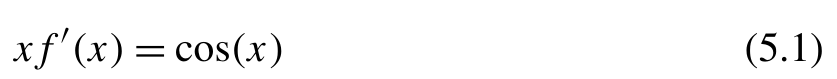
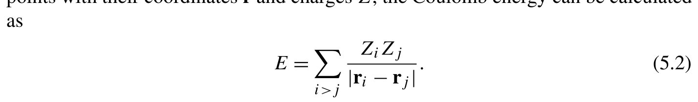
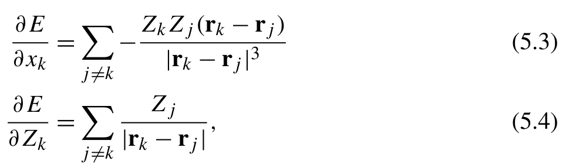

# 元编程与非数值计算 {#ch05 .unnumbered}

元编程（meta-programming）是指编写程序来读取、生成或转换其他程序的技术。单从字面上看，这确实是一项迷人的技术。元编程不仅构思精巧，在科学计算应用中更是一项非常实用的利器。
科学计算并不局限于数值计算。本章将系统介绍数值计算之外的三种关键编程技术：

- 生成，
- 计算，
- 微分。

在科学工程应用中，我们常常需要推导复杂的数学方程并编写程序。人工推导很容易引入错误。为了减少工作量并降低编码出错的风险，一种有效的方法是先用符号计算推导公式，再借助代码生成和自动微分构建计算程序。

## 5.1 生成

在 C/C++ 程序中，元编程通常指在编译阶段使用宏或模板编程等技术生成代码与推导程序逻辑。这些技术属于相对高级的语言特性，也常常让 C/C++ 代码变得晦涩难懂。
考虑到宏和模板带来的复杂性，Python 语言规范并未采用这类设计。然而，这绝不意味着 Python 无法做元编程。作为一门动态编程语言，Python 本身就能将代码视作数据并在运行时直接操作，从而支持了更为灵活、强大的元编程手段，例如：

- 在运行时处理函数。
- 以编程方式处理函数。
- 生成并注册类。

### 5.1.1 与 exec

Python 内置函数 eval 和 exec 能够解析并求值字符串代码。借助这一机制，我们可以在运行时动态拼装代码并执行。
eval 和 exec 拥有非常相似的函数签名：

```text
eval(expr , globals=None , locals=None)
exec(code , globals=None , locals=None)
```
eval 的第一个参数是代码表达式。它受到一些限制：

- 必须是单个表达式。不允许赋值语句。
- 允许推导式、字典推导式和其他推导式代码。
- 不允许 if 子句或 for 循环等结构。
- 可以使用表达式定义函数。但是，不能直接使用 def 或 class 关键字定义函数或类。

exec 接收的代码字符串可以是任意原生 Python 代码。我们可以在字符串中编写赋值语句、定义函数或者声明类。通过 exec 执行代码字符串，效果完全等同于在对应调用处直接嵌入这段代码。
eval 与 exec 会在 globals 和 locals 字典给定的上下文中执行代码字符串。默认情况下，这两个字典对应当前的全局和局部命名空间。借助这一机制，我们可以精细控制代码的执行环境。例如通过自定义局部作用域，即可用 eval 函数模拟 Pandas DataFrame.eval 方法的功能，如下所示：

```python
In [1]: def simple_eval(df , expr):
            return eval (expr ,{ } ,{ **df})
In [2]: mole = pd.read_csv( 'water.csv')
        simple_eval(mole , ' ( x+y+ z)/3')
Out[2]:
0 1.357033
1 1.512567
2 0.872433
dtype: float64
```
这里将 Pandas DataFrame 视为字典，这是我们在第 2 章讨论过的一项特性。
exec 和 eval 的功能互补。通常，它们用于不同的场景。eval 函数使我们能够在设计程序配置时引入编程能力。配置中的元素可以设计为 Python 表达式。在解析和解码配置时，可以使用 eval 动态求值这些表达式。另一方面，exec 常用于生成函数和类，然后将它们集成到 Python 程序中以扩展功能。

### 5.1.2 以编程方式生成代码

第 3 章第 3.4.1 节介绍的 Jinja 模板技术以及 f-string，常用来拼装程序代码。拼装出来的函数可以通过 exec 或 eval 动态注册进 Python 运行时。此外，这类字符串操作手段也能用来生成其他编程语言的代码。在第 12 章中，我们将展示一个完整实例，借助 Jinja 模板生成 C 代码，以高效计算量子化学解析积分。

### 5.1.3 在运行时处理类和函数

除了拼接字符串来生成代码，我们还能利用 Python 原生的元编程机制直接操作函数或类。在日常开发中使用装饰器就是最典型的元编程手法。许多 Python 经典读物（例如 Fluent Python: Clear, Concise, and Effective Programming [1]）对装饰器语法都有详尽介绍，此处不再赘述。
面向类编程时，Python 还提供了 metaclass 关键字，支持动态调整并扩充类的行为。

```python
class Foo(metaclass=Meta):
    ...
```
通过指定 metaclass 关键字，在创建 Foo 类时会调用类工厂 Meta。Meta 类可以访问和修改 Foo 类的所有属性和方法，无论它们是公共的还是私有的。然而，metaclass 的使用相对少见。对元类感兴趣的读者可以参阅 Fluent Python: Clear, Concise, and Effective Programming 一书了解更多细节。这里我们将研究另一种方法，即利用 type 函数动态生成类。
Python 中 type 函数的主要功能是确定对象的数据类型。其效果与访问对象的 __class__ 属性相同：object.__class__。type 的第二个功能是动态创建类：

```text
new_cls = type(cls_name , (bases ,), cls_attrs)
```
这里，cls_name 是表示类名的字符串，类似于在普通类中访问 cls.__name__。bases 是由作为父类的类组成的元组，在普通类中可以通过 cls.__bases__ 找到。cls_attrs 是记录类中属性和方法映射的字典，在普通类中可以通过 cls.__dict__ 访问。例如，

```yaml
dyn_cls = type( 'DynamicClass', (BaseClass , ClassMixin), {'a':4 2 , '__repr__': lambda self: f 'DynamicClass({self.a})', 'inc': lambda self , n=1: self.a + n})
```
这条语句等价于使用以下代码创建一个新类：

```python
class DynamicClass(BaseClass , ClassMixin):
    a=4 2
    def __repr__(self):
        return f'DynamicClass({self.a})', def inc(self , n=1):
        return self.a + n
dyn_cls = DynamicClass
```
用于动态创建类时，type 函数对于以编程方式生成具有相似功能的类尤其有用。量子化学中的平均场模型就是这样的例子，我们将在第 13 章展示。当使用 Python 类抽象平均场模型时，类之间的差异通常只涉及某些属性或方法中的细微特征。通过组合属性和方法，可以使用 type 函数动态生成特定平均场模型的新类。

### 5.1.4 AST

Python 抽象语法树（Abstract Syntax Tree，AST）是 Python 程序结构的树形表示。这棵树中的每个节点，如函数、语句、赋值、函数调用等，都对应程序中特定的语法元素。例如，以下代码的 AST

```python
def double(x):
    return x * 2
```
如图 5.1 所示。在该图中，FunctionDef 节点表示函数定义，Return 节点表示 return 语句。可用节点类型的完整列表可以在 Python AST 文档 [2] 中找到。


**图 5.1** 一个简单的 Python AST

Python 标准库 ast 提供了一整套检查与修改程序抽象语法树的工具。虽然可以直接用 ast 模块中的 Node 类手动拼装语法树，但更常见的做法是直接修改现有函数的 AST，再将其编译回 Python 代码。其中 ast.parse 负责把函数源码解析成 AST，而 ast.unparse 则执行逆向操作，把语法树重新还原成代码文本。
分析或修改语法树必然涉及树遍历。最直接的方式是调用 ast.walk 函数，该通用函数能够递归遍历指定节点的所有子节点。不过，如果操作只针对某些特定语法节点，更推荐继承 ast.NodeVisitor 类来遍历树，或者继承 ast.NodeTransformer 类来就地修改节点。只要在这两个类中定义对应的 visit_X 方法，遍历遇到类型为 X 的节点时就会自动派发调用。这里的 X 代表 AST 节点类型，例如 Assign、Call、Expr、Constant 等。接下来我们通过一个工程实例，看看如何配合使用 NodeVisitor 与 NodeTransformer。
假设需要编写一个消除死代码（不可达代码）来优化函数的工具，可以按如下思路设计处理流程：

1. 函数的 AST，以识别变量之间的所有依赖关系。

我们可以假设这些依赖关系是通过赋值语
句引入的。

2. 依赖关系映射构成一棵依赖树，其根是函数的返回

值。可到达变量是与
根节点相连的叶节点。

3. 映射中所有未连接的元素。这些是未使用的变

量。

4. AST 并删除涉及未使用变量的所有语句。5. 使用 ast.unparse 和 exec 函

数将所得 AST 转换为 Python 代码。
首先，我们使用 ast.NodeVisitor 类提取赋值语句建立的依赖关系。为此，我们创建 ast.NodeVisitor 的子类，并在 visit_Assign 方法中检查 Assign 节点。为了收集每个 Assign 节点涉及的所有变量，我们调用通用树遍历函数 ast.walk() 并筛选 ast.Name 节点，因为变量名由 ast.Name 节点表示。依赖关系是从单一字符串映射到多个字符串，保存在字典中。

```python
import itertools , inspect , ast , textwrap
class DepdenciesVisitor(ast.NodeVisitor):
    def __init__(self):
        self.deps = {}
        self.returns = []
    def visit_Assign(self , node):
        args = [x. id for x in ast.walk(node.value)
                if isinstance (x , ast.Name)]
        for t in node.targets:
            if isinstance (t , ast.Name):
if t.id in self.deps: # (1)
                    self.deps[t.id].extend(args)
                else:
                    self.deps[t.id] = args
    def visit_Return(self , node):
        self.returns.extend( [x.id for x in ast.walk(node.value) if isinstance (x , ast.Name)
    ])
```
需要注意，有些变量可能在函数中被多次赋值，从而多次生成依赖关系映射。为了防止新的依赖关系覆盖已有依赖关系，我们必须检查依赖树中是否已经存在这些依赖关系，如第 (1) 行所示。
依赖关系也可能来自函数调用、原位操作和异常。为了处理这些情况，可以自定义额外的方法，例如
用于原位操作的 visit_AugAssign、在子程序修改输入变量时用于管理函数调用的 visit_Call，以及用于 try-exception 语句的 visit_Assert 和 visit_Raise。处理这些情况并不复杂。为简单起见，我们不详细讨论每一种情况。你可以参考 AST 文档，或借助 GPT 等工具或其他 AI 编程助手生成所需的 visit_ 代码。
检查完整的 AST 后，所有变量的依赖关系都记录在字典 DepdenciesVisitor.deps 中。请注意，有些变量

```yaml
others indirectly. For example, the mappings like { 'b ': 'a ' , 'c ': 'b '} implies that
```
变量 c 依赖于变量 a。为此，我们可以追踪依赖链以识别所有间接依赖。在追踪过程中，变量之间可能存在循环依赖。为了打破循环依赖，我们在追踪时不断从依赖字典中删除已访问的条目。追踪依赖关系的过程由下面的 flatten_deps 函数实现，它根据提供的依赖字典识别所有必需的变量。其输出可用于确定不可到达的变量。这个函数使用动态规划技术，第 9 章第 9.7.3 节将对此进行解释。

```python
def flatten_deps(keys , deps):
    if not keys or not deps:
        return []
    # Remove keys from deps to avoid potential circular dependency
    sub_deps = {k: v for k ,v in deps.items() if k not in keys}
    flattened = [flatten_deps(deps[k] , sub_deps)
                 for k in keys if k in deps]
    return set (itertools.chain(keys , *flattened))
```
获得不可到达变量的列表后，我们创建 ast.NodeTransformer 的子类以修改 AST。在这个类中，我们实现 visit_Assign 方法以消除涉及不可到达变量的赋值语句。如果 visit_ 方法返回 None，相应节点将从 AST 中删除。

```python
class RemoveUnreachable(ast.NodeTransformer):
    def __init__(self , to_remove):
        self.to_remove = set(to_remove)
    def visit_Assign(self , node):
        if any (isinstance(t , ast.Name) and t.id in self.to_remove
               for t in node.targets):
return None # Remove the node
        return node
```
将所有组件组合起来，我们可以创建以下函数来优化给定函数。

```python
def remove_unreachable_statements(fn):
    if callable (fn):
        fn = textwrap.dedent(inspect.getsource(fn))
    orig_code = ast.parse(fn)
    visitor = DepdenciesVisitor()
    visitor.visit(orig_code)
    # Search for variables that are accessible from returns
    referenced = flatten_deps(visitor.returns , visitor.deps)
    unreachable = set(visitor.deps).difference(referenced)
    filtered = RemoveUnreachable(unreachable).visit(orig_code)
    return ast.unparse(filtered)
```
请注意，ast.parse 函数只能解析函数的代码字符串，而不能解析函数对象本身。为解决这个问题，我们使用 inspect.getsource 函数获取输入函数的源代码。
Python 标准库 inspect 是代码生成任务的强大工具。虽然它不能直接修改或生成代码，但 inspect 提供了访问函数源代码、签名、参数注解、局部变量和许多其他细节的工具。
让我们检查 remove_unreachable_statements 函数的结果

```python
In [1]: def fun1(x , y):
            a=x+2
            b=a * x
            c=y * 9-b
            d = f(b)
            b=d
            return b * a
        print(remove_unreachable_statements(fun1))
Out[1]:
def fun1(x , y):
    a=x+2
    b=a * x
    d = f(b)
    b=d
    return b * a
In [2]: def fun2(x , y):
            a=x+2
            b=a * x
            a ,b=a+b    ,a-b
            c = f(y)
            d=c
```

```python
            return a
        print(remove_unreachable_statements(fun2))
Out[2]:
def fun2(x , y):
    a=x+2
    b=a * x
    a ,b=a+b    ,a-b
    return a
```
基于 remove_unreachable_statements 函数，我们可以开发一个装饰器来转换函数对象。这需要使用 exec 在局部命名空间中编译 remove_unreachable_statements 的输出。

```python
def optimize(fn):
    ' ' 'A decorator , which can remove unreachable statements of a function
    remove_unreachable_statements' ' '
    new_fn = remove_unreachable_statements(fn)
    new_code = ast.parse(new_fn)
    # Remove the line containing the decorator from the AST
    new_code.body[0].decorator_list = []
    local_ns = {}
    exec(ast.unparse(new_code), None , local_ns)
    return local_ns[fn.__name__]
```
没有直接的方法将 AST 转换回函数对象。使用 exec 编译 AST 输出是常见做法。这个操作生成一个与输入函数同名的新函数，但它注册在局部命名空间中。然而，当在装饰器中调用 AST 代码时，装饰器本身也包含在生成的函数中，这可能导致循环依赖。为避免这种情况，我们在编译新代码之前清空函数的 decorator_list。

## 5.2 计算

符号计算常用于数学公式的自动化推导。Python 库 SymPy [3] 为微积分、代数运算、方程求解与复变函数处理等任务提供符号数学功能。
符号对象是符号计算的核心。在 SymPy 中，sympy.Symbol 类是表达符号变量的基本数据结构。符号变量由字符串名称标识，其命名规则与 Python 变量标识符一致，由字母、数字和下划线组成。除了使用 sympy.Symbol 类直接创建符号变量，实际中也常用 sympy.symbols 一次性批量声明多个符号。例如，下面这些语句都是定义符号变量的有效方法：

```text
x ,y , z = sympy.symbols( 'x y z' )
x ,y , z = sympy.symbols( 'x ,y1 ,z2_')
x ,y , z = sympy.symbols( 'x y ,_z1')
x ,y , z = sympy.symbols([ 'x', 'y', 'z'])
x02 , x03 , x12 , x13 , var1 , var2 = sympy.symbols( 'x(0:2)(2:4) y z' )
```
调用 sympy.symbols 时，不同变量的名称用逗号或空白字符分隔。为了减少输入量，sympy.symbols 还支持使用范围语法生成符号列表。在上面的例子中，x(0:2)(2:4) 中的切片 0:2 和 2:4 分别展开，从而创建六个变量。
除了 Symbol 类，SymPy 程序中的另一个核心数据结构是符号表达式，由 sympy.Expr 类提供。符号表达式由符号、数字以及定义在符号上的数学函数组成。
为了表示符号或表达式的集合，sympy.Matrix 类用于表示矩阵，sympy.Array 类则用于多维数组。sympy.Matrix 和 sympy.Array 类提供的某些方法，如转置、重塑和索引，与 NumPy 数组的对应操作有些相似。然而，其中大多数与 NumPy 中的方法不同。例如，sympy.Matrix 不支持用于逐元素操作的 ufunc。对两个矩阵调用 a * b 时，它执行标准矩阵乘法。

```text
In [1]: a = sympy.Matrix(sympy.symbols( 'x(:2)(:3)')).reshape(2 ,3)
        a.T * a
Out[1]:
Matrix([
[ x00 **2 + x10 **2 , x00 *x01 + x10 *x11 , x00 *x02 + x10 *x12] , [x00*x01 + x10 *x11 , x01 **2 + x11 **2 , x01 *x02 + x11 *x12] , [x00*x02 + x10 *x12 , x01 *x02 + x11 *x12 , x02 **2 + x12 **2]])
```
符号表达式的 .subs() 方法可用于替换、求值、转换或简化符号表达式。它根据字典中定义的规则替换符号。例如，下面的例子展示如何使用 .subs() 方法按照仿射变换转换多项式表达式。

```text
In [2]: x ,y , z = sympy.symbols( ' xyz ' )
        P=. 5 * x**2+. 5 * y**2
        T = sympy.Matrix([[.7 ,. 1 ,0 . , 0.] , [0. ,. 9 , -.2 , .5] , [.3 ,0 . ,. 8 , 0.]])
```

```python
        xprime , yprime , zprime = T * Matrix([x ,y ,z , 1])
        Ptransformed = P.subs({x: xprime , y: yprime , z: zprime} , simultaneous=True)
        print(Ptransformed.expand())
        print(Ptransformed.subs({x: 1.0 ,y :2 . 0 , z: 0.5}))
Out[2]:
0.245*x**2 + 0.07 *x*y + 0.41 *y**2 - 0.18 *y*z + 0.45 *y + 0.02 *z**2 - 0.1 *z+
     0.125
2.82500000000000
```
当对坐标轴应用仿射变换时，多项式也随之变换。请注意，替换中的某些符号，例如 x、y 和 z，也出现在替换目标中。默认替换过程依次应用替换规则。这会导致较早替换产生的符号在后续步骤中再次被替换。为了避免这种情况，我们使用 simultaneous=True 选项，确保所有替换同时进行。
在符号变量和表达式的基础上，SymPy 为符号数学提供了一套全面的功能。虽然逐项详细讨论这些功能超出了本书的范围，但我们将概述 SymPy 的主要功能。建议读者查阅 SymPy 文档，了解具体功能的更多详细信息。

- 和展开表达式。通用函数 sympy.simplify 提供这一功能。对于多项式，其他功能包括： -

-

- （收集表达式中某一项的相同幂次）。

此外，SymPy 还提供对
三角运算、指数和对数以及某些特殊函
数的简化和展开功能，包括： -
-
-
-

- 表达式的。通常可以使用 sympy.diff 函数和 sympy.Derivative 类进行微分。对于以矩阵表示的符号表达式，SymPy 还可以计算雅可比矩阵。

这一功能只适用于 Matrix 对象，由

- 和不定积分。积分可通过 sympy.Integral 类或 sympy.integrate 函数进行。不定积分使用以下方式计算：

```text
   sympy.integrate(expr , variables)
```
定积分使用以下方式计算：

```text
sympy.integrate(expr , (variable , lower_limit , upper_limit))
```
指定积分限时，SymPy 中的变量 sympy.oo 表示 ∞。对于多变量积分，可以向 sympy.integrate 函数传递多个积分限。SymPy 还提供常见的积分变换。这些功能可在 sympy.integrals 模块中找到，包括： -
-
-
-
以及它们对应的逆变换
-
-
-
-

- 表达式或序列的极限。这些功能与 sympy.limit 和 sympy.limit_seq 函数相关。
- 函数在展开点附近的展开。sympy.series 函数提供这一功能。
- 方程。通用函数 sympy.solve 可用于求解多种方程，包括多项式方程、超越方程和线性方程。SymPy 还为每种类型的方程提供专用求解器。sympy.solveset 函数旨在求出不等式或方程的有限集合或区间。对于线性方程，sympy.linsolve 是以矩阵形式求解的专用函数。对于非线性方程，可以使用 sympy.nonlinsolve 以矩阵形式求解。此外，sympy.nsolve 可用于数值求解非线性方程。
- 微分方程（ODE）。求解 ODE 时，sympy.dsolve 函数与 sympy.Eq 和 sympy.Function 类结合使用。例如，微分方程

{width=41%}

[]{#eq-05-001}

xf (x) = cos (x)) 可以转换为 SymPy 代码

```text
f = sympy.Function( 'f')
eq = sympy.Eq(x *f(x).diff(x), sympy.cos(x))
sympy.dsolve(eq , f(x)))
```
为了表示函数的微分，可以使用 .diff 方法和 sympy.Derivative 类。

- 微分方程（PDE）。sympy.pdsolve 函数可以作为求解 PDE 的起点。然而，求解 PDE 可能不像求解 ODE 那样直接。通常需要使用 sympy.sovlers.pde

模块中的函数，例如 classify_pde、pde_separate、pde_separate_add、pde_separate_mul，为 PDE 求解过程提供提示。

- 针对特定数学领域。SymPy 包含专为各种数学学科设计的模块，例如范畴论、密码学、微分几何、几何学、完整函数、李代数、多项式操作和统计学。SymPy 在线文档为这些领域的功能设有专门章节。
- 广泛的特殊函数和多项式。特殊函数例如

-
-
-
-
-
以及许多其他函数可在 sympy.functions 和 sympy.functions.special 模块中找到。特殊多项式，例如
-
-
-
由 sympy.polys 模块提供。

- 绘图。函数绘图由 sympy.plot 函数和 sympy.plotting 模块提供。sympy.plot 函数基于 Matplotlib 构建，提供与使用 Matplotlib 库相当的用户体验。
- 生成。sympy.printing 模块提供生成各种编程代码的函数，例如 ccode()、fcode()、pycode() 和 julia_code()。此外，SymPy 可以使用 sympy.latex() 将表达式转换为 LaTeX 公式。

除了数学功能，我们还可以在 SymPy 中找到量子物理的各种符号功能：

- 针对常规量子系统，例如
- 用于谐

振子的 sympy.physics.sho 和 sympy.physics.qho_1d 模块。

- 用于氢原子的 sympy.physics.hydrogen 模块。
- Wigner 系数。sympy.physics.wigner 模块收集了 clebsch_gordan、racah、wigner_3j、wigner_6j、wigner_9j 和 wigner_d 等函数。
- 用于角动量耦合和操作的 sympy.physics.quantum.spin 模块。可用功能包括：
- 用于旋转矩阵的 WignerD 类。
- 用于 J 的 J2 类
- 用于沿 x、y 和 z 轴角动量的 Jx、Jy 和 Jz 类。- 用于 Jˆ Jˆ 的 Jplus 和 Jminus 类
- 用于二次量子化的 sympy.physics.secondquant 模块。该模块中可以找到常见的二次量子化算符和操作：
- 分别用于玻色子和费米子

算符的 BosonicOperator 和 FermionicOperator 类。

- 用于湮灭和产生算符的 Annihilator 和 Creator 类。
- 用于以正规序表示的多体操作的 NO 类。
- 用于推导表达

式正规序表示的 wicks 函数。

- 通过 sympy.Quaternion 类进行代数运算。

SymPy 库可以处理大多数需要推导符号公式的场景。为了更精准地操控特定领域问题的符号表达式，有时我们需要按自定义规则从头开发专用的符号处理程序。例如在第 15 章中，我们将展示如何为耦合簇理论量身定制符号推导程序。

## 5.3 微分

自动微分（automatic differentiation，AD）乍看之下很神奇，其实背后的原理并不复杂。对函数应用 AD 时，输入被封装，使得输入的每个操作都被重载。在函数求值时，重载的操作会建立计算图，追踪输入的变化。随后系统依照链式法则对图中各节点应用微分规则。通过遍历整个计算图，就能求出函数的导数。这一过程与惰性求值技术密切相关，第 9 章第 9.8 节将更详细地介绍该技术。
AD 技术是机器学习和神经网络发展的基石。神经网络领域的某些术语已成为 AD 中的常见概念，包括：

- 传播。这个过程按照函数操作的定义顺序，从输入到输出执行这些操作。
- 。这是计算函数对其输入的导数的过程。从函数输出开始，递归应用链式法则，计算每个中间操作对其输入的导数。
- 微分。这种模式定义了输出对输入扰动的响应。
- 微分。这种方法用于反向传播。它以逆序遍历计算图，计算每个中间节点的导数。

有多款神经网络工具可用于执行自动微分，包括 PyTorch [4]、JAX [5]、TensorFlow [6] 和 autograd 等。尤其是 PyTorch 和 JAX，被广泛用于 AD 任务。

### 5.3.1 PyTorch

的学习门槛较低，因为它的运作方式与标准 Python 面向对象编程风格非常相似。我们以计算库仑能的简单问题为例，演示 PyTorch 的自动微分（AD）能力。给定一组坐标为 r、电荷为 Z 的点，库仑能可以计算为

{width=70%}

[]{#eq-05-002}

∑ ZiZj
E =.)
|ri − r j |
这个函数可以使用 NumPy 广播规则实现。

```python
def coulomb_energy(coords: torch.Tensor , z: torch.Tensor):
    zz = z[: ,None] * z
    rr = coords[: ,None ,:] - coords
    d = torch.linalg.norm(rr , axis=2)
    tril = np.tril_indices( len(z), -1)
    return (zz[tril] / d[tril]). sum()
```
为了启用 PyTorch 自动微分，我们将 np.linalg.norm 替换为 torch.linalg.norm。大多数 NumPy 函数在 PyTorch 中都有对应的函数。
提供了几种方法来获取函数相对于其输入变量的导数。一种方法是使用 torch.func 模块提供的类似 JAX 的函数。例如，torch.func.grad 和 torch.func.hessian 函数分别可用于计算梯度和海森矩阵。

```text
In [1]: coords = torch.rand(2 ,3 )
        Z = torch.rand(2 ,3 )
        torch.func.grad(coulomb_energy , argnums=0)(coords ,Z )
Out[1]:
tensor([[ 0.1631 , 2.6309 , -1.6224] , [ -0.1631 , -2.6309 , 1.6224]] , grad_fn= <AddBackward0 >)
In [2]: torch.func.hessian(coulomb_energy , argnums=1)(coords ,Z )
Out[2]:
tensor([[0.0000 , 2.3221] , [2.3221 , 0.0000]] , grad_fn= <ViewBackward0 >)
```
argnums 参数指定要使用自动微分求导的参数的位置。请注意，自动微分的输入变量必须是 torch.Tensor 对象。
第二种方法采用反向传播来生成每个单独变量的梯度。在这种方法中，创建输入变量时必须指定关键字 requires_grad= True。这表示在反向传播期间应计算这些变量的梯度。为了计算梯度，我们首先进行前向传播以计算结果。然后在结果上调用 .backward() 方法来执行反向传播。完成这两个步骤后，可以通过输入变量的 .grad 属性访问梯度。例如，

```python
In [3]: coords = torch.rand(2 ,3 , requires_grad=True)
        Z = torch.rand(2 ,3 , requires_grad=True)
        e = coulomb_energy(coords ,Z )
        e.backward()
        print(coords.grad)
        print(Z.grad)
Out[3]:
tensor([[ 0.1631 , 2.6309 , -1.6224] , [ -0.1631 , -2.6309 , 1.6224]])
tensor([[0.0000 , 2.3221] , [2.3221 , 0.0000]])
```
请注意，.backward() 方法会给可微参数引入副作用。反向传播过程执行自动微分，并原地更新输入变量的梯度。当同一变量被多个函数的输出访问时，对每个输出调用 .backward() 方法会使梯度在同一个变量中累积，而不是只保留最近一次的梯度。

```python
In [4]: x = torch.tensor(1. , requires_grad=True)
        y=x **2
        y.backward()
        print(x.grad)
Out[4]: tensor(2.)
In [5]: y = x * 3
        y.backward()
        print(x.grad)
Out[5]: tensor(5.)
```
为了避免梯度累积，我们通过将 .grad 属性设为 None 或零向量来手动清除梯度。

```python
In [6]: x.grad = None
        y=x * 3
        y.backward()
        print(x.grad)
Out[6]: tensor(3.)
```
如果需要自定义某些函数的梯度，我们可以继承 torch.autograd.Function 类来修改求导规则。在子类中，提供 forward 和 backward 方法来定义前向和反向过程。例如，假设我们打算对库仑能函数实现以下求导，

{width=47%}

**公式 (5.4)**[]{#eq-05-003}

= − Zk) ∂xk |rk − r j |
∂E ∑ Zj
=, (5.4) ∂Zk |rk − r j |
我们可以如下实现该子类。

```python
class CoulombEnergy(torch.autograd.Function):
@staticmethod
def forward(ctx , coords , z):
zz = z[: ,None] * z
rr = coords[: ,None ,:] - coords
d = np.linalg.norm(coords[: ,None ,:] - coords , axis=2)
tril = np.tril_indices( len(z), -1)
res = (zz[tril] / d[tril]). sum()
# ctx.save_for_backward can cache info in ctx for backward
# computation. The saved info can be accessed in the .saved_tensors attribute.
ctx.save_for_backward(coords ,z )
return res
@staticmethod
def backward(ctx , grad_output):
coords , z = ctx.saved_tensors
zz = z[: ,None] * z
rr = coords[: ,None ,:] - coords
d = np.linalg.norm(coords[: ,None ,:] - coords , axis=2)
with np.errstate(all='ignore'):
r i n v=1 ./d
rinv[np.diag_indices(len(z))] = 0.
r_grad = -np.einsum( 'i ,j ,ijx ,ij ->ix',z ,z ,r r , rinv **3)
z_grad = np.einsum( 'j ,ij ->i',z , rinv)
# grad_output represents the factor associated with the current function.
return grad_output * r_grad , grad_output * z_grad
if __name__ == '__main__':
coords = torch.rand(2 ,3 , requires_grad=True)
Z = torch.rand(2 ,3 , requires_grad=True)
e = CoulombEnergy. apply(coords ,Z )
e.backward()
print(coords.grad)
print(Z.grad)
```
要使用这个子类，我们只需按照 forward 方法的函数签名调用 apply 方法来执行前向传播。接下来，与处理常规 PyTorch 操作类似，我们调用 .backward() 方法并访问前向传播输出的 .grad 属性，以获取自定义梯度的结果。

### 5.3.2 JAX

库由两个主要组件构成：jax 软件包侧重于数值计算和自动微分操作的高级 API，而 jaxlib 软件包提供针对特定硬件加速计算所需的底层绑定。这两个组件作为独立的库分别分发。要启用 JAX 的计算能力，两者均需安装。如果仅仅为了探索 JAX 自动微分的功能，为简单起见可以只安装 CPU 后端。

```bash
$  pip install jax[cpu] jaxlib
```
如果希望启用 Nvidia 或 AMD GPU 的后端，或者在 Google Colab 笔记本中使用 TPU，就应安装相应的 JAX 后端。更多细节参见 JAX 文档 [7]。
库采用函数式编程范式设计。JAX 的自动微分通过使用高阶函数实现。与 PyTorch 相比，新用户可能需要付出更多努力才能熟悉 JAX 程序。
为了符合函数式编程风格，通常建议实现不产生副作用的函数。从 NumPy 程序转向 JAX 函数时，可能需要更新 NumPy 代码，以纳入以下做法：

- 修改数组中的单个元素。
- 使用常规赋值语句代替原地操作。
- 将输入变量视为不可变的。

对函数应用 JAX 自动微分时，必须评估该函数能否兼容 JAX 变换。JAX 自动微分系统的基础是前向和反向微分模式之间的变换 [8]。为了启用 JAX 自动微分，函数或操作必须属于可变换对象。Python 中大多数标准算术操作均可由 JAX 变换。然而，NumPy 函数不具备这种性质。鉴于 NumPy 在科学计算中的重要作用，JAX 引入了 jax.numpy 模块，

```python
import jax.numpy as jnp
```
在 JAX 自动微分应用中作为 NumPy 库的替代品。当一个函数完全使用 jnp 编写时，就认为它可由 JAX 变换。在大多数情况下，我们可以从 NumPy 程序出发，只需将 np 模块替换为 jnp。这可能会生成一个与 JAX 兼容的程序。
对于库仑能问题，为了确保可以由 JAX 变换，我们必须使用 coulomb_energy 函数的另一种实现，在调用 norm 函数之前排除 rr 数组的对角项：

```python
def coulomb_energy(coords , z):
    zz = z[: ,None] * z
    rr = coords[: ,None ,:] - coords
    # Note zeros are not differentiable for norm.
    # They are discarded before calling norm.
    tril = np.tril_indices( len(z), -1)
    d = jnp.linalg.norm(rr[tril] , axis=1)
    return (zz[tril] / d). sum()
```
如果复用上一节中 coulomb_energy 函数的实现，JAX 将为梯度返回 nan。这个问题源于 rr 矩阵对角项中的零，在处理 jnp.linalg.norm 函数的梯度时会导致非法值。这里我们不探究 PyTorch 和 JAX 处理 norm 函数的差异。读者只需注意，在梯度中遇到 nan 值时，jnp.linalg.norm 可能存在这个问题。
现在，我们可以使用 jax.grad 函数计算梯度。

```text
In [7]: coords = jnp.array(np.random.rand(2 , 3))
        Z = jnp.array(np.random.rand(2))
        jax.grad(coulomb_energy , argnums=(0 , 1))(coords ,Z )
Out[7]:
(Array([[ -0.03555296 , -0.17780247 , 0.02858889] , [ 0.03555296 , 0.17780247 , -0.02858889]] , dtype=float32), Array
    ([0.58357096 , 0.31454977] , dtype=float32))
```
jax.grad 函数用于计算标量值函数的梯度。如果函数输出数组，JAX 提供 jax.jacobian 函数来计算雅可比矩阵。

```text
In [8]: jax.jacobian(coulomb_energy , argnums=0)(coords ,Z )
out[8]:
[[ -0.03555296 -0.17780247 0.02858889]
[ 0.03555296 0.17780247 -0.02858889]]
```
此外，JAX 提供 jax.jacfwd 和 jax.jacrev 函数来计算雅可比矩阵。这两个函数可以更精细地控制雅可比矩阵的计算。

- 使用前向模式自动微分计算雅可比矩阵。对于输入多、输出较少的函数，这种方法很高效。
- 使用反向模式自动微分。它更适合输出多、输入较少的函数。

jax.jacobian 函数默认调用 jac.jacrev 版本。对于高阶导数，可以使用 jax.hessian 函数计算二阶导数。它本质上是嵌套雅可比运算的封装，等价于 jax.jacfwd(jax.jacrev(f))。
在许多工程场景中，并不需要构造显式的梯度向量（或雅可比矩阵）。我们通常只需要计算雅可比矩阵与某些位移的乘积。例如，在对损失函数进行梯度下降优化时，目标是评估损失函数响应参数空间中微小位移的变化。这个过程本质上等价于计算雅可比矩阵与位移向量的乘积。为了方便这些乘积运算，JAX 提供了 JVP（雅可比矩阵与向量的乘积）函数 jax.jvp，以及 VJP（向量与雅可比矩阵的乘积）函数 jax.vjp。
给定一个计算 f (x) 值的 Python 函数，jax.jvp 可以同时求出 f (x) 和乘积 ∂f (x) · v，而 jax.vjp 生成 f (x) 和 v · ∂f (x)。以 coulomb_energy 函数为例，我们可以使用 jax.jvp 对电荷变化引起的能量变化建模。jax.jvp 函数的输入包括函数 f (x)、计算 ∂f (x) 时所在的原始值，以及用于雅可比矩阵与向量相乘的切向量 v。原始值和切向量都是与 f (x) 的位置参数对应的元组。例如，下面的代码展示了如何调用库仑能函数的 jvp 操作。

```text
In [9]: coords = jnp.array(np.random.rand(2 , 3))
        Z = jnp.array(np.random.rand(2))
        disp = jnp.array(np.random.rand(2))
        fun = lambda z: coulomb_energy(coords ,z )
        primals = (Z ,)
        tangents = (disp ,)
        e , e_tangets = jax.jvp(fun , primals , tangents)
```
自定义 JAX 导数需要分别使用 JAX 函数 custom_jvp 或 custom_vjp 来定义前向模式或反向模式求导规则。JAX 导数自定义使用的编程模型不同于在 PyTorch 中直接实现 .forward() 和 .backward() 方法。在第 16 章中，我们将以耦合簇方法为例，说明如何为梯度计算自定义 JVP 和 VJP。

## 总结

在本章中，我们回顾了使用 eval 和 exec 生成代码的方法。我们讨论了抽象语法树（Abstract Syntax Tree，AST）在分析和修改 Python 代码中的具体应用。对于符号计算任务，我们简要概述了 SymPy 软件包的核心功能。此外，我们展示了由 PyTorch 和 JAX 支撑的自动微分技术基础知识。
元编程代码往往难以直接理解。由于其高度的灵活性和运行时修改能力，使用不当极易导致难以排查的隐蔽错误。学习掌握元编程技术固然大有裨益，但在工程中切忌盲目滥用这项技术。

## 参考文献

[1] Ramalho, Fluent Python: Clear, Concise, and Effective Programming, O’Reilly Media, 2015, https://books.google.co.in/books?id=bIZHCgAAQBAJ.
[2] Software Foundation, Python documentation - abstract syntax trees (ast), https:// docs.python.org/3/library/ast.html#abstract-grammar, 2024.
[3] Meurer, C.P. Smith, M. Paprocki, O. ˇCertík,S.B. Kirpichev, M. Rocklin, A. Kumar, S. Ivanov, J.K. Moore, S. Singh, T. Rathnayake, S. Vig, B.E. Granger, R.P. Muller, F. Bonazzi, H. Gupta, S. Vats,F. Johansson, F. Pedregosa, M.J. Curry, A.R. Terrel, Š. Rouˇcka, A. Saboo, I. Fernando, S. Kulal, R. Cimrman, A. Scopatz, Sympy: symbolic computing in python, PeerJ Computer Science 3 (2017) e103, https://doi.org/10.7717/peerj-cs.103.
[4] Ansel, E. Yang, H. He, N. Gimelshein, A. Jain, M. V oznesensky,B. Bao, P. Bell, D. Be- rard, E. Burovski, G. Chauhan, A. Chourdia, W. Constable, A. Desmaison, Z. DeVito, E. Ellison, W. Feng, J. Gong, M. Gschwind, B. Hirsh, S. Huang, K. Kalambarkar, L. Kirsch, M. Lazos, M. Lezcano, Y. Liang, J. Liang, Y. Lu, C.K. Luk, B. Maher, Y. Pan, C. Puhrsch, M. Reso, M. Saroufim, M.Y .Siraichi, H. Suk, S. Zhang, M. Suo, P. Tillet, X. Zhao, E. Wang, K. Zhou, R. Zou, X. Wang, A. Mathews, W. Wen, G. Chanan, P. Wu, S. Chintala, Pytorch 2: faster machine learning through dynamic python bytecode transformation and graph compilation, in: Proceedings of the 29th ACM International Conference on Archi- tectural Support for Programming Languages and Operating Systems, Vo l u m e2, ASPLOS ’24, Association for Computing Machinery, New York, NY ,USA, 2024, pp. 929–947, https://doi.org/10.1145/3620665.3640366.
[5] Bradbury, R. Frostig, P. Hawkins, M.J. Johnson, C. Leary, D. Maclaurin, G. Necula, A. Paszke, J. VanderPlas,S. Wanderman-Milne, Q. Zhang, JAX: composable transformations of Python+NumPy programs, http://github.com/google/jax, 2018.
[6] Abadi, A. Agarwal, P. Barham, E. Brevdo, Z. Chen, C. Citro, G.S. Corrado, A. Davis, J. Dean, M. Devin, S. Ghemawat, I. Goodfellow, A. Harp, G. Irving, M. Isard, Y. Jia, R. Jozefowicz, L. Kaiser, M. Kudlur, J. Levenberg, D. Mané, R. Monga, S. Moore, D. Murray, C. Olah, M. Schuster, J. Shlens, B. Steiner, I. Sutskever, K. Talwar, P. Tucker, V. Vanhoucke, V. Vasudevan, F. Viégas, O. Vinyals, P. Warden, M. Wattenberg, M. Wicke, Y. Yu, X. Zheng, TensorFlow: large-scale machine learning on heterogeneous systems, software available from https://www.tensorflow.org/, 2015.
[7] JAX authors, Installing jax, https://jax.readthedocs.io/en/latest/installation.html, 2024. 193 L. Python A. J. J. M. The
[8] JAX authors, Custom derivative rules for jax-transformable python functions, https:// jax.readthedocs.io/en/latest/notebooks/Custom_derivative_rules_for_Python_code.html, 2024. CHAPTER The
