# 后 Hartree-Fock 方法 II：耦合簇 {#ch15 .unnumbered}

耦合簇（coupled cluster，CC）理论是描述电子相关效应极其成功的后 Hartree-Fock 方法。CC 计算结果常作为基准，用于评估其他理论方法的精度。尽管耦合簇理论中的方程非常复杂，但借助 NumPy 库与 Python 中的各类张量收缩工具，开发包含单激发与双激发的基础 CC 程序（CCSD）并不算特别困难。
从工程实现来看，CC 程序属于典型的后 HF 实现，需要结合多种软硬件技术方能发挥出最佳性能。CC 程序采用的手段与第 14 章讨论的完全 CI 程序大不相同。我们以双激发耦合簇（Coupled Cluster with double excitation，CCD）程序为案例，探讨 CC 程序中独特的关键技术。我们将展示如何使用第 10 章介绍的互斥锁（mutex）和条件变量（condition variable），在异步执行期间保护共享资源。我们将运用第 5 章的代码生成技术开发一个即时（just-in-time，JIT）编译器，编译 CCD 代码以支持数据预取功能。此外，我们还将构建一套符号编程方法自动推导 CC 方程与程序，进一步拓展第 5 章关于符号计算的讨论。
本章着重探讨适用于耦合簇程序的关键技术。我们简要交代耦合簇理论的基本公式与理论背景，不深入铺开其庞大理论体系。已有若干优秀教材详尽阐述了耦合簇理论，读者可参考 Shavitt 与 Bartlett 的专著 *Many-Body Methods in Chemistry and Physics, MBPT and Coupled-Cluster Theory* [1]，以及 Crawford 与 Schaefer 的导论文章 *An Introduction to Coupled Cluster Theory for Computational Chemists* [2]。
低激发耦合簇方法（如 CCSD、含微扰三重激发的 CCSD(T)、二阶线性响应耦合簇 CC2 及运动方程 CCSD 即 EOMCCSD）均为量子化学的标准手段。若对这些 CC 方法的 Python 实现感兴趣，建议参考开源量子化学软件包 PySCF [3] 中的具体实现。这些方法的 Python 实现核心在于调用 einsum 函数，逻辑直观易懂。

## 15.1 簇理论

在耦合簇理论中，波函数采用指数试探形式（exponential ansatz）表示。这种试探形式提供了一套系统途径，用来刻画超出平均场近似的电子相关效应，逼近完全组态相互作用（Full Configuration Interaction）波函数，其具体表达式为

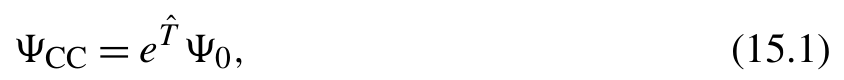{width=41%}

[]{#eq-15-001}

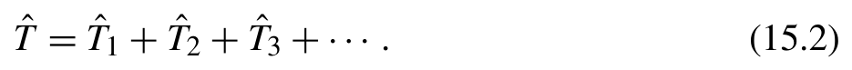{width=46%}

[]{#eq-15-002}

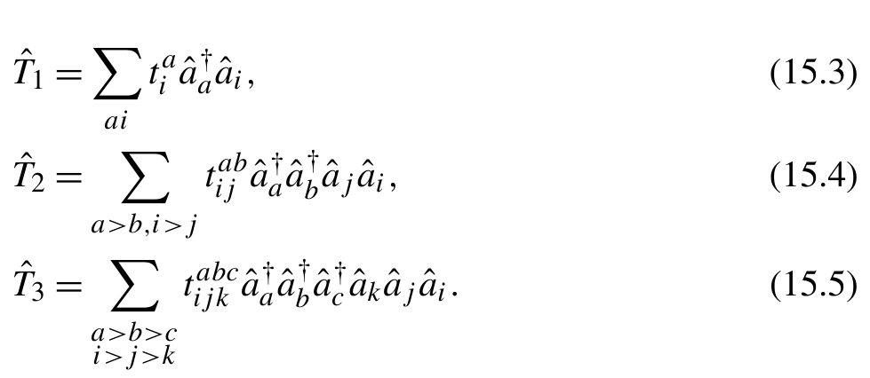{width=48%}

**公式 (15.3)(15.4)(15.5)**[]{#eq-15-003}

利用簇算符的指数形式对哈密顿量作相似变换，便能得出有效哈密顿量：

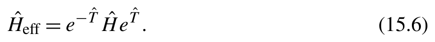{width=42%}

[]{#eq-15-004}

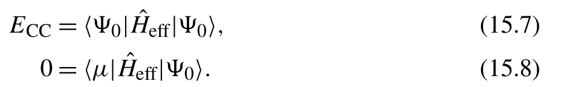{width=45%}

**公式 (15.7)(15.8)**[]{#eq-15-005}

若在 CCSD 中剔除单激发振幅 Tˆ，便得到 CCD（双激发耦合簇）方法。虽然 CCD 计算开销与 CCSD 相近，但因缺失 Tˆ 振幅，其计算精度相对较低。
因此 CCD 方法在实际化学应用中远不如其他方法普遍。但从编程角度来看，CCD 方法足以展现 CC 程序面对的各类工程挑战。为简化问题并展示核心计算技术，后文我们将重点围绕 CCD 方法展开讨论。

## 15.2 CCD 程序

CCD 与 CCSD 的方程在文献 [4–6] [1,2] 中已有详尽讨论。鉴于已有参考资料极为丰富，本文略去推导细节，直接列出相关计算方程。CCD 相关能由下式给出：

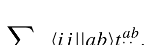{width=30%}

[]{#eq-15-006}

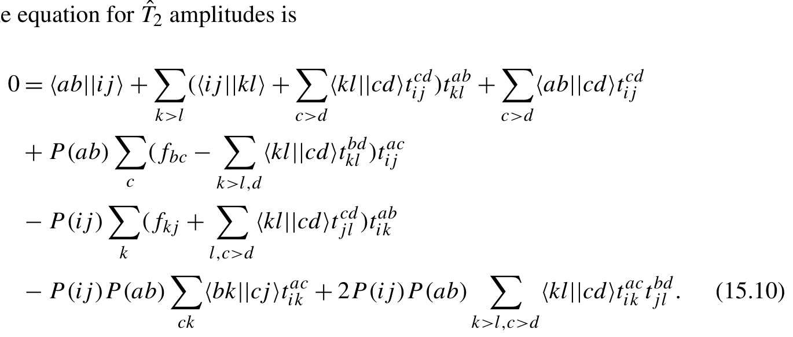{width=67%}

**公式 (15.10)**[]{#eq-15-007}

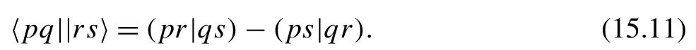{width=48%}

[]{#eq-15-008}

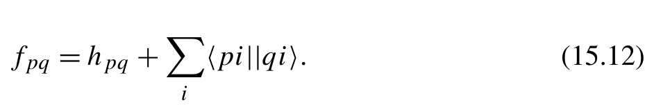{width=46%}

[]{#eq-15-009}

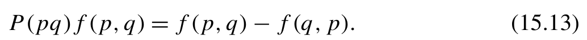{width=50%}

[]{#eq-15-010}

T2 方程是一个非线性方程，可以通过不动点迭代（fixed-point iteration）求解：

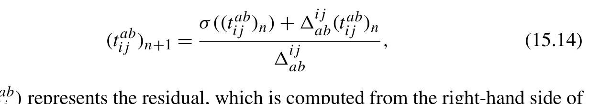{width=60%}

[]{#eq-15-011}

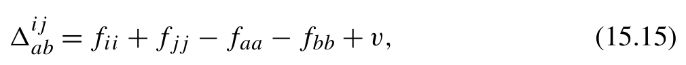{width=49%}

[]{#eq-15-012}

现在来看 CCD 的 Python 程序。首先，我们定义函数来计算 CCD 相关能，并根据式 (15.14) 更新 T2 振幅。

```python
def get_CCD_corr_energy(H , t2):
    return .25 * einsum('ijab ,abij ->',H [ 'oovv'] , t2)
def update_CCD_amplitudes(H: h5py.Group ,t 2 , level_shift=0):
    nvir , nocc = t2.shape[1:3]
    fock = H[ 'fock']
    foo = fock[:nocc ,:nocc]
    fvv = fock[nocc: ,nocc:]
    e_o = foo.diagonal()
    e_v = fvv.diagonal() + level_shift
    Fvv = fvv - 0.5 *einsum('klcd ,bdkl ->bc',H [ 'oovv'] ,t 2 )
    Foo = foo + 0.5 *einsum('klcd ,cdjl ->kj',H [ 'oovv'] ,t 2 )
    Fvv[np.diag_indices(nvir)] -= e_v
    Foo[np.diag_indices(nocc)] -= e_o
    t2out = .25 * np.asarray(H['vvoo'])
    t2out -= einsum( 'bkcj ,acik ->abij',H [ 'vovo'] , t2)
    t2out += .5 * einsum('bc ,acij ->abij', Fvv , t2)
    t2out -= .5 * einsum('kj ,abik ->abij', Foo , t2)
    t2out += .5 *einsum('klcd ,acik ,bdjl ->abij',H [ 'oovv'] ,t 2 , t2)
    t2out = t2out - t2out.transpose(0 ,1 ,3 ,2)
    t2out = t2out - t2out.transpose(1 ,0 ,2 ,3)
    oooo = 0.5 *einsum('klcd ,cdij ->ijkl',H [ 'oovv'] , t2)
```

```python
    oooo += np.asarray(H[ 'oooo'])
    t2out += 0.5 *einsum('ijkl ,abkl ->abij', oooo , t2)
    t2out += 0.5 *einsum('abcd ,cdij ->abij',H [ 'vvvv'] , t2)
    t2out /= e_o + e_o[: ,None] - e_v[: ,None ,None] - e_v[: ,None ,None ,None]
    return t2out
```
CCD 方程包含大量的指标求和，适合借助张量收缩例程高效运算。此处我们调用 einsum 函数完成这些张量收缩。为了提升示例程序的可读性，我们利用 T2 振幅的反对称性质，省略各指标间的约束关系（如 i >j 与 a >b），从而把有约束求和化为无约束求和，例如：

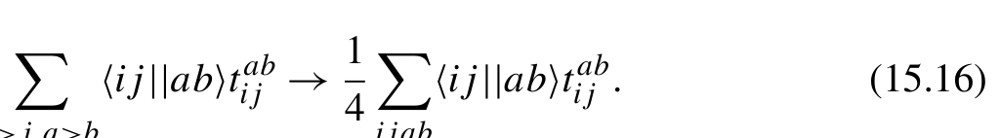{width=50%}

[]{#eq-15-013}

CCD 程序需要五类分子轨道（MO）积分，分别记为 vvoo、oovv、vovo、oooo 与 vvvv。其中 o 与 v 分别指代 ⟨pq||rs⟩ 四个指标中的占据轨道与虚轨道指标。下方函数展示了这些积分的具体计算方法。

```python
import pyscf
def mo_integrals(mol: pyscf.gto.Mole , orbitals , Hfile=None):
    ' ' 'MO integrals in physists notation <pq||rs >' ' '
    no = mol.nelectron
    nmo = orbitals.shape[1]
    eri = np.zeros([nmo *2]*4)
    eri[ ::2 , ::2 , ::2 , ::2] = eri[ ::2 , ::2 ,1::2 ,1::2] = \
    eri[1::2 ,1::2 , ::2 , ::2] = eri[1::2 ,1::2 ,1::2 ,1::2] = \
        pyscf.ao2mo.kernel(mol , orbitals , compact=False).reshape([nmo] *4)
    eri = eri.transpose(0 ,2 ,1 ,3) - eri.transpose(2 ,0 ,1 ,3)
    if Hfile is None:
        Hfile = tempfile.mktemp()
    with h5py.File(Hfile , 'w') as H:
        H['vvoo'] = vvoo = eri[no: ,no: ,:no ,:no]
        H['oovv'] = vvoo.conj().transpose(2 ,3 ,0 ,1)
        H['vovo'] = eri[no: ,:no ,no: ,:no]
        H['oooo'] = eri[:no ,:no ,:no ,:no]
        H['vvvv'] = eri[no: ,no: ,no: ,no:]
```

```python
        hcore = pyscf.scf.hf.get_hcore(mol)
        hcore = einsum( 'pq ,pi ,qj ->ij', hcore , orbitals , orbitals)
        hcore_mo = np.zeros([nmo *2]*2)
        hcore_mo[::2 ,::2] = hcore_mo[1::2 ,1::2] = hcore
        H['fock'] = hcore_mo + einsum( 'ipiq ->pq', eri[:no ,: ,:no ,:])
    return Hfile
```
为简化分子轨道（MO）积分的计算流程，我们借助 PySCF 软件包求出完整 MO 积分张量，再截取所需子块。充分利用原子轨道（AO）积分的置换对称性，并使 I/O 操作与数值计算相互重叠，能显著提升计算效率。第 12 章已详细讨论过相关主题，此处不再赘述。
PySCF 中的 ao2mo 模块只生成空间轨道上的 MO 积分，采用化学记号 (pr|qs)。上方给出的 mo_integrals 函数将 MO 积分从 PySCF 的约定转换为自旋轨道基组中的物理学记号：

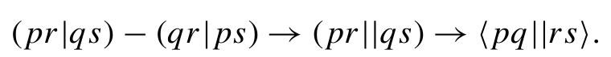{width=37%}

[]{#eq-15-014}

在这一转换中，每个空间轨道映射到两个自旋轨道（spin-orbitals）

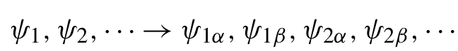{width=32%}

[]{#eq-15-015}

数组索引 0::2 和 1::2 分别用于访问积分张量中的 α 轨道和 β 轨道。
最后，我们可以实现不动点迭代（fixed-point iteration）来求解 T2

```python
import tempfile
import pyscf
from pychem_book.chap13.diis import DIIS
def mp2(H):
    nocc = H[ 'oooo'].shape[0]
    fock = np.asarray(H[ 'fock'])
    e_o = fock.diagonal()[:nocc]
    e_v = fock.diagonal()[nocc:]
    eijab = e_o + e_o[: ,None] - e_v[: ,None ,None] - e_v[: ,None ,None ,None]
    t2 = np.asarray(H[ 'vvoo']) / eijab
    e = get_CCD_corr_energy(H , t2)
    return e ,t 2
def CCD_solve(mf: pyscf.scf.hf.RHF , conv_tol=1e -6 , max_cycle=100):
    ' ' 'A fixed -point iteration solver for spin -orbital CCD' ' '
    mol = mf.mol
```

```python
    orbitals = mf.mo_coeff
    e_hf = mf.e_tot
    with tempfile.TemporaryDirectory() as tmpdir:
        Hfile = mo_integrals(mol , orbitals ,f '{tmpdir}/H')
        diis = DIIS(f '{tmpdir}/diis')
        e_ccd = e_hf
        with h5py.File(Hfile , 'r') as H:
            e_corr , t2 = mp2(H) # initial guess
            e_ccd = e_hf + e_corr
            print(f'E(MP2)={e_ccd}')
            for cycle in range (max_cycle):
                t2 , t2_prev = update_CCD_amplitudes(H ,t 2 ) ,t 2
                e_ccd , e_prev = get_CCD_energy(H , t2) + e_hf , e_ccd
                print(f'{cycle=} , E(CCD)={e_ccd} , dE={e_ccd -e_prev}')
                if abs (t2 - t2_prev). max() < conv_tol:
                    break
                t2 = diis.update(t2 - t2_prev , t2)
    return e_ccd
if __name__ == '__main__':
    mol = pyscf.M(atom= 'N 0. 0 0; N 1.5 0 0' , basis= 'cc -pvdz')
    mf = mol.RHF().run()
    e_ccd = CCD_solve(mf)
```
运行 CCD 求解器需要以平均场波函数（mean-field wave function）为起点。为简明起见，我们使用 PySCF 软件包生成平均场对象。通常，CCD 求解器的初始猜测由 MP2 波函数得到。这个初始猜测等价于将 CCD T2 设为零，并执行单步不动点迭代。

## 15.3 数据传输

update_CCD_amplitudes 函数是 CCD 程序中最耗时的部分，主要有三个瓶颈：

1. 随系统大小的六次方增长的收缩。用 nv

表示虚轨道数，用 no 表示占据
轨道数，张量收缩

```text
   einsum( 'abcd ,cdij ->abij ' , H[ 'vvvv '] , t2)
```
的标度为 n n。由于在大多数分子 CCD 计算中 nv ≫ no，这个
收缩是计算量最大的步骤。其他六阶收缩的开销较小，包括三个标度为 n n 的收缩和两个标度为 n n 的收缩。

2. 从磁盘读取 MO 积分。最大的积分张量 vvvv 需要

读取 8n 字节的数据，假设数据以双精度存储。3. einsum 函数中张量转置的效率以及其他数据
移动操作。与前两个瓶颈相比，这一因素通常
不那么突出。
张量收缩中的 N 规模看起来相当庞大。然而在实际中，计算瓶颈往往源自读取 vvvv 张量的磁盘 I/O。最大的张量收缩需执行 2n n 次浮点运算并传输 8n 字节数据。因此，计算负载与数据传输量之比（FLOPs/bytes）为。在现代多核处理器上，计算能力很容易超过 1 TFLOPs（每秒万亿次浮点运算），而使用 SSD 存储的典型 Linux 文件系统能够提供每秒数 GB 的数据传输带宽。这意味着每传输一字节约有 500 次浮点运算。对于一个有 50 个占据轨道的系统，I/O 和张量收缩所需的时间非常接近（× 1 1.25）。如果将张量收缩卸载到性能可超过 10 TFLOPs 的 GPU 上，I/O 时间将是张量收缩时间的 10 倍。
在计算之前预取数据是优化 CCD 程序性能极为有效的策略。谈及数据预取功能，固然可以考虑使用第 9 章编写的 iterate_with_prefetch 函数。但该函数并不适用于当前场景：它被设计为在单次 for 循环迭代中仅预取一种数据，而此处代码必须从磁盘同时并发预取五种不同类型的积分数据。
一种有效的策略是预先预取这五种数据，确保需要时它们都已在内存中就绪。要应用这一策略，需要实现以下功能：

- 一个后台守护线程（daemon），持续将近期将要使用的数据读入内存缓存。
- 一个数据加载器，从缓存中获取所需数据。
- 一个监控器，用于管理缓存大小，防止内存占用过多。

这种数据预取方案与 Python 的先进先出（FIFO）Queue 类的功能有些相似。受 Queue 模型启发，我们可以在解决以下问题后设计 FIFO 缓存：

- 缓存应采用哪种数据结构？缓存是一个字典，按数据名称索引数据，而不是按数据传入 FIFO 队列的顺序索引。
- 如何确保数据加载器访问数据之前，数据已在缓存中？我们可以使用条件变量（condition variable）(not_empty) 监控缓存的状态。
- 考虑到预取守护线程可能占用大量内存，如何阻塞该守护线程以限制缓存大小？我们可以使用另一个条件变量 (not_full) 暂停预取守护线程，直到缓存中的部分数据被消费。

前三点引出了如下基本功能：

```python
not_empty = Condition() # condition variables shared by two threads
not_full = Condition()
# the prefetch daemon in thread 1
def prefetch():
    for key in data_names:
        cache[key] = h5obj[key]
        not_empty.notify()
        while len (cache) >= maxsize:
            not_full.wait()
# data loader in thread 2
def loader(key):
    not_empty.wait()
    data = cache.pop(key)
    not_full.notify()
    return data
```

- 预取守护线程与加载器之间可能存在竞态条件（race condition），因为两者都需要修改缓存。为了解决这一问题，我们需要使用互斥锁（mutex lock）保护缓存字典。
- 如果预取守护线程和数据加载器中的条件变量同时等待对方的信号，就可能出现死锁（deadlock）。必须仔细设计等待机制，确保两个条件变量的 wait 方法互斥执行。
- 为了平稳终止预取守护线程，需要先执行清理代码，再通知守护线程终止。我们可以将 contextmanager 与 with 语句结合使用，确保清理代码得到正确执行。

下面是一段包含上述所有技术考量的示例代码。我们将函数命名为 readahead，以区别于第 9 章讨论的 iterate_with_prefetch 函数。

```python
import threading
from contextlib import contextmanager
#Implement the readahead function using the producer -consumer model.
@contextmanager
```

```python
def readahead(h5obj , tasks , maxsize=3):
    assert maxsize > 0
    cache = {}
    # This mutex lock is shared by the prefetch function and loader.
    # It must be held whenever mutating the cache.
mutex = threading.RLock() # (1)
    not_full = threading.Condition(mutex)
    not_empty = threading.Condition(mutex)
    terminate = False
    def prefetch(tasks):
        for task in tasks:
            if terminate:
                break
            # Use a condition variable to block the producer.
            # To prevent the cache storing too many items.
            data = np.asarray(h5obj[task])
            with not_full
                cache[task] = data
                not_empty.notify()
                while len (cache) >= maxsize:
                    not_full.wait()
    daemon = threading.Thread(target=prefetch , args=(tasks ,))
    daemon.start()
    def loader(key):
        with not_empty:
            # wait until the required task has been prepared
            if not cache:
                not_empty.wait()
            data = cache.pop(key)
            not_full.notify()
        return data
    yield loader
    terminate = True
    with not_full
# release any locks in prefetch , then the terminate condition in prefetch function will be triggered
        not_full.notify()
    daemon.join()
```
15.3 优化数据传输 应当注意，第 (1) 行的互斥锁（mutex lock）由两个条件变量（condition variable）not_empty 和 not_full 共享。当它们被获取时（通过 with 上下文），with 上下文作用域内的所有资源都受到同一个互斥锁保护。因此，无需引入额外的互斥锁来保护 cache 对象。同一时刻只有一个线程访问 cache 字典，直到显式调用条件变量的 wait 方法。随后 wait 方法将控制权移交其他线程。当其他线程执行 notify 方法时，它会唤醒等待条件并恢复当前线程中的执行流程。
readahead 函数按照输入参数给定的键名顺序读取并缓存数据。最好严格按照数据被使用的顺序开展预取。为了使预取顺序与 update_CCD_amplitudes 函数中的数据访问顺序保持一致，我们需要彻底梳理和排查数据访问次序。随后，将排好序的名称列表传递给 readahead 守护线程（daemon）。顺序不匹配可能导致 readahead 守护线程中的数据加载器陷入停滞。作为练习，鼓励读者自行探索可能诱发这种死锁（deadlock）的深层原因和边界条件。

```python
def update_CCD_amplitudes(H: h5py.Group ,t 2 ) :
    ...
    with readahead(H ,[
        'oovv', 'vvoo', 'vovo', 'oooo', 'vvvv', ]) as load:
        oovv = load( 'oovv')
        Fvv = fvv - 0.5 *einsum('klcd ,bdkl ->bc', oovv , t2)
        Foo = foo + 0.5 *einsum('klcd ,cdjl ->kj', oovv , t2)
        Fvv[np.diag_indices(nvir)] -= e_v
        Foo[np.diag_indices(nocc)] -= e_o
        t2out = .25 * load('vvoo')
        t2out -= einsum( 'bkcj ,acik ->abij', load( 'vovo'), t2)
        t2out += .5 * einsum('bc ,acij ->abij', Fvv , t2)
        t2out -= .5 * einsum('kj ,abik ->abij', Foo , t2)
        t2out += .5 *einsum('klcd ,acik ,bdjl ->abij', oovv ,t 2 , t2)
        t2out = t2out - t2out.transpose(0 ,1 ,3 ,2)
        t2out = t2out - t2out.transpose(1 ,0 ,2 ,3)
        oooo = 0.5 *einsum('klcd ,cdij ->ijkl', oovv , t2) + load( 'oooo')
        t2out += 0.5 *einsum('ijkl ,abkl ->abij', oooo , t2)
        t2out += 0.5 *einsum('abcd ,cdij ->abij', load( 'vvvv'), t2)
    t2out /= e_o + e_o[: ,None] - e_v[: ,None ,None] - e_v[: ,None ,None ,None]
    return t2out
```
目前的数据预取方案存在明显局限：预取顺序必须手工维护。这意味着每当访问顺序发生变动时，readahead 函数的任务列表也必须同步更新。这种人工
调整既繁琐复杂，又容易增加出错风险。为了提高 readahead 函数的易用性，我们可以引入即时编译（Just-In-Time，JIT）技术，在运行时动态解析并确定数据预取顺序。

## 15.4 用于 I/O 预读的编译

即时编译技术乍看起来似乎复杂，其实原理和实现策略都非常明晰。本质上，JIT 在运行时根据输入参数的数据类型优化或动态生成代码路径。此外，这些优化后的代码路径会被妥善缓存，以便后续反复重用。
为了分析或优化代码路径，JIT 技术需要访问并修改函数的抽象语法树（Abstract Syntax Tree，AST）。这一过程涉及第 5 章介绍过的 inspect 和 ast 模块。对于使用 readahead 函数的 CCD 程序，我们可以利用 AST 搜索 update_CCD_amplitudes 函数中的全部数据访问操作。我们可以创建以下 JIT 编译器来实现这一功能。

```python
import inspect
def readahead_jit(f):
    # modify and cache the function until the first run
    new_f = None
    @functools.wraps(f)
    def f_with_readahead(*args , **kwargs):
        for i ,a in enumerate (args):
            if isinstance (a , h5py.Group):
                break
else: # (1)
            return f(*args , **kwargs)
        nonlocal new_f
        if new_f is None:
            arg_names = list(inspect.signature(f).parameters)
            new_f = _inject_readahead(f , arg_names[i])
        return new_f(*args , **kwargs)
    return f_with_readahead
```
第 (1) 行的 for-else 语句排除了无需 HDF5 I/O 的情况。当调用函数时，如果输入参数中包含 h5py 对象，便将该函数传递给 _inject_readahead 函数，以分析数据访问模式。
该 JIT 编译器能够把 readahead 代码注入原函数中。例如在 CCD 程序里，_inject_readahead 函数能在 update_CCD_amplitudes 开头添加一条 with 语句，并将 h5py 对象替换为对应的缓存变量。下方代码示例展示了 JIT 编译器达成的大致效果。

```python
def update_CCD_amplitudes(...):
    with readahead(h5object , [key1 , key2 , ...]) as _loader:
        ...
        einsum(... , _loader[key1] , ...)
        ...
```
为了达到这一效果，我们首先扫描 AST 以识别 I/O 操作。例如形如 H[’vvvv’] 的 I/O 操作属于 ast.Subscript 类型的元素。通常，ast.Subscript 操作包含三种类型内容中的一种：切片、常量或可迭代对象（如元组或列表）。针对 H[’vvvv’]，下标是一个常量字符串。为识别这类代码语句，我们可以遍历 AST，筛选名称与关键字（如 H）匹配且内容为字符串常量的 ast.Subscript 元素。
ast 模块提供了两种遍历 AST 的主要方式。一种是使用 ast.walk 函数，但经由 ast.walk 遍历时，节点出现顺序可能与源代码不一致。此处选用 ast.NodeVisitor 更加合适，因为它采用深度优先方式递归遍历 AST，能够严格保持源码出现顺序。

```python
def _search_tasks(f , keyword):
    tasks = []
    class IdentifyTask(ast.NodeVisitor):
        def visit_Subscript(self , node):
            if ((isinstance(node.value , ast.Name)
                and node.value.id == keyword
                and isinstance (node.slice , ast.Constant)
                and isinstance (node.slice.value , str)):
                tasks.append(node.slice.value)
            return self.generic_visit(node)
    IdentifyTask().visit(ast.parse(inspect.getsource(f)))
    print('# Readahead_jit finds tasks' , tasks)
    return tasks
```
获得 I/O 操作列表后，我们基于 update_CCD_amplitudes 函数的 AST 注入 readahead 函数。查阅 with 语句的 AST 文档可知，下方代码块：

```text
with f() as var:
    code_block
```
编译为 AST 节点：With(withitem("f()", var), body=code_block)。我们可以运用这种结构为 readahead 函数创建 ast.With 节点。随后需要遍历整棵 AST，查找并替换与 h5py 对象相关的 I/O 操作。这一过程借助 ast.NodeTransformer 节点修改器来完成。转换完成后，调用 exec 函数将 AST 重编为可执行的 Python 代码。下方给出具体实现：

```python
def _inject_readahead(f , keyword):
    tasks = _search_tasks(f , keyword)
    loader = f '_{keyword}_loader'
    assert loader not in f.__code__.co_varnames
    tree = ast.parse(inspect.getsource(f))
    fn_node = tree.body[0]
    fn_node.decorator_list = [] # remove the "@readahead" decorator
    fn_node.body = [
        ast.With([
            ast.withitem( ast.parse(f'readahead({keyword} , {tasks})' , mode='eval').body , ast.Name(loader))] , # as loader
            fn_node.body)
    ]
    class RewriteGetitem(ast.NodeTransformer):
        def visit_Subscript(self , node):
            if (isinstance(node.value , ast.Name)
                and node.value.id == keyword
                and isinstance (node.slice , ast.Constant)
                and isinstance (node.slice.value , str)):
                node.value.id = loader
            return self.generic_visit(node)
    new_tree = ast.fix_missing_locations(RewriteGetitem().visit(tree))
    print(f'# Modified {f.__name__} function' )
    print(ast.unparse(new_tree))
    exec(ast.unparse(new_tree))
    return locals ()[f.__name__]
```
如果 I/O 操作涉及重复的对象，会怎样？重复的 I/O 任务不需要反复预取。我们可以优化 readahead 函数，利用这一特性。

```python
@contextmanager
def readahead(h5obj , tasks , maxsize=3):
    assert maxsize > 0
```

```python
cache = {}
    mutex = threading.RLock()
not_full = threading.Condition(mutex)
new_slot = threading.Condition(mutex)
terminate = False
class Data:
def __init__(self , data):
    self.data = data
    self.refcount = 1
def prefetch(tasks):
for task in tasks:
    if terminate:
        break
    with mutex:
if task in cache: # (1)
            cache[task].refcount += 1
            continue
    data = Data(np.asarray(h5obj[task]))
    with not_full
        cache[task] = data
        new_slot.notify()
        if len (cache) >= maxsize:
            not_full.wait()
daemon = threading.Thread(target=prefetch , args=(tasks ,))
daemon.start()
class Loader:
def __getitem__(self , key):
    with new_slot:
        while key not in cache:
            if len (cache) >= maxsize:
                raise RuntimeError('Cache size insufficient' )
            new_slot.wait()
        data = cache[key].data
cache[key].refcount -= 1 # (2)
if cache[key].refcount <= 0: # (3)
            cache.pop(key)
            not_full.notify()
    return data
```

```text
    yield Loader()
    terminate = True
    with not_full
        not_full.notify()
    daemon.join()
```
若某个任务已被缓存，我们只需增加对现有任务的引用，无须重复发起读取，正如第 (1) 行所示。与先前使用 FIFO 缓存的版本不同，该版本仅在 loader 方法中修改引用计数（见第 (2) 行）。当任务的引用计数归零时，便会及时从缓存中剔除淘汰，正如果第 (3) 行处理逻辑所示。
至此，我们构建了一个轻巧的即时编译器（JIT compiler），有效改善了 CCD 程序底层的数据访问机制。要开启即时预取编译，只需将 readahead_jit 装饰器挂载到目标函数 update_CCD_amplitudes 上，无须对其内部业务实现作任何改动。

```python
@readahead_jit
def update_CCD_amplitudes(H: Union[Dict , h5py.Group] , t2: np.ndarray):
    ...
    Fvv = fvv - 0.5 *einsum('klcd ,bdkl ->bc',H [ 'oovv'] ,t 2 )
    Foo = foo + 0.5 *einsum('klcd ,cdjl ->kj',H [ 'oovv'] ,t 2 )
    t2out = .25 * H['vvoo']
    t2out -= einsum( 'bkcj ,acik ->abij',H [ 'vovo'] , t2)
    ...
```

## 15.5 耦合簇理论的符号编程

耦合簇（coupled cluster，CC）理论，特别是较高激发阶数的变体，涉及复杂的方程。利用关联图方法（linked diagram method）推导 CC 方程的系统方法已经确立 [1]。此外，也有能自动推导 CC 图的实用程序 [7]。
倘若手头没有现成的理论工具，该如何推导 CC 方程？为探讨这一问题，我们以 CCD 为例，展示符号计算（symbolic computation）与代码生成相结合的技术方案。SymPy 虽提供了 secondquant 模块推导耦合簇方程，但此处介绍的方法更具通用性。依循本节梳理的开发流程，我们可以编写符号程序，为 SymPy 尚未支持的特殊代数系统自动推导方程。
从本质上说，用于 CC 方程的符号程序是一个计算机代数系统（Computer Algebra System，CAS），旨在对二次
量子化算符执行正规排序（normal ordering）过程。一般而言，开发 CAS 程序涉及以下步骤：

1. 定义问题的基本元素。
2. 定义作用于基本元素的运算规则。
3. 实现一个 eval 函数，能够递归地化简表达式，直到

得出结果。

### 15.5.1 定义基本符号元素

以下类是 CCD 符号程序中的基本元素：

- FieldOperator 类表示二次量子化算符。CCD 中的算符同时涉及占据轨道（occupied orbital）和虚轨道（virtual orbital）。因此我们为其指定标签：取值可为 O（占据）、V（虚轨）或 *（二者兼顾）。Annihilation 与 Creation 算符派生为 FieldOperator 的具体子类。
- Delta 类表示克罗内克 δ（Kronecker delta），它由两个二次量子化算符的对易产生。
- Tensor 类表示 Tˆ 激发算符和哈密顿量中使用的多维系数与积分。

各个类的代码如下。

```python
class FieldOperator:
 ' ' 'Annihilation or creation operators' ' '
 def __init__(self , label= '*'):
     assert label in 'OV*'
     self.label = label
class Annihilation(FieldOperator):
 def __repr__(self):
     return f'{self.label}'
class Creation(FieldOperator):
 def __repr__(self):
     return f'{self.label}^+'
class Delta:
 ' ' 'the Kronecker delta.' ' '
 def __init__(self , indices: List[FieldOpeartor]):
     self.indices = indices
 def __repr__(self):
     ops = '' .join(op.label for op in self.indices)
     return f'Delta({ops})'
```

```python
class Tensor:
    def __init__(self , indices: List[FieldOpeartor] , label=None):
        self.indices = indices
        self.label = label
    def __repr__(self):
        ops = '' .join(op.label for op in self.indices)
        return f'{self.label or self.__clas__.__name__}({ops})'
```

### 15.5.2 实现运算规则

二次量子化算符遵守以下对易关系（commutation relations）：

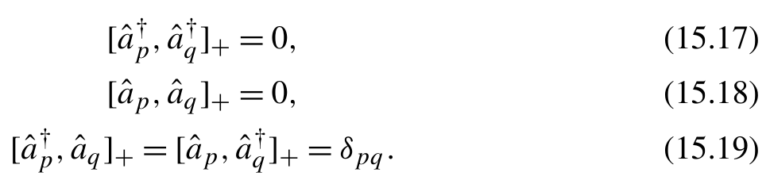{width=47%}

**公式 (15.17)(15.18)(15.19)**[]{#eq-15-016}

这些关系为收缩（contraction）运算提供了基础，收缩运算将时间排序的算符转换为其正规排序表示：

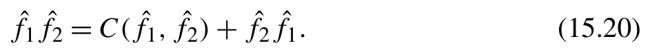{width=46%}

[]{#eq-15-017}

如果 FieldOperator 可对易，则 C( ˆf1, ˆf2) 的值为零；在以下任一条件下会出现这种情况：

- 算符属于同一类型。它们要么都是湮灭算符（annihilation operator），要么都是产生算符（creation operator）。
- 算符具有不同的占据标签。一个作用于占据轨道，另一个作用于虚轨道。

这些条件被转换为以下 commutable 函数：

```python
COMMUTABLE = { 'V': 'O', 'O': 'V', '*': ''}
def commutable(op1: FieldOpeartor , op2: FieldOpeartor):
    return (op1.__class__ == op2.__class__ or
            op1.label == COMMUTABLE[op2.label])
```
然后，我们将式 (15.20) 转换为针对两个 FieldOperator 的 contract 函数，如下所示：

```python
def _contract_fop_fop( fop1: FieldOperator , fop2: FieldOperator) -> List[String]:
    output = []
    if not commutable(fop1 , fop2):
```

```python
        output.append(String([] ,1 , [Delta([fop1 , fop2])]))
    output.append(String([fop2] ,- 1 , remaining=[fop1]))
    return output
```
为了便于管理多个二次量子化算符，我们引入 String 类：

```python
class String:
    ' ' '
    Normal -ordered FieldOpeartors
    ' ' '
__slots__ = [ 'operators', 'factor', 'deltas', 'remaining'] # (1)
    def __init__(self , operators , factor=1 , deltas=None , remaining=None):
        self.operators: List[FieldOperator] = operators
        self.factor = factor
        self.deltas = deltas or []
        self.remaining: List[FieldOperator] = remaining or []
    def __repr__(self):
        ops = self.operators + self.deltas + self.remaining
        ops = '' .join(repr(op) for op in ops)
        return f'{self.__class__.__name__}({ops}) '
```
我们来看看第 (1) 行中的属性。operators、deltas 和 factor 属性的含义很明确。它们分别表示一组 FieldOperator、由收缩生成的一组克罗内克 δ，以及与整个字符串关联的系数。那么，remaining 属性有什么用途呢？
remaining 属性用于存储收缩之后任何尚未处理的算符。考虑一个 FieldOperator fˆ 与一列算符之间的收缩：

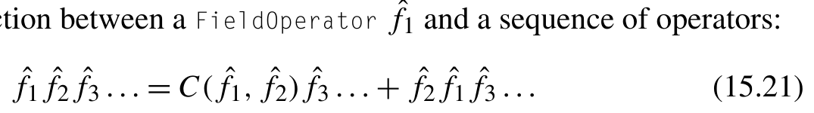{width=52%}

[]{#eq-15-018}

如式 (15.20) 所示，将算符乘积 fˆf 化为正规排序形式后，可继续把 fˆ 与后续各算符展开逐级收缩。remaining 属性忠实记录仍可进一步收缩的残余算符。利用 remaining 属性，下方递归函数即可完整实现式 (15.21) 规定的正规排序过程。

```python
def _contract_fop_string( fop: FieldOperator , string: String) -> List[String]:
    operators = string.operators
    remaining = string.remaining
    factor = string.factor
    deltas = string.deltas
    if len (operators) == 0:
```

```python
        return [String(operators , factor , deltas , [fop]+remaining)]
    # C(x ,a 1 *a2*...) = C(x , a1) *a2*a3*...
# = delta(x                ,a1)*a2*a3*... + C(remaining ,a 2 *a3*...)
    output = []
    for s in _contract_fop_fop(fop , operators[0]):
        if not s.remaining:
            output.append(String(operators[1:] , s.factor * factor , s.deltas + deltas , remaining))
        else:
            substring = String(operators[1:] , factor , deltas , remaining)
            for r in _contract_fop_string(s.remaining[0] , substring): # (1)
                output.append(String(s.operators + r.operators , s.factor * r.factor , r.deltas , r.remaining))
    return output
```
对于 _contract_fop_fop 输出的字符串，如果其 remaining 属性为空，说明该字符串不包含任何可进一步收缩的算符。否则，递归调用 _contract_fop_string 函数，处理 remaining 属性内的 FieldOperator 对象的后续收缩（如第 (1) 行所示）。
在 _contract_fop_string 函数的基础上，我们可以轻松实现一个函数来模拟字符串之间的收缩。

```python
import itertools
def flatten(lst):
    return list (itertools.chain(*lst))
def _contract_string_string(string1 , string2) -> List[String]:
    assert isinstance (string1 , String) and not string1.remaining
    assert isinstance (string2 , String) and not string2.remaining
    if not string2.operators:
        return [String(string1.operators , string1.factor * string2.factor , string1.deltas + string2.deltas)]
    output = [String(string2.operators , string1.factor * string2.factor , string1.deltas + string2.deltas)]
    for fop in reversed (string1.operators):
        #C ( x 1*x2*... ,a 1 *a2*...) = C(x1 , C(x2 , ... , C(xn ,a 1 *a2*...)))
```

```python
        output = flatten(_contract_fop_string(fop ,s ) for s in output)
    return output
def contract(string1 , string2):
    return [String(s.operators + s.remaining , s.factor , s.deltas)
            for s in _contract_string_string(string1 , string2)]
```
到目前为止，我们已经完成了 FieldOperator 和 String 类所需的各项代数运算。接下来，我们将使用这些基础元素定义 CCD 理论中的哈密顿算符（Hamiltonian operator）和 Tˆ 算符。二次量子化的哈密顿量表示如下：

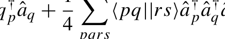{width=30%}

[]{#eq-15-019}

请注意，我们采用的是反对称化形式的双电子积分张量（two-electron integral tensor）。使用反对称张量的原因会在后续讨论中更加清楚。利用 String 类和 Tensor 类，可以轻松构造出哈密顿量的符号表示。
类似的方法可用于构造 Tˆ

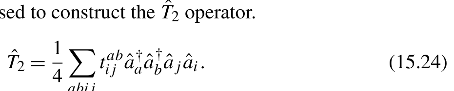{width=45%}

[]{#eq-15-020}

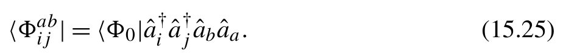{width=45%}

[]{#eq-15-021}

```python
def _make_operator(factor , indices , label=None):
    n= len(indices)
    assert n%2= =0
    operators_c = [Creation(x) for x in indices[:n//2].upper()]
    operators_a = [Annihilation(x) for x in indices[n//2:].upper()]
    operators = operators_c + operators_a[:: -1]
    tensor = Tensor(operators_c + operators_a , label)
    return tensor , String(operators , factor)
def hamiltonian(n , factor):
    return _make_operator(factor , '**'*n ,f 'h{n}')
def excitation(n):
    return _make_operator(.25 , 'V'*n+ 'O'*n ,f 'T{n}')
def deexcitation(n):
```

```python
    return _make_operator(.25 , 'O'*n+ 'V'*n ,f 'T{n}')
def bra_projector(n):
    bra_tensor , bra = _make_operator(.25 , 'O'*n+ 'V'*n)
    return bra_tensor.indices[:: -1] , bra
```
在上述算符体系中，我们对张量指标和算符串共用同一组 FieldOperator 实例。为建立 FieldOperator 与张量指标之间的精确对应关系，每个 FieldOperator 都需要全局唯一的标识符，用来识别张量指标。由于 Python 会为每个独立对象分配唯一的内存 ID，为简明起见，直接使用 FieldOperator 对象本身充当张量指标标识。这种设计意味着每个 FieldOperator 都是全局唯一的独立实体，不可克隆，因为任何 copy() 操作都会衍生出 ID 不同的全新对象，从而破坏映射关系。
得到哈密顿量和 Tˆ 算符的符号表示后，我们现在可以计算 Hˆ。这个有效哈密顿量（effective Hamiltonian）可以通过 Baker-Campbell-Hausdorff 展开求得：

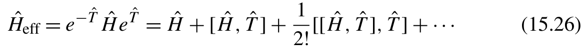{width=57%}

[]{#eq-15-022}

在耦合簇理论（coupled cluster theory）框架中，BCH 展开可以在四阶截断。下面的 Python 代码模拟了 BCH 展开：

```python
def apply_BCH(truncation=4):
    hs = [hamiltonian(1 , 1), hamiltonian(2 , .25)]
    for order in range (truncation+1):
        factor = 1./math.factorial(order)
        for htensor , hstring in hs:
            ht_tensors = [htensor]
            ht_strings = [String(hstring.operators , hstring.factor * factor)]
            for i in range (order):
                amplitudes , t = excitation(2)
                ht_tensors.append(amplitudes)
                ht_strings = flatten(commutate(ht ,t ) for ht in ht_strings)
            for ht_string in ht_strings:
                yield ht_tensors , ht_string
```
该程序中的 commutate 函数计算两个串之间的对易子（commutator）。

```python
def commutate(string1 , string2) -> List[String]:
    output = contract(string1 , string2)
    n_deltas = len(string1.deltas) + len(string2.deltas)
    return [s for s in output if len (s.deltas) > n_deltas]
```
哈密顿量和 Tˆ 算符都包含偶数个 FieldOperator。使用 contract 函数完全交换两个串的位置需要偶数次置换，因此总因子为 1.0。这会抵消对易子中的另一项。
因此，我们只需遍历 contract 函数的输出结果，识别两输入串已完全对换的项并将其从输出中剔除。在当前 commute 函数里，我们依据克罗内克 δ（Kronecker delta）的数量来甄别对换项：纯粹对换算符不会改变克罗内克 δ 数量，而任何有效收缩均会增加 δ 数量。

### 15.5.3 符号化求值表达式

我们可以通过将收缩后的串及其相关的 Tensor 系数投影到 HF 参考态（HF reference），求得其值。这在下面的函数中实现

```python
VSYMBOLS = 'abcdefghvwxyzABCDEFGHVWXYZ'
OSYMBOLS = 'ijklmnopqrstuIJKLMNOPQRSTU'
def on_HF_reference(string , tensors , output_indices=None) -> List[ str]:
    ' ' '<HF|string|HF >' ' '
    h_ops = []
    for op in string.operators:
        if op.label == '*':
            h_ops.append(op)
            continue
        # Creation or annihilation operators in T are normal ordered.
        # They must be zero when applied either on |HF > or on <HF|
        return ''
    deltas = string.deltas
    if h_ops:
        # The remaining operators in Hamiltonian
        if (len(h_ops) == 2 and
            isinstance(h_ops[0] , Creation) and
            isinstance(h_ops[1] , Annihilation)):
            deltas = deltas + [Delta(h_ops)]
        elif len (h_ops) == 4:
            return f'{string.factor*2} * einsum("ijij ->" , h2_oooo)'
        else:
            return ''
```

```python
 vsymbols , osymbols = iter(VSYMBOLS),iter(OSYMBOLS)
 symbol_table = {}
for delta in deltas: # (1)
     op1 , op2 = delta.indices
     label1 , label2 = op1.label , op2.label
     if label1 == 'V' or label2 == 'V':
         symbol_table[op1] = symbol_table[op2] = next(vsymbols)
        else:
         symbol_table[op1] = symbol_table[op2] = next(osymbols)
 if output_indices is None:
     output_script = ''
     else:
     output_script = ''.join(symbol_table[i] for i in output_indices)
 scripts = []
 operands = []
 for tensor in tensors:
     s= ''.join(symbol_table[i] for i in tensor.indices)
     scripts.append(s)
     if tensor.label[0] == 'h':
         operands.append( tensor.label + '_' +
             ''.join('v' if x in VSYMBOLS else 'o' for x in s))
 else:
         operands.append(tensor.label)
 subscripts = f '{" ,".join(scripts)} ->{output_script}'
 operands = ', ' .join(operands)
 return f'{string.factor} * einsum("{subscripts}" , {operands})'
```
这个函数的要点包括：

- string 可能包含源自哈密顿算符的 Creation(’*’) 和 Annihilation(’*’) 算符。这些算符只能出现在收缩后串的最右端。作用于 HF 参考态时，它们会产生对积分中占据指标的求和。如果串中包含四个标记为 ’*’ 的 FieldOperator 对象，它们一定都源自哈密顿量的双电子部分。这一项对应 HF 行列式的双电子能量，由下式给出：

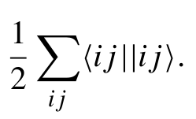{width=30%}

[]{#eq-15-023}

- 如果串中还留有任何 Annihilation(’O’) 或 Creation(’V’) 算符，则该串的值为零。这是因为这些算符作用于左矢 ⟨Ψ 0| 上的 HF 参考态会得到零态。
- 第 (1) 行附近的代码块识别给定 String 对象中与 Delta 对象关联的张量指标。
- 输出可以采用多种格式。为简单起见，我们选择使用 einsum 脚本表示输出。

### 15.5.4 符号化生成 CCD 方程

遍历 apply_BCH 输出中的各个算符串，直接调用 on_HF_reference 即可求得 CCD 能量表达式。为推导 CCD 振幅方程，我们先将这些算符串投影至双激发左矢空间，随后调用 on_HF_reference 求值，代码实现如下：

```python
def CCD_energy(truncation=4):
    output = []
    for ht_tensors , ht_string in apply_BCH(truncation):
        output.append(on_HF_reference(ht_string , ht_tensors))
    return [x for x in output if x]
def CCD_equations(truncation=4):
    output_indices , bra = bra_projector(2)
    output = []
    for ht_tensors , ht_string in apply_BCH(truncation):
        for s in contract(bra , ht_string):
            output.append(on_HF_reference(s , ht_tensors , output_indices))
    return [x for x in output if x]
if __name__ == '__main__':
    for x in CCD_energy(2):
        print(f'E += {x}' )
    for x in CCD_equations(2):
        print(f'F2 += {x}' )
```
输出为

```text
E+ =1 . 0 * einsum("ii ->", h1_oo)
E+ =0 . 5 * einsum("ijij ->", h2_oooo)
E += 0.0625 * einsum("ijba ,baij ->", h2_oovv , T2)
E += -0.0625 * einsum("ijba ,baji ->", h2_oovv , T2)
E += -0.0625 * einsum("ijba ,abij ->", h2_oovv , T2)
E += 0.0625 * einsum("ijba ,abji ->", h2_oovv , T2)
F2 += 0.0625 * einsum("baij ->abji", h2_vvoo)
F2 += -0.0625 * einsum("baji ->abji", h2_vvoo)
F2 += -0.0625 * einsum("abij ->abji", h2_vvoo)
... # 705 more lines for F2
```
读者可能发现，阶数更高时符号程序运行耗时明显增加。这主要是程序产生了海量中间算符串所致。在这类中间串里，绝大多数最左侧的算符均为 Annihilation(’O’) 或 Creation(’V’)。无论算符串后续包含什么内容、经历何种收缩，它们在 HF 参考态上的期望值都恒为零。若能及早侦测出这些中间串并提前短路排除，就能显著减少无效运算。
此类优化可通过惰性求值（lazy evaluation）优雅达成。完全没有必要一次性生成全部算符串后再批量转交 on_HF_reference。相反，串中各个 FieldOperator 的收缩操作可以由 on_HF_reference 内部循环逐项按需触发。一旦触碰零值截断条件，便能安全跳过 contract 函数的后续收缩。在 Python 中可借助生成器（generator）与 yield 语句实现惰性求值，后续代码将深度运用该机制。
从输出中还可以观察到，它包含的项明显多于 CCD 方程 (15.10) 中给出的项。额外的项是由于收缩阶段未处理置换对称性（permutation symmetry）而产生的。接下来，我们将考虑 CCD 张量的置换对称性，以系统改进符号程序。

### 15.5.5 CCD 张量的置换对称性

如何在 contract 函数中融入张量相关的置换对称性？为此我们需要在 String 对象中封装额外的对称结构信息。下方给出了表达 FieldOperator 间对称性的一种有效实现：

1. 使用 FOpGroup 类，将通过

张量指标的置换对称性关联的 FieldOperator 对象分组。对于
同一个 FOpGroup 内的 FieldOperator 对象，由于对称性，它们的指标相同。

2. 修改 String 类的 operators 属性，使其能够容纳

FieldOperator 对象和 FOpGroup 对象。

```python
class FOpGroup(tuple):
    pass
class String:
    ' ' '
    Normal -ordered FieldOpeartors
    ' ' '
    __slots__ = [ 'operators', 'factor', 'deltas', 'remaining']
    def __init__(self , operators , factor=1 , deltas=None , remaining=None):
        self.operators: List[Union[FieldOperator , FOpGroup]] = operators
```

```python
        self.factor = factor
        self.deltas = deltas or []
        self.remaining = remaining or []
    def __repr__(self):
        ops = '' .join(repr(op) for op in self.operators + self.deltas)
        return f'{self.__class__.__name__}({ops}) '
```
收缩两个串时，FOpGroup 对象应被视为一个整体，它可以与其他元素（FieldOperator 或另一个 FOpGroup）收缩。因此，有四种收缩组合：

- 收缩两个 FieldOperator 对象；
- 将 FieldOperator 与 FOpGroup 收缩；
- 将 FOpGroup 与 FieldOperator 收缩；
- 收缩两个 FOpGroup 对象。

我们之前已经讨论过第一种情况。下面重点讨论后三种收缩情况。
如果一个 FieldOperator 对象与 FOpGroup 对象内的算符不对易，_contract_fop_fgroup 函数将产生由 m + 1 个串组成的输出。在这 m + 1 个串中，有 m 个是包含 Delta 对象的收缩串。鉴于 FOpGroup 内 m 个算符之间的置换对称性，这 m 个收缩串对结果的贡献相同。因此，输出中只需考虑其中一种情况，其他 m − 1 个收缩串的贡献可以合并并计入 factor 属性。

```python
def _contract_fop_fgroup(fop: FieldOperator , fgroup: FOpGroup) -> List[
    String]:
    degeneracy = len(fgroup)
    op = fgroup[0]
    if not commutable(fop , op):
        yield _fgroup2str(fgroup[1:] , degeneracy , [Delta([fop , op])])
    yield String([fgroup] ,( -1)**degeneracy , remaining=[fop])
def _fgroup2str(fgroup , factor , deltas , remaining=None):
    if len (fgroup) > 1:
        operators = [FOpGroup(fgroup)]
     else:
        operators = list(fgroup)
    if remaining:
        if len (remaining) > 1:
            remaining = [FOpGroup(remaining)]
    else:
            remaining = list(remaining)
```

```python
    return String(operators , factor , deltas , remaining)
```
输出串中的算符可能包含 FOpGroup 的一个子集。该子集仍可能构成一个 FOpGroup 对象。这里引入辅助函数 _fgroup2str 来处理 FOpGroup 的子集，它根据该子集构造适当的 String 对象。
_contract_fgroup_fop 函数与 _contract_fop_fgroup 类似。它的输出也包含一个 m 重简并的串，对应于 FOpGroup 中的 m 个算符与一个 FieldOperator 对象之间的收缩。

```python
def _contract_fgroup_fop(fgroup: FOpGroup , fop: FieldOperator) -> List[
    String]:
    degeneracy = len(fgroup)
    op = fgroup[ -1]
    if not commutable(fop , op):
        yield _fgroup2str([] , degeneracy , [Delta([op , fop])] , fgroup[: -1])
    yield String([fop] ,( -1)**degeneracy , remaining=[fgroup])
```
_contract_fgroup_fgroup 函数更复杂。由于两个 FOpGroup 中各有多个 FieldOperator 对象，它可能产生多种收缩串。然而，我们可以直接通过考虑收缩输出的最终状态来简化实现。依托 FOpGroup 内部的置换对称性，收缩输出最多可以包含 t 个不同的收缩串，其中 t 是不超过输入 FOpGroup 对象大小的最大整数。这 t 个不同的收缩串可以通过 Delta 对象的数量加以区分，数量从一个到 t 个不等。对于每个收缩串，我们可以使用最简单的收缩模式构造它，然后赋予适当的乘数以计入简并度（degeneracy）。简并度等于形成 Delta 对象的不同可能组合的数量。例如，包含 k 个 Delta 对象的收缩串可以涉及

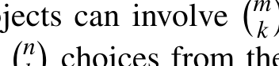{width=30%}

[]{#eq-15-024}

种从第一个 FOpGroup 中选择算符的方式，以及从第二个 FOpGroup 中选择算符的方式，每次选择各有 k! 种组合。这得到的简并度为
n
乘以 k!。

```python
def _contract_fgroup_fgroup(fgroup1: FOpGroup , fgroup2: FOpGroup) -> List[
    String]:
    degen1 = len(fgroup1)
    degen2 = len(fgroup2)
    if not commutable(fgroup1[0] , fgroup2[0]):
        for k in range (1 , min(degen1 , degen2)+1):
            deltas = [Delta([x1 , x2])
                    for x1 ,x 2 in zip (reversed(fgroup1[:k]), fgroup2[:k])]
            factor = (math.comb(degen1 ,k ) * math.comb(degen2 ,k )
                      * math.factorial(k) * ( -1)**((degen1 -k)*degen2))
            yield _fgroup2str(fgroup2[k:] , factor , deltas , fgroup1[k:])
```

```text
    yield String([fgroup2] ,( -1)**(degen1*degen2), remaining=[fgroup1])
```
在 FieldOperator 和 FOpGroup 的四个收缩函数基础上，我们可以实现 _contract_fop_string 函数。

```python
def _contract_fop_string(fop: Union[FieldOperator , FOpGroup] , string:
    String) -> List[String]:
    operators = string.operators
    remaining = string.remaining
    factor = string.factor
    deltas = string.deltas
    if len (operators) == 0:
        yield String(operators , factor , deltas , [fop]+remaining)
        return
    op = operators[0]
    match ( isinstance(fop , FOpGroup), isinstance(op , FOpGroup)):
        case (True , True): fcontract = _contract_fgroup_fgroup
        case (True , False): fcontract = _contract_fgroup_fop
        case (False , True): fcontract = _contract_fop_fgroup
        case (False , False): fcontract = _contract_fop_fop
    for s in fcontract(fop , op):
        if not s.remaining:
            yield String(s.operators + operators[1:] , s.factor * factor , s.deltas + deltas , remaining)
        else:
            substring = String(operators[1:] , s.factor * factor , s.deltas + deltas , remaining)
            for r in _contract_fop_string(s.remaining[0] , substring):
                yield String(s.operators + r.operators , r.factor , r.deltas , r.remaining)
```
接下来构造哈密顿量（Hamiltonian）、Tˆ 算符和左矢投影算符时，我们也需要利用 FOpGroup 类纳入有关置换对称性的信息。需要注意的是，CCD 方程中的投影算符 μ 具有反对称的置换对称性，同样可以表示为反对称形式。

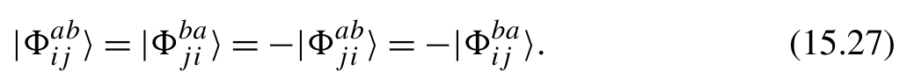{width=50%}

[]{#eq-15-025}

```python
def _make_operator(factor , indices , label=None , symmetric=False):
    n= len(indices)
    assert n%2= =0
    operators_c = [Creation(x) for x in indices[:n//2].upper()]
```

```python
    operators_a = [Annihilation(x) for x in indices[n//2:].upper()]
    if symmetric and n>2 :
        operators = [FOpGroup(operators_c), FOpGroup(operators_a[:: -1])]
        else:
        operators = operators_c + operators_a[:: -1]
    tensor = Tensor(operators_c + operators_a , label)
    return tensor , String(operators , factor)
def hamiltonian(n , factor):
    return _make_operator(factor , '**'*n ,f 'h{n}', symmetric=True)
def excitation(n):
    return _make_operator(.25 , 'V'*n+ 'O'*n ,f 'T{n}', symmetric=True)
def deexcitation(n):
    return _make_operator(.25 , 'O'*n+ 'V'*n ,f 'T{n}', symmetric=True)
def bra_projector(n):
    bra_tensor , bra = _make_operator(.25 , 'O'*n+ 'V'*n , symmetric=True)
    return bra_tensor.indices[:: -1] , bra
```
运行考量对称性的符号程序后，能够得到紧凑的符号解析式；结果严密保留并正确处理了哈密顿量与 Tˆ 的置换对称性。

```text
E+ =1 . 0 * einsum("ii ->", h1_oo)
E+ =0 . 5 * einsum("ijij ->", h2_oooo)
E += 0.25 * einsum("jiab ,abji ->", h2_oovv , t2)
F2 += 0.25 * einsum("abji ->baij", h2_vvoo)
F2 += -0.5 * einsum("ac ,cbji ->abij", h1_vv , t2)
F2 += 0.5 * einsum("ki ,abjk ->baji", h1_oo , t2)
F2 += -1.0 * einsum("kaic ,cbjk ->abji", h2_ovov , t2)
F2 += 0.5 * einsum("akkc ,cbji ->abij", h2_voov , t2)
F2 += 0.125 * einsum("abcd ,cdji ->baij", h2_vvvv , t2)
F2 += -0.5 * einsum("klli ,abjk ->baji", h2_oooo , t2)
F2 += 0.125 * einsum("lkji ,ablk ->baij", h2_oooo , t2)
F2 += 0.5 * einsum("lkcd ,dail ,cbjk ->abji", h2_oovv ,t 2 ,t 2 )
F2 += -0.125 * einsum("lkcd ,dalk ,cbji ->abij", h2_oovv ,t 2 , t2)
F2 += -0.125 * einsum("lkcd ,daji ,cblk ->abij", h2_oovv ,t 2 , t2)
F2 += -0.125 * einsum("lkcd ,cdil ,abjk ->baji", h2_oovv ,t 2 , t2)
F2 += 0.03125 * einsum("lkcd ,cdji ,ablk ->baij", h2_oovv ,t 2 , t2)
F2 += -0.125 * einsum("lkcd ,abil ,cdjk ->baji", h2_oovv ,t 2 , t2)
F2 += 0.03125 * einsum("lkcd ,ablk ,cdji ->baij", h2_oovv ,t 2 , t2)
```
由于我们预先假定左矢投影算符（bra projectors）具有反对称性，这意味着在实际 CCD 程序中使用 F2 张量前，须先行对其施加反对称化。

```text
F2 = F2 - F2.transpose(0 ,1 ,3 ,2)
F2 = F2 - F2.transpose(1 ,0 ,2 ,3)
```
此外，尽管推导中未采用任何耦合簇（coupled cluster，CC）图解法来参数化正规序哈密顿量（normal-ordered Hamiltonian），结果中仍能清晰辨认其结构。利用双电子张量的反对称性，可在下方代码段中识别出 Fock 矩阵：

```text
F2 += -0.5 * einsum("ac ,cbji ->abij", h1_vv , t2)
F2 += 0.5 * einsum("akkc ,cbji ->abij", h2_voov , t2)
F2 += 0.5 * einsum("ki ,abjk ->baji", h1_oo , t2)
F2 += -0.5 * einsum("klli ,abjk ->baji", h2_oooo , t2)
```
在上述输出中，仍可观察到部分重复的张量收缩项，这源于多重 Tˆ 激发算符之间的置换对称性。通过重新排列 t2 张量指标并合并同类项，便可完全复现 CCD 方程 (15.10)。虽然机制更加复杂，不同 t2 串间的对称性同样可循相似逻辑系统处理。本书对此不再展开。
我们可以扩展这个符号程序，使其适用于其他量子化学方法的形式体系。

- 使用自旋求迹激发算符（spin-traced excitation operators）定义哈密顿量

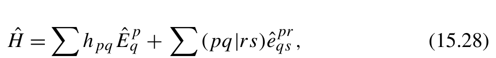{width=48%}

**公式 (15.28)**[]{#eq-15-026}

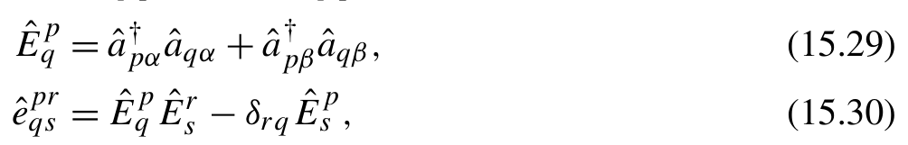{width=49%}

**公式 (15.29)(15.30)**[]{#eq-15-027}

并添加自旋求迹激发算符的对易子规则

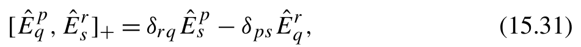{width=46%}

[]{#eq-15-028}

这个符号程序就可以适用于无自旋CC理论（spin-free CC theory）。

- 编写一个 on_MCSCF_reference 函数，以支持多组态自洽场（Multi-Configuration Self-Consistent Field，MCSCF）波函数参考态，并相应地完善收缩规则，便能将符号程序扩展到多参考态 CC 理论（multireference CC theory）。
- 哈密顿算符（Hamiltonian operator）可以作为微扰算符递归地作用于参考态，从而得到用于多体微扰方法（many-body perturbation methods）的符号程序。
- 更新第15.5.1节中的excitation函数，以参数化T − ˆT

有效哈密顿量（effective Hamiltonian）

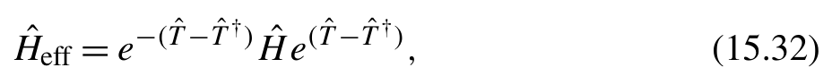{width=45%}

[]{#eq-15-029}

就可以利用符号代码推导幺正耦合簇展开（unitary coupled cluster expansions）。

## 小结

本章系统探讨了开发并优化耦合簇程序的各种工程技术。耦合簇程序面临的主要瓶颈在于磁盘读取积分张量耗费的时间，这通常在整体运行时间中占据支配地位。数据预取（data prefetching）是隐藏磁盘 I/O 开销的行之有效的策略。实施数据预取时，必须剖析代码中的 I/O 行为并在合适位置植入异步加载语句，以便在后台提前读取数据。我们引入即时编译（Just-in-Time，JIT）技术来自动化该流程。在识别出适合预取的 I/O 操作后，JIT 编译器创建数据加载守护线程在后台持续读入数据；随后动态重写源代码，使其直接消费预取好的数据。为严格控制内存用量，预取数据保存在容量固定的缓存字典中。在实现该 JIT 编译器时，我们综合运用了代码生成、异步计算以及互斥锁和条件变量等高阶并发技术。
此外，我们探讨了使用符号编程推导耦合簇方程的方法，并提供了开发符号程序的详细教程。主要步骤包括表示基础算符元素、实现这些元素的对易子规则，以及使用 Hartree-Fock 参考态对输出求值。符号程序的输出包含许多冗余项。考虑耦合簇理论中的置换对称性（permutation symmetry），便可以合并并简化这些冗余项。我们考虑了每个张量内部的置换对称性，得到的结果与图解理论推导出的结果完全一致。

## 参考文献

[1] Shavitt, R.J. Bartlett, Many-Body Methods in Chemistry and Physics: MBPT and Coupled-Cluster Theory, Cambridge Molecular Science, Cambridge University Press, 2009.
[2] Crawford, H.F. Schaefer III, An Introduction to Coupled Cluster Theory for Computational Chemists, John Wiley & Sons, Ltd, 2000, Ch. 2, pp. 33–136, https://onlinelibrary.wiley.com/doi/pdf/10.1002/9780470125915.ch2, https:// doi.org/10.1002/9780470125915.ch2, https://onlinelibrary.wiley.com/doi/abs/10.1002/ 9780470125915.ch2.
[3] PySCF Developers, Quantum chemistry with python, https://pyscf.org/, 2024. CHAPTER By to for = (15.32 I. T.D. The
[4] Purvis, D. George, R.J. Bartlett, A full coupled-cluster singles and doubles model: the inclusion of disconnected triples, Journal of Chemical Physics 76 (4) (1982) 1910–1918, https://doi.org/10.1063/1.443164, https://pubs.aip.org/aip/jcp/article-pdf/76/ 4/1910/18935003/1910_1_online.pdf.
[5] Scuseria, C.L. Janssen, Henry F. Schaefer III, An efficient reformulation of the closed-shell coupled cluster single and double excitation (CCSD) equations, Journal of Chemical Physics 89 (12) (1988) 7382–7387, https://doi.org/10.1063/1.455269, https:// pubs.aip.org/aip/jcp/article-pdf/89/12/7382/18973922/7382_1_online.pdf.
[6] Bartlett, G.D. Purvis, Many-body perturbation theory, coupled-pair many-electron theory, and the importance of quadruple excitations for the correlation problem, Inter- national Journal of Quantum Chemistry 14 (5) (1978) 561–581, https://doi.org/10.1002/ qua.560140504, https://onlinelibrary.wiley.com/doi/pdf/10.1002/qua.560140504, https:// onlinelibrary.wiley.com/doi/abs/10.1002/qua.560140504.
[7] Baumgartner, A. Auer, D. Bernholdt, A. Bibireata, V. Choppella, D. Cociorva, X. Gao, R. Harrison, S. Hirata, S. Krishnamoorthy, S. Krishnan, C. chung Lam, Q. Lu, M. Nooijen, R. Pitzer, J. Ramanujam, P. Sadayappan, A. Sibiryakov, Synthesis of high-performance parallel programs for a class of ab initio quantum chemistry models, Proceedings of the IEEE 93 (2) (2005) 276–292, https://doi.org/10.1109/JPROC.2004.840311. 673 I. G.E. R.J. G.
